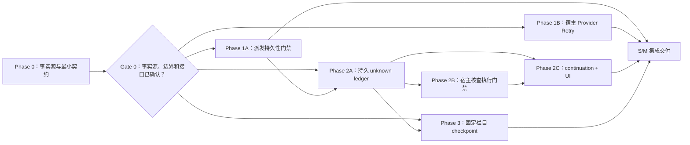

# Agent 长程任务稳定性改进方案

> 日期：2026-10-15
> 文档性质：当前实现分析与分阶段改造方案；首批范围聚焦开发代价可控的 S/M 项，不改运行时代码。
> 分析基线：本地 `main`，HEAD `8c0d2a89`；该分支比 `origin/main` 超前 73 个提交。
> 目标：减少可恢复故障造成的整轮失败，让 Agent 在长任务、上下文压缩和进程中断后能安全地继续工作。

## 1. 执行摘要

当前实现已经具备规范 History、工具调用派发/结算记录、provider 恢复接口、上下文压缩和 checkpoint continuation。主要缺口不是“完全没有恢复”，而是恢复覆盖范围和恢复入口不匹配：

1. Pi AI adapter 关闭自己的内部重试是合理的；真正缺口在宿主恢复策略没有覆盖常见的限流、网络瞬断和服务端暂时性错误。
2. `tool-call-started` 没有结算记录时，系统拒绝普通 checkpoint 续跑是为了不盲目重放副作用。但当前“继续”入口没有把用户送进核查流程，往往只返回“无法继续”；用户改为从头重试又可能重复副作用。这是恢复产品和协议缺口，不应靠放宽安全检查解决。
3. 关键 Session JSONL 投影失败会 fail-closed。若相同事实已在规范 History 中持久化，投影故障不应必然终止当前任务；若规范事实未持久化，则必须继续阻止派发。
4. 长上下文 checkpoint 摘要由截断的 user/assistant 文本组成，未结构化保留工具结果与当前任务状态。被压缩历史可查询，但恢复是否完整依赖模型主动发现并回查。

**首批决策：保留“不可盲目重放未知副作用”和“规范历史先于执行”的安全原则；验证并补齐副作用执行前的持久化保证；将 provider 可重试错误交给宿主统一、有界的预算策略处理；让 unknown 状态跨 continuation 和重启持久继承；用户点击普通“继续”后，助手自动尝试宿主审核且当前可用的安全只读核查，不再要求用户确认是否开始核查；只有查明不了、没有可用安全核查能力，或下一步确需授权/承担风险时才请求用户决定；核查模式由宿主强制限制为只读；用固定结构改善压缩 checkpoint。** 进程重启后不自动续跑，自动核查只由用户明确点击“继续”触发。首批不做全量 projection outbox、自动第三方状态核查框架或新 goal-round 产品。所有阶段均不承诺对任意第三方工具实现 exactly-once。

本文的 **S/M/L** 是相对当前实现的工作量分级：S 为局部行为/提示词调整且无持久格式迁移；M 为跨运行时状态、IPC/UI 或事件契约的改造；L 为存储投影架构、外部 adapter 能力或新的长期任务产品机制。阶段 0 先核实既有持久化不变量，若已有实现满足要求，应保留并补边界验证，不重复建设。

## 2. 当前实现基线与已确认问题

### 2.1 模型请求恢复范围过窄

- Pi AI adapter 向 Pi AI 传入 `maxRetries: 0`，由上层统一管理请求尝试次数。这是正确的职责边界，应保留。[`packages/agent-provider-pi-ai/src/index.ts:111`](../../packages/agent-provider-pi-ai/src/index.ts)
- SDK 在 provider 流错误后调用 `recoverProviderAttempt`，并限制同一个 model request 最多额外尝试一次。[`packages/agent-sdk/src/turn.ts:1233`](../../packages/agent-sdk/src/turn.ts)
- 宿主恢复策略覆盖 effort 参数不兼容、流空闲超时和上下文溢出；普通 429 等错误返回无恢复动作。[`electron/runtime/agentSdkProviderRecovery.ts:26`](../../electron/runtime/agentSdkProviderRecovery.ts)
- 对 429 不重试已有显式测试，因此这是当前策略，不是 adapter 隐式行为。[`electron/runtime/agentSdkProviderRecovery.test.ts:89`](../../electron/runtime/agentSdkProviderRecovery.test.ts)

**影响：** 瞬时服务故障会直接变成 Invocation 失败，用户必须重试/继续。

### 2.2 未结算派发没有可用的核查型续跑

- continuation 校验发现 `tool-call-started` 未对应完成事件时，抛出 `UNKNOWN_SIDE_EFFECT`。[`electron/runtime/agentContinuation.ts:79`](../../electron/runtime/agentContinuation.ts)
- IPC 捕获该错误并返回拒绝；renderer 只展示通用“无法继续”提示。[`electron/ipc/agentProtocolIpc.ts:165`](../../electron/ipc/agentProtocolIpc.ts) [`src/renderer/components/Chat/ChatView.tsx:699`](../../src/renderer/components/Chat/ChatView.tsx)
- 这能避免旧工具调用被机械重放，但用户没有确认执行状态的手段。普通“从头重试”也不能证明之前没有产生副作用。

**影响：** 系统把真实的不确定性留给用户，却没有提供可操作的核查路径；长任务在恰好最需要恢复时形成死胡同。

### 2.3 JSONL 投影故障与执行链耦合

- Hosted 桌面链路启用 `failClosedCriticalEvents: true`。[`electron/claudeStreamHandlers.ts:533`](../../electron/claudeStreamHandlers.ts)
- 非 chunk 事件通过 `appendCritical` 写入；失败时投影器重新抛错。[`electron/runtime/agentSdkSessionEventProjection.ts:26`](../../electron/runtime/agentSdkSessionEventProjection.ts)

**影响：** 关键投影写入故障可以中断当前执行。必须先核清规范 SQLite History 与 JSONL 各自承载的事实，再确定哪些故障能降级；不得简单地把所有关键事件改成 best-effort。

### 2.4 压缩 checkpoint 没有可靠表达长任务状态

- turn-boundary checkpoint 通过拼接旧 user 内容作为 `task`、拼接旧 assistant 内容作为 `decisions`，各截取前 1200 字符；工具消息不参与这两个字段。[`electron/claudeStreamHandlers.ts:585`](../../electron/claudeStreamHandlers.ts)
- checkpoint 提醒模型需要时使用 `history.read`，所以原始事实仍有回查路径，但这依赖模型主动发现缺口。

**影响：** 压缩后模型可能缺少已完成动作、工具返回、当前阻塞和下一步等状态。摘要不能作为执行结果真相，也不能让模型仅凭摘要推断未知副作用已经完成。

## 3. 目标与设计原则

### 3.1 目标

1. 识别可安全重试的 provider 瞬时故障，按有界策略退避重试，并在 History/用量中完整记录每次 attempt。
2. 用户请求“继续”时，即使存在结果未知的工具派发，也能启动安全核查；核查模式由宿主强制限制为已验证只读操作，新 tool-call ID 不能绕过门禁，也不把核查失败伪装成成功。
3. 首批以规范 History 作为恢复事实的依据；只有在事件职责和重建边界得到验证后，才把投影补修纳入后续范围。安全必需的规范事实未提交时仍 fail-closed。
4. 压缩摘要保留任务目标、已确认完成项、执行中/待办、决策、阻塞和未知副作用；首批固定栏目保留稳定 unresolved effect ID，完整逐事实证据引用留给后续类型化 checkpoint。
5. 取消、撤权、审批、安全拒绝、规范 History 写入不确定等硬边界继续优先于自动恢复。

### 3.2 首批范围与工作量

| 等级 | 改进项 | 预期价值 | 本轮处理 |
|---|---|---|---|
| S/M | 验证/补齐工具正文执行前的规范派发记录持久化屏障 | 崩溃恢复能可靠区分“未开始”与“派发后结果未知” | Phase 1A 前置门禁；若现有事务已满足则只补故障边界验证 |
| M | 宿主统一的 provider 瞬时错误分类、有限重试和 attempt 记录 | 瞬时 429、5xx、网络问题不再直接终止 Invocation | Phase 1B；attempt 预算由宿主全局策略持有，与 1A 可并行 |
| M | 跨 continuation 持久继承的 unknown effect ledger | A→B→C 续跑、崩溃和重启后仍能找到每个未解决操作 | Phase 2A；依赖 Phase 1A 的派发事实 |
| S/M | 宿主强制的核查执行门禁 | 核查期间只允许明确审核为只读的操作；新调用 ID 和通用写工具不能绕过 | Phase 2B；依赖 2A 的有效 unknown 集合；默认拒绝未审核能力 |
| M | 核查恢复 UI 与按 unknown 记录绑定的显式用户决定 | 普通“继续”自动启动可用的安全只读核查；只有无法查明或下一步需要授权/承担风险时才请求决定；标准安全门仍有效 | Phase 2C；依赖 2A/2B，不依赖 Provider Retry |
| S/M | 固定栏目型任务 checkpoint，并突出工具 outcome / unresolved effect ID | 减少长历史压缩后丢失进度 | Phase 3；模板可先设计，unknown 状态集成验收依赖 Phase 2A |
| L | projection outbox、跨存储补修与自动 backlog 管理 | 规范事实和可重建投影的故障隔离 | 暂缓到事件职责映射证明必要时 |
| L | 各工具自动 reconcile / 幂等键 adapter 与类型化 `TaskCheckpoint` | 自动化外部状态核查和逐事实来源追溯 | 暂缓；按具体工具/外部系统单独交付 |
| L | 持久 goal 状态与自动多轮 driver | 无人值守的跨轮次目标推进 | 暂缓；属于新增产品机制，且恢复后自动续跑需要独立授权策略 |

### 3.3 非目标

- 不恢复 Pi AI 内部重试，不允许 adapter 隐藏请求次数。
- 不对通用工具在 dispatch 后的未知结果自动重发原调用。
- 不以工具名称、描述或 JSON Schema 猜测副作用语义。
- 不承诺任意第三方 API 的 exactly-once；没有幂等键或状态核查能力时，远端效果可能无法由客户端判定。
- 不把模型上下文摘要当作规范执行记录，不因摘要文本声称“完成”就认定工具成功。
- 不通过放宽授权、审批或撤权机制换取续跑率。

## 4. 目标恢复架构

### 4.1 Provider 恢复策略归宿主统一管理

将 provider 错误归一化为稳定、脱敏的类别，再由**宿主全局恢复策略**决定是否重试。各 provider adapter 只提供传输事实（稳定错误类别、HTTP 状态、request ID、`Retry-After`），不持有各自的 attempt 数或退避策略：

| 类别 | 建议处理 | 示例 |
|---|---|---|
| 瞬时可重试 | 同一路由、有界退避后重试 | 408、429、部分 409、5xx、连接重置、短暂 DNS/连接错误 |
| 输入/配置永久错误 | 不重试，返回明确错误 | 无效请求、模型/参数不支持、无效 schema |
| 凭据/授权错误 | 不重试，指向修复凭据或权限 | 401、403 |
| 特殊兼容恢复 | 继续使用现有专用分支 | effort/output_config 不兼容 |
| 上下文溢出 | 继续使用已验证的上下文恢复分支 | context overflow / silent overflow |
| 用户取消/Turn 超时 | 立即停止，不重试 | abort signal、生命周期超时 |
| 响应流格式错误 | 默认不重试；只有被证明为传输截断等瞬时类别才允许恢复 | 非法事件序列、重复 tool-call ID |

建议初始策略为**最多 3 次总 attempt（含首次）**，指数退避加 full jitter，基础延迟 500ms、单次上限 8s，并尊重 `Retry-After`。SDK 当前“最多额外尝试一次”的限制也必须改为读取宿主给出的剩余 attempt 预算，避免策略配置与 SDK 上限冲突。总恢复等待须受 Turn 预算约束；服务端给出的等待时间超过剩余预算时，及时失败并明确告知可重试时间，不在主进程长时间无界等待。先采用同一路由重试；跨 provider/model failover 单独设计，因为能力、schema 与上下文窗口可能不同。

429、5xx 等状态码也要结合 provider 错误码分类；仅在 provider 契约明确表示可恢复冲突时重试 409，不能按 HTTP 状态码做无差别重试。attempt 上限属于宿主统一配置，不复制 DeepSeek Harness 的 per-provider `retryPolicy` 或无上限 `always` 模式。

每次恢复事件应记录 `requestId`、model turn、attempt、稳定错误类别、HTTP 状态类别、backoff、是否命中 `Retry-After`、结果（scheduled/succeeded/exhausted/cancelled）与用量归因。不得记录 API key、原始消息正文或未经脱敏的 provider body。

SDK 必须在等待前后检查 abort；重试前确保上一 attempt 没有提交为已接受的模型响应。若 provider 已产生临时 streaming chunk，恢复时必须按现有 preview/reconcile 协议回滚或明确标注 attempt discarded，避免用户看到重复/残留输出。每个 attempt 的 usage 继续独立落账，最终聚合值不得漏记被丢弃的 attempt。

### 4.2 未知副作用进入“核查恢复”，而非盲目续跑或直接拒绝

保留 `UNKNOWN_SIDE_EFFECT` 对旧调用的保护，但把“核查模式”定义为宿主执行状态，而不是给模型的一条提示。首批无需建设通用第三方自动 reconciliation 平台，但必须落实以下契约：

1. **稳定身份：** 每条未知副作用使用来源 Invocation 与原 `toolCallId` 组成稳定身份（必要时加 session 范围）。恢复记录保留工具身份、目标摘要、输入摘要/hash、派发时间和来源事件序号；敏感输入遵守现有权限和脱敏规则。新 Invocation 或新 `toolCallId` 不会创建一个语义上“全新”的未知事项。
2. **原子继承：** 创建 continuation 时，计算来源链的有效 unresolved 集合：继承的未解决记录，加上本 Invocation 新产生的 unknown，减去有可信结算证据的记录；按稳定身份去重。将该集合写入目标 `invocation-context-committed`，并与 continuation row 在同一 SQLite 事务提交。后续 continuation 从其规范上下文继承该集合，不能只扫描目标 Invocation 自己的 `tool-call-started/finished`。进程重启后也从规范记录恢复；无法完整读取时 fail-closed。
3. **默认核查门禁与触发：** 目标 Invocation 带有 unresolved 集合时进入 `verify-only`。用户点击普通“继续”会创建恢复 Invocation 并进入自动核查阶段：恢复协调器按 unknown 记录枚举当前可用、与其相关、代码侧明确审核为只读且通过现有授权门禁的 capability/operation；助手逐项尝试适用检查，不要求用户二次确认是否开始。若有适用检查尚未尝试，不能只凭模型文字自称“无法核查”或跳过检查；宿主应保持核查状态并把检查任务交回助手，直到每项检查已尝试、失败/超时、被取消或被标记为无适用能力。进程重启后不自动续跑，只有用户再次明确点击“继续”才触发。工具名、描述、JSON Schema 和模型自称“只读”都不能作为安全证明；未审核操作、通用 shell、未知 MCP 操作及任何写能力默认拒绝派发。这个 gate 必须额外于既有 SafetyGate 执行；普通 capability 授权不解除恢复限制。没有安全只读能力时不假装正在核查，应直接向用户说明。
4. **核查后的用户决定：** 自动核查期间，UI 展示正在检查的具体操作和进度，并提供停止入口；宿主限制检查次数/时限，遵从取消，不得无限轮询。核查若产生足以证明状态的可信规范结算证据，按清除规则处理后再继续任务。若结果确认原操作未执行，普通“继续”仍不授权重新执行；下一步照常经过安全授权。若无法查明、核查失败/超时、没有安全核查能力，或后续动作确需额外授权/承担重复风险，才展示 unknown 来源、目标、已做检查、剩余不确定性并请求用户决定。用户可针对当前目标 Invocation 中每条 unresolved unknown 选择“承担风险继续本轮”；决定先写入 canonical History，仅对指定目标及所绑定的 unknown 有效。只有当前 unresolved 集合中的每条记录都已由用户针对本 Invocation 明确接受风险时，才解除该 Invocation 的 verify-only，后续调用仍须通过现有 SafetyGate。用户也可只批准一个具体重试，此时还要绑定拟执行工具和规范化输入摘要，并只消费一次；该决定、消费记录与匹配的 `tool-call-started` 必须在派发门禁的原子边界内关联。若进程在开始记录提交后崩溃，该次重试本身也成为新的 unknown，不能复用许可。不得因模型换用新 `toolCallId` 自动复用决定。普通“继续”、模型文本或旧 permit 不构成风险接受/重试许可。风险决定不清除 unknown，也不作为后续 continuation 的持久权限。
5. **清除规则：** 风险接受或重试只记录用户选择，不证明原操作未发生，也不清除 unknown；重试成功、无关工具成功、Invocation 正常结束/失败/取消、checkpoint 摘要都不能清除。只读核查成功本身也不能自动清除；只有其工具契约明确保证该证据足以判定原副作用状态，且指向同一稳定 unknown ID 的可信规范结算证据完成提交后，才能追加 resolution 并移出 unresolved 集合。普通 `tool-call-finished`、仍标为 `unknown-after-dispatch` 的结果和合成 transcript 结果都不算证据。后续经审核 resolver 可生成带证据 resolution。首批没有可信 verifier 时，该记录保持 unknown 并在后续恢复中继续显示；不伪造“已完成/未执行”。
6. **Transcript 与幂等：** 新 continuation 从最后一个完整 transcript 边界启动，不把未闭合旧 tool-call 原样塞进 provider transcript，也不重放旧调用。可向模型提供关联原 ID 的合成错误结果或结构化 `outcome-unknown` 上下文，但不得把它写成原工具的成功或普通失败。同一 continuation request ID 重投返回同一恢复记录和目标 Turn。

**后续 L 扩展：** 按工具逐个增加可信 `idempotent`、`reconcile`、`read-only-verifier` 能力合同，并以可审计证据追加结算事件。首批的只读 allowlist 仅覆盖宿主已审核的操作；不能证明只读的通用工具走用户决策路径，不因此建设通用自动 reconciliation 平台。

对无法核查的外部副作用，客户端不能消除客观不确定性。首批的保证是：系统不会把这种不确定性藏在模型上下文里，也不会因为新 ID、续跑、重启或普通完成事件而忘掉它。

### 4.3 分离规范事实持久化与 JSONL 投影

先对每类事件标注权威存储、执行前置条件和修复方式。首批按现有 canonical History / Session JSONL 机制保持 fail-closed，核实“副作用前规范事实已提交”的保证；只对已证明可从规范事实重建的 UI/诊断副本评估降级：

| 事实 | 权威来源 | 失败行为 |
|---|---|---|
| model response、tool started/finished、approval、Invocation terminal | canonical SQLite History（事件权威性待 Phase 0 验证） | 写入结果不确定时禁止依赖该事实继续派发；保持 fail-closed |
| Session transcript/message mirror | 事务边界与权威来源待 Phase 0 验证 | 无法证明提交边界前，不开始依赖该记录的后续 Turn |
| Session JSONL/UI/诊断投影 | 与规范事件的映射待 Phase 0 验证 | 首批不假设可重建；只有证明为副本后才评估延迟和补修 |

如果某安全必需字段当前只存在于 JSONL，继续 fail-closed。Phase 0 必须明确选定可作为恢复依据的事实源；若当前没有已证明的权威来源，应新增一个有范围、有验收的 S 级存储边界任务，作为 Phase 1A/Phase 2A 的前置条件，不能把它记成 L 类后继续推进依赖该事实的功能。只读 allowlist 可以先为空；没有经过代码审核的只读能力时，通过询问用户降级，不阻塞默认拒绝门禁本身。只有可由规范事实重建的非安全投影，其 outbox、幂等补写队列和 backlog 运维才属于 L 类。未证明权威性和事务边界前，不将 JSONL 写入改为 best-effort。取消、撤权或审批决议不能依赖“稍后可修复”来绕过执行前检查。

### 4.4 结构化、可追溯的任务 checkpoint

首批将当前截断拼接摘要改为固定栏目 checkpoint；checkpoint 本身不另增持久化 schema，但 Phase 2A 为保证 unknown 跨运行继承所需的规范事件/上下文字段不受此限制：

```text
目标与用户要求
已确认完成（附简短事实依据）
正在进行 / 待办
关键决策与约束
阻塞与下一步
未解决的工具副作用（originInvocationId + toolCallId、unknown 状态）
```

生成时优先从规范 History 的工具结果和当前运行状态抽取 outcome；摘要需要压缩的历史范围由现有 History 查询路径回查。不要仅凭 assistant 文本推断工具完成。此项先改善模型上下文可读性，不把自然语言 checkpoint 当成执行事实。

**后续 L 扩展：** 在事件 schema 与压缩器支持后，再引入版本化、类型化 checkpoint，例如：

```ts
type TaskCheckpoint = {
  schemaVersion: number
  goal: { text: string; sourceEventIds: string[] }
  completed: Array<{ item: string; evidenceEventIds: string[] }>
  inProgress: Array<{ item: string; toolCallId?: string; evidenceEventIds: string[] }>
  pending: Array<{ item: string; sourceEventIds: string[] }>
  decisions: Array<{ decision: string; evidenceEventIds: string[] }>
  blockers: Array<{ reasonCode: string; detail: string; sourceEventIds: string[] }>
  uncertainEffects: Array<{ originInvocationId: string; toolCallId: string; status: 'unknown'; sourceEventIds: string[] }>
}
```

History 仍是事实真源。checkpoint 应由结构化运行事实和有来源引用的摘要共同构成；工具结果按 `succeeded / known-failure / unknown-after-dispatch / not-dispatched` 表示，不能只从 assistant prose 推断。压缩器按 token 预算裁剪时优先保留当前目标、最近进度、未完成操作和未知副作用；每个被摘要替代的片段都能经 `history.read` 回查。稳定 unresolved ID 由 `originInvocationId + toolCallId` 构成，不能在压缩时降格成单独 toolCallId。若摘要生成或校验失败，保留最近完整消息并按现有 over-budget 行为处理，不写入无来源的“已完成”断言。

## 5. 分阶段实施计划

### Phase 0 Gate 0 实施记录（2026-10-15）

- **事实源 / durability：** `packages/agent-sdk/src/history.ts` 的 `InvocationHistoryWriter` 以单 invocation 序列化 append；Desktop Hosted 路径由 `electron/toolChatLoop.ts` 创建 writer，`packages/agent-sdk/src/turn.ts` 在 `toolExecution.execute(..., beforeDispatch)` 的 lease 回调中先 append `tool-call-started`，随后才进入工具正文。History append rejection 会中止该回调及 dispatch；因此本阶段确认已有屏障，Phase 1A 只补故障边界测试，不重复写屏障。History SQLite 的 append/投影职责见 `electron/runtime/sqliteAgentHistory.ts` 与 `electron/runtime/canonicalHistory.ts`；恢复事实依赖 canonical History，JSONL/session transcript 是独立副本/投影。
- **provider recovery 基线：** Pi AI adapter 的 `maxRetries: 0` 已固定；SDK `runAgentTurn` 仅允许 `recoverProviderAttempt` 决定一次恢复（attempt 1→2），记录 `provider-retry-scheduled` 和 `model-attempt-discarded`。宿主 `electron/runtime/agentSdkProviderRecovery.ts` 目前涵盖 idle timeout、context overflow、output_config 兼容，不涵盖 429/5xx/网络错误分类、Retry-After 或统一等待预算。Phase 1B 扩展宿主预算，保持 adapter 零重试及现有 overflow/兼容分支。
- **unknown 恢复基线：** `electron/runtime/agentContinuation.ts` 对未结算的 `tool-call-started` 返回 `UNKNOWN_SIDE_EFFECT`，拒绝普通 exact continuation；`electron/runtime/continuationSummary.ts` 能把单 invocation 事件归纳为 unknown，但没有稳定跨 invocation ledger。目标契约为稳定 ID=`originInvocationId + toolCallId`；continuation 请求幂等；继承集合与目标 `invocation-context-committed` 同事务落盘；普通工具结果、终态、模型文字及风险接受均不能结算 unknown。仅绑定相同 unknown ID 的可信 resolution 事件可以结算。
- **核查门禁 / UI：** 现有 SDK SafetyGate 在 dispatch 前授权，但没有 verify-only 第二门禁、审核只读 allowlist、结构化风险决定或恢复 IPC/UI 状态。默认 allowlist 为空；Phase 2B 通过统一宿主执行边界 fail-closed，并保留 SafetyGate。用户“继续”必须明确触发恢复；重启不自动续跑；风险决定按目标 Invocation 和 unknown 集合绑定，不能跨 continuation 继承。
- **checkpoint：** 当前 compaction 已能保存带来源的 checkpoint evidence，但尚未发现覆盖目标/进度/待办/约束/阻塞/下一步/完整 unresolved ID 的固定 prompt 栏目。Phase 3 沿用现有 compaction/history 回查机制，仅改摘要结构，不制造执行事实。
- **尚未观测：** provider retry exhaustion、unknown-after-dispatch 频率、continuation rejection 分布等指标未见可用埋点；它们不作为放行前置条件。
- **Gate 0 结论：** canonical History 和派发前持久化屏障已有明确代码路径及事务实现；只读 allowlist 为空是可交付安全默认值。无需先拆额外存储前置任务，可以进入 Phase 1A/1B 与 Phase 2A。

### Phase 0（S）：契约和故障基线

- 追踪实际 Hosted 路径中的 provider attempt、History append、JSONL projection、工具派发及 continuation 受理调用链。
- 定义 provider error taxonomy / attempt 预算、unknown effect 稳定身份与来源字段、canonical 存储位置、继承/去重/结算规则、与目标上下文同事务提交的边界、宿主只读 allowlist 的可信来源与默认拒绝行为、按 unknown ID 绑定的一次性用户决定、recovery state/IPC 和固定栏目 checkpoint。检查现有 `HistoryEvent`/schema version 是否需要迁移；工具恢复能力的通用合同与自动 reconcile 仍留给 L。
- 核对 continuation 校验、目标上下文创建、启动恢复和 SafetyGate/工具派发的全部消费者，重点对应 `electron/runtime/agentContinuation.ts` 的本地事件扫描/来源指针/启动恢复路径，以及 `packages/agent-sdk/src/safetyGate.ts` 和 `packages/agent-sdk/src/turn.ts` 的授权到执行路径；不要只在 continuation 创建时注入一次 prompt 文本。
- 盘点规范 History 与 Session JSONL 的事件职责，列明哪些事件必须在 dispatch 前持久化。
- 收集已有数据：按 error class 的 provider failure/retry/exhausted，`unknown-after-dispatch` 频率、continuation rejection reason、projection failure frequency、compaction 使用率。当前没有埋点的数据标为“未观测”，不为补齐基线而把新增监控设成首批交付的前置条件。
- **阶段交付 / Gate 0：** durability boundary 图、事件映射矩阵、provider 错误/attempt 契约、unknown ledger 与清除规则、恢复模式只读策略、风险决定绑定字段、recovery state/IPC 契约和 checkpoint 栏目；明确事实源与事务边界。Recovery state/IPC 契约需表达“用户点击继续后自动核查”的生命周期、检查器/进度/结果、预算/取消、无法核查与后续用户决定；明确重启后不自动续跑。若事实源或宿主强制默认拒绝的能力无法证明，先把缺口拆成有验收的前置任务，不得将其标记为 L 后放行依赖功能。经审核的只读 allowlist 为空是安全有效的默认值，不构成阻塞。Phase 0 不改变运行行为。

### Phase 1A（S）：派发持久性门禁

- 如果 Phase 0 发现副作用前缺少规范派发事实，先在工具正文执行前确保 History append/事务已提交；如果已有此保证，则只补 crash/failure boundary 覆盖。
- 若 Gate 0 判定当前规范事实源或事务边界不足，先实现已拆出的最小存储边界修复；完成前不得开始依赖该事实恢复的 Phase 2A/2B/2C。
- **通过条件：** 外部工具正文开始前，对应 `tool-call-started` 已在已确认的规范事实源持久化；持久化失败时工具正文不执行。已有实现满足时，以代码路径审阅和故障边界覆盖作为完成证明，不重复加写屏障。

### Phase 1B（M）：宿主级 Provider Retry

- 在宿主恢复策略加入瞬时错误分类与有界退避；保留 Pi AI `maxRetries: 0`。adapter 只规范化 provider 错误事实，不配置尝试次数。
- 将 SDK 单次恢复上限改为消费宿主的 attempt 预算；实现 `Retry-After`、abort/Turn 总等待预算、attempt usage 和 retry ledger；耗尽时返回稳定错误码和清晰 UI 状态。
- 只对未被接受的 provider response 重试；已有 output_config 与 context overflow 分支复用现有恢复，不产生重叠重试预算。
- **通过条件：** 429/503/连接断开后 mock provider 恢复时，同一 Invocation 成功且所有 attempt 被记录；认证/参数错误不重试；取消期间不继续重试；全局 attempt 预算生效；成功/失败 attempt usage 守恒。该工作只依赖 Gate 0 的错误与 attempt 契约，不依赖 Phase 1A。

### Phase 2A（M）：unknown ledger 的持久继承

- 在 canonical History 中为每项 unknown 固定来源身份；实现独立的数据层 helper，能在事务内把来源链的 unresolved 集合与新目标 `invocation-context-committed` 一起提交，并以稳定 ID 去重。helper 和 ledger rehydration 可通过直接构造 History fixture 验收，不等待恢复 UI 或专用入口。
- 扩展启动恢复和 lineage 读取 API，不依赖 target-only event scan 或 prompt 文本维持状态。此阶段交付持久化原语；将 `UNKNOWN_SIDE_EFFECT` 从普通 exact-resume validator 分流到新 continuation 的工作留在 Phase 2C，以消除互相等待。
- 风险决定与事实结算分别记录：用户接受风险/请求重试不能清除 unknown；只有可信证据才能清除。没有可信 verifier 时 unknown 保持打开。
- **通过条件：** A→B→C 连续恢复、B 核查前/后崩溃、B 普通工具成功/正常结束、压缩后继续等场景中，X 的来源身份和 unknown 状态始终存在且仅一条有效记录；复制 continuation 请求得到同一目标；不相关成功、模型声明和终止事件不清除 X。

### Phase 2B（S/M）：核查模式的宿主执行门禁

- Phase 2A 的 effective unresolved 集合非空时，宿主进入 `verify-only`；用户明确点击“继续”创建恢复 Invocation 后进入有界的自动核查阶段，助手自动调用适用于各 unknown 的、Gate 0 定义且代码侧审核为只读的检查能力，不为开始安全核查追加确认。宿主记录每项检查的已尝试/无适用能力/失败/超时/取消状态；有适用检查未尝试时，不允许模型仅靠文字跳过核查阶段。每次派发仍须通过现有 SafetyGate；宿主在工具执行端口之前、最终 dispatch lease 中重新读取规范 unresolved 集合与目标 Invocation 的风险决定，避免模型规划与实际派发之间状态过期。任何未审核工具或写操作都由宿主拒绝，不能依赖模型 prompt 或普通 SafetyGate 自动授权。门禁拒绝须记录为稳定的 `tool-call-not-dispatched` 原因并回传非终止工具结果，让 Agent 可转用审核过的只读路径或向用户询问；恢复模式对新 ID 仍持续生效。若 allowlist 为空或无可用能力，状态直接标记为“无法自动核查”，不展示虚假的检查中状态。
- 自动核查有明确的单项尝试数与总时限，并遵从用户取消；停止后保留 unresolved 状态。结果只有在工具契约明确其证据足以判定原操作状态、且与相同 unknown ID 绑定并写入可信规范 resolution 后才清除 unknown。确认原操作未执行也不自动授权写操作，仍经过普通安全门与所需授权。
- 有意解除限制时，必须为当前 unresolved 集合中的每条记录记录绑定 unknown ID 与目标 Invocation 的风险接受决定；只有全体记录均被明确接受后，才在该 Invocation 生命周期内解除 verify-only。单次重试可单独绑定工具名/规范化输入摘要并在 dispatch 时消费。新 unknown 加入集合后，若没有对应的风险决定，门禁立即恢复 verify-only。保留既有 SafetyGate 和授权检查。决定不被子 continuation 继承，unknown 本身仍保持打开，直到可信证据结算。
- 提供结构化 IPC 记录与校验风险决定；不接受任意聊天文本作为授权。Phase 2C 的 UI 文案和决定选项由 UI 展示；没有安全只读工具时，后端状态必须能让 UI 说明原因。普通“继续”只触发自动安全核查，不隐含解除核查限制或重试许可。
- **通过条件：** 无风险决定时，新 toolCallId 重提同一写操作、借通用 shell/MCP 做写入式“核查”、以及未审核工具变体均在工具正文前被阻止，并以 not-dispatched 回灌；所有执行路径（MCP、shell、browser/driver 等）均经过同一宿主门禁；只读 allowlist 可运行；只有用户点击“继续”才创建恢复并触发核查；存在适用检查时一次点击自动尝试且不能被模型文字跳过，不生成风险决定/二次确认；无可用检查时不显示虚假的检查中状态；核查有界且支持取消；仅接受部分 unresolved 记录时门禁仍开启；新 unknown 进入集合后立即重新锁定；全体风险接受只对目标 Invocation 生效，重启续跑不继承；单次重试决定只放行完全匹配的一次 dispatch，换参数/换工具/重放均被拒；普通 SafetyGate 仍须通过。

### Phase 2C（M）：unknown continuation 与恢复 UI

- 为 `UNKNOWN_SIDE_EFFECT` 增加专用 recovery continuation 分支：从规范历史恢复可被 provider 接受的 transcript，调用 Phase 2A 的事务 helper 新建 Invocation 并提供完整继承 unknown 列表；不得把未闭合的旧 assistant tool-call 原样发送或重放。必要时只在 provider-facing transcript 合成关联该来源 ID 的 unknown 错误结果，canonical History 不把它当作原工具结算。普通 exact-resume 的严格校验保持不变。
- 普通“继续”只作为用户对本次恢复的明确触发：点击后新建 continuation 并进入有界自动核查阶段，助手逐项执行宿主允许、适用于 unknown 且现有授权有效的安全只读核查，不再询问“是否开始检查”。有适用检查未尝试时不能仅凭模型自述跳过；检查均已尝试、失败/超时/取消或无适用能力后，才可转入展示结果与下一步决定。进程重启后仍等待用户点击，不自动恢复运行。
- 核查时 UI 显示“正在核查”及具体操作/进度，并提供停止入口；该状态只能在真实只读检查已派发后出现。空 allowlist、无可用检查器或立即失败时，直接说明“无法自动核查”及原因。核查有界、可取消，重复点击同一恢复请求幂等。
- 核查结论明确后，可信规范证据可结算对应 unknown；若确认未执行，继续执行原动作仍需正常授权。若结果无法查明、检查失败/超时、无安全检查能力，或后续操作确需授权/承担风险，才向用户展示来源、目标、已完成的检查和剩余不确定性，并提供停止、针对某项操作的一次性重试、或对当前全部 unknown 承担本轮风险等结构化选项。风险决定绑定到具体 unknown 和目标 Invocation；普通“继续”不生成风险接受决定，也不接受自由文本替代结构化决定。
- 后端状态机、持久 ledger 和安全 gate 完成后，UI 可依冻结的 recovery state/IPC 契约独立开发；安全门禁未集成前不得对用户开放核查续跑。
- **通过条件：** dispatch 后崩溃且副作用已发生/未发生/无法确认时，继承状态均正确；provider transcript 合法且不重放旧调用；用户一次点击“继续”即自动启动可用安全只读核查，不出现第二次确认或预先承担风险；重启后未点击前不自动恢复；正在核查状态与真实派发一致且可取消；无法查明/检查不可用时显示已查内容和剩余 unknown，再请求具体决定；确认未执行不绕过标准授权；UI 风险决定绑定 unknown 项；撤权、取消和审批仍优先阻止执行。

### Phase 3（S/M）：固定栏目任务 checkpoint

- 更新现有 checkpoint 生成指令和上下文装配，保留目标、完成项、待办/进行中、决策/约束、阻塞/下一步和完整 unresolved effect ID 集合。模板可在 Gate 0 后开发；unknown 状态消费 Phase 2A 的 ledger，不由当前 Invocation 局部事件或模型文本重建。
- outcome 状态以规范 History 为准；固定栏目只提高上下文组织，不创建执行事实。
- **通过条件：** 超预算、多轮工具、分阶段执行与跨 continuation 样例中摘要含有当前目标、下一步和所有 unresolved effect ID；被压缩历史仍能经现有 `history.read` 查询；摘要生成失败时沿用现有 over-budget 行为；checkpoint 和 Invocation 完成均不清除 unknown ledger。

### 首批阶段实施记录（2026-10-16）

| 阶段 | 状态 | 实施与验证 |
|---|---|---|
| Phase 0 / Gate 0 | 完成 | 上述 Gate 0 实施记录确认 canonical SQLite History 为恢复依据，JSONL/transcript 为投影，并记录 provider attempt 与核查边界。 |
| Phase 1A | 完成 | 执行前 `tool-call-started` 持久化屏障已在 `packages/agent-sdk/src/turn.ts` 与 `toolExecutionPort` 的故障边界测试中覆盖；本阶段没有重复建设已有屏障。 |
| Phase 1B | 完成 | 宿主归类 429、5xx 和网络瞬时错误，解析并限制 `Retry-After`，最多 3 次尝试；保留 adapter 零重试、output_config 与上下文溢出恢复；取消等待可中止，耗尽返回稳定码。 |
| Phase 2A | 完成 | continuation context 持久继承完整 unresolved effect 身份；session History 查询从所有 invocation lineage 恢复 unresolved 集合和工具 outcome；继续新建 invocation 时源记录不被结算或修改。 |
| Phase 2B | 完成 | 最终 dispatch lease 内再次读取规范状态；默认只读 allowlist 为空，因此标记无法自动核查并拒绝未审核调用。风险决定只绑定当前完整 unknown 集合和目标 invocation；单次重试许可绑定工具名/输入摘要，并与匹配的 `tool-call-started` 在同一 History 批次消费。普通 SafetyGate 仍在其前执行。 |
| Phase 2C | 完成 | unknown checkpoint 走独立 transcript 恢复分支，provider transcript 合成未知结果但不伪造规范结算；继续 IPC/UI 显示核查不可用状态，并提供结构化风险接受或一次性重试选项。普通 exact continuation 校验保持严格。 |
| Phase 3 | 完成 | 固定栏目摘要新增目标、完成项、决定、约束、待办、阻塞和下一步；unresolved ID 与最近工具 outcome 由 canonical History 查询结果在主机侧装入 checkpoint，模型不能生成这些执行事实。 |

**本地验证：** 定向 Vitest 覆盖恢复、派发、History 和 compaction；电子主进程 TypeScript、渲染进程 TypeScript、i18n 类型生成与 `i18n:check` 均通过。最终全量 `npm test` 执行结果为 1061 passed、1 skipped、160 failed（1078 个文件；10037 passed、111 skipped、160 failed）。定向新增/受影响套件通过；全量失败包含未修改的 `src/shared/policy/defaultRules.contract.test.ts` 快照与多组现有 Hosted/IM 测试的 `LLM_KEY_ACCESS_DENIED`/运行时 fixture 失败，故全仓基线验收未通过，不能据此声称全量绿灯。

**验收边界：** `npm run build:electron:incremental` 在编译前被 `check:pi-ai-runtime-closure` 阻止：当前安装的 Pi AI 缺少 `api/anthropic-messages.js`、`utils/transcript.js` 且运行时闭包清单为空；独立 Electron TypeScript 检查通过。provider 重试使用 mock provider；尚未通过真实 provider 网络故障、真实 MCP/IM 或进程硬崩溃做端到端演练。只读 checker allowlist 明确保持为空，因此首批产品行为是显式告知无法自动核查并要求用户决定，不显示虚假的核查进度。

### 后续 L：架构扩展（不纳入首批 S/M 交付）

- 在事件职责映射证明收益后，引入 canonical History → JSONL/UI projection 的事务 outbox、幂等修复队列和 backlog 观测。
- 为具体内置工具/adapter 实现自动 reconcile、稳定 operation ID、只读 verifier 和证据结算事件；通用工具仍默认为 manual/unknown。
- 把固定栏目 checkpoint 演进为带 schemaVersion、逐事实 event ID 和类型化 outcome 的 `TaskCheckpoint`。
- 若产品需要无人值守跨轮次任务，再设计持久 goal、轮次上限、阻塞判定、恢复后显式授权与 driver 生命周期。
- **纳入条件：** Phase 0 证明当前存储边界存在真实缺口，或 S/M 阶段的运行数据证明相应 L 项能解决高频阻断；每个 L 项单独立项和验收，不阻塞首批稳定性改进。

## 6. 依赖 DAG 与并行边界



**DAG 检查结论：** 当前方案没有逻辑依赖环。Phase 1B 只依赖 Gate 0 的 provider 错误/attempt 契约，可与 Phase 1A 并行；未知结果支路按“1A 持久派发事实 → 2A ledger 数据原语 → 2B 消费 ledger 的宿主门禁 → 2C 接线并对用户开放续跑”单向推进，不依赖 Provider Retry。Phase 2A 的验收使用独立数据层 helper 和 History fixtures，不等待 Phase 2C；Phase 2C 消费已完成的 2A/2B 接口。Phase 3 可先做模板，未知状态的数据集成依赖 2A。所有支路在 S/M 集成验收汇合。

**Gate 0 的失败出口：** 如果无法确认安全恢复所需的事实源，或宿主无法强制默认拒绝未审核工具，记录具体缺失项和最小修复范围，先交付该 S 级边界修复及验收，再放行 Phase 1A/2A/2B/2C 的未知结果路径。没有可信只读能力时将 allowlist 保持为空即可，不要求先建设工具 verifier。不要要求 Phase 2A 先产出 History 事件来证明 History 可用，也不要把必需修复延期为 L。

**避免 UI/后端互等：** Phase 0 冻结 ledger、recovery state、显式风险决定和 IPC 输入/输出契约。Phase 2C 的 UI 可按该契约与 2A/2B 后端并行开发，但必须等持久 ledger 与宿主门禁集成通过后才能开放给用户；任何子任务都不以对方未合并的实现作为开工条件。

**非门禁项：** Phase 0 缺少的历史监控数据只记录为未观测，不阻止 Phase 1A/1B 开工；Phase 2A/2B/2C 不依赖 Phase 1B；Phase 3 不依赖 Phase 2B/2C 的 UI，但 unknown 状态验收依赖 2A；所有 S/M 任务均不依赖 L 类自动 reconcile、projection outbox 或类型化 `TaskCheckpoint`。

## 7. 跨阶段验收矩阵

| 场景 | 期望 |
|---|---|
| provider 返回 429，`Retry-After` 后恢复 | 同 Invocation 有界重试成功；attempt 和用量完整；不创建新 user message |
| provider 持续 5xx/网络失败 | 退避达到上限后稳定失败；保留可读错误类别和同一请求重试入口 |
| provider 401/无效请求 | 不重试，给出配置/参数可操作错误 |
| 模型流空闲超时 | 复用 bounded retry；第二次失败可继续后续 checkpoint 路径，不无限挂起 |
| provider 已接受 tool-call，工具正常失败 | 工具失败结果回给模型；模型可改计划；无需用户重启整项任务 |
| A 中工具已派发后崩溃，再从 B→C 连续恢复或重启 | 稳定 unknown ID 始终继承到最新目标；只读核查受宿主门禁约束；旧调用不重放 |
| 用户点击普通“继续”，且存在适用于 unknown 的已审核只读检查 | 单次点击自动尝试所有适用的安全只读检查，无二次确认、不写入风险接受；模型不能仅以文字跳过；进程重启后须再次由用户点击才启动 |
| 只读检查确认原操作已完成，且产生可信规范结算证据 | 结算相同 unknown 后跳过重复动作并按正常安全门继续剩余任务 |
| 只读检查确认原操作未执行 | 不把“继续”解释成执行授权；下一步操作仍通过标准安全门与必要授权 |
| 只读检查无法查明、失败/超时或当前无安全检查能力 | 不伪装正在核查；保留 unknown，展示已查内容与剩余不确定性后再请求用户决定 |
| 核查模式下模型用新 ID 重提相同写操作，或借通用 shell/MCP“只读检查” | 工具正文执行前被宿主恢复门禁拒绝 |
| 用户明确承担风险继续本轮或批准一次重复风险重试 | 本轮解除限制须逐条接受当前所有 unknown 并绑定目标 Invocation；单次重试另绑定工具/输入摘要；决定不跨续跑继承且仍通过 SafetyGate；原 unknown 不因此清除 |
| 普通工具成功、模型声称完成、Invocation 正常结束或用户取消 | 不能清除其他 Invocation 继承的 unknown；只有可信且可追溯的同记录结算证据能清除 |
| 具体 adapter 已声明并验证稳定幂等键（后续 L） | 自动恢复使用同 operation ID；未具备该能力的首批路径仍保持 unknown/manual |
| 具体 adapter 已声明并验证状态查询能力（后续 L） | 先查状态；只对证实未执行的操作执行重试 |
| 核查有可用只读检查器 | 有界自动执行，UI 显示实际检查进度并允许取消；没有用户风险接受也不能派发写操作 |
| 状态仍无法核查 | 自动检查失败、超时或无安全检查器后，默认不派发未审核能力；向用户说明未知操作、目标、已做检查与剩余重复风险，再等待停止或绑定具体操作的一次性决定 |
| 工具派发持久化屏障失败 | 工具正文不执行；向用户返回持久化故障 |
| canonical History/terminal participant 不确定 | fail-closed；不得把不确定状态伪装为工具普通错误 |
| 长对话触发 compaction | 固定栏目保留目标、待办/下一步、工具 outcome 和稳定 unresolved effect ID；必要时可回查原 History |
| 撤权/用户取消/审批拒绝 | 按现有生命周期和安全语义终止；任何 retry/reconcile 不可越过授权检查 |

## 8. 验证和交付边界

### 本地可验证

- 用 mock provider 和可控时钟覆盖错误分类、backoff、`Retry-After`、attempt 上限、abort 与用量守恒。
- 用内存/SQLite History 和故障注入覆盖派发前持久化屏障、A→B→C unknown 继承、continuation 创建事务中断、重启恢复、稳定 ID 去重、trusted-resolution 清除规则、attempt usage 守恒与固定栏目摘要。
- 用宿主执行端口断言 verify-only 在调用执行端口前拒绝新 ID 写入、通用 shell/MCP 和未审核能力；空 allowlist 安全运行；一次普通“继续”自动尝试所有适用只读检查器，模型不能以文字跳过，且不产生风险决定/二次确认；bounded attempt、超时、取消和幂等重复点击均正确；本轮风险接受必须覆盖当前全部 unknown 且不跨 continuation 继承；单次重试决定只放行完全匹配的一次操作。
- UI 单测验证不同 recovery state 的按钮、实际检查状态、检查结果与风险文案、unknown 记录绑定、重复点击和失败信息；无可用检查器时不能显示“正在核查”；普通“继续”不得生成风险接受决定。
- 代码中涉及类型/文案时运行相应 typecheck/i18n 检查；每个 Phase 按仓库纪律执行定向测试，Phase 收尾/最终验收才运行全量测试。

### 需要外部系统或真机验证

- 真实 provider 的 Retry-After 变体、代理层断连、流中途截断与实际超时分布，需要测试账号/代理或可控网关；没有这些条件时只能验证 mock 行为，不声明已通过真实网络故障验收。
- 第三方 MCP/IM/浏览器操作的状态核查和幂等性必须按 adapter 能力逐项确认；首批保留 `manual/unknown`，不虚构“自动 exactly-once”。自动 reconciliation 属于后续 L 范围。
- Electron 强制退出/系统重启下的 SQLite、JSONL 和外部副作用对账需要桌面集成环境验收；单元测试通过不等价于已验证真实外部副作用。

## 9. 主要风险与控制

| 风险 | 控制 |
|---|---|
| 过宽 retry 放大成本或打压 provider | 只重试明确瞬时类别；设置 attempt 和总等待预算；尊重 Retry-After；记录耗尽率 |
| retry 引发重复显示/重复结算 | attempt 隔离、临时 chunk rollback/reconcile、独立 usage 与 History 事件 |
| 把未知副作用误判为已完成/未执行 | 只接受 adapter 状态核查证据；证据缺失维持 unknown；禁止文本摘要覆盖状态 |
| 核查模式本身派发写操作 | 宿主在工具正文前强制 read-only allowlist、默认拒绝；风险放行按 unknown ID 和具体操作绑定，并仍经过标准 SafetyGate |
| unknown 在续跑/重启中丢失或被错误清除 | canonical ledger 原子继承、稳定来源 ID、trusted-resolution 才清除；用户接受风险/重试和普通终态只留审计记录 |
| JSONL 后续降级导致审计丢失 | 首批维持 fail-closed；L 阶段须先证明 History/outbox 权威链，再增加投影补修 |
| 任务摘要幻觉 | 摘要只作上下文组织；工具状态以 History 为准；摘要生成失败沿用现有 over-budget 行为 |
| 只修桌面而改变 IM 行为 | 首批限定桌面 Hosted 路径；进入其他 lane 前单独验证宿主边界与能力 |

### 9.1 2026-10-16 评审阻断修复

- 活动派发门禁不再把本轮仍在运行的 `tool-call-started` 当作恢复 unknown；终止来源 checkpoint 仍会把没有可信结算的 started 记录纳入 unknown，继续阻止旧副作用盲目重放。
- 存在 unknown 的恢复请求只创建待决定的 continuation 与规范上下文，不准备/派发模型轮次。风险接受或单次重试决定先追加到该目标 History，再校验冻结安全快照、准备并 claim Turn，最后才 dispatch；目标 writer 因此在用户决定后启动并从最新 History version 开始。
- 风险决定或单次重试已持久化、但启动前进程退出时，同一幂等继续请求会读取决定并恢复启动；用户取消则把待决定 continuation 置为 `cancelled`，不派发目标 Turn。
- 回归测试覆盖并行在途工具、风险接受/单次重试的决定先于 writer、决定提交后重启式重入，以及取消后不派发。

## 10. 关联方案与实施顺序

- [`tool-error-recovery-and-turn-continuity-plan.md`](./tool-error-recovery-and-turn-continuity-plan.md)：已有工具失败回灌和 continuation 协议基线；实施时复用其不重放约束。
- [`mcp-timeout-turn-failure-isolation-plan.md`](./mcp-timeout-turn-failure-isolation-plan.md)：MCP timeout/dispatch 后 outcome 的专门分析；当前工作区该文件已有未提交修改，本方案不覆盖它。
- [`failed-turn-continuation-experience-plan.md`](./failed-turn-continuation-experience-plan.md)：失败消息继续/重试体验及输入受理语义；本方案补充“继续并核查未知副作用”的动作合同。
- [`agent-context-token-cost-optimization-plan.md`](./agent-context-token-cost-optimization-plan.md)：上下文预算与压缩相关方案；TaskCheckpoint 的预算/引用设计应与其保持一致。

实施时先完成 Phase 0 / Gate 0，再并行推进 Phase 1A 派发持久性门禁与 Phase 1B 宿主 Provider Retry。未知结果链按 Phase 1A→2A ledger 数据原语→2B 宿主执行门禁→2C 恢复入口/UI 集成验收推进；Phase 2A 不等待 Phase 2C，Phase 2C 只消费已冻结并验证的 2A/2B 接口。Phase 3 模板可先行，unknown 数据接入依赖 2A。关联方案仅作为契约复用与冲突核对依据，不要求等待其全部实施完成。S/M 阶段不包含 projection repair、通用自动 reconcile、provider failover 或 goal-round driver；不得引入 adapter 内部重试或无边界自动重放。
