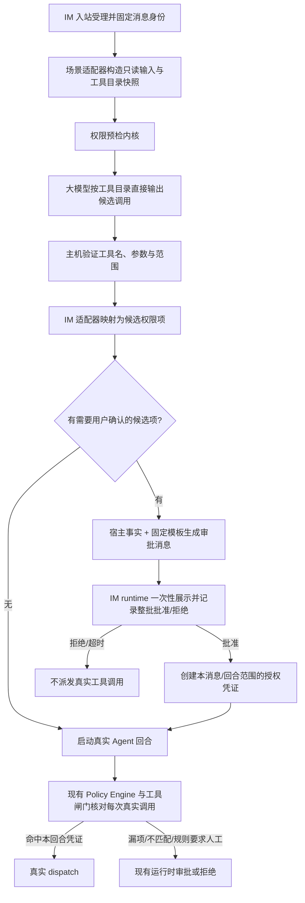

# IM 指令权限预检与集中审批技术方案

> 状态：方案草稿，尚未实现。本文定义 IM 先行验证的权限预检架构；定时任务继续使用现有 Mock 预检，直到 IM 验证达到迁移门槛。
> 日期：2026-10-24
> 最近修订：2026-10-28
> 代码核对基线：`109a938404124235d632e4cdbd4f9e06eaa48728`

## 本轮修订核销【人机共读】

| 上轮反馈 | 本轮处理 | 下钻 |
| --- | --- | --- |
| Shell 参数可能很长，脚本审批必须基于实际执行内容；不能只展示工具名或高层摘要 | 补充候选调用到授权项的宿主转换、Shell/脚本绑定材料、真实调用全量匹配和 miss 回退规则 | §5.1、INV-09～INV-10、AC-11～AC-13 |
| 先参考实际确认逻辑；先把授权逻辑补完整，再讨论交互优化 | 核对桌面、飞书、微信确认实现并记录现有限制；本轮只冻结审阅完整性和授权绑定要求，不决定批量审批卡片与长内容展示方式 | F-07～F-10、§10 |
| 审批消息要让普通用户看懂；明确消息信息由硬编码还是 Agent 生成 | 采用“宿主事实 + 固定模板”为审批主体；Agent 只可补充标明为预计用途的解释，不生成授权范围；加入用户可读消息层级和示意文案 | D-05、§3、§5.2、AC-14～AC-15 |
| 多工具审批不能把异质操作压成简单摘要；要能说明工具信息如何整合 | 增加展示分组与授权项分离规则：同一活动可设标题，但按动作/影响保留子组和逐调用详情；不同影响不合并；加入读、搜、改、运行和外发组合的复杂示例及超长清单降级规则 | D-05、§3、§5.2、AC-14～AC-16 |

## 第 0 层：决策层【人必读】

**一句话：** 收到 IM 指令后，系统先估计可能需要的工具权限，尽量合成一次审批；用户批准后本轮按批准范围运行，漏掉的权限仍由现有运行时闸门逐项处理。先在 IM 验证效果，再决定是否让定时任务采用同一预估能力。

**只有 3 分钟的话：** 先读本节已确认方案和已决的 D-01～D-05，再读 §1 的总体边界和 §9 的效果门槛。

**本轮已确认：** 不要求用户先写执行计划；IM 首期由大模型直接预测候选调用，不运行 Mock 工具循环；一次性审批只覆盖主机能明确限定范围的候选操作；待审和已批准的 IM 指令状态跨重启持久化；一批权限只允许整体批准或拒绝；权限预估不要求穷尽所有调用，未覆盖的调用仍走现有审批；IM 先行，定时任务在验证前保持现状。目标是把符合条件的 IM 指令审批请求数总体降低 95%，不是承诺每条指令都零遗漏。

**已确认的预检方式：** 让大模型像正常 Agent 规划时一样，基于用户指令、可用上下文和当前工具目录/schema，直接生成可能的工具调用及参数。预检阶段只收集结构化候选，不执行工具、不伪造工具结果，也不把 Mock 轨迹作为必要输入；宿主只验证候选并生成权限清单。预检是审批前的一次独立模型推断，输出不是之后真实 Agent 的既定计划；获批后真实 Agent 仍按正常流程执行，模型预测的遗漏或参数差异由运行时闸门继续审批。

**审批消息的已决方向：** 首屏先讲本次任务和预计操作的对象/影响，用普通语言表达读取、修改、运行、删除或对外发送；完整命令、脚本和执行参数可从详情中查看，但必须在批准前可完整审阅。消息明确这是本次任务的一次性整批批准，清单外操作仍会再次询问，拒绝则不启动真实回合。操作事实由宿主产生并用固定模板呈现；模型生成的用途解释只能作为标明“AI 预计”的补充，不能替代事实或决定授权范围。具体飞书/微信的卡片、展开和长内容承载形式在 P0 界面归属评审中确定。

### D-01【已决：A】：一次性审批可以覆盖哪些预估操作？

收到指令后，系统会显示一组可能执行的操作，用户一次确认后 Agent 才开始实际运行。实际执行时，工具参数可能因真实结果而变化；权限范围过宽会让这次确认覆盖用户没看过的操作，范围过窄则仍会出现运行中审批。

- **A：** 只把主机能明确限定工具、对象和授权范围的预估项放进一次性审批；无法在审批前看清目标或内容的操作，以及当前规则要求针对实际内容确认的操作，继续走运行时审批。用户能一次批准多数可提前确定的工具范围；少数操作仍会打断本轮。
- **B：** 预估到的工具类别都放进一次性审批，即使具体对象或内容尚未确定。运行中打断更少，但用户可能在看不到最终目标或内容时就授权执行。
- **可逆性：** 可按工具类别调整，已经发出的审批和已经执行的操作不能撤回。
- **依据强度：** 当前 IM 安全策略会把外发和部分高风险操作留给人工；预估调用能否安全表达为有界权限，需要按工具类别核验，尚无 IM 试点数据。
- **决定：A。** 仅批准主机能明确限定工具、对象和范围的候选操作；无法在审批前看清目标或内容，以及规则要求针对实际内容确认的操作，继续走运行时审批。
- **下钻：** §5、§5.1、§7、F-04、F-05、F-08。

### D-02【已决】：IM 首期用哪种方式估计调用？

**决定：** 用大模型按正常 Agent 的工具选择方式直接预测候选调用及参数；不在 IM 预检中运行 Mock 工具循环。预检输入是用户指令、可用上下文和当前工具目录/schema；模型输出的结构化工具调用只是待验证候选，宿主校验后再映射为权限项。预检阶段没有工具 executor，不生成或消费模拟工具结果。

Mock 轨迹同样只是近似，而且依赖模拟结果继续推进工具循环；对本次目标——尽量合并权限申请、允许少量遗漏后由 runtime 补审——并不需要先模拟整段执行。直接预测减少了预检对“假结果”的依赖，候选覆盖好坏则用 IM 试点的审批减少率、运行时补审率、延迟和模型成本衡量。这里不承诺模型预测一定比 Mock 更准确，也不要求首期追求调用轨迹完全复现。

这是一轮额外的模型推断，不复用后续真实 Agent 的同一份响应；因此它可能与真实 Agent 后续计划不同。漏项、参数越界和新增调用继续走现有运行时闸门与审批。IM 试点期间，定时任务仍保持现有 Mock 预检；只有 IM 验证达到迁移门槛后，才评估定时任务是否采用直接模型预测。

**可逆性：** IM 可停用这项预检并回到逐项运行时审批；不改变定时任务现有 Mock 路径。
**依据强度：** 当前 Agent 已通过大模型生成结构化工具调用，再由宿主在派发前处理；IM 预检的业务目标允许预测不完整。真实预测命中率、延迟和成本尚无试点数据。
**下钻：** §1、§2、§3、§6、F-06。

### D-03【已决：A】：待审批的 IM 指令要不要跨重启保留？

用户可能在收到 IM 权限清单后稍后再批准。当前 IM 延迟审批记录的是一条具体工具调用，并依赖工作流任务绑定；它不能直接代表“一条指令的候选权限集合”。

- **A：** 新增独立、持久化的“指令级预检审批”记录，绑定渠道、消息、用户身份、预估权限和授权代次。应用重启后可以恢复待审批项；数据迁移和清理逻辑较多。
- **B：** 只在内存中保存待审批状态。实现简单，但应用重启、超时或进程切换会使待审批项失效，用户需要重新发指令。
- **可逆性：** 两者都能通过停用 IM 预检回到现有审批；新增记录迁移需要专门回滚策略。
- **依据强度：** 已有 IM 单次工具审批采用持久化记录和执行围栏；指令级审批尚不存在。
- **决定：A。** 待审批及已批准的指令级预检记录跨重启持久化；使用独立记录和状态机，恢复后重新核验身份、策略版本、授权代次和有效期，不伪造工具调用或自动批准。
- **下钻：** §4、§8、F-03。

### D-04【已决：A】：一次批量申请是否允许只批准其中一部分？

一次审批会列出多个候选权限。整批批准或拒绝能让用户只作一次清楚的决定；代价是只要有一项不合适，用户就需要拒绝整批，本轮不会按其他候选权限启动。

- **A：** 一次展示整批权限，只能整体同意或拒绝。行为简单，但用户拒绝时所有候选都不执行。
- **B：** 在同一批申请中逐项选择；获批项创建本回合授权，其余项没有预先授权，真实运行需要时仍走现有审批。用户选择更细，但需要更复杂的交互和逐项回执。
- **可逆性：** 可按版本调整；已经执行的操作不能撤回。
- **依据强度：** 当前运行时审批针对单次工具调用；现有 IM 批量多权限交互尚未核实。
- **决定：A。** 一批候选只记录一个整体批准或拒绝结果；不提供逐项批准，以降低用户决策和交互复杂度。
- **下钻：** §2、§4、§5、§10。

### D-05【已决：A】：批量审批消息先让用户看到什么？

批量申请可能同时包含文件读写、命令和脚本等操作。直接把工具名、参数摘要和授权术语摆在首屏，会让用户需要先懂实现细节才能判断；只给一句模型总结又可能掩盖真实执行对象。

- **A：** 首屏关联用户原始指令，并按“操作和影响”分组呈现预计事项。只有操作性质、影响和审阅方式一致时才合并同类项；不同工具可以放在同一任务标题下，但仍须分列各自动作、对象和数量，不能把读、改、运行、外发揉成一句摘要。每个可批准项都能展开核对完整参数和执行材料。明确这是本次任务的整批一次性批准，范围外调用会再询问，拒绝后不启动执行。
- **B：** 首屏直接展示原始工具名和完整参数。技术信息集中，但用户要自行理解命令、脚本和内部字段，批次较长时很难判断。
- **可逆性：** 消息文案与层级可迭代；任何一次已批准的执行无法靠修改后续文案撤回。
- **依据强度：** 现有桌面确认卡展示命令、脚本预览、工作目录、超时和安全提示；现有 IM 文本会截断长命令/脚本，微信不展示普通 `run_script` 正文。现有内容说明不足以验证批量消息的真实用户理解效果，需 IM 试点观察。
- **决定：A。** 展示分组由宿主根据经验证的动作、目标、影响和工具族模板生成；授权仍保留逐调用 `ApprovalItem`，展示分组不能合并权限。首期不依赖 Agent 生成总括摘要；若同一轮预检已有用途说明，可作为可选的“AI 预计”补充，不得替代事实或授权依据。完整材料必须能在批准前查看；无法可靠归类、说明、完整呈现或恢复的候选不进入批量预授权。
- **下钻：** §3、§5.1、§5.2、F-07～F-10、AC-14～AC-16。

**不需要你决定：** Agent 不会要求用户提交结构化计划；预检模型不能决定 allow/confirm/deny；预检预算由调用方参数传入并受独立主机硬上限约束；IM 与定时任务不共享授权记录；未匹配的真实调用由当前运行时闸门处理；审批主体按宿主事实和固定模板生成，模型解释不参与授权判定。工具目录事实、各调用入口、重启/并发/超时边界和验收用例由实现者核实并补齐。

## 1. 目标、范围与结果口径【人机共读】

### 1.1 目标

对一条已受理的 IM 用户指令，先用大模型按正常 Agent 的工具选择方式直接预测候选工具调用及参数，但不接生产工具 executor。主机把有效候选映射成受限权限项，交给 IM runtime 一次性向用户申请。用户批准后启动真实 Agent 回合；实际调用匹配本回合授权时不重复询问。未预估、超出批准范围或策略不允许预先覆盖的调用，仍经过现有 Policy Engine、工具闸门和 IM 审批路径。

预检是减少重复审批的**采样器**，不是证明任务计划正确、执行结果真实或权限需求完备的校验器。它允许不完整；它不能凭不完整结果授予清单外权限。

### 1.2 非目标

- 不让用户撰写或确认执行计划；用户只审阅系统生成的权限摘要。
- 不在预检阶段调用任何工具 executor；不访问真实文件、启动进程、连接 MCP、访问网络、浏览器或发送消息。
- 预检不构造工具执行和工具结果反馈循环；候选由模型直接预测。
- 不以模型输出作为权限决定、批准凭证或安全事实。
- 不替换现有工具闸门、策略规则、权限匹配和 IM 单次调用审批。
- 不在 IM 试点阶段改变定时任务的预检、持久化授权或运行方式。
- 不要求预估覆盖全部可能调用；漏项交回运行时处理。

### 1.3 效果口径

核心指标为**每条符合条件的用户指令发出的审批请求数**。一次包含多个权限项的批量审批算一次；运行期间的补充审批逐次计数；预检失败后回退发出的请求也计数。以相同资格定义下、按渠道和工具族匹配的基线队列与试点队列计算：

`审批请求减少率 = 1 - (试点审批请求数 / 试点符合条件指令数) / (基线审批请求数 / 基线符合条件指令数)`

符合条件的指令是指基线中至少触发一次用户审批的已受理指令；无受保护工具调用或无需用户审批的指令不纳入分母。比较基线历史队列和试点队列，试点开始前冻结时间窗、渠道/工具族匹配方法和排除项，不为同一指令并行启动两条真实 Agent。总体减少 95% 是试点目标，不表示单条指令保证减少 95%。原来只需一次审批的指令无法从合并中获益；工具调用多、重复申请多的指令贡献更大。另行观测预估命中率、清单未使用比例、预检失败率、预算停止比例、额外运行时审批率、延迟和模型调用成本，不把“模型输出 complete”当准确率。

## 2. 架构边界【人机共读】

**调用顺序：** IM 消息通过现有入口认证、去重并受理后，预检模型基于用户指令、可用上下文和当前工具目录/schema 输出结构化候选调用；主机不执行这些候选。预检无候选或不可用时回到原有 Agent 启动路径。预检有候选时，宿主先投影权限项和审批消息，持久化待审记录，再由 IM runtime 发出一次批量申请；获批后才启动真实 Agent 回合。拒绝、过期、绑定不符均不启动真实工具调用。实际 Agent 回合和每个工具调用仍使用当前运行时闸门。这个预估请求是额外的模型推断，延迟和成本纳入试点评估；它不含模拟工具结果，也不保证与获批后真实 Agent 的调用计划一致。

**解耦边界：** 内核只接收中立的指令上下文、工具目录快照、估计策略和预算；直接调用模型生成结构化候选，返回覆盖状态，不暴露工具执行端口。它不导入 IM、Butler、任务表、IM 消息卡片或审批存储。IM 适配器负责身份、消息绑定、权限清单呈现和本回合授权；定时任务适配器继续负责 schedule/facts、路径解析、任务修订绑定和持久授权记录。两者共享候选调用契约和主机验证原则，不共享业务状态机和授权语义。

## 3. 模块职责与契约【机｜人工可跳过】

| 模块 | 所有权与职责 | 明确不拥有 |
| --- | --- | --- |
| `PermissionPreflightKernel`（拟建） | 接收已筛选指令、工具目录快照、模型调用端口和 `BudgetProfile`；让模型直接生成结构化候选；验证输出结构并记录候选、预算和覆盖状态；不注册、不调用任何工具 executor | IM/task 术语、权限策略、用户确认、数据库和所有工具 executor |
| 场景输入适配器 | 从已认证入口生成不可变输入；选择工具快照、上下文裁剪、预算 profile 和估计策略 | 选择模型输出的权限、扩大调用方身份 |
| 场景权限投影器 | 按受控工具目录和主机 facts 验证参数，转换为可审批的工具权限项；为每项给出稳定来源/决策 trace | 使用模型撰写的权限文字直接授权 |
| IM 预检协调器（拟建） | 管理单条 IM 指令的待审状态；发送批量审批；记录整批批准/拒绝；批准后签发本回合授权凭证；绑定来源消息、渠道身份、session/turn 和授权代次 | 修改长期用户权限；复用定时任务记录；直接调用工具 |
| IM 审批消息投影器（拟建） | 从宿主已验证的 `ApprovalItem` 生成结构化消息；按已登记工具族模板建立活动标题、动作/影响子组和逐项详情。仅当动作性质、影响及审阅方式兼容时才合并呈现，并显示数量和目标 | 调用模型整合权限事实；用自然语言改写扩大或缩小授权范围；让展示组替代逐调用授权项；发起额外的摘要模型调用 |
| IM runtime 与当前工具闸门 | 按策略决定是否可由请求级审批凭证满足确认；在每次真实 dispatch 前核对凭证与实际调用；不匹配时调用既有审批/拒绝路径 | 把预估清单当作无条件 blanket grant |
| 定时任务适配器 | 保留当前 task facts、权限派生、任务版本和运行快照；迁移时才选用已验证的估计策略 | 使用 IM 的会话授权、IM 消息确认状态或回合凭证 |

**内核输入契约（提案）：** `scenarioId`、原始指令及经过筛选的上下文、已认证的来源引用、工具目录快照（稳定工具标识及 schema）、估计策略 ID、主机提供的预算 profile、取消信号。模型看到的是工具说明和参数 schema，不存在可执行的工具端口。用户消息及附件为不可信内容；不得将引用消息、附件或模型生成文本提升为授权证据。

**内核结果契约（提案）：** `status`（`complete | partial | unavailable`）、`candidateCalls[]`（工具稳定 ID、结构化参数、来源固定为 `model-forecast`、序号）、`coverage`、`stopReason`、预算消耗和工具目录版本摘要。结果中不出现 `allow`、`authorized` 或“执行成功”。候选调用表示模型的预测，不证明真实任务一定会执行，也不证明权限清单完整。

**宿主权限投影：** 只接受工具目录中的唯一工具 ID；参数通过对应 schema 与工具专属约束校验。IM 投影器依据当前 host facts 生成可读的操作/对象范围和稳定 permission key；模型给的描述文字不能成为授权事实或授权范围。若将它用于审批说明，只能按 §5.2 标明为“AI 预计用途”。无法安全投影的候选项被排除并标记 partial；其他有效项仍可进入批量审阅。

**审批消息的生成分工：** 消息中的动作、目标、影响、完整执行材料引用、覆盖情况和可批准范围都从宿主验证的 `ApprovalItem` / host facts 投影。宿主模板负责把每个工具族事实转换成用户可核对的短句，并在上层按任务活动设置标题；它不靠模型重写工具参数，也不另发摘要模型请求。模型不能替宿主决定分组、对象或影响。若同轮预检已经提供用途解释，可附为明确标注的“AI 预计用途”；首期消息不能依赖该字段才能解释审批。缺少可靠模板或渠道无法呈现完整审阅材料时，对应候选不进入批量授权。

## 4. IM 请求状态与唯一写入者【机｜人工可跳过】

指令级状态机与当前单工具 deferred todo 分开。状态按表中指定的唯一 owner 提交；审批回调由 IM 预检协调器执行 CAS（compare-and-swap）状态转换，不能直接派发工具。

| 状态 | 含义 | 允许的下一状态 | 唯一写入者/恢复者 |
| --- | --- | --- | --- |
| `accepted` | 入站消息已认证、去重并绑定 session/turn/message | `preflighting`、`closed` | IM 入站协调器创建；预检协调器恢复 |
| `preflighting` | 只读估计正在运行，无生产工具可达 | `review_pending`、`ready`、`fallback_ready`、`closed` | 预检协调器 |
| `review_pending` | 候选清单和消息绑定已持久化，等待用户决定 | `approved`、`rejected`、`expired`、`invalidated` | 预检协调器；已认证的审批入口提交 CAS |
| `approved` | 一次性授权范围与用户确认事实已冻结 | `ready`、`invalidated`、`expired` | 预检协调器 |
| `ready` | 无候选权限或已完成批准绑定复核；可启动真实回合 | `running`、`closed` | 预检协调器 |
| `fallback_ready` | 模型/预算/校验失败；未产生授权，走既有逐项审批 | `running`、`closed` | 预检协调器 |
| `running` | 真实 Agent 回合已启动；本请求凭证仅在其绑定范围内可匹配 | `closed`、`invalidated` | turn 生命周期协调器；预检协调器清理凭证 |
| `rejected` / `expired` / `invalidated` / `closed` | 终态；不能再签发或复用授权 | 无 | 预检协调器；恢复器只做终态核对 |

**持久记录绑定字段（逻辑字段，不是最终数据库 schema）：** 唯一 `preflightId`、渠道、认证 owner/会话身份、来源消息 ID 与内容摘要、sessionId/turnId/requestId、工具目录摘要、权限策略版本与授权 epoch、预估策略/预算/覆盖状态、host 派生权限项、审批材料版本摘要及可校验恢复的受控载荷或不可变引用、整批批准/拒绝结果及时间、过期时间、终态原因。不能只持久化摘要而丢掉用户待审时需要复核的材料；载荷按最小必要字段保存并与日志隔离。日志只记安全允许的摘要标识与计数，不记原文、完整路径、Shell 命令、密钥或完整工具参数。

**提交点与竞态：** 候选清单必须先持久化，再发审批通知；通知重复通过 `preflightId` 幂等。用户批准与过期、撤权、重启恢复竞争时只有一个 CAS 终态转换成功。启动真实 Agent 前，在同一协调边界核对 owner、channel、message digest、turn、policy revision、authorization epoch 和有效期；任何变化都失效凭证并回到原闸门。拒绝/过期回执不得唤醒真实 executor。

**恢复：** 重启时扫描 `review_pending`、`approved` 与 `ready`。有效待审项保持待审并按当前 IM 恢复规则重发/更新通知；过期、身份不匹配或授权代次改变的记录转为 `invalidated`，不能自动批准或派发。`approved`/`ready` 但 `running` 尚未建立的项须重新核对绑定后才启动；不能确认 turn 状态时走原审批路径。每条消息至多有一个有效预检记录。

## 5. 授权凭证与运行时匹配【机｜人工可跳过】

用户批准只创建**单条指令、单个 turn、限时、限工具范围**的授权凭证，不写入长期工具权限或 Profile。凭证至少绑定 `preflightId + source message digest + owner + channel + sessionId + turnId + permission set + policy revision + authorization epoch + expiry`。真实调用使用当前工具闸门产生的事实和决策；final-check 只核验批准主体、对象、权限代次、凭证和实际调用材料，不重新计算业务风险。

权限 matcher 由宿主按工具类别定义，禁止模型提供 matcher：

- 工具 ID 必须与批准项完全对应，不能用工具类别授权未知工具。
- 文件、脚本、Shell、MCP、浏览器、外发等权限按现有策略事实建立各自范围；具体匹配字段在安全规则中登记稳定 rule ID 并写入 policy trace。
- 实际参数改变且超出批准范围、上下文或策略修订改变、凭证过期、授权撤销时，不匹配；转当前 JIT 审批或拒绝。
- 预检结果不完整时，已列出且用户已批准的范围仍可用；未列范围一律没有授权。
- 按 D-04 整批处理用户决定：批准时，凭证包含全部通过 D-01 范围检查且经宿主验证的候选权限项；拒绝时不签发凭证，也不启动真实 Agent 回合。审批交互和回执只需表达一次整体批准或拒绝。

### 5.1 候选调用、授权项与真实调用匹配

预检模型返回的是**候选调用**，不是授权项。授权项只能由宿主从候选调用和当前工具执行事实中构造；未能被宿主校验、无法形成有限授权范围，或按当前策略仍要求针对真实执行材料确认的候选，不进入本批授权集合。过滤或预算截断后仍保留 `partial` 覆盖状态；获批集合只包含已列明且可匹配的项，未列明部分仍走原运行时审批。

每个可审批候选由宿主生成不可变的 `ApprovalItem`，至少绑定：稳定工具 ID、工具专属 matcher 及版本、规范化后的安全相关参数/执行事实、宿主派生的权限范围和 rule/decision trace、来源候选 ID，以及可完整复核的审批材料摘要。若一个候选调用需要多个权限范围，必须全部进入同一审批批次；若一个范围缺失，真实调用整体视为未命中，不允许先派发其中“已匹配”的部分。可合并重复权限项，但须保留其全部来源候选关联。模型提供的文字说明、工具类别名称和自然语言范围不能充当 matcher 或授权依据。

规范化和事实提取使用宿主工具专属逻辑，采用与真实调用相同的参数默认值解析和执行上下文来源；预检只可运行无副作用的准备/事实提取，不得进入 executor、dispatch 或具有外部副作用的准备步骤。运行期仍从真实调用产生当前 facts，并由同一版本 matcher 比较。**不能只凭模型预测文本相似、工具名相同或某个参数命中就认定授权匹配。**

工具专属绑定要求：

- **`run_shell`：** 审批材料包含完整 `command`（包括多行、管道和连接符）、有效工作目录、有效 shell/执行配置、有效 timeout，以及现有确认逻辑展示的说明/理由与安全提示。matcher 至少要求工具 ID、完整规范化命令、宿主解析后的工作目录、执行配置/计划摘要和环境指纹相同；timeout 按规范化后的有效值比较。`description` / `justification` 属于审阅上下文，不能扩大权限范围；其变化是否影响现有策略判断仍由当前策略处理。不得把一次批准泛化成 Shell 命令模式、命令前缀或通用 Shell 权限。命令不透明、动态行为无法按现有策略确定，或策略要求执行时再看真实目标/内容时，不进入预授权批次。
- **`run_script`：** 审批材料必须包含完整代码和有效语言/解释器、参数、工作目录、timeout、影响执行的环境/设置。matcher 绑定主机计算的完整代码摘要、规范化输入参数摘要、环境/设置摘要及认证/策略版本；任一安全相关字段变化即未命中。不能以首行、截断预览、代码长度或模型生成的脚本摘要代替完整脚本绑定。当前 schema 没有独立脚本参数字段；若未来增加参数，必须纳入规范化参数摘要和审阅材料。
- **其他工具：** 在工具专属 matcher 明确规定之前，不从本规则推导通用匹配方式。每个权限事实按 D-01 独立判断是否可在真实调用前限定；无法限定的项留给现有运行时确认。

`ApprovalItem` 的审阅材料与 matcher 必须绑定同一版本和摘要。要是完整材料不能被当前审批渠道可靠呈现，或持久化记录不能在重启后还原同一审阅材料与 matcher 输入，该项不得进入可批准集合；只剩摘要或截断文本时不能签发对应授权。具体如何在 IM 中展示、展开或承载大段命令/脚本留待交互设计阶段解决，不得通过缩短授权材料绕过该门槛。

运行时对每个真实调用，先运行现有 facts 与策略判断，再检查本回合凭证。只有当该调用所需的**全部**受保护权限事实都被未过期、同身份、同消息/turn、同策略与授权代次的已批准 `ApprovalItem` 覆盖，且当前策略允许用该类请求级审批满足确认时，才可跳过重复的用户确认。部分覆盖、调用参数变化、环境/对象变化、matcher 版本变化或任何绑定失配，均视为整个调用 miss：不 dispatch，转现有 JIT 审批/拒绝流程。JIT 通过后可仅为该次真实调用继续，不修改原批次，也不扩大或续期原凭证。

这层需要区分：**facts** 记录候选来源、目录快照、参数和覆盖；**policy** 决定什么范围能被请求级人工确认满足并记录稳定 rule ID/decision trace；**final-check** 只验证凭证和真实调用绑定；**invariant** 保证预检无副作用、请求凭证不跨 turn。既有 `SYS-PREFLIGHT-001` 当前只登记 Butler task preflight；扩展内核时须登记 IM 约束和 owner/effect/audit/tests，不得借用旧 ID 掩盖范围变化。

### 5.2 面向用户的审批消息【人机共读】

消息只把用户作决定需要的信息放在首屏；完整执行材料仍须能在批准前打开查看。结构顺序固定为：

1. **任务上下文：** 关联用户原始指令或可回到原消息的引用，不另写模型摘要来替换用户原意。
2. **活动标题：** 可用用户原指令中明确的任务词作导航标题，例如“检查项目配置”。标题只帮助定位，不是操作描述或授权对象。
3. **操作分组：** 每项用“读取 / 搜索 / 修改 / 运行 / 对外发送”等普通动词写明对象、数量和影响。多个工具只有在动作性质、影响及审阅方式兼容时才可以并成同一操作行；异质工具可以放在同一活动标题下，但必须分列工具族子项及各自数量、目标和作用。比如“检查项目”可以包含“读取 3 个文件”和“搜索 3 个范围”两个子项，不能合写为“检查 6 项”。
4. **逐调用详情：** 展示分组只是导航和降噪；每个子项仍关联自己的 `ApprovalItem`、matcher 和完整材料，展开后可逐调用核对，不因同组而合并权限。`read_file` / `grep` 显示实际文件或搜索范围；`edit_file` / `write_file` 显示将修改的文件及可核对的确切改动；`run_shell` 显示完整命令、有效工作目录、执行配置、超时和安全提示；`run_script` 显示完整代码、语言/解释器、目录、超时及影响执行的环境/设置。不得用工具名、调用数量、差异摘要或模型说明替代完整材料。Shell/脚本的自然语言说明不能照抄模型的 `description` / `justification` 当作已核实用途；若宿主只能确认“将执行一段命令/代码”，无法说明其作用和影响，不能因为详情里有原文就默认适合给普通用户预先批准，应留给执行时确认。
5. **范围和决定后果：** 自然语言说明清单是预估、批准仅作用于列出的这一批和当前回合；真实执行若需要清单外操作仍会再询问。一次只能整体批准或拒绝这张批次；拒绝、超时不启动真实 Agent 回合。整批之外且已知会发生的操作要另列“本次不包含”，说明稍后为何还要确认、何时会出现。未知遗漏不能用“其他操作”笼统概括，只说明预估可能不完整、未列操作会再询问。展示实际有效期限。

**多工具聚合边界：** 聚合器是宿主中的确定性投影逻辑，依据经验证的动作、目标范围、影响类别、策略路径和详情渲染器版本进行分组；模型不能决定把哪些调用合并，也不能生成可批准范围。相同工具族、相同动作且审阅材料结构相同的重复调用，可显示为“读取 3 个文件”并列出全部文件，每次调用仍有独立详情。异质工具仅可共用活动标题，动作/影响不合并。只要涉及效果差异（例如读取与写入、修改与删除、本地执行与对外发送）、目标或影响无法清楚枚举、模板不支持该工具，或者用户无法从详情核对每次调用，就不能进入批量预授权。若材料多到渠道无法完整送达或用户无法逐项展开，不能只压成摘要继续让用户批准；对应候选留给现有逐项 JIT 审批。

**多工具示例（复杂度示意，非权限分类承诺）：** 用户原话：“检查项目配置，修复发现的拼写问题，运行校验，完成后把结果回复给我。”假设预检提出 3 次 `read_file`、3 次 `grep`、2 次 `edit_file`、1 次 `run_shell`，并预计任务完成后调用 `wechat_reply`。是否能进入批量预授权仍逐项服从当前策略；示例中的工具不因列入清单就自动符合资格。

| 消息里的层级 | 预检调用与用户要能看见的信息 | 批次处理方式 |
| --- | --- | --- |
| **检查项目配置**（活动标题） | 下面保留两个子项，而不是把六次调用合并为“检查文件”： • **读取 3 个文件**（`read_file`）：逐个列出文件路径和读取范围，可展开每次调用。 • **搜索 3 个范围**（`grep`）：逐项列出搜索根、关键词/模式和相关筛选参数，可展开每次调用。 | 同一活动标题不代表共用授权；两个子项分别根据各自事实和策略投影。 |
| **修改拼写** | **修改 2 个文件**（`edit_file`）：列出文件路径，并对每个调用提供可核对的精确替换内容/差异；“修复拼写”不能代替实际改动。 | 仅当宿主能把两次改动和运行时调用稳定绑定、且策略允许时才可列入本批。无法审阅具体改动的项留给 JIT。 |
| **运行校验** | **运行 1 条已知校验命令**（`run_shell`）：首屏说明这是本地执行项目校验；详情展示完整命令（例如 `npm run typecheck:shared`）、工作目录、timeout、执行环境/配置和安全提示。 | 只有宿主能根据受控事实说明该命令类别、策略又允许对完整命令做请求级确认时才可列入本批；不能用模型的用途文字证明任意 Shell 命令是“校验”。命令变化或运行环境失配则实际调用回到 JIT。 |
| **完成后回复结果：本次不包含** | 预计会用 `wechat_reply` 回复当前会话，但回复文本依赖校验结果，预检时尚不存在，且外发策略要求针对真实内容确认。 | 不纳入上面那批授权；真实结果生成后另行展示接收会话和完整消息内容，再走现有确认。 |

用户看到的整批说明可写成：“这次会先检查列出的文件和搜索范围，再按详情中的内容修改 2 个文件，并运行这条校验命令。批准只覆盖上面列出的操作；完成后回复你的结果不包含在本次批准中，到时会再让你确认。清单外操作也会再询问。本次只能整体批准或拒绝；拒绝或超时不会开始执行。有效期至 {时间}。” 这段只能由宿主已有事实和模板拼装；用户原始指令负责说明“为什么提出这些动作”，具体操作事实由各子项给出。同一轮预检如已有用途说明，可附“AI 预计用途”并明确其估计性质，但缺少它不影响消息生成，也不允许它替换分项。

文案模板不使用“安全 / 无风险 / 建议通过”等未经策略证明的保证。风险通过对象、动作和可见后果表达；颜色或图标不能替代文字。批量提示不携带当前单工具流程的 `TRUST` / 记忆档位选项。最终消息必须包含整批决定语义、有效期以及按渠道可完整访问的材料；任何被截断、附件不可读或未逐项绑定的项都不能保留在可批准集合中。

#### 界面归属卡（草案，进入 P1 前须按 I8 评审）

1. **放哪个入口：** 沿用用户提交指令的飞书/微信会话，在原会话里收到这条批量审批，保留与原指令的引用关系。
2. **形态：** 单条整批审批消息；先列普通语言的动作、目标和影响，再提供可访问的完整命令/脚本详情；只有“批准本次全部操作”和“拒绝本次任务”两个决定。
3. **样式来源：** 使用飞书/微信各自原生消息/卡片表达，沿用现有确认提示的引用与确认码校验；不新增独立桌面审批页，不把内部工具 ID 或风险规则名当主要文案。
4. **新增还是改造：** 改造现有 IM 单工具确认提示与回执的呈现和批次绑定，形成指令级审批消息；不新增设置项或长期授权入口。
5. **成本：** 需保证长命令/脚本及多工具逐调用材料完整送达并可核对；要处理活动标题/子项展开、渠道长度与附件差异、工具族模板维护、整批回执去重、双语文案和有效期提示。P0 用跨读取、修改、执行、外发的代表性大批样本实测信息是否仍可读；超出呈现能力时相应候选不能批量授权。当前单工具的信任/记忆选项不进入此批次。

**审批状态：** D-05 已确认消息内容层级与生成责任；本卡的渠道承载方式和原生交互能力须在 P0 核验并由项目负责人按 I8 确认，确认前不得进入 P1 界面实现。

## 6. 可配置预算与停止语义【人机共读】

内核调用必须显式接收主机生成的 `BudgetProfile`，至少含 `maxModelRounds`、`maxProposedCalls`、单次请求超时、总超时和模型输出上限。这里的“轮”指一次模型生成，不是模型调用工具后收到 Mock 结果的往返；后续生成只能基于原始指令和已有候选继续预测，不能收到伪造的执行结果。轮次是运行参数，不写死在模型提示词或共享默认常量里。不同场景可以传不同 profile；用户消息、模型输出和 UI 不能自行提高预算。

将**场景默认值**与**系统硬上限**分开：profile 中单项大于 0 且不高于硬上限；达到任一上限即停止后续模型生成并保留已有候选。默认值可在 IM 与定时任务适配器分别配置；调整 IM profile 不改变定时任务。硬上限由宿主集中维护，防止策略参数导致无限调用/费用。IM 首期 profile 与 hard ceiling 的数值在实现前根据模型超时和可接受响应延迟核定；不能假定当前默认值就是永久上限。

当前定时任务 runner 的默认值为 5 次模型生成、12 次 Mock 调用、单次模型请求 20 秒、总计 60 秒；虽然 runner 接收 limits 参数，但校验把调用方数值限制在这些默认值以内。新内核要允许调用方配置预测模型的生成轮次，同时仍受独立 hard ceiling 约束；它没有 Mock 调用预算，因为没有工具调用。预算停止返回 `partial` 及已有候选；有效候选可以批量审阅，覆盖状态必须保留。本次目标允许采样不完整，不能把“没有在预算内看到”解释为“不需要权限”。

## 7. 不变量【机｜人工可跳过】

- **INV-01 预测不授予权限。** 任意模型输出、候选调用或部分覆盖状态均不能单独创建授权凭证。
- **INV-02 预检不触达工具执行端。** 内核没有 executor/dispatch 端口；它只把工具目录作为模型输入并解析结构化预测，因此预检无法派发进程、文件读写、MCP、网络、浏览器或消息发送。
- **INV-03 批准范围由宿主构造。** 用户只看到并批准 host-validated 的工具/对象范围；模型文本不能添加、扩大或重写 permission item。
- **INV-04 请求凭证不得跨请求复用。** 凭证绑定 owner、channel、source message digest、session/turn、权限集、策略修订、授权代次和 expiry；一项失配即不匹配。
- **INV-05 运行时闸门仍是最终控制点。** 每次真实调用在 dispatch 前检查当前策略和本回合凭证；漏项/不匹配进入原审批/拒绝路径，不因曾有预检而跳过。
- **INV-06 业务状态隔离。** IM 一次性凭证不写入任务授权表；定时任务持久授权不授予 IM turn。内核与两个适配器不得相互导入场景状态类型。
- **INV-07 失败无放行。** 模型失败、调用取消、预算无效、无效工具/参数、目录歧义、存储失败、通知失败、用户拒绝或恢复不确定均不产生新授权；已批准且与失败无关的其他工具 scope 不能自动扩大。
- **INV-08 轨迹/输入的审计脱敏。** 安全日志保留阶段、稳定错误类别、策略/预算版本和计数；不落消息正文、密钥或完整敏感参数。
- **INV-09 审批材料与授权项绑定。** 每个授权项由宿主从候选调用构造，并绑定完整审阅材料摘要、工具专属 matcher 版本和宿主事实；材料不完整、无法恢复或 matcher 失配的项不得签发/命中授权。
- **INV-10 单次调用全量命中。** 真实调用所需的所有受保护权限事实必须同时被已批准范围覆盖；任一缺失都使整个调用在 dispatch 前进入现有 JIT 审批/拒绝，不能以部分命中放行。

## 8. 失败、并发与恢复矩阵【机｜人工可跳过】

| 场景 | 状态/权限处理 | 是否可启动真实执行 |
| --- | --- | --- |
| 没有候选受保护工具 | `ready`；不创建凭证 | 可以，后续调用仍过原闸门 |
| 有候选项且用户批准 | 写入已批准的 request-scoped 权限集合 | 仅在启动前绑定复核通过后可以 |
| 用户拒绝或审批超时 | 终态拒绝/过期；清理通知与 pending 唤醒关联 | 不可以 |
| 预检模型不可用/结构错误 | `fallback_ready`；没有候选授权 | 可以进入现有 Agent 流程，真实调用按原 JIT 闸门审批 |
| 预算到期/达到模型生成轮次或候选调用数上限 | 有效候选标 `partial`；没有候选就走 fallback | 有候选时先审阅；无候选时按原流程 |
| 未知工具、参数不合法、路径/MCP 绑定失败 | 丢弃问题候选并标 partial；稳定记录错误类别 | 其他经验证候选可审阅；无有效候选时 fallback |
| 预检同时收到重复消息或通知重放 | 以入站 message key 与 `preflightId` 幂等；不重复建凭证 | 只允许一条有效 turn 启动 |
| 用户批准与撤权/策略更新/过期并发 | CAS 与 epoch/revision 校验；旧凭证失效 | 失配时不能靠旧批准 dispatch，回到原闸门 |
| 用户在不同 IM 身份/群聊批准 | owner/channel/chat-or-user identity 不匹配 | 不可以 |
| 收到批准后应用重启 | durable state 恢复并重新校验；状态不确定转失效 | 只有唯一有效 turn 和所有围栏通过才可以 |
| 实际调用在批准集合之外 | 保留原凭证中其他 scope；单个调用走现有确认/拒绝 | 该调用审批前不 dispatch；不终止整条 turn，遵守当前 loop 处理 |
| 实际调用只命中候选项的一部分参数或权限事实 | 整个真实调用判为 miss；不派发部分操作 | 现有 JIT 审批/拒绝通过后才可执行 |
| `run_shell` 命令、有效工作目录、执行配置或规范化 timeout 与获批项不同 | 不复用原授权；仍执行当前策略判断 | 该调用走现有 JIT 审批/拒绝 |
| `run_script` 代码、输入参数、工作目录、解释器/环境设置与获批摘要不同 | 不复用原授权；代码不一致不得按工具名或首行命中 | 该调用走现有 JIT 审批/拒绝 |
| 候选项的完整审阅材料无法由审批渠道展示或从持久记录还原 | 不将该项放入可批准集合并标记 `partial`；不影响其他有效项 | 若真实 Agent 发起该调用，走现有 JIT 审批/拒绝 |
| 批量审批通知发送失败/存储失败 | 不创建可消费凭证；通知层按现有失败回执记录 | 不可以 |
| `human-required`、locked、critical、recursion-blocked 或规则明确要求执行前看实际内容 | 按 D-01 和当前规则处理；不能由预估清单静默降级 | 当前政策拒绝/延迟审批规则优先 |

## 9. IM 试点评估与迁移门槛【人机共读】

### 9.1 试点采集

先从现有 IM 日志/审批事实确定基线和样本范围，再选择能覆盖常见工具族的真实指令做试点。对每个指令记录：基线审批请求数、预检批次、批准/拒绝/超时、实际调用与预检候选的匹配结果及稳定 miss 类别（工具/参数/对象/环境/策略/过期等）、运行时补充审批数、未使用候选数、覆盖状态、轮次/调用/时长、模型费用区间。关联 ID 使用不可逆摘要；不采集原文、完整调用参数或敏感目标内容。

**比较方法：** 用符合资格定义、按渠道和工具族匹配的基线/试点队列计算审批请求数；实际转向预检时不同时运行第二个有副作用的 Agent。若对比估算需要重放，只用脱敏样本和 no-op tools。分别报告总体减少率、各工具族覆盖率、补充审批率和被拒/放弃率，避免总体均值掩盖某一类高风险漏项。

### 9.2 IM 试点出口

进入定时任务替换评估前必须满足：

1. 试点队列的**总体审批请求减少率达到 95%**；分母、队列和排除项在试点开始前冻结。
2. 所有实际工具调用仍由现有策略与 final-check 控制；边界测试中没有请求凭证跨身份、跨消息、跨 turn 或超范围 dispatch。
3. 汇报预估漏项导致的额外审批、预估多项导致的额外审阅负担、partial/failure 比率、延迟和模型成本；评审确认这些残余代价可接受。不能仅凭减少率隐藏单一工具族的显著问题。
4. 飞书与微信的身份绑定、审批投递/回执、重复/迟到消息及应用重启恢复均通过真实渠道验收；本机测试不能替代这部分验收。

若未达到目标，先调整候选映射、模型策略或场景预算，再在 IM 继续验证；定时任务维持现有 Mock。达到目标后，也不直接共用 IM 的凭证或审批状态。

### 9.3 定时任务迁移门槛与回退

IM 试点通过后，先用定时任务代表性指令做 no-op/shadow 对照：原 `taskPreflightMockTrace` 权限派生与候选预测各自产生候选，逐项核对路径、Shell 工作目录/命令、脚本 digest、MCP service/tool 身份和 coverage。替换只可能改变任务权限候选的生成策略；任务事实收集、任务版本、用户审阅、授权记录、执行快照、运行期 final-check 和现有失败门禁保持由定时任务适配器拥有。

仅在对照结果表明新策略的权限覆盖和范围约束不劣于当前预检、任务侧本地边界测试通过且外部无人值守场景完成验收后，才变更定时任务的估计策略。迁移按版本/任务分批进行，并保留切回原 Mock 策略的开关或版本路由；切回不删除已签发的任务授权记录，不把 IM 的请求级授权导入任务。

IM 回退时停止创建新的批量预检审批；尚未启动的 pending/approved turn 作废并转既有 JIT 路径，已在执行的 turn 每个后续工具调用仍过当前闸门。已派发操作不能通过回滚撤销。定时任务回退只切回原 Mock 预检生成器，保存的任务授权记录仍由现有任务 revision 与 final-check 校验。

## 10. 分阶段实现与可验收边界【人机共读】

| 阶段 | 产物与验收 | 可回退边界 | 环境边界 |
| --- | --- | --- | --- |
| P0 规格与基线 | 按已决 D-01～D-05 冻结指标分母、权限类别矩阵、各工具授权项构造与匹配契约、整批决策语义、分组边界及宿主事实到文案的投影契约、预算 profile/hard ceiling、IM 持久记录契约；用跨读取/搜索/修改/执行/外发的多工具长清单样本走查分组、逐项材料和超长降级；完成并评审五行界面归属卡，明确长命令/脚本及逐项详情在飞书和微信的实际承载方式；建立脱敏代表样本和当前审批基线 | 不涉及代码或运行行为 | 本机代码/文档可核；真实 IM 数据分布需用户授权的脱敏样本；具体界面进入 P1 前须通过 I8 评审 |
| P1 通用内核与 IM 接入 | 实现直接模型预测接口、无 executor 边界、参数化预算、IM 输入/权限投影器、指令级状态协调、请求凭证 matcher；原有 JIT 作为 miss fallback | IM 入口可停止创建新记录并退回现有逐项审批；定时任务不改 | runner、store、闸门和回调边界可本机定向测试；真实 IM 消息和回执需飞书/微信环境 |
| P2 IM 受控试点 | 真实渠道验证身份/重复/延迟/重启；按 §9.2 计算审批减少率及残余成本；记录版本和退出证据 | 停用 IM 预检，未运行 turn 走 JIT，运行中的每次新调用仍过原闸门 | 95% 指标、投递和真实用户体验需真实 IM 流量，单测不能替代 |
| P3 定时任务 shadow 与切换 | no-op 对照后只替换候选估计策略；复核 task-specific permission projection；原定时任务权限审阅与执行授权契约不变 | 按 task/版本切回现有 Mock runner | 可本机测 mapper/snapshot；无人值守、实际 schedule、外部 MCP/投递验收需真实环境 |

**本机可测：** 工具目录/参数校验、策略与 scope projection、预算轮次/超时/取消、partial 候选、预检期间所有工具 executor 调用数为零、一次审批创建多个 scope、grant match/miss、身份/epoch/expiry、重复和乱序回调、崩溃恢复、数据库迁移、JIT fallback、定时任务 adapter 兼容。新增安全逻辑按事实/策略/final-check/invariant 分层，并登记共享 system invariant；定向测试覆盖状态机及跨入口边界。

**必须外部验收：** 飞书与微信真实卡片/消息投递和用户身份识别、延迟/重复回执、应用重启后的远程恢复、真实模型预测效果和延迟/成本、95% 审批请求减少目标、定时任务无人值守环境。真实模型质量不能由固定 mock LLM 单测证明。

## 11. 验收映射【机｜人工可跳过】

| 验收 ID | 断言 | 关联不变量 | 主要验证方式 |
| --- | --- | --- | --- |
| AC-01 | IM 用户消息只触发一个 request-scoped 预检审批批次，用户只能整批批准或拒绝；审批前不启动真实 Agent 工具执行 | INV-01、02、04 | 入站→预检→存储→通知集成测试；整批批准/拒绝及 dispatch spy 验证 |
| AC-02 | 用户批准后匹配的实际工具调用不重复询问；候选漏项和参数越界调用仍走既有 JIT/拒绝 | INV-03、05 | 匹配/不匹配边界矩阵，dispatcher/gate spy |
| AC-03 | 未知工具、坏参数、模型错误或预算耗尽均不产生未授权放行；预估覆盖为 partial 时，有效候选仍可整批审阅，但不开放逐项批准 | INV-01、02、07 | 故障注入、partial coverage 与整批批准/拒绝测试 |
| AC-04 | 同一凭证不能跨 owner、渠道、消息、turn、policy revision、authorization epoch 或 expiry 使用 | INV-04、05 | 安全边界表驱动测试 |
| AC-05 | 重复入站/审批、审批与过期竞争、重启恢复最多启动一个有效 turn | INV-04、07 | 随机状态操作序列 + 状态不变量断言；CAS/故障注入 |
| AC-06 | 预检策略不持有任何工具执行端口；取消/超时后迟到模型回复不能派发工具 | INV-02、07 | runner 竞态测试及生产 executor 全面 spy |
| AC-07 | 不同调用方能传入不同轮次和候选数量预算；预算值不能超过独立 host hard ceiling；预算停止后候选与 partial 状态一致 | INV-02、07 | 多 profile、超过 ceiling、模型轮次/候选数/时间边界测试 |
| AC-08 | IM 与 task adapter 无共享业务授权记录；迁移定时策略不改变 task facts、authorization record 和 run snapshot 契约 | INV-06 | 模块依赖检查、task regression、运行快照和权限 matcher 测试 |
| AC-09 | IM 试点报告按冻结队列计算总体审批请求减少率，达到 95% 后才可进 P3 | — | 真实渠道审计聚合和人工复核 |
| AC-10 | 定时任务更换策略前通过 no-op/shadow 的权限范围对照及无人值守外部验收；失败可切回 Mock 路径 | INV-06、07 | shadow corpus 比较、任务回归和真实 scheduler 验收 |
| AC-11 | 预检候选只有经宿主参数规范化、事实提取和策略资格检查后才能成为授权项；授权项绑定审批材料摘要及 matcher 版本，无法完整审阅或恢复的材料不签发授权 | INV-01、03、09 | Shell/脚本工具事实投影测试、审批材料摘要与持久化往返测试、partial 覆盖测试 |
| AC-12 | Shell 实际调用只有在完整命令及宿主解析后的工作目录、执行配置和有效 timeout 命中批准项时才免于重复确认；脚本调用要求完整代码、规范化参数和环境/设置绑定一致 | INV-05、09 | 参数等价/差异边界矩阵；命令、目录、timeout、代码、解释器、环境任一变化均验证 dispatch 前 miss |
| AC-13 | 某次真实工具调用所需权限未全部被授权项覆盖时，该调用整体不 dispatch 并进入 JIT/拒绝；JIT 结果不扩大原批次授权 | INV-05、10 | 多权限候选、部分命中、补充审批通过/拒绝的闸门集成测试 |
| AC-14 | 审批消息中的动作、对象、范围和风险事实由宿主 facts 经固定模板投影；可选的 Agent 用途说明明确标为预估，不能改变授权项或被表述为安全保证 | INV-03、09 | 按工具族检查结构化事实与渲染文案一致；模型说明注入未知目标/越权措辞时仍不改变批准范围 |
| AC-15 | 用户能从首屏理解本次任务和操作影响，获知整批/一次性范围、清单外调用会再询问、拒绝后不启动；批准前可查看未截断的完整执行材料 | INV-04、09 | 飞书/微信真实渠道内容走查；超长 Shell/脚本、部分预估、过期提示和回复语法测试 |
| AC-16 | 多工具消息的展示组不合并授权项；同一活动下的异质工具仍分别列出动作、影响、目标和调用数量；每个授权项可回到独立匹配材料。无法清晰分组或完整呈现的候选不批量授权；已知排除操作会明确说明稍后确认的原因和时机 | INV-03、09、10 | 读取/搜索/修改/执行/外发混合样本；同类重复与异质混组边界；渠道长清单、材料恢复及 JIT 降级验证 |

## 12. 与当前方案的关系【机｜人工可跳过】

当前定时任务设计和执行证据仍以 [`scheduled-task-multi-workdir-and-preflight-execution-plan.md`](../../safety-approval/in-flight/scheduled-task-multi-workdir-and-preflight-execution-plan.md) 为准。本方案不修订它、不复用其任务授权记录，也不在 IM 阶段修改它。

当前 IM 单工具异步审批继续作为漏项 fallback；它要求具体 `toolCallId`、canonical args、调用 envelope、IM 身份和任务绑定。新指令级预检记录不伪造这些字段，也不把每个候选转成 deferred todo。审批投递适配器、认证回复通道和运行时工具闸门可复用既有组件，但调用级状态机不直接复用为指令级状态机。

## 附录 A：事实卡【机｜人工可跳过】

以下事实基于核对基线 `109a938404124235d632e4cdbd4f9e06eaa48728`；涉及的代码文件在本次核对时相对该基线无工作区改动。

| ID | 事实 | 可复现命令 |
| --- | --- | --- |
| F-01 | 定时任务 Mock runner 有 host-owned 模拟循环、显式 Mock adapter、默认 5 轮/12 次调用/20 秒单请求/60 秒总时长；调用参数受这些默认值限制。轨迹能标记拟调用为 simulated/not-dispatched。 | `sed -n '1,80p' electron/butler/taskPreflightMockRunner.ts`；`rg -n 'validateLimits|maxModelRounds|maxToolCalls|modelRequestTimeoutMs|totalTimeoutMs|dispatch' electron/butler/taskPreflightMockRunner.ts` |
| F-02 | 定时任务权限派生器从 host-recorded Mock trace 的工具名与参数生成任务权限；它依赖 `TaskPathFacts`，因此不是通用 IM 权限 mapper。 | `sed -n '1,120p' electron/butler/taskPreflightPermissionDeriver.ts`；`rg -n 'TaskPathFacts|deriveTaskPreflightPermissions' electron/butler/taskPreflightPermissionDeriver.ts` |
| F-03 | `SYS-PREFLIGHT-001` 当前 owner/scope 指向 `electron/butler` 任务预检；若内核或 IM 使用新的安全约束，需更新登记或新增登记及边界测试。 | `rg -n -A5 "SYS-PREFLIGHT-001" src/shared/security/systemInvariantRegistry.ts` |
| F-04 | 现有 IM deferred producer 从某个真实工具调用构造 envelope，包含 invocation/toolCallId/canonical args，并要求 taskBinding、channel 身份、owner、message/turn 等上下文；缺失必要上下文不能创建延迟审批。 | `rg -n 'taskBinding|canonicalArgs|toolCallId|missingContext|authorizationEpoch' electron/remote/imDeferredApprovalProducer.ts` |
| F-05 | IM 策略将 `outbound` 作为 `outbound-requires-human` 延迟审批；不能假设 agent 批准或预估权限自动满足外发确认。 | `rg -n 'outbound-requires-human|human-required|actionClass' electron/confirmation/imAsyncApprovalPolicy.ts` |
| F-06 | Agent SDK 接收模型生成的结构化工具调用，再进入宿主派发流程；并暴露逐调用的 `beforeToolDispatch` 接缝。这证明正常 Agent 规划本身产出结构化调用候选，但该逐调用 hook 不提供指令级批量审批状态机。 | `rg -n 'toolCalls|tool-call|beforeToolDispatch' packages/agent-sdk/src/turn.ts packages/agent-sdk/src/model.ts` |
| F-07 | 桌面 Shell 确认卡展示完整命令行、工作目录、timeout、理由和安全提示，并可出现信任命令/记忆选项；脚本卡展示脚本预览与 timeout。Shell 卡片能展示多行命令，但脚本预览超过 120 行会省略后续内容。 | `sed -n '100,165p' src/renderer/components/Chat/ShellConfirmCard.tsx`；`sed -n '1,45p' src/renderer/components/Chat/ScriptConfirmCard.tsx`；`sed -n '1,32p' src/renderer/components/Chat/ScriptCodePreview.tsx` |
| F-08 | `run_shell` 输入包含 command、可选 workingDirectory/description/justification/timeout；宿主准备后执行绑定有效 command、cwd、shell、timeout、环境指纹和计划摘要。`run_script` 输入包含完整 code、language、timeout；宿主 facts 绑定输入、代码与设置摘要，现有安全策略另核对内容、参数、环境摘要及认证版本。 | `sed -n '129,142p' src/shared/builtinToolDefinitions.ts`；`sed -n '45,105p' electron/tools/runShellRegisteredTool.ts`；`sed -n '45,105p' electron/tools/runScriptRegisteredTool.ts`；`sed -n '246,260p' electron/confirmation/agentSdkSafetyPolicy.ts` |
| F-09 | 当前 IM 单工具提示不能作为批量审阅完整性保证：微信只对 Shell 展示最多 2000 字命令，其他普通工具不展示完整脚本；飞书 Shell/脚本提示最终文本截断到 2000 字，脚本超长提示虽尝试给桌面端查看全文但也经过该总长度截断。 | `sed -n '237,255p' electron/wechat/weChatImChannel.ts`；`sed -n '250,276p' electron/feishu/feishuImChannel.ts` |
| F-10 | 当前 IM 单次确认要求引用当前提示并回复带确认码的 `Y`/`N`；可选的信任命令/记忆操作属于现有单工具流程，不能直接视为指令级整批授权语义。 | `sed -n '1,110p' electron/remote/imConfirmReply.ts`；`rg -n 'approve_and_trust|memoryTiers|trustEligible' electron/feishu/feishuImChannel.ts electron/wechat/weChatImChannel.ts` |

## 附录 B：未验证项与实施前门禁【机｜人工可跳过】

- 真实飞书/微信入站到 Agent 启动的共同最早挂接点、回合持久化/恢复语义和消息重复处理边界，需在 P0 结合当前两个 router 再核实。
- 当前 IM UI/卡片协议是否支持同一审批内展示多工具活动标题、异质子项、逐调用详情和多个 scope；若渠道无法完整呈现长清单，具体如何降级到 JIT；如新增或更改卡片状态、按钮或拒绝语义，先完成交互归属卡。
- D-05 的消息内容层级已经确定；具体飞书/微信组件、完整命令/脚本的展开或安全附件呈现、整批动作按钮/文本回复形态仍须在 P0 完成并获批界面归属卡后才能实现。
- 哪些现有 `require-confirm` 规则可以接受“针对候选权限清单的人工确认”作为满足方式，哪些必须针对真实内容再次确认；须由 D-01 决定并映射稳定 rule ID。
- `BudgetProfile` 的 IM 初值与独立硬上限需按模型供应方时延/费用和 IM 响应时限确定；不得沿用 `5` 作为不可调整的上限。
- 请求级审批存储的 schema、迁移、过期清理和备份/恢复须在 D-03 后形成契约；不能通过扩展现有单工具 deferred todo 偷渡。
- §9 的 95% 以真实、代表性的 IM 审批流量验证；样本不足或只在 mock LLM/本地 router 验证时，不得宣称达标或启动定时任务替换。
