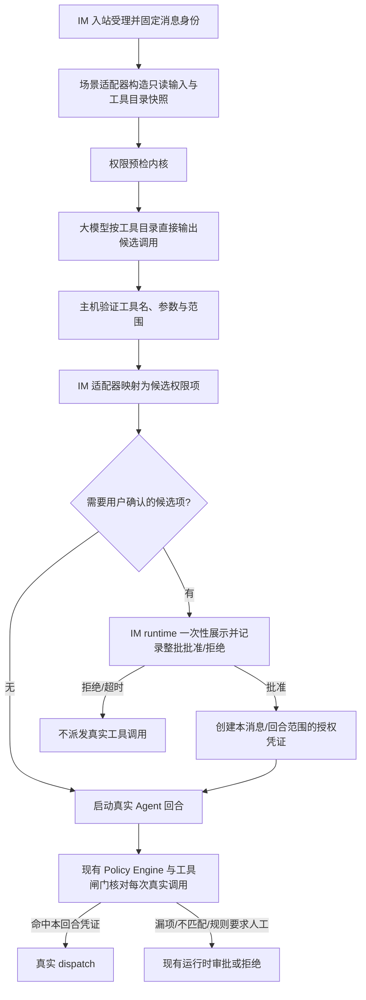

# IM 指令权限预检与集中审批技术方案

> 状态：方案草稿，尚未实现。本文定义 IM 先行验证的权限预检架构；定时任务继续使用现有 Mock 预检，直到 IM 验证达到迁移门槛。
> 日期：2026-10-24
> 代码核对基线：`109a938404124235d632e4cdbd4f9e06eaa48728`

## 第 0 层：决策层【人必读】

**一句话：** 收到 IM 指令后，系统先估计可能需要的工具权限，尽量合成一次审批；用户批准后本轮按批准范围运行，漏掉的权限仍由现有运行时闸门逐项处理。先在 IM 验证效果，再决定是否让定时任务采用同一预估能力。

**只有 3 分钟的话：** 先读本节已确认方案和已决的 D-01～D-04，再读 §1 的总体边界和 §9 的效果门槛。

**本轮已确认：** 不要求用户先写执行计划；IM 首期由大模型直接预测候选调用，不运行 Mock 工具循环；一次性审批只覆盖主机能明确限定范围的候选操作；待审和已批准的 IM 指令状态跨重启持久化；一批权限只允许整体批准或拒绝；权限预估不要求穷尽所有调用，未覆盖的调用仍走现有审批；IM 先行，定时任务在验证前保持现状。目标是把符合条件的 IM 指令审批请求数总体降低 95%，不是承诺每条指令都零遗漏。

**已确认的预检方式：** 让大模型像正常 Agent 规划时一样，基于用户指令、可用上下文和当前工具目录/schema，直接生成可能的工具调用及参数。预检阶段只收集结构化候选，不执行工具、不伪造工具结果，也不把 Mock 轨迹作为必要输入；宿主只验证候选并生成权限清单。预检是审批前的一次独立模型推断，输出不是之后真实 Agent 的既定计划；获批后真实 Agent 仍按正常流程执行，模型预测的遗漏或参数差异由运行时闸门继续审批。

### D-01【已决：A】：一次性审批可以覆盖哪些预估操作？

收到指令后，系统会显示一组可能执行的操作，用户一次确认后 Agent 才开始实际运行。实际执行时，工具参数可能因真实结果而变化；权限范围过宽会让这次确认覆盖用户没看过的操作，范围过窄则仍会出现运行中审批。

- **A：** 只把主机能明确限定工具、对象和授权范围的预估项放进一次性审批；无法在审批前看清目标或内容的操作，以及当前规则要求针对实际内容确认的操作，继续走运行时审批。用户能一次批准多数可提前确定的工具范围；少数操作仍会打断本轮。
- **B：** 预估到的工具类别都放进一次性审批，即使具体对象或内容尚未确定。运行中打断更少，但用户可能在看不到最终目标或内容时就授权执行。
- **可逆性：** 可按工具类别调整，已经发出的审批和已经执行的操作不能撤回。
- **依据强度：** 当前 IM 安全策略会把外发和部分高风险操作留给人工；预估调用能否安全表达为有界权限，需要按工具类别核验，尚无 IM 试点数据。
- **决定：A。** 仅批准主机能明确限定工具、对象和范围的候选操作；无法在审批前看清目标或内容，以及规则要求针对实际内容确认的操作，继续走运行时审批。
- **下钻：** §5、§7、F-04、F-05。

### D-02【已决】：IM 首期用哪种方式估计调用？

**决定：** 用大模型按正常 Agent 的工具选择方式直接预测候选调用及参数；不在 IM 预检中运行 Mock 工具循环。预检输入是用户指令、可用上下文和当前工具目录/schema；模型输出的结构化工具调用只是待验证候选，宿主校验后再映射为权限项。预检阶段没有工具 executor，不生成或消费模拟工具结果。

Mock 轨迹同样只是近似，而且依赖模拟结果继续推进工具循环；对本次目标——尽量合并权限申请、允许少量遗漏后由 runtime 补审——并不需要先模拟整段执行。直接预测减少了预检对“假结果”的依赖，候选覆盖好坏则用 IM 试点的审批减少率、运行时补审率、延迟和模型成本衡量。这里不承诺模型预测一定比 Mock 更准确，也不要求首期追求调用轨迹完全复现。

这是一轮额外的模型推断，不复用后续真实 Agent 的同一份响应；因此它可能与真实 Agent 后续计划不同。漏项、参数越界和新增调用继续走现有运行时闸门与审批。IM 试点期间，定时任务仍保持现有 Mock 预检；只有 IM 验证达到迁移门槛后，才评估定时任务是否采用直接模型预测。

**可逆性：** IM 可停用这项预检并回到逐项运行时审批；不改变定时任务现有 Mock 路径。
**依据强度：** 当前 Agent 已通过大模型生成结构化工具调用，再由宿主在派发前处理；IM 预检的业务目标允许预测不完整。真实预测命中率、延迟和成本尚无试点数据。
**下钻：** §1、§2、§3、§6、F-06。

### D-03【已决：A】：待审批的 IM 指令要不要跨重启保留？

用户可能在收到 IM 权限清单后稍后再批准。当前 IM 延迟审批记录的是一条具体工具调用，并依赖工作流任务绑定；它不能直接代表“一条指令的候选权限集合”。

- **A：** 新增独立、持久化的“指令级预检审批”记录，绑定渠道、消息、用户身份、预估权限和授权代次。应用重启后可以恢复待审批项；数据迁移和清理逻辑较多。
- **B：** 只在内存中保存待审批状态。实现简单，但应用重启、超时或进程切换会使待审批项失效，用户需要重新发指令。
- **可逆性：** 两者都能通过停用 IM 预检回到现有审批；新增记录迁移需要专门回滚策略。
- **依据强度：** 已有 IM 单次工具审批采用持久化记录和执行围栏；指令级审批尚不存在。
- **决定：A。** 待审批及已批准的指令级预检记录跨重启持久化；使用独立记录和状态机，恢复后重新核验身份、策略版本、授权代次和有效期，不伪造工具调用或自动批准。
- **下钻：** §4、§8、F-03。

### D-04【已决：A】：一次批量申请是否允许只批准其中一部分？

一次审批会列出多个候选权限。整批批准或拒绝能让用户只作一次清楚的决定；代价是只要有一项不合适，用户就需要拒绝整批，本轮不会按其他候选权限启动。

- **A：** 一次展示整批权限，只能整体同意或拒绝。行为简单，但用户拒绝时所有候选都不执行。
- **B：** 在同一批申请中逐项选择；获批项创建本回合授权，其余项没有预先授权，真实运行需要时仍走现有审批。用户选择更细，但需要更复杂的交互和逐项回执。
- **可逆性：** 可按版本调整；已经执行的操作不能撤回。
- **依据强度：** 当前运行时审批针对单次工具调用；现有 IM 批量多权限交互尚未核实。
- **决定：A。** 一批候选只记录一个整体批准或拒绝结果；不提供逐项批准，以降低用户决策和交互复杂度。
- **下钻：** §2、§4、§5、§10。

**不需要你决定：** Agent 不会要求用户提交结构化计划；预检模型不能决定 allow/confirm/deny；预检预算由调用方参数传入并受独立主机硬上限约束；IM 与定时任务不共享授权记录；未匹配的真实调用由当前运行时闸门处理。工具目录事实、各调用入口、重启/并发/超时边界和验收用例由实现者核实并补齐。

## 1. 目标、范围与结果口径【人机共读】

### 1.1 目标

对一条已受理的 IM 用户指令，先用大模型按正常 Agent 的工具选择方式直接预测候选工具调用及参数，但不接生产工具 executor。主机把有效候选映射成受限权限项，交给 IM runtime 一次性向用户申请。用户批准后启动真实 Agent 回合；实际调用匹配本回合授权时不重复询问。未预估、超出批准范围或策略不允许预先覆盖的调用，仍经过现有 Policy Engine、工具闸门和 IM 审批路径。

预检是减少重复审批的**采样器**，不是证明任务计划正确、执行结果真实或权限需求完备的校验器。它允许不完整；它不能凭不完整结果授予清单外权限。

### 1.2 非目标

- 不让用户撰写或确认执行计划；用户只审阅系统生成的权限摘要。
- 不在预检阶段调用任何工具 executor；不访问真实文件、启动进程、连接 MCP、访问网络、浏览器或发送消息。
- 预检不构造工具执行和工具结果反馈循环；候选由模型直接预测。
- 不以模型输出作为权限决定、批准凭证或安全事实。
- 不替换现有工具闸门、策略规则、权限匹配和 IM 单次调用审批。
- 不在 IM 试点阶段改变定时任务的预检、持久化授权或运行方式。
- 不要求预估覆盖全部可能调用；漏项交回运行时处理。

### 1.3 效果口径

核心指标为**每条符合条件的用户指令发出的审批请求数**。一次包含多个权限项的批量审批算一次；运行期间的补充审批逐次计数；预检失败后回退发出的请求也计数。以相同资格定义下、按渠道和工具族匹配的基线队列与试点队列计算：

`审批请求减少率 = 1 - (试点审批请求数 / 试点符合条件指令数) / (基线审批请求数 / 基线符合条件指令数)`

符合条件的指令是指基线中至少触发一次用户审批的已受理指令；无受保护工具调用或无需用户审批的指令不纳入分母。比较基线历史队列和试点队列，试点开始前冻结时间窗、渠道/工具族匹配方法和排除项，不为同一指令并行启动两条真实 Agent。总体减少 95% 是试点目标，不表示单条指令保证减少 95%。原来只需一次审批的指令无法从合并中获益；工具调用多、重复申请多的指令贡献更大。另行观测预估命中率、清单未使用比例、预检失败率、预算停止比例、额外运行时审批率、延迟和模型调用成本，不把“模型输出 complete”当准确率。

## 2. 架构边界【人机共读】

**调用顺序：** IM 消息通过现有入口认证、去重并受理后，预检模型基于用户指令、可用上下文和当前工具目录/schema 输出结构化候选调用；主机不执行这些候选。预检无候选或不可用时回到原有 Agent 启动路径。预检有候选时先持久化待审记录并由 IM runtime 发出一次批量申请；获批后才启动真实 Agent 回合。拒绝、过期、绑定不符均不启动真实工具调用。实际 Agent 回合和每个工具调用仍使用当前运行时闸门。这个预估请求是额外的模型推断，延迟和成本纳入试点评估；它不含模拟工具结果，也不保证与获批后真实 Agent 的调用计划一致。

**解耦边界：** 内核只接收中立的指令上下文、工具目录快照、估计策略和预算；直接调用模型生成结构化候选，返回覆盖状态，不暴露工具执行端口。它不导入 IM、Butler、任务表、IM 消息卡片或审批存储。IM 适配器负责身份、消息绑定、权限清单呈现和本回合授权；定时任务适配器继续负责 schedule/facts、路径解析、任务修订绑定和持久授权记录。两者共享候选调用契约和主机验证原则，不共享业务状态机和授权语义。

## 3. 模块职责与契约【机｜人工可跳过】

| 模块 | 所有权与职责 | 明确不拥有 |
| --- | --- | --- |
| `PermissionPreflightKernel`（拟建） | 接收已筛选指令、工具目录快照、模型调用端口和 `BudgetProfile`；让模型直接生成结构化候选；验证输出结构并记录候选、预算和覆盖状态；不注册、不调用任何工具 executor | IM/task 术语、权限策略、用户确认、数据库和所有工具 executor |
| 场景输入适配器 | 从已认证入口生成不可变输入；选择工具快照、上下文裁剪、预算 profile 和估计策略 | 选择模型输出的权限、扩大调用方身份 |
| 场景权限投影器 | 按受控工具目录和主机 facts 验证参数，转换为可审批的工具权限项；为每项给出稳定来源/决策 trace | 使用模型撰写的权限文字直接授权 |
| IM 预检协调器（拟建） | 管理单条 IM 指令的待审状态；发送批量审批；记录整批批准/拒绝；批准后签发本回合授权凭证；绑定来源消息、渠道身份、session/turn 和授权代次 | 修改长期用户权限；复用定时任务记录；直接调用工具 |
| IM runtime 与当前工具闸门 | 按策略决定是否可由请求级审批凭证满足确认；在每次真实 dispatch 前核对凭证与实际调用；不匹配时调用既有审批/拒绝路径 | 把预估清单当作无条件 blanket grant |
| 定时任务适配器 | 保留当前 task facts、权限派生、任务版本和运行快照；迁移时才选用已验证的估计策略 | 使用 IM 的会话授权、IM 消息确认状态或回合凭证 |

**内核输入契约（提案）：** `scenarioId`、原始指令及经过筛选的上下文、已认证的来源引用、工具目录快照（稳定工具标识及 schema）、估计策略 ID、主机提供的预算 profile、取消信号。模型看到的是工具说明和参数 schema，不存在可执行的工具端口。用户消息及附件为不可信内容；不得将引用消息、附件或模型生成文本提升为授权证据。

**内核结果契约（提案）：** `status`（`complete | partial | unavailable`）、`candidateCalls[]`（工具稳定 ID、结构化参数、来源固定为 `model-forecast`、序号）、`coverage`、`stopReason`、预算消耗和工具目录版本摘要。结果中不出现 `allow`、`authorized` 或“执行成功”。候选调用表示模型的预测，不证明真实任务一定会执行，也不证明权限清单完整。

**宿主权限投影：** 只接受工具目录中的唯一工具 ID；参数通过对应 schema 与工具专属约束校验。IM 投影器依据当前 host facts 生成可读的操作/对象范围和稳定 permission key；模型给的描述文字只作诊断，不作为用户审批内容或授权范围。无法安全投影的候选项被排除并标记 partial；其他有效项仍可进入批量审阅。

## 4. IM 请求状态与唯一写入者【机｜人工可跳过】

指令级状态机与当前单工具 deferred todo 分开。状态按表中指定的唯一 owner 提交；审批回调由 IM 预检协调器执行 CAS（compare-and-swap）状态转换，不能直接派发工具。

| 状态 | 含义 | 允许的下一状态 | 唯一写入者/恢复者 |
| --- | --- | --- | --- |
| `accepted` | 入站消息已认证、去重并绑定 session/turn/message | `preflighting`、`closed` | IM 入站协调器创建；预检协调器恢复 |
| `preflighting` | 只读估计正在运行，无生产工具可达 | `review_pending`、`ready`、`fallback_ready`、`closed` | 预检协调器 |
| `review_pending` | 候选清单和消息绑定已持久化，等待用户决定 | `approved`、`rejected`、`expired`、`invalidated` | 预检协调器；已认证的审批入口提交 CAS |
| `approved` | 一次性授权范围与用户确认事实已冻结 | `ready`、`invalidated`、`expired` | 预检协调器 |
| `ready` | 无候选权限或已完成批准绑定复核；可启动真实回合 | `running`、`closed` | 预检协调器 |
| `fallback_ready` | 模型/预算/校验失败；未产生授权，走既有逐项审批 | `running`、`closed` | 预检协调器 |
| `running` | 真实 Agent 回合已启动；本请求凭证仅在其绑定范围内可匹配 | `closed`、`invalidated` | turn 生命周期协调器；预检协调器清理凭证 |
| `rejected` / `expired` / `invalidated` / `closed` | 终态；不能再签发或复用授权 | 无 | 预检协调器；恢复器只做终态核对 |

**持久记录绑定字段（逻辑字段，不是最终数据库 schema）：** 唯一 `preflightId`、渠道、认证 owner/会话身份、来源消息 ID 与内容摘要、sessionId/turnId/requestId、工具目录摘要、权限策略版本与授权 epoch、预估策略/预算/覆盖状态、host 派生权限项、整批批准/拒绝结果及时间、过期时间、终态原因。日志只记安全允许的摘要标识与计数，不记原文、完整路径、Shell 命令、密钥或完整工具参数。

**提交点与竞态：** 候选清单必须先持久化，再发审批通知；通知重复通过 `preflightId` 幂等。用户批准与过期、撤权、重启恢复竞争时只有一个 CAS 终态转换成功。启动真实 Agent 前，在同一协调边界核对 owner、channel、message digest、turn、policy revision、authorization epoch 和有效期；任何变化都失效凭证并回到原闸门。拒绝/过期回执不得唤醒真实 executor。

**恢复：** 重启时扫描 `review_pending`、`approved` 与 `ready`。有效待审项保持待审并按当前 IM 恢复规则重发/更新通知；过期、身份不匹配或授权代次改变的记录转为 `invalidated`，不能自动批准或派发。`approved`/`ready` 但 `running` 尚未建立的项须重新核对绑定后才启动；不能确认 turn 状态时走原审批路径。每条消息至多有一个有效预检记录。

## 5. 授权凭证与运行时匹配【机｜人工可跳过】

用户批准只创建**单条指令、单个 turn、限时、限工具范围**的授权凭证，不写入长期工具权限或 Profile。凭证至少绑定 `preflightId + source message digest + owner + channel + sessionId + turnId + permission set + policy revision + authorization epoch + expiry`。真实调用使用当前工具闸门产生的事实和决策；final-check 只核验批准主体、对象、权限代次、凭证和实际调用材料，不重新计算业务风险。

权限 matcher 由宿主按工具类别定义，禁止模型提供 matcher：

- 工具 ID 必须与批准项完全对应，不能用工具类别授权未知工具。
- 文件、脚本、Shell、MCP、浏览器、外发等权限按现有策略事实建立各自范围；具体匹配字段在安全规则中登记稳定 rule ID 并写入 policy trace。
- 实际参数改变且超出批准范围、上下文或策略修订改变、凭证过期、授权撤销时，不匹配；转当前 JIT 审批或拒绝。
- 预检结果不完整时，已列出且用户已批准的范围仍可用；未列范围一律没有授权。
- 按 D-04 整批处理用户决定：批准时，凭证包含全部通过 D-01 范围检查且经宿主验证的候选权限项；拒绝时不签发凭证，也不启动真实 Agent 回合。审批交互和回执只需表达一次整体批准或拒绝。

这层需要区分：**facts** 记录候选来源、目录快照、参数和覆盖；**policy** 决定什么范围能被请求级人工确认满足并记录稳定 rule ID/decision trace；**final-check** 只验证凭证和真实调用绑定；**invariant** 保证预检无副作用、请求凭证不跨 turn。既有 `SYS-PREFLIGHT-001` 当前只登记 Butler task preflight；扩展内核时须登记 IM 约束和 owner/effect/audit/tests，不得借用旧 ID 掩盖范围变化。

## 6. 可配置预算与停止语义【人机共读】

内核调用必须显式接收主机生成的 `BudgetProfile`，至少含 `maxModelRounds`、`maxProposedCalls`、单次请求超时、总超时和模型输出上限。这里的“轮”指一次模型生成，不是模型调用工具后收到 Mock 结果的往返；后续生成只能基于原始指令和已有候选继续预测，不能收到伪造的执行结果。轮次是运行参数，不写死在模型提示词或共享默认常量里。不同场景可以传不同 profile；用户消息、模型输出和 UI 不能自行提高预算。

将**场景默认值**与**系统硬上限**分开：profile 中单项大于 0 且不高于硬上限；达到任一上限即停止后续模型生成并保留已有候选。默认值可在 IM 与定时任务适配器分别配置；调整 IM profile 不改变定时任务。硬上限由宿主集中维护，防止策略参数导致无限调用/费用。IM 首期 profile 与 hard ceiling 的数值在实现前根据模型超时和可接受响应延迟核定；不能假定当前默认值就是永久上限。

当前定时任务 runner 的默认值为 5 次模型生成、12 次 Mock 调用、单次模型请求 20 秒、总计 60 秒；虽然 runner 接收 limits 参数，但校验把调用方数值限制在这些默认值以内。新内核要允许调用方配置预测模型的生成轮次，同时仍受独立 hard ceiling 约束；它没有 Mock 调用预算，因为没有工具调用。预算停止返回 `partial` 及已有候选；有效候选可以批量审阅，覆盖状态必须保留。本次目标允许采样不完整，不能把“没有在预算内看到”解释为“不需要权限”。

## 7. 不变量【机｜人工可跳过】

- **INV-01 预测不授予权限。** 任意模型输出、候选调用或部分覆盖状态均不能单独创建授权凭证。
- **INV-02 预检不触达工具执行端。** 内核没有 executor/dispatch 端口；它只把工具目录作为模型输入并解析结构化预测，因此预检无法派发进程、文件读写、MCP、网络、浏览器或消息发送。
- **INV-03 批准范围由宿主构造。** 用户只看到并批准 host-validated 的工具/对象范围；模型文本不能添加、扩大或重写 permission item。
- **INV-04 请求凭证不得跨请求复用。** 凭证绑定 owner、channel、source message digest、session/turn、权限集、策略修订、授权代次和 expiry；一项失配即不匹配。
- **INV-05 运行时闸门仍是最终控制点。** 每次真实调用在 dispatch 前检查当前策略和本回合凭证；漏项/不匹配进入原审批/拒绝路径，不因曾有预检而跳过。
- **INV-06 业务状态隔离。** IM 一次性凭证不写入任务授权表；定时任务持久授权不授予 IM turn。内核与两个适配器不得相互导入场景状态类型。
- **INV-07 失败无放行。** 模型失败、调用取消、预算无效、无效工具/参数、目录歧义、存储失败、通知失败、用户拒绝或恢复不确定均不产生新授权；已批准且与失败无关的其他工具 scope 不能自动扩大。
- **INV-08 轨迹/输入的审计脱敏。** 安全日志保留阶段、稳定错误类别、策略/预算版本和计数；不落消息正文、密钥或完整敏感参数。

## 8. 失败、并发与恢复矩阵【机｜人工可跳过】

| 场景 | 状态/权限处理 | 是否可启动真实执行 |
| --- | --- | --- |
| 没有候选受保护工具 | `ready`；不创建凭证 | 可以，后续调用仍过原闸门 |
| 有候选项且用户批准 | 写入已批准的 request-scoped 权限集合 | 仅在启动前绑定复核通过后可以 |
| 用户拒绝或审批超时 | 终态拒绝/过期；清理通知与 pending 唤醒关联 | 不可以 |
| 预检模型不可用/结构错误 | `fallback_ready`；没有候选授权 | 可以进入现有 Agent 流程，真实调用按原 JIT 闸门审批 |
| 预算到期/达到模型生成轮次或候选调用数上限 | 有效候选标 `partial`；没有候选就走 fallback | 有候选时先审阅；无候选时按原流程 |
| 未知工具、参数不合法、路径/MCP 绑定失败 | 丢弃问题候选并标 partial；稳定记录错误类别 | 其他经验证候选可审阅；无有效候选时 fallback |
| 预检同时收到重复消息或通知重放 | 以入站 message key 与 `preflightId` 幂等；不重复建凭证 | 只允许一条有效 turn 启动 |
| 用户批准与撤权/策略更新/过期并发 | CAS 与 epoch/revision 校验；旧凭证失效 | 失配时不能靠旧批准 dispatch，回到原闸门 |
| 用户在不同 IM 身份/群聊批准 | owner/channel/chat-or-user identity 不匹配 | 不可以 |
| 收到批准后应用重启 | durable state 恢复并重新校验；状态不确定转失效 | 只有唯一有效 turn 和所有围栏通过才可以 |
| 实际调用在批准集合之外 | 保留原凭证中其他 scope；单个调用走现有确认/拒绝 | 该调用审批前不 dispatch；不终止整条 turn，遵守当前 loop 处理 |
| 批量审批通知发送失败/存储失败 | 不创建可消费凭证；通知层按现有失败回执记录 | 不可以 |
| `human-required`、locked、critical、recursion-blocked 或规则明确要求执行前看实际内容 | 按 D-01 和当前规则处理；不能由预估清单静默降级 | 当前政策拒绝/延迟审批规则优先 |

## 9. IM 试点评估与迁移门槛【人机共读】

### 9.1 试点采集

先从现有 IM 日志/审批事实确定基线和样本范围，再选择能覆盖常见工具族的真实指令做试点。对每个指令记录：基线审批请求数、预检批次、批准/拒绝/超时、实际调用与预检候选的 scope 匹配结果、运行时补充审批数、未使用候选数、覆盖状态、轮次/调用/时长、模型费用区间。关联 ID 使用不可逆摘要；不采集原文、完整调用参数或敏感目标内容。

**比较方法：** 用符合资格定义、按渠道和工具族匹配的基线/试点队列计算审批请求数；实际转向预检时不同时运行第二个有副作用的 Agent。若对比估算需要重放，只用脱敏样本和 no-op tools。分别报告总体减少率、各工具族覆盖率、补充审批率和被拒/放弃率，避免总体均值掩盖某一类高风险漏项。

### 9.2 IM 试点出口

进入定时任务替换评估前必须满足：

1. 试点队列的**总体审批请求减少率达到 95%**；分母、队列和排除项在试点开始前冻结。
2. 所有实际工具调用仍由现有策略与 final-check 控制；边界测试中没有请求凭证跨身份、跨消息、跨 turn 或超范围 dispatch。
3. 汇报预估漏项导致的额外审批、预估多项导致的额外审阅负担、partial/failure 比率、延迟和模型成本；评审确认这些残余代价可接受。不能仅凭减少率隐藏单一工具族的显著问题。
4. 飞书与微信的身份绑定、审批投递/回执、重复/迟到消息及应用重启恢复均通过真实渠道验收；本机测试不能替代这部分验收。

若未达到目标，先调整候选映射、模型策略或场景预算，再在 IM 继续验证；定时任务维持现有 Mock。达到目标后，也不直接共用 IM 的凭证或审批状态。

### 9.3 定时任务迁移门槛与回退

IM 试点通过后，先用定时任务代表性指令做 no-op/shadow 对照：原 `taskPreflightMockTrace` 权限派生与候选预测各自产生候选，逐项核对路径、Shell 工作目录/命令、脚本 digest、MCP service/tool 身份和 coverage。替换只可能改变任务权限候选的生成策略；任务事实收集、任务版本、用户审阅、授权记录、执行快照、运行期 final-check 和现有失败门禁保持由定时任务适配器拥有。

仅在对照结果表明新策略的权限覆盖和范围约束不劣于当前预检、任务侧本地边界测试通过且外部无人值守场景完成验收后，才变更定时任务的估计策略。迁移按版本/任务分批进行，并保留切回原 Mock 策略的开关或版本路由；切回不删除已签发的任务授权记录，不把 IM 的请求级授权导入任务。

IM 回退时停止创建新的批量预检审批；尚未启动的 pending/approved turn 作废并转既有 JIT 路径，已在执行的 turn 每个后续工具调用仍过当前闸门。已派发操作不能通过回滚撤销。定时任务回退只切回原 Mock 预检生成器，保存的任务授权记录仍由现有任务 revision 与 final-check 校验。

## 10. 分阶段实现与可验收边界【人机共读】

| 阶段 | 产物与验收 | 可回退边界 | 环境边界 |
| --- | --- | --- | --- |
| P0 规格与基线 | 按已决 D-01～D-04 冻结指标分母、权限类别矩阵、整批审批交互卡、预算 profile/hard ceiling、IM 持久记录契约；建立脱敏代表样本和当前审批基线 | 不涉及代码或运行行为 | 本机代码/文档可核；真实 IM 数据分布需用户授权的脱敏样本 |
| P1 通用内核与 IM 接入 | 实现直接模型预测接口、无 executor 边界、参数化预算、IM 输入/权限投影器、指令级状态协调、请求凭证 matcher；原有 JIT 作为 miss fallback | IM 入口可停止创建新记录并退回现有逐项审批；定时任务不改 | runner、store、闸门和回调边界可本机定向测试；真实 IM 消息和回执需飞书/微信环境 |
| P2 IM 受控试点 | 真实渠道验证身份/重复/延迟/重启；按 §9.2 计算审批减少率及残余成本；记录版本和退出证据 | 停用 IM 预检，未运行 turn 走 JIT，运行中的每次新调用仍过原闸门 | 95% 指标、投递和真实用户体验需真实 IM 流量，单测不能替代 |
| P3 定时任务 shadow 与切换 | no-op 对照后只替换候选估计策略；复核 task-specific permission projection；原定时任务权限审阅与执行授权契约不变 | 按 task/版本切回现有 Mock runner | 可本机测 mapper/snapshot；无人值守、实际 schedule、外部 MCP/投递验收需真实环境 |

**本机可测：** 工具目录/参数校验、策略与 scope projection、预算轮次/超时/取消、partial 候选、预检期间所有工具 executor 调用数为零、一次审批创建多个 scope、grant match/miss、身份/epoch/expiry、重复和乱序回调、崩溃恢复、数据库迁移、JIT fallback、定时任务 adapter 兼容。新增安全逻辑按事实/策略/final-check/invariant 分层，并登记共享 system invariant；定向测试覆盖状态机及跨入口边界。

**必须外部验收：** 飞书与微信真实卡片/消息投递和用户身份识别、延迟/重复回执、应用重启后的远程恢复、真实模型预测效果和延迟/成本、95% 审批请求减少目标、定时任务无人值守环境。真实模型质量不能由固定 mock LLM 单测证明。

## 11. 验收映射【机｜人工可跳过】

| 验收 ID | 断言 | 关联不变量 | 主要验证方式 |
| --- | --- | --- | --- |
| AC-01 | IM 用户消息只触发一个 request-scoped 预检审批批次，用户只能整批批准或拒绝；审批前不启动真实 Agent 工具执行 | INV-01、02、04 | 入站→预检→存储→通知集成测试；整批批准/拒绝及 dispatch spy 验证 |
| AC-02 | 用户批准后匹配的实际工具调用不重复询问；候选漏项和参数越界调用仍走既有 JIT/拒绝 | INV-03、05 | 匹配/不匹配边界矩阵，dispatcher/gate spy |
| AC-03 | 未知工具、坏参数、模型错误或预算耗尽均不产生未授权放行；预估覆盖为 partial 时，有效候选仍可整批审阅，但不开放逐项批准 | INV-01、02、07 | 故障注入、partial coverage 与整批批准/拒绝测试 |
| AC-04 | 同一凭证不能跨 owner、渠道、消息、turn、policy revision、authorization epoch 或 expiry 使用 | INV-04、05 | 安全边界表驱动测试 |
| AC-05 | 重复入站/审批、审批与过期竞争、重启恢复最多启动一个有效 turn | INV-04、07 | 随机状态操作序列 + 状态不变量断言；CAS/故障注入 |
| AC-06 | 预检策略不持有任何工具执行端口；取消/超时后迟到模型回复不能派发工具 | INV-02、07 | runner 竞态测试及生产 executor 全面 spy |
| AC-07 | 不同调用方能传入不同轮次和候选数量预算；预算值不能超过独立 host hard ceiling；预算停止后候选与 partial 状态一致 | INV-02、07 | 多 profile、超过 ceiling、模型轮次/候选数/时间边界测试 |
| AC-08 | IM 与 task adapter 无共享业务授权记录；迁移定时策略不改变 task facts、authorization record 和 run snapshot 契约 | INV-06 | 模块依赖检查、task regression、运行快照和权限 matcher 测试 |
| AC-09 | IM 试点报告按冻结队列计算总体审批请求减少率，达到 95% 后才可进 P3 | — | 真实渠道审计聚合和人工复核 |
| AC-10 | 定时任务更换策略前通过 no-op/shadow 的权限范围对照及无人值守外部验收；失败可切回 Mock 路径 | INV-06、07 | shadow corpus 比较、任务回归和真实 scheduler 验收 |

## 12. 与当前方案的关系【机｜人工可跳过】

当前定时任务设计和执行证据仍以 [`scheduled-task-multi-workdir-and-preflight-execution-plan.md`](../../safety-approval/in-flight/scheduled-task-multi-workdir-and-preflight-execution-plan.md) 为准。本方案不修订它、不复用其任务授权记录，也不在 IM 阶段修改它。

当前 IM 单工具异步审批继续作为漏项 fallback；它要求具体 `toolCallId`、canonical args、调用 envelope、IM 身份和任务绑定。新指令级预检记录不伪造这些字段，也不把每个候选转成 deferred todo。审批投递适配器、认证回复通道和运行时工具闸门可复用既有组件，但调用级状态机不直接复用为指令级状态机。

## 附录 A：事实卡【机｜人工可跳过】

以下事实基于核对基线 `109a938404124235d632e4cdbd4f9e06eaa48728`；涉及的代码文件在本次核对时相对该基线无工作区改动。

| ID | 事实 | 可复现命令 |
| --- | --- | --- |
| F-01 | 定时任务 Mock runner 有 host-owned 模拟循环、显式 Mock adapter、默认 5 轮/12 次调用/20 秒单请求/60 秒总时长；调用参数受这些默认值限制。轨迹能标记拟调用为 simulated/not-dispatched。 | `sed -n '1,80p' electron/butler/taskPreflightMockRunner.ts`；`rg -n 'validateLimits|maxModelRounds|maxToolCalls|modelRequestTimeoutMs|totalTimeoutMs|dispatch' electron/butler/taskPreflightMockRunner.ts` |
| F-02 | 定时任务权限派生器从 host-recorded Mock trace 的工具名与参数生成任务权限；它依赖 `TaskPathFacts`，因此不是通用 IM 权限 mapper。 | `sed -n '1,120p' electron/butler/taskPreflightPermissionDeriver.ts`；`rg -n 'TaskPathFacts|deriveTaskPreflightPermissions' electron/butler/taskPreflightPermissionDeriver.ts` |
| F-03 | `SYS-PREFLIGHT-001` 当前 owner/scope 指向 `electron/butler` 任务预检；若内核或 IM 使用新的安全约束，需更新登记或新增登记及边界测试。 | `rg -n -A5 "SYS-PREFLIGHT-001" src/shared/security/systemInvariantRegistry.ts` |
| F-04 | 现有 IM deferred producer 从某个真实工具调用构造 envelope，包含 invocation/toolCallId/canonical args，并要求 taskBinding、channel 身份、owner、message/turn 等上下文；缺失必要上下文不能创建延迟审批。 | `rg -n 'taskBinding|canonicalArgs|toolCallId|missingContext|authorizationEpoch' electron/remote/imDeferredApprovalProducer.ts` |
| F-05 | IM 策略将 `outbound` 作为 `outbound-requires-human` 延迟审批；不能假设 agent 批准或预估权限自动满足外发确认。 | `rg -n 'outbound-requires-human|human-required|actionClass' electron/confirmation/imAsyncApprovalPolicy.ts` |
| F-06 | Agent SDK 接收模型生成的结构化工具调用，再进入宿主派发流程；并暴露逐调用的 `beforeToolDispatch` 接缝。这证明正常 Agent 规划本身产出结构化调用候选，但该逐调用 hook 不提供指令级批量审批状态机。 | `rg -n 'toolCalls|tool-call|beforeToolDispatch' packages/agent-sdk/src/turn.ts packages/agent-sdk/src/model.ts` |

## 附录 B：未验证项与实施前门禁【机｜人工可跳过】

- 真实飞书/微信入站到 Agent 启动的共同最早挂接点、回合持久化/恢复语义和消息重复处理边界，需在 P0 结合当前两个 router 再核实。
- 当前 IM UI/卡片协议是否支持同一审批内展示多个不同工具 scope；如新增或更改卡片状态、按钮或拒绝语义，先完成交互归属卡。
- 哪些现有 `require-confirm` 规则可以接受“针对候选权限清单的人工确认”作为满足方式，哪些必须针对真实内容再次确认；须由 D-01 决定并映射稳定 rule ID。
- `BudgetProfile` 的 IM 初值与独立硬上限需按模型供应方时延/费用和 IM 响应时限确定；不得沿用 `5` 作为不可调整的上限。
- 请求级审批存储的 schema、迁移、过期清理和备份/恢复须在 D-03 后形成契约；不能通过扩展现有单工具 deferred todo 偷渡。
- §9 的 95% 以真实、代表性的 IM 审批流量验证；样本不足或只在 mock LLM/本地 router 验证时，不得宣称达标或启动定时任务替换。
