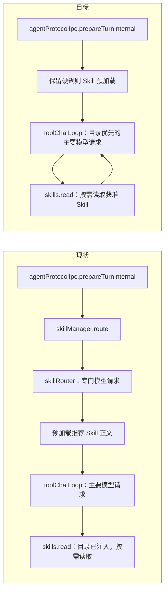

# Skill 目录优先与按需加载技术方案

> 状态：草稿（未实施）｜核验：基线 `codex/session-runtime-ended-tool-timer` `9ad6631e`（2026-11-03）；专属符号命中 `buildSkillCatalogSection`、`skillsReadTool`、`skillManager.route`；本地 Codex 参考仓库 `/Volumes/MacHub/Hub-Develop/codex` 基线 `c0e88f3c04`。
> 篇内路由：决策人读第 0 层；评审读第 0–1 层与 RP-2~RP-6；实现者读第 2 层及附录。

## 第 0 层 决策界面【人必读】

**一句话：** 现在每条消息会先等一个专门的技能推荐请求，再开始主要工作；目标是让主要模型先看到可用技能目录，只在任务确实需要时读取技能正文。

**只有 3 分钟的话：** 看 D-01、目标链路、权限不变量和 AC-01~AC-04。

**需要你决定的事项**

### D-01：取消每条消息前的专门技能推荐请求

目前输入消息后，应用会先等一个专门请求判断要不要用技能；即使最后一个技能也没用上，这段等待仍会发生。改为主要模型在开始处理任务时看到技能名称和说明，需要时再读取技能正文。

- **A：采用目录优先方案（推荐）**。不需要技能的任务可直接进入主要模型处理；需要技能的任务由主要模型读取后继续工作。技能相关请求仍可能多一次模型往返，但这次往返同时承担任务处理；现有 `alwaysLoad`、手动激活、飞书和 Wiki 规则继续直接加载。该行为可通过代码回退恢复。
- **B：保留专门推荐请求**。既有行为与路由模型配置继续有效，但每条适用消息仍承担额外请求及其延迟。
- **依据强度：** 代码已确认独立路由发生在主要模型调用之前；历史运行日志记录过 3 个技能、未命中时路由耗时约 1.609 秒。尚无目录优先实现后的真实模型时延分布。
- **未作选择时：** 本文保持草稿，不进入实现阶段。
- **下钻：** `skillManager.route`、`agentProtocolIpc.prepareTurnInternal`、`buildSkillCatalogSection`、`skills.read`；`INV-01`、`AC-01`、`AC-02`。

**不需要你决定：** Skill 目录过滤、读取授权、并发读取预算、快照一致性、取消与回退测试由实现者按规格落实；不新增设置开关、IPC、持久化字段或 SDK 接口。

## 第 1 层 方案概要【人机共读】

### 现状与目标

当前 `prepareTurnInternal` 调用 `skillManager.route()` 并等待结果，再把选中的 Skill 正文拼到本轮上下文；`mode='llm'` 时路由器会单独调用模型。与此同时，真正的首轮模型请求已通过 `buildSkillCatalogSection()` 注入目录，`skills.read` 已支持按名称读取正文。形成了“先做一次专门模型路由，之后主要模型仍看到目录”的重复决策。

目标是在默认 `mode='llm'` 下取消这次前置模型请求和自动匹配正文预加载，让主要模型根据目录按需读取。未使用 Skill 的普通请求因此不再等待独立路由调用。Skill 相关任务可能在主要模型发现需要技能后先调用 `skills.read`，随后继续任务；目录本身会占少量上下文预算。

### 范围

- 本方案只调整桌面端 Skill 自动路由与正文加载的执行位置和授权范围。
- `alwaysLoad`、会话手动激活、飞书硬规则、Wiki 触发规则继续在首轮模型请求前直接加载正文。
- `mode='legacy'` 继续使用现有本地匹配作为回退路径。
- 不改设置界面、用户可见状态、agent-sdk、会话存储、IPC、数据库格式及外部渠道行为。
- `mode='llm'` 下现有路由专用模型、上下文、超时等配置字段保留在存储结构中以兼容旧设置，但不再驱动单独路由请求；它们的配置语义变化属于 D-01 批准范围。

### 设计依据与比较

本地 Codex 参考仓库在首轮上下文中提供 Skill 名称和描述，并指示主模型在任务明确匹配时读取 Skill 正文；明确提及的 Skill 可在执行任务前直接加载。SpaceAssistant 已有目录注入和 `skills.read`，因此可沿用渐进披露模型，不需要新增工具协议。

备选做法是继续独立路由请求，优点是自动选择结果和主模型解耦；代价是普通请求仍承担前置延迟与一次额外模型调用。纯本地关键词匹配能省掉请求，但无法可靠覆盖自由表达的任务，且 `mode='legacy'` 已提供现成回退路径。本方案选择目录优先。

### RP-2 链路图【人机共读】



目标链路中的 per-turn Skill 访问范围与读取预算由 `toolChatLoop` 创建并传递；唯一 writer 是本轮工具执行上下文。`skillRouter` 仅用于 `legacy` 本地匹配及确定性硬规则，不再拥有默认 `llm` 模式的模型路由状态。

### RP-3 变更面表【人机共读】

| 单元 | 作用简述 | 改动类型 | 对应 `D/INV` | 跨边界 |
|---|---|---|---|---|
| `electron/ipc/agentProtocolIpc.ts` | 接收桌面端 Agent 请求并准备本轮上下文 | 改造 | D-01、INV-01 | 向主要请求交接硬规则 Skill 快照 |
| `electron/skills/skillManager.ts` | 管理 Skill 查询、匹配、路由和正文读取 | 改造 | D-01、INV-01 | 保留 legacy 路由行为 |
| `electron/skills/skillRouter.ts` | 计算硬规则激活与本地 / 模型匹配结果 | 改造 | INV-01 | 移除默认模式的前置模型调用 |
| `src/shared/skillPrompt.ts` | 构造目录提示并按名称读取 Skill 正文 | 改造 | INV-02、INV-03 | 目录不暴露文件系统路径 |
| `electron/toolChatLoop.ts` | 组装主要模型上下文并执行工具循环 | 改承重边界 | INV-02、INV-04 | 创建并传递本轮 Skill 范围与预算 |
| `electron/tools/skillsReadTool.ts` | 执行模型发起的 Skill 正文读取 | 改造 | INV-03、INV-04 | 强制本轮授权与读取预算 |
| `electron/tools/types.ts` | 定义主进程工具执行上下文 | 改承重边界 | INV-03、INV-04 | 增加内部 per-turn Skill 读取范围，不改变公共端口 |
| `electron/tools/builtinExecutors.ts` | 注册内置工具执行器 | 复用不改 | INV-03 | 已注册 `skills.read` |
| `electron/tools/snapshotReadRegisteredTool.ts` | 校验只读工具计划与执行快照一致 | 复用不改 | INV-05 | 既有上下文 / 结果哈希校验继续生效 |
| `src/shared/domainTypes.ts` | 定义共享领域配置和 Skill 类型 | 复用不改 | INV-06 | 保持配置字段及持久化形状 |

**计数：** 改既有 7 个、新建 0 个、复用不改 3 个；改对外契约 0 行；改承重边界 2 处。无新增持久化字段、稳定错误码或对外数据项。两个内部承重边界共同闭合工具读取授权与调用上下文，不拆分为多份方案。

### RP-4 契约面六面【人机共读】

| 契约面 | 结论 | 依据 / 验证 |
|---|---|---|
| ① agent-sdk 接口 | 不改 | 不新增宿主端口、历史事件或 SDK 导出；运行 `npm run check:agent-sdk`、`npm run typecheck:agent-sdk` |
| ② 会话存储接口 | 不改 | 不改变消息 / 事件写入和恢复；运行 `npm run check:session-storage-boundary`、`npm run check:session-storage-cleanup-boundary`、`npm run check:message-fact-ownership` |
| ③ IPC / 预加载 | 不改 | 路由调用是主进程内部调用；不增加通道或参数 |
| ④ `src/shared/` 类型 | 不改 | 既有 `SkillsConfig`、`SkillRouteResult` 形状不变；内部工具上下文是 `electron/tools/types.ts` 私有类型 |
| ⑤ 持久化格式 / 迁移 | 不改 | 不新增数据库字段、版本或迁移；旧设置仍可解析 |
| ⑥ 领域数据格式 | 形状不改，`mode='llm'` 语义改变 | 现有路由专用设置字段保留但在此模式不再生效；由 D-01 批准，旧值读取兼容测试覆盖 |

### RP-5 量级与拆分判断【人机共读】

改既有 7 个单元、新建 0 个、复用 3 个；改对外契约 0 行、改承重边界 2 处；新增持久化字段 0 个、新增错误码 / 对外数据项 0 个；实现阶段 1 个。单阶段可以先实现范围快照，再接入 `skills.read` 并验证完整请求链；没有跨版本迁移或外部契约需要拆方案。

### RP-6 待批准清单与三处弱点【人必读】

**待批准：** 仅需批准 D-01，即 `mode='llm'` 不再先做专门技能推荐请求，改为主要模型按目录决定是否读取技能。该选择可用代码回退，不迁移用户数据。真实模型下的新时延分布尚未验证。

**最可能被推翻的三处：**

1. **无技能请求的收益**：若主要模型上下文本身仍因其它准备工作延后，目录优先只能去掉路由等待，不能消除其它延迟；首轮 provider 请求时间线会推翻“足以改善首启体感”的判断。
2. **目录选择质量**：若主模型不按目录说明读取已匹配 Skill，真实任务回放中的漏读率会推翻“目录描述足以触发加载”的假设。
3. **目录与权限一致性成本**：如果无法让目录和 `skills.read` 共用冻结的可用 Skill 快照，安装 / 禁用并发会造成读到不同版本或越权；快照边界测试会推翻当前单阶段设计。

## 第 2 层 规格层【机｜人工可跳过】

### F-01 代码事实与边界

基线 `9ad6631e`（2026-11-03），复核命令：

```text
rg -n 'skillManager\.route|buildSkillCatalogSection|skills\.read|shouldCallLlm|getAvailableSkills|collectHardRuleSkills' electron src/shared
```

- `agentProtocolIpc.prepareTurnInternal` 在主模型请求前等待 `skillManager.route()`，并把路由结果的 Skill 正文放入 `skillFragments`。
- `skillRouter.routeSkills` 在 `autoDetect`、`routing.mode === 'llm'`、路由启用、有输入且有可用 Skill 时获取 API Key 并调用路由模型。
- `toolChatLoop` 已在首轮主模型 system prompt 中注入 `buildSkillCatalogSection` 生成的目录。
- `skills.read` 已注册，并通过缓存按 Skill 名读取正文；工具包装器对准备与执行阶段的上下文和结果做快照哈希校验。
- 目录条目当前包含 `skill.filePath`；正文读取目前不按本轮禁用集合过滤。目录展示和正文读取必须同时修正，不能仅移除路由调用。
- 绕过通道清单：显式 Skill `/` 命令或会话激活路径、`alwaysLoad`、飞书来源、Wiki 关键词硬规则、`mode='legacy'` 本地匹配，以及除 `agentProtocolIpc` 外的 `skillManager.route` 调用（包括独立路由 IPC）均须分别保留既有语义；主模型工具循环中的 `skills.read` 是本方案新增的自动读取入口。

### 目标链路与状态所有权

1. turn 准备阶段读取当前 Skills 配置、会话激活状态、Skill 缓存和请求来源，生成不可变的本轮 Skill 范围快照。
2. `alwaysLoad`、会话手动激活、飞书 / Wiki 硬规则继续在主模型请求前直接加载；其余自动 Skill 仅将允许的稳定元数据放入目录。
3. 默认 `mode='llm'` 不调用专门路由模型；主要模型通过目录决定是否调用 `skills.read({name})`。
4. `mode='legacy'` 保留现有本地匹配和预加载，不调用模型路由。
5. `skills.read` 只接受本轮快照中获准的 Skill 名称，基于冻结的同一 Skill 内容执行；按本轮计数器同步预留名额，成功读取后才记为已消耗，重复读取同一 Skill 不重复占额。
6. 请求结束、取消或失败时销毁范围快照和读取预算，不写入会话或全局缓存。

| 状态 | 唯一 writer | 生命周期 / 恢复 |
|---|---|---|
| 当前 turn 可见 Skill 集合 | turn 准备逻辑 | 以本轮配置与 Skill 内容快照创建；请求结束即销毁；失败不重试外部路由 |
| 每轮不同 Skill 的读取名额 | `toolChatLoop` 持有的读取预算对象 | 主进程内同步预留；单次调用失败可释放；请求结束销毁 |
| Skill 正文快照 | Skill 缓存读取边界 | turn 开始时冻结；读取前不刷新；快照一致性由既有 snapshot-read 校验确认 |

### 不变量

- **INV-01｜默认链路不等待独立路由模型：** `mode='llm'` 的 turn 在首个主要模型请求前不得调用 `routeSkills` 的模型分支。证明：provider client spy 验证调用顺序和请求数。
- **INV-02｜模型只看到本轮可用目录：** 目录仅含未在全局或会话级禁用的 Skill，排除列表以外的 Skill 不通过“Additional skills”提示暗示存在；目录排序和预算稳定。证明：禁用组合、预算截断测试。
- **INV-03｜读取受本轮授权：** `skills.read` 只能读取冻结快照中授权的精确名称，不接受任意路径或本轮禁用项；读取正文上限仍为 32,000 字符，超限返回工具失败而不终止 turn。证明：越权名、路径输入、超限与同名更新快照测试。
- **INV-04｜每轮 Skill 正文加载有界：** 自动按需读取与直接预加载共同遵循 `maxConcurrent` 的不同 Skill 总量上限；重复读取已加载 Skill 不占新名额；多个并发读取先同步预留，不能超额。证明：并发工具调用测试。
- **INV-05｜只读快照有效：** 读取计划和执行之间上下文 / 正文变化仍由 `createSnapshotReadRegisteredTool` 拒绝；拒绝只让工具调用失败，不污染后续读取。
- **INV-06｜兼容配置及硬规则：** 配置 JSON 形状不变；`alwaysLoad`、手动激活、飞书 / Wiki 硬规则和 `legacy` 本地匹配保持既有选择结果与来源信息。
- **INV-07｜逐 turn 隔离：** 一个会话的并发 turn、取消 turn 和后续 turn 不共享读取范围或预算；较早 turn 的工具不能读取较新 turn 新增或被授权的 Skill。

### 目录与读取契约

目录每项只包含 Skill 名称、描述，以及模型可直接使用的 `skills.read` 指引；不得出现绝对路径或主机文件系统位置。若目录预算截断，尾部只说明目录已截断及需基于已展示目录作选择，不得暗示可读取未授权的隐藏 Skill。

读取工具输入仍为 `{ name: string, max_chars?: number }`。`name` 必须精确匹配冻结快照；`max_chars` 取请求值与 32,000 字符上限的较小值。失败结果采用现有工具失败表示，不新增稳定错误码。当前快照中的 `SkillDefinition.content` 作为读取正文；相对附件读取沿用 Skill 文本自身现有安全规则，不向模型暴露绝对位置。

`maxConcurrent` 的口径在此固定为：每轮被预加载或通过 `skills.read` 成功读取的不同 Skill 正文总数上限；一次 turn 已预加载的正文先占名额，读取同名正文幂等，不额外扣减。若历史行为的 `maxConcurrent` 仅限制自动路由结果，需通过现有测试和实现核对确认此调整不会削弱手动激活 / alwaysLoad 的语义；若会改变配置含义，先补 D 决策，不得静默修改。

### 配置兼容与失败处理

- 保持 `SkillsConfig` 与 `SkillsRoutingConfig` 的字段、缺省值、反序列化和 IPC 形状。
- `mode='llm'` 下 `model`、`context`、`contextTurns`、`contextMaxChars`、`timeoutMs`、`includeTriggersInCatalog` 不再控制独立路由；不得删除或重置旧值。
- `autoDetect=false` 或 `routing.enabled=false` 时，目录中不暴露自动发现 Skill，也不允许 `skills.read` 自动读取；直接激活与硬规则仍按既有规则运行。
- `mode='legacy'` 继续本地匹配；其结果受同一禁用配置过滤。
- 目录构造失败不得阻断主请求；被授权 Skill 读取失败、超限或快照失效仅作为该工具失败反馈，模型可以不使用该 Skill 继续，是否重试由模型决定。
- 用户取消请求时，取消信号继续传播到工具执行；正在读取正文应快速结束，且不得消费永久状态或影响下一 turn。

### 场景矩阵

| 场景 | 期望结果 | 覆盖 |
|---|---|---|
| 普通任务、存在 3 个可用 Skill | 不调用路由模型；首个 provider 请求直接启动 | AC-01、AC-02 |
| 用户任务命中 Skill 描述 | 主模型可读取匹配 Skill 后继续，不预先把所有正文注入上下文 | AC-03 |
| 无可用 Skill、目录超预算 | 不调用路由模型；目录为空或稳定截断；主请求继续 | AC-01、AC-05 |
| 全局禁用 / 会话禁用 | 目录与 `skills.read` 均不可访问；猜测名称返回工具失败 | AC-04 |
| alwaysLoad / 手动 / 飞书 / Wiki | 硬规则正文仍在主模型首轮可见，来源提示准确 | AC-06 |
| legacy 模式 | 保留本地匹配结果，不访问路由模型 | AC-07 |
| 读取超限、快照改变、读取失败 | 工具失败反馈；后续 turn 和会话可继续 | AC-08 |
| 两个并发读取争最后名额 | 至多一个不同 Skill 读取成功；重复读取已读 Skill 可成功 | AC-09 |
| 两个并发 turn、一个取消 | 范围与预算隔离；取消不影响另一 turn | AC-10 |
| 旧配置含路由专用字段 | 配置加载与保存不抹除字段；`mode='llm'` 不发路由请求 | AC-11 |
| `skills.read` 准备后 Skill 内容 / 配置变化 | 快照检查拒绝陈旧结果，不执行旧快照 | AC-08 |

### 验收映射

| 验收 | 可执行断言 | 对应不变量 | 证据 |
|---|---|---|---|
| AC-01 普通 turn 不再付路由往返 | 无路由 API 调用；首个 provider 请求在 turn 预备完成后直接进入；无 API Key 时不发生路由专用失败 | INV-01 | `skillRouter` / `agentProtocolIpc` 定向测试，注入请求计数器 |
| AC-02 首次开始状态与首轮请求顺序正确 | Skill 目录组装不发网络请求；首个 provider 请求开始前不等待路由模型 | INV-01 | agent protocol 请求时序测试 |
| AC-03 需要 Skill 时按需读取 | 描述命中时模型可调用 `skills.read`，读取内容进入后续模型上下文；无关 Skill 正文不进入首轮上下文 | INV-02、INV-03 | tool-loop 端到端模拟 provider 测试 |
| AC-04 禁用项不能被发现或读取 | 禁用 Skill 不在目录中；直接猜名读取失败，合法 Skill 仍可读 | INV-02、INV-03 | 组合配置边界测试 |
| AC-05 目录预算确定 | 排序稳定、预算截断稳定、路径不泄露 | INV-02 | `skillPrompt` 单测 |
| AC-06 硬规则选择不回归 | alwaysLoad、手动、Feishu、Wiki 命中仍直接预加载且来源映射正确 | INV-06 | `skillRouter` 与 prepare-turn 测试 |
| AC-07 legacy 可用 | 旧本地匹配选择集和来源保持，路由模型调用为零 | INV-06 | `skillRouter` 回归测试 |
| AC-08 失败不破坏会话 | 超限、越权、快照改变和正文缺失都只产生工具级失败；后续工具 / turn 可运行 | INV-03、INV-05 | `skillsReadTool` 和 snapshot-read 故障注入测试 |
| AC-09 并发上限正确 | 并发不同名称不超过 maxConcurrent；重复名称可并发返回且只占一名额 | INV-04 | 工具级 Promise barrier 竞态测试 |
| AC-10 turn 隔离及取消 | 并发 turn 读写范围互不可见；取消后预算销毁，下一 turn 从零计数 | INV-07 | tool-loop 并发 / abort 测试 |
| AC-11 旧设置可往返 | 旧配置字段加载后保存保持原字段和原值，且默认路由不发专门请求 | INV-06 | 配置归一化与 IPC 回归测试 |

### 阶段、发布与回退

| 阶段 | 输入 / 输出 | 出口证据 | 回退实体 |
|---|---|---|---|
| 实现与验收 | 代码基线 `9ad6631e`；输出是目录过滤、per-turn 读取授权、默认路由快速路径及边界测试 | AC-01~AC-11 通过；相关定向测试、`npm run build:electron:incremental`、`npm run typecheck:renderer`；阶段收尾按仓库规则执行全量 `npm test` | 回退实现提交即可；无数据迁移。`mode='legacy'` 只回退到本地匹配，不等同于恢复旧 LLM 路由；恢复旧行为需回退整组代码变更 |

### 未验证项

- **U-01｜真实模型请求时延与 Skill 选择质量：** 本文未运行真实模型；实现后需要基于真实配置做普通任务和 Skill 任务样本，记录从回车到首个 provider 请求、首个可见运行事件，以及 Skill 漏读 / 误读。本文不承诺固定毫秒改善值。
- **U-02｜autoDetect 与 disabled 配置消费边界：** 全仓路由外调用及目录来源需实现前再 `rg` 核对，确保目录与读取权限执行完全一致。
- **U-03｜maxConcurrent 既有语义：** 需用代码与现有测试确认硬规则预加载是否计入该数；若改变用户已配置的上限含义，应停止实现并补充人类决策。

### 评审自曝与推翻条件

- 若真实主模型常常忽略短目录说明，即使额外提示后仍漏读，需回到模型层重新设计激活契约，而不是继续增加说明文字。
- 若读取预算、目录快照与执行工具上下文无法共享同一冻结 turn 身份，应先设计独立的授权传递机制，不能通过全局变量或按会话共享 Map 补洞。
- 若 `mode='llm'` 的路由专属设置字段仍被其他用户可见功能依赖，D-01 必须扩展兼容决策；不得静默删除字段或改变 UI。

