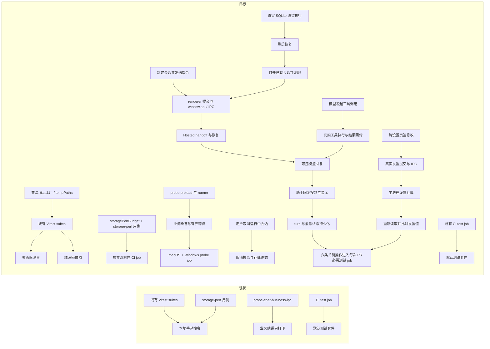

# 测试体系优化技术方案（近期 + 中期）

> 状态：实施中（2026-11-02；W0–W8 已本地实现；W0 六条真实 Electron UI 链路正向 `6/6`、负向 `6/6` 通过，required `test` job 已接入；pre-push hook 已安装并实际运行通过。进程重启恢复会恢复已记录上下文并说明工具结果未知，由 Agent 决定检查/询问/重试；不自动重跑旧 turn。D-04、R-01、R-02、R-04 已获用户批准；R-03 维持 storage-perf 非阻断观察，不要求五次远端数据作为验收；W0 / W6 平台 CI 结果仍待取得。评审复核：[复评报告](../../../review/2026-11-02-test-system-optimization-technical-plan-review.md)）
> 核对基线：`main` `a6a5cdb7`（2026-11-01）；修订时 HEAD `bf980e1e`（领先 4 提交，评审确认不影响核对项实质）
> 范围：覆盖率测量与门禁策略、测试基建复用、fixture 确定性、流式链路故障注入、渲染快照通道、存储性能门禁进 CI、probe CI 矩阵扩展、本地 pre-push 快速门禁、测试政策文档修订。
> 来源：2026-11-01 对 DeepSeek Harness（外部仓库，下称 DSH）测试体系的对比调研；外部事实标注为「外部参照」，不在本仓复核范围内。
> 本文保留方案设计基线；实际实施状态、证据与剩余验收见第 3 节“当前实施状态与未完成验收”。

## 第 0 层：决策层【人必读】

**一句话**：本仓测试纵深已经足够（约 1255 个测试文件，计数口径与复核见 F-08；真实 Electron 探针、静态边界检查、不变量方法论），缺的是把纵深变成默认强制的量化门禁、可复用测试基建，以及新会话发送、续聊、工具调用、取消、重启恢复和设置保存六条关键操作的自动化回归；本方案分阶段补齐，且不与在途 CI 可靠性方案重复。

**只有 3 分钟的话**：看本节、[与 CI 可靠性方案的边界](#与-ci-可靠性方案的边界人必读)、[工作流分解](#工作流分解人机共读) 和 [阶段与验收](#阶段与验收人机共读)。

### 与 CI 可靠性方案的边界【人必读】

[ci-reliability-improvement-technical-plan.md](./ci-reliability-improvement-technical-plan.md)（在途）已覆盖并**拥有**以下事项，本方案不重复设计：

| 事项 | 归属 |
|---|---|
| `CI / required` 稳定聚合门禁与分支保护规则 | CI 可靠性方案 §2.1、§4.1（D-01 已批准采用） |
| 本地 pre-push hook | CI 可靠性方案 §2.3 建议本地 hook 编排已有快速检查；用户于 2026-11-02 批准本轮实施（R-04）。本方案交付 `check:pre-push`、版本化 `.githooks/pre-push`、手动安装/卸载命令和显式跳过规则；hook 只提供本地反馈，不替代远端 required CI。 |
| fixture 平台无关临时目录纪律（mkdtemp、不绑定宿主路径） | CI 可靠性方案 INV-04、§4.3 |
| Electron 串行初始化屏障（任何真启动 Electron 的 CI job 必须遵守） | CI 可靠性方案 INV-03、§4.2 |
| 失败证据、测试报告 artifact、失败复盘分类 | CI 可靠性方案 §4.4 |

本方案与其的关系是**叠加而非并行**：CI 可靠性方案解决「CI 结论可信、失败不被洗白」；本方案解决「测什么、怎么测得更省、更快暴露回归」。本地 hook 的职责、可跳过边界和“不替代远端门禁”原则归 CI 可靠性方案 §2.3；本方案按用户批准交付具体命令、hook 与测试（R-04），两份文档同步维护。临时目录纪律仍遵循 INV-04。

### 已确认决策与待决项

- **R-01 覆盖率第一批只测量，不阻断 PR**。用户于 2026-11-02 确认：先收集基线数据，再决定是否以及如何设门槛；不因无基线而设阈值。
- **R-02 chat IPC probe 在 macOS + Windows 先做非阻断观察**。用户于 2026-11-02 确认两平台先观察；不会将 probe job 加入 `CI / required`。远端结果用于确认矩阵运行正常和检查屏障，不改变其观察性。
- **R-03 storage-perf 保持非阻断观察**。测试生成 SQLite / 文件样本，CI runner 运行同一合成场景；远端计时只反映 runner 上的测试耗时与波动，不代表生产流量或高频负载。当前 job 不阻断 PR，因此连续 5 次远端结果不是本轮完成条件；只有将来提议改为阻断门禁时，才先收集重复运行证据评估计时稳定性。
- **R-04 本轮实施原生 pre-push hook**。用户于 2026-11-02 确认纳入本轮；不引入 hook 管理依赖。具体安装、跳过、命令编排、失败阻断和维护方式见 W8 与 CI 可靠性方案 §2.3。

### 不需要负责人决定（默认取舍）

- **hook 使用 Git 原生 `core.hooksPath` 与版本化脚本，不引入 lefthook / husky**；clone 后由开发者显式执行 `npm run hooks:install`，需要卸载时执行 `npm run hooks:uninstall`（R-04）。
- **不给 Vitest 配置 retry**。与现状一致，也与 DSH 立场一致（其全仓唯一 retry 在真实 API e2e）：单元/集成测试失败必须可复现，用重试掩盖不确定性会把 flaky 从门禁信号中隐藏。
- **快照更新不引入自动刷新机器人**；第一批快照的 diff 全部人工审查。
- **不迁移测试文件到独立 `tests/` 目录**；保持就近放置约定（DSH 的包级 `tests/` 是其 monorepo 结构的自然结果，不是本仓应照搬的形态）。
- **覆盖率第一批只测量不门禁**（见 R-01）。
- **不引入 Playwright/WebDriver 级 Electron UI e2e**；W0 使用 Electron 自带的 `webContents.executeJavaScript` 驱动真实 renderer 的可访问控件，不增加产品 IPC 或浏览器自动化依赖。

### 决策状态

- **D-04［已批准：执行门禁］六条关键用户操作进入每 PR 必过检查**：用户于 2026-11-02 批准接入必过检查。新会话发送、已有会话续聊、工具调用后完成、用户取消、进程重启恢复后继续操作、跨设置页签修改并保存六条链路已由 `.github/workflows/ci.yml` 的既有 `test` job 调用 `npm run verify:critical-user-flows`；该 job 仍由 `CI / required` 汇总门禁依赖。假服务固定响应，不依赖真实模型凭据。

## 1. 概要层【人机共读】

### 1.1 目标

在不重写现有测试的前提下，为测试体系补上五类缺失能力：**关键会话操作的全链路回归门禁**、**量化门禁的起点**（覆盖率测量）、**测试基建的复用**（共享工厂、临时目录、流式故障注入）、**低成本回归通道**（渲染快照）、**性能与真实运行时门禁的常态化**（storage-perf 与 probe 进 CI）；并把散落的约定收敛为一页与现状一致的测试政策文档。

### 1.2 背景与问题

对 DSH 的对比调研（外部参照）显示，其测试体系的核心不是工具而是门禁文化：每类质量属性都有对应自动化 lane 且默认强制，每条例外都要求书面理由。对照之下本仓的具体缺口（均为本仓可复核事实，见附录）：

1. **覆盖率装而未用**：`@vitest/coverage-v8` 已在 devDependencies（package.json:131），但 vitest.config.mts、package.json scripts、ci.yml 均无任何 coverage 配置、脚本或门禁。
2. **测试基建薄且重复**：`electron/testSupport/` 四个文件合计 64 行，`electron/database/testHelpers.ts` 67 行；renderer 与 src/shared 侧无共享消息工厂，8 个测试文件各自内联 `assistantMessage` / `userMessage` 等工厂，复用靠复制（清单见 F-03）。
3. **fixture 确定性隐患**：`pagedChatBodyStore.test.ts:22` 用 `tmpdir + Date.now + Math.random()` 拼**目录**名；shell 三处（`shellConfigDb.test.ts:19`、`shellToolLoopHelpers.test.ts:15`、`shellCommandTrust.test.ts:85`）以同款方式拼单文件路径——三处均有 `afterEach` 清理，残留问题是非原子拼名的理论碰撞。同仓已有正确示范（`shellToolLoopHelpers.test.ts:17` 的 `mkdtempSync`），说明是惯例未统一而非能力缺失。
4. **无快照通道**：`toMatchSnapshot` 全仓 0 处；聊天渲染（Markdown、气泡、工具卡片）是最易被回归影响的「模型可见输出」，目前只能靠手写断言逐点覆盖。
5. **性能门禁未常态化**：`test:storage-perf` 已有硬性 p95 断言，但靠环境变量 + 白名单 `-t` 手动触发，CI 不跑；`bench:*` 为手动基线对比工具。
6. **真实运行时验证大量在 CI 之外**：`probe:*` npm scripts 共 9 个（`scripts/` 下另有配套 preload/launcher 辅助文件），只有 `probe:sqlite` 进 CI 矩阵。
7. **测试政策文档已过时**：`testing-guide.md` 写「当前三项目 electron / renderer / renderer-perf」，与现状四项目（含 agent-sdk）不符；其 electron 项目表格描述为 forks + 单 worker + 关闭文件并行，与当前 `vitest.config.mts` 的 macOS threads + 4 worker + 文件并行配置不符。

### 1.3 范围与非目标

**范围**：`vitest.config.mts`、`package.json` scripts、`.github/workflows/ci.yml`（观察性 job、required `test` 中的六条关键操作回归及 hook 辅助测试）、`.githooks/pre-push`、`scripts/check-pre-push.cjs`、`electron/testSupport/`、`electron/runtime/storagePerfBudget.ts`、`scripts/probe-chat-business-ipc.cjs`、`scripts/probe-chat-business-ipc-preload.cjs`、关键用户操作端到端集成测试、`src/test/`、指定的测试文件迁移、`docs/develop/platform-eng/testing-guide.md`，以及新增的覆盖率基线文档。各阶段对应单元见 RP-3。

**非目标**：不修改产品运行行为；不改变既有 CI job 拓扑与聚合门禁；不引入 Playwright / WebDriver 重型 UI 自动化；W0 使用 Electron 集成测试驱动真实 renderer 提交、preload、IPC 与生产业务处理；不建立 DSH 式录制会话回放 / 浏览器快照 lane（远期）；不做覆盖率一步到位 100% 门禁。W0/W6 只改测试资产，不改变应用生产代码行为；W8 hook 是本地开发反馈，不新增远端 required status check。

### 1.4 主要取舍

- **选择**「先测量、再基线、后门禁」的覆盖率路径，而不是直接套用 DSH 的 per-file 100% 门禁：DSH 的 100% 是多年豁免清单治理的结果，直接照搬会把首个迭代变成大规模豁免运动。
- **选择**复用 `anthropicClientFactory` 既有注入缝实现 SSE 故障注入，而不是起本地 HTTP server：前者零网络依赖、CI 友好、与现有测试衔接。
- **选择**快照只覆盖纯渲染组件（ChatMarkdown、ChatBubble）：快照的维护成本与组件的输出自由度成正比，含状态与交互的组件留给既有手写断言。
- **排除**给 storage-perf 与 renderer-perf 添加自动重试或放宽断言来换取 CI 稳定：性能断言失败应触发预算复核，不是重跑过关。

## 2. 工作流分解【人机共读】

### P1 近期（W0 优先；各项独立提交并按验收完成）

#### W0 必选操作链路：会话操作与设置保存

- **不变量 INV-05**：用户已发送且被接受的新 turn，在正常执行路径上必须保持可运行，直到助手结果与成功终态均提交；恢复逻辑不得将本次启动的 turn 当成遗留 turn 终止。
- **不变量 INV-06**：用户在设置页修改并保存的有效值，不得因切换页签、控件卸载或表单重渲染而丢失、变成 `undefined` / `NaN` 或与持久化值不一致；保存成功后重新读取必须得到同一规范化值。
- **链路范围**：此前的新会话故障是最高优先级回归；同一必需测试套件覆盖另外四条会话操作和一条设置保存操作。现有测试文件有不少局部和集成用例，但分开验证 handler、协调器、Hosted 执行、SQLite 恢复或设置控件都不算整条用户链路通过。

| 操作链路 | 必须按顺序验证的结果 | 现有测试能证明什么 / 尚缺什么 |
|---|---|---|
| 新会话发送指令 | 创建会话 → renderer 提交 → `window.api` / IPC → turn 运行 → 回复显示 → turn 与助手消息成功保存 → active turn 清空 | `new-session` 真实 Electron 链路覆盖界面创建与发送、用户/助手消息保存、SQLite turn 完成和 active turn 清空。 |
| 已有会话继续对话 | 打开已有会话 → 发送第二条指令 → 模型输入包含正确历史且当前指令只出现一次 → 新回复显示并提交 → 历史顺序正确 | `continue-session` 真实 Electron 链路从界面提交两条指令；本地模型检查历史里两条用户消息各出现一次，并验证第二条回复与顺序。 |
| 工具调用后完成 | 发送会触发工具的指令 → 模型发出 tool-use → 正确工具实际执行一次 → 结果回到模型 → 助手最终回复显示并完成保存 | `tool-roundtrip` 真实 Electron 链路经由用户批准、正式 `read_file` 工具执行、本地模型接收工具结果、助手最终回复与 SQLite 终态。 |
| 用户取消运行中会话 | 启动请求并保持模型响应待处理 → 用户取消 → provider 收到取消 / 执行停止 → UI 与存储均为 cancelled → 迟到响应不能复活或覆盖终态 | `cancel-stale-response` 真实 Electron 链路在 provider 请求挂起时从界面取消，核对取消终态、active turn 清空，并在迟到响应窗口后再次检查终态。 |
| 进程重启后恢复并继续 | 真实 SQLite 留下执行中 turn → 关闭并重开应用 / runtime → 遗留 turn 按恢复规则收敛 → 会话仍可打开 → 下一条用户指令正常完成 | `restart-recovery` 真实 Electron 链路复用 SQLite profile，重启后恢复已记上下文并显式告知 Agent 工具结果未知；不自动重跑旧 turn，下一条消息在同一会话发给 provider。 |
| 跨页签修改并保存设置 | 修改设置值 → 切到会卸载该控件的其他页签 → 保存 → 主进程校验并写入实际设置存储 → 重新读取 / 重开设置页 → 值与用户输入一致 | `settings-cross-tab-save` 真实 Electron 链路切换页签后保存并通过正式 config IPC 重新读取设置值。 |

- **测试形态**：新增确定性的 Electron 集成套件，驱动真实 renderer 操作、`window.api` / preload / IPC、主进程 turn 启动、Hosted handoff 与恢复、turn runtime 和 SQLite session storage；只把模型服务响应替换为固定、可控的流。设置保存用真实设置表单和 IPC / 持久化路径，不能 mock 保存 handler 或存储。工具调用使用真实应用工具注册与执行路径，副作用限定在临时目录或内存夹具。不得 mock 恢复逻辑、Hosted handoff、turn runtime、IPC handler 或会话 / 设置存储，也不得只断言函数被调用。
- **共同断言**：对话链路检查用户可见结果与数据库事实一致、状态终结正确（completed / cancelled）、无意外 active turn、用户指令与工具调用次数正确；设置链路检查跨页签后提交值有限且符合 schema、保存成功、重新读取值相同。各阶段均有界等待，失败时输出链路名、阶段名及 turnId 或设置字段名。取消链路额外验证迟到模型响应不会改变 cancelled 终态。
- **回归有效性**：六条真实 Electron 链路均检查各自关键用户结果、存储事实或对话上下文；新会话检查新 turn 正常完成，重启检查旧 turn 上下文和下一 turn 可运行，设置检查卸载页签后保存并复读。六条故障注入分别令对应链路断言失败，验证器确认失败来自预期断言且命令非零退出，本地负向验收 `6/6` 通过；远端 macOS / Windows 执行证据仍待 CI。
- **CI 与验收**：六条链路全部加入现有每次 PR 必跑的 `test` job，并纳入 required 聚合结果，不另设可选 / 观察性 lane。**AC-8**：CI 每次 PR 执行六条链路；新会话可完成、续聊历史正确、工具可执行并完成、取消后无迟到复活、重启恢复后可继续、设置跨页签保存后复读一致；各链路的反向验证 / 故障注入证明测试可检出对应回归。代码和 required job 已就绪；本地正向 / 负向均通过，远端 macOS 执行与 Windows 兼容性证据待分支进入 CI。真实模型试跑可作发布前补充证据，但不替代自动化门禁。
- **可执行接入契约（已实现）**：`scripts/run-critical-user-flows.cjs`（Node 父启动器）与 `scripts/critical-user-flows.electron.cjs`（Electron 子进程套件）提供六条 UI 流程；`npm run test:critical-user-flows` 运行已构建产物，`npm run verify:critical-user-flows` 依次构建 renderer / Electron、串行预热并运行套件。父启动器仅监听 `127.0.0.1` 随机端口，静态服务限制在 `dist/renderer/` 内；Electron 通过正式主进程、preload、`window.api`、IPC 与真实 UI 运行，六例使用隔离的 `userData`，重启例复用同一 profile。UI 由 `webContents.executeJavaScript` 按真实控件操作并检查可见结果；本地六条均通过，启动与静态服务异常、流程断言失败或超时会使父命令非零退出。
- **固定模型边界**：父启动器在 loopback 随机端口启动 Anthropic 兼容 SSE 假服务，按场景返回预先编排的普通回复、工具调用、延迟/取消响应；每个隔离 profile 通过应用已有模型服务配置持久化接口，将 API base URL 指向该服务并使用仅测试用假 key。请求仍经正式 Anthropic client、Hosted handoff、工具循环与 turn runtime；不替换 client factory，不 mock IPC、恢复、核心执行器或存储。工具副作用仅允许写入该用例自己的临时工作目录。
- **隔离、重启与清理**：每条链路使用独立 `mkdtemp` 根目录及独立 `userData`/SQLite 数据库；重启恢复用例的两次 Electron 启动显式复用同一 profile，其他用例不得复用。父启动器串行运行六例，为每例设置总超时；无论成功、断言失败或超时，均在 `finally` 关闭 Electron 子进程树、停止 renderer 静态文件服务和模型 loopback 服务并删除临时根目录。父启动器仅在 Electron 正常退出且收到成功结果、renderer 服务无 404/5xx 请求时记该例通过；静态文件服务错误、启动失败、断言失败或超时都使父命令非零退出。子进程每例输出带链路名和阶段名的机器可读结果。
- **精确 CI 接入**：在 `.github/workflows/ci.yml` 现有 macOS `test` job 中，以 `npm run verify:critical-user-flows` 替换单独的 `npm run build:electron` 步骤（该命令内已构建 renderer 与 Electron、串行预热并用本地静态服务加载 `dist/renderer/`），位置在现有类型/边界检查之后、Vitest 主套件之前；原有 `npm test` 与其余测试步骤保留。此 `test` job 必须继续进入仓库既有 `CI / required` 聚合门禁。六条场景必须各输出一条通过记录并在 job 日志中列出汇总；缺少任一场景记录、断言失败、进程异常或超时均令命令和 required job 失败。首次落地还须逐条做反向验证并保留结果，证明对应回归会使该命令失败。
- **回退**：W0 的两个脚本、package scripts 与 CI 接入按一个独立提交交付，回退时整体撤销；若因此移除 required 检查，必须同步把 D-04 重新标为待决并为关键链路 required 覆盖指定替代门禁，不能静默删除测试后仍宣称覆盖承诺有效。其他 P1/P2 工作项按各自独立提交回退，不改变其余阶段状态。

#### W1 覆盖率测量与基线

- **现状**：coverage-v8 闲置（附录 F-01）。
- **改动**：
  1. `package.json` 增加 `test:coverage`：`vitest run --coverage --project electron --project agent-sdk --project renderer`；
  2. 产出《覆盖率基线 2026-11》文档到 `docs/develop/platform-eng/`，记录各顶层目录的 statements/branches/functions/lines，附复核命令；
  3. 在 vitest.config.mts 预留 `coverage.include`/`exclude` 结构与**豁免注释规范**（每条例外必须带原因 + TODO，供 R-01 决策后启用阈值时直接复用）。
- **借鉴点**（外部参照 DSH）：豁免必须逐条列举并写明理由；「未覆盖的行往往是被门禁正确标记的死代码，应删除而非补测」——基线评审时按此口径过一遍低覆盖文件，先识别死代码再谈补测。
- **验收**：`npm run test:coverage` 一条命令产出三 project 合并报告；基线文档数字可由复核命令重现。

#### W2 测试基建复用：共享工厂与临时目录 helper

- **现状**：renderer 与 src/shared 内联工厂 8 处（附录 F-03）；testSupport 合计 131 行（附录 F-04）；目录类临时路径 1 处 + 文件类 3 处用 Date.now 拼名（附录 F-02）。
- **改动**：
  1. 新建 `src/test/factories/message.ts`：基于 `src/shared/domainTypes.ts` 的领域类型提供 `assistantMessage` / `userMessage` / `toolUse` / `thinking` 等工厂，参数显式、返回类型完整、允许字段覆写；不引入第三方工厂库；
  2. 迁移 8 个内联副本到共享工厂：renderer 5 个（ChatBubble、ChatView.scrollToLatest、chat.i18n、DetailPanel/useReferencedFiles、chatToolSessionService）+ src/shared 3 个（streamingActivityStatus、resolveRemoteProgressSnapshot、chatMessageQueue，与工厂同属 renderer project include 范围，纳入而非排除），迁移是纯等价替换，不改断言；
  3. 新建 `electron/testSupport/tempPaths.ts`：`mkdtempRoot()`（目录，自动登记 afterEach 清理）与 `uniqueFilePath()`（单文件，原子唯一命名）；改造 `pagedChatBodyStore.test.ts:22` 为 `mkdtempRoot()`，shell 三处改用 `uniqueFilePath()`（三处既有 afterEach 清理保留不动）；
  4. 在两处新 helper 文件头注释写明使用约定（引用 CI 可靠性方案 INV-04）。
- **验收**：`npm run test:renderer` 与 `npm run test:electron` 全绿；`pagedChatBodyStore.test.ts` 连续重复跑 20 次无目录碰撞；`grep -rn "tmpdir.*Date.now" electron/ src/` 清零（文件类允许收敛进 helper 内部实现）。

### P2 中期（约 1–2 周，每项独立成 PR）

#### W3 流式链路故障注入 harness

- **现状**：相关测试以 `vi.mock('./anthropicClientFactory')` mock 工厂模块、以 `vi.fn()` 拼装 client（electron 下 21 个测试文件，其中 claudeStreamHandlers 系 4 个），SSE 错误场景（中断、半截流、超时、overloaded）散落且写法不一；`vi.mock('@anthropic-ai/sdk')` 全仓仅 `anthropicClientFactory.test.ts:5` 一处，是工厂边界自测，**应保留不迁移**；`electron/testSupport/claudeStreamHandlers.ts`（14 行）是既有复用起点。
- **改动**：新建 `electron/testSupport/anthropicStreamHarness.ts`：可脚本化的 SSE 事件序列场景集（message_start / content_block_delta / thinking delta / tool_use / error / overloaded / 网络中断 / 半截流终止），经 `anthropicClientFactory` 既有注入缝下发；测试以「给定事件序列 → 断言 delta/thinking/done/error 事件流与持久化结果」编排。只 mock LLM/网络边界；IPC 与存储层保持既有真实/内存实现（与 DSH「优先真实实现而非 mock」口径一致，外部参照其 llm-mock-server 的场景化思路但不引入网络服务）。**迁移目标集合限定为 claudeStreamHandlers 系 4 个测试 + testSupport 起点**：appIpc / toolChatLoop 等其余 17 处 mock 的断言粒度是「client 被以某参数调用」，与 SSE 事件序列场景化不是同一层问题，不在迁移范围。
- **验收**：harness 覆盖 ≥6 类场景；claudeStreamHandlers 系 4 个测试迁移后全绿；该 4 文件中 `vi.mock('./anthropicClientFactory')` 清零（全仓其余 17 处不动），迁移文件清单在 PR 中列出（度量口径见 F-08）。

#### W4 渲染快照通道

- **现状**：`toMatchSnapshot` 0 处（附录 F-07）。
- **改动**：为 `ChatMarkdown`（Markdown→React 渲染树）与 `ChatBubble`（文本 / 工具调用卡片 / 思考折叠等组合态）增加 snapshot 测试；fixture 覆盖代表性输入（中英混排、代码块、表格、工具卡片、思考块、超长文本截断）。约定写进 testing-guide：快照仅用于纯渲染输出；快照 diff 在 PR 中人工审查；CI 中快照失败即失败（Vitest 默认 CI 不自动更新，无需额外配置）。
- **验收**：两组件快照落地且 CI 稳定；人为改动渲染输出时快照变红（红绿验证一次并记录于 PR）。

#### W5 存储性能门禁进 CI

- **现状**：`test:storage-perf`（env 开关 + 白名单 `-t`、单 worker）有硬性 p95 断言，仅本地手动跑；阈值散在测试用例名与断言中。
- **改动**：
  1. 阈值集中到一个常量模块（建议 `electron/runtime/storagePerfBudget.ts`），测试断言引用它；
  2. ci.yml 的 `storage-perf` 观察性 job 使用 macOS runner，步骤为依赖安装 → `npm run build:agent-provider-pi-ai` → `npm run test:storage-perf`；纯 Vitest node 环境，不启动 Electron，不涉及 INV-03 预热；超时预算参考实测 p95 加余量。显式构建不可省略：根 `pretest` 只由 `npm test` 触发，不由 `test:storage-perf` 触发；
  3. 每次运行上传耗时摘要 artifact（字段仅含用例名 / 耗时 / 结论，遵循 CI 可靠性方案 §4.4 的字段纪律）。
- **本地验收记录（2026-11-02）**：预算常量化并由选定断言读取；storage-perf lane 10 个被选中测试实例全绿。此前运行 77.38s，并发读写 30 个样本的候选 p95 为 2.38ms、主线程 History replay 为 0；本次复跑 84.77s，10 项通过、130 项按白名单跳过。红绿验证将 `apiShadowP95Ms` 暂设为 0，选定用例以 `candidate=12.32ms` 非零失败；恢复 50ms 后通过。CI job、JSON 汇总及只含用例名 / 耗时 / 结论的 14 天摘要 artifact 已实现。该 job 是非阻断观察；本地完整验证和 CI 配置检查足以完成实现验收，不要求连续远端运行。

#### W6 probe CI 矩阵扩展

- **现状**：9 个 `probe:*` npm scripts，CI 只跑 `probe:sqlite`（3 平台矩阵）；chat 系列仅本地手工。
- **实施**：`scripts/probe-chat-business-ipc-preload.cjs` 与 `scripts/probe-chat-business-ipc.cjs` 已改造为业务断言 probe；ci.yml 已加入 macOS + Windows 观察性矩阵：`npm ci` → `build:electron` → **Electron 串行预热屏障（按 CI 可靠性方案 INV-03）** → `npm run probe:chat-business-ipc`。复用 `SPACEASSISTANT_IPC_SAMPLES`（默认 1000），CI 设 40。preload 有界等待初始与终态投影，超时抛错；主进程校验投影版本递增、终态投影送达、active 清空、持久化 turn 为 `state=terminal/outcome=completed`、助手消息成功态。任一断言失败均非零退出；业务结果通过断言判定，不只写摘要日志。
- **故障注入**：为探针提供仅测试使用的故障模式或等价隔离入口，覆盖「丢失投影」与「异常终态」两例；各自须在有界超时/业务断言处失败、命令退出码非零，且 CI job 红。故障入口不得默认启用，不新增产品 IPC。
- **本地验收记录（2026-11-02）**：正式 Electron 下默认 1000 samples 正常路径通过，验证投影版本 1→2、completed 终态、active 清空、SQLite turn 与 assistant completed；`drop-projection` 在 terminal 有界等待处非零退出；`abnormal-terminal` 因业务终态断言非零退出。CI 已有 macOS + Windows 矩阵、build→串行初始化→probe 顺序，且 contract checker 拒绝缺失屏障或 `continue-on-error`。用户确认该 job 保持两平台非阻断观察；两平台远端正常 job 与屏障失败实机注入尚待 CI 证据。

#### W7 测试政策一页纸（testing-guide.md 修订）

- **现状**：`testing-guide.md` 两处与现状不符（四项目 vs 三项目；electron 池配置的平台差异未表达，附录 F-05）。
- **改动**：在保持「配置与基建」定位（执行纪律仍归 AGENTS.md）的前提下修订并扩充：
  1. 修正项目表为现状四项目，标注平台差异（macOS threads 并行 / Windows forks 单 worker）及理由引用 vitest.config.mts 注释；
  2. 新增 **lane 地图**：默认回归（electron+agent-sdk+renderer）、renderer-perf、storage-perf、probe、bench 各自定位、触发方式与「谁在 CI 跑」；
  3. 新增 **mock 边界约定**：只 mock LLM/网络/时钟边界；Electron API 与存储优先真实实现或内存替身；`vi.mock('electron')` 需在测试内注释原因（现状 41 处，不强制迁移）；
  4. 新增 **快照触发条件**（W4 的约定）、**覆盖率豁免规范**（逐条 + 原因 + TODO）、**临时目录规范**（mkdtemp / uniqueFilePath，引用 INV-04）。
- **验收**：文档每一项与 `vitest.config.mts`、`package.json`、ci.yml 现状一致（以核对基线复核）；不与 AGENTS.md 重复。

#### W8 本地 pre-push 快速门禁（R-04）

- **用户决定**：2026-11-02 确认把本地 pre-push hook 纳入本轮。
- **实现**：仓库提供可手动运行的 `npm run check:pre-push`，以及 `.githooks/pre-push`。`npm run hooks:install` 将本仓库本地 `core.hooksPath` 设为 `.githooks`；`npm run hooks:uninstall` 撤销该设置。安装不由 `npm install` 自动触发。
- **检查内容**：每次运行先执行 `check:no-nul`、`check:treesitter-wasm`、`check:agent-sdk` 与 `typecheck:shared`；推送涉及 `src/renderer` / `src/shared` 时加跑 `typecheck:renderer`，涉及 `packages/agent-sdk` 时加跑其独立 typecheck；有 Electron / renderer / SDK 源码变更时按推送 refs 执行 `npm run test:related -- <changed files>`。任一命令非零即停止并阻断本次 push。
- **跳过与边界**：仅当显式设置 `SPACEASSISTANT_SKIP_PRE_PUSH=1` 时跳过本地检查，并打印说明；跳过不会改变远端 required CI，也不影响分支保护。hook 只提供开发反馈，不把本地结果当作 CI 通过。
- **本地验收记录（2026-11-02）**：checker 单测 `5/5`、Git 本地 bare remote 集成测试 `1/1`（实际触发 hook，显式跳过成功，checker 非零时 push 被拒绝）；`npm run hooks:install` 后读回 `core.hooksPath=.githooks`；`npm run check:pre-push` 对当前分支 86 个变更路径运行全部快速检查与关联测试，相关 Vitest 481 个文件通过、1 个跳过，6146 项通过、137 项跳过，checker 最终通过。CI `test` job 已接入 checker、Git hook 集成、W0 runner 与负向 verifier 的 Node 单测。

## 3. 阶段与验收【人机共读】

阶段为设计边界，不是执行进度清单；P1 各项可独立提交，P2 顺序建议 W3 → W4 → W7 → W5 → W6（政策文档收尾能吸收前面各项沉淀的约定）。

| 阶段 | 交付 | 验收 |
|---|---|---|
| P1 | W0 六条关键操作端到端回归；W1 覆盖率脚本 + 基线文档；W2 共享工厂 + tempPaths + 4 处改造；W8 本地 pre-push 快速门禁 | **AC-8**：每次 PR 的必需测试 job 执行六条链路；六条反向故障注入均令相应断言失败并使命令非零。**AC-9**：pre-push hook 安装、手动执行、显式跳过与失败阻断行为可复核；不改变远端 required CI。**AC-1**：`npm run test:coverage` 一条命令产出合并报告，基线文档数字可复核。**AC-2**：8 处内联工厂迁移后 `test:renderer` 全绿；`tmpdir.*Date.now` 模式清零；重复跑 20 次无碰撞。 |
| P2 | W3 SSE harness；W4 双组件快照；W5 storage-perf CI；W6 probe CI；W7 政策修订 | **AC-3**：harness ≥6 场景；claudeStreamHandlers 系 4 文件迁移后 `vi.mock('./anthropicClientFactory')` 清零（其余 17 处不动），清单在 PR 中。**AC-4**：快照红绿验证记录在案。**AC-5**：阈值常量化；性能用例通过，阈值压低或注入可控延迟时命令非零退出、恢复预算后通过；CI 观察 job 与脱敏摘要可运行且不进入 required 门禁。若未来改为 required，另行收集重复 runner 结果后评估。**AC-6**：probe 两平台正常路径通过；丢投影与异常终态负例均令命令非零退出；active/投影/持久化/助手状态断言齐备；INV-03 屏障生效。**AC-7**：testing-guide 与三份配置文件逐项一致。 |

### 当前实施状态与未完成验收

截至 2026-11-02，本方案状态以代码、定向命令和实际 CI 运行结果为准：

| 工作项 | 已完成证据 | 尚未完成的验收 |
|---|---|---|
| W0 / AC-8 六条关键用户链路 | Electron UI harness 与 runner 5 项测试通过；六条真实 Electron 流程本地正向 `6/6` 通过，故障注入负向 `6/6` 均被对应断言检出。目标会话恢复在 session-storage 边界为无终止事件的遗留 turn 写入 `process-restart` 终止记录并选择 working context；工具结果不明时明确说明事实，不自动重跑旧 turn；同一会话的下一条消息可到达 provider。按用户要求合并 `codex/session-runtime-ended-tool-timer` 后，`npm test` 全量通过（1256 个文件通过、1 个跳过；12160 项通过、140 项跳过，用时 1106.70 秒）；CI `test` job 配置为调用六链路验证命令并仍属于 `CI / required` 汇总 | 六链路远端 macOS CI 结果与 Windows 兼容性证据待 CI 运行 |
| W1 / AC-1 覆盖率 | `npm run test:coverage` 与基线文档已提交，测量结果可本地复核 | 无已知剩余项 |
| W2 / AC-2 测试基建 | 工厂与临时路径 helper 已提交；renderer/Electron suites、20 次重复、typecheck 与增量构建已通过 | 无已知剩余项 |
| W3 / AC-3 流式 harness | 场景 harness 与目标测试迁移已提交，定向测试通过 | 无已知剩余项 |
| W4 / AC-4 渲染快照 | 两组件快照及 red/green 验证已提交 | 无已知剩余项 |
| W5 / AC-5 storage-perf | 本地红绿验证通过；CI 观察 job、阈值模块和脱敏摘要 artifact 已实现；按当前范围保持非阻断，不作为 `CI / required` | 无实现项剩余；若将来提议改成 required，再以重复 runner 结果检查计时稳定性；远端 job 的日常观察不代表生产负载 |
| W6 / AC-6 chat IPC probe | 本地正常路径、丢投影、异常终态三种路径均已验证；用户确认 macOS + Windows 先作为非阻断观察；CI 矩阵与初始化顺序静态门禁通过 | macOS + Windows 远端正常结果、初始化屏障失败时 probe 未启动的实际 CI 证据；观察 job 不进入 `CI / required` |
| W7 / AC-7 测试政策 | guide 已按当前四个 Vitest project、CI lane、mock、snapshot、coverage 与 temp path 纪律修订并提交 | 无已知剩余项 |
| W8 / AC-9 pre-push hook | `core.hooksPath=.githooks` 已在本仓安装；bare remote 集成测试证明 Git 会调用 hook、显式 skip 可过、检查失败会阻止 push；`npm run check:pre-push` 对 86 个变更路径通过，关联 Vitest 481 个文件通过、1 个跳过；checker 单测 5/5、集成测试 1/1 | 无已知本地剩余项；GitHub 远端 `test` job 尚未运行本次变更 |

本轮本地验证命令：合并 `codex/session-runtime-ended-tool-timer` 后运行 `npm test`（1256 个测试文件通过、1 个跳过；12160 项通过、140 项跳过，用时 1106.70 秒）；`npm run verify:critical-user-flows`（构建 renderer / Electron 并运行六条真实 Electron 流程，`6/6` 通过）；`npm run test:critical-user-flows:negative`（六条注入故障均令对应链路失败并被验证器识别，`6/6`）；Node harness / verifier / pre-push 单测（15/15）；合并后恢复 / 投影 / 存储定向 Vitest（4 个文件、226 项通过、6 项跳过）；`npm run check:pre-push`（本地安装后的实际链路通过；481 个关联测试文件通过、1 个跳过；6146 项通过、137 项跳过）；`npm run typecheck:renderer`、`npm run i18n:check`、`npm run check:ci-required-coverage`、`npm run build:electron:incremental`，以及 W1/W5/W6 已记录的覆盖率、storage-perf 与 chat IPC probe 命令。storage-perf job 保持非阻断观察，不以连续远端运行作为实现验收。W0 与 W6 的平台 CI 运行证据仍待远端执行；禁止把已接入的 job 或本地结果表述成 CI 平台通过。

## 4. 风险与已排除方案【机｜人工可跳过】

| 方案 / 风险 | 结论 | 原因与缓解 |
|---|---|---|
| 直接实施 per-file 100% 覆盖率门禁 | 排除 | 无基线数据，首轮将催生大面积豁免使门禁失去意义；按 W1 先测量，R-01 决策门禁范围。 |
| SSE 故障注入走本地 HTTP server（DSH llm-mock-server 式） | 暂缓 | 更接近真实但引入端口/生命周期管理，与本仓现有 fetch 注入缝衔接成本高；若 W3 后仍需真实套接字场景再评估。 |
| 快照扩展到消息列表 / 视口等状态组件 | 排除 | 输出自由度大、维护成本高；保持纯渲染组件范围。 |
| 覆盖率 / probe 拉长 CI 时长 | 缓解 | 覆盖率先不入 CI（本地测量）；probe 用采样参数压时长；storage-perf 单 job 时长实测后由 R-03 决定是否 required。 |
| 快照与 harness 的维护疲劳 | 缓解 | 快照 diff 人工审查 + 仅限纯渲染；harness 场景收敛到单一文件，禁止测试内手写事件序列绕过。 |
| testing-guide 修订与 AGENTS.md 职责混淆 | 缓解 | 维持既有分工声明（配置与基建归 guide，执行纪律归 AGENTS.md），修订时逐节自查不越界。 |

## 5. 评审包【RP-1~RP-6】

### RP-1 一句话变更

现状：测试能力分散在本地命令与少量 CI lane → 目标：把覆盖率测量、可复用测试基建、快照、存储性能、真实 IPC 业务探针和六条关键用户操作纳入可复核的阶段化交付，并保持与 CI 可靠性方案的职责边界。下钻：R-01…R-04、W0…W7、AC-1…AC-8、D-04、INV-05/06；引用的外部不变量 INV-03/04 明确归 CI 可靠性方案所有。

### RP-2 现状 / 目标链路



新接入点：共享工厂接入既有测试 suites；coverage/snapshot 接入对应 Vitest suites；storagePerfBudget 被 storage-perf 用例读取；probe preload 采集投影，runner 发起真实 IPC 并核对 SQLite 持久化，结果由新增 CI jobs 判定；W0 父启动器管理本地模型假服务与隔离目录，Electron 子进程加载正式 renderer 和正式主进程入口并驱动六条真实用户链路。各新状态唯一 writer：probe turn 状态由既有 `createSessionTurnRuntime` / SQLite session storage 写入；preload 仅观察 IPC 投影，不写业务状态；W0 的业务状态由产品现有流程写入，测试驱动只操作界面、读取结果；性能预算常量由代码维护、测试只读。

### RP-3 变更面表

| 单元 | 作用简述 | 改动类型 | 对应 `W/AC/R/INV` | 跨边界 |
|---|---|---|---|---|
| `vitest.config.mts` | 配置 Vitest 项目与覆盖率（测试运行器依赖它） | 改造 | W1, AC-1, R-01 | 无 |
| `package.json` scripts | 暴露统计、构建、六链路与 pre-push 验证命令 | 改造 | W0/W1/W5/W8, AC-1/5/8/9, D-04/R-04 | 仓内开发命令；无产品 API |
| `.github/workflows/ci.yml` | 在既有 required test job 接入 W0 与本地门禁脚本单测，并编排探针与性能 job | 改造 | W0/W5/W6/W8, AC-5/6/8/9, D-04/R-04；外部 INV-03 | CI job 行为；遵守 CI 可靠性方案的 required 聚合与 Electron 预热约束 |
| `.githooks/pre-push` | 由 Git 调用本地快速检查入口 | 新建 | W8, AC-9, R-04 | 本地开发机 hook；不表示 CI 通过 |
| `scripts/check-pre-push.cjs` 与测试 | 解析推送 refs、选择快速 typecheck / related tests 并传播失败 | 新建 | W8, AC-9, R-04 | 本地开发命令；node/npm 与既有检查脚本 |
| `scripts/run-critical-user-flows.cjs` | 启动本地模型假服务、隔离目录和 Electron 子进程，汇总失败并清理 | 新建 | W0, AC-8, D-04, INV-05/06 | 本机进程、loopback HTTP；无产品 API |
| `scripts/critical-user-flows.electron.cjs` | 加载正式 Electron 应用并驱动真实 renderer 的六条链路 | 新建 | W0, AC-8, D-04, INV-05/06 | renderer / preload / IPC / Hosted / turn 与设置存储真实贯通 |
| W0 renderer 控件定位标记（仅在可访问名称不足时） | 让 Electron 驱动器稳定定位真实控件，不改变交互行为 | 条件改造 | W0, AC-8, D-04 | renderer DOM 测试定位属性；不新增 IPC 或产品数据契约 |
| `electron/testSupport/anthropicStreamHarness.ts` | 生成脚本化模型流事件（stream 测试依赖它） | 新建 | W3, AC-3 | 测试内部 |
| `electron/testSupport/tempPaths.ts` | 创建并清理唯一临时路径（测试 fixture 依赖它） | 新建 | W2, AC-2；外部 INV-04 | 测试内部 |
| `electron/runtime/storagePerfBudget.ts` | 集中声明性能测试上限（性能用例读取它） | 新建 | W5, AC-5, R-03 | 测试内部 |
| `scripts/probe-chat-business-ipc-preload.cjs` | 接收投影并测量 IPC 呈现（probe runner 依赖它） | 改造 | W6, AC-6, R-02；外部 INV-03 | probe 专属 preload / IPC 边界，不新增产品 IPC |
| `scripts/probe-chat-business-ipc.cjs` | 启动真实 Electron 并校验业务终态（CI probe job 调用它） | 改造 | W6, AC-6, R-02；外部 INV-03 | Electron IPC / SQLite 既有契约只读验证 |
| 六条关键用户操作场景与故障注入 verifier | 验证会话与设置真实链路及六条负例（required job 执行正向链路；负向验证用于验收） | 新建 | W0, AC-8, D-04, INV-05/06 | renderer / preload / IPC / Hosted / 会话与设置存储跨层链路 |
| `ConfigSettingsPage.test.tsx` | 验证跨页签保留设置值（设置页回归依赖它） | 复用不改 | W0, AC-8, D-04, INV-06 | 已覆盖控件卸载后的提交载荷；W0 另验证真实 IPC 持久化与复读 |
| `src/test/factories/message.ts` | 构造共享消息测试数据（renderer 与 shared 测试依赖它） | 新建 | W2, AC-2 | 测试内部 |
| 指定的 8 个消息工厂测试 | 验证聊天与共享消息行为（测试 runner 执行它们） | 改造 | W2, AC-2 | 无 |
| `pagedChatBodyStore.test.ts` 与 3 个 shell 测试 | 验证临时目录与文件行为（Electron 测试项目执行） | 改造 | W2, AC-2；外部 INV-04 | 无 |
| claudeStreamHandlers 系 4 个测试 | 验证流式事件与错误处理（harness 驱动它们） | 改造 | W3, AC-3 | 无 |
| `ChatMarkdown` 与 `ChatBubble` 测试 | 固定纯渲染输出（renderer 测试项目执行） | 新建 | W4, AC-4 | 无 |
| `sessionStorageShadow.test.ts` 与 `sessionTranscriptProjection.test.ts` | 测量存储路径 p95（storage-perf job 执行） | 改造 | W5, AC-5, R-03 | 无 |
| `docs/develop/platform-eng/testing-guide.md` | 说明测试项目与 lane（开发者按它选择命令） | 改造 | W2/W3/W5/W6, AC-2/3/5/6 | 文档约定 |
| 覆盖率基线文档 | 记录目录覆盖率基线（负责人据此讨论阈值） | 新建 | W1, AC-1, R-01 | 文档交付 |

计数：改既有 10 类单元、新建 9 类单元、复用不改 1 类单元，另有 1 项按需发生的 renderer 测试定位标记改造（表中改造项按目录/测试集合成组计；W0 两个启动器与六条场景分别登记）；改产品对外契约 0 行；仓内开发命令接口改造 1 行；`改承重边界` 0 处；新增持久化字段 0；新增稳定错误码 / 领域数据项 0。W0 两个启动器与六条关键操作集成测试、现有设置页回归、W6 两个 probe 脚本、storagePerfBudget 与覆盖率基线文档均已登记。

### RP-4 契约面六面

| 契约面 | 结论 | 依据 / 验证 |
|---|---|---|
| ① agent-sdk 接口契约 | 不改 | 只新增/调整测试支持与测试脚本；不触碰 SDK 端口、事件、公开导出或依赖方向。实现 PR 运行 `npm run check:agent-sdk` 与 `npm run typecheck:agent-sdk`。 |
| ② 会话存储接口契约 | 不改 | 不改 session storage API、writer、表结构与明文备份；W0/W6 都经既有产品流程写入，测试只读取 turn、消息及恢复结果；W6 通过现有 `getPersistedTurn` / `getMessages` 只读核验。实现 PR 运行 `npm run check:session-storage-boundary`、`npm run check:session-storage-cleanup-boundary`、`npm run check:message-fact-ownership`。 |
| ③ IPC / preload 暴露面 | 不改产品通道 | W0 通过正式 preload 暴露的现有 `window.api` 操作真实 UI，不添加产品 IPC；W6 只消费已有 `chat:list-active-turns` 与 `chat:turn-projection`，另用 probe 专属测试通道驱动 fixture；不得新增应用产品通道。 |
| ④ `src/shared/` 类型 | 不改 | 消息工厂直接使用既有领域类型；运行 `npm run typecheck:shared`。 |
| ⑤ 其他持久化格式与迁移 | 不改 | W0 通过现有设置保存/读取契约及隔离 userData 验证结果，不增加设置字段、数据库 schema 或迁移；W6 probe 使用内存 SQLite。 |
| ⑥ 领域数据格式 | 不改 | 不新增规则、配置项、错误码或稳定失败分类。 |

### RP-5 量级与拆分判断

按 RP-3 原交付归组为改既有 10、新建 9、复用 1，另有 1 项按需发生的 renderer 测试定位标记改造；W0 负例验证新增 2 个脚本，R-04 新增 3 个本地 hook / checker / 测试文件，并扩充 npm scripts 与 required test job 中的脚本单测。产品公共契约改动 0、承重边界 0；新增持久化字段 0、新增错误码 / 对外数据项 0；P1/P2 两阶段，W8 归 P1。契约六面均为不改；W0 六条关键用户操作回归进入 P1 required 门禁；各工作项按阶段交付。

### RP-6 待批准清单与自曝三处

- **待决 / 待验收**：D-04、R-01、R-02、R-04 已由用户确认；R-03 按本方案继续保持非阻断观察，若要调整为 required 须另行决策。W0 六条负向故障注入已本地 `6/6` 检出。外部验收仍包括 W0 远端 macOS 运行与 Windows 兼容性证据，以及 W6 两平台正常结果和初始化屏障负例；storage-perf 的重复 runner 数据只在讨论升级为 required 时需要，合成测试不用于推断生产负载。
- **弱点 1**：W6 probe 业务断言可能与实际终态语义不符；若真实 `turnRuntime`/SQLite 流程中 outcome 或助手状态定义不同，须以既有领域契约与测试证据修订，不能放宽为仅打印。
- **弱点 2**：storage-perf 在 CI 的 p95 可能受 runner 波动影响；当前 job 不阻断 PR，摘要用于观察 runner 测试稳定性；若未来提议升级为 required，应先用重复结果评估预算，不得靠重试或放宽预算掩盖。
- **弱点 3**：coverage 合并报告与新增测试工厂的 project include 可能遗漏文件；若复核命令与报告覆盖面不一致，修正配置/基线后再讨论阈值。

## 6. 追溯关系【机｜人工可跳过】

| 项 | 关联项 |
|---|---|
| R-01 | W1、AC-1；§4 首行排除项；用户确认先只测量、建立基线后再决定门槛 |
| R-02 / R-03 | W6 / W5；AC-6 / AC-5；R-02 确认为两平台非阻断观察；R-03 维持非阻断观察，升级门禁需重新决策 |
| INV-03（CI 可靠性方案） | W6 job 步骤、AC-6 |
| INV-04（CI 可靠性方案） | W2 tempPaths 约定、AC-2 |
| R-04 | W8 / AC-9；用户批准本轮实施本地 hook；职责与远端门禁边界见 CI 可靠性方案 §2.3 |
| D-04 / INV-05…06 | W0 六条关键用户操作与 AC-8；D-04 于 2026-11-02 获用户批准并接入 required `test` job；INV-05/06 为本方案定义的不变量 |
| F-08 | §0 测试文件计数、W3/AC-3 度量基线（21 处 / 其中 claudeStreamHandlers 系 4 文件） |
| 附录 F-01…F-07 | §1.2 各问题点 |

## 附录：事实与复核命令【机｜人工可跳过】

复核基线：`main` `a6a5cdb7`（2026-11-01）。

### F-01 覆盖率依赖闲置

```bash
grep -n '"@vitest/coverage-v8"' package.json   # :131
grep -rn "coverage" vitest.config.mts .github/workflows/ci.yml   # 无输出
```

### F-02 Date.now 临时路径清单（目录类 1 + 文件类 3）

```bash
grep -rn "tmpdir.*Date.now" --include="*.test.ts" electron/ src/
# pagedChatBodyStore.test.ts:22（目录）；shellConfigDb.test.ts:19；
# shellToolLoopHelpers.test.ts:15；shellCommandTrust.test.ts:85（文件）
grep -n "mkdtempSync" electron/shell/shellToolLoopHelpers.test.ts   # :17 同文件已有正确示范
grep -n "afterEach" electron/shell/shellConfigDb.test.ts electron/shell/shellToolLoopHelpers.test.ts electron/shell/shellCommandTrust.test.ts   # 三处文件类均有 afterEach 清理（:23 / :20 / :89）
```

### F-03 renderer 内联消息工厂

```bash
grep -rln "function assistantMessage\|const assistantMessage\|function userMessage\|function makeMessage" --include="*.test.tsx" --include="*.test.ts" src/renderer/ src/
# renderer：Chat/chat.i18n.test.tsx、Chat/ChatView.scrollToLatest.test.tsx、Chat/ChatBubble.test.tsx、
# DetailPanel/useReferencedFiles.test.ts、services/chatToolSessionService.test.ts
# src/shared：streamingActivityStatus.test.ts、resolveRemoteProgressSnapshot.test.ts、chatMessageQueue.test.ts（合计 8）
```

### F-04 测试基建现状

```bash
wc -l electron/testSupport/* electron/database/testHelpers.ts
# 21 + 14 + 11 + 18 + 67 = 131
```

### F-05 testing-guide.md 与配置漂移点

`docs/develop/platform-eng/testing-guide.md`：「当前三项目」缺 agent-sdk；electron 项目表为 forks + maxWorkers 1 + fileParallelism false。对照：

```bash
sed -n '11,42p' vitest.config.mts   # 四 project；darwin threads + 4 workers + fileParallelism，Windows forks 单 worker
```

### F-06 CI job 与 probe 覆盖

```bash
grep -n "name:\|probe:sqlite\|test:shell-lifecycle" .github/workflows/ci.yml
grep -c "probe:" package.json   # probe 脚本总数（scripts 内计数）
```

### F-07 快照通道为空

```bash
grep -rn "toMatchSnapshot\|toMatchInlineSnapshot" --include="*.test.tsx" --include="*.test.ts" electron/ src/ | wc -l   # 0
```

### F-08 测试文件计数与 W3 度量口径

```bash
git log -1 --format=%h
find electron src packages \( -name "*.test.ts" -o -name "*.test.tsx" \) | wc -l   # §0 计数口径（2026-11-01 HEAD bf980e1e 实测 1255）
grep -rln "vi\.mock('\./anthropicClientFactory'" electron/ | wc -l   # W3 迁移外集合基线：21
grep -rln "vi\.mock('\./anthropicClientFactory'" electron/ | grep -c claudeStreamHandlers   # 迁移目标集合：4
grep -rn "vi\.mock('@anthropic-ai/sdk'" electron/ --include="*.test.ts"   # 仅工厂边界自测 1 处（保留不迁移）
```

全仓宽口径（含 `docs/review/` 下 12 个评审 repro 测试与 `scripts/` 下 1 个）比该口径多 13 个文件，不入 §0 计数。

### 外部参照（DSH，不在本仓复核范围）

对比调研来源（外部仓库 deepseek-harness）：`docs/testing.zh.md`（分层测试政策、mock 原则、豁免文化）、`vitest.config.ts`（per-file 100% 门禁与逐条例外注释）、`scripts/coverage-exempt.ts`（豁免准入规则）、`packages/test-support/llm-mock-server`（SSE 故障注入）、`packages/session/session-persistence/tests/contract.ts`（契约测试复用）。上述为外部观察，本方案仅吸收原则，不引用其实现。

---

### 编写边界

本文记录方案、实施与验收状态。W0–W8 已在本分支完成本地实现和 TDD 验证；合并 `codex/session-runtime-ended-tool-timer` 后全量 `npm test` 通过。R-01（覆盖率先测量）、R-02（macOS / Windows IPC probe 非阻断观察）、R-04（本轮加入 pre-push hook）已按用户决定实施；R-03 依当前范围维持 storage-perf 非阻断观察，不要求远端重复运行作为完成条件。W0 与 W6 的远端平台 CI 证据仍须在远端工作流实际运行后补记，因此计划仍处实施中。
