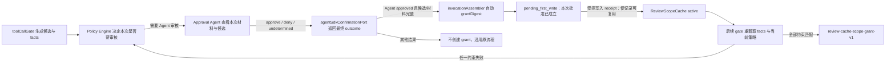

# 会话审核范围缓存免回传优化方案

> 2026-11-04；基线 `90a0f7bd`；承接 [工具调用安全审核性能调研.md](../工具调用安全审核性能调研.md) 与 [工具调用安全审核范围缓存执行计划](./tool-review-cache-execution-plan.md)。本文提出对既有方案的窄范围修订：**审批 Agent 仍判断本次操作，但不再负责回传缓存元数据；范围缓存由主进程安全逻辑根据已批准的候选自动建立。** D-1 已由用户批准为 A；根据用户后续执行指令，本方案在独立 worktree 中落地。

## 第 0 层：决策【人必读】

**一句话**：目前一次普通文件编辑通过审核后，后续同一任务对同一文件的编辑仍可能重复送审，因为主进程要求审批 Agent 额外输出一个复用标记和摘要；按已批准的 D-1，由主进程在批准成功后自动建立受限的会话范围缓存。

### D-1｜Agent 批准本次操作后，是否自动登记精确范围的后续复用记录？——A，已批准

**背景**：审批 Agent 已经查看本次工具调用和宿主生成的目标候选。现在它还必须额外返回 `reuseApproved=true` 与摘要，主进程才创建缓存。缺少任一字段时，批准只作用于本次调用，同一文件随后继续触发 Agent 审核。安装包会话 `286cf722-5c12-4770-ab35-b274a6bf083d` 的一轮记录中，7 次 `edit_file` 均再次进入 `default-write-execute-ask`；实际写入合计不足 1 秒，审批等待累计约 31 秒。现有事件没有保存候选、回传字段或 grant 建立结果，不能从历史确认这 7 次分别缺失在哪个内部分支。

**要决定什么**：

- **A（已批准）**：Agent 对本次调用返回有效 `approve` 后，主进程对已展示给 Agent 的、宿主构造且完整的范围候选自动登记 grant；不要求模型生成复用字段。该批准即按 D-1 覆盖候选范围内的操作；缓存记录只用于后续复用，不额外创设或延后业务授权。记录只覆盖候选明示的 lane、会话、主体、工具、操作、对象、执行环境、授权域/代次、策略版本和冻结任务约束，并受逐次策略与执行检查约束。
- **B**：保留 `reuseApproved` 和摘要回传；通过改写提示词、重试或审核 Agent 自检来提高字段返回率。用户仍可能为同一文件等待重复审核，模型输出继续承担缓存协议职责。

**后果**：A 减少模型输出协议负担和重复审核；一次批准的后续复用范围由宿主候选限定，主进程仍须保证候选材料完整并逐次核验。B 保持“是否登记后续复用记录由 Agent 显式返回”的语义，但无法保证重复操作不再重复审核。

**可逆性与依据**：缓存只在当前主进程内存，清理会话或重启即失效；回退 A 可恢复为仅本次批准。依据包括已安装程序会话事件、当前源码中候选/回传/grant 三段式链路；但该会话没有字段证明 Agent 的回传值，无法据此还原 7 次重复审核各自缺少的条件。新增诊断只能帮助定位实现后发生的 grant 登记或缓存查询结果，不能补回历史缺失事实。

**决议**：A，用户于 2026-11-04 批准。实现应由主进程在候选完整且本次 Agent 审批有效时自动建立受限会话 grant；不得要求模型回传缓存元数据。不得以此决议覆盖 deny、locked、真人逐次确认、当前任务和逐次 final-check。

下钻：`electron/confirmation/agentChannel.ts`、`electron/confirmation/approvalAgent.ts`、`electron/confirmation/toolCallGate.ts`、`electron/runtime/invocationAssembler.ts`、`electron/confirmation/reviewScopeCache.ts`。

### 只有 3 分钟时

1. 看 D-1：已决定由主进程自动建立受限缓存。
2. 看下方的边界：本方案不让模型决定路径、对象或策略豁免。
3. 看 `AC-1`、`AC-3`：同对象后续编辑命中，变化对象或高风险对象不命中。

### 不需要你决定

- 是否保留目标候选：保留；它由主进程根据 facts 和工具输入生成。
- 缓存 key、HMAC、回执、容量及生命周期：沿用既有方案，不新增第二套缓存。
- 是否把 Agent 批准记入用户 SQLite 决策缓存：不做；新机制仍是当前会话内存范围缓存，来源标记为 `agent`。
- 本方案是否立即改代码：用户于 2026-11-04 明确要求按 TDD 实施；以本次执行指令为准。

## 第 1 层：概要【人机共读】

### 目标与非目标

目标是消除“批准一次后，主进程还等待模型再次声明应该缓存”的依赖，并让 grant 登记结果及缓存查询结果有可查询的宿主诊断事实。

非目标：放宽当前 deny、locked、真人逐次确认或用户 override；用模型文字判断目标路径；跨会话/跨进程持久化；把 Agent 批准写入 `decision_cache`；扩展新的工具类型或对象识别器；为缓存命中省略当前策略、facts、final-check 或本次 permit。

### 目标行为

1. gate 生成完整候选，并把相同候选作为本次审核材料交给 Agent；候选不完整、审核材料被截断或未实际送达时，不创建 grant。
2. 本次 Agent 答复通过现有审批阈值，且确认通道最终结果仍为 Agent `approved` 时，主进程自动尝试 grant。模型只返回现有 `approve / deny / undetermined` 和理由、风险字段；不再解析或要求 `reuseApproved`、`scopeCandidateDigest`。
3. grant 仅绑定宿主最初发给该次审批的候选摘要，不能由工具调用参数或模型自报目标改写。对写入工具，缓存记录先处于 `pending_first_write`；可信 receipt 只决定记录何时可用于后续缓存复用，不决定本次批准是否成立，也不改变本次写入结果。
4. 后续调用重新运行当前 facts、策略与执行前检查。只有全部适用策略允许该来源复用、任务约束与主体/对象/授权代次一致、receipt 有效且策略无强制确认时才命中。
5. 本方案新增的诊断限于 grant 登记的创建/跳过结果与后续缓存查询的命中/未命中，记录稳定原因码；不新增 receipt 激活或撤销事件出口。日志不写脚本/文件正文、完整路径或 HMAC 原值。

## RP-2：链路图【人机共读】

唯一 grant writer：确认端口返回**最终** Agent `approved` 后，`invocationAssembler` 使用同次 gate 保存在 execution context 中的候选及 digest 调用 `reviewScopeCache.grantDigest`。审批模型不是 grant writer。对写入工具，受控写入 receipt 是缓存记录转为可复用状态的条件，不是本次批准或执行成功的判据；策略消费唯一位于共享 Policy Engine。

## RP-3：变更面表【机｜人工可跳过】

| 单元 | 作用简述 | 改动类型 | 对应 `D/INV` | 跨边界 |
|---|---|---|---|---|
| `electron/confirmation/agentChannel.ts` | 将审核答复转换为确认结果 | 改造 | D-1、INV-1、AC-1 | 否 |
| `electron/confirmation/approvalAgent.ts` | 构造审核请求并解析审核答复 | 改造 | D-1、INV-1、AC-1 | 否 |
| `electron/skills/bundled/securityApprovalSkill.ts` | 给审批 Agent 提供安全审核准则 | 改造 | INV-1、AC-1 | 删除要求模型输出缓存字段的指令 |
| `src/shared/confirmation/types.ts` | 定义审批与范围候选类型 | 改造 | D-1、INV-1 | 是：共享类型 |
| `electron/confirmation/agentSdkConfirmationPort.ts` | 编排确认结果回调 | 改造 | INV-1、INV-2 | 否 |
| `electron/runtime/invocationAssembler.ts` | 连接 gate、确认端口与缓存 | 改承重边界 | INV-1、INV-2、INV-5 | 否 |
| `electron/confirmation/reviewScopeCache.ts` | 持有会话内范围 grant 状态 | 复用不改 | INV-2、INV-3 | `pending_first_write` / `active` 仅表示缓存复用状态 |
| `electron/confirmation/toolCallGate.ts` | 生成候选并在策略前核验缓存 | 改造 | INV-2、INV-3、AC-2 | 否 |
| `electron/confirmation/reviewScopeWrite.ts` | 用可信 receipt 更新缓存复用状态 | 复用不改 | INV-3 | 沿用现有 receipt 协议；不新增生命周期审计出口 |
| `src/shared/policy/policyEngine.ts` | 汇总适用规则并消费 grant | 复用不改 | INV-3 | 既有规则 trace 足以消费 |
| `electron/confirmation/securityAuditLog.ts` | 写入脱敏后的安全事件 | 改造 | INV-5、AC-4 | 登记/查询诊断事件字段；不记录 receipt 生命周期 |
| `docs/develop/safety-approval/security-policy-audit-field-map.md` | 维护安全审计字段真源 | 改造 | INV-5 | 登记本方案实际新增的诊断字段 |
| `electron/confirmation/agentChannel.test.ts` | 验证 Agent outcome 与范围批准连接 | 改造 | AC-1、AC-4 | 否 |
| `electron/runtime/invocationAssembler.test.ts` | 验证宿主 grant 创建/跳过条件 | 改造 | AC-1、AC-4 | 否 |
| `electron/confirmation/securityAuditLog.test.ts` | 验证审计字段白名单与脱敏 | 改造 | AC-4 | 否 |
| `electron/skills/bundled/securityApprovalSkill.test.ts` | 验证随包审批指令与合同一致 | 改造 | AC-3 | 否 |
| `electron/confirmation/reviewScopeCache.test.ts` | 验证缓存状态与容量不变量 | 复用不改 | INV-2、INV-3 | 既有随机状态序列测试继续覆盖状态机 |
| `electron/confirmation/approvalAgent.test.ts` | 验证模型答复解析 | 改造 | AC-1 | 否 |

计数：改既有 14 个、新建 0、复用不改 4；`改对外契约` 1 行（共享类型）；`改承重边界` 1 处；新增数据库字段 0；新增安全审计事件字段 1 组（仅 grant 登记与缓存查询诊断，JSONL 向后兼容）；新增用户错误码 0；新增稳定诊断 reason code 1 组（不作为用户错误码）。

## RP-4：契约面六面【机｜人工可跳过】

| 契约面 | 结论 | 依据与验证 |
|---|---|---|
| ① agent-sdk 接口契约 | 不改 | 宿主仍使用现有 approve/confirm outcome；不加 SDK 端口和事件。验证 `npm run check:agent-sdk`、`npm run typecheck:agent-sdk`。 |
| ② 会话存储接口契约 | 不改 | grant 仍只在主进程内存，无数据库/历史新字段；session clear 沿用现状。验证 `npm run check:session-storage-boundary`。 |
| ③ IPC / preload | 不改 | 无 renderer 设置或新通道。 |
| ④ 共享类型 | 改 | 移除 `ApprovalVerdict.approve` 上 `reuseApproved` 和 `scopeCandidateDigest` 的生产依赖；兼容解析期可以忽略旧字段，所有宿主依赖点同步更新。验证 `npm run typecheck:shared`。 |
| ⑤ 其他持久化格式与迁移 | 改 | 安全审计 JSONL 增加一个脱敏事件及可选结构化字段；无 SQLite schema 变化和迁移。旧读取方忽略未知字段；字段白名单与来源登记在审计字段图。 |
| ⑥ 领域数据格式 | 改 | 新增稳定 grant 决策 reason code；复用既有 `review-cache-scope-grant-v1` 策略 trace，不改政策可配置面。 |

旧调用方兼容：旧审批服务若仍返回两个附加字段，解析器忽略它们；新审批服务只回传现有 verdict 字段也可建立 grant。历史已经落下的 outcome 不重放、不恢复 grant。

## 第 2 层：规格【机｜人工可跳过】

### 事实卡【F-1~F-5】

| ID | 可复核事实 | 复核命令 / 证据 |
|---|---|---|
| F-1 | 当前 `ApprovalVerdict.approve` 带可选 `reuseApproved` 与 `scopeCandidateDigest`；解析器只有模型返回正确值才保留。 | `rg -n 'reuseApproved|scopeCandidateDigest' src/shared/confirmation/types.ts electron/confirmation/approvalAgent.ts electron/confirmation/agentChannel.ts` |
| F-2 | agent channel 只有 `reuseApproved===true` 且回传摘要等于 clue 候选摘要，才在 outcome 上添加 `reviewScopeGrant`。 | 同 F-1；读取 `electron/confirmation/agentChannel.ts` 对应分支。 |
| F-3 | invocation assembler 只在 outcome grant、候选 digest、回答者与工具类型均匹配时写入 `grantDigest`。 | `rg -n 'onScopeApproved|grantDigest' electron/runtime/invocationAssembler.ts` |
| F-4 | gate 已生成宿主候选并检查 `ReviewScopeCache.lookup`；决策命中后仍会检查 receipt。 | `rg -n 'buildReviewScopeCandidate|reviewScopeCache.lookup|verifyReviewFileReceipt' electron/confirmation/toolCallGate.ts` |
| F-5 | `ReviewScopeCache` 是内存状态机；写入缓存记录要通过可信 receipt 后才进入可复用的 `active` 状态，这不决定本次批准或写入结果；已有容量与随机不变量测试。 | `rg -n 'pending_first_write|activateFirstWrite|randomized state invariants' electron/confirmation/reviewScopeCache.ts electron/confirmation/reviewScopeCache.test.ts` |

本机安装实例在本轮目标会话中记录了 7 个 `edit_file` 的 `approval-waiting` / `approval-resolved`，reason 均为 `default-write-execute-ask`；DB 中无这些候选/回传字段，无法断言具体是哪一条 grant 前置失败。只读复核位置：`~/Library/Application Support/spaceassistant/spaceassistant-data.db`，turn `75ccc010-36ed-4dae-86b4-423256cb5c86`。本地 `policy_audit_events` 没有该 turn 的策略事件。

### 不变量【INV-1~INV-5】

- **INV-1｜模型只负责业务裁决**：是否批准仍由现有审批流程决定；grant 是宿主对批准结果与宿主候选执行的确定性后处理。模型输出不包含缓存开关、摘要、路径授权或协议握手字段。
- **INV-2｜候选唯一真源**：grant 只能从此次 gate 产生并随此次确认材料传递的候选创建；不从 outcome 文本、模型理由、后续工具参数或日志重构候选。候选不存在、材料未交付/被截断、审批不是 Agent approved 时不创建。
- **INV-3｜逐次策略优先**：grant 不能覆盖 deny、locked、用户 override、真人逐次确认、规则未声明允许的来源、当前任务不匹配或 final-check 失败。命中后仍签发本次专属 permit。
- **INV-4｜来源与范围隔离**：该自动 grant 来源为 `agent`，只绑定当前 lane/session/已验证主体/授权域及代次/tool/operation/对象集合/environment/policyVersion/taskConstraint；不写 user decision cache，不跨会话/lane/进程。
- **INV-5｜诊断不得自证**：稳定 reason code 由宿主实际分支写入；候选摘要/文件正文不写日志。新增诊断只覆盖 grant 登记（如 `candidate_missing`、`review_material_incomplete`、`grant_created`、`grant_duplicate_or_capacity`）及缓存查询（如 `grant_lookup_hit`、`grant_lookup_miss`）；非批准结果沿用现有确认结果事件，不新增专门 scope 事件；不承诺 receipt 激活/撤销的新增审计事件。

### 决策写入算法与唯一 owner

在 `agentSdkConfirmationPort` 获得 primary outcome 后，由 `invocationAssembler.onScopeApproved` 执行：

1. 必须是本次 agent-channel 的原始 `approved` outcome，`answererKind=agent`；fallback 到用户、timeout、unavailable、undetermined、deny、defer、取消或迟到审批均不自动建 Agent grant。
2. 从同次确认 context 取回 `reviewScopeCandidate` 与 gate 保存的 `reviewScopeCandidateDigest`；主进程验证该候选是首次审核发送的不可变快照，工具名等于已准备的工具调用，digest 通过 session HMAC 校验。
3. 校验该次审批 packet 完整交付了候选与任务材料；沿用现有 `reviewScopeEvidenceComplete`、`taskDigestTruncated`、任务身份字节上限和通道状态。缺一条件只跳过缓存，不改变本次 approve 是否有效。
4. 用 host outcome 的批准结果与候选摘要调用 `grantDigest`，写入缓存状态；返回值只表示缓存记录是否登记，不代表工具实际写入成功，也不是本次批准成立的条件。写入工具后续只有在 receipt 校验通过后才可复用该缓存记录。
5. 写不含原文、路径和摘要的 `confirm.review-scope` 安全审计事件，仅记录登记创建/跳过和查询命中/未命中、稳定 reason code、来源、lane、工具类型、候选版本和 invocation 关联 ID。字段进入 `security-policy-audit-field-map.md` 与审计白名单；不记录用户文件名或内容，也不新增 receipt 激活/撤销事件。

**语义**：Agent 对含候选的审核请求返回 `approve`，按已批准的 D-1，主进程将其作为候选范围内操作的批准，并登记同范围后续复用记录；它不会覆盖候选之外的操作或逐次策略检查。`pending_first_write` 与 `active` 只描述缓存记录能否复用，不表示业务授权尚未成立或后来才成立。现有 `approve` 三态没有“本次批准但不登记复用记录”的区别；若产品需要该区别，须另立决策，不能要求模型暗中回传 metadata。

### 策略及失败矩阵

| 事件 | 本次调用 | grant | 后续调用 |
|---|---|---|---|
| Agent approve，候选完整，桌面普通文件范围符合规则 | 本次批准成立，按现有 final-check 与执行边界处理 | 登记为 `pending_first_write`；receipt 通过后缓存记录可复用 | 同范围可能命中；仍经当前策略/facts/final-check |
| Agent approve，但候选缺失、任务截断、材料未送达 | 按现有审批结果执行 | 不创建 | 继续原策略审核 |
| Agent deny / undetermined / timeout / fallback / defer / cancel | 按既有结果处理 | 不创建 | 继续原流程 |
| 候选相同但命中用户 override / locked / human-required / deny | 原策略结果 | 不消费 | 原策略结果 |
| 目标、操作、工具、环境、任务、主体、授权代次或策略版本改变 | 按当前策略 | 旧缓存不匹配或撤销 | miss，原策略审核 |
| 首次写 receipt 缺失/不可信，或写入结果 uncertain | 按既有批准、提交及执行语义处理 | 缓存记录不转为可复用状态 | 后续不因该记录免审；不得据此推断本次未执行 |
| 兼容旧 Agent 返回 `reuseApproved` 字段 | 按现有 approve/deny 字段 | 由宿主同一算法决定，忽略该额外字段 | 同上 |

### 场景矩阵

| 场景 | 预期 |
|---|---|
| 同会话同任务、同一普通文件连续 `edit_file`，替换文本变化 | 第一项批准后，receipt 校验通过使缓存记录可复用；后续命中且不再调用审批 Agent |
| 同任务编辑第二个文件 | 新对象，独立审核并独立候选；不得因文件 A 授权文件 B |
| 同路径但从 `edit_file` 改 `write_file`，或从文件编辑改 Shell | 工具/操作不同，miss |
| 模型回传旧字段、无字段、字段格式错 | 不影响审批结论；主进程不读取这些字段来决定 grant |
| 审批材料 packet 截断或候选未到审批端 | 本次照原有审批处理；grant 跳过并记 reason |
| 当前策略有未许可 ask、deny、locked 或要求真人逐次确认 | grant 不消费；原策略执行 |
| 对象、权限、策略代次变化，文件外部替换/改写 | 当前核验失败，撤销或 miss；executor 不越过现有执行边界 |
| 取消/迟到/并发两个同候选审批 | 仅 primary 最终、未取消的审批可建一次 grant；重复 digest 幂等处理，不重复扩张状态 |
| 用户明确选用现有会话记忆档位 | 继续现有人类记忆 writer；不把 Agent grant 转成 user 来源 |
| 应用退出/重启或会话销毁 | 内存 grant 消失；重新审核 |

### 验收【AC-1~AC-6】

- **AC-1**：相同普通文件目标的连续编辑，首次 Agent 批准建立范围批准并登记缓存记录；可信 receipt 校验通过后，后续同范围调用命中且审批 Agent 调用计数为 1。receipt 失败只阻止缓存复用，不撤销本次批准，也不判定本次写入结果。测试先证明现状失败再证明修复通过。
- **AC-2**：候选对象、工具、操作、任务约束、lane、主体或授权域任一变化都 miss；当前 deny/locked/human-required/用户 override 的行为与缓存前一致。
- **AC-3**：删除模型 `reuseApproved` / `scopeCandidateDigest` 输出后，approve 仍可按 host 条件建立范围缓存；deny、timeout、undetermined、fallback、cancel、截断和未送达候选均不建立。
- **AC-4**：安全审计 JSONL 可按 turn/invocation 查询 grant 创建/跳过及缓存查询命中/未命中与稳定 reason code；不要求新增候选生成、审批材料完整性、receipt 激活或撤销事件。断言不包含路径明文、脚本片段、内容摘要或 HMAC，并覆盖旧读取方忽略未知字段。
- **AC-5**：首次写和命中后写的 rename/link 外换、原位改写、receipt 错误、并发撤销、取消和迟到结果继续通过既有故障注入；未取得可信 receipt 不激活/推进，最终执行器调用遵守现有状态语义。
- **AC-6**：既有 `ReviewScopeCache` 随机状态不变量测试、策略矩阵测试、三阶段安全检查和系统 invariant 检查通过；缓存容量/生命周期没有退化。

### 验收边界

- **本机源码可验**：全部候选和审批通道边界、grant 调用条件与稳定 reason code、策略/final-check、缓存状态机、并发/取消/迟到与回执故障注入、定向测试、`npm run check:system-invariant-registry`、相关类型检查与 electron 增量构建。
- **需外部环境**：正式安装包重复编辑真实测量、其他操作系统句柄提交、真实飞书/微信审批通道与生产审计日志。外部结果不替代源码可验项。

### RP-5：量级与拆分判断

预计改既有 14 个单元、新建 0、复用 4；跨包/共享契约 1 行、承重边界 1 处；新增数据库字段 0、安全审计 JSONL 字段 1 组、用户错误码 0、稳定诊断 reason code 1 组；阶段 1 个。本次没有两处承重改动，无需拆分。旧执行计划中 P3/P4 已记为完成，本方案属于对 P3 授权握手和 P4 grant 写入条件的后续修订；不得把旧计划的已完成记录改写成从未实施。

## RP-6：批准范围与自曝弱点【人必读】

**已批准范围**：D-1 = A（2026-11-04）。实现范围为一次有效 Agent approve 后，由主进程对同一完整候选自动登记会话级窄范围 grant。grant 表示候选范围内的批准；缓存状态只控制后续复用。没有 UI、开关、数据库持久化、额外 lane 或新工具范围待批。

**自曝三处弱点**：

1. **一次 approve 的原语义是否只作用于一次调用**：若实现前发现现有产品承诺明确为单次授权，需暂停实现并重开 D-1；自动建立范围 grant 会改变授权语义。
2. **候选材料是否确实送达且未截断**：若任何通道只在 host 有候选而审批 prompt 未呈现，自动 grant 会变成未经审核的扩权；以 request 组装测试核对传递链路。新增诊断不承诺记录候选正文或追溯历史送达事实。
3. **当前任务约束是否足够稳定和精确**：若 follow-up 上下文变化导致过宽授权或无法可靠 miss，应保留逐次审核，先改造宿主任务绑定事实。

## 术语对照

| 业务词 | 内部词 |
|---|---|
| 本次批准 | primary Agent `approved` outcome |
| 后续范围复用 | `ReviewScopeCache` 中的 session-scoped Agent grant 缓存记录 |
| 宿主候选 | `ReviewScopeApprovalCandidate` 与 `ReviewScopeCandidate` |
| 首次写入凭据 | `ReviewFileReceipt` |
| 命中/未命中原因 | `review_scope_*` 稳定 reason code |

## 修订记录

- 2026-11-04：根据 SpaceAssistant 安装实例的重复审核样本，提出取消模型 `reuseApproved + scopeCandidateDigest` 回传要求，由宿主在审批批准后自动登记精确、会话级的 Agent grant；receipt 仅控制缓存记录何时可复用。D-1 = A 已由用户批准；方案尚未实施。
- 2026-11-04：根据整体复审结论，收窄诊断承诺至 grant 登记与缓存查询，不新增 receipt 生命周期审计出口；澄清缓存状态不代表业务授权成立条件。
- 2026-11-04：按用户执行指令在独立 worktree 中完成 TDD 实施；Agent 输出不再解析缓存字段，主进程从确认 context 取回 host-only 候选与 digest，在最终 Agent approve、审核材料完整、HMAC 匹配且公开候选与绑定对象逐项相同时自动登记。新增 grant 创建/跳过及 gate 命中/未命中诊断，并对白名单事件执行专用字段投影。

## 实施核验记录

| 验收项 | 结果 | 证据 |
|---|---|---|
| AC-1 / AC-3 | 通过 | 装配器回归验证不回传缓存字段仍创建 `pending_first_write`；候选缺失、公开候选与 host scope 对象不一致、材料不完整与 deny 不创建；AgentChannel、解析器与 Skill 合同测试通过 |
| AC-2 / AC-5 / AC-6 | 通过 | `toolCallGate.test.ts`、`reviewScopeCache.test.ts`、`reviewScopeWrite.test.ts`、`policyEngine.test.ts` 纳入全量测试；逐次策略、receipt 与缓存不变量通过 |
| AC-4 | 通过 | `confirm.review-scope` 的创建/跳过与命中/未命中事件按 invocation 关联；审计白名单测试确认不落候选路径、正文或摘要 |
| 全量测试 | 通过 | `npm test`：1,256 个测试文件通过、1 个跳过；12,170 项通过、140 项跳过 |
| 类型与边界门禁 | 通过 | `npm run typecheck:shared`、`npm run check:agent-sdk`、`npm run typecheck:agent-sdk`、`npm run build:electron:incremental`、`npm run check:system-invariant-registry` |
| 外部验收 | 未执行 | 正式安装包重复编辑测量、其他操作系统句柄提交、真实飞书/微信审批通道与生产审计日志仍需外部环境验证 |
