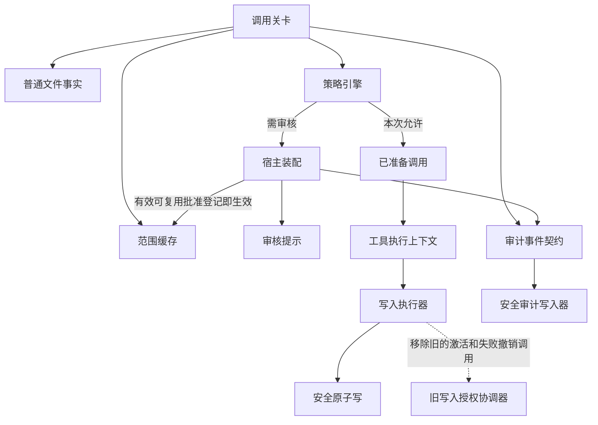

# 同一普通文件重复审核优化技术方案

> 状态：草稿（2026-11-11 简化复核；既有功能决议保留，第四轮复审后调整第 1 项，四项行为决议与设置设计已批准，独立存储已确认，仅本次与三渠道搜索规则已批准，搜索路径授权已确认）  
> 日期：2026-11-06 ｜ 源码基线：`7f9f4971` ｜ 上游：[同一普通文件重复审核优化需求](../../../requirement/safety-approval/same-file-review-fast-track-requirement.md)

## 第 0 层 · 决策【人必读】

### 本轮已确认的两项【人必读】

1. **仅这一次。** 普通「同意」继续按设置记住批准。只在确实能复用的人工确认中，加一个次要动作「仅允许本次」，例如你临时让助手修改同一份文档，但希望下次重新问。桌面用现有确认卡，飞书和微信用现有确认消息中的明确动作。审核助手使用结构化的仅本次标记。代价是各渠道要多支持一个选择，但日常同意仍是一步。缺少这个选择的版本先不启用新版复用，负责人已确认该动作及下方界面归属。
2. **哪些搜索需要先问一次。** 默认可直接搜索的场景照常直接搜索。想先批准一次再继续搜索的用户，在三个渠道已有的自定义安全规则里，将同一条普通工作目录递归搜索规则改为「人工批准」。第一次由本人批准，之后在原批准的目录范围内继续搜索时按设置复用。逐次确认和拒绝仍优先。代价是需要新增一条可配置规则。若不启用该配置，继续走当前搜索策略。
**已确认的搜索授权边界。** 批准绑定目录路径和搜索范围。同路径的普通目录重新生成或恢复后，当前规则允许且实际读取仍受原批准范围约束，就可以继续使用批准。

负责人于 2026-11-11 批准「仅允许本次」及三渠道搜索规则。B-1、B-2 的产品决策已确认，按下文验收。实际安装包与飞书、微信入口继续按 U-1/U-2 验收。

### 已确认的存储方向【人必读】

**24 小时和 7 天的批准单独保存在应用现有的本机数据库中。** 负责人于 2026-11-11 确认采用独立授权表。重启时核对原截止时间与当前权限，点击「清空全部」时一并删除。应用升级时新增该表。

四项用户行为和设置设计均已确认。存储规格已补齐。升级新增授权表并保留已有会话。回退到旧版前须清除新授权数据并恢复旧版可读取的数据库版本，已有会话保留。实际安装包与飞书、微信入口列入交付验收。 [存储与恢复规格](#p0-storage-contract)

### 为什么要改【人必读】

你让助手修改一份说明文档，第一次审核通过并写入成功，随后又发一句「继续改」。现有实现可能再次送审。它会把新的用户消息当成另一项任务，也会区分局部编辑和整文件写入，还可能因为文件被外部编辑器重新保存而找不到可用的批准。一次安装实例中记录到 31 次文件写入，31 次都进入了审核。这个样本说明重复审核确实发生过，现场运行的具体版本和每次重审的原因仍需查证。

**改完以后，首次批准若未限定仅本次且设置允许复用，用户再发消息时，系统先看批准有没有过期，再看这次操作是否落在批准范围内。** 两项都满足，而且当前规则允许，才省去重新审核。系统仍会检查这次要操作的实际目标。只批准一次的操作仍只执行一次。

### 这次具体改什么，按什么顺序做【人必读】

| 顺序 | 现在的问题 | 改完后用户会看到什么 |
| --- | --- | --- |
| **先统一所有工具如何记住批准** | 记录明明还在，换一条消息却可能匹配失败。不同工具也没有共用的有效期约定。 | 明确支持单会话、单进程、当天（24 小时）、7 天内四种有效期。用户发来新消息本身不会让批准失效。有效期只回答「能用多久」，批准内容另行规定谁能在哪些会话、对哪些对象做什么。比如批准本会话读同一个文件，后面仍可读该文件，换一个文件则重新判断。飞书和微信的工作目录清单也纳入验收。获批用户换一条消息仍可查看同一份配置清单，清单内容每次重新获取，配置变化后重新判断。 |
| **再改同一普通文件的写入** | 局部编辑与整文件写入分别查批准。文件被外部程序改写后，还可能因为和上次写入时的文件状态不同而重审。 | 明确允许继续修改的批准经程序核对并记录后，同一文件可以在局部编辑和整文件写入之间切换，也可以改变正文和替换方式。其他程序在同一路径重新保存普通文件后，仍按当前目标检查，符合原批准范围就可继续。保存失败不使批准失效；修复执行条件后，仍在批准范围内就可重试。结果未知时先核实，不自动重复修改。 |
| **让目录搜索使用同一套批准机制** | 一次递归搜索获批后，另发一次以子目录为根的搜索，现有记录只会比较两次的根是否完全相同。 | 例如首次批准递归搜索 `docs/`，后续以相同查询和输出限制搜索 `docs/design/`，只要实际能读到的内容都在原批准范围内，就可复用。若直接点名子目录会搜到父目录原本跳过的文件，扩大读取范围的调用仍由当前规则裁决。 |
| **文件写入改造后补齐日志并核验安装包** | 重复送审时，现有日志难以判断是运行版本太旧、批准没有生效，还是当前规则要求重新确认。 | 维护者能把首次批准、首次写入和后续复用串起来，看到运行版本和未复用原因。日志里不记录文件正文、完整路径或搜索文本。用户已批准这一项。 |

四种有效期与跨消息复用、普通文件的写入范围、日志扩展、子目录搜索的方向均已确定。**所有接入工具共用同一套审批、批准记录和复用流程。** 工具只需提供各自的范围判断。写文件判断是不是获批的那个文件，搜索目录判断本次能读到的文件是否都在获批范围内。桌面、飞书和微信的目录搜索在同一阶段接入、共同验收。各渠道的规则只决定具体调用直接放行、可复用批准、需确认还是拒绝。**搜索目录、读取文件、写入文件是不同的批准。** 查看工作目录清单也不会获得切换目录或读取目录中文件的权限。敏感路径、脚本、可执行文件、固定持续集成配置，以及现有规则要求真人逐次确认的操作，仍按原规则处理。

详细规格见 [通用前置](#approval-cache-foundation)、[文件写入](#decision-1)、[安全日志](#decision-2)和[目录搜索](#grep-subtask)。

### 本轮删掉哪些不必要的设计【人必读】

同文件继续修改只需要程序记住一份有效批准，每次检查这次修改是否仍在范围内。此前方案还要求专门记录每次保存的状态、为结果增加代次，以及为批准再生成一个日志编号。这些都不需要另建：保存结果、并发写保护和操作编号已经存在，直接使用。

本轮删除独立的写入结果记录和协调协议；不要求新建编辑材料模块；日志使用已有操作编号，不再增加批准编号。原因核查、统计和验收统一见本文。

已记录为用户确认的四种有效期、跨消息使用、三渠道目录搜索和工作目录清单要求继续保留。这些功能本身有额外成本，但不因简化而取消。共用机制只增加实际用到的寿命、范围和来源检查，不建设插件注册、通用比较器框架或统一管理界面。文件修改、目录搜索分别验证自己的范围限制。

### 实施前还需确认什么【人必读】

- **批准方式已核对。** 人工与审核助手沿用现有同意操作。未限定仅本次的批准，按设置和当前规则在原范围内使用。
- **重启后恢复已确认。** 24 小时和 7 天批准以本机时钟判断是否到期，重启沿用原截止时间。关机期间有些时钟回拨无法识别，用户已接受这一限制。

逐次确认维持现有行为：当前规则要求每次询问真人时，即使还有一份未到期的批准，这次也必须重新询问。签核前维持暂缓实施。

### 本轮签字范围【人必读】

| 状态 | 评审内容 |
| --- | --- |
| 已定 | 同一普通文件跨工具复用、批准与保存结果分离、四种有效期、三渠道目录搜索及脱敏诊断。 |
| 已定 | 第 1 项已定：审批同意后按设置默认复用，明确限定仅本次时只用一次。第 2 项已定：设置选多久就生效多久。只有单会话限原会话，其余期限允许同一用户换会话。 |
| 方向已定 | 24 小时和 7 天批准保存在本机新增的一张授权表和一组元数据中。启动时核对原截止时间和权限。回退版本前作废这批批准。关机期间未低于已保存时间的回拨无法由本机识别，用户已接受此限制，具体格式与回退步骤见存储规格。 |
| 已定 | 用户通过现有「清除全部审批缓存」入口一并清除可复用批准。清除成功后，下次遇到需要审批的操作会重新询问。逐条撤销另行评审。 |
| 外部验收 | 用实际安装版本和飞书、微信真实入口核验批准和重复审核次数，当前待验。 |

四项用户可见行为与下方设置入口已确认。已确认的存储方向及技术规格见本页开头。

### 审批复用设置设计【人必读】

**已批准：在「设置 → 安全策略 → 确认记忆管理」增加一行「审批复用期限」，默认选「本次会话」。**

用户在这里选择批准后多久可以继续使用同一份批准。固定成单会话会让想跨会话工作的用户重复审批，统一设为 24 小时则会让只想在当前会话复用的用户保留批准更久。建议用一个下拉框集中设置，人工和审核助手照常审批。设置适用于桌面、飞书和微信已有的合格复用操作。

| 下拉选项 | 用户看到的说明 |
| --- | --- |
| 本次会话（默认） | 仅在原会话内使用。会话结束或应用退出后失效。 |
| 本次运行 | 可以换会话使用。退出应用后失效。 |
| 24 小时 | 从批准时起有效 24 小时，可以换会话或重启应用。 |
| 7 天 | 从批准时起有效 7 天，可以换会话或重启应用。 |

建议把「本次会话」作为缺省值，贴近现有会话内复用习惯。选项保存成功后用于新批准，已发出的批准按原期限到期。若希望旧批准立即停止，点击同页「清空全部」。例如，从 24 小时改成本次会话后，先前的 24 小时批准仍按原截止时间有效。保存后展示简短提示「已保存。新批准将使用此期限，已有批准按原期限到期」。旧版本配置没有这个值时显示默认项，已有批准记录按各自原有规则处理。

界面草图：

```text
安全策略 › 确认记忆管理

审批复用期限       [ 本次会话 ▾ ]
仅在原会话内使用。会话结束或应用退出后失效。
新批准使用此期限。已有批准按原期限到期。

现有确认记忆和清除操作                     [清空全部]
```

#### 界面归属卡（项目负责人已于 2026-11-11 批准）【人必读】

| 项 | 提案 |
| --- | --- |
| 入口 | 「安全策略」页内的「确认记忆管理」区域，放在现有确认记忆列表之前。期限与清除批准可以在同一处找到。 |
| 形态 | 一个带标签的下拉框，下一行解释当前选择和何时生效。选择后立即保存。 |
| 样式来源 | 沿用当前页面的 ConfigField、Ant Design Select、设置提示文字和主题样式。 |
| 新增还是改造 | 现有区域增加一行。继续使用同页「清空全部」和原确认弹窗，调整其说明和可用状态。 |
| 成本 | 用户理解四个期限和修改何时生效。维护一项全局设置、中英文文案、保存状态和旧配置缺省行为。 |

「清空全部」确认文案建议改为「清除全部确认记忆和可复用批准？清除后，需要审批的操作会重新询问。」现有按钮依据旧列表是否为空禁用，新增批准可能不出现在该列表中。提议在数据加载完成后允许点击，空缓存清理也可正常完成，以便用户始终能执行提前清除。

#### 方案期交互检查【机｜人工可跳过】

依据 PRODUCT.md、DESIGN.md、Operate 参考及现有 `ToolsSecuritySettingsTab.tsx` 的 MemorySection。列表前放一行设置，当前值与期限说明同时可读。下拉复用组件的 hover、focus、选中和键盘操作。读取和保存时禁用控件，读取失败可重试，保存失败恢复原值并显示错误。窄布局将控件移至标签下一行，说明可换行。可访问名称使用「审批复用期限」，说明与控件关联。所有新增文案实施时通过现有中英文 i18n。实施后检查长文案、焦点和实际保存反馈。

评审内容为入口、四个选项、默认本次会话、新批准才使用新期限、清除按钮的文案与可用状态。项目负责人已于 2026-11-11 批准上述范围，界面尚未实现。

### 已确定的有效期【人必读】

| 选择 | 什么时候失效 |
| --- | --- |
| 单会话 | 原会话结束或应用进程退出，以先发生者为准。重启后打开原会话，也要重新批准。 |
| 单进程 | 应用进程退出时失效，重启后重新批准。 |
| 当天 | 自批准起满 24 小时失效。退出、关闭期间和重启都按原期限继续计时。 |
| 7 天内 | 从批准时开始计时，满 7 天失效。关闭期间照常计时，重启不会重新起算。 |

例如周一下午批准了 7 天内的操作，周二重启后仍可在原范围内使用，期限仍到下周一下午。应用需要保存当天和 7 天这两类批准，并在启动后核对原到期时间及撤销状态。本地记录格式留在技术规格中确认。

### 已批准的目录搜索范围【人必读】

**对符合条件的普通目录搜索开放。** 桌面、飞书和微信共用这一规则。需要确认时，仍由当前规则指定的人或审核助手审批。首次批准且符合复用设置后，用户在有效期内搜索同一父目录下更窄的范围，可以省去重新确认。后续搜索须保留原查询、过滤和输出限制，且实际能读到的文件都在原批准范围内。直接放行、要求逐次确认和拒绝的情形仍按当前规则处理。

开放范围已经确定。实施前还要落实具体规则条目和首次确认如何说明复用范围。若需改确认界面，先评审具体呈现方式。

### 什么证据会让我们调整方案【人必读】

1. **重启后无法确认批准是否已经撤销或到期。** 此时该记录不能恢复，修复保存和核对机制，通过重启验收后再交付。
2. **文件或搜索工具无法在读取、写入之前确认实际范围。** 比如直接搜索子目录绕开了父目录的忽略规则，或写入会把普通文件变成可执行文件。此时相关调用继续按当前规则裁决。
3. **实际安装包仍然重复送审，或日志无法解释原因。** 本机测试只能证明代码路径。安装包验收须对上运行版本、首次批准、后续调用和实际审核次数，飞书、微信的目录清单也要通过真实入口验证。

这些验收由实现和发布阶段提供证据。

## 第 1 层 · 评审概览【人机共读】

本方案承接宿主登记授权的既有决议，替换文件写入授权的比较方式，并分离批准生命周期与单次写入结果。编辑结果检查优先复用现有函数，不预设新模块。诊断按已批准的 D-2 进入现有安全日志，交付面来自需求 AC-2、AC-5。下文既有变更面仅描述文件写入与日志。通用前置改造的新增存储面单列评审。

### 链路与变更面【人机共读】

下表给出链路节点的职责及影响。代码路径列于规格定位表。表中规模只计算文件写入与诊断，通用寿命和目录搜索的改动范围分别在 P0、G-01 说明。

| 单元 | 作用简述 | 改动类型 | 对应 | 跨边界 |
| --- | --- | --- | --- | --- |
| 调用关卡 | 采集调用事实并请求策略裁决 | 改承重边界 | D-1/D-2，INV-01/03/04 | 向宿主交付候选与诊断结果 |
| 普通文件事实 | 识别文件类别与写入材料 | 改承重边界 | D-1，INV-03 | 调用关卡消费结构化事实 |
| 范围缓存 | 唯一写入会话授权记录 | 改承重边界 | D-1/D-2，INV-01/02/04 | 调用关卡、宿主装配及写入结果协调器消费 |
| 宿主装配 | 绑定审核、调用和执行材料 | 改造 | D-1/D-2，INV-02/04 | 沿用既有确认和执行上下文 |
| 审核提示 | 向审核 Agent 描述本次及候选范围 | 改造 | D-1，INV-01 | 沿用原有答复协议 |
| 旧写入授权协调器 | 关联写入结果与旧授权状态 | 改造 | D-1，INV-02 | 移除文件执行结果改变批准的调用，不替换为新协调器 |
| 已准备调用 | 持有并清理本次调用材料 | 复用不改（待验证） | D-1，INV-02 | 沿用既有调用清理；不增加批准执行凭据 |
| 工具执行上下文 | 承载当次工具执行材料 | 复用不改（待验证） | D-1，INV-02 | 不增加结果记录或新执行代次 |
| 写入执行器 | 核验许可并执行编辑或覆盖 | 改造 | D-1，INV-02/03 | 沿用工具接口和执行结果 |
| 安全原子写 | 验证写入边界并生成回执 | 改承重边界 | D-1，INV-02/03 | 保留原子写入口，移除历史回执复核入口 |
| 策略引擎 | 裁决当次调用与授权能否使用 | 复用不改 | D-1，INV-03 | 现有规则来源白名单与决策轨迹已可表达 |
| 审计事件契约 | 定义安全日志的稳定字段 | 改对外契约 | D-2，INV-04 | 新旧日志读取者 |
| 审计字段真源 | 记录字段和取值契约 | 改造 | D-2，INV-04 | 同步 v2、七个原因码及旧行兼容 |
| 安全审计写入器 | 按白名单投影并落盘 | 改造 | D-2，INV-04 | 使用原文件与保留策略 |



现状是保存成功后才允许使用批准、保存结果还会更新批准状态；目标是批准经核对登记即生效。写入执行器继续返回既有工具结果，图中不再新建结果记录节点。范围缓存是批准唯一写入者，审计写入器是日志唯一写入者。

### 契约面六面【人机共读】

| 面 | P0 共用授权 | A/B 文件和诊断 | G-01 目录搜索 |
| --- | --- | --- | --- |
| agent-sdk 接口 | 复用。确认结果仍为单次执行凭据，复用同意由宿主在 SDK 适配前验证。 | 复用 | 复用 |
| 会话存储接口 | 复用。独立授权表由范围仓库写入，会话消息和历史 writer、接口及备份协议沿用。 | 复用 | 复用 |
| IPC / 预加载 | 改承重边界。桌面设置、IM 策略和会话删除复用既有通道、请求和返回形状，修改主进程内的撤销与提交顺序。期限设置新增 1 个保存通道，既有读取响应增加 1 个可选字段。人工确认拟增加仅本次动作及可选参数，按已批准的确认动作和通道规格实施。 | 复用 | 候选生成接入现有 IM 工具入口，确认通道同 P0 |
| 共享类型 | 改。期限设置及拟新增的仅本次可选字段。 | 改。日志版本及原因码扩展。 | 复用 P0 |
| 其他持久化格式 | 改。1 张授权表和 1 组元数据。 | 日志兼容旧行，数据库由 P0 负责。 | 复用 P0 |
| 领域数据格式 | 改。拟增加仅本次可选字段，寿命由设置决定。 | 改。范围审计新增版本及原因取值。 | 复用 P0 |

**需求外扩声明。** 寿命设置来自四种寿命决议，界面入口已批准，设置数据形状见存储规格。独立授权表和元数据来自已确认的跨重启存储决议，具体格式见存储规格。审计版本及七个原因码来自已批准的 D-2，实施时同步审计字段真源。寿命设置界面按已批准归属卡实施。

### 量级、拆分与排除项【人机共读】

文件写入及诊断部分计划改既有 10 个运行单元和 1 份审计规格、新建 0 个、复用 3 个，其中 4 处承重边界改动、1 处对外契约改动。审计不新增字段，复用现有能力版本字段增加 1 个取值，并补 7 个原因码，合计 8 个新增诊断取值。A/B 数据库字段和产品错误码各新增 0 个。P0 本轮补列 4 个提交相关改动单元，均为承重边界，新建 0 个。审批解析器已在 A/B 定位表列出，跨阶段复用该定位。两张定位表去重合计 18 行（14 个既有运行单元改动、3 个复用、1 份审计规格）。P0 的存储、规则和协议增量另见六面表，G-01 的候选生成改动见其变更表。

通用前置 P0 排在最前。P0 完成后，文件写入与日志分为两个阶段，各自验收与回退；目录搜索的范围判断另列 G-01，可与文件写入阶段并行评审。两项都接入 P0 共用流程。上表的规模和六面结论仅计入已定的文件写入与日志阶段。P0、A/B、G-01 分开评审、验收和回退，汇编在同篇方便核对授权来源、存储与消费的依赖。文件阶段放在一起的依据是缓存匹配条件与批准生效条件须在同一运行版本同时切换。若只合并缓存键，旧回执仍让同路径替换失效；若只移除回执回读，跨工具仍不复用。日志格式和现场验收可独立发布及回退，授权机制测试不依赖落盘新格式。见 INV-01～04、阶段与回退。

文件写入采用精确路径授权，不扩大为整个目录；不按历史内容指纹续期。跨重启存储仅由 P0 处理，文件阶段不另建第二套存储。单会话按原会话匹配，其他三种寿命支持同一用户跨会话使用。

## 第 2 层 · 规格与验收【机｜人工可跳过】

### 决策映射【机｜人工可跳过】

<a id="decision-1"></a>
- **D-1（已定）**　沿用 2026-11-04 宿主登记决议，按 2026-11-06 需求修订，将两个文件写入工具归为同一路径授权。规范见 INV-01～03，验收见 AC-01、03、04、06。

<a id="decision-2"></a>
- **D-2（2026-11-06 已批准 A）**　阶段 B 按下文「诊断契约」扩展现有安全日志，关联 INV-04、AC-02、05。D-1 实现及源码回归可独立验证。

### 模型与不变量【机｜人工可跳过】

| ID | 不变量与实现位置 | 验证 |
| --- | --- | --- |
| INV-01 / D-1 | 宿主以同一文件写入能力对精确目标做会话内绑定。审核提示明示所批准的目标写入范围，保留真实工具和本次材料供本次审核。缓存之外的审批及执行材料保留真实工具与操作。 | AC-01、03 |
| INV-02 / D-1 | 符合设置及规则的有效批准经宿主核对登记即生效，不依赖首次受控写入成功。缓存是授权状态唯一 writer；写入成功、失败、取消或结果未知独立记录，不撤销或延长批准。记录只由授权生命周期和容量回收处置。 | AC-01、06 |
| INV-03 / D-1 | facts 报告当前对象及材料证据；policy 以当前规则决定能否消费 grant；final-check 校验本次 permit、主体、授权代次、对象及执行材料。复用不签发旧许可、不替代当前检查。 | AC-03、04、06 |
| INV-04 / D-2 | 授权各阶段的诊断可通过既有调用编号检查，受控验收可核对首次登记与后续使用，审计写入器只接收白名单数据。日志失败无权影响授权。 | AC-02、05 |

此处 INV 编号为方案追踪 ID。方案沿用既有安全规则与执行边界，不新增系统级不可配置约束。策略复用沿用 `review-cache-scope-grant-v1` 及原 decision trace。final-check 沿用已有 failure class / case ID，失败时工具派发不发生。派发后的目录或目标竞态沿用受控写入拒绝与不确定提交结果。

### 授权键与当前事实契约【机｜人工可跳过】

- **授权键**　先验证真实工具与操作组合，再在文件写入摘要序列化处将 `edit_file/edit`、`write_file/write` 投影为同一 `file-write` 能力及 `target` 角色。按 P0 共用授权匹配契约处理寿命和使用范围。workDir 使用关卡本次解析的有效工作目录，含 pinnedWorkDir 参与的解析结果。跨来源只要解析到不同目录即不命中，相同目录仍须满足渠道、主体及其他绑定。AC-03 加同会话不同固定目录反例及相同解析目录正例。文件写入匹配材料包括 lane、主体、授权域 id/revision/epoch、规范化绝对路径的角色对象集合（按角色和值排序）、workDir 及策略版本，剔除任务文本和用户消息 ID。两种写工具均要求恰好一个 target。内容、替换参数和文件状态不参与摘要。原 `grep` 投影与摘要域保持原义。
- **审核材料**　审核请求仍包含本次工具、参数和宿主候选。提示把文件候选解释为在获批寿命和使用范围内对该目标的局部编辑及整文件写入，并明确逐次规则与目标边界仍有效。按下节设置和请求绑定契约，宿主校验本次审核实际使用的候选与真实工具、目标、上下文和摘要后才登记。首次批准证据不全、主体或授权绑定缺失、自动化 lane 均不登记文件授权。后续查询以当前安全事实和可验证的授权约束为准。授权审批与缓存诊断分开。
- **facts**　沿用工作目录路径类别与目标解析，获取当前普通文件或受支持的新建目标事实。目录外、敏感、固定 CI、脚本扩展名、可执行权限/魔数、链接或非普通文件等均不进入普通文件复用；当前或拟写结果有可执行特征时按现行路径处理。事实模块返回结构化的目标、分类及证据缺口，由调用关卡选择是否生成候选。证据未知时回到既有政策。
- **编辑材料**　优先复用现有编辑结果计算函数，保留执行器已有 EOL、替换计数和转义回退语义；只有实际存在两套不一致算法时才做最小函数提取，不预设新文件或模块。复用事实通过现有身份约束读取，按执行器允许的输入边界生成结果或明确失败。移除缓存专属的 4 MiB 和启用转义回退即跳过的门槛。合法编辑的大小或参数变化本身不造成 miss。无法匹配、读失败或读中身份变化记作证据缺口，现有工具错误和安全回退照常生效。
- **policy / final-check**　缓存只交付来源给策略引擎。只有规则轨迹实际采用范围授权才计入命中。deny、locked、真人逐次确认、用户覆盖优先。初审和执行前重查均以当次材料为准。若重新解析时目标类型或权限边界变化，按当前策略裁决；若已签发许可后的身份、路径或执行材料发生变化，由现有 final-check / 受控写入边界拒绝或报不确定提交。当前调用的身份比较继续有效。同一路径在两次调用之间替换普通文件，由新调用采集并绑定新身份。编辑器已有的重读前置条件仍生效。若读缓存过旧，先用原入口重新读取，再在原批准有效且覆盖的范围内发起编辑。重读既不登记新授权，也不需要重新请求审核 Agent。

### 复用批准如何验证【机｜人工可跳过】

1. 人工和审核 Agent 沿用现有批准操作。宿主根据审批发起时的用户设置及当前规则，冻结渠道、主体、目标、能力、所选寿命和授权代次，单会话另绑定原会话，并绑定到本次审批请求和候选。
2. 宿主只从正常确认流程接受可信批准。批准未明确限于本次，且规则和设置允许复用时，按冻结范围登记；结构化的仅本次批准只签发当次许可。拒绝、超时、错绑及已撤销结果均不登记。缺少可验证范围或设置依据时，仅执行已经获准的本次操作。自由文本不作为授权范围来源。
3. 宿主校验请求绑定和当前代次后登记，仓库重算候选摘要。登记失败不改变本次批准结果。旧历史记录不补登，程序直接放行不产生批准。普通批准沿用既有动作。仅本次字段及入口见下节已批准的契约。
4. AC-P0 从正常入口覆盖人工和 Agent 批准后的默认复用、仅本次、缺设置、错绑和逐次确认。首轮审批计数以实际请求为准，合格后续调用新增审批为零。

#### 「仅本次」答复契约（已批准）【机｜人工可跳过】

沿用既有批准分支，在宿主内部确认结果增加可选 `reuse: 'once'`。缺省代表按设置判断，字段不与旧记忆档位互推。各通道只在绑定的请求允许复用时展示或发送该选择。SDK 当次批准回执保持原形状。

| 通道 | 正常入口与可信映射 |
| --- | --- |
| 桌面 | 现有工具确认卡及确认提交。普通同意沿用原载荷，次要动作「仅允许本次」提交 `reuse: 'once'`。主进程验证待确认请求、操作及答复绑定。 |
| 飞书 | 现有 IM 确认回调中增加同名动作。回调携带请求 ID 及固定动作值，只有通过既有发起人、消息与请求绑定检查才映射为 `reuse: 'once'`。 |
| 微信 | 现有 IM 文本确认解析器接受明确的「仅本次 <请求编号>」，以既有会话和授权用户校验命中唯一待确认请求，宿主映射同一标记。自然语言、缺编号或错绑不产生批准。 |
| 审核助手 | 现有结构化 approve 分支允许可选 `reuse: 'once'`，解析器校验枚举，Agent 通道保留该字段至宿主。无字段的现行答复按设置判断。 |

人工确认界面归属提案为既有桌面工具确认卡、飞书确认消息和微信确认指令。桌面及飞书复用既有次要动作样式，微信复用既有确认文案和请求编号，主批准动作保持原位置。改造现有确认流程，成本为一个次要动作、双语文案及三渠道测试。项目负责人于 2026-11-11 批准，纳入 P0。拟涉及确认卡与提交类型、IPC/preload 的可选参数、IM 消息和解析器、共享确认类型及 Agent 解析器，旧客户端缺字段保持兼容。正常入口用同一设置分别验证普通批准登记、仅本次不登记、错绑拒绝，以及旧答复仍能完成当次操作。

#### 设置直接决定使用期限【机｜人工可跳过】

用户选择的有效期直接生效。只有“单会话”按原会话匹配；单进程、24 小时和 7 天允许同一用户换会话继续使用。其他匹配条件仍按原批准对象和操作范围核验。当前规则继续判断本次操作能否使用已有批准，包括拒绝和逐次确认；规则不另设期限上限或会话名单。24 小时和 7 天从批准时计时，重启沿用原截止时间，用户已确认依赖本机时钟。设置入口、缺省值和切换行为按上方已批准的设置设计执行。

### 逐次确认的裁决顺序【机｜人工可跳过】

静态核对 `src/shared/policy/policyEngine.ts`：常规规则路径先从同一份 `matchedActions` 选中 deny，再由 `humanFloor` 捕获任一有效 `confirm-every-time`，以该条规则 ID 返回真人确认。该返回发生在 `effectiveReviewRules` 及范围授权消费之前。因此即便规则同时有来源白名单，也不会走到复用分支。保留策略引擎原样复用的结论须经入口回归验证。

AC-04 增加有效逐次确认与来源白名单并存的用例，分别覆盖规则自身和规则转换得到该动作，以及 Agent、真人来源的已有批准。断言要求真人确认、轨迹保留实际生效规则 ID、未采用 `review-cache-scope-grant-v1`，批准前派发为零。另跑默认工作目录写入入口，验证有效逐次规则不会被早返回绕过。若正常入口反例失败，先将策略修复纳入变更面并复审，不能以范围缓存的判断替代策略。

### 状态、并发与恢复【机｜人工可跳过】

| 转移 | 触发和提交点 | 失败、并发与恢复 |
| --- | --- | --- |
| 无记录 → `active` | 宿主核对符合复用条件的批准、候选、主体和授权代次后，同步登记。此时批准生效。 | 登记前审批取消、拒绝或证据不足不登记；重复登记不延长期限。容量不足时不建立复用记录，本次批准仍按原许可链处理。 |
| `active` → `active` | 本次写入成功、失败、执行取消或结果未知。 | 写入结果不撤销、不延长批准。当前路径租约与本次 permit 仍逐次取得；调用清理仅释放执行材料。 |
| 任意 → 不可复用 | 按 P0 检查寿命、使用范围、显式撤销及授权代次。 | 迟到或重复的执行结果不能恢复失效批准；新用户消息本身不使批准失效。 |

批准状态仍由现有范围缓存唯一写入。核对批准后登记，后续只检查有效性和范围；文件写入不再调用批准激活、写租约续回执或失败撤销接口。删除这些文件授权耦合，不另建结果仓库、协调器、执行代次或恢复任务。执行结果和取消沿用既有工具调用返回值及清理协议。

并发写入沿用现有路径租约和本次 permit，不加第二把批准写锁。缓存查改继续在主进程同步完成，不跨 await。普通调用取消只清理本次执行；显式撤销批准才改变批准有效性。迟到执行结果没有批准写接口，因而不能恢复失效批准。

明确失败后可在批准有效且目标检查通过时重试。结果未知沿用工具现有的不确定结果报告，不自动重放；用户或助手通过现有读取工具查看当前文件，确认后再决定后续操作。本方案不新增自动读回、完成情况推断或补偿流程。读到相同内容也不能在并发场景下证明上次调用成功。

移除文件授权对 `pending_first_write`、`write_pending` 和历史回执相等的依赖。保留安全原子写对本次提交对象的校验和现有工具结果。重启后的批准恢复按 P0，旧执行许可不恢复，不自动重放旧修改。

### 诊断契约（D-2）【机｜人工可跳过】

沿用 `confirm.review-scope`、既有 outcome 及 session/request/invocation/tool-use 标识。使用现有 `reviewScopeCandidateVersion` 字段增加 `review-scope-candidate-v2` 取值，表示本方案的文件候选语义；原 `grep` 仍用 v1。删除另增 `reviewScopeGrantRef` 和随机 UUID 的要求，不增加通用授权追踪系统。受控测试通过预先确定的文件及调用序列关联批准与后续操作；生产日志只解释本次登记、查找和策略消费，不能唯一关联历史批准时明确标证据不足，不靠新增路径指纹弥补。

| 环节 | outcome | 既有原因码 | 新增原因码 |
| --- | --- | --- | --- |
| 候选 | skipped | `review_material_incomplete`、`candidate_digest_invalid`、`unsupported_tool` | `scope_cache_unavailable`、`scope_task_unavailable`、`scope_binding_unavailable`、`scope_target_ineligible`、`scope_target_unverified` |
| 登记 | created / skipped | `grant_created`、`candidate_missing`、`review_material_incomplete`、`candidate_digest_invalid`、`grant_duplicate_or_capacity` | `grant_registration_stale` |
| 单次写入结果 | 沿用工具执行结果 | 沿用工具执行结果码 | 不增加范围授权事件或原因码 |
| 查询及策略消费 | hit / miss / skipped | `grant_lookup_hit`、`grant_lookup_miss` | `grant_policy_not_used` |

候选首个失败按缓存、授权材料、证据、绑定、目标资格、摘要校验的顺序归因。通用 miss 表示当前键无记录，涵盖绑定变化、生命周期结束及容量回收。禁止搜索其他授权键推断哪个绑定不匹配。查到活动记录但策略采用其他规则时记录 `grant_policy_not_used`，结合既有决策轨迹区分策略拦截与独立放行。已有记录的回收原因由登记调用的生命周期、验收输入和查询结果辅助核对。

白名单只留既有字段、既有关联 ID、工具名、lane、决策编号、来源、结果和时间；拒绝正文、路径、任务文本、异常原文、回执字段、HMAC 和密钥。写入器沿用有界缓冲；丢失、截断或缺关联的样本标为证据不足。旧行继续可读，旧读者可忽略未知版本取值及原因码，验收须复核既有读取链路。能力版本从实际执行的宿主关卡发出；用安装包现有构建身份中的版本、commit 与 build ID 关联发行记录。只看到版本号、旧日志或没有事件时，不推断该实例一定缺少功能。

### 验收、反例与交付边界【机｜人工可跳过】

| 验收 | 对应不变量 / 需求 | 可执行断言与证据 |
| --- | --- | --- |
| AC-01 | INV-01/02，需求 AC-1 | 从宿主调用入口注入批准，写入成功后交替用两工具、变更局部参数及整文件正文，覆盖合法的大小变化和转义回退。外部原位修改和原子替换后另起调用（局部编辑先按现行规则读取），每次仍走当前 permit，断言首次 Agent 调用为 1、后续为 0。并核对审核提示明示范围。 |
| AC-02 | INV-04，需求 AC-2 | 从实际安装包读取构建身份，对照干净工作树的发行提交及发布产物校验值并完成跨用户消息的重复写入。用既有调用标识及受控夹具核对审核、登记和命中；缺候选、未登记和策略拦截用自动化测试注入，不要求维护旧包矩阵。 |
| AC-03 | INV-01/03，需求 AC-3 | 逐一改变 lane、主体、域/代次、workDir、策略版本和路径，或单会话批准用于其他会话，断言无越界复用。换用户消息的正例由 P0 覆盖。覆盖敏感、固定 CI、脚本、写入生成可执行魔数、硬链接、符号链接、非普通文件、缺证据，以及阶段 A 对 `grep` 原行为的隔离和原有新建文件快通道。 |
| AC-04 | INV-03，需求 AC-4 | 对有效授权注入 deny、locked、human-required、用户覆盖和 final-check 失败，断言策略和既有 trace 保持优先级。变更审批代次、目标或 permit 时派发计数为 0；派发后换父目录或目标时原子写不越界。 |
| AC-05 | INV-04，需求 AC-5 | 用真实审计序列化和新旧 JSONL 测试诊断原因完整、调用可关联；注入带路径、正文、摘要、回执、token 的对象并断言输出无该值。 |
| AC-06 | INV-02/03，需求 AC-6 | 首次写入失败后修复执行条件再试，审批新增请求为 0；执行取消和结果未知不改变有效批准，也不自动重放追加。沿用路径租约并发回归，断言迟到结果不能恢复已撤销批准。范围缓存增加固定种子的登记/查询/撤销/过期/清理随机序列，验证失效后不可命中及容量上限；执行端不另建随机状态模型。 |

指标从带预先标注目标与上下文的验收调用计算，合格后续调用的分母独立于日志的 hit 结果。按 invocation/tool-use 去重，用 `confirm.request` 中的 Agent 归因及实际审批子请求日志核对，不能以策略的预计审核路径代替请求计数。出现初审命中、复检改判或许可失败时，按复检决策和派发结果判断越界。目标审核率 0%。全量 miss/skip 的稳定原因覆盖率目标 100%，用当前规则和真实派发结果对拍，越界命中目标 0。阶段 B 用固定夹具而非记录真实用户文件目标来核算分母。真实桌面、飞书和微信分别通过正常入口运行用例，渠道账号、安装包及日志由发布验收负责人提供。

工具调用、策略事件、审批会话和模型请求分别计数。一次审批可能发起多轮模型请求，按真实请求标识去重。规则直接放行单列。历史样本的 31 次写入只用于解释现象，其中 1 次同路径归属为推定。若省去首次之后的 30 次请求，按当时记录的 43 次审批请求估算，减少约 69.8%。安装包验收使用受控的同文件连续修改，统计实际请求次数和等待时间。

### 阶段、迁移与回退【机｜人工可跳过】

| 阶段 | 输入 → 输出 | 出口证据 | 回退 |
| --- | --- | --- | --- |
| P0 · 通用授权复用 | D-4 与当前源码 → 共用寿命与范围匹配 | 见 P0 的 AC-P0。存储与启用细节评审完成后进入验收。 | 独立回退通用授权能力，旧版不得消费新版记录。 |
| A · 授权行为 | P0 的验收构建及 D-1 → 同路径共享键、批准登记生效、逐次边界 | AC-01/03/04/06。跑范围缓存、调用关卡、旧写入协调器、原子写、宿主装配及关联执行器定向测试；运行 SDK/存储门禁、`npm run check:system-invariant-registry` 和一次主进程增量构建。 | 回退 A 的改动提交并重启，旧路径按旧机制重新登记。 |
| B · 诊断与安装验收 | A 的验收构建及已批准的 D-2 → 稳定审计、运行能力标识、安装实例证据 | AC-02/05、共享类型检查、审计相关定向测试及真实安装验收。记录包身份、脱敏调用序列与指标。 | 独立回退 B 的审计改动并重启，保留 A；历史审计行按原留存期限处理。 |

定向回归入口以这些既有测试为基座，新增用例按上表归属扩充。

```sh
npm exec vitest run electron/confirmation/reviewScopeCache.test.ts electron/confirmation/reviewScopeWrite.test.ts electron/confirmation/toolCallGate.test.ts electron/runtime/invocationAssembler.test.ts electron/safeAtomicWrite.test.ts electron/tools/writePermitReapproval.integration.test.ts
npm exec vitest run electron/confirmation/securityAuditLog.test.ts electron/confirmation/toolCallGate.test.ts electron/runtime/invocationAssembler.test.ts
```

阶段 A/B 沿用 P0 的授权存储和版本兼容策略，不额外引入数据库迁移。日志沿用现有事件，批准生效由登记事件标明，写入结果沿用原工具结果，交付完成以验收证据为准。旧审计行原样保留。最终交付验证按仓库规则在阶段收尾执行全量测试，并在候选安装包上跑正常入口。

### 规格定位表【机｜人工可跳过】

| 单元 | 落点 |
| --- | --- |
| 调用关卡 | `electron/confirmation/toolCallGate.ts`；G-01 在 `buildReviewScopeCandidate` 扩展 grep 渠道门槛 |
| 普通文件事实 | `electron/confirmation/reviewScopeEligibility.ts` |
| 范围缓存 | `electron/confirmation/reviewScopeCache.ts` |
| 宿主装配 | `electron/runtime/invocationAssembler.ts` |
| 审核提示 | `electron/confirmation/approvalAgent.ts` |
| 旧写入授权协调器 | `electron/confirmation/reviewScopeWrite.ts` |
| 已准备调用 | `electron/tools/registeredAgentTurnTools.ts` |
| 工具执行上下文 | `electron/tools/types.ts` |
| 写入执行器 | `electron/tools/builtinExecutors.ts` |
| 安全原子写 | `electron/safeAtomicWrite.ts` |
| 策略引擎 | `src/shared/policy/policyEngine.ts` |
| 审计事件契约 | `src/shared/confirmation/types.ts` |
| 安全审计写入器 | `electron/confirmation/securityAuditLog.ts` |
| 审计字段真源 | [安全策略审计字段映射](../security-policy-audit-field-map.md)（随实现同步） |

#### P0 补列的规格定位【机｜人工可跳过】

| 单元 | 落点 | 改动类型 | 作用简述 | 对应约束 |
| --- | --- | --- | --- | --- |
| 桌面安全设置提交 | `electron/ipc/securityIpc.ts` | 改承重边界，接入撤销冻结 | 提交桌面安全设置 | `INV-P03` |
| IM 策略提交 | `electron/ipc/policyIpc.ts` | 改承重边界，接入撤销冻结 | 提交远程策略变更 | `INV-P03` |
| 策略快照事务 | `electron/confirmation/imPolicyStore.ts` | 改承重边界，对齐事务提交与发布 | 保存快照并递增代次 | `INV-P03` |
| 会话删除 | `electron/ipc/sessionIpc.ts` | 改承重边界，删除前清理批准 | 清理会话关联批准 | `INV-P01/03` |

<a id="approval-cache-foundation"></a>

## P0 · 通用授权缓存寿命与范围匹配【人机共读】

**D-4（2026-11-06 已定）**　先拆分寿命和匹配，再接入工具。四种寿命均可跨消息。单会话、单进程在应用重启后失效。当天按 24 小时、7 天内按 168 小时，自原批准时间计时，跨重启恢复，离线时间照常计入。按第 2 项决议，单会话以外的期限允许同一用户跨会话使用。

| 寿命 | 建议有效边界，供规格评审 | 会话使用范围 |
| --- | --- | --- |
| 单会话 | 同一会话实例仍存活，进程退出失效 | 仅原会话 |
| 单进程 | 签发进程存活，重启失效 | 同一用户的会话 |
| 当天 | 自批准起满 24 小时失效，跨重启保留原截止时间 | 同一用户的会话 |
| 7 天内 | 自批准起满 168 小时失效，跨重启保留原截止时间 | 同一用户的会话 |

**需评审的交付面。** 当天和 7 天的活跃批准须保存原签发和截止时间以及恢复所需的最小授权与撤销信息，单会话和单进程记录仅驻内存。负责人需确认落盘契约。若涉及新增选择入口，先批准界面归属卡。存储契约评审完成后实施落盘和恢复。

### P0 规格、验收与回退【机｜人工可跳过】

- **INV-P01｜寿命独立。** 记录拆为寿命及签发/到期信息、批准的使用范围、工具授权能力及对象约束、授权来源与版本。活跃状态、到期、撤销、使用范围和匹配结果分别核验。查找和命中均不续期。单次批准仍走现有调用许可，缺失明确寿命或复用授权的旧数据不转为新记录。
- **INV-P02｜匹配独立。** 候选分区保留渠道、主体、授权域/代次及策略版本，结合使用范围检查会话资格。工具比较器只校验有安全意义的对象和操作限制，例如文件读的规范路径和获批读取范围、写入的精确目标、搜索的可访问子集。用户消息 ID、请求 ID、轮次、整段对话与从这些值派生的摘要只可用于首次审核或追溯，不进入通用复用键或资格门槛。首次批准中明示且能验证的对象与能力限制继续匹配。未定义比较器或规则未允许该授权来源的工具继续逐次裁决。
- **INV-P03｜状态与恢复。** 通用授权仓库是记录唯一 writer，工具只提交宿主验证过的批准材料。文件批准登记即生效，执行凭据绑定单次调用，不作为批准恢复条件。重启只恢复仍有效且当前可验证的当天和 7 天活跃记录，使用原截止时间，禁止按启动时刻重算。跨重启无法验证授权代次、到期时间或撤销状态时拒绝恢复。发现时钟异常时拒绝恢复，过期和撤销后的旧记录不得因重启或迟到回调复活。用户上下文资料、一次性执行许可和旧决策缓存条目均不迁移。
- **变更面与边界。** 以现有范围缓存、宿主登记及调用关卡为切入点，仅抽出共用的寿命、主体与范围检查函数，工具范围用现有工具分支判断，不引入比较器注册表或插件接口。现有决策缓存的落盘能力仅作为取证，持久化方案在批准前不认定复用现有表。策略引擎仍裁决是否消费，执行端仍签发并核验本次许可。Agent SDK 和会话存储写入端口沿用原契约。P0 修改三个既有 IPC 入口内部的提交边界，通道和载荷沿用原契约，具体定位见下表。落盘契约、兼容策略和精确变更面在 P0 存储评审后锁定。
<a id="p0-storage-contract"></a>

#### P0 持久化和恢复契约【机｜人工可跳过】

| 项 | 拟定行为 |
| --- | --- |
| 记录与归属 | 在现有应用 SQLite 中使用独立版本的授权表和元数据，范围仓库唯一写入，事务走 `runInTransaction`。仅持久化 24/168 小时记录。记录含格式版本、批准来源、能力、规范化范围字段，单会话记录另绑定原会话（仅驻内存）、授权域、持久代次、签发及截止毫秒。元数据保存全局时间下限。批准行仅保存签发时的域代次副本。无正文、旧许可或审批对话。 |
| 恢复校验 | 按版本解析记录，从当前主体、配置和调用生成匹配材料，与保存的规范化范围比较。读取失败、格式不支持、范围不匹配、代次失配、已撤销或已到期时拒绝复用。旧进程内候选摘要不参与恢复。 |
| 授权代次 | `policy_authorization_epochs(domain, epoch)` 是唯一权威来源，批准登记只读当前值。桌面和 IM 的策略提交沿用现有同事务整数递增。恢复时必须读到有效域行并与批准快照一致，同时核对当前策略和主体。缺行或损坏时拒绝该域全部历史批准，先事务清理旧批准，再由既有策略提交初始化域行。禁止从批准行恢复代次。 |
| 登记与撤销 | 登记事务提交后生效。策略变更通过既有桌面和 IM 提交入口触发作废，会话删除清除绑定该会话的单会话批准，发布回退在退出前事务删除持久批准。提交点、冻结和失败反馈见下表。逐条撤销界面留待单独评审。 |
| 时间 | 登记和每次持久批准消费前提交全局时间下限，取原下限与当前 UTC 毫秒的最大值。启动及查找时，若时间不可读、早于下限或签发时间，或已到原截止点，拒绝该记录。检测到回拨时在事务内删除持久批准并保留时间下限，提交失败则禁用恢复。运行中用单调钟与墙钟共同核对，任何一方已达期限即停止使用。关机期间未低于下限的隐蔽回拨无法识别，用户已接受这一限制。 |
| 回退 | 回退使用下节 125 → 124 逆迁移。无法确认回退或数据库恢复期间授权连续性时，升级后先清理旧持久批准，要求重新批准。复制或恢复整套旧本机状态不可由同一数据库自证，备份恢复不得导入批准表。 |

#### 表结构、设置与迁移【机｜人工可跳过】

**存储单元。** 在 `electron/database/schema.ts` 定义授权表 DDL，在 `electron/database/migrations.ts` 从基线 124 迁移至 125。范围仓库在 `electron/confirmation/reviewScopeCache.ts` 管理批准和时间下限，使用现有数据库连接与 `runInTransaction`。授权表属于安全设置数据，不进入会话存储端口和会话导出。

```sql
CREATE TABLE review_scope_grants (
  id INTEGER PRIMARY KEY,
  format_version INTEGER NOT NULL CHECK (format_version = 1),
  lane TEXT NOT NULL CHECK (lane IN ('desktop', 'feishu', 'wechat')),
  subject_id TEXT NOT NULL,
  domain TEXT NOT NULL CHECK (domain IN ('desktop', 'im')),
  policy_revision INTEGER NOT NULL CHECK (policy_revision >= 0),
  policy_epoch INTEGER NOT NULL CHECK (policy_epoch >= 0),
  policy_version TEXT NOT NULL,
  capability TEXT NOT NULL CHECK (capability IN ('file-read', 'file-write', 'grep', 'list-work-dirs')),
  source TEXT NOT NULL CHECK (source IN ('agent', 'user')),
  scope_json TEXT NOT NULL CHECK (json_valid(scope_json)),
  lifetime TEXT NOT NULL CHECK (lifetime IN ('24h', '7d')),
  issued_at_ms INTEGER NOT NULL CHECK (issued_at_ms >= 0),
  expires_at_ms INTEGER NOT NULL,
  CHECK (expires_at_ms - issued_at_ms =
    CASE lifetime WHEN '24h' THEN 86400000 ELSE 604800000 END),
  CHECK ((lane = 'desktop' AND domain = 'desktop')
    OR (lane IN ('feishu', 'wechat') AND domain = 'im'))
) STRICT;

CREATE UNIQUE INDEX review_scope_grants_identity
ON review_scope_grants (
  domain, lane, subject_id, policy_revision, policy_epoch, policy_version,
  capability, source, lifetime, scope_json
);

CREATE INDEX review_scope_grants_expiry
ON review_scope_grants (expires_at_ms);
```

- **范围编码。** `scope_json` 是有界 UTF-8 规范 JSON，沿用范围缓存的稳定键序和拒绝非法值语义，大小沿用范围缓存单项上限。文件读写使用 `{workDir, target}`，其中两项为本次事实生成的规范绝对路径。搜索使用 `{workDir, root, query, options, ignoreDigest}`，其中 `query/options` 保存原搜索的归一查询及影响读取、过滤和输出的参数，子目录包含关系按 G-01 验证。工作目录清单使用 `{disclosureDigest}`，值是 P0 定义的目录披露快照按配置 ID 排序后规范编码的 SHA-256。按能力拒绝缺字段、未知字段和不受支持的形状。范围数据仅在本机使用，日志不得输出路径、查询和摘要。
- **查询与容量。** 用身份索引前缀按域、渠道、主体、版本和能力取候选，丢弃到期记录和不获当前规则允许的来源。精确范围比较规范编码。搜索仅在该候选集上按 G-01 验证范围，不能按字符串前缀授予访问。多条同时命中时按签发时间倒序、ID 倒序选首条，保持原截止时间。新批准按唯一身份覆盖对应旧记录，单纯命中不写入签发或截止时间。持久记录复用现有全局缓存容量上限，登记前先删过期和失配代次，再按签发时间、ID 升序回收超额最旧记录。
- **元数据与设置。** 在现有 `schema_meta` 用 `review_scope_wall_floor_ms` 保存时间下限，值为十进制毫秒字符串，缺失且授权表为空时初始化为当前时间。表非空时缺失或无效则拒绝恢复并先清理。设置使用同表键 `review_scope_default_lifetime`，值为 `session | process | 24h | 7d`，旧数据缺省为 `session`。读取已有 `security:get-settings-model` 响应新增可选 `reviewScopeLifetime`，主进程保存入口新增 `security:set-review-scope-lifetime`，入参仅 `{ lifetime }`，响应沿用安全设置成功和失败形状。preload、共享 API 类型与设置页同步更新。非法输入拒绝，保存成功后新发起审批读取新值，在途审批沿用发起时冻结值，已有记录不重算。该新增 IPC 是已确认设置的实现载体，旧设置客户端忽略可选字段。
- **升级。** 124 → 125 在同一事务创建表和索引、初始化设置及有效时间下限，最后写 schema 125；125 → 126 在同一事务检查桌面授权代次，仅缺失时删除该域可能残留的旧授权并初始化 epoch 1，最后写 schema 126。失败整体回滚。初始化数据库按同一迁移链到 126。原 `decision_cache`、会话和消息不迁入或改写。若 desktop epoch 缺失，旧桌面批准不复活；IM epoch 已存在时不变。启动策略迁移还会为没有快照的新安装建立 `desktop-v1` 默认快照并递增 desktop epoch。回退入口接受 schema 125/126，先删除本功能授权表及元数据，再写回 schema 124；未知更高版本拒绝回退。
- **登记与消费。** 每次落盘登记和消费在事务中核对当前域 epoch 与有效规则绑定，推进已保存时间下限。登记同时写批准行，提交成功才对后续调用可见。消费提交后仍走本次策略和许可检查。启动读取并清理过期、无效及失配记录。检测到回拨时按上表清除持久批准，仍可按当前规则重新审批。读写失败则停用持久复用，本次已获准操作仍走既有许可。
- **清空与并发。** 全量清除在已有清理入口内冻结查找和登记，事务删除持久批准及原清理涉及的数据库记录。提交后清内存并作废清除前发出的待登记材料，再返回成功。事务失败不返回成功。执行前复检不能接受已清除批准对应的未派发许可，已经开始的文件写入沿用既有执行边界。时间下限与期限设置保留。
- **回退。** 源码中旧迁移器拒绝较高 schema 版本，回退流程不可直接用 124 打开 125。发布回退入口先退出应用并独占数据库，备份后校验 schema 恰为 125，在单事务内删除授权表和两个元数据键，最后把 schema 写回 124。索引随表移除，既有批准缓存、会话与消息保留。任一步失败回滚并中止回退。未知更高版本不得执行该逆迁移。再次升级走空表迁移，旧批准不会恢复。

**验收补充。** AC-P0 增加真实 SQLite 的新建、124 升级、事务中断重跑、125 回退再升级用例，核对旧应用可读会话和旧审批缓存。验证授权表容量、边界到期、原期限不续期、无效格式、清空后重启、清空与迟到审批竞争。设置入口覆盖旧数据缺省、非法值、保存失败保留原值、修改后仅新发起审批使用新值。AC-G1 继续验证搜索实际读取范围。

#### P0 撤销提交点与定位【机｜人工可跳过】

| 入口 | 既有事务及拟改动 |
| --- | --- |
| 桌面 `electron/ipc/securityIpc.ts` | 沿用 `security:set-policy-package`、`security:set-rule-override`、`security:remove-rule-override`。由现有桌面快照提交路径进入 `imPolicyStore.ts` 的 `commitDesktopPolicySnapshot`。在同一事务内写快照、递增 desktop epoch。 |
| 飞书和微信 `electron/ipc/policyIpc.ts` | 沿用 `policy:write` 的 IM 分支。普通提交及切换标准版本均落到 `electron/confirmation/imPolicyStore.ts` 的 IM 快照提交事务，随快照递增 im epoch。 |
| 策略仓库 `electron/confirmation/imPolicyStore.ts` | 复用两域现有事务写入。扩展宿主提交边界，在进入同步提交前冻结相应域的批准消费和许可签发。提交后使内存旧批准失效，再沿既有回调发布策略变更。失败或冲突沿原入口返回结果并以未变更的已提交状态解冻。所有许可复检比较当前 epoch，提交前签出的旧许可在提交后失效。 |
| 会话删除 `electron/ipc/sessionIpc.ts` | 复用既有删除入口和会话存储所有权。P0 先冻结该会话并清理绑定该会话的单会话批准，成功后执行原删除。清理失败则沿原入口返回失败。若后续会话删除失败，已清理的批准须重新授予。AC-P0 注入单会话批准清理成功而会话删除失败，断言会话保留、原入口报失败、旧批准无法复用，重新授予后可按原规则使用。 |
| 清除全部审批缓存 `electron/ipc/securityIpc.ts` | 沿用 `security:clear-cache` 的无 key 分支。清除期间冻结复用查找和登记，原清除动作一并删除持久批准并清空内存批准，完成后才返回成功。清除开始前发起的审批结果不得补登，签发未派发的复用许可仍须通过执行前复检。清除失败沿既有入口报告失败。带 key 分支维持原语义。 |
| 回退与恢复 | 发布负责人在回退前执行上述独占逆迁移。清理失败中止回退。确认不了恢复连续性时，启动先删除历史批准，再开放登记。 |

上述是 P0 的宿主变更面及规格定位，既有撤销 IPC 通道和载荷保持兼容，期限设置 IPC 见上节。授权作废可由清除全部审批缓存、策略提交、会话删除及回退触发。容量回收、进程退出和到期沿各自寿命处理。

P0 的契约面以第 1 层表为准。AC-06 从既有安全设置变更或会话删除入口触发作废，覆盖失败提示、迟到结果和重启后无命中。容量回收由范围仓库管理，属于缓存淘汰，验收与用户撤销分开。

AC-P0 增加正常确认入口的仅本次、按设置复用、缺材料及错绑对照，覆盖工作目录清单。重启夹具覆盖登记和撤销事务前后退出、授权变更中断、记录格式无效或代次缺失、过期、回拨、旧版回退及重新升级。断言只恢复可验证且仍有效的记录，使用原截止时间，撤销成功后重启无命中。

- **P0 接入用例｜远程工作目录清单（`list_work_dirs`）。** 该工具在飞书、微信远程会话列出配置中的目录及本会话的绑定状态。现有普通只读路径可按规则放行，范围缓存当前没有该工具的候选。当生效规则要求审核且允许消费复用授权时，该工具接入 P0 的四种寿命。批准范围是「该远程主体在所选有效期内查看指定的目录配置清单」，授权只覆盖列举。后续匹配使用宿主验证的渠道、主体、所选寿命的会话边界、授权代次及获批清单的披露材料。首版对清单使用精确匹配，按目录配置 ID 规范化后比较披露字段（目录名、路径、别名、敏感标记等）；增加、移除或变更配置后重新裁决。当前会话绑定和活动标记从本次快照计算，仍受所选寿命和披露范围约束。只缓存授权，清单内容每次由本次调用生成。
- **匹配与执行材料分开。** `electron/tools/listWorkDirsRegisteredTool.ts` 现有 `callerBindingHash` 包含 `messageId`、`requestId` 等，`snapshotHash` 绑定本次结果。两者继续用于本次准备、复检和执行校验。为跨消息授权单独生成范围匹配材料，跳过消息 ID、请求 ID、轮次、对话摘要及整个调用绑定哈希。目录清单不把当前工作路径字符串作为额外通用匹配门槛。依据 `electron/tools/workDirExecutors.ts` 的实际披露字段取证，日志仅保留原因及调用关联编号。

- **AC-P0（需求 AC-7）**　用可控时钟和主进程重启夹具验证四种寿命的到期前、到期点、会话关闭与重启。验证同一主体换消息后仍命中，越出会话范围、主体或策略代次失配、当前规则要求逐次确认时不能消费。用文件读、文件写入、目录搜索和远程工作目录清单的比较器契约用例，覆盖跨工具、跨目标、跨会话的正反例。验证 24 小时和 168 小时的到期边界、跨午夜及切换系统时区不改变截止时间、时钟回拨、旧格式、撤销及异常中断。断言重启后单会话与单进程批准均失效，当天与 7 天批准在原期限内可恢复，离线期间过期的记录不能恢复。运行既有 SDK 和会话存储门禁。清单用例在飞书和微信的正常注册工具入口验证：原批准可跨消息 ID 和请求 ID，首次及后续调用使用独立执行许可；切换主体、越出会话范围或修改目录配置后重新裁决。注入本次准备后的调用者或快照变化，断言不返回旧清单；直接放行和工具撤销仍由原规则处理。
- **回退**　按授权版本隔离新记录。回退时旧实现继续按旧规则裁决，不能把新版记录当成旧批准。数据移除按本节逆迁移执行，运行中的许可照原边界处理。
- **F-P0**　`rg -n 'candidateDigest|sessionSecrets|clearSession' electron/confirmation/reviewScopeCache.ts` 核对当前摘要、会话密钥和生命周期。`rg -n 'currentUserMessageId' src/shared/approvalTaskDigest.ts` 核对消息身份来源。`rg -n 'CREATE TABLE IF NOT EXISTS decision_cache' electron/database/schema.ts` 核对独立的既有决策存储。

<a id="grep-subtask"></a>

## G-01 · 目录搜索接入通用审批复用【人机共读】

**D-3（2026-11-06 已批准对符合条件的普通目录搜索开放）**　桌面、飞书和微信的 `grep` 在同一阶段接入 P0 共用审批流程，并采用同一个目录范围判断。它负责判断本次搜索能否被已批准的递归搜索范围覆盖。批准登记、寿命、撤销、查找、规则裁决及本次执行许可共用现有审批链路。渠道身份仍须匹配批准范围。远程工作目录外递归搜索等已被规则禁止的操作继续拒绝。

### 变更位置与发布门禁【人机共读】

| 位置 | 现状 → 目标 | 拟改动面 |
| --- | --- | --- |
| 候选生成渠道门槛 | `buildReviewScopeCandidate` 当前仅桌面进入 grep 候选分支。G-01 扩展到飞书和微信，沿用不依赖渠道的当前读取路径事实；远程主体取已认证的 `remoteContext.authOwner`。缺主体或事实不登记，交既有策略处理。 | 改宿主内部候选构造，三个入口均须命中候选构造覆盖点 |
| 调用关卡、范围缓存 | 搜索根精确匹配 → 通过共用查找流程调用目录搜索范围判断，识别可覆盖本次搜索的父目录授权 | 宿主内部候选与查询契约 |
| 搜索范围规划、搜索执行器 | 以本次根独立计算可读范围 → 为继承调用保留父范围限制，并强制取父范围与子树的交集 | 宿主内部执行材料。范围规划落点为 `electron/tools/grepScope.ts`，执行器落点见定位表 |
| 首次授权与规则 | 普通读取按现有规则放行或确认 → 规则允许复用的批准来源才可登记，当前规则显式允许才可消费 | 按已批准的三渠道规则交付规格 |
| 安全审计 | 精确查询结果 → 沿用已批准的关联编号与通用命中、跳过原因，配合当前规则轨迹核验 | 沿用阶段 B 字段，禁止记录父子路径及查询文本 |

**启用边界。** 对当前需要确认的普通递归目录搜索，在具体规则允许且首次批准且设置覆盖后续受限搜索时登记并复用，沿用原审批人。直接放行的调用照常放行。逐次确认、敏感或其他受限目标按现有规则裁决。三渠道在同一阶段落实允许复用的规则并验收。若涉及界面，按交互指南先批准界面归属卡。

#### 三渠道规则交付规格【机｜人工可跳过】

新增内置规则 ID `grep-workdir-recursive-reusable`，三个渠道均可在既有自定义套餐中覆盖。命中对象限 facts 已验证的普通工作目录递归搜索，默认动作 `allow`。仅当用户通过现有规则覆盖选择 `ask` 时启用首次真人确认与批准复用。生效规则为该 ID、动作为 ask 且来源为 user 时可登记和消费，Agent 批准不进入此规则的复用。桌面、飞书、微信分别经当前真人确认入口批准原递归搜索的父根、查询和限制。

| 渠道 | 可交付验收配置 | 首次批准来源 |
| --- | --- | --- |
| 桌面 | 自定义套餐，覆盖该规则为「人工批准」 | 本地确认的 user |
| 飞书 | IM 自定义套餐，覆盖该规则为「人工批准」 | 原认证用户的确认回调 |
| 微信 | IM 自定义套餐，覆盖该规则为「人工批准」 | 原认证用户的确认指令 |

规则引擎对这个规则 ID 的可复用 ask 增加窄例外，允许该条用户覆盖消费 user 批准。其他用户覆盖保持既有行为。拒绝、锁定、逐次真人确认及其他有效 ask 的限制先于复用。现有工作目录直接放行不压过这条已启用的 ask。未设置该覆盖时保持现有裁决，不新增确认。若另有不允许复用的有效 ask，不登记且不消费。把规则、规则覆盖校验、策略消费、三渠道候选和正常入口列入 G-01 变更面。AC-G1 用实际产品配置路径设置该规则，再从三渠道入口验证首次询问一次、匹配子搜索零次，覆盖未启用、逐次确认、拒绝和其他 ask 的对照。负责人已确认该启用方式。

#### 父根路径与搜索范围【机｜人工可跳过】

持久批准绑定规范化父根路径、查询及范围限制。跨调用和重启后，重新解析父根及当前搜索路径，按当前事实与策略判定。目录在同一路径被重新生成或恢复，只要仍是受支持的普通目录且能限制实际读取在获批范围内，批准继续按原期限使用。

`ignoreDigest` 用来验证原搜索范围的忽略条件，覆盖影响父范围的忽略文件、规则来源、缺失状态和引擎语义版本。若忽略输入变化且无法证明当前读取范围仍受原条件约束，按当前规则重新判断。每次调用继续检查敏感路径、链接逃逸及范围扩大，执行前核验本次许可绑定的父根和范围材料。调用开始前的同路径替换与检查后发生的路径变化分别验收。

### 子集契约与验收【机｜人工可跳过】

- **INV-G1｜授权包含。** 缓存仅登记宿主核对符合复用设置的已批准递归目录范围。记录与原授权上下文、规范化父根及实际递归范围绑定，原规则要求单次或逐次确认时不登记。后续用路径组件判断真子目录，拒绝字符串前缀相似目录、兄弟目录、祖先、符号链接逃逸及证据不足的对象。首版要求查询表达式及查询、过滤、输出选项按归一值一致。授权使用 P0 的寿命和会话范围，匹配主体、工作目录及授权/策略代次。用户消息或轮次变化不影响匹配。
- **INV-G2｜实际访问范围。** 按归一后的搜索计划取「父根获批范围内允许枚举和读取的成员」与「当前子树」的交集，在读取和产出结果前强制该范围。包含证明必须覆盖祖先路径上的隐藏、默认排除、Git 与其他忽略规则、敏感排除、词汇挂载和链接行为。直接点名可能解除默认排除，因此仅比较两次参数、两个根或最终输出都不足以证明包含。搜索执行器只接收可执行验证的父范围约束；若当前搜索引擎无法保留父根上下文并强制交集，该调用不使用继承。执行前复检绑定父根、当前子根和范围材料，仍签发本次许可，策略 deny、locked、真人逐次确认及用户覆盖优先。
- **AC-G1｜正例可达。** 桌面、飞书、微信均从正常调用入口验收，并断言先生成候选，再进入同一套批准查找和范围判断；IM 缺认证主体时不生成候选。对已获批可复用的规则，首次确认受限递归父目录搜索，再以相同选项搜索普通子目录，断言首次确认 1 次、合格子目录新增确认 0 次，子调用使用独立许可。对当前规则直接放行、要求逐次确认或拒绝的场景，断言原裁决仍然生效，并验证授权不能跨渠道。测试中用含同前缀目录的夹具确认路径按组件比较。
- **AC-G2｜反例。** 覆盖隐藏、敏感、默认忽略、祖先忽略规则、挂载别名、直接点名解除排除、扩大过滤/输出、链接跳转、当次核验后的路径变化及不支持的搜索引擎。注入策略变化、用户消息变化、到期、会话销毁和并发派发。加入同路径普通目录在重启前重新生成或恢复的正例，断言当前策略和范围检查通过后可继续复用。断言继承执行实际打开的成员均属于父范围及子树，任何许可失败均不派发。用 ripgrep 和回退引擎分别验证，支持范围按实测登记。
- **独立验收和回退。** 本机运行范围缓存、关卡及搜索范围测试（`electron/tools/grepScope.test.ts`、`electron/tools/grepScopeExecutor.test.ts`、`electron/tools/grepFallback.test.ts`），安装候选包按桌面、飞书和微信的实际规则验证首次批准和子调用计数。回退 G-01 的独立改动并重启，恢复精确搜索根查询，文件写入及日志阶段可保留。阶段 A 的验收继续验证未启用 G-01 时 `grep` 原行为。

**源码依据（F-G1）**　`rg -n 'recursive: args.toolInput.recursive|toolName: .grep.|subtree' electron/confirmation/toolCallGate.ts` 核对当前候选键及执行子树。递归语义应以归一后的实际搜索计划为准，现有键的 `recursive` 入参不足以作为证明。`rg -n 'isExplicitTarget|explicitSensitiveHit|noIgnoreVcs' electron/tools/grepScope.ts` 核对直接点名可改变排除行为。`rg -n 'read-target-workdir-allow|path-outside-readonly-allow|reviewCacheSources' src/shared/policy/defaultRules.ts src/shared/policy/policyPackages.ts` 核对默认规则与消费门槛。

## 附录 · 证据与对账【机｜人工可跳过】

### 重复审核的核查顺序【人机共读】

先核对实际安装包的构建身份，再检查首次审批是否符合复用设置、是否限定仅本次、宿主是否登记、后续操作是否匹配、当前规则是否消费该批准。最后按实际模型请求标识计数。缺少对应记录时标为证据不足。新建文件自动放行失败和独立的决策缓存表为空，都不足以判断范围批准是否生效。

### 事实卡与旁路【机｜人工可跳过】

| ID | 基线证据与复查方式 |
| --- | --- |
| F-1 | [运行分析](../../../analyze/2026-11-06-same-file-write-repeated-approval-agent-review.md)记录 31 次写入进入 Agent 审核，其中 1 次同路径归属为推定。30/31 为同文件写入中的后续调用占比，31/43 是全部审批请求中该文件写入占比。样本未见范围事件，无法仅凭新建文件快通道的 `unsafe_target` 推断范围 grant 失败。 |
| F-2 | `git merge-base --is-ancestor 937722e8 7f9f4971` 返回 0。 `rg -n 'onScopeApproved|grantDigest|scopeCandidateDigest' electron/runtime/invocationAssembler.ts electron/confirmation/agentSdkConfirmationPort.ts` 可复查 [已批准方案](./review-scope-agent-independent-grant-optimization-plan.md) 的宿主登记及取消/授权变更分支。 `rg -n 'buildApprovalTaskIdentity|cleanupPrepared' src/shared/approvalTaskDigest.ts electron/tools/registeredAgentTurnTools.ts electron/claudeStreamHandlers.ts electron/remote/imRemoteAgent.ts` 可复查任务身份来源与已准备调用的清理出口。 |
| F-3 | `rg -n 'exactParameters|projectReviewScopeEditResult|verifyReviewFileReceipt|write_pending|EDIT_PROJECTION_LIMIT' electron/confirmation electron/safeAtomicWrite.ts` 可复查工具与替换方式参与键、大小/转义回退限制、查询回读历史回执及活动写入刷新。 |
| F-4 | `rg -n 'review-cache-scope-grant-v1|effectiveReviewRules|reviewScopeGrant' src/shared/policy/policyEngine.ts` 可复查通用规则与默认写入规则的消费位置。 `rg -n 'clearSessionToolResources|reviewScopeCache.clearAll|session-storage-build-identity' electron scripts/after-pack.cjs` 可复查会话清理、退出清理及安装包身份来源。 |
| F-5 | `rg -n 'confirm.review-scope|grant_lookup_miss' electron/confirmation electron/runtime/invocationAssembler.ts src/shared/confirmation/types.ts` 可复查现有审计白名单及缺候选、回执和策略消费阶段的诊断缺口。 |

旁路包括工作目录内新建文件自动放行、规则直接放行、真人审批、命令/脚本间接写文件及插件写入。它们可继续按原链路运行，均不能替代本方案经宿主核对的可复用批准。自动化 lane、已延迟到其他调用恢复的批准及非受控写入都没有本次登记凭据。回归以真实工具调用入口和策略轨迹验证旁路隔离。

### 承重面门禁与未验证项【机｜人工可跳过】

- **基线门禁（2026-11-11，HEAD `7f9f4971`）**：`npm run check:agent-sdk`、`npm run typecheck:agent-sdk`、`npm run check:session-storage-boundary`、`npm run check:session-storage-cleanup-boundary`、`npm run check:message-fact-ownership`、`npm run typecheck:shared` 均退出 0。会话模块图覆盖 814 个文件和 31 个非法依赖探针。实施后复跑，并验证旧三态审批记录、旧规则配置、旧 SDK 调用方和 schema 124 会话数据库升级后仍可读写。现有会话数据不迁入授权表。
- **基线差异复查**：`git diff --stat ce1f382e..7f9f4971 -- electron/runtime/invocationAssembler.ts electron/database/schema.ts` 命中两处。装配器新增固定工作目录和会话消息端口，当前匹配按本次解析目录，见 AC-03。数据库版本已是 124，P0 迁移从 124 起步。F-1 仍是历史样本。F-2 至 F-5、F-P0 和 F-G1 的源码定位仍有对应入口，grep 远程候选限制未变。
- **U-1**　样本安装包身份已通过实际候选包构建身份与 SHA-256 关联；包内签名验证通过。证据及命令见本附录「2026-11-11 实施与真实入口验收」。
- **U-2**　飞书与桌面真实入口已验；桌面首次审核建立批准后，同一会话的第二条消息命中 `review-cache-scope-grant-v1`。为使干净桌面 profile 能构造候选，schema 126 补齐缺失的 desktop epoch，启动策略迁移为新安装建立默认 `desktop-v1` 快照。定向回归及系统不变量登记检查通过；最终全量测试见 2026-11-12 补充。微信按用户选择保持待验。

### 人层与规格对账【机｜人工可跳过】

| 项 | 对账 |
| --- | --- |
| 同一普通文件复用、权限边界和失败隔离 | D-1 ↔ INV-01/02/03 ↔ AC-01/03/04/06 ↔ F-2/3/4 与测试 |
| 运行诊断及脱敏 | D-2 ↔ INV-04 ↔ AC-02/05 ↔ F-1/5 与安装证据 |
| 规模与契约 | A/B 为 10 改、0 新、3 复用及 1 份审计规格。P0 补列 4 个提交相关改动单元，均为承重边界，去重后定位表共 18 行。IPC 保留公共形状并修改三个提交入口内部边界。存储、规则及协议增量按六面表分列。 |
| 通用前置 P0 | D-4 ↔ INV-P01/02/03 ↔ AC-P0 ↔ F-P0。四种寿命和重启规则已定，存储、设置与迁移规格见 P0。 |
| 目录搜索独立任务 | D-3 ↔ INV-G1/G2 ↔ AC-G1/G2 ↔ F-G1。普通目录搜索开放已批准，具体规则条目见三渠道规则交付规格，确认动作已批准。 |
| 数据项与阶段 | 0 个新审计字段 + 1 个版本值 + 7 个原因码。文件写入与日志阶段 A/B 共两段，前置 P0 和独立任务 G-01 分别计列。外部验收按 U-1/U-2 记录。 |

业务词对应为「复用记录」→ review scope grant，「本次写入结果」→ 既有工具执行结果，「审核原因」→ 稳定审计原因码。

### 2026-11-11 模型修订：批准独立于保存结果

依据用户对“保存失败为何使批准失效”的纠正，删除首次受控写入成功才激活批准的目标设计。批准登记即生效，执行结果独立；结果未知先核实，失败后重试仍逐次检查文件。旧代码事实保留为取证依据，不代表目标规范。诊断表移除原拟新增的 6 个激活相关原因码（5 个首次写入码及 1 个待首次写入码），其余日志字段不在本轮新增。

### 2026-11-11 过度设计复核

| 发现 | 简化处理 | 保留的行为验证 |
| --- | --- | --- |
| 为分开批准与保存结果又造一套结果状态与代次 | 删除新结果仓库、协调协议和自动恢复；直接沿用工具结果 | AC-06：失败后可重试、未知不自动重放、撤销不复活 |
| 预先规定新增编辑模块 | 先复用已有函数，确有语义重复才局部提取 | AC-01：编辑语义与实际执行一致 |
| 已有调用编号仍另造批准 UUID | 删除新增字段，沿用现有编号和受控测试序列 | AC-02/05：实际请求计数和脱敏日志可检查 |
| 补充文档重复规则与阶段 | 收为验收清单，规则、变更面、阶段只在本篇定义 | 清单引用本篇 AC，不再自编第二套 INV/AC |
| 统一审批被扩成通用插件框架 | 只提取实际共用检查函数，各工具保留范围判断 | P0/G-01 既定功能和四种寿命不删减 |

此轮仅简化实现约束，不新增界面、开关或数据字段。文件阶段 13 个既有单元的分类为 10 改、3 复用；P0 的存储契约仍须单独评审，其规模未锁定，不能把文件阶段规模当作全部交付规模。

### 11 月 11 日评审核销【机｜人工可跳过】

| 阻断 | 本轮补充 | 状态 |
| --- | --- | --- |
| 复用批准无可验证契约 | 复用请求明确绑定来源、期限、会话和目标，补正常入口验收 | 待复审启用规则和确认方式 |
| 逐次确认优先级未证明 | 静态确认同一规则集合先经过真人确认返回，补白名单并存与默认入口回归 | 静态已核对，测试待实施 |
| 跨重启缺少恢复契约 | 提交 P0 持久代次、事务提交点、时钟和版本隔离设计 | 待批准存储与时钟限制 |

本轮只修改方案，实施签核保持暂缓。

### 第二轮六项阻断核销【机｜人工可跳过】

| ID | 修订证据 | 当前状态 |
| --- | --- | --- |
| B-1 | 显式答复值、宿主请求绑定、旧记录兼容、前案替代条款 | 协议待批 |
| B-2 | G-01 新增候选渠道门槛、远程主体来源和正常入口断言 | 规格已补，运行待验 |
| B-3 | 原拟规则字段和交集机制已撤出 | 由第 2 项决议替代 |
| B-4 | 签字清单、需求外扩、分阶段六面及存储计数 | 存储与时钟限制待批 |
| B-5 | 既有设置、会话删除和回退触发，明确提交点和失败反馈 | 第 4 项已确认清除全部入口 |
| B-6 | HEAD 基线、固定目录影响、schema 124、六项门禁 | 基线检查通过 |

复审材料已更新，实际安装包和真实 IM 仍待验。

### 本轮复审核销【机｜人工可跳过】

| ID | 修订与验收 |
| --- | --- |
| R-1 | 五处消费映射和双向兼容用例进入 P0，合法答复当次通过后才登记。 |
| R-2 | 复用现有域代次表，补代次递增后重启不能恢复旧批准的 AC-P0 用例。 |
| R-3 | 登记真实桌面、IM 和会话删除入口，明确冻结、事务提交、发布、失败和许可复检顺序。 |

F-P0 复查命令为 `rg -n 'policy_authorization_epochs|authorizationDomain' electron/database/migrations.ts electron/confirmation/imPolicyStore.ts electron/runtime/invocationAssembler.ts`。基线可见 desktop 和 im 两域采用整数递增，装配器读取同表。P0 沿用[自定义策略方案的 epoch 契约](./custom-policy-full-control-development-plan.md)，依赖所有会改变生效规则的提交在发布前完成同事务递增。若新增提交入口尚未遵守该契约，对应入口的持久复用须等回归通过后启用。

跨重启验收分母只计原批准仍有效、会话范围符合且当前规则允许复用的后续调用。已过期、撤销或恢复证据缺失的调用单列。

六项门禁见附录「承重面门禁与未验证项」的 2026-11-11 基线门禁记录，本轮只复核源码与修订文档。协议、规则与存储提案待人签核，实际安装包和真实 IM 保持 U-1/U-2 待验。

### 第三轮一致性修订【机｜人工可跳过】

R-1 至 R-3 已获复审关闭。R-4 修订将三个 IPC 提交边界的改动与六面结论对齐，补齐 8 个单元的定位及阶段计数。签字范围沿用本文清单，实际安装包及真实渠道仍按 U-1/U-2 验收。

### 签核第 1 项修订

用户确认按设置默认复用，明确限定仅本次时只批准本次。此前 R-1 所针对的新答复值及四个消费单元改造已撤出，宿主仍校验审批与目标范围的绑定。第 2 项随后明确由设置直接决定周期和会话边界。

### 签核第 2 项修订

用户确认设置直接决定有效期与会话边界。24 小时内在会话 A 批准修改某文件后，同一用户在会话 B 修改同一获批文件可沿用批准。AC-P0 验证单会话跨会话不命中，其他三种在各自有效期内跨会话命中，且逐次确认、撤销和范围变化仍按现有检查处理。原拟规则期限上限、会话名单与相关轨迹字段删除。会话删除只清理绑定该会话的批准，跨会话批准可通过「清除全部审批缓存」提前清除。

### 签核第 4 项修订

清除全部审批缓存时，一并清除内存及本机保存的可复用批准。复用现有安全设置入口及定位表中的同一代码单元。AC-P0 从该入口执行全量清除，验证清除前登记的单会话、单进程、24 小时及 7 天批准均不再命中，重启后也不恢复。注入清除期间迟到的审批结果、清除失败及未派发的旧许可，验证旧批准不被补登，清除失败时不报告成功，旧许可复检失败后不派发。

### 本机存储边界修订

用户确认本方案以本机数据库为可信存储，数据库写权限持有者的主动篡改不在防护范围内。删除安装密钥和记录防篡改校验。恢复继续检查记录格式、原截止时间、授权代次、当前规则及撤销状态。

### 最新复审核销

| 阻断 | 修订 | 状态 |
| --- | --- | --- |
| B-1 | 仅本次结构化字段、四类正常入口与绑定验收 | 负责人已批准，正常入口待验 |
| B-2 | 三渠道可交付规则、来源、优先级和真实配置路径验收 | 负责人已批准，三渠道待验 |
| B-3 | 持久批准、INV-G1 与验收均采用路径和搜索范围。新增同路径普通目录重新生成后的复用正例。 | 文档矛盾已修正，运行待验 |

### 2026-11-11 至 2026-11-12 实施与真实入口验收【机｜人工可跳过】

| 验收项 | 证据与结果 |
| --- | --- |
| TDD 修复 | `electron/confirmation/toolCallGate.test.ts` 先复现既有路径 `write_file` 被路由到通用 Agent 确认、没有 `write-target-existing` 的失败；实现后覆盖候选生成、同工具正文变化复用及 `write_file` → `edit_file` 跨工具复用。定向命令：`npm exec vitest run -- electron/confirmation/toolCallGate.test.ts src/shared/policy/policyEngine.test.ts`；追加跨工具用例后：`npm exec vitest run -- electron/confirmation/toolCallGate.test.ts electron/confirmation/reviewScopeCache.test.ts -t 'routes only a new ordinary in-workspace IM write|normalizes edit and write grants'`。 |
| 代码提交 | `8d93a0f5`（修复）独立提交；此前方案实现提交为 `271027a6`。 |
| 构建与边界 | `npm run build:electron:incremental`、`npm run typecheck:shared`、`npm run check:system-invariant-registry` 均通过。 |
| 候选安装包 | 首轮包 SHA-256：`61d8c957515807cce75b035e38eefb304e467dda47a405c74bdfc1e9bdfb5e10`。桌面初始化修复后的最终候选包 SHA-256：`a69c9ac518c05474bd9a8fdb9a3f5aa65b16bfe2f7fb3f79b4c11f541995f5f0`；`npm run pack:mac` 成功，`codesign --verify --deep --strict --verbose=1 release/mac-arm64/SpaceAssistant.app` 返回有效签名。使用隔离 user-data-dir `/tmp/sa-fasttrack-e2e/profile`，复用模型配置；数据库迁移至 schema 126，desktop 快照为 `desktop-v1` revision 1、epoch 2，IM 为 `im-standard-v2` revision 2、epoch 2。 |
| 真实飞书 | 私聊正常入口首次对隔离夹具文件执行 `write_file`，仅一次 Agent 审核并建立范围批准；下一条独立消息再次 `write_file`、再下一条消息以 `edit_file` 修改同一文件，均命中 `review-cache-scope-grant-v1`，没有新增 `confirm.request`。SecurityAudit 记录首次 miss/审核/登记，后两次 hit 与最终策略裁决。测试会话 ID：`1e87f97c-87a1-4fc9-85ac-8d50df22209a`；结果文件位于 `.fast-track-e2e/workspace/fast-track-e2e.txt`。 |
| 真实桌面 | 首轮会话因干净 profile 缺 desktop epoch 和策略快照，出现 `candidate_missing`；据此增加 schema 126 epoch 初始化及启动默认快照迁移。修复包启动后使用全新桌面会话 `a66082a2-ed38-4bcd-8d7a-27ab8cf85048`：首次请求读取并覆盖隔离夹具 `fast-track-e2e.txt`，审计为 `confirm.request` → Agent 批准 → `confirm.review-scope created/grant_created`。同一会话下一条独立消息再次覆盖该文件，`policy.decision` 为 `review-cache-scope-grant-v1` / `auto-allow`，`confirm.review-scope hit/grant_lookup_hit`，没有第二次 `confirm.request`。文件最终内容为 `desktop-v126-two`。日志：`.fast-track-e2e/workspace/.agent/logs/SecurityAudit-20261112.log`。 |
| 微信 | 候选配置显示 SDK 已就绪但未绑定。用户明确选择“不绑定，WeChat 保持待验”，因此不进行账号绑定，微信真实入口待验。 |
| 全量测试 | 首轮 `npm test` 发现两条“新建目标在审批期间出现”的已有断言仍期望旧 fallback 规则 ID；安全行为仍将目标变化升级为真人确认。已同步更新断言，两个关联用例通过。桌面默认策略快照落地后，又更新启动 revision/epoch 和审计条数的既有预期。一次全量复跑仅因 `editDiagnosis` 性能比例测得 15.60、略超 15 的门槛失败；该用例独立运行通过，随后最终 `npm test` 退出码 0：1290 个测试文件通过、1 个跳过；12722 项通过、140 项跳过（总计 12862 项）。 |

### 2026-11-12 代码评审 P1 修复【机｜人工可跳过】

| 评审反例 | 修复与证据 |
| --- | --- |
| 限时批准到期后，缓存仍命中；重启恢复和内存父目录继承也可能绕过到期检查。 | 内存缓存仅作索引；精确命中与父目录继承前均重新向授权存储核验，失效时逐出缓存。24 小时边界前命中、到期时失效；7 天记录到期后重启不恢复；已缓存父授权到期后不能覆盖子搜索。 |
| 父搜索忽略规则跳过的目录，作为显式子目录根搜索时可能扩大实际读取文件集。 | 子根相对父根的路径祖先及其上级若存在适用的 VCS 或 ripgrep 忽略配置，就保守拒绝继承，不解析规则是否恰好命中该子根；`include_ignored=true` 仍检查 `.ignore` / `.rgignore` 与 ripgrep 配置。检查沿相关路径祖先进行，不递归遍历无关子树。测试用 `.gitignore`、`.ignore`、`.rgignore` 夹具覆盖。 |
| 修复验证 | 反例先红后绿。定向：`npm exec vitest run electron/confirmation/reviewScopeGrantStore.test.ts electron/confirmation/reviewScopeCache.test.ts electron/tools/grepScope.test.ts electron/tools/grepScopeExecutor.test.ts electron/tools/grepFallback.test.ts electron/confirmation/readPermitExecutor.test.ts electron/confirmation/toolCallGate.test.ts`（7 文件、344 项通过）。全量首轮发现两条原子目录继承测试未隔离本机全局 Git ignore 配置；已隔离测试环境并重跑。最终 `npm test` 通过：1290 个测试文件通过、1 个跳过；12726 项通过、140 项跳过。`npm run build:electron:incremental`、`npm run typecheck:shared`、`npm run check:system-invariant-registry` 通过。 |

### 2026-11-12 系统复审 R-01～R-07 修复【机｜人工可跳过】

| 复审项 | 修复与验收 |
| --- | --- |
| R-01 · 策略拒绝/询问依赖候选 | grep 普通目录子树事实独立于复用候选；规则匹配 `path-target:workdir-normal` 与 `read-target-scope:subtree`。候选缺失或证据不完整不改变规则动作。桌面/IM 真实调用关卡覆盖合法 `deny` 与不完整证据下的 `ask`。 |
| R-02 · “仅本次”登记丢失 | 范围登记使用最终批准结果的 `answerer` 和 `reuse`，覆盖 Agent 直接批准与 Agent 失败后转人工批准；最终结果为仅本次时宿主跳过范围登记。两条 port 回归通过。 |
| R-03 · include_ignored 下仍被 VCS 以外规则排除 | 子树范围证明按 ripgrep 的实际开关区分 VCS 忽略与 `.ignore` / `.rgignore`；未证明包含关系时缓存查找与 final-check 均拒绝继承。隔离夹具由实际 `rg --hidden --no-ignore-vcs` 对照父根与显式子根。对应 INV-G1、AC-G2。 |
| R-04 · 时钟下限元数据缺失 | store 构造时在事务内检查有效下限；若仍有存量授权则先清空，再建立可信下限。真实 SQLite 重启反例通过。 |
| R-05 · volatile 父批准查询不一致 | grant store 将 session/process volatile 父范围与持久记录共用同一范围证明；process 可跨会话，session 保持同会话。覆盖 process 跨会话、session 跨会话拒绝以及 session 索引淘汰后恢复父范围。 |
| R-06 · 恢复索引到期后阻塞重新批准 | 精确授权从 store 恢复时同步登记候选 scope；失效且缺少 scope 的缓存索引也会逐出。覆盖恢复后到期再登记成功及有效期不续期。 |
| R-07 · grep/目录清单卡缺少仅本次动作 | Read 与 Generic 确认卡仅在主机提供 `allowReuseOnce` 时展示既有“仅允许本次”按钮；ToolCallCard 路由、提交参数和未授权时不显示均有回归。 |
| 验证汇总 | 路径祖先检查收敛后的定向复核：4 文件、294 项通过；此前功能集定向 10 文件、574 项也通过。最终 `npm test`：1290 个测试文件通过、1 个跳过；12739 项通过、140 项跳过。`npm run typecheck:renderer`、`npm run typecheck:shared`、`npm run i18n:check`、`npm run check:agent-sdk`、`npm run check:system-invariant-registry` 和 `npm run build:electron:incremental` 均通过。 |

复核真实入口日志可在隔离夹具工作目录的 `.agent/logs/SecurityAudit-20261111.log`、`.agent/logs/SecurityAudit-20261112.log` 与 `.agent/logs/FeishuCli-20261111.log` 完成；测试文件内容只作隔离夹具证据。不要将消息正文或真实用户文件路径写入安全审计日志。

### 第三轮系统复审核销（R3）

| 问题 | 修订与边界 | 回归证据 |
| --- | --- | --- |
| R3-01：仅本次仍可写入旧记忆 | 确认卡点击“仅允许本次”不携带已选记忆档位；IPC 对 once 与记忆/信任写入组合 fail closed，拒绝组合提交，不能产生其他持久授权。 | `WriteConfirmCard.test.tsx` 覆盖选档后点击；`appIpc.confirmTrust.test.ts` 覆盖真实 IPC waiter 与记忆 writer 未调用。 |
| R3-02：人工批准占用同摘要索引 | 同一候选的重复来源批准仍拒绝；仅允许已有人类来源、随后收到的新 Agent 批准提升内存索引来源，且只有存储层成功登记后才更新。Agent 重复回调不续期。 | `reviewScopeCache.test.ts` 覆盖 user→agent 登记、来源命中及重复 Agent 拒绝。 |
| R3-03：审核材料未揭示实际授权范围 | 冻结的期限随 gate 上下文进入 `ConfirmRequest` 和模型线索；提示列出期限，并说明普通文件批准在该期限内可跨消息用于同路径局部编辑与整文件写入。仅本次不产生记忆或范围授权。 | `agentSdkConfirmationPort.test.ts`、`agentChannel.test.ts` 与 `approvalAgent.test.ts` 分别覆盖冻结期限传递、线索承载和最终提示文本。 |

这些变化不增加配置项、持久化字段或新授权能力；修正提交约束、来源索引与审核时可见的现有授权含义。真实模型及 IM/桌面链路没有因本轮单测而视为重新验收。

### 第四轮复审核销（R4-01）

持久精确授权查询现在将 `source` 纳入 SQL 身份条件，缓存 final-check 也核对仓库返回来源与内存索引来源一致。相同范围可以保留 user/7d 与 agent/24h 两条记录：查询 agent 只返回 agent 批准；agent 到期后旧缓存条目失效，仍有效的 user 批准以真实来源返回并由当前策略判定，不得续接 agent 放行。仓库测试覆盖两来源并存、各自期限与到期；真实工具关卡测试覆盖到期前命中、fresh cache 到期询问、原 cache 同样到期询问。未新增规则或放宽来源消费限制。

### 第五轮复审核销（R5-01）

内存缓存命中已有有效 user 索引后，仍会查询仓库中的 Agent 来源；发现当前主体、渠道、策略代次、目标范围及寿命均有效的 Agent 批准时，将本次索引来源升级为 Agent，再交当前策略裁决。未发现有效 Agent 时保留原 user 来源。A 会话缓存 user/session、B 会话登记 agent/24h 的真实 gate 回归验证旧 cache 与新 cache 均可跨会话命中；推进到 24 小时后两者都重新要求 Agent 审核。既有仓库测试继续验证 session 授权不跨会话，R4 测试继续验证长寿命 user 授权不能保活过期 Agent 授权。
