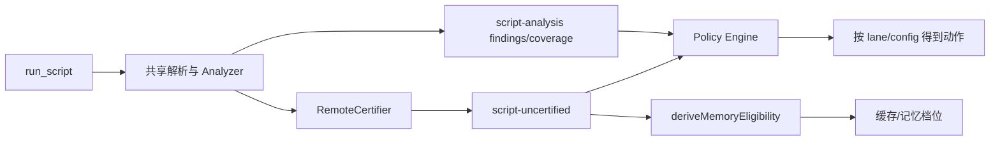

# 脚本分析事实扩展与渠道策略收敛计划（v5）

> **定位**：统一桌面、微信、飞书和自动化链路的脚本分析事实；删除远程专属的 `RemoteCertifier` 安全判断。脚本分析只描述观察到的行为、分析覆盖度与无法确认的部分；是否放行、确认或拒绝只由共享策略引擎按渠道规则决定。
> **状态**：按 2026-11-11 初审 B1–B6、复审 B7、v4 阻断、v5 D4 缓存键阻断及本轮 TDD 实测修订；已确认 D1=A、D2=A、D3=B、D4=A、D5=B、D6=A；P0、P1-A、P1-B 完成，P2 进行中，P3/P4 未完成｜**评审代码基线**：`7f9f4971`；**实现 worktree 基线**：`codex/script-analysis-facts-expansion`
> **评审沿革**：本稿取代 v3 的“远程认证扩容”模型；此前评审核销内容只在与新模型相容时保留。旧稿把远程白名单认证作为独立安全判断的设计不再生效。v5 将 D4 键统一为版本化四元组；本轮本机实测修订了过时的 N8 基线：`range/print` 已按现行纯计算表建模为 complete，记忆闭环改用 `customApi()` 作为真实未建模路径样本。
> **范围**：脚本事实与 IR、`toolCallGate`、声明/路径提取、记忆资格、facts completeness/supplement/snapshot、审批线索与 `agent-sdk` 请求、IM standard v3 的策略 floor/resolver/rule set/行为标签、规则契约测试与 i18n；详见 §5 变更面表。
> **非目标**：网络出口代理化、OS 级执行沙箱、新增审批 Agent 接入 IM、非 Python 内容分析、域名级网络白名单、以脚本自述作为放行依据。
> **篇内路由**：决策与业务效果看 §0；现状证据看 §1；事实契约和策略规则看 §2；阶段与验收看 §3；发布实测看 §4；变更面和术语看 §5。

---

## 0. 【人必读】决策界面

### 一句话变更

现状是“大家共用行为发现，但远程另外跑一遍白名单认证”；目标是“所有渠道只拿同一份脚本分析事实，策略按渠道分别决定如何处置”。这样修复分析漏项会同时改善各渠道；远程仍可比桌面更严格，但严格性由远程规则表达，不藏在分析器里。

### 当前究竟有什么重复判断

`toolCallGate` 对 Python 脚本生成 `script-analysis` 事实，桌面与远程共用这些发现；之后 `scriptAnalysisExtractor` 额外调用 `isScriptCertifiedRemoteSafe()`，若不通过则产生 `script-uncertified`。远程规则把该信号锁定为逐次真人确认；桌面 clean allow 规则不直接匹配它。于是同一脚本有两种不同答案：“分析器没发现风险”与“远程认证器不承认它安全”。这不是渠道策略差异，而是事实提取阶段混入了远程专属判断。

补充：虽然桌面 clean allow 规则不直接匹配 `script-uncertified`，`deriveMemoryEligibility()` 与 `buildMemoryTiers()` 会跨 lane 消费该信号并封顶为无记忆资格。因此删除它也会改变桌面脚本的持久记忆资格，不能把影响范围限定为远程。

### 现状链路与目标链路



目标删除 D/E：同一 facts producer 产出 `findings + coverage + uncertainties`，事实同时进入策略；Policy Engine 按渠道、配置和规则决定动作，之后由既有执行授权链路核验。

### 与 finding 化方案的前置关系与定序（B6）

[`script-finding-model-technical-design.md`](./script-finding-model-technical-design.md) 已定“finding 化先行，本计划随后 rebase”，并把“认证结论不变”列为其原范围前提；本计划的方向决策现已要求移除该结论。两份方案改动同一批 Analyzer、IR、extractor、memory、policy 与审批材料文件，不并行实现。

**定序**：先以 finding 化方案收敛并核对当前在库的 `ScriptAnalysisResult` / `script-analysis` 契约，再 rebase 本计划；本计划只在此契约上增加 `uncertainties`，不另建 `ScriptAnalysisFacts`，也不改变 `findings`、`coverage`、`totalCount` 的既有含义。finding 方案里的 `certification: certified | not-certified` 与“认证器不变”条款不作为本计划的目标契约；应在其收口记录中标为被后续决策取代，并由本计划 P2 在等价门禁通过后原子退役旧认证结果。

P0 静态盘点见 §1.5：在途目录中有 finding 化技术方案，但没有独立的 finding 执行计划文件；技术方案的代码基线较旧，不能据其阶段表推断当前实现进度。当前代码已有 `ScriptAnalysisResult` findings 契约，应据 HEAD 实物 rebase。另发现“解析失败应真人确认”的 finding 方案，与本计划 `parse-failed → forbidden` 和现有 completeness resolver 不一致；现已确认 D6=A，实施时须同步修订 finding 方案并按 §2.4/§3.2 对拍。

### D1｜共同分析本轮补齐到什么范围，并保留记忆边界

**决议：已选 A。** 本轮要补齐 IR 保真、绑定来源、作用域和隐式调用 uncertainty，并采用 D3=B 的行为类别范围。

- **固定边界（不作为选项）**：各渠道共用同一个脚本分析实现和同一份事实结果；分析只产事实，不产安全动作；渠道差异只由策略规则表达。旧认证器失败样本在替代事实和规则就绪前不得切换；切换后必须保持这些样本在桌面和远程的无记忆/逐次确认边界，不因删信号而新增持久记忆。同时保留既有“仅有可恢复的路径分析缺口、内容摘要有效”时的本会话信任选项；其他不确定事实不得因此获得记忆档位。
- **要决定什么**：在上述固定边界内，本轮补齐多少已知分析缺口。
- **选项 A（建议）**：修复 IR 保真、绑定来源、作用域与隐式调用不确定性，并按 D3 批准的类别扩展行为发现。各渠道收到相同的发现、覆盖度和不确定项。
- **选项 B**：只修复 IR 中已确认的字段丢失，不扩展新行为类别；未知调用仍以明确 uncertainty 交给策略。
- **用户影响**：A 可能使原先漏检或覆盖不完整的脚本进入各渠道已有的确认/拒绝规则；已经被共同 Analyzer 完整覆盖的语法，不再只因远程认证器 allowlist 较窄而额外确认。真正未建模的结构仍作为共同 uncertainty 交策略处置。B 保留部分危险行为发现缺项，但不会把未知伪装成干净事实。
- **可逆性**：可逆，分阶段提交并记录新增事实类别对应的策略效果。
- **依据**：现有 analyzer、独立 certifier 和渠道规则为代码事实；各渠道受影响脚本数量尚无数据。
- **未决默认（当前决议已覆盖）**：若未选择，采用 B，只做事实边界和 IR 保真，不新增行为类别；不得据此删除 `script-uncertified` 或改变记忆资格。
- **下钻**：§1、§2.1–§2.4、§3。

### D2｜不同渠道如何消费同一份事实

**决议：已选 A。** 依据用户明确方向：同一脚本事实跨渠道复用，策略保留渠道动作差异；远程现有自动放行双门控继续由远程策略表达。

- **已决事项**：远程与桌面共用分析事实；保留渠道动作差异，并由策略规则表达。远程现有自动放行双门控沿用。
- **选项 A（本计划建议）**：保留渠道差异：桌面沿用桌面规则；微信/飞书只有在分析覆盖完整、没有策略禁止或需确认的发现、且 `remoteScriptRequiresConfirm=false` 与 `andMigrationComplete=true` 均满足时才自动放行；不完整或目标不可证的事实由远程 locked 规则要求逐次真人确认。自动化现状没有 clean allow 规则：未命中 locked deny 的脚本走 `automation-default-confirm`，不能描述为可自动放行。
- **选项 B**：统一规则结果，不保留远程更严格的自动放行门槛。
- **用户影响**：A 保留远程与桌面的体验差异，但这个差异可在规则和 trace 中查询；B 会改变至少一个渠道的确认频率。
- **可逆性**：规则可回退；已执行脚本无法撤回。
- **依据**：现行规则和 `policyEngine` 优先级为代码事实；策略承担渠道差异来自用户已明确的架构要求。
- **未决默认（当前决议已覆盖）**：此前默认不改变既有渠道动作，只先改为共用事实；现已确认保留渠道动作差异。
- **下钻**：§1.1、§2.4、§3.2。

### D3｜补齐哪些当前不可见的行为

**决议：已选 B。** 共同分析补充进程创建、`pickle`/`marshal` 反序列化入口及列出的标准库网络调用。

- **要决定什么**：是否把进程创建、反序列化和未列入网络模块表的真实出站调用纳入共同分析事实。
- **选项 A**：最小范围，只补进程创建。
- **选项 B（建议）**：同时补进程创建、`pickle`/`marshal` 反序列化入口和 `ftplib`/`smtplib`/`xmlrpc`/`telnetlib` 网络调用。
- **用户影响**：新增事实会由各渠道的策略规则处理，可能使脚本从自动放行变为确认或拒绝；若保留当前渠道政策，桌面、IM、自动化的具体动作按矩阵分别列出并经真实 gate 验证。将 `concurrent` 当作进程模块根进行保守分类可能影响线程池脚本，需单列证据与规则，不得暗中等同于进程创建。
- **可逆性**：代码可回退；发布后发生的确认或拒绝不可追溯撤销。
- **依据**：模块列表缺项为代码事实；存量影响量未测。
- **未决默认（当前决议已覆盖）**：若未选择，不新增类别。
- **下钻**：§1.2、§2.2、§3.2。

### D4｜脚本记忆与分析版本

**决议：已选 A。** 在 P2 前把 invocation 级合成 `extractorVersion` 纳入每个 `script-content` 记忆键，唯一键形为 `(extractorVersion, contentDigest, workdirDigest, sessionId)`；旧版本记忆不再命中新版本事实。

- **要决定什么**：分析事实语义变化后，旧的“记住此脚本”决定是否继续命中。
- **选项 A（已批准）**：把 invocation 级合成 `extractorVersion` 纳入每个 `script-content` 键，格式为 `(extractorVersion, contentDigest, workdirDigest, sessionId)`；键升级先于 P2 生效，现存无版本三元组不再命中，用户可能重新确认一次，也不得在新键未命中时回查旧三元组。它标识分析语义，不称为认证版本；这是持久化键格式变更。
- **选项 B**：版本切换时清理旧条目，需要迁移且清理不可逆。
- **选项 C**：键和条目均不变，旧结论继续生效，已记忆的允许可能绕过新增事实对应的策略。
- **可逆性**：A 可回退到先前的提取器版本；若该版本曾以版本化四元组写入条目，回退后会重新命中同版本条目。迁移前的无版本三元组不会因回退而重新命中；B 不可恢复已清理条目；C 无迁移。
- **依据**：审批材料绑定已有 `authenticationVersion`，脚本记忆键未带版本且按键精确匹配；受影响条目数需在发布验证时统计。
- **未决默认（当前决议已覆盖）**：此前默认不改持久化键；现已选择 A，须在 P2 前完成版本化键及旧键不命中验收。
- **下钻**：§1.3、§2.7–§2.9、§3.1–§3.2。

### D5｜是否扩展脚本头部声明能力？（已选 B：暂缓）

**决议：已选 B。** 不因低概率、未经验证的声明采用需求而新增网络/进程注释格式、冲突分类和确认卡逻辑；当前已有路径注释解析和提示维持原样。

**当前代码与本次决议范围**：代码已支持一种可选的 Python 首部注释 `# @path-scope workdir-readonly`。它必须出现在首条代码语句之前；shebang 和编码声明可以在它之前。没有写声明的脚本照常分析。代码和测试证明解析器识别这个格式，不能证明真实作者会不会写、使用频率有多高。D5=B 保留这项既有能力；本轮不新增网络/进程声明格式，不增加声明与分析观察之间的结构化冲突逻辑或详细确认卡。

**例子**：如果作者写“脚本只读工作目录”，而分析事实显示存在与该声明不一致的行为，A 会把声明和观察到的事实一起展示给用户，由策略决定是否逐次确认。声明只是作者提供的一条输入事实，不会授权执行；声明与观察一致也不会自动放行。由于当前没有作者采用率或实际收益数据，这只是待验证的功能假设。

- **问题说明**：A/B 的差别是是否扩展这套“声明作为事实、冲突交策略、确认卡解释冲突”的功能；当前决议已选择暂缓扩展。

- **选项 A**：保留现有路径声明，并定义网络、进程声明格式；分析器只产声明与观察关系的事实状态，不产生 allow。策略对冲突逐次真人确认，确认卡并列显示声明内容和观察事实；声明一致不增加放行。记忆键仍只按 D4=A 做版本化。
- **选项 B（已选）**：保留现有路径声明解析、signal 与提示；本轮不新增网络/进程声明格式，不增加结构化冲突事实或详细确认卡说明，先完成共同分析事实与策略收敛。
- **A 的用户影响**：声明与行为冲突的脚本会多一次逐次确认，用户能看到冲突依据；声明一致时行为不变。B 不引入声明相关提示，但也不会解释脚本自述与观察之间的矛盾。
- **利弊**：A 在作者提供声明时增加可审计证据和确认上下文，代价是要设计并维护新注释格式、规则、测试和翻译；目前没有证据表明作者会广泛填写。B 缩小本轮范围，保留现有路径注释解析，但暂不扩展网络/进程声明和确认卡提示。
- **决议理由**：不为低概率且未经证实的作者声明使用场景增加解析、策略和 UI 逻辑。若未来出现明确需求或采用证据，再单独评估是否扩展。
- **可逆性**：声明规则和卡片展示可回退；已经发生的确认无法撤销；缓存键不由 D5 决定。
- **依据**：`scriptPathFacts.ts` 与对应测试证明首部路径注释格式已实现；没有作者实际采用率数据，也没有网络/进程声明格式或冲突卡片的实测结果。
- **决议执行范围**：按 B 保留现有路径声明解析、signal 与提示；核心分析事实与策略迁移独立推进。
- **下钻**：§2.3、§2.4、§5。

**决议状态：已选 B；当前只保留已有路径注释解析和提示，不扩展网络/进程声明或冲突卡片。**

### D6｜脚本分析失败时，是拒绝还是交给真人确认

**决议：已选 A。** 所有渠道遇到 `parse-failed` 均拒绝；本决议不改变 `partial/missing` 的交互确认与 automation 拒绝规则。

- **背景**：同一类脚本解析失败目前可能在初次 Gate 进入真人确认，而共享 `FactCompleteness` 把 `parse-failed` 定义为禁止；补充证据后的复裁又会按该定义拒绝。若不统一，首轮确认与复核会对同一份不完整事实给出不同动作。
- **要决定什么**：当脚本语法无法解析或分析器无法产出可用事实时，系统是拒绝本次调用，还是把代码交给真人逐次确认。
- **选项 A（已选）**：统一遵循现有 `parse-failed → forbidden`：所有渠道拒绝，记忆为 `none`，不交给 IM 审批 Agent，执行器不调用。结构已完整遍历但局部覆盖不足的 `partial/missing` 则由桌面/IM 锁定真人逐次确认、不给记忆；automation 锁定拒绝。
- **选项 B**：交互渠道继续真人逐次确认解析失败；这要求同时改变共享 completeness resolver 与补充证据复裁契约，不能只改初次 Gate。
- **用户影响**：A 会把当前部分解析失败时可继续确认的脚本改为直接拒绝；B 保留人工复核通道，但仍需重定义“parse-failed”在事实快照和审批请求中的含义。
- **可逆性**：策略规则可回退；解析失败时已执行的脚本无法撤回。
- **依据**：当前 `factsCompleteness.ts` 与 `recheckInvocationFacts.ts` 对 parse-failed 的处置是代码事实；初次 Gate 与 finding 化方案仍有人工确认语义，行为尚未统一。
- **未决默认（当前决议已覆盖）**：此前会保留旧信号与旧 Gate；现已选择 A，实施需统一初次 Gate、补充复裁与 SDK 语义后再切换。
- **下钻**：§1.5、§2.8、§2.4、§3.2。

### 不需要你决定

具体语法树遍历、IR 字段承载、事实来源标记、规则匹配实现、回归用例，以及执行计划的提交拆分由实现者负责；但不得新增渠道特定分析结果，也不得把动作字段塞进分析事实。

---

## 1. 【人机共读】代码现状与问题证据

### 1.1 共用分析与远程专属认证并存

- `electron/confirmation/toolCallGate.ts` 的 `run_script` Python 路径解析一次 IR，再调用 `extractScriptSignals`。
- `electron/confirmation/extractors/scriptAnalysisExtractor.ts` 调用 `analyzeScriptContent(code, ir)` 生成发现与覆盖度；此部分没有 lane 参数，桌面、微信、飞书共用。
- 同一提取器再调用 `isScriptCertifiedRemoteSafe(ir)`；失败时产生 `script-uncertified`。这是分析事实之外的第二个正向白名单判断。
- `src/shared/policy/defaultRules.ts` 中，`script-uncertified-ask-remote` 只匹配微信/飞书且 locked；`script-clean-certified-remote` 还要求 `remoteScriptRequiresConfirm=false` **及** `andMigrationComplete=true`；`script-clean-allow-desktop` 按桌面发现规则放行。
- `src/shared/policy/memoryEligibility.ts` 对 `script-uncertified` 无视 lane 地返回 `none`，由 `buildMemoryTiers()` 同时影响缓存读取、确认 UI 档位及缓存写入。因此该信号既影响远程处置，也保护桌面不把未认证/未建模脚本记成持久允许。
- IM standard v3 还有 `im-script-network-review-candidate` 静态候选链：`script-network-deny-remote` 与旧未认证规则被 floor/resolver 排除后，由 `im-script-network-review` 交审批 Agent；候选不匹配时仍保留网络拒绝/确认底线。替换规则 ID 时必须同步 floor、resolver 与 rule set，不能让字符串分支静默失效。
- 因此共用的是行为发现；远程另有正向认证、IM standard v3 静态网络审批分流，记忆资格又跨 lane 消费认证信号。修改必须同时保留三者各自的策略语义。

### 1.2 现存事实缺口

- `ScriptAnalysisResult` 的类型允许 `coverage='partial'`，但 `analyzeScriptContent()` 当前只有发现投影失败或异常时产出 `failed`，其余成功解析都产 `complete`；未建模结构没有 `partial` 的实际产出点。
- `RemoteCertifier` 失败只改变认证布尔，不改变 `findings/coverage`。例如测试已固化的 `for/else` 中未建模 `with`：Analyzer 输出空 findings + `complete`，唯一不让它走 clean 的信号是 `script-uncertified`。所以移除信号前必须让每个认证失败原因有等价事实、测试和策略消费者。
- Analyzer 的危险模块表和网络模块表缺少 `multiprocessing`、`concurrent.futures`、`pickle`/`marshal` 读取入口及部分标准库网络模块。缺项可能表现为零发现。
- IR 适配存在字段丢失、别名来源/完整模块路径丢失、块级绑定未合并、隐式调用未形成不确定事实等风险。扩展分析前必须先保证结构和来源不丢，或把无法承载明确标为分析不完整。
- 未绑定裸名、动态调用目标、对象协议（格式化、索引、迭代、上下文管理）不能仅因未命中已知危险模块就视为无风险事实。

### 1.3 版本与缓存现状

`electron/confirmation/toolCallGate.ts:715` 中 `script-path-extraction` 写入 `authenticationVersion: 'script-certifier-v1'`；审批绑定由 `electron/confirmation/agentChannel.ts:78` 投影成 `scriptApprovalBinding.certifier`，用于同一审批材料的最终绑定。脚本记忆键目前按脚本内容、工作目录和会话匹配，不含该版本。键精确匹配意味着键结构改变会令旧条目不命中；切回曾写入过记忆的旧提取器版本可能重新命中同版本四元组条目，但迁移前无版本三元组不会因此命中。移除认证器后，绑定字段需改称事实提取器版本，但要经过 facts provenance 与 agent-sdk 请求兼容评估；不得只改本地字段名。

记忆键的实际构造比单独的内容摘要更严格：当前 `policyEngine.ts` 只有在 `contentDigest` 和 `workdirDigest` 都是 64 位小写 SHA-256，且当前 `sessionId` 存在时才派生 `script-content` 键。**这是当前实现的无版本三元组** `(contentDigest, workdirDigest, sessionId)`，不含 lane；会话边界由 `sessionId` 绑定，工作目录边界由 `workdirDigest` 绑定。D4 批准的目标键唯一为 `(extractorVersion, contentDigest, workdirDigest, sessionId)`：同一个 invocation 的 canonical、非空 `extractorVersion` 必须同时参与 eligibility 与所有 `script-content` cache lookup/write 的精确键匹配。合法版本指 §2.8 在该 invocation 内合成、包含必需脚本组件并经 snapshot/provenance 校验的同一 canonical 字符串。缺失或非法版本时不给任何脚本 memory eligibility/tier/key，不读写缓存，也绝不回查旧三元组；提取器版本改变必须 miss。lane 仍由策略和 eligibility 限定，不加入键。`memoryEligibility.ts` 当前只校验内容摘要，故可能出现 eligibility=`session` 但无法派生键、确认卡无可选档的中间态；新契约必须同时验资格、档位、读写和命中。

通用 `FactCompleteness` 已包含 `authentication-missing` 和 `capability-description-stale`，在 `factsCompleteness`、`factsSupplement`、invocation snapshot 白名单及审批线索中有消费点。此计划不得删除或重命名这两个既有值来表达脚本 coverage；保留枚举并明确脚本 coverage 与 invocation-level completeness 的映射。

### 1.4 复现入口

评审基线 `7f9f4971`（评审已核验相关代码面与 `ce1f382e` 无差异）；以下命令用于复核本节现状：

```bash
grep -n "analyzeScriptContent\|isScriptCertifiedRemoteSafe\|script-uncertified" electron/confirmation/extractors/scriptAnalysisExtractor.ts electron/shell/scriptContentSecurity.ts
grep -n "script-uncertified-ask-remote\|script-clean-certified-remote\|script-clean-allow-desktop" src/shared/policy/defaultRules.ts
grep -n "authenticationVersion\|script-content" electron/confirmation/toolCallGate.ts src/shared/confirmation/types.ts src/shared/policy/policyEngine.ts
grep -n "script-uncertified\|network-api" src/shared/policy/memoryEligibility.ts src/shared/policy/policyEngine.ts
grep -n "authentication-missing\|capability-description-stale" src/shared/confirmation/invocationFactsSnapshot.ts src/shared/confirmation/factsCompleteness.ts src/shared/confirmation/factsSupplement.ts
grep -n "im-script-network-review-candidate" src/shared/policy/policyFloor.ts src/shared/policy/imPolicyBehaviorResolvers.ts src/shared/policy/imStandardV3Rules.ts
grep -n "script-path-declaration\|parseScriptPathDeclaration\|script-declared-path-scope-allow-desktop\|allowDeclaredPathScopeScripts" src/shared/confirmation/types.ts electron/confirmation/extractors/scriptPathFacts.ts electron/confirmation/toolCallGate.ts src/shared/policy/defaultRules.ts src/shared/domainTypes.ts
grep -n "scriptApprovalBinding\|factsProvenance\|authenticationVersion\|certifier" src/shared/confirmation/types.ts electron/confirmation/agentChannel.ts electron/confirmation/agentSdkSafetyPolicy.ts electron/confirmation/agentSdkConfirmationPort.ts
grep -n "andMigrationComplete\|automation-default-confirm\|script-network-deny-remote" src/shared/policy/defaultRules.ts src/shared/policy/policyEngine.ts
grep -n "script-clean-certified-remote\|certified-clean-script" src/shared/policy/imPolicyBehavior.ts src/shared/policy/imPolicyBehavior.test.ts src/shared/policy/imPolicyBehaviorResolvers.test.ts
grep -n "decide(facts\|host-tool-facts-v1\|reportedSnapshotCompleteness\|factsCompleteness" electron/confirmation/toolCallGate.ts
grep -n "resolveFactsCompleteness\|script-unmodeled-path-ask\|script-content" src/shared/confirmation/recheckInvocationFacts.ts src/shared/policy/defaultRules.ts src/shared/policy/policyEngine.ts
find docs/develop/safety-approval/in-flight -maxdepth 1 -type f -iname '*script*finding*' -print
```

### 1.5 P0 当前实现盘点（静态，HEAD `7f9f4971`）

本轮只读核对了代码和在途方案；工作区没有 `.ts` diff。核对结果如下，均为当前源码事实，不代表测试或真实渠道验收：

| 面 | 当前实现 | P0/P1 必须处理 |
|---|---|---|
| Finding 方案状态 | `script-finding-model-technical-design.md` 存在，核对基线为 `02969077`；目录无独立 execution plan。代码已有 `ScriptAnalysisResult` 与 finding 信号，技术方案阶段表不能作为实现状态证明 | 以当前 HEAD 类型、生产者、消费者和测试重建 rebase 清单；不声称存在未找到的执行计划或阶段完成证据 |
| Gate 顺序 | `toolCallGate.ts` 先调用 `decide()`（约 1376 行），决策后才计算 `reportedSnapshotCompleteness` 并构造 snapshot（约 1500–1530 行）；snapshot 固定写 `host-tool-facts-v1` | 把 extractor completeness 在策略决策前一次性汇总并注入 facts；同一值供 Policy Engine、snapshot、audit 使用，不能决策后另算 |
| 初次 Gate 完整性 | audit 的 `factsCompleteness` 目前只聚合 MCP/browser/Lark signal；snapshot completeness 另用 extraction-failed、shell partial、MCP 状态计算；脚本 `script-analysis.coverage` 未进入二者。`resolveFactsCompleteness()` 目前用于补充证据重裁决，不参与初次 Gate 的 `decide()` | 统一初次 Gate、snapshot、补充证据重裁决的 completeness 语义和 rule trace |
| 脚本失败与动作 | parse error 产生 `extraction-failed`；交互链路由 `script-analysis-incomplete-confirm` 真人确认，automation 对路径未知有 locked deny。共享 completeness helper 对 `parse-failed` 定义为 forbidden，finding 化方案也写过 parse failure 人工确认 | D6 已选 A：统一为 parse-failed deny，新增/对齐 locked 规则并同步 finding 方案；partial/missing 仍交互确认、automation 拒绝 |
| IM Agent 复核 | standard v3 的 `im-script-network-review` 要求 network finding、静态候选 complete、执行环境/设置/审批材料 complete；规则排除 finding deny、analysis failed、extraction-failed。全局 invocation completeness 目前不参与初次 policy match | 把“完整且候选材料齐备”作为 Agent 复核前置；任何会改变候选可靠性的 partial/missing 先由 completeness 规则接管，不能同时让 Agent 与人工规则竞争 |
| 会话记忆 | `script-unmodeled-path-ask` 是 cacheable ask；eligible 只校验内容 digest，而 `deriveCacheKeys` 另要求工作目录 digest、sessionId。人工确认写入还要求 key 来自本次 decision 的 memoryTiers；只有 eligible、卡片选项不证明实际可写或后续可命中 | B7 用例必须贯通 Policy Engine cache lookup → 确认档位 → `recordUserAnswerFromDecision` 写入 → 同键再调用命中，并对缺 digest、不同目录/会话、来源未知作负例 |

**P0 结论**：事实契约和测试清单可按当前 HEAD 继续 rebase；D4=A 与 D6=A 已获决，剩余是实现前置兼容与验证工作，不再是待拍板项。P0 不修改重叠生产契约。

---

## 2. 【规格层】统一事实契约与渠道策略

### 2.1 责任边界与不变量

1. **单一分析实现**：给定相同脚本字节、语言、工作目录等可信分析输入，所有调用渠道复用同一个 Python 分析器与同一版本的事实结果；分析器不读取 lane、套餐档位、远程配置、记忆状态或审批者。
2. **事实无动作**：分析输出只包含观察、证据、来源、覆盖度和版本；不得包含 `certified`、`uncertified`、allow/ask/deny、answerer、policy rule ID 或“可自动放行”等字段。
3. **未知保持未知**：未建模语法、解析失败、调用来源不可证、隐式调用接收者不可证等必须以稳定的不完整/未知事实表达。策略不得将未知折成“未发现危险”。
4. **策略唯一决策**：渠道差异只由共享 Policy Engine 中按 lane/config 匹配的规则产生，并保留稳定 rule ID 与 decision trace；执行器不重新分析或改写处置。
5. **声明不是证明**：用户声明只作为自述与观察比较的输入；`supported` 只有在分析范围及覆盖条件满足时才产出，且本轮不允许声明单独触发放行。

### 2.2 统一脚本分析结果

沿用 finding 化方案及当前代码中的 `ScriptAnalysisResult` 与 `script-analysis` signal（`findings`、`coverage`、`totalCount`、`reason`）；不另造平行的 `ScriptAnalysisFacts` 结构、不改变 `totalCount === findings.length` 语义。只在此契约上**增量加入**结构化 `uncertainties`，并让 `coverage='partial'` 有真实生产点：

```ts
interface ScriptAnalysisResult {
  findings: ScriptFinding[]
  coverage: 'complete' | 'partial' | 'failed'
  totalCount: number               // 保留既有定义：等于 findings.length
  reason?: string                 // 保留既有失败原因字段
  uncertainties: ScriptUncertainty[] // 新增；不替代 coverage/findings/totalCount
}
```

`findings` 描述观察到的行为类别，例如进程创建、动态执行、网络访问、破坏性文件操作和写入；`uncertainties` 描述“为什么还不能完整判断”。同一发现不得因渠道而换类别或换证据。覆盖失败时保留独立且可信的发现，但策略必须获得明确的 `coverage` 状态；是否让该事实组合锁定确认属于策略规则。

`coverage` 表示解析、IR 承载与分析遍历是否完整，不表示脚本是否无风险：所有节点均被检查、但某个已解析调用的路径效果未被该路径提取器建模时，可为 `complete` 并记录 uncertainty；未支持节点、来源链断裂或遍历中断则为 `partial/failed`。`ScriptUncertainty` 至少包含稳定 `kind`、源码范围及来源状态。为记忆路径区分两种情况：`path-analysis-unmodeled-call` 表示 callee 来源已由静态绑定解析、只是路径效果模型缺项，并显式 `dynamicAccess=false`；`call-target-unresolved` / `binding-origin-unknown` 表示调用来源本身不可证，永不符合会话记忆窄口。缺少 `targetResolution` 或 `dynamicAccess` 时按未知处理。

**认证失败等价覆盖清单（P2 删除旧信号的硬门禁）**

| `RemoteCertifier` 失败分支/来源 | 新事实映射 | 必须有的回归断言 |
|---|---|---|
| 未建模 statement / expression（`walkStmts`、`walkExpr` default） | uncertainty `unmodeled-statement` / `unmodeled-expression`，coverage=`partial` | 代表性语法各一例；不产无 uncertainty 的 clean facts |
| callee 是计算表达式（既非 name 亦非 attr） | uncertainty `call-target-unresolved`，coverage=`partial` | `factory()()`、表达式 callee；位置/原因稳定 |
| `resolveExprChain` 返回 `module === null` | uncertainty `call-target-unresolved` 或 `binding-origin-unknown`，coverage=`partial` | 未绑定裸名、赋值别名、块出口/遮蔽分别覆盖 |
| `REFLECTION_NAMES`：`getattr/hasattr/setattr/delattr/vars/globals/locals` | 已有 reflection finding；目标/来源仍不明时同时产对应 uncertainty | 直接名、属性末位、别名及动态目标样本 |
| `EXEC_IMPORT_NAMES`：`eval/exec/compile/__import__` | 已有 dynamic-execution/dynamic-import finding；无法解析入口时产 uncertainty | 直接调用、`builtins`/属性链、别名及 computed target 样本 |
| `importlib.import_module` | dynamic-import finding；动态模块目标另产 uncertainty | 静态/动态模块参数各一例 |
| 危险模块调用未命中既有安全能力事实（当前 `isCertifiedSafeDangerousCall` 返回 false） | 若现有 Analyzer finding 已准确覆盖，沿用该 finding；否则产 `unclassified-dangerous-call` uncertainty，coverage=`partial` | 对每个危险根至少一例；不得因“认证失败”直接赋动作 |

旧认证器全部 fail 分支、名字集合与递归入口都须在映射表登记；表项未完成或无对应测试时 P2 不得删除 `script-uncertified`。新 clean 规则（桌面、微信、飞书）必须显式要求 `coverage==='complete'` 且 **uncertainties 为空**，再检查其渠道发现处置条件；仅要求“无非 allow finding”不合格。

**认证通过但绑定保守性不足的 golden（N8）**：与 fail 分支表分开登记，不能把“旧认证器通过”当作安全预期。至少覆盖：① `for x in range(3): print(x)`，实测当前路径 facts 为 complete、内容分析无 uncertainty，冻结为无新增确认的无害基线；② `for x in range(3): x()`，验证循环目标不可被误当作可信模块根，必须产出可解释 finding/uncertainty，不能 clean；③ `left = right = dangerous_callable` 后分别经两个别名调用，验证多目标赋值不会因绑定未更新而变成 clean。P1 对②③先做 RED 基线核验，再实现并达到目标断言；实测与评审所述不同则先修正文档基线，不得硬编码错误预期。

事实生产者同时负责完整 IR 承载和消费：`assert.msg`、`raise.cause`、赋值目标、格式说明等若进入 IR，必须由事实分析器消费，不能出现“字段已承载但无人检查”的窗口。无法可靠承载时，该输入应产生 `failed/partial` 与稳定 uncertainty，而非静默丢弃。

### 2.3 现有路径声明兼容（D5=B）

本轮保留现有可选注释 `# @path-scope workdir-readonly` 及 `script-path-declaration` signal `{ scope, consistent }`，不改变其解析语法、未知 scope 的处理或用户提示；不新增网络/进程声明、结构化冲突分类或确认卡内容。

`script-declared-path-scope-allow-desktop` 目前不可达。本轮维持该状态，不修复、不启用 allow，也不改变 `allowDeclaredPathScopeScripts` 配置，避免扩展放行范围。后续若有实际使用证据并重新决议 D5，另行评估声明扩展。

### 2.4 策略映射与决策优先级

在通过 §2.2 的 fail-branch 映射与 §2.9 的记忆资格门禁后，移除 `script-uncertified`，并删除远程 clean 规则对独立认证结论的依赖；远程 clean 规则本身仍保留为策略规则，条件改为共同分析事实 `coverage=complete`、无 uncertainty 且无需处置的发现。所有渠道的 clean allow/ask 规则都必须排除有 uncertainty 的 facts。策略基于共同事实形成按渠道区分的规则：

`signalTokenSet` 从 `script-analysis.uncertainties` 派生 `script-analysis:uncertainty` 与 `script-analysis:uncertainty:<stable-kind>`。默认规则 ID `script-uncertified-ask-remote` 与 `script-clean-certified-remote` 在本迁移中**保留为兼容 ID**（避免 resolver/floor/custom profile/trace 引用静默失效），但更新匹配事实、注释、reason 与 i18n：前者消费 unresolved facts，是策略规则而非认证器输出；后者 clean 条件不再引用 certifier。ID 的语义性改名另作带别名迁移。

`script-unmodeled-path-ask` 同样保留原 rule ID、`action='ask'` 与 `cacheableAsk: true`；迁移期同时识别旧 `script-path-extraction:unmodeled-call` 和新的 `path-analysis-unmodeled-call`，兼容窗口关闭后由共同事实 token 命中。它仍可对更广的未建模调用要求询问；只有 §2.9 的已解析来源、完整 coverage、来源范围、内容/工作目录摘要和 session 键条件全部满足时，记忆层才给 `session`，其他命中仍不给记忆档位。调用来源未知须产 `call-target-unresolved`/`binding-origin-unknown`，不能由 legacy 标签被误归为路径效果未建模。

**保留 ID、更新 match 的边界（N9）**：静态核对 `PolicyRuleOverrideInput` 只持久化 `ruleId/action/params`，`applyCustom()` 按 ID 覆盖动作并保留默认规则的 `when/match`；因此旧 override 不会把旧 match 带入新规则。`validatePolicyRulesFloor()` 仍对 locked 规则逐项比较 `when + match`，所以默认规则、IM v3 floor/resolver 的同 ID 副本和契约测试必须同批更新，保证比较的是新的一致条件。保留 ID 是必要的，因为 floor/resolver/FAIL_CLOSED 分支按 ID 特判；改 match 只在上述 floor 同步后成立，不能据此省略规则行为对拍。

| 事实 | 桌面 | 微信/飞书 | 自动化 |
|---|---|---|---|
| 已观察到策略需确认的发现 | 沿用桌面安全档与 locked floor | 沿用远程确认/拒绝规则 | 按现有无人值守拒绝规则 |
| coverage 不完整、存在关键 uncertainty 或提取失败 | 显式规则处置；不得因无 finding 放行 | 保留逐次真人确认底线 | 保留拒绝底线 |
| coverage complete、无 uncertainty 且无需策略处置的发现 | 桌面 clean 规则 | 远程 clean 规则仅在 `remoteScriptRequiresConfirm=false` 且 `andMigrationComplete=true` 时放行 | 当前无 clean allow；通常进入 `automation-default-confirm`，命中 locked deny 则拒绝 |

表中是目标行为提案，不代替真实 gate 对拍。拒绝、人工 floor、可记忆 ask、自动审批与 allow 的优先级必须以 `policyEngine` 实际顺序验证；任何新增 locked 规则需登记稳定 rule ID 与 decision trace。若声明一致，不改变 clean 规则的匹配条件。

**IM standard v3 网络复核保持项**：`im-script-network-review-candidate:complete` 的静态候选分析和 `im-script-network-review`（`answerer='agent'`）保持独立；非候选网络调用仍命中 `script-network-deny-remote`。本迁移保留 `script-uncertified-ask-remote` 与 `script-clean-certified-remote` 两个稳定 rule ID，只改变匹配事实与 reason，避免 resolver/floor/custom profile/trace 引用静默失效。`policyFloor.ts`、`imPolicyBehaviorResolvers.ts` 中按 ID 的 candidate 排除分支及 `policyPackages.test.ts` 的 `FAIL_CLOSED_IDS` 必须继续命中并增加契约测试。若未来确需改 ID，必须另作 alias/override 迁移。

**完整性与规则动作的竞争顺序（v4-3）**：完整性是同一份 host facts 与 snapshot 的状态，不是 Gate 在决策后追加的解释。按 §2.8，Policy Engine 用首次决策前附加的 `invocation-facts-completeness:<value>` token 和脚本 coverage token 运行规则。D6=A 时，`parse-failed` 命中 `script-analysis-parse-failed-deny`（所有 lane locked deny），拒绝先于确认、Agent、缓存；脚本 `partial/missing`（含未知调用来源）在桌面/微信/飞书命中 locked `script-analysis-incomplete-confirm`，回答者 user、无 memory tiers；`authentication-missing/capability-description-stale` 命中 `invocation-facts-incomplete-confirm`，交互 lane 同样由真人逐次确认且无记忆。automation 对上述非 complete 状态命中 `automation-incomplete-facts-deny`。补充证据复裁使用相同聚合值和同一优先级，不另作一套动作。

IM standard v3 的 `im-script-network-review` 仅当 invocation completeness、脚本 coverage、network candidate、执行环境/设置与审批材料全部 complete，且不存在阻断该候选的 uncertainty 时交 Agent；partial/missing/parse-failed 优先走上述完整性规则，network deny floor 不得因不完整 candidate 被排除。完整的静态网络候选仍由 Agent 复核；其 network finding 使记忆资格为 `none`。唯一可记 `session` 的 `path-analysis-unmodeled-call` 必须保持 `complete` 且来源已解析，交互链路走 `script-unmodeled-path-ask` 真人确认；automation 仍拒绝且 Agent/非人回答者不能写入记忆。

解析失败动作已按 D6=A 决定：实施时新增/对齐 `script-analysis-parse-failed-deny` 与 automation locked deny，并同步 finding 化技术方案。若未来改选 B，则必须同步修改 `factsCompleteness.ts`、补充证据复裁与 SDK 合约，不能只保留当前初次 Gate 的确认规则。

| 同一 invocation facts | 策略输入 completeness / snapshot completeness | rule ID、最终动作与回答者（D6=A） | IM Agent 与缓存结果 | 执行边界 |
|---|---|---|---|
| Python parse error / `coverage=failed, reason=parse_error` | 两处均为 `parse-failed` | `script-analysis-parse-failed-deny`；deny；无回答者 | 不交 Agent；`memoryTiers=[]`，不查/写缓存 | 所有 lane 拒绝，executor 未调用 |
| `coverage=partial/failed(non-parse)/missing` 或调用来源不可证 | 两处均为 `partial` 或 `missing`；`failed(non-parse)` 固定映射到 `missing` | desktop/IM `script-analysis-incomplete-confirm`；automation `automation-incomplete-facts-deny` | 不交 IM Agent；`memoryTiers=[]`，不查/写缓存 | 交互渠道每次由真人确认；automation 拒绝 |
| `authentication-missing` 或 `capability-description-stale` | 两处保留对应枚举 | desktop/IM `invocation-facts-incomplete-confirm`；automation `automation-incomplete-facts-deny` | 不交 IM Agent；`memoryTiers=[]`，不查/写缓存 | 交互渠道每次由真人确认；automation 拒绝 |
| 完整静态网络候选，所有候选/环境/设置/审批材料 complete，且无阻断 uncertainty | 两处均为 `complete` | IM `im-script-network-review`；ask/review；answerer=`agent` | 进入 Agent 复核；network finding 令记忆资格为 `none`，不写缓存 | Agent 未批准前不执行；非候选网络继续命中原 deny floor |
| 完整分析，只有来源已解析的 `path-analysis-unmodeled-call`，满足 §2.9 的双摘要和 session 条件 | 两处均为 `complete` | `script-unmodeled-path-ask`；ask；desktop/IM answerer=`user` | 交互 lane 可给 session tier；automation 命中 locked deny、无记忆；按 §3.2 验证真实缓存写入与再命中 | 同 lane、同工作目录、同脚本、同 session 才可再次命中；Agent 不接管 |
| 完整但有其他 uncertainty/finding | 两处均为 `complete` | 按相应 finding/uncertainty 规则；unknown source 不得转入上一行 | 除唯一 §2.9 窄口外均无 session tier；网络/危险 finding 无记忆 | 按渠道规则真人确认/拒绝；不得因 completeness=`complete` 当作 clean |

Policy Engine 的动作优先级按源码顺序验收：deny → locked human floor → cacheable ask/缓存 → Agent auto-evaluator/普通策略。由此 parse-failed deny 先于任何 ask；partial human floor 先于 IM Agent；只有完整候选进入 Agent；会话缓存只服务可记忆 ask，且必须先得到 human answer。snapshot completeness、`ContentFacts` completeness token 与 audit completeness 必须逐项相等。

`imPolicyBehavior.ts` 的 `'certified-clean-script'` 场景键本轮也作为 legacy policy scenario 保留，明确其新含义是“完整分析且无策略处置事实的 clean 脚本”；更新注释与 `imPolicyBehavior.test.ts`、`imPolicyBehaviorResolvers.test.ts` 套餐矩阵断言。不得把它解释为分析器签发了安全认证。

### 2.5 分析来源、绑定与隐式调用

- `Scope.modules` 保存完整模块路径；`Scope.attrs` 保存完整来源路径和属性。`ResolvedChain` 同时保留根模块语义与完整 `modulePath`。分类按完整路径区分 `multiprocessing.dummy` 与进程创建模块。
- 名称解析输出来源类别（导入绑定、属性/赋值绑定、本地定义、未知根、未解析）；来源是分析证据，不是 allowlist 判决。未知根、遮蔽、动态导入和重绑定需形成 uncertainty，或形成已观察 finding；不得因为解析出一个名字就推断安全。
- 隐式调用（格式化、下标、迭代、`with`、比较/运算重载等）需逐节点说明：实际可观察到什么、目标能否证明、缺证时 coverage/uncertainty 如何表达。不要声称静态分析证明了第三方库内部没有副作用。
- 作用域合并覆盖 if/while/for/try/with/function/class 等控制结构；状态冲突或动态重绑需保留来源不确定性。

### 2.6 分析类别表

| 构造 | 事实类别 | 规则输入说明 |
|---|---|---|
| `multiprocessing.Process/Pool`、`ProcessPoolExecutor` | `process-creation` | 进程创建已观察；`ThreadPoolExecutor` 单独分类或明确不属于该类别 |
| `pickle.load(s)`、`marshal.load(s)` | `deserialization` 或既有动态执行类别的细分 | 只对读取/反序列化入口产事实，不误伤 dump |
| `ftplib`、`smtplib`、`xmlrpc`、`telnetlib` | `network-api` | 标记标准库网络调用，不直接决定拒绝或确认 |
| 未知 callee、动态派发、反射、目标来源不明 | `uncertainty` 对应稳定子类 | 策略可要求确认；事实本身不命名动作 |
| IR 未承载或遍历失败 | coverage `partial/failed` + 原因 | 不得输出“干净”结论 |

直调、模块别名、from-import 别名均须分别验证；每例断言事实类别、uncertainty/coverage 与最终策略 decision，不能再以“认证失败”作为分析验收。

### 2.7 契约变更与版本

- 移除 `script-uncertified` signal、`isScriptCertifiedRemoteSafe` 的渠道安全语义，以及 `script-certifier-vN` 命名。
- 将审批材料中的版本标识改成 `script-analysis-vN`（facts `extractorVersion`）；它只说明事实提取语义版本。现写入 `toolCallGate.ts` 的 `authenticationVersion` 和 clue 的 `scriptApprovalBinding.certifier` 必须通过兼容迁移，不能只改命名或删除字段。
- 脚本记忆版本键按已批准的 D4=A：在 P2 前将所有 `script-content` 键统一为 `(extractorVersion, contentDigest, workdirDigest, sessionId)`；无版本旧三元组不得回查，缺失/非法版本失败关闭。
- 共享确认类型、labels、策略规则、审计与规则 trace 同批更新。UI 是否展示 uncertainty 按其自身需求决定；D5=B 不增加声明相关 UI。

### 2.8 Invocation facts 与审批/agent-sdk 契约

采用已有 `FactCompleteness` 与 `factsProvenance`，不另造第二套 invocation completeness：

| 脚本分析结果 | Invocation `FactCompleteness` | 说明 |
|---|---|---|
| coverage `complete` | `complete` | 仅在 findings 与 uncertainties 都按契约生成时 |
| coverage `partial` | `partial` | 有观察事实，但仍有未覆盖结构/调用目标 |
| coverage `failed` 且 reason=`parse_error` | `parse-failed` | 现有 completeness 语义为 forbidden；原因另在 extraction failure signal 保留 |
| coverage `failed` 且非 parse error | `missing` | 例如位置/事实投影不可用；走 human-required，不得误映射为 parse-failed |
| facts 未能生成/缺失 | `missing` | 不得用空 findings 合成 complete |
| `authentication-missing` | 保留既有枚举与 human-required 语义 | 不用来表示“删除 RemoteCertifier” |
| `capability-description-stale` | 保留既有枚举与 human-required 语义 | 属于现有工具能力描述完整性，不代表或替代脚本作者声明；D5=B 不改此契约 |

`FactCompleteness` 的六个既有值在 `invocationFactsSnapshot` 白名单、`factsCompleteness`、`factsSupplement`、共享类型和审批请求中均保持合法；本计划不删除或复用其中两个旧值。`InvocationFactsSnapshot.extractorVersion` 是一次 invocation 的通用版本入参，不得直接改成只代表脚本的版本。它按本次参与事实生产的 extractor ID 排序，合成为稳定的 canonical JSON 字符串，例如 `{"invocation-facts":"v1","script-analysis":"v2","script-path-extraction":"v3"}`；相同生产者集合与版本排列顺序不影响结果，任一参与 extractor 的语义版本变化都会改变合成值。非脚本工具只写通用版本和该工具实际参与的 extractor，不伪造 `script-analysis` 项；脚本工具缺少必需的脚本分析版本时不得默认为通用版本或 `complete`。这些版本组件必须经生产者清点产生，不允许由调用方手写随意拼接。`factsProvenance.extractorVersion` 因而是整份 invocation facts 的权威合成代次，其中脚本分析版本是一个组件。

**初次 Gate 与补充复裁共用的 completeness 契约（B3/v4）**：每个 extractor 在分析完成后先交付原始状态；Gate 在首次 `decide()` 前按唯一顺序合成 invocation completeness，再把同一个状态作为 host-derived `invocation-facts-completeness` fact 放入 `ContentFacts`，并原样写入 snapshot 与 audit。决策后禁止再次依据不同 signal 集合重算。

| 聚合输入 | invocation completeness | 策略前置与最终动作 |
|---|---|---|
| 任一必需 extractor 报 `parse_error` | `parse-failed` | D6=A 时由 locked deny 优先于确认、Agent、缓存；不执行、不记忆 |
| 无 parse error，但必需事实缺失 | `missing` | 交互渠道 locked 真人逐次确认；automation locked deny；不交 Agent、不记忆 |
| 无 parse error/missing，但有未覆盖结构或遍历不完整 | `partial` | 与 `missing` 相同；IM Agent candidate 不得吞掉该状态 |
| 必需身份认证缺失 / 能力描述过期 | 保留对应既有值 | 交互渠道命中 locked `invocation-facts-incomplete-confirm`；automation 命中 `automation-incomplete-facts-deny`。IM Agent candidate 不命中，不记忆 |
| 所有必需 extractor 均成功，包含可被明确表达的 uncertainty | `complete` | 进入普通策略矩阵；具体 uncertainty 仍可触发策略确认，不代表 clean |

合成顺序固定为 `parse-failed > missing > partial > authentication-missing > capability-description-stale > complete`；若同时存在多个同等级状态，snapshot 保留该优先级选出的主状态，`ContentFacts` 继续保留全部来源 signal。此排序只统一事实完整性，不直接决定动作；上表动作由 D6 和共享策略规则落实。`path-analysis-unmodeled-call` 若来源已证、coverage complete 且所有窄口条件满足，保持 `complete`；调用来源未知映射 `partial`，不因旧 `unknownReason='unmodeled-call'` 被抬升。

`script-path-extraction.authenticationVersion` 与 `ApprovalCluePack.scriptApprovalBinding.certifier` 当前进入审批请求/最终材料绑定。迁移按兼容顺序执行：①新增并贯通上述 invocation 级合成 `extractorVersion`；②新生产者双写旧字段兼容别名与新合成字段，旧字段只映射旧脚本组件，不冒充全链路版本；③最终绑定比较新合成版本，旧队列材料按旧版本明确过期并要求重新确认；④全量消费者与 SDK schema 验收后，才在独立兼容窗口删除旧字段。`certifier` 不得继续被描述为安全证明。

因此契约面按**可能改动的 agent-sdk / 审批材料契约**处理，不能预先断言“不改”。执行前必须核对 `agentChannel`、`agentSdkSafetyPolicy`、`agentSdkConfirmationPort` 和 SDK 请求实际 schema，运行 `npm run check:agent-sdk` 与 `npm run typecheck:shared`，并做旧/新审批材料兼容测试。若最后证明只改宿主内部字段，需用调用链与门禁证据将该面改判“不改”。

### 2.9 记忆资格等价保持（B2）

`deriveMemoryEligibility()` 目前会对 `script-uncertified` 返回 `none`，但 `script-path-extraction` 的 `unknownReason='unmodeled-call'` 有一个刻意保留的中间档。旧标签自身无法区分“调用来源已知、路径效果未建模”与“调用来源未知”，因此新事实必须将两者拆开；旧标签不得独自授权记忆。

D4 版本门禁适用于所有渠道和所有脚本记忆档位：没有同次 invocation 的合法 `extractorVersion` 时，脚本不得获得任何可记忆资格或 tier，也不得对脚本记忆执行 lookup/write；版本缺失不能通过 clean 分支或旧键兼容逻辑绕过。

| 新分析 facts 与策略事实 | 记忆资格/记忆键 | 策略/用户可见结果 |
|---|---|---|
| `coverage=complete`、无 finding、无 uncertainty，且其他现有 none 门禁未命中 | 沿用现有 lane 规则（桌面可 persistent；IM 沿用 session 上限）；凡派生 `script-content` 键均使用 D4 四元组 | 按 clean 规则决定动作 |
| `coverage=complete`、无 finding；全部 uncertainty 均为 `path-analysis-unmodeled-call`，每条都有源码范围、`targetResolution='resolved'`、`dynamicAccess=false`；同次 facts 中有对应 `script-path-extraction` 路径缺口；没有 `call-target-unresolved` / `binding-origin-unknown` 或其他 uncertainty | 只有该 narrow facts 同时具备 §2.8 生成的 canonical、非空 invocation `extractorVersion`，合法 `contentDigest` 与 `workdirDigest`（均为 64 位小写 hex）、非空 `sessionId` 时才产生 `session` eligibility 与 `script-content` 键；键固定为 `(extractorVersion, contentDigest, workdirDigest, sessionId)` | `script-unmodeled-path-ask` 保持 `cacheableAsk: true`；仅用户确认可选择本会话信任。来源未知、关键信息缺失不准沿用旧路径标签绕过判据 |
| 任一调用来源未解析/绑定来源未知；出现其他或混合 uncertainty；动态访问；`extractorVersion` 缺失/非法；digest 缺失/非法；coverage `partial/failed/missing`；存在 finding；或命中其他既有 none 门禁 | `none`，不生成 memory tier/cache key，不执行旧无版本三元组 lookup/write | 交互渠道按完整性/策略规则逐次确认；automation 按 locked 底线拒绝；不交不完整事实给 IM Agent |

旧认证器 fail 样本仍须跨 lane 保持原来的 `none`，不能误入上述窄口；此例外依据的是来源已证的路径分析事实条件，不依赖认证器运行时结果。旧 `script-path-extraction` 证据退役前，新 uncertainty 必须携带足以逐项验证上述窄口的同等事实。旧 `unknownReason='unmodeled-call'` 若没有可对应的已解析调用来源，只能迁移为 unknown-source uncertainty，不能默认映射到 `path-analysis-unmodeled-call`。

门禁：①基线测试已证明 `for x in range(3): print(x)` 的路径 facts 为 complete（`range/print` 属现有纯计算白名单），不得将其误当作未建模记忆样本；使用 `customApi()` 核验真实窄口：旧认证器通过、路径 facts 为 unknown/unmodeled-call、规范 `extractorVersion`、两个 digest、当前 session、eligibility、`buildMemoryTiers` 和 cacheable ask，并记录旧三元组 miss。②迁移后真实 Gate 命中 `script-unmodeled-path-ask`、answerer=`user` 与唯一 session tier；以真实 decision tier 调用 `recordUserAnswerFromDecision`，断言实际写入 `(extractorVersion, contentDigest, workdirDigest, sessionId)` 的 `script-content` 键；同 lane、同脚本/摘要、同工作目录、同 session、同版本再调用必须 cache hit，不再弹确认。③保持其他字段相同但换 `extractorVersion` 必须 miss（可提供绑定新版本的新 tier）；缺失/非法版本、缺任一摘要或无 sessionId 均无 tier、无 key、无 read/write，且不得回查旧三元组；换工作目录/session、调用来源未知、混合 uncertainty、partial/failed 也不得产生窄口 session tier/write/hit。④旧认证器 fail golden 逐项对拍所有 lane，保持原 `none`；网络 finding 和其他 none 门禁不变。⑤验证版本回退：只允许命中曾以相同四元组版本写入的条目；迁移前无版本三元组仍不命中。此版本身份与回滚行为是 P1-B 和 P2 前置门禁。

### 2.10 关键不变量

- **INV-1 相同输入同事实**：同一脚本和可信分析上下文跨 lane 产生等价事实。
- **INV-2 分析无 verdict**：分析模块不导入 policy，不读取 lane/config，也不输出动作结论。
- **INV-3 未知不等于干净**：旧认证器每个 fail 分支均有稳定 finding/uncertainty 映射；coverage 不完整或有 uncertainty 时所有 clean allow/ask 规则均不命中。
- **INV-4 策略可追溯**：每个 allow/confirm/deny 都能追溯到 lane、规则 ID、事实 token 与有效配置。
- **INV-5 记忆边界双向保持**：旧认证器 fail 样本在替代事实接管后，跨 lane 不得从 `none` 升级；既有 digest 合法、非动态 `unmodeled-call` 窄口不得从 `session` 收紧为 `none`；不得将任何不完整/有 finding 的脚本升级成 `persistent`。
- **INV-6 失败不越过人工底线**：解析/提取失败不得让任何渠道进入 clean 自动放行；无人值守通道按现有拒绝/确认底线。

---

## 3. 执行与验收

### 3.1 顺序

1. **P0 现状盘点与 rebase**：核对 HEAD、技术方案与真实调用方/测试；复建 `ScriptAnalysisResult` 依赖清单；把已批准的 D6=A parse-failed 动作与 D4=A 版本化记忆方案落入实现契约。
2. **P1-A 事实与决策契约**：先定 uncertainty 子类、来源/位置字段、coverage 语义与 completeness 聚合；在首次 `decide()` 前生成并注入同一 completeness，snapshot/audit/补充复裁原样复用；明确 incomplete/Agent/session 的竞争矩阵。完成 RemoteCertifier fail 映射、认证通过但绑定保守性不足 golden、IR 消费与常见无害语法基线。
3. **P1-B 切换前兼容与记忆准备**：在 P2 前生产 invocation 级合成 `extractorVersion`，双写旧审批绑定别名与新版本并通过 agent-sdk/schema/旧队列兼容门禁；依据已批准 D4，将所有 `script-content` lookup/write 改为精确四元组 `(extractorVersion, contentDigest, workdirDigest, sessionId)`，禁止旧三元组 fallback，并验证版本缺失失败关闭、旧三元组不命中、同版本命中、异版本 miss、回滚语义与真实 cache 写读。完成 pending approval 的明确兼容或失效重确认；未完成不得切换。
4. **P2 原子策略切换**：仅在 B1–B4、B7、v4-1/v4-2/v4-3 与 v5 D4 缓存键门禁全部通过、D4/D6 已决且 P1-B 兼容/记忆处理已生效后，同批切换共同 uncertainty 策略、memory eligibility 与 floor/resolver，再删除 `script-uncertified` 和 RemoteCertifier。clean 规则显式排除所有 uncertainty；同批完成 rule IDs、trace、labels 与审批绑定的切换。
5. **P3 兼容窗口清理与审计**：在新版本审批材料与缓存键稳定运行、无旧消费者后，独立删除 `authenticationVersion/certifier` 兼容别名；D5=B 下维持已有路径声明事实，不新增网络/进程声明或确认卡逻辑，并确认审计只记录允许的事实投影。该阶段不得承载任何 P2 必需的版本或记忆迁移。
6. **P4 外部验收**：桌面、微信、飞书和自动化实跑；收集事实差异、确认/拒绝/Agent 审核命中、缓存写入/再命中与记忆重确认数。

P2 是唯一允许删除 `script-uncertified` 的阶段，必须是原子切换。P2 的入口门禁包括：D4 与 D6 已获批；新版本生产、旧审批材料处理和 D4 四元组键已在 P1-B 生效；旧三元组无 fallback、缺版本失败关闭、相同版本命中/不同版本失效和回滚语义均已验证；Policy Engine、snapshot 与 audit 的 completeness 相同；真实会话缓存写入/再命中、失效负例、IM Agent 候选排除与 human floor 均已对拍。任一未完成时只可继续 P0/P1，不得删除旧信号或让旧缓存绕过新规则。

### 3.2 必须验收的矩阵

- **同事实对拍**：相同脚本分别以 desktop / wechat / feishu / automation 构造 gate 输入；断言分析事实完全相同，lane 差异仅出现在 policy decision。
- **认证失败等价对拍（B1）**：逐项跑 §2.2 映射清单中的全部 `RemoteCertifier` fail 分支；断言 findings/uncertainties/coverage、clean 规则未命中及最终 rule ID。映射缺项使 P2 门禁失败。
- **记忆资格与缓存闭环（B2/B7/v5）**：每个旧认证失败样本变更前后断言所有 lane 的 eligibility、memory tiers、cache lookup/write 都不从 `none` 放宽。基线 `for x in range(3): print(x)` 保持 complete/clean；用真实未建模路径 `customApi()` 验收 Gate：命中 `script-unmodeled-path-ask`、answerer=`user`、确认前 lookup miss 且只给 session tier；用该 decision 调用 `recordUserAnswerFromDecision` 并断言实际写入 `(extractorVersion, contentDigest, workdirDigest, sessionId)` 的 `script-content` 键；同 lane、同脚本、同工作目录、同 session、同版本再调用并断言 cache hit、不再弹确认。保持其他字段不变但换版本或使用旧无版本三元组必须 miss；缺失/非法版本不得给 tier、读取或写入；负例还覆盖缺任一摘要/会话 ID、换工作目录/session、未知来源、混合 uncertainty、partial/failed，逐项断言无 session tier、无写入、无命中。回滚只可重命中同版本四元组条目，迁移前三元组不恢复。
- **完整性与最终动作竞争（v4-3）**：对 parse-failed、partial、missing、authentication-missing、capability-description-stale、完整 IM 网络候选、唯一可记忆的 `path-analysis-unmodeled-call`、其他 uncertainty/finding 构造同一份 invocation facts；逐项断言策略输入 completeness 与 snapshot/audit 值相同，并记录 rule ID、最终动作、answerer、IM Agent 是否收到请求、memory tiers/cache lookup/write、executor 是否调用。补充证据复裁必须用相同 completeness 与优先顺序。D6=A 时 parse-failed 必须 deny；交互 lane 的 partial/missing/authentication-missing/capability-description-stale 必须真人逐次确认且无记忆；automation 对所有非 complete 状态 deny；IM Agent 只接收所有材料完整的静态网络候选；唯一 session 窄口只允许真实用户回答后写入缓存。
- **决策差异对拍**：clean 完整、危险发现、未知调用、分析 partial、解析失败分别跑所有渠道；断言 rule ID、动作、回答者、记忆资格和执行器是否调用。声明冲突仅为未来重新选择 D5=A 时的扩展验收项，当前不属于本轮。
- **漏检与绑定**：直调/模块别名/from-import 别名；`multiprocessing.dummy` 与进程池；`pickle.load(s)` 与 dump；网络标准库；白名单名字遮蔽、别名重绑、块出口绑定；`for` 目标不得误登记为可信模块根；多目标赋值的危险别名必须被更新或明确标 unknown。
- **IR 保真**：assert message、raise cause、下标/属性目标、f-string 格式说明等构造在 Analyzer 与路径 facts 的真实消费者中产生对应事实；不可承载时明确 coverage 不完整。
- **隐式调用**：f-string、下标、迭代、with、比较/算术重载等，断言 observable finding 或 uncertainty，不得无声通过；仅在语法形态常见时不自动产 uncertainty，须按接收者/来源是否可证分类。
- **常见无害语法与确认率（N10）**：P1 golden 纳入普通 f-string、字面量容器、已知内建 `range/print`、局部已知值的下标/迭代等样本；断言已完整建模的样本不因节点形态本身新增 uncertainty，并统计桌面确认率相对基线的变化。语义目标确实不可证的调用仍可产 uncertainty，不能为压确认率而伪造 complete。
- **`extractorVersion` 合成（N7）**：不同 extractor 清单排列生成同一 canonical 版本；任一参与组件升版导致版本变化；非脚本工具不含脚本组件；脚本工具缺必需组件时失败关闭；旧字段别名与新合成版本不混淆。
- **策略竞争**：拒绝优先；locked floor 不被档位、记忆或自动审批越过；同一事实多规则命中时 trace 与 rule IDs 可预测；保存旧 `ruleId/action/params` override 后更新规则 match，仍按新默认/floor 条件验证且不带入旧 match。
- **IM standard v3 网络复核（B4）**：静态 `requests.get/head` 候选继续命中 `im-script-network-review`、answerer=agent；非候选网络事实继续拒绝；确认 `policyFloor` / resolver 的 rule ID 特例、`FAIL_CLOSED_IDS` 与行为包规则契约同步，旧/新 ID 迁移不得静默漏保护。
- **声明既有实现（B5）**：D5=B 下保留当前首部 path-scope 解析、未知 scope 忽略及既有 `script-path-declaration` signal；不可达的 `script-declared-path-scope-allow-desktop` 不被激活。未知/重复/冲突状态的结构化事实仅在未来重新选择 D5=A 时扩展验收。
- **事实完整性与审批契约（B3）**：六种 `FactCompleteness` 现有值仍被 snapshot/supplement/approval 接受；旧审批材料与带 `extractorVersion` 的新材料按迁移规则处理；执行 `check:agent-sdk` 与 shared type 门禁。
- **版本迁移（D4/v5）**：旧审批材料、迁移前无版本三元组不命中、相同四元组版本命中、切换到新提取器版本 miss、回退到曾写入的旧提取器版本只命中该版本四元组分别验证；缺失/非法版本不得 fallback；统计会重新确认及回退恢复命中的条目数量。

### 3.3 代码门禁

按受影响文件运行定向测试；只改主进程时跑 `npm run test:electron`，策略共享类型变更跑 `npm run typecheck:shared`。审批/事实公开契约变更增加 `npm run check:agent-sdk` 与相关 SDK 类型/兼容门禁。安全逻辑变更按仓库要求运行边界测试与 `npm run check:system-invariant-registry`。阶段收尾再按仓库测试策略运行相关验收；本稿编写阶段未运行测试。

### 3.4 外部验收

1. 桌面与微信/飞书对同一脚本得到相同 `script-analysis` facts；审计可证明事实一致、规则决策不同。
2. clean 完整脚本的远程行为仍受既有双门控控制：`remoteScriptRequiresConfirm=false` 且迁移门控 `andMigrationComplete=true` 时才可自动执行。
3. 解析失败、未知调用目标、未建模语法不得被当成无发现 clean 脚本自动放行。
4. 自动化当前没有 clean allow 规则；外部验收应观察到既有 `automation-default-confirm` 或 locked deny，不可把它描述成自动放行。
5. 新增危险类别按各渠道策略结果核验；不得把“检测到”直接等价为“拒绝”。
6. 当前 D5=B：保留已有路径注释行为，不新增声明冲突确认逻辑。
7. 常见无害语法样本的 desktop uncertainty/确认率与切换前基线对照；不以未区分的“不确定”导致全量确认激增。
8. `unmodeled-call` 的 digest-bound session 窄口在确认卡、缓存 lookup 和写入中闭环；其余 uncertainty 无记忆档位。

---

## 4. 非目标与后续项

- **声明一致后远程放行**：本计划明确不做。未来若提出，必须证明正向证据、目标覆盖和声明语义，并作为独立策略决策评审。
- **网络域名 allowlist、OS 沙箱、审批 Agent 接入 IM**：独立方案。
- **对象来源证明**：若要把 `f"{obj}"`、`data[key]`、`for x in query()` 从 uncertainty 降为 complete facts，需单独建立可信来源模型与边界测试。
- **线程池快捷处置**：线程池是否可在某些渠道自动执行是策略问题；其事实类别不得与进程创建混同，之后按实测影响评审。

---

## 5. 变更面与术语对照

| 单元 | 作用 | 改动类型 | 对应决策/不变量 |
|---|---|---|---|
| `scriptContentSecurity.ts` | 把 Python 语法转为发现与覆盖事实 | 改造 | D1/D3，INV-1~3 |
| `scriptIr/types.ts` | 承载分析消费的 Python 节点与位置 | 改造 | D1，INV-3 |
| `pythonAdapter.ts` | 将 parser tree 保真转换为 IR | 改造 | D1，INV-3 |
| `scriptAnalysisExtractor.ts` | 将分析结果装成 invocation facts | 改造 | D1，INV-1/2 |
| `scriptPathFacts.ts` | 提取路径观察事实并保留现有 path-scope 注释解析 | 按 D1 改造路径事实；D5=B 不新增声明类型/冲突逻辑 | D1/D5，INV-2/3 |
| `toolCallGate.ts` | 汇总同一份 facts 并发起策略裁决 | 改造 | D1/D2，INV-1/4 |
| `memoryEligibility.ts` | 决定本次结果能否被记忆 | 改造 | B2，INV-5 |
| `policyEngine.ts` | 汇总 token、规则与记忆档位 | 改造 | B2/B3，INV-4/5 |
| `defaultRules.ts` | 定义按渠道消费 facts 的动作规则 | 改造 | D2/B1/B4/B5 |
| `policyFloor.ts` | 为 IM 注入不可覆盖的策略底线 | 改造/兼容测试 | B4，INV-4/6 |
| `imPolicyBehaviorResolvers.ts` | 生成 standard v3 的 IM 动作规则 | 改造/兼容测试 | B4，INV-4 |
| `imStandardV3Rules.ts` | 定义 standard v3 的 locked 行为 | 复用并验收 | B4，INV-4/6 |
| `imPolicyBehavior.ts` | 将稳定规则 ID 映射为套餐场景 | 改造/兼容测试 | B4，INV-4 |
| `invocationFactsSnapshot.ts` | 校验并冻结 facts 完整性快照 | 改造/兼容测试 | B3，INV-1/3 |
| `factsCompleteness.ts` | 把完整性状态映射到审批处置事实 | 改造/兼容测试 | B3，INV-3/6 |
| `factsSupplement.ts` | 合并并排序补充完整性证据 | 改造/兼容测试 | B3，INV-3 |
| `agentChannel.ts` | 将 facts provenance 装入审批线索 | 改造/兼容测试 | B3 |
| `agentSdkSafetyPolicy.ts` | 将事实快照传给审批 SDK | 改造/兼容测试 | B3 |
| `agentSdkConfirmationPort.ts` | 将审批上下文写入 SDK 请求 | 改造/兼容测试 | B3 |
| shared confirmation `types.ts` | 定义分析与审批共享字段 | 改造 | B1/B3/B5 |
| `defaultRules.contract.test.ts` | 锁定稳定规则 ID 和覆盖清单 | 改造 | B1/B4/B5 |
| `policyPackages.test.ts` | 锁定 fail-closed 与套餐矩阵 | 改造 | B4 |
| `imPolicyBehaviorResolvers.test.ts` | 验证 v3 resolver 与候选分流 | 改造 | B4 |
| extractor / gate / memory tests | 验证事实、规则和记忆端到端等价 | 改造 | B1/B2/B5 |
| `labels.ts` + zh-CN/en-US `config.json` | 展示修订后的规则语义 | 按策略规则改造；D5=B 不增加声明冲突卡文案 | B4；D5=A 时另增 |
| `domainTypes.ts` 的声明开关 | 定义既有 path-scope 设置 | 复用不改；规则保持不可达 | B5 |
| 脚本决策缓存键 | 绑定记忆决定与事实代次 | 按已批准 D4 改为 `(extractorVersion, contentDigest, workdirDigest, sessionId)`；禁止旧三元组 fallback，属于持久化格式变更 | D4/B2/v5 |

### 契约面与规模

| 契约面 | 本计划结论 |
|---|---|
| agent-sdk 接口 | **先按可能改对外契约处理**：审批请求新增/兼容 facts `extractorVersion`；通过 schema 调用链与 `check:agent-sdk` 证明兼容后才可改判“不改” |
| 会话存储接口 | 不改；D4 作用于脚本决策缓存键，不改会话消息/历史存储 |
| IPC / preload | 不改 |
| shared confirmation 类型 | 改；`script-analysis` 新增 uncertainties，provenance 版本迁移为 additive |
| 其他持久化格式 | 改；D4 已批准版本化脚本记忆键，旧无版本键不回查 |
| 领域数据格式 | 改 facts token；现有 rule ID 保留，rule match / trace / i18n 同批调整 |

当前评估：**约 21 个既有生产/共享契约单元、4 组测试、2 个 locale 资源**进入变更面；不新增独立运行时模块。脚本决策缓存键是已批准的持久化格式变更；agent-sdk 契约先按可能变更计，IPC 与会话消息/历史存储不改。finding 前置方案 rebase 后必须按去重文件清单重算数量。按拆分门槛，本稿保持单份方向方案，执行按 P0–P4 分阶段并设原子切换点。

**自曝三处可能被推翻的判断**：① D2 是否继续远程更严格，若产品要统一动作矩阵则重写渠道规则；② D3 全量危险类别是否会误伤常用线程池/标准库调用，须由样本集和真实 gate 统计推翻或确认；③ D4 已决定版本进入四元组键，但回滚到旧版本会恢复该版本写入的记忆；若发布运维不接受这种恢复语义，需在发布/缓存失效流程中额外处理，不能悄悄退回无版本三元组。

| 业务说法 | 代码/内部术语 | 含义 |
|---|---|---|
| 脚本分析事实 | `ScriptAnalysisResult` / `script-analysis` | 描述观察、覆盖和不确定性，不含动作结论；延续 findings/coverage/totalCount 契约 |
| 不完整分析 | `coverage=partial/failed` 或 uncertainty | 已知分析边界，不能解释为没有风险 |
| 渠道策略 | Policy Engine 的 lane-scoped rules | 桌面、IM、自动化对相同事实采取不同动作 |
| 事实提取版本 | `extractorVersion` | 标记分析语义代次，不是安全认证或执行许可 |

---

## 6. 本稿相对原稿的自说明差异

| 主题 | 原稿 v3 | 本稿 v4 |
|---|---|---|
| 核心问题定义 | 远程认证器形状太窄，导致远程快车道空转 | 共用分析之外叠加远程专属安全判断，造成同事实双重语义 |
| 分析架构 | Analyzer 产发现；RemoteCertifier 再给远程认证结果 | 一个渠道无关分析器产 findings、coverage、uncertainties；不设第二认证器 |
| 安全决策归属 | `script-uncertified` 由认证器产生，再影响远程处置 | 分析器不产安全 verdict；策略按 lane/config 对相同事实决定 allow/confirm/deny |
| 渠道差异 | 一部分在规则，一部分隐含于远程认证器的通过/失败 | 全部在策略规则中，必须有 rule ID 与 decision trace |
| “分析没发现”的含义 | 远程还要看认证通过；桌面可按 clean 规则放行 | 必须结合 coverage 与 uncertainty；未建模或不完整不能冒充 clean |
| 形状扩展收益 | 主要度量远程认证通过率/恢复自动放行 | 度量共同事实覆盖、渠道间事实一致性及各策略决策结果 |
| 能力声明 | 作为冲突提醒；旧认证快车道仍另行工作 | D5=B：保留已有可选路径注释，不扩展网络/进程声明及冲突提示 |
| 版本语义 | `script-certifier-vN` 标识发证/认证代际 | `extractorVersion` 标识事实语义代际；决策与授权仍由策略/审批材料绑定 |
| 验收重点 | 认证布尔、发证失败、远程快车道 | 跨 lane facts 对拍 + 分 lane policy 决策矩阵 + floor/缓存/trace 验收 |
| 本轮安全收益 | 通过扩容让更多远程脚本获得认证 | 删除双重判断，并保证补齐的检测事实对所有渠道一致可见 |

**读者结论**：远程可以比桌面更保守，但它必须因为策略明确要求更保守，而不能因为远程单独运行另一套脚本分析器或认证器。分析负责回答“观察到了什么、覆盖到哪里、哪些仍不确定”；策略负责回答“在这个渠道和配置下怎么办”。

**评审范围**：D1–D6 均已按本节回填决议。D5=B 下保留既有路径注释机制，不扩展网络/进程声明及冲突确认卡；其他已选内容按 P1/P2 门禁实现和验收。§7 中 B7/N8 原始基线表述已由本轮实测修订，具体处置见上表。

## 7. 2026-11-11 初审与复审阻断及建议处置

| 条目 | 修订处置 | 实施关闭证据 |
|---|---|---|
| B1 未建模即干净 | §2.2 增 RemoteCertifier fail→finding/uncertainty 一对一清单；partial 产点；所有 clean 规则必须 `coverage=complete` 且无 uncertainty；P2 原子切换 | 全分支 golden + extractor→rules→engine gate；缺一支不得删除旧 signal |
| B2 桌面记忆放宽 | §0、§1.1 纠正 lane 无关消费；§2.9 要求旧 fail 样本所有 lane eligibility/tier/cache lookup/write 等价 | 变更前后 memory eligibility 与 tiers/cache 端到端对拍 |
| B3 facts/SDK 契约遗漏 | §2.8 保留 completeness 六值、定义 mapping；版本字段 additive 迁移；SDK 面暂按可能改契约并设门禁 | schema 调用链核对、旧/新审批材料兼容用例、`check:agent-sdk`、`typecheck:shared` |
| B4 IM standard v3 链路缺失 | §1.1/§2.4 保留静态网络候选与 Agent review；旧 rule ID 保持兼容，floor/resolver/fail-closed IDs 和套餐映射纳入变更面 | v3 candidate→Agent 与 non-candidate→deny 对拍；rule ID/behavior/package contract tests |
| B5 声明既有实现冲突 | D5=B：保留现有路径注释解析、signal 与提示，不扩展新声明类型或冲突卡；原不可达的旧 allow 规则和设置维持现状 | 现有路径声明及未知/非首部输入行为保持兼容；若未来改选 D5=A，再补 invalid/conflict/supported 事实和策略验收 |
| B6 finding 方案定序 | §0 增前置和 rebase 门禁；既有 `ScriptAnalysisResult` 为基线，uncertainties 仅增量；要求核对 execution plan 状态矛盾 | rebase 后重跑 §1.4 命令、核验 F42 实证与执行计划状态、重列变更面 |
| N1 版本定位 | §1.3 明确写入位于 `toolCallGate.ts:715`，clue 投影位于 `agentChannel.ts:78` | 代码迁移测试 |
| N2 迁移门控 | D2/§2.4/§4 明确同时要求 `remoteScriptRequiresConfirm=false` 和 `andMigrationComplete=true` | 真实 policy config 矩阵 |
| N3 automation | D2、§2.4、§4 写明无 clean allow，现为 default confirm 或 locked deny | automation gate 用例 |
| N4 变更面计数 | §5 列出 memory、policy floor/resolver、facts completeness/supplement、审批适配器、规则测试与 locale | rebase 后生成去重路径清单并对账 |
| N5 README | 已同步 `docs/develop/safety-approval/README.md` 的在途条目描述 | README 与本方案首段一致 |
| N6 D4 旧记忆版本化 | D4 已决 A：在 P2 前将合成 `extractorVersion` 纳入键；旧键不再命中 | 版本化键、旧键不命中、同版本命中与回滚行为通过缓存验收 |
| B7 `unmodeled-call` 中间记忆档 | §2.9 增 facts→eligibility 映射；只有来源已解析、coverage complete、无 finding 且 uncertainty 全为 `path-analysis-unmodeled-call`，并具备合法内容/工作目录摘要与 session ID 时保留 `session` 窄口；其余 uncertainty/不完整 coverage 为 `none` | `range/print` 经本轮实测是 complete/clean；改用 `customApi()` 作为已定位的未建模路径基线，再验证真人确认、实际 cache write 与同键 re-hit；负例保持无 tier/无写/无命中 |
| N7 通用 `extractorVersion` | §2.8 定义按参与 extractor ID 排序的 canonical JSON 合成；非脚本不写脚本组件，缺必需脚本组件失败关闭 | 排列稳定、组件升版改变合成值、非脚本/缺组件用例及旧字段兼容测试 |
| N8 认证易放过的绑定形状 | §2.2、§3.2 纳入 for-target 被误作模块根、多目标/解包赋值漏更新绑定的 golden；与旧认证 fail 分支表分开 | 本轮确认 `for x in range(3): print(x)` 已被路径分析器建模为 complete/clean，不提供 session tier；迁移不得改变此现状。危险别名不可 clean；窄口缓存闭环另用 `customApi()` |
| N9 floor 与 rule ID 边界 | §2.4 说明 override 只存 ID/action/params、不存 match；改 match 要同步默认 floor/resolver，同 ID 特判不能随意改名 | 保留 ID；默认规则、IM v3 floor、override 与 condition signature 契约测试对拍 |
| N10 常见无害语法确认率 | P1 增常见无害脚本 golden；不因语法节点常见/遍历缺口本身一律制造 uncertainty，并测 desktop 确认率变化 | golden 确认已建模样本无新增 uncertainty；汇总切换前后桌面确认率 |
| N11 本轮文档范围核对 | 修订验证边界改为描述本任务触及文件，并单列当前工作区其他改动为范围外，不推定其归属 | `git status --short` / `git diff --name-only` 逐项复核提交选择 |
| v4-1 P2 前置兼容与记忆迁移排期冲突 | §3.1 将 invocation 版本生产、审批双写/旧材料处理及 D4 记忆迁移/风险接受前移到 P1-B；P3 只清理兼容别名与做后续审计 | P1-B 的旧/新审批材料、旧记忆、回滚与真实缓存读写门禁全部通过后才准进入 P2 |
| v4-2 会话记忆判据与端到端验收不足 | §2.2/§2.9 定义可记忆 uncertainty 的来源、coverage、digest、workdirDigest、sessionId 与键；§3.2 覆盖实际写入和同键再命中及负例 | 规则命中、真人回答、`recordUserAnswerFromDecision` 写入、再次 cache hit 全链路通过；缺条件/跨目录/跨 session/未知来源均不写不命中 |
| v4-3 completeness 与裁决路径未统一 | §2.8/§2.4 规定首次决策前合成并注入同一 completeness；明确与 deny、真人确认、IM Agent、session cache 的优先级和同次调用验收矩阵 | 对策略输入、snapshot、audit、rule ID、动作、answerer、Agent、memory/cache、executor 做逐例一致断言；补充证据复裁保持相同行为 |
| v5 D4 版本键与缓存读写验收不一致 | D4、§1.3、§2.7、§2.9、§3.1–§3.2 与 §5 统一为 `(extractorVersion, contentDigest, workdirDigest, sessionId)`；当前无版本三元组仅作为旧实现基线，不得 fallback | 同版本命中、异版本 miss、旧三元组 miss、缺/非法版本无 eligibility/tier/read/write、同版本回滚语义全部纳入 P1-B/P2 门禁 |

### 本轮 TDD 执行记录（2026-11-11）

| 阶段/项目 | 状态 | RED / GREEN 证据与未完成项 |
|---|---|---|
| P0 现状 rebase | 完成 | 在隔离 worktree 基于 `7f9f4971` 核对生产者、消费者、调用方与计划；发现原 N8 `range/print` 假设与现行纯计算白名单不符，已用真实 gate RED 修正预期，记忆闭环样本改为 `customApi()`。 |
| P1-A 事实与 completeness | 完成 | 结构化 uncertainty、脚本内容 uncertainty token、策略/snapshot/audit 共用 completeness、D6 parse-failed deny 均已实现。RemoteCertifier 旧拒绝形状现有 mapped uncertainty/finding 回归覆盖；补齐 loop target 来源未知和 chained assignment IR 丢失，覆盖 dangerous module roots 与未知 IR 变体。常见无害语法与相关 golden 通过。 |
| P1-B 版本缓存与审批兼容 | 完成 | 脚本缓存键采用版本化四元组，旧三元组无 fallback；真实 Gate→人工回答→SQLite 写入→同版本命中、异版本/跨 session miss 和缺版本无 tier 已通过。P1-B 先双写旧 `certifier` 别名与新 `extractorVersion`；P3 已清理旧别名。final-check 绑定新版本，旧缺版本/版本变化会返回真人重确认。审批线索由宿主本地 `ApprovalCluePack` 消费，不改变 agent-sdk package schema。 |
| P2 原子策略切换 | 完成 | 同批切换 uncertainty 事实、策略 floor/resolver、memory eligibility 与规则/i18n；移除 `script-uncertified` signal/type 和 RemoteCertifier verdict。网络 finding 与除 `path-analysis-unmodeled-call` session 窄口外的 uncertainty 禁止记忆；远程 uncertainty 逐次真人确认，automation incomplete 拒绝。P2 相关 11 个测试文件 695 项通过；完整 `npm test` 通过（12,736 passed、140 skipped）。 |
| P3 兼容窗口清理与审计 | 完成 | 删除 `script-path-extraction.authenticationVersion` 与审批线索 `certifier` 字段；审批 binding 直接携带 invocation `extractorVersion`，final-check 对比版本和内容/参数/环境摘要。Hosted 合成 Gate 用例补齐版本，确认执行后撤权仍不重试 provider。审批契约、审计投影、locked floor 分类及 i18n 已同步；`npm run check:agent-sdk` 通过。 |
| 2026-11-12 评审 4 项 P1 回归 | 完成 | RED：`scriptContentSecurity.test.ts` 与 `toolCallGate.test.ts` 复现 partial 交 Agent、子模块能力漏报、嵌套 setter complete、函数别名入口 complete。GREEN：桌面 partial locked 真人且 clean allow 排除 partial；进程/网络子模块按根模块能力和精确池调用分类；递归 assign/aug_assign/delete 目标进入 uncertainty；取消普通函数与命名 lambda 的参数来源推断，仅保留已知原始值 iterable 的内置 `sorted(key=lambda …)` 特例；三个纯函数 Golden 改为 partial。远程 xmlrpc 子模块命中 `script-network-deny-remote`。最终 8 个边界文件 734 tests 通过；invariant、共享类型、i18n、完整构建通过。 |
| 2026-11-12 复审 R1–R4 | 完成 | RED：sorted 未知默认形参/调用后绑定、未知索引协议、装饰器和类基类创建均复现为 complete；策略 contract 仍断言旧 lane/signal。GREEN：删除 sorted 参数推断；索引读检查 receiver/index/slice，indexed write/aug_assign/delete 标记 uncertainty；装饰器和带基类 class 在 analyzer 与 coverage collector 双侧标记 uncertainty；契约同步 desktop locked floor 与 remote partial floor。相关 9 文件 760 tests 通过；构建、shared typecheck、i18n、system-invariant 通过。 |
| 2026-11-12 系统复审 S1–S4 | 完成 | RED：15 个复现输入在 `scriptContentSecurity.test.ts` 全部以 `coverage=complete` 失败。GREEN：IR 保留 assert message、raise cause、函数/赋值注解及解包语义；f-string 直接消费 CST interpolation/format_specifier，移除源码切分/失败转 string；绑定覆盖参数遮蔽、块出口与方法调用后的别名原始值失效；集合、推导式和未知解包进入 uncertainty；路径 facts 同步遍历新增字段并丢弃失效常量。为未知迭代对象上的隐式转换/比较与解包更新预期边界。11 个相关测试文件 983 tests、electron 增量构建、shared typecheck、system-invariant registry 通过。 |
| P4 外部渠道验收 | 待真实环境 | 本次交付边界按用户选择：完成源码与本地门禁；真实微信/飞书账号及生产运行验收列为后续外部待办。 |

2026-11-12 复审 R1–R4 修复后最终验收：9 个相关测试文件通过（760 tests）；`npm run build`、`npm run typecheck:shared`、`npm run i18n:check` 与 `npm run check:system-invariant-registry` 通过。本轮未运行全量 `npm test`；前一轮两次全量测试分别持续约 18 分钟和 13 分钟、无测试摘要而人工中止（exit 130），不能作为本轮全量通过证据。此前 P2 阶段的全量测试通过记录只对应当时的提交基线。真实微信/飞书渠道验收未执行，按用户选择列为外部待办。

2026-11-12 系统复审 S1–S4 修复后本轮验收：15 个复现 RED 后转 GREEN；11 个定向测试文件通过（983 tests），`npm run build:electron:incremental`、`npm run typecheck:shared` 与 `npm run check:system-invariant-registry` 通过。全量 `npm test` 已尝试，运行超过 23 分钟无摘要后人工终止（exit 130），不作为通过证据；期间另一个 worktree 也在运行全量测试。未运行完整应用构建、Electron 真机或真实 IM；真实微信/飞书渠道验收仍按用户选择列为外部待办。

**范围边界**：工作目录主 checkout 的其它未提交文件未纳入本 worktree；本分支只包含本计划与本轮代码文件。交付前按 `git status --short` 明确提交清单。
