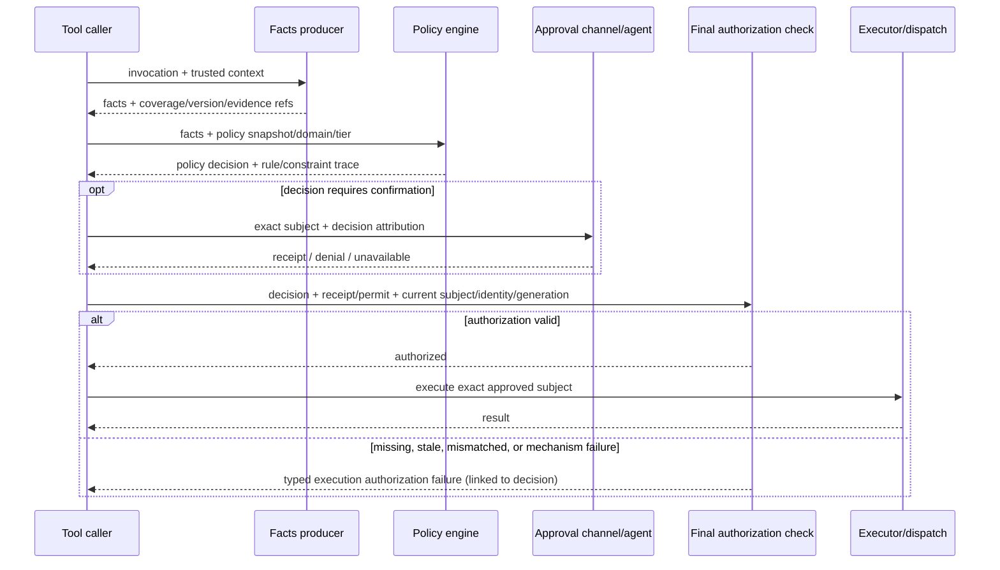

# 安全策略三阶段架构契约（Phase 0 草案）

基线 commit：`8c0d2a89f78816d4a7d1b1a1890ad59f608cee4f`。本文件把开发计划 §2.1 转为仓库责任边界；候选实现的最终归位以 inventory 为准。

## 阶段契约

| 阶段 | 输入 | 输出 | 失败类别 | 禁止副作用 | 责任模块（当前/目标） |
|---|---|---|---|---|---|
| Facts：事实核实与补充 | 原始调用、可信上下文、目标解析器/扫描器可读内容 | 带来源、覆盖状态、版本与引用的 facts；不得包含最终授权 verdict | `complete` / `partial` / `unavailable` / 解析技术错误；unknown 保留为 unknown | 不创建审批、permit 或 dispatch；不以证据标签直接 deny/confirm | 当前 `src/shared/confirmation/outboundClassification.ts`、`toolCallGate` 内 extractor、shell/path 与 IM 附件提取；目标是纯 facts producer |
| Policy：请求决策 | facts 快照、lane/domain/tier、有效配置与规则、必要的策略 Agent 结果 | 唯一 policy decision：allow / require-confirm / deny；rule/constraint 归因、answerer、facts 与策略依赖版本 | 策略 deny、需确认、输入/配置不可用（必须带稳定原因）；不得伪装成事实命中 | 决策结束后不得由 adapter/gate/executor 重新分类或按产品偏好覆盖；不执行目标动作 | 当前 `src/shared/policy/policyEngine.ts`、策略 resolver/constraints；目标为唯一 decision trace |
| Final check：执行前最终检查 | 原 decision、必要 receipt/permit、授权代次、执行对象 envelope、当前 identity/目标版本 | `authorized` 或 `missing-authorization` / `subject-mismatch` / `stale-or-revoked` / `mechanism-failure`；关联原 decision | 授权缺失、对象不匹配、旧/撤销、机制校验失败；允许记录执行 veto | 不做敏感性/风险重判，不产生新的 policy allow/confirm/deny，不改写原 decision | 当前各 tool executor、write/read permits、IM `assertImOutboundAllowed` 等；目标是共享执行授权契约和 adapter |

底线登记（目标 registry）只说明不可配置的身份、完整性、能力、平台或生命周期约束与责任阶段。运行时不得读取登记表来排序/计算普通策略 verdict。

## 调用顺序

## 2026-10-15 基线反例

`electron/confirmation/agentSdkConfirmationPort.ts` calls the confirmation channel and then rewrites an agent `approved` result to `denied` when `facts.actionClass === 'outbound'` (baseline line 153). This is a policy action after the approval outcome, with no rule ID in that branch. The policy decision/approval request must select the answerer before calling the port; final checks may only verify the exact approved subject and receipt.

## 需要在 Phase 0 inventory 继续裁定的混合点

- `toolCallGate.ts` currently performs prechecks, fact extraction, policy decision and permit registration in one flow. Each deny path needs classification: policy rule, invalid request, missing mechanism material, or execution integrity.
- shell precheck can short-circuit before `policyEngine`; determine whether its deny is deterministic input/mechanism validation or product policy and ensure it has trace attribution.
- remote tool policy is a second decision path today; map each branch to shared policy conditions or document an independently justified trust-domain mechanism.
- IM classification combines observed labels, trust-boundary facts and dispatch eligibility; split sensitive-content policy from identity/recipient/object binding checks.
