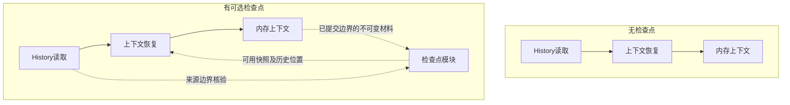

# 会话上下文检查点机制

> 2026-10-31；独立机制讨论稿，未实施，尚非可直接编码的持久化规格。来源：用户明确要求统一概念，并将检查点作为会话存储模块下独立次级模块。关联[主性能方案](./会话存储全链路性能改进方案.md)。本轮仅修改文档。

## 第0层：这项机制解决什么【人必读】

**检查点让会话重启后恢复得更快，不决定哪些事情真实发生过。**

例如，会话已有一千条记录。如果在第八百条保存过当时完整有效的消息集合，恢复时可以加载它，再处理后两百条；没有它，也能从第一条开始还原。两条路必须得到相同结果。所谓完整有效消息，是当时模型应该看到的内容；已经压缩成摘要的部分不需要重新放入原文。

### 已确定的边界

- **当前信息存储**：只负责当前未完成轮次的信息，不算检查点。
- **检查点**：保存过往完整有效消息集合的快照，是独立性能机制。
- **History**：唯一事实来源。检查点删除、损坏或生成失败，不能改变历史或让成功提交变失败。
- **上下文压缩**：为了缩短模型输入而改变有效上下文。它与检查点目的独立；压缩后适合顺便生成检查点，但压缩记录不自动成为完整检查点。

以上概念及模块归属已经由用户明确；下面仍需讨论的是策略和实现，不重新把概念包装成待批项。

### CP-D-1：什么时候值得保存一份完整快照

背景：保存过少，普通会话恢复用不上；保存过多，则重复编码、写盘，抵消主方案减少全文保存的收益。

- **A：周期保存，并在压缩完成后安排保存。** 普通会话也能受益，代价是新增写入；周期需要对比首次保存、后续轮数和新增字节量，不能只按长会话选参数。
- **B：仅在压缩后保存。** 少一类触发，未达到压缩条件的会话恢复没有加速。
- **推荐A，具体参数待测后评审；未确定前不启用自动生成。** 原六十四轮只是候选，不是架构约束，也不认为它适合多数会话。应比较短于六十四轮的候选间隔，暂不指定新的默认值。
- **可逆性：** 停止生成或删除检查点，仍可从History恢复，已有对话不丢失。
- **依据强度：** 没有我们自己的冷恢复统计；尚不能承诺具体收益。开发者先在隔离夹具测量，不要求用户升级前跑测试。
- 下钻：CP-INV-01／03，CP-AC-01／04，§2.3。

### 本次范围与最可能推翻设计的三处

本次确认职责与故障边界，提出独立模块；不批准具体文件／表结构，不新增界面、开关、IPC或用户错误码。落盘格式、内部接口和触发参数须形成完整规格后再进入实现阶段。

| 风险 | 表现 | 推翻条件 |
| --- | --- | --- |
| 快照只证明自己没坏，却没证明来源正确 | 恢复出不同的模型输入 | 有检查点与从History重建不一致，必须修正生成协议 |
| 为验证快照每次重放全部History | 看似有检查点，恢复仍很慢 | 验证成本抵消恢复收益，必须调整来源身份与读取边界 |
| 快照生成太频繁 | 保存正文的CPU／写盘热点重新出现 | 普通交互阻塞或总写入不可接受，必须调整策略 |

## 第1层：模块怎样工作【人机共读】

### 1.1 在主结构中的位置

原方案把周期全文记录写入执行终态，用事实表示同时承担恢复加速。本方案把加速副本移出提交主链。两图的区别是是否安装可选模块；不是让History丢掉压缩或失败取舍事实。

会话存储是父模块；检查点模块是其独立次级模块。它唯一负责检查点的生成、存取、验证、失效和清理，不能修改History事实。上下文恢复负责按历史规则还原消息；内存上下文负责活跃会话推进。当前信息存储、工具效果恢复、执行租约不归检查点模块管理。

| 单元 | 作用简述 | 类型 | 谁依赖它／边界 |
| --- | --- | --- | --- |
| 检查点模块 | 保存并验证恢复快照 | 新建 | 会话存储内的独立次级模块，消费确定历史边界的材料 |
| 上下文恢复 | 从历史恢复有效消息 | 改承重边界 | 可选使用快照；无快照路径必须完整保留 |
| 内存上下文 | 维护活跃会话消息 | 改承重边界 | 提供已提交边界的不可变视图，不为生成快照阻塞普通提交 |
| History读取 | 提供事实及来源身份 | 复用不改（待验证） | 需验证现有身份足以低成本对齐；不足则先修订契约与量级 |

此处数的是独立方案的影响面：新建1、改既有2、复用1，改承重边界2、改对外契约0（格式未设计，不能据此承诺将来仍为0）。三个主要子职责都封装在新模块内部，不另建检查点队列服务。涉及恢复承重边界，故从主案拆出；不能将两文档的重叠单元简单相加。新增持久字段／格式版本数尚未定，新错误码／配置／IPC提案0，实现阶段尚未排入。

### 1.2 六个契约面

| 契约面 | 当前结论 | 详细设计前必须补齐的证据 |
| --- | --- | --- |
| agent-sdk | 本次不新增宿主端口或事件种类；不能要求SDK持有检查点存储 | 与宿主恢复连接时跑check:agent-sdk、typecheck:agent-sdk及有无检查点等价测试 |
| 会话存储 | 增加内部次级模块及可选恢复入口；不改变History唯一writer／事务提交点 | 明确接口、唯一writer、会话删除协调；三项存储边界门禁与旧数据测试 |
| IPC／preload | 无新通道、参数或回执变化 | 原保存／执行调用不得等待快照生成 |
| 共享领域类型 | 不向renderer发送检查点字段，不改Message／TurnDisplay | 共享类型检查及UI行为对照 |
| 落盘格式 | 必须新增或选择一种派生快照表示，尚未定，不能实施 | 路径／表、字段、完整发布、代次、引用、清理及兼容算法须明确后评审 |
| 配置／规则／错误码 | 没有新增产品项 | 内部失效不能升级成新的产品执行错误 |

这是范围与契约讨论稿，不以表格齐全冒充格式详设完成。

### 1.3 另外两个产品给出的参考

Codex的部分压缩记录含完整替代上下文与恢复信息；符合条件时可作为恢复起点，再处理后续记录。按本定义属于检查点，但不能据此断言它跳过全部历史文件读取。

DeepSeek Harness保存有效消息范围的替换，可能只替换局部；已经确认内存增量推导消息，尚未确认独立的完整消息集合快照机制。不能把局部替换、JSONL物理文件换代或内存缓存统称为检查点。

## 第2层：正确性与设计约束【机｜人工可跳过】

### 2.1 不变量与职责

| ID | 必须成立的性质 | 验收 |
| --- | --- | --- |
| CP-INV-01 | 关闭或删除全部检查点，仍从History得到相同有效消息；检查点不授予执行权 | CP-AC-01／03 |
| CP-INV-02 | 只发布对应确定已提交历史前缀的完整快照；来源不匹配或数据不完整不使用 | CP-AC-01／02 |
| CP-INV-03 | 生成／读取失败不改变History、提交回执或会话可执行性；真实History损坏仍按原故障规则处理 | CP-AC-02／03／04 |
| CP-INV-04 | 当前未完成信息、未知工具效果与审批／租约不能由消息快照替代；清理不删权威材料 | CP-AC-03／05 |

检查点只保存完整消息集合，不宣称单凭它能恢复全部执行状态。未完成工具等状态仍由事实及原控制信息恢复；压缩后生成也须选择可确定的已提交边界，不能拍下半提交的内存数组。

### 2.2 “完整可用”和“对应事实”分别证明什么

生成时，恢复器／内存上下文所有者提供确定历史前缀及其归约结果，冻结同一视图再编码。发布前核验会话身份、历史代次和边界仍有效；历史在边界之后继续追加不应无故使该检查点失效。正式格式至少要表达会话身份、历史边界及其来源身份、归约规则版本、消息集合、内容完整性信息；这些只是必需信息类别，尚不承诺具体字段数量。

内容摘要只能发现文件截断或内容变化，不能证明数组语义正确。与History的一致性由唯一恢复规则、生成时稳定边界及对照测试建立；读取时核对来源身份／规则版本／完整性，不每次从头重放。没有经过验证的低成本来源身份前，不许只凭检查点自带的序号和摘要宣称对齐；该问题留给详细设计显式解决，不先添加一套全历史证明协议。

缓存采用正常存储故障模型，不能承诺仅靠自校验发现被任意篡改且重新计算摘要的内容。若要抵抗此类篡改，必须另定威胁模型和可信校验方式，不暗增安全系统。

### 2.3 生命周期与触发策略

生成请求只消费已提交事实的不可变视图；后台编码／写出，完整发布后才可见；同一会话的重复请求合并，不能无限并发复制全文。具体调度复用现有预算，不能另建无界队列。是否采用文件原子替换或SQLite事务，待格式选择后给唯一算法。

比较首次检查点、后续间隔及压缩后触发。测试候选可以包含1／4／8／16／64个已完成轮次，并报告新增字节量；这些是实验取值，不是产品默认。压缩事件与检查点分别提交，检查点失败不能撤销已生效压缩。保留数量及大快照空间上限也需和结果一起确定，不先写入固定承诺。

读取时至多检查最新候选；不可信则直接走无检查点恢复，不逐个尝试无界旧快照。后续历史按正常规则处理，不能因有快照跳过审批、工具效果或执行权核验。生成中崩溃保留旧完整候选，半成品不可见；最终发布机制确定后用故障注入验证这条要求。

清理只处理本模块拥有的派生快照。删除快照不能删除History及权威spill；若快照引用权威大正文，必须先明确引用生命周期，未设计前不采用该表示。会话删除／代次变化与后台生成竞态须阻止迟到发布；规则版本变化拒绝旧候选并重建，不要求用户迁移检查点。升级没有检查点时直接走正常恢复。

### 2.4 验收与开发顺序

| ID | 可执行断言 |
| --- | --- |
| CP-AC-01 | 普通消息、工具、压缩、失败选择、人工复核分别在任意有效边界保存，再追加历史；有／无检查点恢复消息逐字节及顺序一致 |
| CP-AC-02 | 截断、坏摘要、错会话／代次／边界／规则版本、生成中崩溃均不使用坏候选；不修改History，能正常从事实恢复 |
| CP-AC-03 | 工具效果unknown、待审批、提交不确定时，快照不能使会话错误执行；删除全部快照不改变结论 |
| CP-AC-04 | 1／10／100MiB历史及短会话比较首次与后续触发；报告生成CPU／字节、恢复读取／解析／归约p50／p95、主线程阻塞及总磁盘占用，不能只报缓存命中耗时 |
| CP-AC-05 | 生成／读取／删除／会话释放／代次变化并发和随机操作序列，断言无迟到发布、无事实删除、无混用当前信息；停止生成仍可正常运行 |

开发顺序：先验证主案无检查点恢复；再依据实际数据确定低成本来源身份和完整格式，完成六面契约及迁移／关闭／回退规格评审；最后实现生成与读取，并确定触发参数。当前只交付讨论稿，不安排未定格式的实施阶段。关闭模块即回到无检查点恢复，不需要把快照反向迁移成事实。

开发测试在隔离库执行；真实库仅经授权使用副本，Windows实机恢复需相应环境验证。用户正常升级无需手工整理、校验或生成检查点。没有性能实测前，不承诺具体加速倍数。

## 证据与未验证项【机｜人工可跳过】

- CP-F-01：主案原§2.8规定每64版本写完整锚点；本轮撤回事实终态与性能快照绑定。旧版本可通过git show 33d9fae0查看。
- CP-F-02：Codex本地检出恢复器select_input_compaction检查replacement_history及恢复元数据，符合条件后从替代上下文与后续记录恢复；位置为codex-rs/core/src/session/rollout_reconstruction.rs。参考检出基线c0e88f3c；不推断文件读取总量。
- CP-F-03：DSH本地检出packages/core/session/src/index.ts中deriveMessages按有效节点增量生成，surface.ts支持局部replace；参考检出基线22ddee37。未发现不等于已证明不存在其他检查点路径。

未验证：实际冷恢复耗时、来源身份是否足够、快照格式／发布原子性、预算与保留数量、触发参数。由开发者在详细设计及隔离测试中关闭，不作为用户升级操作。当前文档不能作为新增持久化格式的实施批准。
