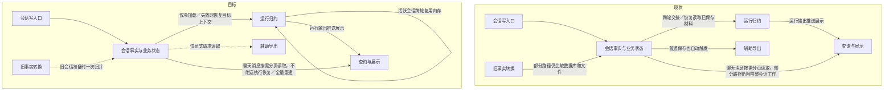

# 会话存储全链路性能改进方案

> 状态：**复杂度收敛后的技术方案，未实施；格式、接口与向前升级按本文实施验证**；2026-10-31。
> 代码事实基线：`58d28d76fc39d258e17c6ced726de03a434afdf6`；本轮文档基线：`8b781d6d`。用户安全代码修改不纳入。
> 本轮以减少独立机制重审：撤回通用数组差分／跨版本正文引用及其专用回退算法；改为统一上下文推进规则、记录实际业务变化。本轮补齐有限业务事件、SDK状态接口与现有数据库版本保护，删除反向格式转换这条独立链路。五阶段按明确替换出口实施验证。详见独立复杂度重审结论。不实施代码、迁移或删除。
> 阅读方式：第0层说明要决定什么；第1层独立解释现状、改后行为、影响范围、收益与风险；第2层及附录供实现和证据复核，不是读懂前两层的前提。

### 本轮核销【人机共读】

| 评审问题 | 本轮改写 | 检查边界 |
| --- | --- | --- |
| B-03／04：暂停基线被压缩改写、复核版本缺少提交身份 | 分离不可变parkBaseline；复核用确定身份的新事实流，事实／版本回执／审计／ready同事务 | §2.2.1／2.2.2／2.8.1，AC-13／15；设计已补齐，实施须新旧对拍及故障注入 |
| 性能减少被误当成架构简化 | 撤回通用差分／引用解析，要求热运行与冷恢复共用上下文规则；要求重复职责退出并记录代码量变化，不设净减门槛 | §1.13／2.2／3.1、INV-10／AC-19；具体契约见§2.2，兼容发布见§3.1；实现结果尚未验证 |
| B-01：SDK每次追加仍全读 | 增加窄元数据／按键查询，明确版本协调、重复尝试及提交不确定 | §2.3.1、SDK契约、AC-01／09；需真实writer到SQLite集成测试复审 |
| B-02：旧claim拦住恢复 | 目标宿主先分流活跃占用／失效占用，恢复资格与执行资格分开 | §2.10、租约变更面、AC-17／18；既有继续入口须先恢复再接纳，不绕过unknown |
| 最近讨论未回写到图及规格 | 统一列表现状、展示／执行两条读取、局部读取时机、目标一次性转换、显式导出 | §1.1／1.12、§2.4／2.6、AC-05／10／16／18；不是新增分页方案 |
| 日常动作被塞入非必需修复／维护 | 以动作允许工作表为约束，撤回启动普查、主动修旧会话、重复恢复／终态全文核对 | §1.7／1.11／2.10、INV-09、AC-18；不是把旧工作搬到后台 |
| 检查点与当前进度／History编码混在一起 | 统一术语，移出周期快照和触发策略，增加无检查点恢复验收 | §1.10／2.8、AC-13／15；独立检查点机制文档 |
| 开发验收与升级动作混写 | 明确执行者／触发时机，撤销外部脚本交接条件，兼容准备自动完成，停读与物理删除分开 | §1.9、D-1／3／4、§2.6／2.7／3.1、AC-07、B.6 |
| 辅助导出仅改为异步，仍保留全会话重复工作 | 取消日常自动导出及退出补导出，保留按需生成能力；明确其不能承担完整备份 | D-3、§1.8／2.7、AC-04／07、F-26；开发核销仓内调用；升级说明告知停止自动更新 |
| 启动修复／清理未纳入新主线 | 补齐最小启动检查、按会话恢复、失败隔离和后台清理，明确哪些旧串行依赖退出 | D-5、§1.7／2.10、AC-17、F-25；旧工作集机制复用，不误称当前全量扫库 |
| “History与独立transcript一致性”无法自说明 | 改成两份具体材料：逐步执行记录，以及每轮结束后另存的完整后续模型输入；解释谁读、为何要对齐、哪条新写退出 | 第0层与§1.0／1.4给出完整例子，不要求先查代码 |
| 简图只有抽象框，读者仍不知道一次请求怎样经过系统 | 现状与目标按相同五项职责画图，说明写入者、提交时点和四种消费路径 | §1.1；图中名称复用变更面表 |
| 接口表仍以章节引用和内部术语承担解释 | 重写§1.3六个契约面，每行直接给出现状、目标、调用方适配、旧数据处置和验证；引用仅放最后一列 | §1.3完整表；不要求读者翻代码或先读规格才能判断影响 |
| 把工作量减少等同于用户必然更快 | 每个问题分别列减少的工作、保留的成本及如何验收，时间目标和外验限制前置 | §1.5／1.6；未实现、未实测，不宣称Windows已修复 |

## 第0层：要解决什么、需要批准什么【人必读】

**把“每轮重新读取并复制已保存的会话”改为“记录这轮变化、保留必要执行状态，再按需要读取”。**

现在，同一次对话有两类内容重叠的保存材料：一类逐步记录模型输入、回答、工具调用和结果；另一类在每轮结束后，再保存下一轮模型应看到的完整消息集合。第二类包含历史消息、工具配对和压缩摘要，不能简单等同于聊天窗口里的气泡。两类材料都被恢复流程使用，因此目前不能直接删掉其中一类。

推荐只让逐步执行记录承担新执行的恢复依据，同时在本轮结束记录“下一轮到底采用哪份内容”；每轮另存完整集合的做法退出。运行中的会话继续使用已经推进的内存状态，重启后才从保存的记录恢复。无检查点时也必须从History正确恢复；可选检查点只加速冷恢复，独立设计，不再每轮复制全文。

排队消息能否编辑、谁可以继续执行、重试是不是同一条指令，仍需数据库单独管理。这些是业务规则，不能因为减少正文副本就取消。聊天页、搜索、工具详情和导出文件从已保存材料生成，不各自决定一次执行是否成功。

### D-1：是否用同一套上下文规则替代每轮完整输入副本

背景：目前执行循环维护一份模型消息，恢复代码另行拼接，结束时再把下一轮应采用的全文保存到独立表。前版试图用通用数组差分和跨版本引用缩小副本，但增加了编码、引用解析和逆向转换机制。

- **A：统一上下文推进规则，直接保存实际变化。** 新输入、模型回答、工具结果、压缩替换和结束后的内容取舍都有明确记录；活跃会话在内存应用，冷恢复使用同样规则。取消新执行每轮独立全文副本。代价是必须逐项证明现有失败、审批说明和工具顺序行为不变，并修改执行内核与宿主契约。
- **B：保留独立全文版本，再用通用差分减少字节。** 旧读取概念延续，但要长期维护数组比较、跨版本引用及解码、回退，减少写入不等于架构变简单。
- **采用A，方向已对齐；具体事件格式／接口见§2.2，升级边界见§3.1，实施负责验证。** 撤回前版宿主正文v2封套；沿用现有数据库版本保护，取消反向格式转换及额外兼容回退包。不削减模型原应看到的内容，不授权删除旧数据。
- **可逆性：** 数据库升级后不支持降级旧安装包，沿用现有版本号拒绝机制；本案不新增反向迁移或兼容回退包。问题通过支持当前schema的修复版本解决。
- **依据强度：** 已确认运行数组与旧格式恢复器职责重复，但它们语义尚不等价；共用规则及重复职责退出仍须隔离验证，不能据架构图宣称已通过。
- 下钻：§1.13／2.2／3.1，INV-06／10，AC-13／15／19。

### D-2：是否保存“哪些工具和审批仍未完成”

背景：要判断一条工具结果或审批是否合法，必须知道此前发生过什么。当前每次新增记录，都重新读取旧记录算一遍；工具越多，重复读取越多。

- **A：保存当前未完成事项，并和新增记录一起更新。** 校验规则不减少；重启后可接着使用，旧执行第一次恢复时计算一次。新增两个数据库字段，需证明保存结果和从头计算相同。执行内核的写入器还要改用小范围版本／重复记录查询，否则上层仍会先读全文；这是内部接口改动，用户无新增操作。
- **B：每次从头计算。** 不新增字段，但长执行中重复扫描的开销保留。
- **采用A，作为已对齐性能方向的内部实现。** 对用户没有新增操作或显示状态。
- **可逆性：** 修复版本保留新增列及已写记录；需要撤回增量校验时可忽略其缓存状态、恢复原合法性计算，不降schema、不删事实。
- **依据强度：** 从头扫描已确认；新旧校验是否对所有合法、非法操作得出同一结论，需对照和随机操作测试，当前未通过这些新测试。
- 下钻：§2.3，INV-01／02，AC-01／02／09。

### D-3：是否停止自动生成可读会话副本

背景：当前应用会在会话目录中反复生成会话信息和消息列表文件，方便直接查看。但正常打开会话和继续执行读取数据库；这些文件不含完整执行依据，不能当作完整备份。仅让生成过程在后台运行，仍会消耗读取、编码和写盘资源。

- **A：停止自动生成，只在明确请求时导出。** 新建、消息变化、轮次结束和退出不再生成副本；数据库保存成功即可反馈。已有文件不再自动更新，依赖它们的外部脚本需要调整。保留可读导出的底层能力，本次不新增导出按钮或调用通道；若没有既有产品入口，新增入口须另行设计和批准。
- **B：保留自动副本，改为后台生成。** 仍可供外部程序读取，但文件可能滞后；反复读取整个会话、编码写盘和维护调度的成本继续存在。
- **采用A，按此前已对齐方向实施。** 升级不因停止自动导出而扫描、迁移或删除既有可读副本；旧会话执行记录的兼容处理独立进行。取消自动副本不等于取消数据库备份，也不在这里承诺新增备份能力。
- **可逆性：** 可恢复自动生成并从数据库重导；停用期间旧文件不会自行变新，回退不能立即把它们当最新内容。已报告的数据库保存成功不因导出失败而撤销。
- **依据强度：** 自动调用及全量写出已确认，文件恢复函数未找到生产调用者；开发者负责检查并移除仓库内自动副本依赖；无法普查用户自行编写的外部脚本，也不将它们作为升级前置条件，停止自动更新应写入升级说明。
- 下钻：§1.8／2.7，INV-04，AC-04／07，F-13／26。

### D-4：旧文件中的独有记录入库后，是否停止正常执行时再读文件核对

背景：部分旧会话的压缩摘要或请求用量记录可能只在会话文件中。直接停读可能丢失模型输入所需材料；永远双读又会让兼容处理留在每次正常操作里。

- **A：程序在旧会话实际需要执行时，先处理该会话，再切换其正常读取。** 自动将文件独有材料归入数据库；不要求用户事先整理或转换全部会话。只有整份所需材料已处理完才登记完成，之后执行只依赖数据库。确实缺失的旧压缩材料沿既有批准方案重建，重建结果可能与原来不同，必须沿原规则明确处理，不能当作“从未压缩”。新增一个内部完成字段。
- **B：继续每次比较数据库和文件。** 不增加完成字段，但保留文件故障、差异核对及重复读取的长期成本。
- **采用A，本分支负责接入和验证。** 旧文件清理专项已有的缺失处理授权不在此重新修改；本案不新增用户机器上旧文件的批量删除任务。
- **可逆性：** 不重建旧文件供旧安装包降级；升级后数据库继续作为事实来源，修复版本保留读取能力。未处理完的会话由程序在执行准备时调用兼容逻辑，用户无需寻找或手工运行转换入口。
- **依据强度：** 旧文件独有材料的消费者已确认，另一个工作树有专项实现记录；开发者仍需用隔离的旧格式夹具核验本分支覆盖；经用户授权的真实库副本可补充测试，不要求逐台用户机器核验。
- 下钻：§2.6，INV-03／04，AC-06／16。

### D-5：是否取消启动普查，将恢复限于实际要执行的目标会话

背景：当前启动串行恢复执行记录、运行快照、提交状态及续跑；此前本案又提出启动扫描候选、后台主动恢复和每入口先调用准备方法。它们仍让日常动作承担无关工作。

- **A：启动只打开存储并隔离旧执行者。** 不枚举历史会话或逐轮修复。只看聊天页时读取所需页面；接受输入时保存本次输入和必要控制信息；真正开始执行且内存上下文不存在或失效时，才加载目标会话的历史，在同一次加载中还原上次执行状态。热会话不再重做。代价是首次继续旧会话可能有恢复等待，必须独立测量；结果不确定时仍禁止错误续跑。
- **B：启动及每个入口提前做恢复准备。** 可以提前处理部分旧状态，但用户未使用的会话也消耗资源，普通输入前置链继续增长。
- **采用A，具体调用契约按§2.10实施验证；未完成替换前不移除旧执行保护。** 桌面、远程与自动任务走同一执行宿主，不增加界面／错误码，不改变授权和远程回执格式。既有任务调度本来需要续跑时才触发目标加载，不借启动主动恢复全部历史任务。
- **可逆性：** 可在支持当前schema的修复版本中调整编排，无须逆向改数据格式；已发生的工具动作不能靠回退重做。旧命令进程的归属核验保留，相关会话执行前完成。
- **依据强度：** 启动编排、接纳正文读取及终态全文核对已核实；取消前置后的并发、异常和旧格式边界须隔离测试，不代表当前已完成优化。
- 下钻：§1.7／1.11／2.10，INV-08／09，AC-17／18，F-25。

### 已对齐范围、交付限制及最可能出错的三处

以上五项按此前讨论采用A，不再重复请求批准：调整执行记录内部格式，增加三个数据库字段，取消每轮完整输入副本及自动可读导出，恢复仅针对实际执行目标。数据库升级后旧安装包不能打开，属于现有约束，不是新增取舍。本案没有额外兼容回退包、反向迁移、新表、正文共享服务、文件回收体系、界面协议、设置或用户错误码。当前没有需要用户新增决策的主线问题；技术设计与验收由实施者负责。

算法、版本恢复、故障处理和规模测试可在Mac及隔离数据库验证。Windows原故障、安装包及真实远程渠道由开发验收人员在对应环境验证；真实用户库仅在明确授权后使用副本补充测试，不是每位用户升级前的操作；本方案当前没有这些结果。全案最后必须同时达到架构退出条件和性能目标，不能只凭局部提速完成收尾。

| 主要风险 | 出错时会怎样 | 什么证据会推翻当前设计 |
| --- | --- | --- |
| 失败后选错下一轮内容 | 把本不该保留的半轮工具交互传给模型，或丢掉原应保留的压缩摘要 | 成功、失败、暂停、压缩后失败的重建内容有一项与现有行为不同，就必须修正记录方式 |
| 重启恢复变慢 | 写入少了，但打开会话或再次提交仍长时间等待 | 无检查点冷恢复的实际成本必须测清；必要正文传输或界面完整快照超预算，就必须在本案内调整，不能列为未来优化后关闭 |
| 旧材料的消费者遗漏 | 新写可用，旧版本、人工复核或恢复流程却找不到原内容 | 任一受支持调用方仍依赖被取消的新正文副本，就不能切换或删除 |

## 第1层：不翻代码也能评审的方案说明【人机共读】

### 1.0 先说明当前保存了什么

| 材料 | 内容与用途 | 本次怎样处理 |
| --- | --- | --- |
| **逐步执行记录**（代码称History） | 按顺序保存实际模型输入、模型回答、工具开始／结果、审批、压缩和本轮结束。工具是否已执行、恢复时能否重试，需要看这些记录 | 作为新执行唯一的正文恢复依据；记录上下文变化，不每轮再复制此前全部内容 |
| **每轮完整模型输入副本**（代码称transcript entries） | 每轮结束后另存一份下一轮模型应使用的完整消息集合，并带版本号。它不等于聊天气泡：里面还涉及工具配对、压缩摘要及失败时保留哪些内容。下一轮交接和人工复核恢复目前会读它 | 新执行停止写入；原来依赖它的调用方改从逐步执行记录恢复同一版本。旧版本副本先保留只读 |
| **业务控制信息** | 指令第一次接纳时采用的配置和输入版本、排队顺序、当前执行者及提交结果。不保存另一份正文，用于防止重复接纳、过期执行者写入和重复提交 | 保留；检查“当前能否执行”只读这些小字段，不顺便加载全文 |
| **当前信息存储**（旧代码部分命名为checkpoint） | 流式回答还未成为可靠执行记录时，定期保存文字和思考片段，以便中断后保留已有输出。当前还可能重复带上累计工具结果 | 保留未提交文字和必要顺序；已可靠记录的工具结果从逐步执行记录恢复，不随每次保存重复编码 |
| **查询、展示和辅助文件** | 聊天分页、搜索结果、工具摘要及按需详情、可读导出。它们面向不同消费者，不能替代执行记录判断工具是否发生过 | 单向生成或按需读取，复用现有分页、摘要和大正文文件机制，不再增加一套同步协议 |

**一个具体例子：** 会话已有100轮，用户提交第101轮，模型调用一个工具并回答。现在既记录第101轮的输入、回答和工具过程，又在结束时把下一轮所需的完整消息集合（包括仍保留的旧消息或压缩摘要）保存一份；新增记录时还可能重读已有执行记录，恢复工具／审批状态。

改后，已有100轮不因本轮开始而再复制一份：保存本轮实际输入、工具和回答，以及本轮结束后采用哪段内容。若本轮失败，明确保存应继续采用原输入还是压缩后的某段内容，不用“最后一个界面数组”猜测。重启时按这些记录还原；运行中继续用已推进的状态，不每次工具调用都从头读取。

这里区分两件事：压缩或人工复核所记录的完整替代内容，是改变模型上下文的事实；检查点是另存的完整消息集合快照，只为加速恢复。周期及压缩后保存策略归独立检查点模块，不再规定History每64个版本必须保存全文。

### 1.1 现状与目标链路：谁保存，谁读取

两图使用相同粒度。节点名与§1.2变更面一致；聊天消息当前已经按索引分页，目标不是从“读全部消息”发明分页，而是移除局部读取旁边的整会话准备和附带任务。图中箭头分别说明读取和展示，不把执行恢复画成聊天页面的必经前置。



**写入责任不新增：** 仍由Electron主进程已有会话存储入口写SQLite。一次本轮结束，执行结束记录、下一轮采用的内容选择、提交版本、执行者状态和防重复回执在同一个数据库事务中提交；其中任一步失败就不报告整体成功。现有方案已用同一事务防止两类材料只保存一边；本案不把它误诊为“原来两次独立提交”。取消的是额外准备、保存及读取一份完整正文，不是取消数据库的一致提交，也不是取消执行者检查。

**读取分四种情况：** 运行中的下一次工具／模型推进使用当前内存状态；重启后实际需要执行且内存缺失，或确需指定旧版本时，才还原目标执行记录；界面分页和预览只读取需要的消息；辅助文件仅由明确导出调用生成，普通保存不触发。完成旧材料归并的会话，不再通过文件是否存在或与数据库一致来决定能否执行。

这里没有独立的“历史页面”。它就是聊天窗口中的已保存消息：初次选中会话且无可用页面缓存时读最近一页，向上滚动读更早一页，跳转搜索命中读目标范围，展开工具详情读该次详情。只为实际目标取值，不为其他未选中会话预热。读取某页不代表加载模型上下文。

“运行归约”就是把按顺序保存的记录应用到当前状态：例如看到工具开始就登记待完成工具，看到结果就结清；看到压缩记录就替换相应模型输入范围。它是已有执行代码的职责收敛，不是另建一个拥有独立历史的服务。

### 1.2 改哪些地方、谁会受到影响

类型含义：**改对外契约**包括跨包接口、跨进程完成语义及落盘格式；**改承重边界**指仓库内部多个调用方共同依赖的读取或恢复接口；**改造**只调整内部实现；**复用不改（待验证）**表示必须证明已有能力够用，不能当作已经验收。

| 单元 | 作用简述 | 类型 | 改后行为与受影响调用方 | 代码定位／依据 |
| --- | --- | --- | --- | --- |
| 会话写入口 | 接纳并提交会话变更 | 改对外契约 | 数据库保存后返回，普通操作不再触发或等待可读副本；桌面及其他自动写入调用方同步退出触发 | sessionIpc／agentProtocolIpc／ipcShared；D-3 |
| 会话事实与业务状态 | 保存执行记录与业务信息 | 改对外契约 | 结束一轮只保存执行记录中的内容选择及必要业务信息，不另写完整模型输入；交接／恢复调用方共同切换 | agentHistoryStorage／sqliteAgentHistory／sessionTranscript／schema；D-1／2／4／5 |
| 运行归约 | 统一推进与恢复模型上下文 | 改承重边界 | 从执行循环和冷恢复调用同一消息状态推进规则；旧宿主拼接规则退出，格式适配与展示投影各自保留 | SDK turn/context、canonicalHistory／execution／hostedTurnHandoff及recovery；D-1／5 |
| 查询与展示 | 读取消息并呈现状态 | 改承重边界 | 状态不读全文、预览只取候选、界面不复制全部已加载历史；聊天／搜索／上下文摘要／工具详情保持原可见含义 | queries／operations／ChatView／chatRunnerService／TurnDisplay；INV-03／05 |
| 辅助导出 | 生成可读会话文件 | 改对外契约 | 仅显式请求生成；退出自动调度和补导出，文件停止自动更新；现有文件格式保留，升级说明告知停止自动更新；不探测外部脚本 | sessionBackupManager／shutdown；D-3 |
| 历史写入与校验 | 协调追加版本及事件合法性 | 改对外契约 | SDK writer不再每批全文前读，复用已知版本及按键去重；SQLite使用增量状态校验，保留原拒绝规则 | packages/agent-sdk/src/history.ts、全部HistoryPort宿主／包装器；D-2 |
| 旧事实转换 | 承接旧格式独有材料 | 改承重边界 | 读取旧完整输入、归并文件独有摘要／用量，完成后正常执行只读库；恢复／用量／压缩／保留清理一起覆盖 | 旧entries兼容、台账专项、compaction／meter／retention；D-1／4 |
| 当前信息存储 | 保存当前轮次未完成信息 | 改承重边界 | 仅保存当前轮未完成文字及必要身份；已提交工具结果不重复带入，目标冷恢复按新职责读取 | acceptedAssistantCheckpoint／messages／目标恢复；INV-07 |
| 回归与规模夹具 | 检验故障和规模表现 | 改造 | 对照新旧输入与校验结果，模拟中断、回退及长会话，测量真实工作量和等待 | 原SDK／storage／renderer测试扩展；AC-01～19 |
| 页定位与构建预算 | 定位消息并限制后台任务 | 复用不改（待验证） | 沿已有定位索引和后台工作线程准备页面／摘要，仍验证消息来源版本；不再新建调度系统 | locator／prepared Worker；AC-03／05／10／12 |
| 安全与执行租约 | 防止未授权和过期执行 | 改承重边界 | 授权／unknown语义不变；旧claim与提交收敛改为按目标、普通领取前可达，原全库helper不能直接复用 | policy／final-check／claim／receipt；INV-02 |
| spill与引用回收 | 管理外置大正文文件 | 复用不改（待验证） | 大正文仍用已有文件描述和引用保护；被旧版本引用时不能回收，不增加新对象存储或回收体系 | spill／既有history和entries owner；INV-06 |

上表共12个职责单元：改既有10、新建0、复用2；其中改对外契约4、改承重边界5、内部改造1。第1.0节已说明英文名所指的数据；表中代码名只供定位，不要求读者凭它们猜用途。

**持久化改动：** 不新增表；增加3个数据库字段，2个保存工具／审批校验状态，1个标记旧文件材料已归并；数据库结构升级一次，执行记录需要版本化演进，采用§2.2定义的上下文协议版本2（独立于数据库schema编号），复用原事件种类。沿用前版提议的当前状态编码，不新增展示协议、工作线程、用户错误码、开关或诊断事件。

**为什么仍用一份方案：** 取消完整输入新写、恢复指定版本、执行结束的一致提交必须一起设计，否则可能先停写再发现旧版本无法恢复。实施拆成五个可验证阶段；已有旧文件专项复用原转换规则，不另建迁移系统。最终的19项验收必须全部覆盖架构退出、恢复和性能，不能拿阶段数减少代表复杂度已消除。

### 1.3 哪些接口和格式会变，旧调用方怎么办

这里的“调用方”是使用某项能力的程序。例如，执行内核负责调用模型和工具，桌面宿主负责把执行接到数据库、权限和会话生命周期上；两者之间的接口即使用户看不见，改动后也必须一起适配。下面逐项说明改动和兼容后果，最后一列仅供查阅实现规格。

| 接口或格式／改不改 | 现在怎样，改后怎样 | 谁必须适配，旧调用方和旧数据怎么办 | 怎样验证／下钻 |
| --- | --- | --- | --- |
| **执行内核与宿主的接口（agent-sdk）：改** | **现在：** 执行时维护模型消息，恢复时由宿主另行拼接；每次追加记录前，内核写入器还会读取此前全部记录。**改后：** 内核提供同一套消息处理能力，执行和恢复都用它决定新增消息、工具顺序、压缩替换和结束后的保留内容。结束时传递“保留工作结果、原暂停基线或压缩后的失败内容”的选择，替代完整消息副本。判断新增记录是否合法，也共用同一计算函数：例如工具结果必须对应尚未完成的调用。追加前只在必要时查询当前版本或指定重复记录；连续正常追加不读旧全文。 | 桌面数据库接入层及其中间转发层必须一起接入新能力，不能某层仍先读全文。读取完整历史的旧方法保留，新增小范围查询对旧独立宿主可选；旧的完整消息提交方式也保留兼容，其他SDK使用者不必采用本项目数据库。桌面新路径统一切换，不能运行和恢复各写一套消息规则。人工复核另存审定事实，不向已结束的原执行记录追加。 | 对比旧／新模型消息，覆盖工具乱序、压缩后暂停与失败；统计真实数据库接入链的读取量；验证旧宿主仍能工作。边界／类型检查：check:agent-sdk、typecheck:agent-sdk。下钻：§2.2／2.3.1／2.8.1，AC-01／13／15。 |
| **会话保存、执行交接和恢复接口：改** | **现在：** 每轮另存完整的后续模型输入，多个执行入口和收尾步骤读取全文；启动恢复结果还影响全局能否执行。**改后：** 记录本轮变化和最终内容选择，原数据库事务一起保存业务版本、提交回执及必要状态。活跃会话跨轮复用内存，首次执行或内存失效才按指定版本恢复目标会话；结束时看提交结果，不再回读全文确认。启动只确认数据库和写入隔离可用，不表示全部旧会话已恢复。 | 桌面、IM及自动任务的执行交接、继续执行、人工复核和状态查询都须同步改用新含义。页面仍读取所需消息，不因打开聊天页而恢复模型上下文。旧完整消息副本继续支持读取，但新执行不再写入；指定版本改由提交回执定位事实。遗留执行占用在领取执行权之前处理；不确定结果仍禁止擅自重跑工具。删除和大正文清理必须保留仍被旧版本使用的材料。 | 从真实执行／继续入口验证旧占用可恢复、活跃执行不会被抢占；验证提交中断、指定版本读取、人工复核重试及删除保护。运行会话存储、清理边界和消息归属三项检查。下钻：§2.4／2.5／2.8／2.10，AC-03／06／09／15／17／18。 |
| **桌面页面与主进程之间的接口：通道和数据结构不改，普通写入的附带工作改变** | **现在：** 部分保存操作还会触发或等待整会话可读文件导出。**改后：** 普通保存只提交数据库，不触发导出；数据库保存成功才能返回成功。原消息展示、工具摘要和按需详情的传输方式保留，本案不新增导出按钮或通道。 | 页面调用层、主进程处理层及关闭应用流程需移除自动导出的触发／等待，页面无需改请求参数或解释新返回结构。保留的底层显式导出仍须等自己的读写完成才能成功，不能借普通保存的成功回执冒充导出已完成。 | 检查创建、编辑、排队操作及结束一轮均不产生导出任务；数据库失败不返回成功；核对原展示和详情读取行为。下钻：§2.7，AC-04／05／07／14。 |
| **主进程与页面共用的消息和工具展示类型：不改** | **现在和改后：** 页面接收用户消息、助手输出、工具摘要，并按需读取工具详情。新的“模型下一轮保留哪些消息”属于执行内部信息，不作为新消息字段发送给页面；页面不承担历史恢复或执行安全判定。 | 原消息组件、工具展示和事件订阅继续使用现有类型，无须识别数据库记录格式、终态内容选择或人工复核事实。界面去除重复历史复制属于内部改造，不靠新增传输协议实现。 | 运行共享类型与渲染进程类型检查，对照会话切换、追加、修改、删除、停止回答及工具详情的原行为。下钻：§2.7，AC-05／11／14。 |
| **数据库及执行记录的保存格式：改；已有可读导出文件的结构不改** | **现在：** 执行历史之外，每轮还保存一份完整后续模型输入；追加合法性反复从旧记录计算。**改后：** 新执行记录保存实际新增输入、回答、工具结果和最终内容选择；只有首次建立独立输入范围、业务压缩或人工审定等确需完整集合时才保存完整替代内容，不借这些入口每轮重存全文。新增三个数据库字段：两个保存工具／审批合法性校验的当前状态，一个标记旧文件独有材料已归并。事件内容采用新的版本标记，不新增表。可读会话文件保留原格式，但停止自动更新。 | 新应用保留旧事件和旧完整输入的读取能力；旧文件中的独有摘要／用量只在目标实际执行时归并一次，成功后不再双读。数据库版本随此次升级提高，旧应用按已有版本检查拒绝打开；不做逆向迁移或额外回退包。已有可读导出文件不扫描、不删除，升级说明告知停止自动更新。 | 用旧库升级后写入、重开并按旧／新版本读取；覆盖归并中断、磁盘满、坏大正文文件和提交结果不确定；验证旧应用拒绝打开新库。下钻：§2.2／2.3／2.6／3.1，AC-06／07／09／15／16。 |
| **权限规则、设置、用户错误码及远程渠道数据：不改** | **现在和改后：** 谁能执行、何时需要用户批准、怎样处理可能已发生的工具效果，继续使用原规则；现有设置和错误码不新增取值。飞书等远程渠道不需要理解新的内部记录格式，原请求及回执含义保留。 | 权限判断、审批、远程请求与回执调用方沿用原契约；存储内部改造不得绕过授权或把“执行结果未知”当作“未执行”。如果实现发现确需新增用户可见行为，必须单独说明，不能夹带在本表的“不改”结论里。 | 对照原授权、审批延后、未知效果及远程回执用例；日志继续不含消息正文、密钥等敏感材料。下钻：INV-02，AC-02／06／14／17。 |

**验证状态：** 上表描述目标行为。已有边界检查和旧代码测试不能证明新方案已经实现；实施后仍须验证旧调用方可用、旧数据可读、提交中断可恢复，以及实际读取量和界面等待确实下降。

### 1.4 旧方案在防什么，为什么这次可以少做

| 旧机制具体在防什么 | 原来为什么需要 | 新方案怎样承担同一责任 | 哪些保护仍不能删 |
| --- | --- | --- | --- |
| 防止工具结果没有对应开始、审批不属于这次调用、未获批准就重试 | 新记录单独看不出此前哪些工具和审批仍未完成，当前从旧记录重新算出状态 | 把同一套规则算出的当前未完成事项随记录一起保存；新增时接着计算，不再每批读完整前缀 | 工具／审批身份、结束顺序和未知效果重试规则不变；要对照新旧允许／拒绝结果 |
| 防止“这一轮结束了”和“下一轮模型看到什么”分开成功 | 逐步执行记录和另存的完整模型输入各有消费者；当前已把二者放在同一数据库事务里，防止只保存一边。仍需准备和维护两类正文，并让各调用方读对版本 | 新结束记录本身保存下一轮内容选择，与提交版本和回执一起提交；不再额外写一份完整正文，因此少一套正文写入及读取分工 | 当前执行者是否有效、采用的旧版本是否正确、重复提交是否同一内容、提交结果不确定时如何核对，全部保留 |
| 防止数据库没有旧压缩摘要，停读文件后把模型输入还原错 | 部分旧记录只在文件，或归并到数据库只完成了一部分；单看文件存在／为空都不能证明处理完 | 在旧会话准备时归并并登记完成；完成后只使用数据库，后续新事实也先入库，不每次再比较文件 | 未完成会话的兼容入口、缺失和冲突处理；损坏不能被解释成从未压缩 |
| 防止重启后丢掉工具结果或已展示的半段文字 | 当前输出保存可能同时带上累计工具数组和未提交文字，恢复会读这些材料 | 可靠工具结果从逐步执行记录还原；定期输出保存只留未提交文字和必要顺序 | 工具已经产生外部效果、但结果未保存时仍不能自动重做；未可靠保存的输出不随便删除 |
| 防止读到过期消息或坏大正文 | 复用完整读取器会顺便核验整会话，即使调用方只要几个状态字段或一条预览 | 状态只查控制信息，预览只准备实际候选消息，并在修改时再核身份和来源版本 | 实际使用正文的完整性、会话权限和版本竞争检查不变；不是“少读了就当成功” |

这里不能靠“数据库事务保证一切”推导安全：事务只保证同一批库内写入一起成功或失败，不证明选出的上下文正确，也不能撤销已经发生的外部工具动作。必须分别证明：保存的当前状态与从头计算相同；新记录还原出的下一轮消息与原保存内容相同；旧文件独有材料已完整承接。

### 1.5 哪些工作减少，为什么用户会更快

| 用户遇到的问题 | 现有额外工作 | 这次实际减少什么 | 还要测什么才能算解决 |
| --- | --- | --- | --- |
| 工具调用越多，后续操作越慢 | 每小批新增都读取、解析前面已完成的执行记录 | 固定未完成事项数量时，新增校验不再随已完成记录增长；运行中直接推进现有状态 | 100／400／800事件对照，既测历史行访问，也测主进程阻塞；未完成事项自身增长的成本单列 |
| 长会话提交或队列调整慢 | 查几个状态字段也加载全文；取120字预览却还原整个会话 | 状态读取正文为0；预览只读候选消息，写入时核候选是否变化 | 候选消息本身很大、首次定位、排队竞争仍有成本，不能只测热缓存 |
| 每轮结束写入越来越重 | 保存本轮执行后，还重复保存历史全文，初始输入也可能再次复制此前所有消息 | 初始记录存实际输入及边界，结束时存有限业务取舍；周期性能快照移出事实提交 | 分别统计初始记录、结束记录和完整检查点字节，不能只把全文从一张表搬进每个事件 |
| 页面首屏已加载却迟迟不绘制，随后输入仍卡 | 首屏更新后同步复制已加载历史；辅助摘要扫描全文与其他请求争用主进程 | 活跃消息区不复制累计历史；辅助摘要用已有后台线程准备，没依赖的提交不等待它 | 页面更新到下一绘制、后台投递和返回复制、下一次提交等待分别测；只延后任务不算消除工作 |
| 高频工具结果保存和展示造成CPU增长 | 输出保存反复编码累计工具结果；界面构造累计文本、工具摘要和活动列表 | 可靠结果不反复写入输出保存；复用未变摘要、合并展示发布、详情按需读取 | 仍保留完整展示快照，工具和文本总量增长的剩余成本必须达到整体预算，不能默认已解决 |
| 新建会话或编辑反馈慢 | 新建本身是小写入，但可能排在上述大同步任务后；编辑可能还等整会话导出 | 减少主进程前面的重复工作；停止自动全会话导出及其等待 | 单独记录请求排队与数据库执行时间；普通操作导出任务数／正文读字节为0；显式导出本身仍有全量成本 |

### 1.6 怎样判断整个方案完成

五阶段最终要同时核销：新执行没有每轮完整输入副本；新增校验不反复重读已完成历史；可靠工具结果不反复随当前信息存储保存；已归并会话执行不依赖文件；局部查询不还原全会话；界面与辅助输出不反向决定执行结果。旧数据只读兼容可以保留；检查点由独立方案负责，不计作本案正确性依赖。

性能工程目标为：普通新建／提交接纳回执、热页面更新后绘制、冷首屏可读三项分别以95%的样本不超过200毫秒、100毫秒、1秒验收；主进程单次连续阻塞的最大值不超过50毫秒。覆盖100～1000轮、不同工具数量及大结果，至少30样本，网络模型时间和用户等待不计入，但请求排队、数据库、线程投递及结果复制计入。上述是待验证目标，当前没有达标成绩；详细场景见验收规格。

冷恢复仍要读取实际需要的内容。本案必须报告不使用检查点的恢复成本，不能假定固定64轮就能达标；检查点收益和成本由独立方案验收。整体性能目标不降低，发布时若依赖检查点达标，必须连同该模块一起验收，不能把责任移出后宣称达标。Windows进程满核的直接归因仍需现场性能采样，Mac夹具通过不能替代原故障验收。

### 1.7 启动只做什么，其他工作何时发生

**启动不再承担“把历史修好”的任务。** 它只打开数据库、执行版本确需的结构迁移／中断维护恢复，建立本次进程身份，确保旧执行者不能继续写入。上述必要条件失败才影响全局执行；不能因为某条旧会话记录尚未检查就阻断其他会话。

| 工作 | 唯一触发时机 | 启动是否做 |
| --- | --- | --- |
| 隔离旧执行者 | 本次进程取得存储写入资格时 | 做必要的存储／进程级保护，不逐会话还原 |
| 展示聊天消息 | 页面请求一页或一条消息时 | 不预加载全部会话，不触发执行恢复 |
| 恢复上下文及上次执行状态 | 目标会话实际要执行，且没有可复用的内存上下文时 | 不普查；与同一次历史加载合并完成 |
| 处理遗留命令进程 | 对应会话恢复后、允许其重新执行前 | 不枚举全体消息找进程；保留归属核验 |
| 旧格式兼容转换 | 实际消费者需要该旧材料时 | 不主动回填全库，不在后台偷偷预做 |
| 空间回收／派生数据修复 | 已有保留策略到期、真实维护请求，或所需查询数据缺失时 | 不把启动／会话切换当新触发器 |

例如，未打开的旧会话上次工具结果不明，启动不去判断它；实际继续该会话时，加载历史并识别不确定状态，阻止自动重做工具。仅查看它的消息不应触发完整恢复。既有自动任务真要开始工作时，同样走这一条目标加载路径。

### 1.8 辅助导出留下什么、取消什么

辅助导出把会话信息写成session.json，把消息列表写成messages.json，放在工作目录下的sessions子目录，供人或外部程序直接查看。它不包含完整执行历史、审批和提交凭据，不能恢复应用的全部执行状态；当前代码里的文件恢复方法只有测试调用，正常加载与续跑不使用它。

目标是停止“保存一次就顺带重写副本”。普通操作只保存数据库；需要可读文件时才明确发起导出。这样既去掉操作后的等待，也去掉后台仍会发生的整会话读取、编码、写盘和调度维护。显式导出仍需读取所选会话，成本没有消失，而是由实际需求触发。

升级后，既有session.json／messages.json可读副本保持原样，不因停用自动导出而扫描、迁移或删除，只停止更新。开发者核销仓内调用，并在升级说明告知这一变化；不检查用户的外部脚本，也不要求用户交接后才能升级。另有旧执行记录文件可能保存数据库尚缺的压缩摘要／用量，它们由兼容恢复逻辑按需处理，与可读消息副本分别对待。数据库备份与恢复是另一项完整性要求，本案没有用消息副本替代它，也没有新增备份系统。当前未确认可复用的会话导出产品入口，因此本案仅保留底层按需生成能力，不暗加按钮或设置；需要产品入口时另行设计。

### 1.9 开发验收与用户升级分别发生什么

| 环节 | 谁负责、何时发生 | 用户机器上的行为 |
| --- | --- | --- |
| 分支对齐、调用方核销、兼容／回退／性能测试 | 开发者在发布前，以隔离测试库和旧格式夹具完成；真实库测试须取得授权并使用副本 | 不在安装时运行测试，不普查用户外部脚本 |
| 安装新版后的数据库结构升级 | 新版应用打开数据库时按版本自动执行三列迁移；失败保持原失败出口 | 不要求用户执行SQL、先整理旧会话或检查工作树 |
| 旧会话执行材料兼容 | 程序在目标会话执行／恢复准备时自动处理，不因启动或页面切换主动推进 | 不要求升级前转换全部会话；必要材料未准备好时只限制相关执行 |
| 停止可读副本自动更新 | 新版代码取消触发；开发者写入升级说明 | 不因这项变更扫描、迁移或删除已有副本；用户自有脚本可能读到停用前内容 |
| 降级边界 | 沿用数据库版本号检查，旧应用拒绝打开升级后的数据库；异常由支持当前schema的修复版本处理 | 不增加回退包、逆向转换或用户手工处理 |

“批准”是项目负责人的设计裁决；“测试通过才发布”是开发交付条件；“版本／执行权校验通过才继续”是应用在运行时的安全条件。三者不能写成让用户升级前完成的一张操作清单。文件路径共处sessions目录也不代表用途相同：可读副本、旧执行记录、权威大正文文件必须按各自依赖处理。

### 1.10 统一概念与独立检查点模块

主线只有三项：History保存执行事实及上下文变化；内存上下文供活跃会话连续调用模型，跨轮复用；当前信息存储保存当前未完成轮次的信息。重启或会话从内存释放后，从History恢复一次。没有检查点也必须得到同样的消息集合和执行结论，恢复不等于重新执行工具。

检查点是会话存储模块下独立的次级模块，保存截至某个历史位置的完整有效消息集合。有效就从它开始处理后续历史；不存在或不可信就从History恢复。它不授予执行权，不处理未完成工具，也不反向修补History。生成失败不影响对话提交。检查点与当前信息存储的定义已确定；触发策略、来源对齐验证、文件格式及保留数量在[独立文档](./会话上下文检查点机制.md)讨论，尚不授权实施。

本案12个职责单元不包含该新模块；独立模块另计，不以原“新表0／新列3”覆盖它未来的持久化格式。先将正确性与加速机制解耦，最终用户体验目标仍联合验收，不用拆文档掩盖性能缺口。

### 1.11 日常动作的工作边界

判断一项任务是否应跟随日常动作：**不做它，当前动作是否会保存错误、展示错误或造成错误执行？** 若不会，就不把它塞进该动作。下面不是只限制等待时间，也限制动作顺便创建的后台任务。

| 动作 | 必须完成的工作 | 不随该动作触发的工作 |
| --- | --- | --- |
| 启动 | 打开存储、版本必要迁移、建立写入者隔离 | 会话候选普查、逐轮提交核对、历史分类／预热、GC全扫、旧文件修复／导出 |
| 新建会话／读列表 | 新建局部事务；列表只读当前档位元数据（本案未设计列表分页） | 历史准备、目录扫描、文件副本、顺便清理并写回 |
| 打开／切换聊天页 | 所需分页、骨架和当前可见展示 | 模型上下文恢复、工具结果核对、全历史live复制、自动全量摘要／搜索语料预建 |
| 接受输入／编辑队列 | 输入校验、当前操作身份与既有接纳控制检查、本次持久化和回执 | 全文恢复、历史审计、兼容全库转换、辅助导出、检查点生成 |
| 开始实际执行／既有恢复请求 | 目标控制分流；旧占用恢复可先于普通claim到达，结案后领取；热上下文复用，缺失才加载 | 为每个入口另设一套预检查；每轮重新恢复健康上下文 |
| 模型／工具循环 | 增量更新内存；保留原授权、审批、执行前复核与必要事实提交 | 重建整会话、重校验全部旧事件、复制累计工具结果到当前信息存储 |
| 追加历史 | 校验本批结构和与当前未完成状态的衔接，事务更新事实／状态 | 重放已完成历史、全会话摘要／预览／文件导出、审计整库 |
| 结束一轮 | 同事务提交必要终态／版本／回执；提交确定后发布内存结果 | 成功后再读全文证明成功、恢复其他轮次、自动全量导出 |

接纳成功只沿原协议表示输入已接受，不冒充执行完成或工具已获准。原控制状态明确禁止接纳时仍沿既有失败通路，不为提速改变产品队列语义；本案只移走为读取该状态而加载正文的负担。信息面板确需的全量统计、全文搜索和显式导出可由各自真实消费请求触发，不能取消功能，也不能假借“首屏后独立执行”给每次切换附送一次全扫。

当前方案曾加入的启动候选扫描、后台主动旧会话恢复和统一prepareExecution前置，本轮撤回；当前源码已有的全文接纳／状态读取、终态回读、追加前缀重放则列为删除目标。不是声称它们已经在代码中移除。

### 1.12 两种读取、一次性转换和列表现状

**聊天展示与模型上下文是两份不同用途的结果，不是两份权威历史。** 前者用于看消息、翻页、搜索和展开工具；后者供模型继续执行。它们可以共用History读取、正文解析和定位能力，不能强行共用同一个完整数组。例如旧八十轮已压缩，聊天仍可翻看原交互，模型可能只看压缩摘要及后续消息。展示摘要可重建，压缩摘要属于影响模型输入的事实，不能随意重新生成。

| 材料 | 谁触发、读多少 | 不做什么 |
| --- | --- | --- |
| 会话列表 | 主界面初始化要加载目录。**当前数据库全量读取可见会话，再筛选档位，IPC一次返回，界面内存过滤／分组／渲染；没有分页** | 不读取各会话全部聊天，不为每行生成摘要或模型上下文 |
| 当前聊天消息 | 实际选中会话需要首屏、滚动、定位或详情时，按对应范围读取；有效缓存可复用 | 不处理未选中会话，不把选中等同于恢复执行 |
| 展示摘要／搜索材料 | 当前实际展示／搜索请求需要时读取或构建，缓存可复用 | 不在进入主界面时批量重建全部会话，不混同压缩摘要 |
| 模型内存上下文 | 实际开始执行且内存缺失／失效时，恢复目标上下文；热会话直接复用 | 仅看聊天不构建，不为未访问会话预热 |

列表目标先明确两项：数据库直接筛选当前档位，读列表不清理写回；**本案尚未给出列表分页协议，不能声称启动已是有界列表读取。** 列表分页与限制渲染范围是待设计的规模问题；若引入分页，名称搜索、时间／管家分组和新会话推送必须覆盖未加载部分，不能直接在现有完整数组上加slice就算完成。本轮记录缺口，不暗改IPC及交互契约。

旧格式处理按目标会话／存储位置一次性完成。新会话直接使用新格式，不查询其他旧会话；旧目标首次需要兼容执行材料时归入History并提交完成标记；成功后以后只用正常路径。中断或失败不记完成，下次只对该目标续做。目标加载本来取得的格式／完成状态可用于分流，不另加“库内是否还有旧会话”的全库查询、目录扫描或每轮文件比较。兼容代码长期保留不等于所有执行长期支付转换成本；只读旧entries的兼容读取也不意味着每次重迁移。

### 1.13 复杂度重审后的主结构

正常运行与恢复不能各自决定“模型应看见什么”，再新增协议证明两边一致。目标是在执行内核集中这套规则：新消息追加、工具结果按调用顺序进入、压缩替换、失败保留范围、审批说明的生成。活跃会话应用已提交变化；冷恢复从History应用相同变化。当前信息存储只补当前轮独占输出，业务控制信息仍决定权限／执行权；不能把所有状态硬塞进同一个对象。

撤回通用数组前后缀差分、任意事件／版本正文引用、递归解码及其专用回退。普通事实就是实际新增内容；只有压缩、独立scope初始建立或人工复核本来就需要完整有效上下文时才记录完整替代内容。检查点仍是独立可选快照，不参与事实正确性。

旧History恢复器目前输出旧Claude格式，并可能补未知工具结果；SDK运行时还会注入审批说明，两者不能直接互换。保留必要的格式适配和未知效果规则，但同一条消息内容／顺序规则只在一个地方实现。聊天展示会保留模型已压缩掉的原交互，因此展示投影不应强行和模型上下文共用一个结果数组。

详细审查、职责删除及代码量口径见[复杂度重审](./会话存储方案复杂度重审.md)。结论是前版不具备“已经简化”的证据；本轮提出替代模型，仍须证明旧实现真正退出、同一消息规则不再双重维护；代码量如实统计，不以净减少为关闭条件。不得把迁移代码、测试、检查点拆到别处就从总账中隐去。

审批延后暂停与普通失败是两种不同取舍：即使本轮已压缩，暂停仍保存轮次开始时的原基线；普通失败才保存压缩后截至本轮用户输入的内容。原基线只保留不可变内存引用，不新增全文持久副本。人工复核则创建一条独立的审定事实提交，和新业务版本、原轮次审计及恢复可用状态一起入库；重试返回同一版本，不改写原执行结果，也不执行工具。以上保持原产品行为，不需要新增用户决策。

### 1.14 精简落在什么地方，而不是又增加哪些层

最终主链只有：执行宿主持有SDK上下文 → SDK记录实际变化 → 原数据库事务提交；下一轮直接继续这个上下文。重启后的目标执行从History调用同一SDK规则还原。数据库不再证明另一份完整输入与历史一致；也不维护任意正文引用图。界面分页、执行权和必要审计仍各自存在，因为它们解决的是不同问题。

| 以前独立维护的职责 | 本案的替换与真正删除 |
| --- | --- |
| SDK运行拼消息＋宿主恢复拼消息 | 合并为SDK同一规则；删除宿主模型路径的重复排序、配对、取舍，不要求删除展示投影 |
| 逐步历史＋每轮完整后续输入＋二者一致性读取 | 新执行仅存实际变化及有限终态选择；删除新entries正文写入、正常终态全文回读和同义正文比较 |
| 自动导出防抖／重试／退出刷新 | 删除这些调度与生产挂接；保留显式写出函数和必要删除清理 |
| 启动全局恢复／全局就绪与目标执行恢复 | 改写为原宿主的单一目标恢复分支；删除全局扫描编排，不并存两个恢复状态机 |
| renderer持久历史与live历史反复merge／clone | 查询store管已加载历史，live管当前增量；删除历史seed和六个重复合并函数的相关职责 |
| 新格式编码＋逆向重写回退 | 采用有限业务载荷及现有数据库版本保护；不实现通用codec、引用解析及反向转换器 |

新增工作主要是共享规则的抽取、SDK窄查询和数据库增量校验；前两项替换原实现，不能作为旁挂新层交付。增量校验确有额外缓存状态成本，换取密集工具追加不再反复扫描。这一处保留新增机制，不掩饰为纯删除。

代码量观测分两账：长期生产代码包含旧数据reader和保留的维护逻辑，记录新增、删除和净变化，不要求净减少；故障测试及迁移夹具另报新增量；不增加回退制品或复制整套实现。每阶段提交同时列删除函数／调用、替代函数及实际行数；不能先把全部新机制加完，最后才研究删什么。当前没有实现diff，不预设净变化方向；本表确定必须消失的重复职责，不把行数增减替代架构与性能验收。

## 第2层：单一历史规格【机｜人工可跳过】

### 2.1 所有权及退出清单

| ID | 不变量 | 验收 |
| --- | --- | --- |
| INV-01 | 事件、stream version、推进状态同事务，回滚不领先，重复不再推进 | AC-01／02／09 |
| INV-02 | 授权、租约、接纳冻结、幂等及unknown效果规则不削弱 | AC-02／06／09／14 |
| INV-03 | 控制读无正文、局部读无全会话重建，完成转换正常执行无文件裁决 | AC-03／05／10／16 |
| INV-04 | 派生失败不撤销权威事实，回执与显式导出完成分开 | AC-04／07／11／16 |
| INV-05 | 工作量、必要字节、主线程阻塞同时验收，必要全文不豁免 | AC-01／03／08／12／13 |
| INV-06 | 任意被引用已提交版本可精确恢复；新terminal不依赖独立entries正文；依赖未退出不GC | AC-06／09／13／15 |
| INV-07 | 展示只派生，恢复不依赖renderer或检查点；已提交工具结果不靠当前信息副本保命 | AC-08／11／14／15 |
| INV-08 | 目标执行所需上下文未恢复不得执行，局部失败不影响无关会话；全局写入保护未建立不开放执行，GC不删除未决依赖 | AC-17，D-5 |
| INV-10 | 热运行与冷恢复共享上下文内容／顺序规则；通用差分引用不进入新方案；旧职责实际删除并核算生产代码净变化 | AC-13／15／19，D-1 |
| INV-09 | 每个日常动作只触发§1.11允许工作；恢复按需且合并，不能把非必需工作换成后台任务继续触发 | AC-18，D-5 |

| 材料 | writer／提交点 | 最终职责 |
| --- | --- | --- |
| agent_history_events | 既有append helper／事务 | 执行事实、上下文变化／替换、终态选择及人工复核记录，唯一新正文来源 |
| streams／transcript checkpoints／receipts | 既有业务事务 | stream合法性状态、已提交上下文版本／status、turn提交身份；无第二份正文 |
| accepted_turn_contexts／queue／claim | 现有接纳／领取／终态事务 | 首次配置冻结、指定输入版本、FIFO和fencing，不强行事件化 |
| session_transcript_entries | 升级前旧writer；新运行停止写入 | 未转换旧版本只读兼容，不作为新执行的另一套权威或每轮缓存 |
| messages／当前信息（旧代码turn checkpoint） | 现有消息及coordinator入口 | 队列编辑、UI骨架和未提交文本，可靠工具结果从History重建 |
| locator／prepared页／summary | 既有构建器及source revision | 可重建查询表示；不决定执行是否成功 |
| 文件／renderer live | 既有导出／活跃路由 | 辅助输出及当前呈现，不能倒灌事实 |

最终退出：每批前缀重放、每轮新entries全文、每轮History初始全文、当前信息中累计可靠工具结果副本、live历史seed、状态读全文、preview全会话、正常双源裁决、自动辅助导出、普通回执等导出及退出补导出（按D-3）。保留旧entries读取和业务需要的完整上下文替换记录有独立用途，不为了删表而发明正文库。

### 2.2 统一上下文规则与业务变化记录（替代旧宿主codec v2）

旧§2.2的prefixCount／suffixCount、session-version／event正文base及物理封套整体撤回，git历史仅作追溯，不再是可选实施分支。新的规则放在agent-sdk，使用CanonicalModelMessage等内核类型；宿主负责持久化、执行权和查询，不能反向把Electron类型引入SDK。

**共享的是消息内容和顺序的推进规则，不是所有控制状态：**

| 真实变化 | 内存执行与冷恢复共用的含义 | 需退出的旧做法 |
| --- | --- | --- |
| 新一轮输入 | 以该轮确定的已提交会话边界为起点，加入实际新输入；system／工具配置按冻结请求规则处理 | 每轮重新存完整初始messages，再根据消息ID猜跨轮关系 |
| 模型回答 | 保留原Canonical消息内容、身份和工具声明，加入本轮状态 | SDK push一次，宿主再转换／拼接一遍决定正文 |
| 工具结果 | 持久事实可按完成顺序到达；模型消息按原工具调用顺序归入，状态持有必要待配对结果 | 两处独立维护配对及排序规则 |
| 压缩／明确上下文替换 | 以记录中的真实替代集合替换有效上下文；原始事实仍保留供审计与展示 | 用两个完整数组比较后再编码“差异”来表达已知替换 |
| 成功结束 | 采用本轮成功上下文，保留原去system等交接语义 | 再读History和运行数组比较以挑选终态base |
| 失败／取消／超时／park | park采用轮次开始时原基线，普通失败采用基线或压缩后截至required user的范围；半轮事实保留但不自动进入下轮 | 为表达有限取舍引入任意前后缀引用协议 |
| 人工复核 | 显式记录审定后的替代上下文及原审计关系，幂等、权限和事务围栏不变 | 单独向新entries写另一份正文 |

#### 2.2.1 一份SDK运行状态，区分已提交、工作中与失败保留消息

`SessionContextState`是SDK内存对象：已提交消息`committed`、本轮工作消息`working`、本轮失败保留消息`failure`、轮次开始时不可变的暂停基线`parkBaseline`、未配对工具结果及调用顺序。本轮开始时working在committed上加入实际新输入；failure按旧SDK的failure baseline初始化。数组允许共享不可变消息对象，仅复制变更的数组容器，不深拷贝旧正文。parkBaseline与failure最初共享原失败基线的不可变对象；压缩只更新failure，不改写或释放parkBaseline。宿主不能直接写这些视图。它们是同一对象的运行状态，均不新增持久表。

公开最小接口提案：`restoreSessionContext({ committedVersion, events }): SessionContextState`、`beginContextTurn(state, { invocationId, baseVersion, inputMessages, failureInputMessages, requiredUserMessage, requestSystem })`、`applyContextEvent(state, event)`、`selectContextCommit(state, outcome): ContextSelection`。restore和运行均调用apply；provider适配器只把选出的Canonical消息转换成请求形状，不决定保留范围。宿主以`{sessionId, generation, committedVersion, scope, state}`持有对象；scope含track身份和输入范围，由已有交接材料生成，不扩成跨会话缓存。不同scope切换使该对象失效并按指定边界重建。新输入与failureInputMessages必须由原接纳／handoff入口提供实际新增材料，不允许调用方比较两份累计数组计算；只有原业务明确要求独立集合时才走显式替换。

审批说明由approval-resolved的批准事实通过SDK同一纯函数生成，仍以system消息进入working；持久会话选择去system，与旧成功交接相同。动态system与工具定义仍由每次请求材料提供，不把临时配置当聊天消息累计保存；需要审计的原请求配置／摘要继续保存，不再额外保存累计messages。媒体、thinking及签名保持原Canonical载荷与spill机制。

**失败选择必须在运行时就确定，不在终态回读寻找：** 无压缩时failure沿用原sessionTranscriptFailureMessages语义，输入增量独立记录，不能一概把本轮user加进失败基线。压缩提交时，从该完整替代集合中按旧SDK的精确required user匹配方式确定截止位置，将所得前缀设为failure；不能精确匹配则将failure标记为不可用，仅当普通失败实际选择它时转既有不确定恢复；不得阻断仍有有效parkBaseline的暂停提交，也不阻断成功选择working。压缩之前的failure若仍被parkBaseline引用则保留到本轮结案；可释放的仅是无引用旧数组。park始终选择parkBaseline并按旧行为过滤system，普通失败／取消／超时才选择更新后的failure；失败半轮的事实仍保留，但不进入下轮有效消息。工具结果先按toolCallId暂存，按模型声明的调用顺序统一进入working；未实际执行的结果不得伪造成成功。

#### 2.2.2 上下文协议版本2：复用事件种类，只记录实际变化

这里的`contextProtocol: 2`是已有payload里的协议判别字段，不是增加第二套History信封或SQL列。事件eventId／invocationId／sequence／schemaVersion及幂等键沿用原契约；schemaVersion由发布时实际支持的历史schema常量分配，不用数据库schema117／118代替。新旧payload用判别字段分支，未知值拒绝执行，不猜测为旧格式。

| 原事件种类 | 新协议payload的上下文部分 | 约束 |
| --- | --- | --- |
| invocation-context-committed | `{contextProtocol:2, baseVersion, inputMessages, failureInputMessages, scope}`，另保留原非messages请求元数据及requiredUserMessage精确绑定，供热／冷同规则校验failureCut | inputMessages是本轮实际新增输入；failureInputMessages是旧失败基线相对已提交上下文的实际新输入，不能写累计全文。track初次建立或业务本就给出独立输入集时用下行的显式替换；不能用数组diff推断 |
| replay-message-committed | 原Canonical消息及原用途，进入working | 同一消息仅在其原事实入口写一次，不能与model-response重复追加 |
| model-response-committed／tool-call-finished等 | 原Canonical回答／工具结果及原关联身份 | 不新加同义消息副本；approval事实亦复用原事件 |
| transcript-compacted | `{contextProtocol:2, messages, failureCut}`并保留原压缩元数据；failureCut为required user在messages中的截止下标（含该消息） | messages是业务确实生成的完整替代集合；SDK生成与消费均校验范围及required user精确匹配。失败匹配不得默认0或latest |
| invocation-context-committed的显式替换分支 | `{contextProtocol:2, replacement:{reason, messages}, scope}`，reason仅`initial-scope`或`manual-review` | 仅新的独立scope初始化／原已授权人工审定，作为明确提交的seed；独立scope初始化的failure初始值为初始化后的已提交集合，再按实际本轮输入进入轮内状态；manual-review独立结案不启动模型轮次，按§2.8.1提交审定集合。不能每轮借initial-scope重复存完整会话。人工复核关联原审计身份并走原权限事务 |
| invocation-completed／failed／interrupted／parked | 原终态payload增加`contextSelection: {contextProtocol:2, target:'working'|'failure'|'park-baseline', baseVersion}` | invocation-completed只能working；invocation-parked只能park-baseline（业务outcome仍为interrupted）；普通failed／interrupted按原失败语义选failure，不能只按outcome=interrupted混同park；选择本invocation的当前状态，无任意版本／事件引用，不存终态全文 |

`SessionTranscriptCommitIntent`改为判别联合：旧分支保留原messages供旧SDK调用；新分支以`contextSelection`替代messages，原sessionId／baseVersion／outcome／executionLease／messageMirror不变。新分支必需与同batch终态payload选择逐字段相同；提交摘要以既有稳定编码覆盖本batch事件、选择及mirror／lease身份，不对累计全文重新hash。使用新intent的桌面wrapper必须透传，不得展开为旧messages。新协议从baseVersion所指的前一次提交线性推进，不能引用另一个不相关分支。

事务仍由原SQLite入口执行：校验执行lease、expected history version、session baseVersion、batch合法性及终态选择身份，写事件／版本／receipt／claim／queue／必要message mirror，**不读全文验证选择内容**。选择的业务语义由SDK唯一生产器和共享归约器保证，数据库验证封闭取值与状态转移；这与不在数据库重跑模型一样，是职责边界，不是删除执行保护。对拍与不变量测试覆盖选择生产器，错误或未知载荷只在实际冷恢复目标上拒绝执行。

append成功后SDK发布committed并推进version；失败或unknown不发布。unknown由原receipt和窄幂等查询确定，未确定前不能执行下一轮。失败／取消也只按同一原子提交选择推进，不凭下一次输入反推成功。当前信息存储只保留尚未终结的输出及原身份；已提交正文不回写新entries。

#### 2.2.3 旧数据适配与删除边界

旧事件先经单向适配转成上述SDK动作：已有完整初始输入／entries可作为旧提交边界的seed，后续用同一推进规则；完整旧替代记录仍是替换动作。只在冷加载或显式旧版本查询读这些材料。旧Claude格式转换、展示提取与未知工具提示分别保留其用途，不能把提示当工具真实结果。普通新协议不经过旧折叠器，也不做新旧结果双算核对。

具体退出点：turn.ts内所有直接决定messages.push／splice及failure选择的分支改为共享动作；canonicalHistory的模型恢复调用改为SDK动作适配，删除其重复配对／排序／终态选择；展示消费者保留原独立提取；hostedTurnHandoff不再在成功／park／失败后全文回读判定提交。协议测试比较完整Canonical输入及原安全决定，不在用户日常运行时对拍。

指定旧版本恢复到明确提交边界，不增加正文引用图。冷恢复只顺序推进一次，不在每个事件展开累计全文。检查点缺失不影响正确恢复。跨轮状态接口、事件形状、终态提交至此为本案的确定提案；剩下的是实现和验证，不再以“以后详设”留白。

### 2.3 增量追加：用事务状态替代缓存协调

**持久化提案（D-2）：** 在`agent_history_streams`增加`transition_state_version INTEGER NULL`、`transition_state_json TEXT NULL`。版本表示归约编码，不是事件schema；新建流首次追加即写v1，旧流两列均NULL表示未补齐。新表0。stream.version仍是唯一事件序列提交版本，不另增第二个水位。

JSON v1固定8个成员：`invocationId`、`turnId`、`terminalKind`（null或已有终态kind）、`pendingToolCalls`（唯一字符串数组）、`pendingApprovals`（唯一字符串数组）、`approvalIdentityByPendingId`（字符串二元组数组）、`deferredTodoIds`（唯一字符串数组）、`unconsumedRetryApprovals`（approvalEventId到toolName／inputHash的二元组数组）。排序用于确定编码，解码后须按唯一规范编码重编码并与原串相等，以拒绝重复键及非规范值；另检查非法身份和集合重复项。没有正文、权限决定或载荷副本。

unknown retry消费后移除unconsumed项；再次消费因不存在被拒绝，与现有missing-or-consumed拒绝含义一致。approvalEventId是已持久化事件身份，不能靠换payload重用；同批批准／消费／tool-start按顺序处理。`pendingUnknownRetryStart`只存在当前批次局部，批末必须为空；不落盘“消费了一半”的状态。已关闭stream保存terminalKind以拒绝再次追加。状态规模依赖未完成事项，deferred引用仍有生命周期成本，不声称O(1)。

历史校验器在现有文件导出两个纯函数：`createHistoryTransitionState(previous: readonly HistoryEvent[]): HistoryTransitionState`和`advanceHistoryTransitionState(state: HistoryTransitionState, incoming: readonly HistoryEvent[]): HistoryTransitionState`。前者从空状态校验归约完整前缀，后者不得修改输入状态、失败不返回部分状态；`HistoryTransitionState`就是上述v1的只读内存形状。旧`validateHistoryTransition`保留签名并委托同一规则，MemoryHistory依然可作全量参照。不会新增SDK→宿主依赖，不复制两套审批规则。先以旧validator做差分，确认旧合法事件及非法批次结论相同，再替换旧实现；不为提速改拒绝条件。

一次普通追加，在原事务内按顺序执行：

1. 保持批次格式、canonical JSON、process generation、session归属、幂等身份与expectedVersion检查。精确重复沿既有分支返回，不推进状态；冲突仍拒绝。
2. version=0的新流从空状态推进。已有流必须有可解析v1状态且身份匹配；缺失／不支持／损坏时不追加、不执行工具，调用既有错误通路进入显式准备／修复。不能在普通追加中悄悄回退全量读取。
3. 只读取当前状态并校验incoming；检查sequence、批末unknown retry及terminal顺序。写事件／引用／projection义务，更新stream.version与两个字段，仍在同一事务。
4. 若还有terminal transcript intent，保留现有租约、baseVersion、receipt和message mirror同事务提交。最外层COMMIT后才返回成功；SAVEPOINT释放不是持久成功。

不增加内存权威状态，因此不需要事务提交回调、WeakSet凭据或cache revision协议。外层回滚同时回滚新状态；COMMIT unknown按现有不确定路径恢复，不假定提交失败。存储读回状态的解析／编码成本为O(未完成状态)，历史校验成本不再依赖已完成正文；这比声称全流程线性更准确。

**内部旧流准备／修复（由程序自动调用）：** SDK恢复／续跑准备阶段按invocation读一次完整前缀，验证事件与归属、生成v1状态；短事务重核stream.version及session generation再写入两列。漂移则丢弃结果重试，最多2次后返回既有准备失败，不能无限争用。损坏历史不补齐。新的accepted input和continuation version=0直达helper无需旧流准备；已有流全部生产写者必须先调用同一准备入口。前台普通追加不触发整库扫描；修复完同一版本不再重放。

代码内删除session时一并删除stream状态；未来改写旧事件语义的迁移必须重建受影响流状态。禁止外部修改DB后继续信任旧状态；损坏库按恢复／审计路径处理，不以每次读全文自证覆盖任意篡改。

### 2.3.1 SDK写入器也必须退出全文前读（B-01）

当前InvocationHistoryWriter.enqueue无条件history.read，provider-attempt-result还从snapshot.events找重复项；只改SQLite validator不能消掉这层N(N−1)/2读取。保留HistoryPort.read完整快照语义，不用空events或Worker搬移冒充解决。

**新增可选窄端口提案：** `inspectAppend(input: { invocationId: string; idempotencyKeys: readonly string[] }): Promise<{ invocationId: string; version: number; schemaVersion: number; events: readonly HistoryEvent[] }>`。events只返回请求键实际命中的原事件，包含原身份／sequence／payload；不返回其他事件。空键数组只读stream头。每次键数不超过待提交batch大小，缺键返回缺失，不伪造事件。尚无stream时返回version=0、宿主当前支持schemaVersion及空命中，不为查询创建流。版本头与命中结果来自同一个只读快照；SQLite用原invocation／idempotency索引及runInTransaction组织必要一致读取，只水合命中的正文，不能解码全流。未来／错误schema仍拒绝。此端口不授权追加，最终appendBatch事务CAS与幂等检查保留。

该方法可选仅为旧SDK宿主兼容。新桌面链必须具备并透传，不得因某层wrapper丢失而回落history.read；未提供方法的旧独立宿主保持原语义但不计入桌面性能通过。MemoryHistory可实现同一窄协议作对拍。所有HistoryPort构造／绑定／包装器逐一登记；追加端口仍只允许当前绑定invocation。

| 窗口 | writer唯一行为 |
| --- | --- |
| 首次写入／currentOrPersistedVersion尚无版本 | inspectAppend空键取得version／schema并在writer队列中缓存；不能每次查询都丢弃结果。真实恢复若已读History，可用同一窄查询建立当前版本，不依赖外部传入未经核验版本 |
| 连续普通追加 | 使用本writer已确认version生成batch，经原tail串行；requiredVersion先与已知版本比较，beforeAppend保持原时点，appendBatch最终CAS发现外部并发。不额外读header或全文；只在提交成功后推进已知版本 |
| 单条provider-attempt-result | 以原invocation＋requestId＋attempt组成稳定键，inspectAppend查头＋该键；先保留原版本冲突优先级，再比对kind／stable(payload)。同内容返回真实原事件及duplicate；异内容抛原HistoryIdempotencyConflict；不存在才按原CAS追加 |
| 外部writer改变版本 | appendBatch或窄查询报告原HistoryVersionConflict；不自动改base或给同一业务内容重新编号后重试。由原调用者协调／恢复，不追加全量read探测 |
| 确定回滚或前置失败 | 仅原稳定版本／序列／幂等／结构拒绝，或宿主已明确保证回滚的错误可归此类；其他append异常一律按提交不确定处理，不靠错误文案猜测。不发布新版本，后续操作只能在确认的版本上继续 |
| append返回前断链／COMMIT unknown | 保留本batch身份与原错误，不假定未提交、不重新编号自动重试；使用inspectAppend查询本batch各稳定键和头，由宿主原不确定提交处理核对完整身份／内容。整批匹配且terminal receipt等必要参与者一致才认定提交；缺失／部分／冲突保持未决，暂停该writer后续追加，不能靠一次缺键证明工具未执行 |

inspectAppend只作为首次建版本、特殊幂等和异常核对；不是给每条普通追加新加一次往返。窄查询与append之间仍可能并发变化，由最终CAS处理；重复provider事件返回的是读取线性化时点原结论，与原读后判断语义对齐。普通稳定键／批次重复仍由appendBatch事务去重，不把内存去重当权威。恢复后重建writer不复用旧实例的不确定version。

AC-01须使用真实SDK writer→全部生产wrapper→SQLite，分别统计writer.read、inspectAppend、SQL旧行和正文；冷建版本允许一次头查询，热普通追加全文read为0且窄前查询为0。provider／冲突／unknown单列，不混入普通规模成绩。上述端口是待实现契约，不是当前代码已有能力。

### 2.4 控制信息、上下文与局部读取

- 在既有sessionTranscript模块增加`readSessionTranscriptState(db, sessionId)`，返回`{sessionId, version, status, lastTurnId?}`，只SELECT checkpoint的version／status／last_turn_id，缺行保持version=0／ready语义。acceptPrepared、readTranscriptState及只查状态的恢复分支消费它。readSessionTranscript对新版本委托统一Canonical上下文规则，旧版本才读原entries；不能改成返回空messages。
- hosted交接先由目标入口处理可阻挡普通claim的失效占用／uncertain，健康目标不做历史恢复；取得claim后再按控制版本选择内存复用或必要冷加载；不每轮读取完整已提交版本。遇到版本漂移仍按既有baseVersion／claim规则处理。不改变trackScopedModelInput、system消息、required user及失败settlement上下文。一次准备材料的stringify／hash复用，不能跨版本缓存未经核验正文，也不删除spill读回完整性。
- preview：事务外选择排序／删除后的候选身份并按现有prepared单条读机制取正文，事务内重新应用队列检查、选择候选并比对id／role／timestamp／message revision和session source revision。完全一致才写preview；不一致不提交本次队列变更，重做准备，最多2次后既有queue_changed返回。scope和canonical-backed校验沿用既有规则，不把空preview当读失败成功。
- 页、单条、搜索、重试目标、API baseline、导出复用现有locator／prepared body与最终源复核，不能只优化page IPC。legacy_required保持明确旧reader，不能装作canonical已经就绪。session:list按现有profile语义下推过滤，当前列表接口仍一次返回完整当前档位集合，不把它称作分页／有界读；读取不再顺便strip／flush，旧元数据清理放到既有维护入口，不新建维护队列。
- summary baseline保留现有信息语义，但取消每次页面挂载／切换自动发起全历史计算。实际信息面板需要时，先读有效派生结果，缺失才在既有Worker构建并复用；热状态随相关变化增量更新。可见信息不伪造为0，按现有加载／失败语义处理；具体UI保持不变，不以此暗改呈现。搜索同理按真实搜索请求取材料。markers保持独立且按当前展示实际需要读取，不触发模型上下文准备。

正文准备接口`SessionExecution.readHostedTranscript(sessionId): Promise<HostedTranscriptSnapshot>`只服务真正冷恢复或指定旧版本读取，复用既有Worker预算，返回后核验版本／执行权。hostedTurnHandoff四个旧全文读取点不得机械全部改为await：入口热命中不读正文；完成／park／失败收尾只消费确定提交结果或小回执，不能再加载完整上下文。COMMIT结果不确定时才查询原receipt／控制行，仍不能以查不到结果直接重做工具。HistoryPort.read虽为Promise，也不得在普通完成后用它重读整invocation查terminal；优先由原提交入口返回既有结果，接口形状在P0明确，调用方保留原错误语义。readSync不作为热路径回退。

### 2.5 内存上下文、当前信息存储与恢复

内存上下文的生命周期是活跃会话而非一次用户轮次。先在执行宿主的目标入口识别真实活跃owner及失效claim；必要恢复须在普通claim之前可达。恢复结论允许后取得原执行权，再比较session generation、已提交version及上下文范围；匹配则复用内存消息，正常跨轮不调用全文读取。运行中的上下文沿当前事件增量推进，不在每次工具循环调用readHostedTranscript重建。只有首次接管、指定旧版本、失败恢复或原有明确重新准备边界读取历史；异常恢复只针对该目标，不附送全历史审计。成功commit后同一运行态推进已提交version；COMMIT unknown则停止接纳并查receipt，不能先推进内存猜成功。当前hosted runtime按轮创建，不能直接声称已经跨轮复用；实施时由会话执行宿主持有上下文，单轮runtime只借用。会话释放／关闭丢弃内存，人工复核、代次／提交版本变化或track范围不匹配使其失效；失效后从History恢复。每个session仅在原执行所有权下推进，同一事务提交不确定时不可发布内存成功。该承重接口采用§2.2.1的SDK状态及宿主持有元组，不新建第二个正文事实来源。

工具身份、输入、批准、start、result和terminal以History为准。当前信息存储只存未进入可靠事实的content／thinking、段顺序和原有必要状态（包含§2.10遗留本机进程处置所需PID／归属token，不等于工具结果副本）；普通2秒窗口不扩大，确认／reconcile／tool-result／终态的可靠提交时点不推迟。tool-result沿History成功提交后不再随后续当前信息保存反复编码整个toolCalls；效果已发生而result未保存仍unknown，不从无数组推断未执行。

旧当前信息存储有独占材料时，恢复按toolCallId与History合并，冲突不能授权成功；在可靠事实覆盖或按原恢复规则结案前不清空。progress和preview若无执行恢复消费者可重建；未提交文本仍保留，不能为删字段丢掉用户已见输出。terminal前当前信息保存、terminal提交后回执丢失、取消后迟到的当前信息保存分别沿原version／streaming／lease屏障处理。

renderer live只保存routeAdd／patch／remove所需活跃差量，未命中live沿原store／overlay路径更新；不seed／clone已加载历史。无调用历史merge出口删除，abort的Redux fallback保留。page dispatch后允许绘制；markers、summary和失败原因独立且检查session代次，不虚构markers→summary→live串行链。gateway仍等DB回执再dispatch，分段计量排队／事务／reply／绘制。

### 2.6 旧文件归并（复用专项）

承接[台账拒绝服务清理专项](./会话台账拒绝服务清理-最小执行计划.md)的已批准事实分类、压缩缺失处理、outbox重建及回退；不得重建平行迁移框架。专项另一工作树“源码完成”不是本分支覆盖证明；开发者须在本分支按实际调用者移植／核验，工作树检查不是安装后运行步骤。

在既有session_ledger_projection_state增加`canonical_read_version INTEGER NULL`：NULL表示该location尚未整体归并；1表示压缩、meter及该location全部实际执行消费者依赖的文件事实均已归并或按既有批准恢复结案。只支持1，未来值拒绝；不以ready或文件为空推断完成。原session generation／workDir identity继续绑定位置，不再新增一个身份系统。

这是按location一次性转换，非全库任务。未访问旧location不产生工作；其他位置是否仍旧格式不参与当前位置正常执行。

算法：

1. 新location在第一次原子初始化中写1，之后所有新压缩／meter先写canonical，文件为派生。旧location保持NULL，由程序在目标会话执行上下文加载时自动调用转换；列表／页面查询不隐式触发转换。
2. 转换复用原location生命周期锁，停止该location旧文件事实writer，取得稳定文件输入及canonical版本。按专项身份合并，区分无历史、缺失、未知、冲突；不能把部分回填视为已完成。
3. 压缩沿既有canonical事件及v2 backfill snapshot存放，meter沿既有request／usage事实存放，不新建第二事实表。已有义务按专项source-missing／健康集合分流，缺源不静默ack；未覆盖类型仍保留载荷。
4. 全部消费者的结果已能从DB生成后，短事务核验session generation、source revision及location归属，提交最后的归并事实和完成列1。此前分批提交允许存在，但不提前置1；转换中断按稳定身份幂等续做。最终版本漂移最多重试2次，再走现有准备失败。
5. 完成后正常读取只用canonical；在目标加载本来读取的位置／格式状态中取得完成列，不另加每次模型调用的兼容探测。已完成位置不读文件、不调用双源比较。文件后来损坏不撤销完成；数据库缺源是权威损坏／修复问题，不能偷偷回到陈旧文件裁决。NULL仅在内部准备／恢复入口兼容，普通执行由程序先完成准备；“显式”指调用关系明确，不指用户手工触发。

完成列证明的是一次转换结束，不是每次运行的新鲜度证明；后续新事实的唯一writer与事务规则维持覆盖。旧进程不得继续写旧格式，升级需排空并保持原process generation fencing；无法排除并存旧writer时不能切换。

开发验收要求已归并会话不再依赖旧文件执行，不要求从用户磁盘删掉文件。本案不新增旧文件批量删除任务；另行执行既有专项物理删除时，仍须满足其AC-S9、载荷依赖与R包条件，不能把专项删除当成本次升级必做步骤。保留无消费者的历史文件不妨碍执行路径退出；若新正常执行仍依赖文件，则本案验收失败。retention改查DB依赖，不能因文件不再读就误删仍被上下文引用的大正文。

### 2.7 查询、展示与导出不另建协议

沿用现有TurnDisplay完整快照、50ms合并、renderer rAF和chatGetTurnDisplays重取；工具只传现有摘要，详情沿chat:get-tool-call-details按需获取。没有epoch、revision或snapshot／patch v2。未变化工具摘要复用，内容相同不能只比较长度，替换cache先扣旧字节再加新字节，只通知变化turn。脏标记在原turn更新处产生，不每次遍历并编码完整turn求diff；实际完整snapshot构造仍计入预算。

摘要生成必须先有界取值，不能完整stringify超大对象再截断。单turn工具数／文本增长后的完整展示仍有成本，AC-12／14直接测量；若此策略不能达标，须带证据重审展示边界，不能预先用一套通用patch协议掩盖问题或宣布完成。

**D-3=A的唯一行为：取消自动触发，不将原任务换个队列继续运行。** 新建／更新会话、消息新增／补丁、排队编辑／删除／重排、轮次完成、启动维护及正常退出均不得为可读副本发起正文读取或写盘。核销范围包括sessionIpc创建时backupWithRetry、scheduleBackup、flushBackup、backupAfterMessagePatch及其他backup.schedule／flush调用、main中的session-backup-flush和自动维护挂接；按调用图检查所有渠道，不只删除桌面等待。保留数据库提交后回执，不引入乐观成功，不改变远程回执格式或权限。

原DebouncedSessionBackupManager的自动防抖、pending集合、operationChains和退出重试职责退出；若删除／遗留文件清理仍共用其中方法，先拆掉自动生成依赖，保留原路径防护和清理必要边界，不以删除类名作为验收。启动不再枚举全体会话来重导出；关闭时不为了补齐文件启动新读取。权威事件排空、数据库关闭顺序及执行安全保护继续保留。

SessionBackupManager的分页写出可作为显式请求的底层能力保留；本次不新增IPC、CLI或界面入口，不把未核实入口写成既有功能。若产品需要可点击导出，先补界面归属及独立需求裁决，不能作为本案隐藏交付。显式调用者等待自身读写完成才报告成功，不得借普通保存回执冒充导出完成；分页复用现有prepared Worker，线程投递和大单条计入预算。应用退出不承诺未完成显式导出成功，不补做自动导出；在既有关闭期限内完成或按失败清理临时文件，不能关库后继续读。messages.json沿用临时文件＋sync＋rename，失败保留旧有效messages.json；session.json目前单独写，**不承诺两文件原子一致或完整旧副本保留**，更不能作数据库灾备。

开发者在发布前核销仓库内自动生成与消费调用，并在升级说明明确“可读副本停止自动更新”。不探测用户机器上的外部脚本，不要求用户确认或交接，不以外部脚本情况阻止升级。升级不因本次停用而扫描、迁移或删除既有session.json／messages.json；§2.6所处理的旧执行记录文件是另一类材料，按原内部兼容流程处理。既有会话删除语义不外扩为清理用户另存的导出。开发者若日后恢复自动模式，应由程序先从数据库重导当前副本；用户无需手工补文件。D-3=B仅为未切换分支，保留原行为及其成本，不算目标达成。

### 2.8 不依赖检查点的恢复、旧版本与人工复核

检查点定义为“截至确定历史位置的完整有效消息集合快照”，仅用于恢复加速，规格移至[会话上下文检查点机制](./会话上下文检查点机制.md)。当前信息存储只管当前未完成轮次，不算检查点；压缩改变模型输入，是History事实，与检查点目的独立。

周期快照属于检查点模块，不再向terminal按固定轮次强制写全文。无检查点时顺序应用事实；业务确需完整替换可以存在，但不是每轮快照。引用中的旧提交版本不能改latest；旧entries只作兼容读取，首个新事实边界以§2.2.3的旧提交seed承接，不批量改写旧数据；读者须保留其依赖直到实际退出。

人工复核采用§2.8.1的确定事务：独立复核事实流承载审定集合，既有receipt绑定新业务版本；原turn及其回执不改写。它复用协议2的完整业务替换，不引入旧v2封套、通用正文引用或模型／工具执行。

**保留／删除：** 无检查点恢复依赖原历史，故活跃会话内不按“旧turn已完成”删除其History。复用现有session级retention保护；消息删除／编辑不能物理抹掉仍作为版本基底的事件，只影响现有逻辑可见性与新输入准备。整session删除先按现有引用／生命周期锁检查，再一并删历史和spill owner。旧entries／spill仍沿现有owner管理，不新增GC owner或改变三张spill表CHECK。任意事件裁剪须先证明不存在上下文依赖；本案不引入细粒度历史GC来换更多复杂度。

#### 2.8.1 人工复核：独立事实身份与一个原子结案事务（B-04）

**用途与入口。** 改写原`reconcileUncertainSessionTranscript`，仅在操作者已按原规则审定commit_uncertain目标后调用；不创建第二套恢复服务。输入保留sessionId、原turnId、expectedVersion、outcome、messages、operatorId和rationale，增加内部必填`sessionGeneration`及从原不确定状态读取的`sourceInvocationId`／原terminal eventId（若尚无terminal则明确null）／claim原身份与状态。这些是宿主读取后冻结的目标身份，不接受请求自行声明安全。沿§2.10同一目标串行门、原授权和进程写入隔离进入；不领取普通执行权、不清ready后再调用普通terminal commit。

**唯一复核槽位与重试身份。** `reviewKey = SHA256(stableEncode(['session-review-v1', sessionId, sessionGeneration, sourceTurnId, expectedVersion]))`；编码采用既有确定JSON编码，数组保留边界，不用字符串直接拼接。`resolutionId='session-review:'+reviewKey`，`repairInvocationId='session-review-invocation:'+reviewKey`，`repairTurnId='session-review-turn:'+reviewKey`。命名域专用于内部复核，普通accepted turn身份生产器不得生成该域。resolutionId不再缺省取当前时间；旧调用方可不传，由宿主确定性派生，若传入则必须等于派生值。相同目标／generation／版本只有一个槽位，不因操作者或正文变化生成第二个版本。

复核载荷摘要覆盖协议版本、上述全部源身份、expectedVersion、outcome、审定Canonical messages、operatorId及rationale；不含重试时间。相同槽位不同摘要一律冲突，不能最后写入覆盖。第一次事务把身份、源绑定和审定载荷写入History及原审计表，从而持久化；事务前崩溃可按同一源元组重算，不需另建pending表。调用者重试保留原expectedVersion／generation，不根据最新版本重造请求。

**事实形状。** 在新的repairInvocationId流以expected history version=0提交固定两事件，eventId与idempotencyKey分别由reviewKey加固定`seed`／`terminal`角色派生；两事件的turnId均为repairTurnId：

1. invocation-context-committed：协议2、`replacement:{reason:'manual-review',messages}`、scope和`review:{resolutionId,sourceTurnId,sourceInvocationId,sourceTerminalEventId,sessionGeneration,baseVersion:expectedVersion,reviewPayloadSha256,operatorId,rationale,outcome}`。
2. invocation-completed：`status:'completed'`表示复核提交完成，另保留review元数据及`contextSelection:{contextProtocol:2,target:'working',baseVersion:expectedVersion}`。这不声明原业务turn成功；原业务outcome仍取审定输入并写入receipt。共享归约器把seed设为working，直接选择审定集合，不运行provider／工具，也不创建accepted turn、助手气泡或工具成功结果。

原invocation已终结仍不可追加；新流不借原turn身份。该分支由同一History存储内部事务原语写事件、stream版本、推进状态、session_seq和既有spill引用，明确绑定sessionId；不能依赖不存在的repair accepted turn反查session。此绑定复用普通写入的显式session归属校验；不新增公开HistoryPort特权选项。

**原子顺序。** 全部数据库动作在一次`runInTransaction`中完成，重用底层写原语而不调用会因非ready拒绝的普通业务提交函数：

| 顺序 | 核验／写入 | 失败处理 |
| --- | --- | --- |
| 1 | 按派生resolutionId／repairTurnId读审计、receipt及对应两事件；已有完整同摘要结果先返回原nextVersion，即使checkpoint已ready或后来又有新版本 | 不完整或摘要不同则拒绝；不能补造成功、覆盖或新开槽位 |
| 2 | 核验当前session generation、checkpoint.status=commit_uncertain、version=expectedVersion、last_turn_id=sourceTurnId；原invocation／terminal身份及claim／queue原元组未变，无真实活跃owner；确认原turn无成功业务receipt／已提交entries | 不匹配返回既有冲突／不可复核结果；先按需判清实际已提交，不另生修复版本 |
| 3 | 用上文固定身份向全新repair流写seed与terminal，验证原合法性规则；分配其session_seq范围。new history stream已存在但无步骤1完整结果视为损坏／冲突 | 任一步失败整事务回滚，包括spill引用、session_seq及stream状态 |
| 4 | 向既有session_turn_commit_receipts插入`(sessionId,repairTurnId,reviewPayloadSha256,expectedVersion,nextVersion=expectedVersion+1,outcome,seedSessionSeq,terminalSessionSeq)`；原turn回执不覆盖。向session_transcript_reconciliations插入`(resolutionId,sessionId,sourceTurnId,nextVersion,'commit-reviewed',operatorId,rationale)` | 既有(sessionId,nextVersion)唯一约束防双版本；失败全回滚 |
| 5 | CAS更新原checkpoint到nextVersion／ready，last_turn_id保留sourceTurnId；仅按冻结原元组清理该原turn的不确定claim／queue，保持旧复核的释放／删除语义 | checkpoint CAS必须1行；应存在的claim／queue更新必须命中原元组，否则全回滚；本就缺失的行由冻结输入明确表示，不静默忽略变化 |

COMMIT成功后才使活跃内存失效并返回；ready与新事实、receipt、审计同时可见，失败时仍uncertain，绝不先开放执行。原有安全阶段／授权与unknown效果处置不变；审定消息不等于批准重跑工具。

**指定版本与返回丢失。** 新版本读取先以(sessionId,nextVersion)取既有唯一receipt，再由repairTurnId及event_start／event_end定位这两个新事件，检查seed.review与审计的原turn／版本／resolutionId绑定后还原审定消息；不能用checkpoint.last_turn_id反查原turn的失败terminal冒充新版本来源。正常新协议版本也以receipt定位其提交事实，checkpoint只给当前状态。业务控制表session_transcript_checkpoints不是独立性能检查点模块；后者全部删除也不影响此路径。

返回前断链或COMMIT unknown时，先按同一resolutionId／repairTurnId读取完整审计＋receipt＋事实并核摘要，命中即返回同一个nextVersion；不能先要求checkpoint仍uncertain。若在已恢复数据库连接的确定读事务中确认全未提交且原元组仍相同，重试同一事务；无法确认或观察到部分材料则保持不确定／拒绝，不改新身份、不重跑工具。并发两个不同审定请求只有先提交者成功，后者同槽不同摘要冲突。新entries写入为0；新增表／列为0，复用现有两张回执／审计表和History字段，不为此给健康路径加查询。

### 2.9 故障及绕过入口

| 入口／窗口 | 唯一处理 |
| --- | --- |
| accepted input／continuation直接helper | 新流空状态；统一上下文规则与terminal commit都接入，不只改主History类 |
| MemoryHistory／SDK独立宿主 | 仍用逻辑事件及旧接口，无session则不引入宿主业务依赖 |
| IM／butler／track | 底层新模型共同覆盖，不改变授权或外部回执语义 |
| 准备后baseVersion／generation漂移 | 丢弃材料，至多2次重做，禁止引用错base |
| spill完成后DB回滚 | 孤儿沿原GC，不发布成功；原owner保持 |
| 外层／嵌套回滚 | 事件、状态、receipt、version一起回滚，不留新entries |
| terminal提交后IPC回执丢失 | 查原receipt／终态选择，不能重做工具或重复推进version |
| 工具效果后result前崩溃 | unknown与原审批恢复，不用无结果推断未执行 |
| 压缩后失败／park | park选择不可变parkBaseline；普通失败选择可随压缩更新的failure，不混同interrupted业务outcome |
| 人工复核提交后返回前退出 | 按§2.8.1派生同一reviewKey，先查repair receipt／审计／事实，再判断uncertain；命中返回原nextVersion，不写entries或覆盖原turn |
| 已转换文件失败 | DB继续执行；仅显式导出失败由该调用者处理，不恢复自动重试；转换未完成不置完成 |
| 旧版本／损坏／未来记录格式 | 旧版本兼容，损坏与未来版本拒绝，不回落空上下文 |
| renderer切换／迟到响应 | 原session代次和turn版本过滤；不增加patch恢复协议 |

### 2.10 启动、目标加载与实际执行分别负责什么

#### 启动：不扫描历史候选

保留数据库打开、版本必要迁移／中断维护恢复及process generation建立；必须用原存储锁和写入路径fencing使旧执行者失效，不能只改一个内存布尔值。若存储无法安全读写或并存writer无法隔离，沿原全局错误出口处理。这些进程级保护不授权逐会话扫描，更不能假定generation自动终止外部shell进程。

main退出默认recoverHistory、全体snapshots／coordinator／transcript reconciliation、legacy分类、spill GC及孤儿进程遍历。canonical_history_recovery_work已有表和索引可保留给实际消费者或显式诊断，但启动不为了“知道还有什么”枚举它。未分类历史不应迫使启动全库分类；没有待办行也不能据此判断目标执行安全。

`recover()`如为兼容保留，仅建立上述全局条件；report不伪造所有会话已恢复。inspectRecoveryStatus只描述全局存储／写入条件，不能从单会话故障推成全局blocked。availability查询只读必要控制状态，不加载History、查工具效果或顺便修复；目标尚未加载不是全局失败。所有原completed／history.succeeded／coordinator.succeeded调用方须核销。

#### 页面加载与输入接纳：不做执行恢复

分页、单条与列表查询只准备各自所需展示材料，不调用执行上下文加载。必要投影缺失时只构建该消费所需范围；旧reader确实需要某类兼容材料时仅走对应兼容分支，不隐式调用整套执行恢复。全量API baseline不能伪装成limit=1状态查询。

acceptPrepared／readTranscriptState只读小控制行，保留原首次配置、幂等、接纳版本及明确阻断检查；不从这些方法调用旧流重放、文件转换、遗留进程处理或完整上下文恢复。输入随后触发执行是下一个阶段，必须与输入持久化回执分别计时，不把已接受等同于已执行。现有错误／排队含义不变；若要改变未决会话能否接纳输入，另列产品决策，不在此偷偷放开。

#### 执行宿主：一个按需上下文加载点

撤回上一版新增的`SessionRecoveryPort.prepareExecution`及“每个入口领取前先恢复”协议。桌面、IM、butler、继续／重试和自动任务共同到达目标执行宿主；不能把普通claim当恢复资格。领取前的目标恢复分支及锁序按下文执行，结论允许后才取得普通执行权并复用／恢复上下文。恢复资格不允许调用模型或派发工具。

**B-02的可达性及锁序：**

1. 本进程已经取得原单实例／存储写入隔离并建立process generation；这只让旧writer失效，不会自动释放session_execution_claims，也不能以claim.generation（会话领取代次）冒充进程代次。
2. 所有普通claim、目标恢复、人工结案的宿主调用统一经过会话级入口串行门；锁序固定为“目标会话入口→原location生命周期边界（仅需旧材料时）→短SQLite事务”，不得反向取得。串行门只协调同进程在途任务，不新增持久恢复租约或产品接口；其他进程由原存储独占／generation隔离。若这些前提不能建立，拒绝恢复，不以owner字符串像旧PID或超时推断失效。
3. 领取之前用目标session_id读claim／queue／checkpoint小行。当前进程全部claim创建和释放须在同一入口注册／注销活跃owner；已有真实活跃owner则沿原排队／busy语义等待，不进行恢复、不偷取。启动首次持有独占存储、且无本进程登记owner的遗留行才进入目标恢复；若存在无法覆盖的写入旁路，P0失败，不能把“不在内存”当失效证明。进程重启后登记为空只在该独占前提下成立。
4. 无占用且ready直接领取，不恢复历史；失效claimed可按原未开始规则定向释放，executing／transcript_committed／commit_uncertain则核对目标事实／receipt和必要进程身份。短事务不持有至异步IO结束：在串行门内记录旧claim完整tuple及相关version，读取目标材料，再在短事务复核进程代次、tuple、queue及receipt，条件更新；漂移即丢弃／返回原冲突，不释放新owner。现有recoverStaleSessionExecutionClaims及reconcileCommittedSessionTranscripts必须改为session限定版本，不在目标入口调用全库实现。
5. 有可靠terminal／receipt且参与者一致则收敛目标控制行，不重做提交；仅未开始占用可释放；工具已start但无可靠result或无法判明提交继续unknown。完成需要的目标上下文恢复后复用该结果，不在claim成功后再重放一次。恢复到ready后在同一入口领取普通claim，退出串行门后运行仍保留原租约／generation／baseVersion final-check。

**接纳前已经blocked的入口：** acceptPrepared仍不触发恢复，不放宽commit_uncertain拒绝。现有chat:continue-from-checkpoint／继续恢复handler已经有明确sessionId时，在调用会触发接纳阻断的continuation／accept服务之前，调用同一宿主的目标恢复分支（先做原请求身份／scope检查，不运行模型工具）。它无需新accepted turn或普通claim才能进入；可确定已提交／未开始状态收敛后，再继续原接纳与执行流程；unknown仍走原复核／风险批准，不能因为点“继续”就放行。所有该handler中的availability／status前置亦须允许到达目标恢复；不能仍在另一层先返回blocked，也不能让用户必须先成功发送新输入才能修复。原IPC形状、错误及授权不变。P0必须以真实handler链证明此路径可达。

冷加载一次完成有效消息和执行状态归约，不能先恢复一遍，再调用另一个reconcile重复重放。旧格式必需材料、旧流推进状态和当前信息独占材料均在该目标加载过程中承接；小事务发布前复核generation／version及相关receipt。并发加载复用同一个目标在途任务；失败释放任务，未提交状态不发布，不建立第二个持久就绪证明表。热执行不重复冷恢复检查。

| 该次目标加载发现什么 | 处理什么，不附送什么 |
| --- | --- |
| terminal及receipt已提交 | 读取确定提交结论，必要时收敛目标控制行；不重新加载全文证明、不要求新entries、不重跑工具 |
| 已接纳但未开始 | 按原事实与归属恢复该目标队列／执行权，不因claimed就推断工具效果 |
| 工具start后缺可靠结果 | 保留unknown，沿原人工复核／批准规则；不补展示失败就自动重试 |
| 当前未完成输出 | 合并该轮独占输出，可靠工具结果用History；不加载其他会话快照 |
| running continuation | 既有调度真正要恢复该任务时按其身份处理；启动不预收敛所有任务 |
| 遗留run_shell身份 | 复用原token／PID／group核验并处置目标进程，再允许相关执行；不遍历其他会话 |

本机进程身份保留原toolCalls必要字段id／toolName／status／processPid／processGroupId／processOwnerToken，不跟累计结果正文一起删。先核验身份再收尾状态，防止旧清理器因executing已改failed跳过。cleaned／already-exited不证明外部动作未发生；not-owned／unverified／failed不裸杀、不清除效果不确定状态。首次执行前处理尚未处置的遗留进程是必要工作，不能为了省加载而绕过。

#### 维护：每项有自己的触发，不绑定日常动作

删除此前“启动后后台主动处理旧候选／旧材料回填”的提议。GC／保留策略只沿已有明确维护调度、到期条件或显式维护请求；不在本案另加启动、切页、输入、追加事件的全扫触发。现有每次启动即触发的全扫也应移出该入口，复用原维护能力不等于复用其错误触发时机。小范围随删除事务维护引用属于该删除的必要工作，保留。

查询派生物只在实际消费缺失时重建；旧格式仅在实际消费者需要时准备；检查点按独立模块获批策略且不能成为提交同步参与者；辅助导出仅明确调用；全历史一致性审计只在开发验收或显式诊断中执行。维护关闭后普通功能仍正确，不能将“后台最终会修好”作为正常执行前提。

GC必须保留原引用／代次保护，未决依赖或未分类集合缺乏可靠覆盖时跳过受影响删除；不能为使GC放行而强制恢复全部会话。空间错误不清除执行未决状态，DB无法写入仍走原存储故障。既有专项物理删除不新增为升级步骤。

## 第3节：迁移、阶段与整体验收【机｜人工可跳过】

### 3.1 向前升级与现有数据库版本保护

数据库升级后不支持旧安装包降级，这是现有行为。`electron/database/migrations.ts`的migrate入口在数据库版本高于DB_SCHEMA_VERSION时抛出DatabaseUpgradeRequiredError，拒绝继续迁移／打开。此前为此增加兼容构建R及逆向转换要求，没有需求依据，整体删除；不新增最低reader字段、回退包、反向转换、旧文件重建或用户操作。

新表0，新增SQL列3；schema编号从实施时实际migration尾号顺延，原事务入口提交结构升级。协议2启用必须在对应数据库schema升级后，不能只改payload而漏升数据库版本，确保旧应用由已有版本检查挡住。新应用仍需读取旧事件、旧entries及目标旧文件独有材料，这是向前兼容，不能与旧应用读取新库混淆。

| 中断窗口 | 唯一处理 |
| --- | --- |
| schema升级中断 | 原版本化事务回滚或完成；重开后按数据库版本继续，不伪造增量状态或归并完成 |
| 首次执行旧目标 | 只转换该目标必要材料；独有事实及完成标记同事务提交，未完成仅该目标下次续做 |
| 新事件追加／终态提交中断 | 由原CAS／receipt确定结果；unknown不发布内存成功、不重跑未知工具 |
| 升级后运行旧安装包 | 既有数据库版本检查拒绝，不降版本号，不转换历史以绕过保护 |
| 新版本发现问题 | 在支持当前schema的修复版本中修复并保留已写事实；不承诺直接退旧包 |

隔离库验收：旧版本写入→新版本升级→成功／失败／压缩／人工复核及unknown故障→关闭所有检查点→新版本重开并继续读写；另验证旧版本因schema过新而拒绝。磁盘满、坏spill及迁移／提交中断必须覆盖。升级前备份不能冒充升级后新增事实的恢复依据，也不在用户启动时执行演练。

### 3.2 五阶段替换出口

| 阶段 | 输入／输出 | 出口证据与回退 |
| --- | --- | --- |
| P0 模型对拍 | 旧版本夹具→跨轮内存所有权／失效接口、无检查点恢复、统一Canonical推进／有限终态选择及旧规则删除、SDK writer窄查询／wrapper覆盖、claim前恢复及继续入口可达性、旧validator差分、预算基线、全部消费者／owner及启动全局就绪调用方清单 | 隔离原型可表达失败／压缩／park／人工复核并与旧行为对拍；冻结旧库／新协议的迁移与重开用例，生产实现和通过证据由P1产出；仅夹具可撤回 |
| P1 统一历史提交 | D-1／2已对齐→SDK writer窄协议／全部wrapper、§2.2协议与§3.1向前升级、共享上下文规则（含独立parkBaseline）、§2.8.1复核原子结案、控制行／receipt、增量状态；先接通公开版本读取、复核读写及现有恢复消费者对新receipt／terminal的识别，再退出新entries写入及每轮全文初始context | AC-01／02／03／09／13／15；开发隔离库升级／带新写重开须经仍在使用的原恢复入口收敛，P3未实施亦可读回同版本并继续；通过才允许发布；不是新增共享库 |
| P2 结束文件裁决 | D-4已对齐＋专项本分支对齐→归并和完成列，消费者canonical读取 | AC-06／16，已转换location各正常执行入口对旧记录文件访问0；升级后直接读取数据库事实，不重建旧文件 |
| P3 统一恢复与读展示 | D-5已对齐→最小启动检查、执行宿主按需上下文加载、工具恢复／当前信息存储、局部读取／live／原展示及独立维护触发 | AC-05／08／10／11／14／15／17／18；混合健康／故障会话、全局就绪旧消费者归零及GC竞态通过；不恢复全局扫描；修复版本继续使用同一目标恢复入口 |
| P4 整体关闭 | D-3=A已对齐、仓内依赖核销及升级说明完成→自动导出退出、显式能力边界核验、旧消费者退出核销、全部规模与恢复验收 | AC-01～19通过，目标同时完成；Windows原故障外验另列，不把核心残余延期；升级及故障恢复完整演练 |

阶段是可审查的替换边界，不是进度清单。阶段表的AC编号表示相关验收范围；包含后续阶段能力的AC不在前阶段宣称整体完成，只验证本阶段已实现子范围，P4汇总本机完整证据；外部平台验收独立登记，不作开发前置。旧数据只读兼容可以保留，但新写仍双正文、正常执行仍双源裁决、恢复仍依赖累计toolCalls或性能超预算，P4均失败。

### 3.3 验收定义

| ID | 可执行断言 | 对应 |
| --- | --- | --- |
| AC-01 | 真实SDK writer经生产wrapper到SQLite，固定batch／pending扩大前缀；热普通追加writer.read=0、窄前查询=0、下层旧完成行／正文访问0；provider重复原事件／异内容冲突、外部版本变化及COMMIT unknown保持原语义；只在真实冷恢复全重放 | INV-01／05，D-2 |
| AC-02 | 新旧validator合法／非法批次差分，审批／terminal／defer／unknown retry；随机序列断言归约状态与事件一致 | INV-01／02，D-2 |
| AC-03 | 状态正文0；preview只候选，无关历史不放大访问；源／queue漂移不写错误预览 | INV-03，F-04／18 |
| AC-04 | 创建／消息变化／队列操作／终态及各渠道普通写入不触发辅助导出，导出读字节及任务数为0；DB提交才返回成功，DB失败不成功；IPC排队／事务／绘制分段 | INV-04／05，D-3 |
| AC-05 | 首次选中／上滚／搜索定位／工具详情只读取当前目标所需范围，不触发其他会话工作；page dispatch／绘制、markers、实际消费summary、live、submit sequence分开；切页不触发全量summary，必要构建不主线程扫全文，迟到结果不串会话 | INV-03／05，F-09／19 |
| AC-06 | 旧schema／spill／entries／legacy-only压缩及meter；失败续跑／人工复核／接纳旧version／track／IM等价 | INV-02／03／06，D-1／4 |
| AC-07 | 显式写出等待完成或报告失败，大单条符合阻塞预算，失败保留旧messages.json且不承诺两文件原子；启动／退出不补导出，无自动pending／防抖任务；升级不因停用导出扫描／迁移／删除既有副本，仓内依赖已核销且升级说明齐备，退出中导出不在关库后读取 | INV-04／05，D-3 |
| AC-08 | 关键持久化时点不推迟；可靠工具结果不重复进入当前信息存储；摘要同长度变更正确，cache字节不漂移 | INV-05／07，§2.5／2.7 |
| AC-09 | 外层／嵌套回滚、COMMIT unknown、精确重复／冲突、准备版本漂移：事件／状态／version／receipt一致，无新entries副本 | INV-01／02／06，D-1／2 |
| AC-10 | 新建局部写；列表profile在SQL筛选且等价、无清理flush，不加载任何会话正文；明确仍全量返回，报告会话数量增长的查询／IPC／渲染成本；页／单条／搜索／API baseline冷／热／兼容分开测 | INV-03／05，F-10～12 |
| AC-11 | live无历史seed，后台／切换／add／patch／remove／overlay／abort保持；初始页增长不扩大clone | INV-04／07，F-19／23 |
| AC-12 | §3.4全部规模／预算与退出清单通过，行／字节／p50／p95／max及主线程连续阻塞完整报告 | INV-03～07，D-1～5 |
| AC-13 | 热运行与冷恢复使用相同Canonical消息规则；普通新版本不写entries、不存累计初始全文，不产生通用差分／正文引用图；有限终态取舍、工具顺序及审批说明与旧行为等价，压缩和人工复核真实替换保留；压缩→deferred park仍保留原基线，同一压缩→普通失败采用压缩前缀，多次压缩不释放parkBaseline；与旧SDK逐消息对拍 | INV-06，D-1 |
| AC-14 | 五工具崩溃窗口恢复不降级；原完整展示／重取／终态正确，摘要有界，不重复编码旧工具详情；累计展示成本仍满足AC-12 | INV-02／07，§2.5／2.7 |
| AC-15 | 关闭／删除全部检查点后：旧库→新业务变化记录／压缩／人工复核→读写reopen→新版本再次读写reopen；旧安装包由现有数据库版本检查拒绝；坏spill／磁盘满／中断不丢升级后版本及原receipt；原terminal已存在且业务提交uncertain→人工复核→返回前断链→同身份重试→重开按指定版本读，只产生一个修复版本，无新entries、无工具重跑、原审计turn／receipt不覆盖；同槽异载荷冲突，事务每步失败均无ready先开放窗口；压缩park／普通失败无检查点恢复逐消息一致 | INV-06／07，D-1／2／4 |
| AC-16 | 新／已转换location正常执行对旧记录文件访问0，坏文件／ENOSPC不改DB成功；转换中断不置完成且仅目标续做；转换成功后重复执行不再访问旧文件／重复归并，库内其他旧会话不触发探测或拖慢该目标；全部消费者与专项outbox义务覆盖 | INV-03／04，D-4 |
| AC-17 | 最小启动正文访问0；扩大会话数量不触发启动恢复扫描；健康／unknown／坏投影／旧未分类混合会话互不误放行；取消全部启动恢复后重开库，从首次执行或真实继续handler到达目标恢复，覆盖旧claimed／executing／transcript_committed／commit_uncertain及真实活跃owner；未开始可达、已提交不重做、unknown不重试，不预先手工清claim；最终核lease；恢复再退出／并发／PID复用／GC交错不丢事实或重做工具；停后台维护仍可执行健康会话 | INV-02／03／05／08，D-5、F-25 |
| AC-18 | spy统计同步调用及派生任务：启动、页读、接纳、热执行、历史追加和终态各只触发§1.11允许工作；未访问旧会话不分类／恢复；未选中会话任务数0（独立自动任务实际执行除外）；反复切页不触发全量摘要／维护，热轮次不全文回读；故障只在实际恢复／不确定提交时触发对应目标处理；领取失败不阻断必要目标恢复，接纳blocked仍可经既有恢复handler到达，不新增健康路径全量准备 | INV-09，§1.11／2.10 |
| AC-19 | 删除清单按实际函数与调用者核销：SDK／宿主不再各自决定同一消息内容和顺序；旧完整输入新写、差分codec提案、全局恢复编排、自动导出调度、live历史merge均退出目标职责；长期生产代码以同一格式化／注释口径报告新增／删除／净变化，迁移、测试、检查点分别列账，净减少不是关闭条件；不得用搬目录、合并行或删安全规则冒充职责退出，重复职责未退出则不得称简化完成 | INV-10，D-1，复杂度重审 |

### 3.4 规模、预算及验证落点

固定夹具：100／400／800个4KiB事件，batch固定、pending分别1／16；100／1000轮4KiB消息，每页20；10／100／1000工具各4KiB，另有100工具各1MiB结果。分别报告总字节、冷／热文件缓存、机器／SQLite、检查点完全关闭与首次旧格式接入；每类至少30样本，不用平均值掩盖转换峰值。

沿前版工程目标：普通新建／submit接纳回执p95≤200ms，热page dispatch至下一绘制p95≤100ms，冷首屏可读p95≤1s；含IPC排队／Worker投递／DB，不含模型网络与用户等待。普通及显式准备任务主线程连续阻塞max≤50ms；必要全文总耗时允许随字节增长，但不能连续阻塞豁免。受影响旧热点p95至少降50%；原已满足绝对预算时以绝对预算和工作量约束为准。阈值是待验证目标，调整需修改方案及证据，不能测试内偷偷放宽。

大工具场景额外检查：后续当前信息保存不重编码旧结果；展示只用原摘要与按需详情，摘要生成不先编码全部结果。初始context与terminal写入字节分别报告，不能只数entries INSERT归零却把同样全文移入每个事件。压缩及首次旧格式接入峰值单列。活跃运行跨用户轮次复用内存，不每轮重放；冷指定版本在检查点关闭时验证恢复结果、顺序线性归约及损坏事件／非法边界拒绝。1／10／100MiB历史分别记录读取、解析、归约及主线程阻塞；当前没有冷恢复实测。独立检查点测试另做有无快照对照，不与本案无快照基线混算。

| 测试簇 | 既有落点与新增反例 |
| --- | --- |
| 追加／状态 AC-01／02／09 | packages/agent-sdk/test/history.test.ts、electron/runtime/sqliteAgentHistory.test.ts、electron/database/sqliteStore.transaction.test.ts；差分、随机状态不变量 |
| 上下文／旧数据 AC-03／06／13／15 | electron/database/sessionTranscript.test.ts、database.queuedMessage、canonicalHistory、sessionTranscriptProjection、sessionTranscriptStartup、agentContinuation既有测试；共享规则／失败选择／向前升级／故障恢复 |
| 桌面 AC-04／05／11 | messageMutationGateway.queuedEdit、chatRunnerService、ChatView既有测试；主线程／迟到回执／live |
| 当前信息／展示 AC-07／08／14 | sessionBackupManager、sessionBackupShutdown、turnCoordinatorStorage、turnDisplayPublisher、renderer turnDisplayStore；五窗口故障及原完整协议；普通写入触发矩阵、显式写出故障／关闭竞态及升级不触碰既有副本 |
| 整体 AC-10／12／16／17／18／19 | sessionSwitchPerformance、recovery.test、sessionTranscriptStartup、streamingCleanup、启动orphan清理与台账专项夹具；大结果、无检查点恢复、停文件执行、混合会话和恢复／清理竞态 |

启动增加固定未完成量的100／1000个已完成会话对照；最小屏障不读消息或spill，启动不读工作集／未完成轮次集合；恢复正文只属于实际执行请求选中的目标，单坏会话不得阻断新建及已知健康会话。比较DB打开／最小屏障／窗口可用／首次目标准备的独立耗时；连续主线程阻塞仍遵守50ms预算。未访问旧分类损坏不触发扫描；目标首次执行的旧兼容失败与全局writer隔离失败分别测试，不把未检查视为已恢复。

B-01集成须测首次／热追加／provider重复／并发／提交不确定；B-02夹具必须从完全未运行启动恢复的新进程状态，经真实执行或继续handler开始，禁止手工预清claim。

SDK改动跑check:agent-sdk／typecheck:agent-sdk；存储三项边界门禁；涉及renderer跑共享／renderer类型。开发定向测试合并跑，阶段收尾再全量。本轮仅文档，旧测试不充当共享上下文规则或新格式已实现证明。

### 3.5 精简完成判据

主线只有一份新执行历史、一组独立业务状态、运行归约及单向派生；没有另一套新上下文正文owner、对象共享GC或展示补丁恢复协议。每份保留材料都能解释独占业务含义或恢复／查询收益。原依赖尚未承接就不删，核心成本未达预算就不完成。

计数：D5／INV10／AC19／F29、12职责单元、5个逻辑阶段；新表0／新SQL列3；上下文payload协议版本2、commit intent判别联合及SDK接口见§2.2；升级与版本保护见§3.1。通用codec和反向转换均不实施。D-1～5采用A；P0是实现验证阶段，未通过不得启用生产新写；不能以文档自检冒充其通过。检查点保持独立，不以拆分使主线遗留成本消失。

## 附录：代码事实【机｜人工可跳过】

### 事实卡

每条 F 均以文首提交为基线，复现命令见附录 A；“源码确定”只描述工作存在，不等于已经测出线上占比。

| ID | 已核实的代码事实 | 性能含义与限定 |
| --- | --- | --- |
| F-01 | `appendSqliteAgentHistoryBatchInTransaction` 每批 SELECT 此 invocation 全部旧事件、逐行 JSON.parse，再调用 `validateHistoryTransition(previous,incoming)` | 小批次追加 E 个事件时旧事件访问量约为 E(E−1)/2；批次大小影响常数；不等于每个 token 都写 History |
| F-02 | `validateHistoryTransition` 重建 pending tool／approval 等状态并遍历前缀与新增事件 | 状态可增量归约，但终态、审批身份和 unknown-effect retry 原子批次规则都必须保留 |
| F-03 | `SqliteAgentHistory.read()` 直接调用 `readSync()`，后者全 invocation 解析、水合、校验 | Promise 接口不代表调用线程已释放；恢复与普通读需区别 |
| F-04 | `acceptPrepared` 和 `readTranscriptState` 调用 `readSessionTranscript`，只使用状态／版本；该函数仍读 `messages_json` 并可能同步读 spill | 仅查控制信息也支付完整正文成本，是指令提交前可直接消除的工作 |
| F-05 | `readHostedTranscript` 同步读取完整已提交转录；转录提交重复 JSON.stringify 与摘要计算 | 模型请求确实需要上下文，但可以复用同一次材料并在事务外准备，不能靠截短上下文提速 |
| F-06 | 每个 invocation 的初始 context 保存 messages；每次终态还保存完整 session transcript；大块可能 spill。requestSnapshot **只存消息数与摘要，不再存消息全文** | 长期保存字节可能重复；完整请求摘要本身仍 stringify＋hash。不能误诊为“每个 requestSnapshot 都存全文” |
| F-07 | spill 写入使用 UUID 文件，sync、读回验证并多次求摘要；context 中多个大块可能重复外置；同步读执行文件读取和 SHA-256 | 存储外置不消除 CPU 与 I/O；优化候选是复用同次材料；不能据此绕过读回验证 |
| F-08 | 当前信息存储（旧代码称checkpoint）普通事件 2 秒合并；tool-result、确认、reconcile 和终态会立即提交；写入会重新序列化整条工具数组并读回整行 | 不能只调大 timer；高频工具结果绕过 timer，累积快照字节仍增长 |
| F-09 | `getContextHistorySummaryBaseline` 扫描会话所有 thinking／attachments 并估算；ChatView 在首屏提交后调用 | 不应误算成首屏必经串行等待，但会阻塞后续主进程工作 |
| F-10 | 当前 source identity 为 formatVersion 2，读取 source revision 与少量版本事实；页读已有 locator、Worker 与最终复核 | 早期“每页枚举全部 stream”在本基线已不成立；复用现有机制 |
| F-11 | locator 缺失可等待 backfill；兼容回退仍可能读取整会话投影；source 页面 Worker 一次一建且等待退出；已有 prepared 常驻 Worker 和前台单槽预算 | 冷、热、回填和回退必须分开；复用线程不能额外扩张并发预算 |
| F-12 | 创建会话是局部事务；App初始化调用sessionList，SQL无LIMIT／cursor读取全部可见会话后在主进程过滤profile；一次IPC返回Session[]，界面内存搜索／分组及map渲染；读取时清理旧metadata可能触发flushSave | 新建慢未证明是 INSERT 慢，也可能排在其他同步任务之后；列表只读需去副作用；当前没有列表分页，不等于聊天消息没有分页 |
| F-13 | 辅助备份为全量分页导出，默认每页 2000；3 秒防抖；部分消息／队列操作等待 flushBackup | 分页控制内存峰值，不降低总导出字节；异步文件 I/O 之外的 stringify 仍在调用线程 |
| F-14 | TurnDisplay携带累计content／thinking、工具摘要及活动，工具详情由chat:get-tool-call-details按需取；50ms合并部分事件，关键状态立即发；renderer有帧合并 | 累计展示构造仍会增长，但不是反复传全部工具结果；保留原协议也须按摘要／文本／活动的实际工作量验证 |
| F-15 | 主连接为同步 SQLite、WAL、synchronous=NORMAL、busy timeout 默认 5 秒；save 调度 PASSIVE checkpoint，维护另有 TRUNCATE | 锁等待可能冻结事件循环但不解释持续满核；checkpoint 不等于每次 save 重写整库；WAL 自动 checkpoint 也需计量 |
| F-16 | 本机单次临时库：4KiB payload、100／400／800 次单事件事务追加约 81／504／1626ms；定向测试46通过、25跳过 | 支持超线性现象，不是统计基准、不是 Windows 结果，未包含真实工具执行／网络／renderer |
| F-17 | `commitMessagePatch`先await messagePatchNonTurn再更新overlay／display／summary；基线仅找到定义、未找到生产调用者。队列edit／delete／reorder有ChatView调用，同样先等IPC | 独立于辅助导出的数据库回执屏障；不能等同于输入框每次键盘回显，也不能说所有submit经过该函数 |
| F-18 | `contentForSessionPreview`对canonical-backed行调用整会话`readCanonicalSessionTranscriptForShadow`再取一个message；排序／删除队列在事务内调用，最后才slice(0,120)；内容编辑若为最后一条直接使用编辑content | 单条短预览可承担整会话归约／spill校验，并延长写事务；输出短不等于访问范围小 |
| F-19 | markers在独立effect请求；首屏page dispatch后同步initLiveSessionFromStore，再请求summary；init合并当前store与既有live后clone。submit的turn-started也调用init并等待message sequence查询 | 无markers→summary→live的严格串行依赖；存在辅助IPC争用与dispatch后同步clone阻止下一绘制机会，初次已加载集合与累计live应分别计量 |
| F-20 | `session_transcript_entries`不仅被交接读取，还被`reconcileCommittedSessionTranscripts`及人工复核恢复按turn/version查询；spill引用、GC、删除和存储统计也消费该表 | 不是可直接删除的展示缓存；删历史版本需先替代接纳及恢复的版本引用 |
| F-21 | `readCompactionReplayForLocation`比较文件与canonical压缩记录并识别legacy-only／部分回填；`readContextMeterEventsForLocation`仍可返回文件独占request事件；retention guard保护文件压缩依赖 | 当前不能全局停止读取或删除ledger；应按事实类别转移，不能把新会话结论套到旧会话 |
| F-22 | schema v85曾创建`canonical_invocation_pending_views`，v114因runtime owner退役而删除；当前schema版本117 | 不得原样复活“缺缓存就全量回退”的协议；本版推进状态必须有唯一事务owner，替代热路径重放 |
| F-23 | renderer `resolveSessionMessagesForApi`／`getLiveMessages`基线未见外部生产调用；routeAddMessage、routePatchMessage及removeLiveMessage有调用；页面和turn-started仍触发live初始化 | 可以退出无调用的历史合并职责，但不能直接删掉运行中消息路由；需保留补丁及overlay行为 |
| F-24 | SDK turn.ts成功提交result.messages去system；park选择failure baseline；失败函数可能取最近compaction至required user的前缀。execution.readHostedTranscript当前直接读entries，canonicalHistory已有事件归约 | 不能删除entries后无条件使用当前运行数组；新终态必须持久化原终态的准确选择，并将既有消费者切向同一归约 |
| F-25 | main先await recoverHistory，随后await spill GC及recovery.recover；recovery依次snapshots→coordinator→reconcile→continuations，并以全局completed和未完成投影影响就绪；History已有active workset及可续跑分类，分类失败路径可退exhaustive recovery；本机orphan清理验证进程归属 | 启动问题在跨阶段依赖与故障范围，非所有路径必全量扫库；新编排应复用workset和安全处置，退出全局投影／清理等待 |
| F-26 | SessionBackupManager写session.json及messages.json；restoreSession在electron／src内仅找到定义及测试调用；sessionIpc创建直接backupWithRetry，ipcShared有schedule／flush，main退出调用flushPendingSessionBackups | 取消等待不足以消除自动副本成本；可退出自动触发，不能据仓内无恢复调用推断无外部消费者，也不能称两文件为完整灾备 |
| F-27 | InvocationHistoryWriter.enqueue每次history.read，provider-attempt-result扫描snapshot.events去重；评审探针100／400／800次追加分别返回4950／79800／319600个旧事件 | 仅SQLite增量validator不足，必须同时退出SDK全文前读；这些不是线上耗时数据 |
| F-28 | claim在checkpoint非ready或其他owner遗留claimed／executing／transcript_committed时拒绝；advanceProcessGeneration只推进进程代次；现有全库stale-claim恢复才收敛占用，acceptPrepared在uncertain先拒绝 | 领取后恢复会不可达；须目标限定、领取前可达、继续handler在接纳阻断前到达，不恢复全库启动扫描 |
| F-29 | SDK turn.ts直接更新Canonical messages、按原工具声明顺序加入结果及审批system说明；canonicalHistory.ts归约为Claude旧格式、过滤system、按选项补未知结果；canonicalSessionTranscriptEvents还会去掉工具交互用于另一展示面 | 当前不是一套等价规则，不能直接搬旧reducer或把展示投影当模型上下文；需共享Canonical语义而保留不同适配职责 |

## 附录 A：复现与证据【机｜人工可跳过】

所有命令从仓库根执行。符号定位不以行号固化；源文件可用 `git show 58d28d76:<路径>` 重放基线。

```bash
git rev-parse HEAD
ls electron/sessionStorage electron/database electron/storage
# F-01/02
rg -n 'previousEvents|validateHistoryTransition|appendSqliteAgentHistoryBatchInTransaction' electron/database/agentHistoryStorage.ts packages/agent-sdk/src/history.ts
# F-03/07
rg -n 'readSync|hydrateLargeToolResultSync|spillLargeCanonicalPayload' electron/runtime/sqliteAgentHistory.ts
rg -n 'readSourceTruthSpillSync|readFileSync|writeObject|sha256|file.sync' electron/storage/spillProtocol.ts electron/storage/spillStore.ts
# F-04/05
rg -n 'acceptPrepared|readTranscriptState|readHostedTranscript|readSessionTranscript' electron/sessionStorage/execution.ts electron/database/sessionTranscript.ts electron/runtime/hostedTurnHandoff.ts
# F-06：快照全文与请求摘要要分别核实
rg -n 'invocation-context-committed|transcriptCommit|canonicalRequestSnapshot' packages/agent-sdk/src/turn.ts
rg -n 'messagesSha256|messagesCount|snapshotPreparedModelCall' packages/agent-sdk/src/model.ts
# F-08/09
rg -n 'isImmediateCheckpointEvent|CHECKPOINT_INTERVAL_MS|acceptedAssistantCheckpoint' src/shared/turnCoordinator.ts
rg -n 'sessionList|setSessions' src/renderer/App.tsx
rg -n 'listSessions|ORDER BY updated_at' electron/database/operations.ts
rg -n 'filtered|groups.map|group.sessions.map' src/renderer/components/SessionList/SessionListPane.tsx
rg -n 'updateMessageContentImpl|checkpointTurnAtomically|getContextHistorySummaryBaseline' electron/database/operations.ts
# F-10/11
rg -n 'sourceRevision|formatVersion' electron/sessionStorage/infrastructure/sqlite/projectionSourceIdentity.ts
rg -n 'readSourceChatPage|waitForSourceBackfill|readPreparedChatPage' electron/sessionStorage/queries.ts
rg -n 'new Worker|worker.once|withProjectionForegroundWorkerBudget' electron/sessionStorage/infrastructure/sqlite/projectionSourceChatBodyWorkerClient.ts
# F-12/13
rg -n 'session:list|session:create|stripAllSessionsAndPersist' electron/ipc/sessionIpc.ts electron/ipc/ipcShared.ts
rg -n 'flushBackup|backupAfterMessagePatch' electron/ipc/agentProtocolIpc.ts
rg -n 'DEFAULT_BACKUP_PAGE_SIZE|streamMessagesJsonAtomic|JSON.stringify|handle.sync' electron/sessionBackupManager.ts
# F-17/18/19：回执、预览与辅助任务的实际拓扑
rg -n 'commitMessagePatch|commitQueuedMessageEdit|commitMessageDelete|commitQueuedMessageReorder' src/renderer --glob '!*.test*'
rg -n 'contentForSessionPreview|reorderQueuedUserMessagesInScope|deleteQueuedUserMessageInScope' electron/database/operations.ts
rg -n 'chatGetSessionCompactionMarkers|initLiveSessionFromStore|chatGetContextHistorySummaryBaseline|chatGetMessageSequence' src/renderer/components/Chat/ChatView.tsx
rg -n 'cloneMessages|mergeDbAndLive|initLiveSessionFromStore' src/renderer/services/chatRunnerService.ts
# F-14/15
rg -n "toolCalls:|toolDisplay|chat:get-tool-call-details|chat:get-turn-displays" src/shared/turnDisplayProtocol.ts electron/ipc/agentProtocolIpc.ts
rg -n 'turnToDisplay|chat:turn-display' electron/main.ts
rg -n 'content: message.content|toolCalls:|summaryCache|activity' src/shared/turnDisplayProtocol.ts
rg -n 'busyTimeout|walCheckpoint|synchronous|journal_mode' electron/database/sqliteStore.ts
# F-20～23：恢复消费者、文件独占事实及退役缓存
rg -n "session_transcript_entries|readSessionTranscript|reconcileCommittedSessionTranscripts" electron/database/sessionTranscript.ts electron/sessionStorage/execution.ts electron/storage
rg -n "readCompactionReplayForLocation|hasLegacyOnly|readContextMeterEventsForLocation" electron/sessionStorage/sqliteSessionStorage.ts
rg -n "canonical_invocation_pending_views|DB_SCHEMA_VERSION" electron/database/schema.ts
rg -n "resolveSessionMessagesForApi|getLiveMessages|initLiveSessionFromStore|routeAddMessage|routePatchMessage" src/renderer/services src/renderer/components/Chat/ChatView.tsx --glob "!*.test*"
# F-26：辅助副本与仓内自动触发（不能据此普查外部脚本）
rg -n 'restoreSession\(|backupWithRetry|scheduleBackup|flushBackup|backupAfterMessagePatch' electron src
rg -n 'session-backup-flush|flushPendingSessionBackups' electron/main.ts electron/sessionBackupShutdown.ts
# F-25：启动工作集、串行依赖与安全清理
rg -n "recoverHistory|spill-source-truth-gc|persisted-orphan|recovery.recover|cleanupStreaming" electron/main.ts
rg -n "snapshots|coordinator|reconciliation|completed|readApiBaseline" electron/sessionStorage/recovery.ts
rg -n "classifyLegacyProjectionRepairs|listStartupRecoveryWorkset|canonical_history_recovery_work" electron/runtime/sqliteAgentHistory.ts
# F-24：终态上下文不是统一取当前数组
rg -n "sessionTranscriptMessagesForFailure|sessionTranscriptFailureMessages|result.messages.filter|readHostedTranscript|rebuildClaudeMessagesFromHistory" packages/agent-sdk/src/turn.ts electron/sessionStorage/execution.ts electron/runtime/canonicalHistory.ts
# 绕过入口
rg -n 'appendSqliteAgentHistoryBatchInTransaction|readSessionTranscript\(' electron --glob '*.ts' --glob '!*.test.ts'
```

### A.0 本轮P1证据与关闭边界

[评审报告](../../../review/session-storage-performance-and-checkpoint-plan-review-2026-10-31.md)保存两条隔离探针的完整复现脚本及60项定向测试记录。本轮复读history.ts的writer、sessionTranscript.ts的claim与恢复、processGeneration.ts和continue handler，确认报告调用顺序；没有重跑旧测试，因为本轮没有实现新协议。实现后必须按AC-01／17／18新增真实端到端夹具，不能用旧探针或静态文档检查关闭阻断。

### A.1 单次追加实验

环境：本机 macOS，Node v26.4.0，经 tsx 直接运行现有 SQLite helper；file-backed 临时库、默认 WAL／NORMAL、无 renderer／网络／工具／源 spill。三个 invocation 共用同一新建库，按100→400→800顺序执行；每事件 payload 的 probe 字符串4096字节（不是事件总字节），每个事件单事务。包括索引、触发器、事务和校验耗时，未分离缓存预热和 WAL 自动 checkpoint。

```text
events=100  elapsedMs=81
events=400  elapsedMs=504
events=800  elapsedMs=1626
```

可复现脚本（不会打开用户数据目录；结束清理临时库）：

```bash
node --import tsx --input-type=module <<'JS'
import fs from 'node:fs';
import os from 'node:os';
import path from 'node:path';
import { performance } from 'node:perf_hooks';
import { appendSqliteAgentHistoryBatchInTransaction } from './electron/database/agentHistoryStorage.ts';
import { openSqliteDatabase, getDbConnection } from './electron/database/sqliteStore.ts';
import { runInTransaction } from './electron/database/transaction.ts';
const dir = fs.mkdtempSync(path.join(os.tmpdir(), 'sa-history-perf-'));
const db = openSqliteDatabase(path.join(dir, 'probe.db'));
try {
  const conn = getDbConnection(db);
  for (const count of [100, 400, 800]) {
    const invocationId = 'probe-' + count;
    const start = performance.now();
    for (let i = 0; i < count; i++) {
      const sequence = i + 1;
      const event = { invocationId, turnId: invocationId, sequence,
        eventId: invocationId + '-' + sequence, idempotencyKey: invocationId + '-' + sequence,
        schemaVersion: 1, kind: 'model-request-started',
        payload: { requestId: 'r' + sequence, probe: 'x'.repeat(4096) } };
      runInTransaction(conn, () => appendSqliteAgentHistoryBatchInTransaction(conn, [event], i));
    }
    console.log(JSON.stringify({ events: count, elapsedMs: Math.round(performance.now() - start) }));
  }
} finally { db.close(); fs.rmSync(dir, { recursive: true, force: true }); }
JS
```

本实验未严格证明线上CPU由此独占，也没有对真实tool事件、不同批次、多个进程、冷文件缓存和Windows作推断。后续实施基准须增加重复样本与访问量计数。

## 附录 B：前版调研已执行核验【机｜人工可跳过】

2026-10-30，文首工作区代码基线；存在用户原有未提交安全代码改动，本方案不包含它们，不把工作区结果冒充干净提交CI。

| 命令／检查 | 本次结果 | 能证明／不能证明 |
| --- | --- | --- |
| `npm run check:agent-sdk` | 通过（含依赖与包闭包） | 当前SDK边界成立；不证明目标设计已实现 |
| `npm run typecheck:agent-sdk` | 通过 | 当前类型基线；不是异步调用方已迁移 |
| `npm run check:session-storage-boundary` | 通过，31个非法边探针被拒绝 | 当前存储依赖边界；不证明目标设计已实现 |
| `npm run check:session-storage-cleanup-boundary` | 通过 | 当前清理入口约束 |
| `npm run check:message-fact-ownership` | 通过 | 当前消息事实边界 |
| `npm exec vitest run electron/sessionStorage/sessionSwitchPerformance.test.ts electron/turnCoordinatorStorage.test.ts src/renderer/services/turnDisplayStore.test.ts` | 3文件通过，46通过、25跳过 | 既有定向行为；规模开关未启用，不证明大负载目标 |
| 附录A临时库实验 | 执行并清理临时目录 | 重复追加超线性线索；单样本不能作为验收 |

### B.1 前版补充核验（2026-10-30，非本版实现成绩）

| 核验 | 结果 | 限定 |
| --- | --- | --- |
| `check:agent-sdk` | 通过，含依赖测试4项及包闭包 | 当前工作区边界；不证明新纯函数已实现 |
| `check:session-storage-boundary` | 通过，31非法探针拒绝、778文件分类、0待定跨目录例外 | 当前边界，不证明新状态语义 |
| `check:session-storage-cleanup-boundary`／`check:message-fact-ownership` | 均通过 | 不允许据此删除旧事实 |
| 临时库两列增删实验 | SQLite 3.53.3，242个schema对象前后定义一致，完整性ok；临时目录已删除 | 通过tsx加载现有openSqliteDatabase，在隔离库运行runInTransaction增列／删列；未改schema_meta版本，未测试安装包与数据迁移 |

该实验仅是旧提案两列DDL的历史证据，不覆盖当前§3.1。复现使用附录A临时库初始化／finally清理方式，将事件追加循环替换为两个事务：第一事务依次`ALTER TABLE agent_history_streams ADD COLUMN transition_state_version INTEGER`、`ADD COLUMN transition_state_json TEXT`；第二事务先DROP transition_state_json再DROP transition_state_version；比较前后`sqlite_schema`的type／name／sql并运行`PRAGMA integrity_check`。不打开用户库。本文新增事实与文档链接／ID／数量仍需文档自检，不以代码门禁代替。

### B.2 上版模型的文档验证

源码复核：SDK已有commit intent及失败上下文选择，canonicalHistory已有上下文归约；因此不能只删除entries而不记录terminal实际选择。现有spill owner仍限history／entries，现有TurnDisplay为工具摘要及详情按需。本文提出统一History编码，未实施／未运行其测试，前版两列DDL和门禁不计为本版语义通过。

上版文档自检覆盖D4／INV7／AC16／F24、12单元类型、5阶段、相对链接／围栏／NUL及git diff --check。未运行新codec测试，未把旧门禁记为新模型通过。

### B.3 本轮自说明改写核验

本轮仅重写第0／1层：补充五类保存材料、具体一轮示例、同粒度现状／目标图、12单元用途与调用方、六面契约的业务后果、原保护／替代机制／保留保护、六类性能因果链和整体完成条件。原同事务提交事实明确保留，未把两类恢复材料误写成两次独立提交。技术决策、字段／格式／阶段／验收数量不变。定义计数、图与表节点名称、局部链接／围栏／NUL及git diff --check已通过；未运行代码测试，也未以文字自检代替独立读者理解验证。

### B.4 启动规格补充（历史修订记录，后续B.8／B.10取代其编排）

核查main、SessionRecoveryPort、History workset及streaming／orphan清理，新增F-25；D-5明确开放时点取舍，§1.7自说明、§2.10具体分工、INV-08及AC-17覆盖失败隔离／重复执行／GC。无代码变更，不将新增契约记为已通过实现测试；本轮按定义区校验D5／INV8／AC17／F25、12职责单元、五阶段及新增持久化量不变，局部链接／围栏／NUL及git diff --check通过。

### B.5 辅助导出模型修订（2026-10-31）

D-3从“后台自动导出、操作早返回”改为“停止自动导出、仅显式请求生成”；同步修改链路、单元表、契约、性能因果、阶段及AC-04／07。新增F-26，复核restoreSession调用者及创建／消息／退出触发；未把外部消费者缺失或产品导出入口当已验证事实。计数为D5／INV8／AC17／F26，职责12、阶段5、新表0／新列3不变。仅文档修订，不代表实现测试通过。

### B.6 升级与开发验证边界审计（2026-10-31）

复核全文升级／启用／切换／准备／删除／回退／真实库措辞，修正六类混淆：外部脚本交接、可读副本与旧执行记录混称、内部显式准备被理解为用户操作、隔离回退演练被理解为升级步骤、分支对齐被理解为运行要求、停读与专项物理删除绑定。§1.9统一说明执行者及触发时机；D-1／3／4、§2.6／2.7／3.1、P1／P4、AC-07及UV同步修正。不取消运行时版本／租约保护，也不以文档检查代替实现验收。

### B.7 检查点职责拆分（2026-10-31）

新增独立机制讨论稿，主案只引用其可选恢复加速边界。删除每64版本强制全文及63版本恢复上限；统一当前信息存储称谓（旧代码和SQLite WAL术语保留原名并说明），压缩替换事实与性能快照分开。AC-13／15及规模测试要求无检查点恢复正确；跨轮内存上下文所有权列入P0，不把当前单轮runtime冒充已有跨轮复用。独立文档不预定持久化格式，主案12单元／新列3不包含其未来设计。仅文档检查，无实现或性能新成绩。

### B.8 日常动作职责收紧（2026-10-31）

本轮同时删除方案新加负担与核销源码旧负担：撤回启动候选普查／旧分类、后台主动恢复、统一prepareExecution前置；冷恢复并入执行上下文加载，热会话复用；状态／接纳／终态只用必要控制与提交结果；切页不附送全量摘要；维护按自身到期／请求触发，不以异步掩盖额外工作。D-5及§1.7／2.10重写，§1.11逐动作允许工作、INV-09／AC-18计入验收。主案D5／INV9／AC18／F26、12职责、5阶段、新列3；无代码变更，无性能新成绩。

### B.9 最近共识统一回写（2026-10-31）

§1.1两图同时明确已有聊天分页，目标差异是去附带整会话工作；修正“保存后生成辅助文件”残留。§1.12区分列表／聊天展示／模型上下文及展示摘要／压缩事实；按实际目标触发，不预热全部会话。§2.6明确目标一次转换、完成后退出兼容探测；AC-05／10／16／18覆盖触发范围、列表真实规模及重复执行不重复转换。F-12补App／SQL／UI列表全量链路；列表分页尚未设计，不以“有界查询”冒充已解决，也不新增未批IPC。定义数量不变，仍是文档修订。

### B.10 两项P1评审响应（历史修订，当前设计响应见B.12）

依据[评审报告](../../../review/session-storage-performance-and-checkpoint-plan-review-2026-10-31.md)重读SDK writer与claim／process generation代码。B-01补窄端口、版本与特殊重复协议及集成计量；B-02补claim前目标恢复资格、锁序、目标限定helper、活跃owner覆盖和既有继续handler可达性。新增F-27／28，SDK与安全租约变更面同步：仍12职责，但改既有10／复用2，对外4／承重5／内部1。评审60项通过与隔离探针仅作旧缺陷证据；本轮未实施或运行新协议测试，两项保持待复审，不能标已关闭。检查点不承担解决上述问题的职责。

### B.11 复杂度模型重审

[重审结论](./会话存储方案复杂度重审.md)否定“前版已证明简化”：撤回通用差分及跨版本正文引用／专用回退，统一上下文规则成为替代主线。新增F-29、INV-10／AC-19，重新开放格式和回退设计；B-01／02仍待复审与集成验证，检查点不替代这些约束。旧章节算法只可通过git历史追溯，不与新模型并行选用。计数和阶段只表达范围，不代表实施就绪。

### B.12 从评审意见推进为具体替换方案（2026-10-31）

补齐SDK唯一状态、普通输入／失败输入的区分、压缩失败截止、有限终态选择、复用事件payload的协议2及intent联合；数据库只校验原子边界，不重算累计上下文。改用兼容构建R回退，撤去反向重写历史及重建旧文件任务。B-01／02的窄追加协议与领取前目标恢复仍按原具体契约实施，原报告不改；本轮完成设计响应，集成测试与性能结果留给实施验收，不再把作者责任停在待复审。

### B.13 删除无依据的兼容回退交付（2026-10-31）

用户指出旧应用本就因数据库版本过新而拒绝打开；源码migrations.ts的DatabaseUpgradeRequiredError及version比较已核实。撤销B.12新增的R构建及全部相关阶段／验收义务；主线沿用现有拒绝降级约束，保留旧数据向前兼容、提交恢复和故障验证。D-1～5按讨论采用A，不再重复请求用户批准。其他专项已批准的物理删除／回退约束由各专项持有，不因本案调整而擅自改写。

### B.14 复审B-03／B-04的具体协议修订（2026-10-31）

依据[复审报告](../../../review/session-storage-performance-and-checkpoint-plan-rereview-2026-10-31.md)及原SDK park／failure分支、人工复核事务与既有receipt／审计schema，新增不可变parkBaseline选择及§2.8.1完整结案协议。固定复核槽位身份，不向原terminal流追加；新流的seed／terminal、业务nextVersion及receipt、原turn审计和ready同事务，重试先查已提交身份。AC-13／15和P1停写entries前置同步。报告204项旧测试和park探针仍仅作现状证据；本轮仅设计修订，未实施或重跑测试。上轮B-01／02设计遗漏按复审已覆盖，不重复列为未解设计阻断。

### B.15 执行计划编制时调整代码量验收（2026-10-31）

按用户最新指示，净减代码不作为关闭条件。AC-19保留重复职责实际退出和如实报告代码增删，删除净减少硬门槛；INV及AC数量不变。实现任务和门禁由独立执行计划维护，Windows／安装包／真实IM外验不阻塞本机开发阶段。

## 附录 C：未验证项（不缩小交付目标）

- UV-01 开发验收人员在Windows及真实IM环境验证profile／安装包；真实库仅使用经授权的副本。原故障未复现前不称已关闭；不要求每位用户升级前完成验收。
- UV-02 旧entries／接纳引用／文件独占事实分布与专项工作树移植范围；仓内自动副本依赖及显式导出产品入口：开发者发布前核销调用、写明升级行为；不普查用户脚本，不新增未确认界面。
- UV-03 增量状态充分性及所有写者覆盖：P0／P1差分与随机不变量，不通过修正状态设计。
- UV-04 统一消息推进对失败／park／压缩／人工复核的精确恢复、新业务变化格式及升级后新写重开恢复：开发者在P1隔离库验收中演练，发布前通过，不将空库DDL当兼容证据。
- UV-05 无检查点冷恢复、完整展示、必要上下文比较／读取、Worker投递及SQLite是否满足预算：P4必须通过，不能把残余列成未来优化。
- UV-06 当前信息字段独占性、引用依赖retention与legacy完成列的全消费者覆盖：故障夹具核验，不以新写成功代替恢复正确。
- UV-07 启动无候选扫描、目标加载旧分类覆盖、全局就绪消费者迁移、执行宿主冷／热上下文路径、遗留进程和GC竞态：开发者发布前在隔离故障夹具执行AC-17；无法定位的执行风险保持全局停止，不凭局部降级猜安全。
- UV-08 会话列表当前全量返回及渲染的规模成本：开发者在隔离数据下测量；分页／游标／搜索与分组协议尚未设计，不能将聊天已有分页当成列表已分页。若预算不达标，须补齐该设计再验收，不改称已解决。

术语：History是执行事实；上下文版本是已提交输入选择，不等于UI消息；检查点是独立保存的完整有效消息集合快照，仅加速恢复；当前信息存储仅管当前未完成轮次；压缩记录是业务事实；校验状态不授予权限；旧entries是兼容材料；页面／展示／文件是派生；权威spill不能随意清除。
