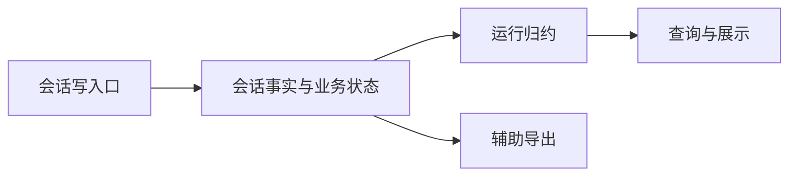

# 会话存储全链路性能改进方案

> 状态：**单一执行历史模型评审草稿，未实施**；2026-10-30。
> 代码事实基线：`58d28d76fc39d258e17c6ced726de03a434afdf6`；本轮工作区HEAD `d8ffc2bb`。用户安全代码修改不纳入。
> 授权：文档与取证，不实施代码／数据操作。路线仍选SQLite；撤回前版正文共享两表、manifest及展示v2协议提案。
> 证据：源码与前版隔离实验，不含Windows故障profile、真实库或安装包验收。提案行为和已验证实现严格区分。

### 本轮核销【人机共读】

| 上轮问题 | 本轮模型变化 | 限制／证据 |
| --- | --- | --- |
| 新链路仍协调多份事实 | History承担上下文变化与终态选择，entries退出新执行独立提交，checkpoint仅留未提交进度 | §2.1／2.2／2.5，AC-13～15；不是隐藏图中节点 |
| 用新机制管理旧重复 | 撤回正文库、引用表／新增GC owner、manifest和展示delta；沿既有spill及完整摘要展示 | 新表0、新展示协议0、新服务0；§1.2／2.7 |
| 相比其他产品没有清晰主线 | 单一会话写入口→History＋必要业务事务→运行归约→查询／展示／导出 | §1.1；队列和执行权保留独立业务事实 |
| 避免复制却可能变成全量重放 | 上下文用前缀／后缀编辑存新增材料；最多64版本一个锚点，运行态增量推进 | §2.2／2.8；必要全文CPU和冷恢复仍实测 |
| 简化以牺牲恢复为代价 | 按终态明确选择继续用哪个上下文，失败／park／人工复核和旧接纳版本可重建 | AC-06／09／13／15；不能拿可见气泡替代模型输入 |

## 第0层：目标与取舍【人必读】

**同一次执行的上下文、响应、工具与终态只沿一条历史保存；数据库维护必要业务状态，运行时从历史推进，页面和文件单向生成。**

这次精简的核心不是再减少几个函数，而是取消“执行历史＋另一份每轮完整转录”双重持久化。历史保存变化；上下文检查点只承担有限重放的加速作用。队列、首次接纳配置、执行权和提交回执继续保留，因为它们不是展示副本。

最终同时验收：新增不读全前缀、不每轮复制历史正文；普通执行不由文件裁决；工具结果不在恢复快照重复保存；新建／首屏／提交及密集工具调用达到预算。必要完整模型输入与首次恢复不豁免主线程阻塞预算。若仍超预算，方案继续修正，不能局部通过就完成收尾。

### D-1：以执行历史统一保存上下文

背景：目前执行历史已有上下文、响应和工具记录，终态又保存完整转录；两份材料各有恢复消费者，增加同步与存储成本。

- A：上下文变化和终态选择统一记录在数据库执行历史，旧转录只读兼容；新执行从历史恢复。减少一条权威写入和每轮全文副本，冷恢复需从有限检查点归约。
- B：保留每轮完整转录，增加共享正文库管理重复。可直接读取各版本，但需新增内容引用和回收协议。
- 推荐A，待批；未批准不改变新写格式。配套回退包须重建旧转录、保留升级后新写；不能直接打开旧包。
- 依据：现有历史和转录消费者已核实；失败／压缩／人工复核的精确等价性须差分验证，不能先删后补。
- 下钻：INV-01／02／06、§2.2／2.8、AC-06／13／15。

### D-2：保存历史校验的当前状态

背景：每次新增都从旧记录推导待处理工具和审批，成本随前缀增长。

- A：当前校验状态与事件一起提交，新增两个字段；规则不减，旧流第一次准备重放一次。
- B：保留全量重放，不改字段，但密集追加瓶颈继续存在。
- 推荐A，待批；未批准不实施。回退包移除两列并恢复旧全量校验，新增事件不丢。
- 依据：原扫描已核实；新状态充分性需合法／非法差分及随机不变量验证。
- 下钻：§2.3、INV-01／02、AC-01／02／09。

### D-3：普通桌面操作提交数据库后即返回成功

背景：数据库提交后等待整会话辅助导出，延长回执且混淆文件失败和保存失败。

- A：成功表示数据库已提交，文件稍后更新；显式导出和退出仍等实际完成。
- B：保留等待，维持原完成时点，但仍受导出影响。
- 推荐A，待批；未批准保持B。可恢复等待，不新增界面、备份格式或远程行为；外部消费即时文件的契约须核对。
- 依据：等待链已核实，外部消费普查未做；不引入乐观显示，数据库回执仍是屏障。
- 下钻：INV-04、§2.7、AC-04／07。

### D-4：旧文件归并后退出正常执行裁决

背景：旧文件可能独占压缩／用量事实；一直双读会使兼容永久留在正常路径。

- A：承接已有专项的转换和已批准缺失处理，完成后只读数据库；新增一个位置完成字段，旧未完成数据有显式转换入口。
- B：保持每次比较和回退，不改字段，但双源成本与恢复协议继续存在。
- 推荐A，字段与当前分支接入待批；不重开专项已批准的有损策略。回退需重新生成升级后的文件，不能只恢复陈旧副本。
- 依据：本分支有旧消费者，另一工作树有专项实施记录；尚需对齐范围与故障夹具。未批准不切换／删除。
- 下钻：INV-03／04、§2.6、AC-06／16。

### 范围、外验与三处弱点

四项决策覆盖本案：统一历史的宿主编码v2、两个校验字段、一个文件转换字段及普通回执变化。撤回正文两表、13列、manifest、新spill owner和展示快照／patch协议。无新界面、设置、产品错误码、外部IM行为；SDK事件业务词汇与HistoryPort签名保留，宿主落盘编码改变。

Mac可验算法／恢复／访问范围；真实库、Windows原故障、安装包、真实IM仍外验。不能把外验未做说成产品已修复，也不能据此排除设计目标。

三处弱点：①History能否精确表达失败时选择的上下文，差分不等就修正终态编码，不能取当前UI凑数；②检查点间重建是否满足预算，实测不通过就在本案调整锚点粒度／执行线程，不能恢复每轮全文副本掩盖；③去掉独立转录后，接纳版本、人工复核和旧数据消费者是否遗漏，任何独占材料未承接就不能切写或删除。

## 第1层：评审包【人机共读】

### 1.1 同粒度的目标主线



图不是用一个框隐藏多套提交：会话事实与业务状态由同一SQLite事务提交事件、校验状态及必要接纳／执行权／receipt；**没有另一条新transcript正文提交，也没有正文共享库**。运行归约不持有可独立裁决的第二份持久历史，冷启动由检查点与事件恢复；查询投影和展示可以重建，辅助文件不反过来批准执行。

与Codex／DSH借鉴的是“一个历史入口、增量推进、单向派生”，不是移植其全部模块。SQLite内必要业务表是本项目的产品状态，不要求把队列／租约全部事件化。下表给出节点内部及外围改动，防止简单图隐藏实际工作量。

### 1.2 变更面与量级

| 单元 | 作用简述 | 类型 | 具体范围／依赖方 |
| --- | --- | --- | --- |
| 会话写入口 | 接纳并提交会话变更 | 改对外契约 | sessionIpc／agentProtocolIpc／ipcShared，回执时点D-3 |
| 会话事实与业务状态 | 原子保存事实及执行归属 | 改对外契约 | agentHistoryStorage／sqliteAgentHistory／sessionTranscript／schema及public/execution异步正文读取；D-1／2／4 |
| 运行归约 | 推进上下文并恢复执行 | 改承重边界 | canonicalHistory、execution、hostedTurnHandoff、continuation及coordinator；D-1 |
| 查询与展示 | 局部读取并呈现状态 | 改承重边界 | queries／operations／ChatView／chatRunnerService／TurnDisplay；不新增展示协议 |
| 辅助导出 | 生成可重建文件 | 改造 | sessionBackupManager及shutdown；D-3 |
| 历史校验器 | 校验工具审批生命周期 | 改对外契约 | SDK history公开纯归约导出；D-2，宿主事件逻辑类型不变 |
| 旧事实转换 | 归并旧格式及文件事实 | 改承重边界 | 旧entries兼容、台账专项、压缩／meter／retention；D-1／4 |
| 必要进度checkpoint | 保存未提交文本进度 | 改承重边界 | acceptedAssistantCheckpoint、messages、启动恢复；可靠工具事实不再重复保存 |
| 回归与规模夹具 | 核验恢复及工作量 | 改造 | 原SDK／storage／renderer测试扩展，不建独立框架 |
| 页定位与构建预算 | 定位正文并约束后台负载 | 复用不改（待验证） | locator、prepared Worker及既有单槽／队列上限 |
| 安全与执行租约 | 约束授权与执行所有权 | 复用不改（待验证） | policy、final-check、claim／receipt、unknown规则 |
| spill与引用回收 | 保护外置正文生命周期 | 复用不改（待验证） | 复用history／旧entries现有owner，不新增正文对象owner |

共12职责单元：改既有9、新建0、复用3；改对外契约3、改承重边界4、内部改造2。新增表0、新SQL列3（stream2＋ledger1）、schema升级1、宿主History编码版本1；沿用推进状态v1。新展示协议／Worker／用户错误码／开关／诊断事件均0。五阶段、16项AC。职责粒度不同于前版16单元，不能把少4个框当代码已减少；真正删除依据见§2.1和AC-13～16。

达到拆分门槛仍用一份总体规格：上下文终态选择、接纳版本和恢复直接关联，分开定义容易先删独占材料；五个出口隔离实现风险，专项台账复用原协议。本案最终出口包含全部目标，不把关键重构移到未来方案。

### 1.3 契约六面

| 面 | 变化 | 兼容验证 |
| --- | --- | --- |
| agent-sdk | 加纯校验归约导出；HistoryPort／SessionTranscriptCommitIntent／事件种类不变。commit intent成为宿主生成终态上下文记录的输入，不再必然写entries | check:agent-sdk、typecheck:agent-sdk，MemoryHistory及旧事件差分；SDK只读逻辑payload |
| 会话存储 | 新写只提交History上下文及checkpoint控制行／receipt；entries新写退出，宿主codec与读取归约改变；public execution.readHostedTranscript改返回Promise，四处handoff调用await并复核版本／租约 | 三项存储边界门禁；旧接纳版本、人工复核、GC、COMMIT unknown及R演练 |
| IPC／preload | D-3只改普通桌面完成时点；通道、参数、返回形状不改，无展示v2 | gateway回执和原chatGetTurnDisplays／详情按需回归 |
| 共享类型 | 产品Message与TurnDisplay保持，宿主编码不暴露renderer | typecheck:shared／renderer，旧渲染行为对拍 |
| 其他持久化格式 | 增三列及宿主历史payload v2；entries旧格式只读，业务version与receipt不改含义 | 新旧codec、未来版本拒绝、升级后R回退保留新写 |
| 领域数据格式 | 无规则／配置／产品错误码新增 | 既有故障通路与脱敏；若实现需新增，回到决策层审 |

当前门禁结果见附录B，仅证明旧基线，不证明拟议codec／恢复成立。

### 1.4 为什么校验可以减少

| 原保护 | 新机制与退出理由 | 仍保留 |
| --- | --- | --- |
| 每批历史全重放 | 同一归约规则的充分状态与事件同事务推进，旧流一次建立起点 | 审批身份、terminal、unknown retry、幂等与版本 |
| History与独立transcript一致性 | 删除第二条新正文提交；terminal在History中记录精确上下文选择，业务version／receipt同事务 | 租约、baseVersion、提交unknown、接纳冻结 |
| 文件与DB双源比较 | 一次归并发布完成，之后唯一事实writer维持覆盖 | 未转换显式准备、缺失／冲突与专项既有恢复规则 |
| 累计工具checkpoint | 工具结果由History恢复，checkpoint只存未提交进度 | 效果后未落库仍unknown；关键提交时点不变 |
| 全文查询验证 | 状态查控制行，preview查候选；仅实际使用正文做完整性检查 | spill完整性、scope与最终版本核对 |

增量状态需通过“从H得到S，再从S处理B”等价于“从H全量处理B”证明。统一历史需通过“同一终态归约出的上下文与原commit intent字节及顺序一致”证明。事务不能代替这两项证明，也不能证明外部工具未执行。已退役proof字段不计为本轮收益。

### 1.5 性能因果链

固定pending和batch，热追加不再读旧前缀；控制读正文0；preview只读候选。初始上下文保存相对已提交版本的变化，terminal保存上下文选择／必要修正，不每轮写完整历史；每64个版本保存一次完整锚点，压缩天然形成检查点。工具结果只按执行事实写入；live不复制累计历史；summary及必要编码使用既有Worker预算。

展示保留完整但有界的工具摘要和详情按需接口，不承诺每次传输O(新增字节)；通过脏标记复用未变摘要、50ms合并、rAF和变化turn通知减少重算。其累计文本／摘要仍须整体规模验收，不能因为没改协议就豁免。

新建慢可能来自共享主线程排队，不能声称INSERT本身复杂。必要模型输入读取仍O(M)，差分准备也可能扫描M；本案减少的是持久化正文与重复计算，线程投递／SQLite／冷恢复都计入预算，不把异步签名视为提速证明。

## 第2层：单一历史规格【机｜人工可跳过】

### 2.1 所有权及退出清单

| ID | 不变量 | 验收 |
| --- | --- | --- |
| INV-01 | 事件、stream version、推进状态同事务，回滚不领先，重复不再推进 | AC-01／02／09 |
| INV-02 | 授权、租约、接纳冻结、幂等及unknown效果规则不削弱 | AC-02／06／09／14 |
| INV-03 | 控制读无正文、局部读无全会话重建，完成转换正常执行无文件裁决 | AC-03／05／10／16 |
| INV-04 | 派生失败不撤销权威事实，回执与显式导出完成分开 | AC-04／07／11／16 |
| INV-05 | 工作量、必要字节、主线程阻塞同时验收，必要全文不豁免 | AC-01／03／08／12／13 |
| INV-06 | 任意被引用已提交版本可精确恢复；新terminal不依赖独立entries正文；依赖未退出不GC | AC-06／09／13／15 |
| INV-07 | 展示只派生，恢复不依赖renderer；已提交工具结果不靠checkpoint副本保命 | AC-08／11／14／15 |

| 材料 | writer／提交点 | 最终职责 |
| --- | --- | --- |
| agent_history_events | 既有append helper／事务 | 执行事实、上下文差分／锚点、终态选择及人工复核记录，唯一新正文来源 |
| streams／transcript checkpoints／receipts | 既有业务事务 | stream合法性状态、已提交上下文版本／status、turn提交身份；无第二份正文 |
| accepted_turn_contexts／queue／claim | 现有接纳／领取／终态事务 | 首次配置冻结、指定输入版本、FIFO和fencing，不强行事件化 |
| session_transcript_entries | 升级前旧writer；新运行停止写入 | 未转换旧版本只读兼容，不作为新执行的另一套权威或每轮缓存 |
| messages／turn checkpoint | 现有消息及coordinator入口 | 队列编辑、UI骨架和未提交文本，可靠工具结果从History重建 |
| locator／prepared页／summary | 既有构建器及source revision | 可重建查询表示；不决定执行是否成功 |
| 文件／renderer live | 既有导出／活跃路由 | 辅助输出及当前呈现，不能倒灌事实 |

最终退出：每批前缀重放、每轮新entries全文、每轮History初始全文、累计可靠工具checkpoint、live历史seed、状态读全文、preview全会话、正常双源裁决、普通回执等导出（按D-3）。保留旧entries读取和少量完整检查点有独立用途，不为了删表而发明正文库。

### 2.2 上下文版本与宿主History编码v2

业务版本仍由session_transcript_checkpoints.version和session_turn_commit_receipts映射到已提交turn；只是该turn的上下文从History恢复，不再必须有entries行。readHostedTranscript对新版本读取对应receipt的turn及terminal，依本节归约；旧版本无v2提交材料才读原entries。返回SessionTranscript逻辑形状不变。

**宿主物理编码**采用单一封套，SDK读写仍是原HistoryEvent：

```text
{ __spaceassistant_history_payload_v2: {
    payload: <原事件payload，初始context时去掉messages>,
    context: {
      base: { kind: 'empty' }
          | { kind: 'session-version', sessionId, version }
          | { kind: 'event', invocationId, eventId },
      prefixCount, suffixCount, messages: <中间新增／替换消息数组>
    }
} }
```

固定marker表达版本，不新增表或正文引用对象。prefix／suffix非负安全整数且和不超过基数组长度；结果为base前缀＋messages＋base后缀，保留消息及键序／值，不按UI气泡重组。full锚点使用empty base、两count为0。仅允许session内引用；event base必须在同一invocation且sequence更早，其含义是按既有canonical reducer归约到该event为止的上下文（不是只取该事件payload.messages）；session-version必须是该次输入的已提交baseVersion，禁止未来／环引用。未知marker拒绝，绝不回落旧payload猜测。

适用位置只有两处：`invocation-context-committed`存实际初始context相对已提交session版本的编辑；terminal的宿主封套存此次commit intent.messages的准确编辑。其他响应、工具及压缩事件沿旧格式；`transcript-compacted`已有完整messages，作为自然锚点。terminal的SDK逻辑payload原样返回，context是宿主提交材料不泄漏SDK；初始context在SDK读取前由宿主还原messages，再走原validateHistoryBatch；fromRow等结构校验也必须在封套解码后，不允许只在返回前补水合。无session归属／无commit intent的独立宿主保持旧表示，不制造跨session引用。若本轮失败没有可用commit intent，只记录原terminal及原失败结果，不擅自推进session version或把未提交context升为已提交。

编辑由既有prepared Worker对逻辑消息的序列化字节求最长公共前缀，再求不重叠最长公共后缀；只保存中间消息。允许O(M)比较，但不在主线程再次stringify全数组求差分。prepared材料绑定session generation、baseVersion和目标事件身份，最终事务重核；失败重试最多2次，不能引用过期base。一次消息很大沿原spill处理，owner仍是agent_history_events，不建新GC协议。

**终态的选择不能猜测：** completed使用SDK实际commit intent；failed／cancelled／timed_out沿sessionTranscriptMessagesForFailure的实际结果；park保留既有failure baseline；发生压缩后，SDK原逻辑决定是否采用压缩材料。准备器优先以当前invocation中最后一个已提交且可确定上下文的事件前缀为base，复用原canonical reducer；普通成功结果应只需去system等必要裁剪，而不是把本轮工具结果再存一遍。失败保留baseline时直接引用session-version；压缩后失败按原required user截断规则作必要编辑。只有归约结果与实际commit intent精确一致才使用空中段选择，否则保存真实差异。若没有可用base可精确表达，则写full锚点，不能截断或替换为运行中的另一份数组。普通完成不能每次无条件走full分支，AC-13覆盖。

终态事务仍一次提交terminal、version推进、receipt、claim／queue和必要message mirror；receipt沿现有outcome＋逻辑messagesJson摘要算法，摘要在prepared材料中计算。移除entries INSERT及其spill owner更新，而不是移除baseVersion／lease检查。commitSessionTranscriptInTransaction改为仅提交上述控制行／receipt，由同事务History terminal提供正文；无生产调用的独立commitSessionTranscript全文wrapper移除或只留旧格式恢复工具，不能成为绕过History的新writer。reconcileCommittedSessionTranscripts改核对receipt和terminal的nextVersion／上下文材料，不能继续以entries行存在作为新提交成功证据。新receipt的event_start／end继续覆盖该turn；在该范围按invocation／turn定位唯一terminal封套，缺失或冲突按损坏处理，不能当成“没执行”。仅存在旧receipt而没有v2材料时走旧entries兼容。

每次SDK恢复若需初始逻辑context，宿主解码后再交SDK；canonical查询、mirror、compaction、meter和只读Worker都接入同一codec。正常小查询不调用它全量重建。分页locator构建逐事件应用上下文编辑并复用前一版本的位置，不逐invocation先展开完整初始messages再fold；最终页只水合候选正文。实际模型输入才展开完整数组。mirror复用本次准备得出的新增／编辑消息，未变历史只核必要身份和状态，不重复全正文编码。全量逻辑恢复接口保留给真实消费者，不作为所有读入口的通用前置。幂等以还原后的原逻辑payload及commit intent比较，不能比较封套和旧inline串。旧receipt不改写；prepared hash不可由renderer提供。

### 2.3 增量追加：用事务状态替代缓存协调

**持久化提案（D-2）：** 在`agent_history_streams`增加`transition_state_version INTEGER NULL`、`transition_state_json TEXT NULL`。版本表示归约编码，不是事件schema；新建流首次追加即写v1，旧流两列均NULL表示未补齐。新表0。stream.version仍是唯一事件序列提交版本，不另增第二个水位。

JSON v1固定8个成员：`invocationId`、`turnId`、`terminalKind`（null或已有终态kind）、`pendingToolCalls`（唯一字符串数组）、`pendingApprovals`（唯一字符串数组）、`approvalIdentityByPendingId`（字符串二元组数组）、`deferredTodoIds`（唯一字符串数组）、`unconsumedRetryApprovals`（approvalEventId到toolName／inputHash的二元组数组）。排序用于确定编码，解码后须按唯一规范编码重编码并与原串相等，以拒绝重复键及非规范值；另检查非法身份和集合重复项。没有正文、权限决定或载荷副本。

unknown retry消费后移除unconsumed项；再次消费因不存在被拒绝，与现有missing-or-consumed拒绝含义一致。approvalEventId是已持久化事件身份，不能靠换payload重用；同批批准／消费／tool-start按顺序处理。`pendingUnknownRetryStart`只存在当前批次局部，批末必须为空；不落盘“消费了一半”的状态。已关闭stream保存terminalKind以拒绝再次追加。状态规模依赖未完成事项，deferred引用仍有生命周期成本，不声称O(1)。

历史校验器在现有文件导出两个纯函数：`createHistoryTransitionState(previous: readonly HistoryEvent[]): HistoryTransitionState`和`advanceHistoryTransitionState(state: HistoryTransitionState, incoming: readonly HistoryEvent[]): HistoryTransitionState`。前者从空状态校验归约完整前缀，后者不得修改输入状态、失败不返回部分状态；`HistoryTransitionState`就是上述v1的只读内存形状。旧`validateHistoryTransition`保留签名并委托同一规则，MemoryHistory依然可作全量参照。不会新增SDK→宿主依赖，不复制两套审批规则。先以旧validator做差分，确认旧合法事件及非法批次结论相同，再替换旧实现；不为提速改拒绝条件。

一次普通追加，在原事务内按顺序执行：

1. 保持批次格式、canonical JSON、process generation、session归属、幂等身份与expectedVersion检查。精确重复沿既有分支返回，不推进状态；冲突仍拒绝。
2. version=0的新流从空状态推进。已有流必须有可解析v1状态且身份匹配；缺失／不支持／损坏时不追加、不执行工具，调用既有错误通路进入显式准备／修复。不能在普通追加中悄悄回退全量读取。
3. 只读取当前状态并校验incoming；检查sequence、批末unknown retry及terminal顺序。写事件／引用／projection义务，更新stream.version与两个字段，仍在同一事务。
4. 若还有terminal transcript intent，保留现有租约、baseVersion、receipt和message mirror同事务提交。最外层COMMIT后才返回成功；SAVEPOINT释放不是持久成功。

不增加内存权威状态，因此不需要事务提交回调、WeakSet凭据或cache revision协议。外层回滚同时回滚新状态；COMMIT unknown按现有不确定路径恢复，不假定提交失败。存储读回状态的解析／编码成本为O(未完成状态)，历史校验成本不再依赖已完成正文；这比声称全流程线性更准确。

**显式旧流准备／修复：** SDK恢复／续跑准备阶段按invocation读一次完整前缀，验证事件与归属、生成v1状态；短事务重核stream.version及session generation再写入两列。漂移则丢弃结果重试，最多2次后返回既有准备失败，不能无限争用。损坏历史不补齐。新的accepted input和continuation version=0直达helper无需旧流准备；已有流全部生产写者必须先调用同一准备入口。前台普通追加不触发整库扫描；修复完同一版本不再重放。

代码内删除session时一并删除stream状态；未来改写旧事件语义的迁移必须重建受影响流状态。禁止外部修改DB后继续信任旧状态；损坏库按恢复／审计路径处理，不以每次读全文自证覆盖任意篡改。

### 2.4 控制信息、上下文与局部读取

- 在既有sessionTranscript模块增加`readSessionTranscriptState(db, sessionId)`，返回`{sessionId, version, status, lastTurnId?}`，只SELECT checkpoint的version／status／last_turn_id，缺行保持version=0／ready语义。acceptPrepared、readTranscriptState及只查状态的恢复分支消费它。readSessionTranscript对新版本委托下述History上下文归约器，旧版本才读原entries；不能改成返回空messages。
- hosted交接获得claim后读取确定的已提交版本；遇到版本漂移仍按既有baseVersion／claim规则处理。不改变trackScopedModelInput、system消息、required user及失败settlement上下文。一次准备材料的stringify／hash复用，不能跨版本缓存未经核验正文，也不删除spill读回完整性。
- preview：事务外选择排序／删除后的候选身份并按现有prepared单条读机制取正文，事务内重新应用队列检查、选择候选并比对id／role／timestamp／message revision和session source revision。完全一致才写preview；不一致不提交本次队列变更，重做准备，最多2次后既有queue_changed返回。scope和canonical-backed校验沿用既有规则，不把空preview当读失败成功。
- 页、单条、搜索、重试目标、API baseline、导出复用现有locator／prepared body与最终源复核，不能只优化page IPC。legacy_required保持明确旧reader，不能装作canonical已经就绪。session:list按现有profile语义下推过滤；读取不再顺便strip／flush，旧元数据清理放到既有维护入口，不新建维护队列。
- summary baseline保持现有完整语义，改为在既有prepared构建Worker中计算，按source revision发布结果；冷构建与页构建共享既有预算，不允许主进程同步回退全量扫描。构建完成前独立等待，不阻塞无依赖submit；过期结果丢弃。markers仍是独立effect。Worker投递、读取与结果发布各自计入AC-12，不能只移动函数名。

正文准备接口明确改变：`SessionExecution.readHostedTranscript(sessionId): Promise<HostedTranscriptSnapshot>`，复用既有prepared Worker及预算；hostedTurnHandoff四个调用点await后核验session version／status和原lease仍有效。控制信息仍同步小查询，不借异步返回空正文。HistoryPort.read本来是Promise，宿主session v2读取在Worker解码；readSync保留给明确同步兼容／测试，不能作为新正常路径回退。启动仅核对terminal／receipt／tool事实时做定向SQL，不为判断终态水合初始完整context；真正续跑正文走异步准备。

### 2.5 恢复、必要checkpoint与运行态

运行中的上下文沿当前事件增量推进，不在每次工具循环调用readHostedTranscript重建。只有首次接管、指定旧版本、失败恢复或原有明确重新准备边界读取历史。成功commit后同一运行态推进已提交version；COMMIT unknown则停止接纳并查receipt，不能先推进内存猜成功。该状态复用现有hosted runtime生命周期，不新建全局会话缓存／失效服务。

工具身份、输入、批准、start、result和terminal以History为准。messages checkpoint只存未进入可靠事实的content／thinking、段顺序和原有必要状态；普通2秒窗口不扩大，确认／reconcile／tool-result／终态的可靠提交时点不推迟。tool-result沿History成功提交后不再随后续checkpoint反复编码整个toolCalls；效果已发生而result未保存仍unknown，不从无数组推断未执行。

旧checkpoint有独占材料时，恢复按toolCallId与History合并，冲突不能授权成功；在可靠事实覆盖或按原恢复规则结案前不清空。progress和preview若无执行恢复消费者可重建；未提交文本仍保留，不能为删字段丢掉用户已见输出。terminal前checkpoint、terminal提交后回执丢失、取消后迟到checkpoint分别沿原version／streaming／lease屏障处理。

renderer live只保存routeAdd／patch／remove所需活跃差量，未命中live沿原store／overlay路径更新；不seed／clone已加载历史。无调用历史merge出口删除，abort的Redux fallback保留。page dispatch后允许绘制；markers、summary和失败原因独立且检查session代次，不虚构markers→summary→live串行链。gateway仍等DB回执再dispatch，分段计量排队／事务／reply／绘制。

### 2.6 旧文件归并（复用专项）

承接[台账拒绝服务清理专项](./会话台账拒绝服务清理-最小执行计划.md)的已批准事实分类、压缩缺失处理、outbox重建及回退；不得重建平行迁移框架。专项另一工作树“源码完成”不是本分支覆盖证明，先按实际调用者移植／核验。

在既有session_ledger_projection_state增加`canonical_read_version INTEGER NULL`：NULL表示该location尚未整体归并；1表示压缩、meter及该location全部实际执行消费者依赖的文件事实均已归并或按既有批准恢复结案。只支持1，未来值拒绝；不以ready或文件为空推断完成。原session generation／workDir identity继续绑定位置，不再新增一个身份系统。

算法：

1. 新location在第一次原子初始化中写1，之后所有新压缩／meter先写canonical，文件为派生。旧location保持NULL，通过显式会话准备进入转换；列表／页面查询不隐式触发转换。
2. 转换复用原location生命周期锁，停止该location旧文件事实writer，取得稳定文件输入及canonical版本。按专项身份合并，区分无历史、缺失、未知、冲突；不能把部分回填视为已完成。
3. 压缩沿既有canonical事件及v2 backfill snapshot存放，meter沿既有request／usage事实存放，不新建第二事实表。已有义务按专项source-missing／健康集合分流，缺源不静默ack；未覆盖类型仍保留载荷。
4. 全部消费者的结果已能从DB生成后，短事务核验session generation、source revision及location归属，提交最后的归并事实和完成列1。此前分批提交允许存在，但不提前置1；转换中断按稳定身份幂等续做。最终版本漂移最多重试2次，再走现有准备失败。
5. 完成后正常读取只查询完成列和canonical，不读文件、不调用双源比较。文件后来损坏不撤销完成；数据库缺源是权威损坏／修复问题，不能偷偷回到陈旧文件裁决。NULL仅在显式准备／恢复入口兼容，普通执行须先完成准备。

完成列证明的是一次转换结束，不是每次运行的新鲜度证明；后续新事实的唯一writer与事务规则维持覆盖。旧进程不得继续写旧格式，升级需排空并保持原process generation fencing；无法排除并存旧writer时不能切换。

文件停写与物理删除仍遵守专项AC-S9、载荷依赖与R包；这是本案最终阶段的联合条件，不是另案延期。保守保留无消费者的历史文件不妨碍执行路径退出；若仍有实际消费者，则最终阶段失败。retention改查DB依赖，不能因文件不再读就误删仍被上下文引用的大正文。

### 2.7 查询、展示与导出不另建协议

沿用现有TurnDisplay完整快照、50ms合并、renderer rAF和chatGetTurnDisplays重取；工具只传现有摘要，详情沿chat:get-tool-call-details按需获取。没有epoch、revision或snapshot／patch v2。未变化工具摘要复用，内容相同不能只比较长度，替换cache先扣旧字节再加新字节，只通知变化turn。脏标记在原turn更新处产生，不每次遍历并编码完整turn求diff；实际完整snapshot构造仍计入预算。

摘要生成必须先有界取值，不能完整stringify超大对象再截断。单turn工具数／文本增长后的完整展示仍有成本，AC-12／14直接测量；若此策略不能达标，须带证据重审展示边界，不能预先用一套通用patch协议掩盖问题或宣布完成。

D-3=A时普通桌面操作commit后scheduleBackup并返回；失败独立记录且保留旧有效文件，原单会话operationChains／3秒防抖重试，显式导出与shutdown等待排空后关库。D-3=B保留等待，不能隐去等待时间。导出逐页读取逻辑正文，用既有prepared Worker做必要JSON编码，不改文件格式，不声称session.json＋messages.json原子对。大单条和线程投递均纳入阻塞预算。

### 2.8 检查点、旧版本与人工复核

为避免每轮完整快照又避免每次从创世重放，**首次从旧格式接入的新提交、此后session version为64的整数倍时**，terminal context写full锚点；已有压缩事件是invocation内自然检查点。普通新版本只存编辑／上下文选择。解析指定版本时从其receipt定位terminal，迭代展开依赖图并复用任务内结果，最多跨63个前驱已提交版本后遇到full锚点；同invocation只归约所需事件前缀。不得用递归栈无限展开或每层重复解析同一前缀。

64是本案工程提案，不是已测最优值；AC-12记录锚点写入峰值与冷恢复。稀疏锚点仍复制必要全文，因此不宣称累计存储严格O(新增字节)；它是有明确间隔的恢复成本交换，不再让每轮都保存两份全文。若锚点成本超预算就在本案调整间隔／线程并重新核验，而非新增通用正文库。

接纳冻结的旧version不能改成latest。新version由receipt＋History恢复，升级前旧version从旧entries读取；这些只读行在accepted引用／旧恢复消费者退出前保留，不强行全库迁移。第一次接入的新terminal full锚点切断后续对旧正文的正常依赖；原旧version仍独立可读。版本0保持ready／空上下文语义，不空造事件。

人工复核不再向新entries单独写入另一份正文：在现有人工复核入口建立确定性修复invocation，使用已有invocation-context-committed完整审定messages及原terminal词汇；与新version／原审计session_transcript_reconciliations／claim处理同事务。修复身份固定为JSON.stringify([sessionId,原turnId,expectedVersion])派生的确定性ID；修复receipt使用该新ID作turn_id，checkpoint.last_turn_id指向修复ID，原审计仍记录待复核原turn。原receipt不覆盖，原claim按原待复核身份结案；重复请求先查修复receipt／审计，不重复提升version。保留原resolution／operator／rationale，不重新计算工具是否执行，不自动重跑外部效果。旧审计按其原entries读，不能把“未找到新terminal”当未复核。

**保留／删除：** 新上下文edit可以引用同session旧version或同invocation早先事件，故活跃会话内不按“旧turn已完成”删除其History。复用现有session级retention保护；消息删除／编辑不能物理抹掉仍作为版本基底的事件，只影响现有逻辑可见性与新输入准备。整session删除先按现有引用／生命周期锁检查，再一并删历史和spill owner。旧entries／spill仍沿现有owner管理，不新增GC owner或改变三张spill表CHECK。任意事件裁剪须先证明不存在上下文依赖；本案不引入细粒度历史GC来换更多复杂度。

### 2.9 故障及绕过入口

| 入口／窗口 | 唯一处理 |
| --- | --- |
| accepted input／continuation直接helper | 新流空状态；宿主codec与terminal commit都接入，不只改主History类 |
| MemoryHistory／SDK独立宿主 | 仍用逻辑事件及旧接口，无session则不采用宿主v2 |
| IM／butler／track | 底层新模型共同覆盖，不改变授权或外部回执语义 |
| 准备后baseVersion／generation漂移 | 丢弃材料，至多2次重做，禁止引用错base |
| spill完成后DB回滚 | 孤儿沿原GC，不发布成功；原owner保持 |
| 外层／嵌套回滚 | 事件、状态、receipt、version一起回滚，不留新entries |
| terminal提交后IPC回执丢失 | 查原receipt／terminal context，不能重做工具或重复推进version |
| 工具效果后result前崩溃 | unknown与原审批恢复，不用无结果推断未执行 |
| 压缩后失败／park | 按原commit intent选择baseline或压缩结果，不默认当前运行数组 |
| 人工复核提交后返回前退出 | 先查稳定修复身份／审计，恢复同一版本 |
| 已转换文件失败 | DB继续执行，导出独立重试；转换未完成不置完成 |
| 旧版本／损坏／未来codec | 旧版本兼容，损坏与未来版本拒绝，不回落空上下文 |
| renderer切换／迟到响应 | 原session代次和turn版本过滤；不增加patch恢复协议 |

## 第3节：迁移、阶段与整体验收【机｜人工可跳过】

### 3.1 升级及回退R-History-v2

schema提案117→118，实施前确认占位。runInTransaction只新增两个stream状态列和ledger canonical_read_version列；无新表／新owner／新spill表约束。兼容读取器先支持旧payload与宿主v2，原schema117数据不改写。启用新写前，新terminal路径、旧版本／人工复核读取、canonical投影、幂等和回退程序必须一起验证。

不全库重写旧事件或entries，不新增迁移进度表。旧流显式准备补状态；旧location按专项归并；首个新提交full锚点。读取某version先定位其receipt／terminal，v2用新codec，原提交材料才用旧entries；不能以entries是否存在混淆一次COMMIT unknown。所有新terminal一律不写entries；旧entry保留只读，非双写过渡。

**R-History-v2为本案必须交付的兼容回退程序，算法如下：**

1. 停接纳和writer、排空、取得原数据库／location／spill边界，确认schema与codec受支持。拒绝未来版本，不让旧包并存写入。
2. 按session版本升序还原所有v2初始context为旧messages payload，terminal封套恢复原logical payload；对每个新提交版本重建原entries.messages_json及原spill引用，并核对原receipt的outcome／messages摘要。人工复核版本也要还原，审计、ID、event sequence、version和claim保持。
3. 逐owner事务发布旧表示，恢复旧history／entries spill owner，再移除对应新封套；不得在还原前删源。回退中断可按封套和缺失entries继续，已完成owner幂等。需要的依赖必须先水合再转换，不能先展开base事件后破坏后续版本解析；按session稳定快照准备、核验后分批发布，回退进程保留可重建材料直至整session完成。
4. 由可靠History重建旧toolCalls checkpoint及升级后的文件事实；不重执行工具。全部owner已旧格式、entries已补齐、文件可读后，最后schema事务DROP三新增列、恢复117；重开旧兼容运行逻辑并验证读／写／reopen。

准备空间不足、坏spill、任一步骤／最终DDL失败均保持停机与可恢复材料，不手改schema号、不恢复升级前备份丢掉新写。R程序必须包含支持v2的离线读取器，不能依赖即将被替换的旧安装包。回退本身不授权生产库操作。WAL／NORMAL及断电保证不变；前版空库两列DDL实验只证明局部DDL可行。

### 3.2 五阶段替换出口

| 阶段 | 输入／输出 | 出口证据与回退 |
| --- | --- | --- |
| P0 模型对拍 | 旧版本夹具→v2编辑／终态选择、旧validator差分、预算基线、全部消费者与owner清单 | 失败／压缩／park／人工复核可精确还原，R原型可演练；仅夹具可撤回 |
| P1 统一历史提交 | D-1／2批准→宿主codec、控制行／receipt、增量状态；新entries写入及每轮全文初始context退出 | AC-01／02／03／09／13／15；带新写R回退通过才启用；不是新增共享库 |
| P2 结束文件裁决 | D-4批准＋专项本分支对齐→归并和完成列，消费者canonical读取 | AC-06／16，所有入口文件访问0；回退重建升级后文件，不依赖旧副本 |
| P3 统一恢复与读展示 | 工具恢复、必要checkpoint、局部查询、live差量、原展示复用及Worker summary | AC-05／08／10／11／14／15；故障矩阵与大规模成本通过；R重建旧checkpoint |
| P4 整体关闭 | D-3分支确定→导出、旧消费者退出核销、全部规模与恢复验收 | AC-01～16通过，目标同时完成；Windows原故障外验另列，不把核心残余延期；R完整演练 |

阶段是可审查的替换边界，不是进度清单。旧数据只读兼容可以保留，但新写仍双正文、正常执行仍双源裁决、恢复仍依赖累计toolCalls或性能超预算，P4均失败。

### 3.3 验收定义

| ID | 可执行断言 | 对应 |
| --- | --- | --- |
| AC-01 | 固定batch／pending扩大旧前缀，热追加不读取已完成事件，状态字节单列；只在显式旧流准备全重放 | INV-01／05，D-2 |
| AC-02 | 新旧validator合法／非法批次差分，审批／terminal／defer／unknown retry；随机序列断言归约状态与事件一致 | INV-01／02，D-2 |
| AC-03 | 状态正文0；preview只候选，无关历史不放大访问；源／queue漂移不写错误预览 | INV-03，F-04／18 |
| AC-04 | 阻塞／失败导出时A已返回且DB一致，B保留等待；DB失败不成功，IPC排队／事务／绘制分段 | INV-04／05，D-3 |
| AC-05 | page dispatch／绘制、markers、summary、live、submit sequence分开；summary不主线程扫全文，迟到结果不串会话 | INV-03／05，F-09／19 |
| AC-06 | 旧schema／spill／entries／legacy-only压缩及meter；失败续跑／人工复核／接纳旧version／track／IM等价 | INV-02／03／06，D-1／4 |
| AC-07 | 显式导出／shutdown等真实排空，大单条编码符合阻塞预算，失败保留旧文件，pending不先关库 | INV-04／05，D-3 |
| AC-08 | 关键持久化时点不推迟；可靠工具结果不重复checkpoint；摘要同长度变更正确，cache字节不漂移 | INV-05／07，§2.5／2.7 |
| AC-09 | 外层／嵌套回滚、COMMIT unknown、精确重复／冲突、准备版本漂移：事件／状态／version／receipt一致，无新entries副本 | INV-01／02／06，D-1／2 |
| AC-10 | 新建局部写；列表profile等价且无清理flush；页／单条／搜索／API baseline冷／热／兼容分开测 | INV-03／05，F-10～12 |
| AC-11 | live无历史seed，后台／切换／add／patch／remove／overlay／abort保持；初始页增长不扩大clone | INV-04／07，F-19／23 |
| AC-12 | §3.4全部规模／预算与退出清单通过，行／字节／p50／p95／max及主线程连续阻塞完整报告 | INV-03～07，D-1～4 |
| AC-13 | 普通新版本不写entries、不存完整历史初始context；terminal准确选择结果，稀疏锚点外只写变化；重建指定版本与旧intent逐字节／顺序一致 | INV-06，D-1 |
| AC-14 | 五工具崩溃窗口恢复不降级；原完整展示／重取／终态正确，摘要有界，不重复编码旧工具详情；累计展示成本仍满足AC-12 | INV-02／07，§2.5／2.7 |
| AC-15 | 旧库→v2新写／压缩／人工复核→读写reopen→R→117读写reopen；坏spill／磁盘满／中断不丢升级后版本及原receipt | INV-06／07，D-1／2／4 |
| AC-16 | 新／已转换location执行文件访问0，坏文件／ENOSPC不改DB成功；转换中断不置完成，全部消费者与专项outbox义务覆盖 | INV-03／04，D-4 |

### 3.4 规模、预算及验证落点

固定夹具：100／400／800个4KiB事件，batch固定、pending分别1／16；100／1000轮4KiB消息，每页20；10／100／1000工具各4KiB，另有100工具各1MiB结果。分别报告总字节、冷／热文件缓存、机器／SQLite、锚点有无与首次旧格式接入；每类至少30样本，不用平均值掩盖转换峰值。

沿前版工程目标：普通新建／submit接纳回执p95≤200ms，热page dispatch至下一绘制p95≤100ms，冷首屏可读p95≤1s；含IPC排队／Worker投递／DB，不含模型网络与用户等待。普通及显式准备任务主线程连续阻塞max≤50ms；必要全文总耗时允许随字节增长，但不能连续阻塞豁免。受影响旧热点p95至少降50%；原已满足绝对预算时以绝对预算和工作量约束为准。阈值是待验证目标，调整需修改方案及证据，不能测试内偷偷放宽。

大工具场景额外检查：后续checkpoint不重编码旧结果；展示只用原摘要与按需详情，摘要生成不先编码全部结果。初始context与terminal写入字节分别报告，不能只数entries INSERT归零却把同样全文移入每个事件。每64版本锚点及压缩峰值单列。活跃运行不每轮重放，冷指定版本验证依赖链边界，损坏／循环引用拒绝。

| 测试簇 | 既有落点与新增反例 |
| --- | --- |
| 追加／状态 AC-01／02／09 | packages/agent-sdk/test/history.test.ts、electron/runtime/sqliteAgentHistory.test.ts、electron/database/sqliteStore.transaction.test.ts；差分、随机状态不变量 |
| 上下文／旧数据 AC-03／06／13／15 | electron/database/sessionTranscript.test.ts、database.queuedMessage、canonicalHistory、sessionTranscriptProjection、sessionTranscriptStartup、agentContinuation既有测试；codec／失败选择／R |
| 桌面 AC-04／05／11 | messageMutationGateway.queuedEdit、chatRunnerService、ChatView既有测试；主线程／迟到回执／live |
| checkpoint／展示 AC-07／08／14 | sessionBackupManager、sessionBackupShutdown、turnCoordinatorStorage、turnDisplayPublisher、renderer turnDisplayStore；五窗口故障及原完整协议 |
| 整体 AC-10／12／16 | sessionSwitchPerformance与台账专项既有夹具；大结果、锚点、停文件后完整执行替身 |

SDK改动跑check:agent-sdk／typecheck:agent-sdk；存储三项边界门禁；涉及renderer跑共享／renderer类型。开发定向测试合并跑，阶段收尾再全量。本轮仅文档，旧测试不充当v2已实现证明。

### 3.5 精简完成判据

主线只有一份新执行历史、一组独立业务状态、运行归约及单向派生；没有另一套新上下文正文owner、对象共享GC或展示补丁恢复协议。每份保留材料都能解释独占业务含义或恢复／查询收益。原依赖尚未承接就不删，核心成本未达预算就不完成。

计数：D4／INV7／AC16／F24、12职责单元、5阶段；新表0、新SQL列3、schema升级1、宿主codec v2一版，推进编码v1；新展示协议／GC owner／Worker／错误码／开关／诊断事件0。本案格式与恢复规格已经给出，原型若不成立须修订本文，不把目标移到后续方案。

## 附录：代码事实【机｜人工可跳过】

### 事实卡

每条 F 均以文首提交为基线，复现命令见附录 A；“源码确定”只描述工作存在，不等于已经测出线上占比。

| ID | 已核实的代码事实 | 性能含义与限定 |
| --- | --- | --- |
| F-01 | `appendSqliteAgentHistoryBatchInTransaction` 每批 SELECT 此 invocation 全部旧事件、逐行 JSON.parse，再调用 `validateHistoryTransition(previous,incoming)` | 小批次追加 E 个事件时旧事件访问量约为 E(E−1)/2；批次大小影响常数；不等于每个 token 都写 History |
| F-02 | `validateHistoryTransition` 重建 pending tool／approval 等状态并遍历前缀与新增事件 | 状态可增量归约，但终态、审批身份和 unknown-effect retry 原子批次规则都必须保留 |
| F-03 | `SqliteAgentHistory.read()` 直接调用 `readSync()`，后者全 invocation 解析、水合、校验 | Promise 接口不代表调用线程已释放；恢复与普通读需区别 |
| F-04 | `acceptPrepared` 和 `readTranscriptState` 调用 `readSessionTranscript`，只使用状态／版本；该函数仍读 `messages_json` 并可能同步读 spill | 仅查控制信息也支付完整正文成本，是指令提交前可直接消除的工作 |
| F-05 | `readHostedTranscript` 同步读取完整已提交转录；转录提交重复 JSON.stringify 与摘要计算 | 模型请求确实需要上下文，但可以复用同一次材料并在事务外准备，不能靠截短上下文提速 |
| F-06 | 每个 invocation 的初始 context 保存 messages；每次终态还保存完整 session transcript；大块可能 spill。requestSnapshot **只存消息数与摘要，不再存消息全文** | 长期保存字节可能重复；完整请求摘要本身仍 stringify＋hash。不能误诊为“每个 requestSnapshot 都存全文” |
| F-07 | spill 写入使用 UUID 文件，sync、读回验证并多次求摘要；context 中多个大块可能重复外置；同步读执行文件读取和 SHA-256 | 存储外置不消除 CPU 与 I/O；优化候选是复用同次材料；不能据此绕过读回验证 |
| F-08 | checkpoint 普通事件 2 秒合并；tool-result、确认、reconcile 和终态会立即提交；写入会重新序列化整条工具数组并读回整行 | 不能只调大 timer；高频工具结果绕过 timer，累积快照字节仍增长 |
| F-09 | `getContextHistorySummaryBaseline` 扫描会话所有 thinking／attachments 并估算；ChatView 在首屏提交后调用 | 不应误算成首屏必经串行等待，但会阻塞后续主进程工作 |
| F-10 | 当前 source identity 为 formatVersion 2，读取 source revision 与少量版本事实；页读已有 locator、Worker 与最终复核 | 早期“每页枚举全部 stream”在本基线已不成立；复用现有机制 |
| F-11 | locator 缺失可等待 backfill；兼容回退仍可能读取整会话投影；source 页面 Worker 一次一建且等待退出；已有 prepared 常驻 Worker 和前台单槽预算 | 冷、热、回填和回退必须分开；复用线程不能额外扩张并发预算 |
| F-12 | 创建会话是局部事务；列表读取全部可见会话后过滤 profile；读取时清理旧 metadata 可能触发 flushSave | 新建慢未证明是 INSERT 慢，也可能排在其他同步任务之后；列表只读需去副作用 |
| F-13 | 辅助备份为全量分页导出，默认每页 2000；3 秒防抖；部分消息／队列操作等待 flushBackup | 分页控制内存峰值，不降低总导出字节；异步文件 I/O 之外的 stringify 仍在调用线程 |
| F-14 | TurnDisplay携带累计content／thinking、工具摘要及活动，工具详情由chat:get-tool-call-details按需取；50ms合并部分事件，关键状态立即发；renderer有帧合并 | 累计展示构造仍会增长，但不是反复传全部工具结果；保留原协议也须按摘要／文本／活动的实际工作量验证 |
| F-15 | 主连接为同步 SQLite、WAL、synchronous=NORMAL、busy timeout 默认 5 秒；save 调度 PASSIVE checkpoint，维护另有 TRUNCATE | 锁等待可能冻结事件循环但不解释持续满核；checkpoint 不等于每次 save 重写整库；WAL 自动 checkpoint 也需计量 |
| F-16 | 本机单次临时库：4KiB payload、100／400／800 次单事件事务追加约 81／504／1626ms；定向测试46通过、25跳过 | 支持超线性现象，不是统计基准、不是 Windows 结果，未包含真实工具执行／网络／renderer |
| F-17 | `commitMessagePatch`先await messagePatchNonTurn再更新overlay／display／summary；基线仅找到定义、未找到生产调用者。队列edit／delete／reorder有ChatView调用，同样先等IPC | 独立于辅助导出的数据库回执屏障；不能等同于输入框每次键盘回显，也不能说所有submit经过该函数 |
| F-18 | `contentForSessionPreview`对canonical-backed行调用整会话`readCanonicalSessionTranscriptForShadow`再取一个message；排序／删除队列在事务内调用，最后才slice(0,120)；内容编辑若为最后一条直接使用编辑content | 单条短预览可承担整会话归约／spill校验，并延长写事务；输出短不等于访问范围小 |
| F-19 | markers在独立effect请求；首屏page dispatch后同步initLiveSessionFromStore，再请求summary；init合并当前store与既有live后clone。submit的turn-started也调用init并等待message sequence查询 | 无markers→summary→live的严格串行依赖；存在辅助IPC争用与dispatch后同步clone阻止下一绘制机会，初次已加载集合与累计live应分别计量 |
| F-20 | `session_transcript_entries`不仅被交接读取，还被`reconcileCommittedSessionTranscripts`及人工复核恢复按turn/version查询；spill引用、GC、删除和存储统计也消费该表 | 不是可直接删除的展示缓存；删历史版本需先替代接纳及恢复的版本引用 |
| F-21 | `readCompactionReplayForLocation`比较文件与canonical压缩记录并识别legacy-only／部分回填；`readContextMeterEventsForLocation`仍可返回文件独占request事件；retention guard保护文件压缩依赖 | 当前不能全局停止读取或删除ledger；应按事实类别转移，不能把新会话结论套到旧会话 |
| F-22 | schema v85曾创建`canonical_invocation_pending_views`，v114因runtime owner退役而删除；当前schema版本117 | 不得原样复活“缺缓存就全量回退”的协议；本版推进状态必须有唯一事务owner，替代热路径重放 |
| F-23 | renderer `resolveSessionMessagesForApi`／`getLiveMessages`基线未见外部生产调用；routeAddMessage、routePatchMessage及removeLiveMessage有调用；页面和turn-started仍触发live初始化 | 可以退出无调用的历史合并职责，但不能直接删掉运行中消息路由；需保留补丁及overlay行为 |
| F-24 | SDK turn.ts成功提交result.messages去system；park选择failure baseline；失败函数可能取最近compaction至required user的前缀。execution.readHostedTranscript当前直接读entries，canonicalHistory已有事件归约 | 不能删除entries后无条件使用当前运行数组；新终态必须持久化原commit intent的准确选择，并将既有消费者切向同一归约 |

## 附录 A：复现与证据【机｜人工可跳过】

所有命令从仓库根执行。符号定位不以行号固化；源文件可用 `git show 58d28d76:<路径>` 重放基线。

```bash
git rev-parse HEAD
ls electron/sessionStorage electron/database electron/storage
# F-01/02
rg -n 'previousEvents|validateHistoryTransition|appendSqliteAgentHistoryBatchInTransaction' electron/database/agentHistoryStorage.ts packages/agent-sdk/src/history.ts
# F-03/07
rg -n 'readSync|hydrateLargeToolResultSync|spillLargeCanonicalPayload' electron/runtime/sqliteAgentHistory.ts
rg -n 'readSourceTruthSpillSync|readFileSync|writeObject|sha256|file.sync' electron/storage/spillProtocol.ts electron/storage/spillStore.ts
# F-04/05
rg -n 'acceptPrepared|readTranscriptState|readHostedTranscript|readSessionTranscript' electron/sessionStorage/execution.ts electron/database/sessionTranscript.ts electron/runtime/hostedTurnHandoff.ts
# F-06：快照全文与请求摘要要分别核实
rg -n 'invocation-context-committed|transcriptCommit|canonicalRequestSnapshot' packages/agent-sdk/src/turn.ts
rg -n 'messagesSha256|messagesCount|snapshotPreparedModelCall' packages/agent-sdk/src/model.ts
# F-08/09
rg -n 'isImmediateCheckpointEvent|CHECKPOINT_INTERVAL_MS|acceptedAssistantCheckpoint' src/shared/turnCoordinator.ts
rg -n 'updateMessageContentImpl|checkpointTurnAtomically|getContextHistorySummaryBaseline' electron/database/operations.ts
# F-10/11
rg -n 'sourceRevision|formatVersion' electron/sessionStorage/infrastructure/sqlite/projectionSourceIdentity.ts
rg -n 'readSourceChatPage|waitForSourceBackfill|readPreparedChatPage' electron/sessionStorage/queries.ts
rg -n 'new Worker|worker.once|withProjectionForegroundWorkerBudget' electron/sessionStorage/infrastructure/sqlite/projectionSourceChatBodyWorkerClient.ts
# F-12/13
rg -n 'session:list|session:create|stripAllSessionsAndPersist' electron/ipc/sessionIpc.ts electron/ipc/ipcShared.ts
rg -n 'flushBackup|backupAfterMessagePatch' electron/ipc/agentProtocolIpc.ts
rg -n 'DEFAULT_BACKUP_PAGE_SIZE|streamMessagesJsonAtomic|JSON.stringify|handle.sync' electron/sessionBackupManager.ts
# F-17/18/19：回执、预览与辅助任务的实际拓扑
rg -n 'commitMessagePatch|commitQueuedMessageEdit|commitMessageDelete|commitQueuedMessageReorder' src/renderer --glob '!*.test*'
rg -n 'contentForSessionPreview|reorderQueuedUserMessagesInScope|deleteQueuedUserMessageInScope' electron/database/operations.ts
rg -n 'chatGetSessionCompactionMarkers|initLiveSessionFromStore|chatGetContextHistorySummaryBaseline|chatGetMessageSequence' src/renderer/components/Chat/ChatView.tsx
rg -n 'cloneMessages|mergeDbAndLive|initLiveSessionFromStore' src/renderer/services/chatRunnerService.ts
# F-14/15
rg -n "toolCalls:|toolDisplay|chat:get-tool-call-details|chat:get-turn-displays" src/shared/turnDisplayProtocol.ts electron/ipc/agentProtocolIpc.ts
rg -n 'turnToDisplay|chat:turn-display' electron/main.ts
rg -n 'content: message.content|toolCalls:|summaryCache|activity' src/shared/turnDisplayProtocol.ts
rg -n 'busyTimeout|walCheckpoint|synchronous|journal_mode' electron/database/sqliteStore.ts
# F-20～23：恢复消费者、文件独占事实及退役缓存
rg -n "session_transcript_entries|readSessionTranscript|reconcileCommittedSessionTranscripts" electron/database/sessionTranscript.ts electron/sessionStorage/execution.ts electron/storage
rg -n "readCompactionReplayForLocation|hasLegacyOnly|readContextMeterEventsForLocation" electron/sessionStorage/sqliteSessionStorage.ts
rg -n "canonical_invocation_pending_views|DB_SCHEMA_VERSION" electron/database/schema.ts
rg -n "resolveSessionMessagesForApi|getLiveMessages|initLiveSessionFromStore|routeAddMessage|routePatchMessage" src/renderer/services src/renderer/components/Chat/ChatView.tsx --glob "!*.test*"
# F-24：终态上下文不是统一取当前数组
rg -n "sessionTranscriptMessagesForFailure|sessionTranscriptFailureMessages|result.messages.filter|readHostedTranscript|rebuildClaudeMessagesFromHistory" packages/agent-sdk/src/turn.ts electron/sessionStorage/execution.ts electron/runtime/canonicalHistory.ts
# 绕过入口
rg -n 'appendSqliteAgentHistoryBatchInTransaction|readSessionTranscript\(' electron --glob '*.ts' --glob '!*.test.ts'
```

### A.1 单次追加实验

环境：本机 macOS，Node v26.4.0，经 tsx 直接运行现有 SQLite helper；file-backed 临时库、默认 WAL／NORMAL、无 renderer／网络／工具／源 spill。三个 invocation 共用同一新建库，按100→400→800顺序执行；每事件 payload 的 probe 字符串4096字节（不是事件总字节），每个事件单事务。包括索引、触发器、事务和校验耗时，未分离缓存预热和 WAL 自动 checkpoint。

```text
events=100  elapsedMs=81
events=400  elapsedMs=504
events=800  elapsedMs=1626
```

可复现脚本（不会打开用户数据目录；结束清理临时库）：

```bash
node --import tsx --input-type=module <<'JS'
import fs from 'node:fs';
import os from 'node:os';
import path from 'node:path';
import { performance } from 'node:perf_hooks';
import { appendSqliteAgentHistoryBatchInTransaction } from './electron/database/agentHistoryStorage.ts';
import { openSqliteDatabase, getDbConnection } from './electron/database/sqliteStore.ts';
import { runInTransaction } from './electron/database/transaction.ts';
const dir = fs.mkdtempSync(path.join(os.tmpdir(), 'sa-history-perf-'));
const db = openSqliteDatabase(path.join(dir, 'probe.db'));
try {
  const conn = getDbConnection(db);
  for (const count of [100, 400, 800]) {
    const invocationId = 'probe-' + count;
    const start = performance.now();
    for (let i = 0; i < count; i++) {
      const sequence = i + 1;
      const event = { invocationId, turnId: invocationId, sequence,
        eventId: invocationId + '-' + sequence, idempotencyKey: invocationId + '-' + sequence,
        schemaVersion: 1, kind: 'model-request-started',
        payload: { requestId: 'r' + sequence, probe: 'x'.repeat(4096) } };
      runInTransaction(conn, () => appendSqliteAgentHistoryBatchInTransaction(conn, [event], i));
    }
    console.log(JSON.stringify({ events: count, elapsedMs: Math.round(performance.now() - start) }));
  }
} finally { db.close(); fs.rmSync(dir, { recursive: true, force: true }); }
JS
```

本实验未严格证明线上CPU由此独占，也没有对真实tool事件、不同批次、多个进程、冷文件缓存和Windows作推断。后续实施基准须增加重复样本与访问量计数。

## 附录 B：前版调研已执行核验【机｜人工可跳过】

2026-10-30，文首工作区代码基线；存在用户原有未提交安全代码改动，本方案不包含它们，不把工作区结果冒充干净提交CI。

| 命令／检查 | 本次结果 | 能证明／不能证明 |
| --- | --- | --- |
| `npm run check:agent-sdk` | 通过（含依赖与包闭包） | 当前SDK边界成立；不证明目标设计已实现 |
| `npm run typecheck:agent-sdk` | 通过 | 当前类型基线；不是异步调用方已迁移 |
| `npm run check:session-storage-boundary` | 通过，31个非法边探针被拒绝 | 当前存储依赖边界；不证明目标设计已实现 |
| `npm run check:session-storage-cleanup-boundary` | 通过 | 当前清理入口约束 |
| `npm run check:message-fact-ownership` | 通过 | 当前消息事实边界 |
| `npm exec vitest run electron/sessionStorage/sessionSwitchPerformance.test.ts electron/turnCoordinatorStorage.test.ts src/renderer/services/turnDisplayStore.test.ts` | 3文件通过，46通过、25跳过 | 既有定向行为；规模开关未启用，不证明大负载目标 |
| 附录A临时库实验 | 执行并清理临时目录 | 重复追加超线性线索；单样本不能作为验收 |

### B.1 前版补充核验（2026-10-30，非本版实现成绩）

| 核验 | 结果 | 限定 |
| --- | --- | --- |
| `check:agent-sdk` | 通过，含依赖测试4项及包闭包 | 当前工作区边界；不证明新纯函数已实现 |
| `check:session-storage-boundary` | 通过，31非法探针拒绝、778文件分类、0待定跨目录例外 | 当前边界，不证明新状态语义 |
| `check:session-storage-cleanup-boundary`／`check:message-fact-ownership` | 均通过 | 不允许据此删除旧事实 |
| 临时库两列增删实验 | SQLite 3.53.3，242个schema对象前后定义一致，完整性ok；临时目录已删除 | 通过tsx加载现有openSqliteDatabase，在隔离库运行runInTransaction增列／删列；未改schema_meta版本，未测试安装包与数据迁移 |

该实验仅是旧提案两列DDL的历史证据，不覆盖当前§3.1。复现使用附录A临时库初始化／finally清理方式，将事件追加循环替换为两个事务：第一事务依次`ALTER TABLE agent_history_streams ADD COLUMN transition_state_version INTEGER`、`ADD COLUMN transition_state_json TEXT`；第二事务先DROP transition_state_json再DROP transition_state_version；比较前后`sqlite_schema`的type／name／sql并运行`PRAGMA integrity_check`。不打开用户库。本文新增事实与文档链接／ID／数量仍需文档自检，不以代码门禁代替。

### B.2 本轮文档验证

源码复核：SDK已有commit intent及失败上下文选择，canonicalHistory已有上下文归约；因此不能只删除entries而不记录terminal实际选择。现有spill owner仍限history／entries，现有TurnDisplay为工具摘要及详情按需。本文提出统一History编码，未实施／未运行其测试，前版两列DDL和门禁不计为本版语义通过。

文档自检覆盖D4／INV7／AC16／F24、12单元类型、5阶段、相对链接／围栏／NUL及git diff --check。未运行新codec测试，未把旧门禁记为新模型通过。

## 附录 C：未验证项（不缩小交付目标）

- UV-01 Windows故障profile、安装包、真实库与真实IM：外验才关闭原故障。
- UV-02 旧entries／接纳引用／文件独占事实分布与专项工作树移植范围；外部即时文件消费：切换前核对。
- UV-03 增量状态充分性及所有写者覆盖：P0／P1差分与随机不变量，不通过修正状态设计。
- UV-04 宿主v2对失败／park／压缩／人工复核的精确恢复，以及带新写R程序：P1启用前演练，不将空库DDL当兼容证据。
- UV-05 稀疏锚点、完整展示、必要上下文比较／读取、Worker投递及SQLite是否满足预算：P4必须通过，不能把残余列成未来优化。
- UV-06 checkpoint字段独占性、引用依赖retention与legacy完成列的全消费者覆盖：故障夹具核验，不以新写成功代替恢复正确。

术语：History是执行事实；上下文版本是已提交输入选择，不等于UI消息；稀疏锚点是历史中的完整上下文检查点；校验状态不授予权限；旧entries是兼容材料；页面／展示／文件是派生；权威spill不能随意清除。
