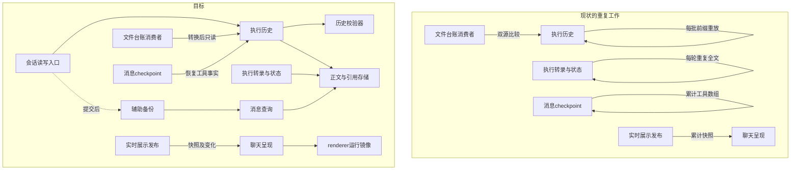

# 会话存储全链路性能改进方案

> 状态：**整体替换方案评审草稿，未实施**；2026-10-30。撤回前版“近期修复四阶段＋架构目标另案”的交付结构。
> 代码事实基线：`58d28d76fc39d258e17c6ced726de03a434afdf6`；本轮工作区HEAD `70b845c0`，中间仅本专题文档变化；用户安全代码修改不纳入。
> 授权：设计与取证，不实施代码、迁移、删除或发布。SQLite路线依据见[路线对比](./会话权威存储路线对比.md)。本文是完整目标的提案，新格式和IPC仍须评审批准。
> 证据边界：Mac源码与前版隔离实验；无Windows故障profile、真实库和安装包实测。方案有效性与实现验收分别记账。

### 本轮核销【人机共读】

| 上轮问题 | 本轮模型变化 | 关闭依据／限制 |
| --- | --- | --- |
| 阶段完成却不实现整体目标 | 删除近期／未来双轨，正文共享、文件退役、恢复／展示分工全部进入主体及最终出口 | §2～3；不能靠局部验收关闭全案 |
| 不说明旧保护为何能退出 | 按风险保留审批／租约／完整性；将重复归约替换为事务状态，双源验证移至一次转换 | §1.4、INV-01～07；不依赖“SQLite天然正确” |
| 改善只有口号 | 为每个热点规定工作量变化，必要全文处理也进入线程与阻塞预算 | §1.5、AC-01～16；速度与Windows结论仍待实施测量 |
| 终局留待后续详设 | 定义正文表／引用、上下文编码、文件完成列、恢复合并及展示v2；定义统一回退算法 | D-2～6、§2.3～2.9、§3.1；夹具和回退程序待实现，不是格式待另定 |

## 第0层：目标与取舍【人必读】

**从反复复制、重建和互相比较多份会话材料，改为数据库提交事实与必要状态、共享不变正文、按需读取、单向生成展示和文件。**

交付目标同时包含架构与性能：正常执行不由辅助文件裁决；新增执行记录不重读已完成历史；上下文版本不反复写入相同正文；工具更新不反复保存其他工具结果或发送累计展示项；新建、首屏、提交和密集工具调用满足同机预算。最后一项不过，整体方案不完成。

这不是把所有数据合成一份日志。执行轨迹、排队编辑、执行权、上下文版本有不同业务含义；要取消的是无必要的重复处理和重复裁决。模型请求读取实际上下文仍需支付正文成本，但不能因此让无关状态查询和界面更新一起扫描全文。

### D-1：数据库统一承担会话事实提交

背景：执行事实、上下文及队列／执行权已在数据库，旧文件仍有兼容消费者。需确定长期归属。

- A：保留数据库，文件降为输出，旧文件事实先转换；利用既有查询与事务，需完成消费者切换。
- B：迁到逐行日志承担会话权威；便于顺序记录与外部检查，但要重新设计队列、执行权和多事实提交。
- 推荐A；未批准维持现状。本提案不并行实施B。格式转换前可撤回，删除后依赖回退包，不能无损直接打开旧包。
- 依据：实际消费者已核实；没有同耐久条件的两介质速度排名，不以介质名保证性能。
- 下钻：INV-01～07、AC-01～16。

### D-2：保存执行校验的当前状态

背景：每次新增都从全部旧记录推导待处理工具和审批，重复成本增长。

- A：与新增记录一起保存精简状态，校验规则不变；新增两个字段，旧执行首次准备要重放一次。
- B：保留全量重放，少一次格式变更，但密集追加问题保持。
- 推荐A，待批；未批准不实施。可通过配套回退包恢复旧格式，升级后的记录必须保留。
- 依据：重复读取已核实；等价性需新旧差分、回滚及随机序列测试，不能只靠示例。
- 下钻：§2.3、INV-01／02、AC-01／02／09。

### D-3：普通桌面操作在数据库提交后返回成功

背景：保存后等待辅助全量导出会延长回执，数据库成功和文件失败还可能混淆。

- A：成功代表数据库已提交，文件稍后更新；显式导出和退出仍等待完成。
- B：继续等文件，保留原完成时点，交互受导出影响。
- 推荐A，待批；未批准不改完成语义。可恢复等待，不改备份文件格式；外部消费对即时文件的依赖须核对。
- 依据：等待链已核实，无外部消费普查；不引入乐观展示，数据库回执仍是屏障。
- 下钻：§2.7、AC-04／07。

### D-4：上下文版本共享不变正文

背景：多轮上下文保存相同的大正文，造成重复编码、写入和校验。

- A：保留各次上下文的顺序与版本，让它们引用同一会话内的不变正文；新增两张内部表和一版存储编码，读取和回收需同步调整，用户看到的内容不变。
- B：继续完整副本，仅调度到后台；格式更简单，但重复存储与写入增长仍在。
- 推荐A，待批；未批准本案不宣称整体目标完成。回退包须展开引用，保留升级后内容；空间不足时停止回退，不能删新数据换取可启动。
- 依据：重复快照和版本消费者已核实；收益及迁移正确性需规模与恢复测试。共享仅限完全相同的消息，不合并含义不同的版本。
- 下钻：§2.8、INV-06、AC-13／15。

### D-5：恢复保存必要进度，展示发送实际变化

背景：工具checkpoint重复保存累计结果，展示反复传累计文本、工具摘要与活动项；工具越多单次更新越重。展示并非传送全部工具结果。

- A：工具事实由执行记录恢复，尚未提交的文本等必要进度继续检查点保存；展示改为首次完整、随后更新变化部分，丢失后重新取当前展示。新增内部展示协议版本，用户交互语义不变。
- B：保留累计快照，减少部分重复编码；改动小，但不能消除累计大结果反复传送。
- 推荐A，待批；未批准不能将此问题记为解决。展示协议可随整包回退；持久化恢复材料须由回退包重建，不能只退界面。
- 依据：现有checkpoint和展示链已核实；必须验证工具效果已发生而记录尚未提交等崩溃窗口，不减少关键持久化时点。
- 下钻：§2.5／2.9、INV-02／07、AC-08／14／15。

### D-6：完成旧文件事实归并后退出正常双源读取

背景：旧文件可能独占压缩或用量材料，直接去掉读取会改变模型输入；永远双读又把迁移成本留在正常执行。

- A：复用既有专项的转换与已批准缺失处理，归并后记录完成；正常执行只读数据库，未完成数据保留显式兼容入口。新增一个内部完成字段。
- B：保持现有比较与回退，无新完成字段，但双源协议长期保留。
- 推荐A，新增字段及本分支接入待批；不重开专项已批准的有损处理决策。未批准不能停读或删文件。回退先重新导出升级后的事实，不能依赖陈旧旧文件。
- 依据：本分支有旧消费者，专项在另一工作树有实现记录，需核实移植范围。完成标记不靠每次比较文件自证。
- 下钻：§2.6、INV-03／04、AC-06／16。

### 待批范围、外验与三处弱点

待批为上述六项组合：权威边界、两个推进字段、一个文件转换字段、两张正文／引用表、一版上下文存储编码、展示v2及普通桌面完成时点。没有新界面、开关、用户错误码或外部IM行为；已有恢复提示沿原批准语义。文档继续不代表批准实施格式或产品行为。

Mac及隔离测试验证算法、故障和规模；Windows原故障、安装包、真实库与真实IM属于外验。可分别交付证据，原故障未经外验不能标修复；不因此降低整体设计的完成范围。

最弱三处：①当前状态是否足够表达全部旧规则，差分失败就修正状态模型；②共享正文后的引用与GC是否增加了错误删除风险，故障测试失败则不能切换；③必要正文传输、SQLite写入或结构化复制是否仍长时间占主线程，超预算必须在本方案内调整布局／执行线程并重新评审，不能以“后续优化”完成收尾。

## 第1层：整体评审包【人机共读】

### 1.1 目标链路与替换关系



主进程现有存储入口仍是唯一writer，统一走runInTransaction；正文引用、事件、推进状态和终态提交同事务。正文准备在事务外，最终核验版本和租约。展示不回写执行事实；文件归并完成后不再裁决新执行。引用表只服务定位和GC，不与正文另起一套业务资格证明。

### 1.2 变更面与量级

| 单元 | 作用简述 | 类型 | 范围与依赖方 |
| --- | --- | --- | --- |
| 历史校验器 | 校验工具审批生命周期 | 改对外契约 | SDK history及导出，MemoryHistory／SQLite；D-2 |
| 执行历史 | 原子追加执行事实 | 改对外契约 | agentHistoryStorage、sqliteAgentHistory及schema；D-2／4 |
| 执行转录与状态 | 保存上下文版本和状态 | 改承重边界 | sessionTranscript、execution及交接／人工复核；D-4 |
| 会话读写入口 | 接纳作用域内操作 | 改对外契约 | sessionIpc、agentProtocolIpc、ipcShared；D-3 |
| 消息查询 | 提供局部正文与摘要 | 改承重边界 | operations、queries、prepared Worker；D-1／4 |
| 文件台账消费者 | 转换旧事实并读数据库 | 改对外契约 | sqliteSessionStorage、ledger、retention；完成列，D-6 |
| 消息checkpoint | 保存尚未提交的必要进度 | 改承重边界 | coordinator、acceptedAssistantCheckpoint、恢复宿主；D-5 |
| 辅助备份 | 生成可重建文件 | 改造 | sessionBackupManager与shutdown；D-3 |
| 聊天呈现 | 加载并消费实时变化 | 改对外契约 | ChatView、gateway、turnDisplayStore、preload／api；D-5 |
| renderer运行镜像 | 路由活跃消息更新 | 改造 | chatRunnerService；D-1／5 |
| 实时展示发布 | 发布当前展示与变化 | 改对外契约 | TurnDisplay共享协议及publisher；D-5 |
| 回归与规模夹具 | 验证恢复和工作量 | 改造 | 现有SDK／storage／renderer测试扩展；D-1～6 |
| 页定位与构建预算 | 限制局部构建负载 | 复用不改（待验证） | 已有locator、prepared Worker、单槽与队列上限 |
| 安全与执行租约 | 约束授权及执行所有权 | 复用不改（待验证） | policy、final-check、claim、unknown效果规则 |
| 引用与回收 | 保护权威正文生命周期 | 改承重边界 | spillReferenceIndex／GC，接入正文owner；D-4 |
| 正文与引用存储 | 共享不可变消息正文 | 新建 | 同一SQLite内两表及codec，不新增服务／Worker；D-4 |

共16逻辑单元：改既有13、新建1、复用2；改对外契约6、改承重边界4、内部改造3。新增表2、SQL列13（正文5＋引用5＋stream2＋转换1）；既有spill表约束重建3；新内部上下文编码1、展示协议版本1、推进状态编码1、schema升级1。新用户错误码／开关／诊断事件均0。五阶段，最终出口覆盖全部16项AC。

超过拆分门槛仍采用一份总体规格：共享正文、恢复合并和兼容退役改变同一批事实的owner，分开定义容易重复复制或先删引用；在五个可独立验证出口实施，但不另立互相矛盾的格式真源。专项台账协议复用、不重复开发。阶段出口是替换完成边界，不是允许部分目标永久悬置。

### 1.3 契约六面

| 面 | 变化 | 兼容与验证 |
| --- | --- | --- |
| agent-sdk | 增加纯归约导出；HistoryPort及事件业务词汇不变，持久化引用只在宿主codec内出现 | check:agent-sdk、typecheck:agent-sdk；旧事件／MemoryHistory及差分，宿主先水合再交SDK |
| 会话存储 | 两新表、三新列，history／transcript物理正文可用引用；唯一writer与事务不变 | 三项存储边界门禁；双格式读取、恢复／GC、旧库和统一回退演练 |
| IPC／preload | 展示内部v2：快照／变化／重取；普通桌面回执D-3变化 | api／preload／renderer同包升级；丢包、重连、重复、乱序及旧回执测试 |
| 共享类型 | 增加展示v2联合类型；产品Message语义不变，引用编码不泄漏renderer | typecheck:shared／renderer；不向UI泄漏存储字段 |
| 其他持久化格式 | 内部manifest v1、推进v1、canonical_read_version；schema117→118 | §3.1统一R包，必须覆盖升级后新写；实施前重新确认版本占位 |
| 领域数据格式 | 不新增规则、配置和用户错误码；沿既有故障通路 | 旧错误断言、日志脱敏；实现若需新稳定错误需回到决策层 |

现有门禁结果见附录B，仅是基线；拟议实现后必须重跑，不证明新语义。

### 1.4 为什么原保护可以精简

旧保护并非都多余：审批状态依赖历史、双源保护迁移数据、租约防旧writer、spill校验保护库外材料。新方案按风险替换，不能笼统删校验。

| 保护 | 最终承担机制 | 能退出／不能退出 |
| --- | --- | --- |
| 历史合法性 | 旧规则的充分状态与事件同事务归约 | 退出每批前缀重放；不退出审批绑定、终态和unknown retry规则 |
| 并发／幂等／未知效果 | 原租约代次、receipt、身份及恢复 | 原样保留；数据库不能回滚外部工具效果 |
| 文件独占事实 | 一次性归并、完成列、显式旧数据入口 | 完成后退出正常双读；未完成不假装覆盖，损坏按既有批准恢复 |
| 上下文稳定与完整性 | 不可变正文＋有序manifest＋事务引用 | 退出相同正文重复副本；不退出版本、输入摘要、spill完整性和GC保护 |
| 运行恢复 | 已提交工具事实＋必要未提交进度 | 退出累计工具结果重复checkpoint；不能以无结果推断工具未执行 |
| UI同步 | 有序变化、缺口重取当前展示 | 退出重复传全部结果；UI仍不能授权执行／恢复 |

增量等价性需证明：从历史H得到状态S，从S校验新增B，与从H全量校验B有相同结论和下一状态；新流空状态、旧流一次准备、每次同事务保持，由归纳得到后续合法性。共享正文等价性则通过按manifest还原相同顺序和消息字节证明；双源退出通过归并覆盖与完成发布证明。这些是三种不同证明，不互相替代。任意手工篡改库后的全历史审计属于恢复边界，不以热路径反复自证覆盖。

### 1.5 性能因果链与验收

| 原热点 | 替换后的工作量 | 仍须测量 |
| --- | --- | --- |
| 小批追加反复读前缀，累计近O(E²) | 固定pending和批次时累计校验近O(E)，只推进状态 | pending增长、SQLite索引／事务／spill |
| 状态／预览读取全部M字节 | 状态正文0，预览只候选m字节 | 冷定位、版本竞争、候选很大 |
| 每轮上下文重复写M字节 | 只新增独有正文；manifest仍O(消息数) | 归一编码仍可能扫描M，放入既有Worker并计传输；不冒充O(新增字节)CPU |
| 累计工具结果重复checkpoint／IPC | 只提交新事实和必要进度；展示仅变化工具／文本 | 文本本身增长、重连完整快照、结构化复制 |
| 旧文件长期双源比较 | 已转换会话正常文件访问0 | 一次转换量及未转换集合 |
| 首屏clone／summary／导出争用 | live仅活跃差量；summary与正文准备共享Worker预算；导出脱离普通回执 | Worker投递与DB最终提交仍在主线程，必要全文也必须满足阻塞预算 |

新建INSERT本身局部，改善还来自减少其前面的同步排队；不能据此断定Windows满核全由本模块造成。验收先证明行／字节工作量下降，再证明同机p50／p95／max和连续阻塞达标。必要完整读取、冷转换、重连快照都纳入测试；超预算由本案继续解决，不留下“整体已完成、核心成本以后处理”的出口。

## 第2层：最终模型与规格【机｜人工可跳过】

### 2.1 不变量与所有权

| ID | 不变量 | 验收 |
| --- | --- | --- |
| INV-01 | 事件、version和推进状态同事务，重复不再推进，回滚不领先 | AC-01／02／09 |
| INV-02 | 授权、租约、幂等、unknown效果规则不弱化；未知提交先恢复再重试 | AC-02／06／09／14 |
| INV-03 | 控制读不水合全文，局部读不重建全会话，转换完成普通执行无文件裁决 | AC-03／05／10／16 |
| INV-04 | 派生失败不撤销事实，正常回执与显式导出完成分开 | AC-04／07／11／16 |
| INV-05 | 性能同时核对工作量、必要字节和主线程阻塞，冷路径不隐去 | AC-01／03／08／12／13 |
| INV-06 | 引用精确重建旧版本；正文、owner及提交原子可见；引用存活时不可GC | AC-06／09／13／15 |
| INV-07 | 展示可重建且不裁决执行，恢复不依赖展示传输；工具结果不会因删checkpoint副本丢失 | AC-08／11／14／15 |

| 材料 | 唯一writer／提交点 | 保留职责／退出职责 |
| --- | --- | --- |
| History事件与stream状态 | 既有append helper／事务 | 执行事实及合法性；退出每批全重放 |
| accepted context、queue／claim／receipt | 现有接纳／领取／终态事务 | 冻结配置、FIFO、执行权和提交身份；不强行合并成事件 |
| transcript checkpoint／entries | 现有转录提交及人工复核／事务 | 状态、版本和有序正文引用；退出重复完整正文 |
| 正文／引用两表 | 宿主存储codec／上述同一事务 | 不变消息内容及GC owner；不另建事实裁决 |
| messages／turn checkpoint | 现有消息和coordinator入口 | 排队编辑、状态、尚未提交文本；工具事实从History恢复 |
| locator／prepared页及summary | 既有构建器／source revision发布 | 可重建查询结果，不写执行事实 |
| 文件及outbox | 既有专项writer／归并事务及导出边界 | 兼容输入或派生输出，完成后退出正常执行判定 |
| TurnDisplay／renderer live | 主进程publisher／renderer路由 | 当前展示与活跃更新，不保存另一份完整会话历史 |

### 2.2 最终退出清单

最终出口必须同时满足：热追加全前缀读取退出；状态读全文退出；preview整会话重建退出；live历史seed退出；新上下文重复正文写入退出；累计工具结果checkpoint退出；每次展示累计工具快照退出；已转换会话正常双源比较退出；普通回执等待辅助导出按D-3退出。保留小manifest、必要未提交进度、完整重连快照及显式恢复重放，它们有独立消费职责。

旧pending-view表不复活，七proof字段本来已退役不计本轮收益。正文共享不等于删除上下文历史版本；引用和业务版本分别保留。删除旧字段／文件只能发生在消费者迁移及回退演练之后。

### 2.3 增量追加：用事务状态替代缓存协调

**持久化提案（D-2）：** 在`agent_history_streams`增加`transition_state_version INTEGER NULL`、`transition_state_json TEXT NULL`。版本表示归约编码，不是事件schema；新建流首次追加即写v1，旧流两列均NULL表示未补齐。新表0。stream.version仍是唯一事件序列提交版本，不另增第二个水位。

JSON v1固定8个成员：`invocationId`、`turnId`、`terminalKind`（null或已有终态kind）、`pendingToolCalls`（唯一字符串数组）、`pendingApprovals`（唯一字符串数组）、`approvalIdentityByPendingId`（字符串二元组数组）、`deferredTodoIds`（唯一字符串数组）、`unconsumedRetryApprovals`（approvalEventId到toolName／inputHash的二元组数组）。排序用于确定编码，解码后须按唯一规范编码重编码并与原串相等，以拒绝重复键及非规范值；另检查非法身份和集合重复项。没有正文、权限决定或载荷副本。

unknown retry消费后移除unconsumed项；再次消费因不存在被拒绝，与现有missing-or-consumed拒绝含义一致。approvalEventId是已持久化事件身份，不能靠换payload重用；同批批准／消费／tool-start按顺序处理。`pendingUnknownRetryStart`只存在当前批次局部，批末必须为空；不落盘“消费了一半”的状态。已关闭stream保存terminalKind以拒绝再次追加。状态规模依赖未完成事项，deferred引用仍有生命周期成本，不声称O(1)。

历史校验器在现有文件导出两个纯函数：`createHistoryTransitionState(previous: readonly HistoryEvent[]): HistoryTransitionState`和`advanceHistoryTransitionState(state: HistoryTransitionState, incoming: readonly HistoryEvent[]): HistoryTransitionState`。前者从空状态校验归约完整前缀，后者不得修改输入状态、失败不返回部分状态；`HistoryTransitionState`就是上述v1的只读内存形状。旧`validateHistoryTransition`保留签名并委托同一规则，MemoryHistory依然可作全量参照。不会新增SDK→宿主依赖，不复制两套审批规则。先以旧validator做差分，确认旧合法事件及非法批次结论相同，再替换旧实现；不为提速改拒绝条件。

一次普通追加，在原事务内按顺序执行：

1. 保持批次格式、canonical JSON、process generation、session归属、幂等身份与expectedVersion检查。精确重复沿既有分支返回，不推进状态；冲突仍拒绝。
2. version=0的新流从空状态推进。已有流必须有可解析v1状态且身份匹配；缺失／不支持／损坏时不追加、不执行工具，调用既有错误通路进入显式准备／修复。不能在普通追加中悄悄回退全量读取。
3. 只读取当前状态并校验incoming；检查sequence、批末unknown retry及terminal顺序。写事件／引用／projection义务，更新stream.version与两个字段，仍在同一事务。
4. 若还有terminal transcript intent，保留现有租约、baseVersion、receipt和message mirror同事务提交。最外层COMMIT后才返回成功；SAVEPOINT释放不是持久成功。

不增加内存权威状态，因此不需要事务提交回调、WeakSet凭据或cache revision协议。外层回滚同时回滚新状态；COMMIT unknown按现有不确定路径恢复，不假定提交失败。存储读回状态的解析／编码成本为O(未完成状态)，历史校验成本不再依赖已完成正文；这比声称全流程线性更准确。

**显式旧流准备／修复：** SDK恢复／续跑准备阶段按invocation读一次完整前缀，验证事件与归属、生成v1状态；短事务重核stream.version及session generation再写入两列。漂移则丢弃结果重试，最多2次后返回既有准备失败，不能无限争用。损坏历史不补齐。新的accepted input和continuation version=0直达helper无需旧流准备；已有流全部生产写者必须先调用同一准备入口。前台普通追加不触发整库扫描；修复完同一版本不再重放。

代码内删除session时一并删除stream状态；未来改写旧事件语义的迁移必须重建受影响流状态。禁止外部修改DB后继续信任旧状态；损坏库按恢复／审计路径处理，不以每次读全文自证覆盖任意篡改。


### 2.4 控制信息、上下文与局部读取

- 在既有sessionTranscript模块增加`readSessionTranscriptState(db, sessionId)`，返回`{sessionId, version, status, lastTurnId?}`，只SELECT checkpoint的version／status／last_turn_id，缺行保持version=0／ready语义。acceptPrepared、readTranscriptState及只查状态的恢复分支消费它。保留readSessionTranscript给真实正文消费者，不能改成返回空messages。
- hosted交接获得claim后读取确定的已提交版本；遇到版本漂移仍按既有baseVersion／claim规则处理。不改变trackScopedModelInput、system消息、required user及失败settlement上下文。一次准备材料的stringify／hash复用，不能跨版本缓存未经核验正文，也不删除spill读回完整性。
- preview：事务外选择排序／删除后的候选身份并按现有prepared单条读机制取正文，事务内重新应用队列检查、选择候选并比对id／role／timestamp／message revision和session source revision。完全一致才写preview；不一致不提交本次队列变更，重做准备，最多2次后既有queue_changed返回。scope和canonical-backed校验沿用既有规则，不把空preview当读失败成功。
- 页、单条、搜索、重试目标、API baseline、导出复用现有locator／prepared body与最终源复核，不能只优化page IPC。legacy_required保持明确旧reader，不能装作canonical已经就绪。session:list按现有profile语义下推过滤；读取不再顺便strip／flush，旧元数据清理放到既有维护入口，不新建维护队列。
- summary baseline保持现有完整语义，改为在既有prepared构建Worker中计算，按source revision发布结果；冷构建与页构建共享既有预算，不允许主进程同步回退全量扫描。构建完成前独立等待，不阻塞无依赖submit；过期结果丢弃。markers仍是独立effect。Worker投递、读取与结果发布各自计入AC-12，不能只移动函数名。


### 2.5 运行恢复、checkpoint与桌面路径

renderer live以消息id保存活跃差量，不从Redux seed／clone已加载历史。routeAdd／patch／remove及overlay保留；不在live中的消息沿既有store路径更新。无生产调用的resolveSessionMessagesForApi／getLiveMessages历史merge出口删除；主进程模型输入不改用renderer数据。

page dispatch后允许下一绘制；markers、summary、失败原因独立调度并校验session代次。submit仅等待真正依赖的sequence与准备，不等待无关辅助结果。gateway仍在DB确认后dispatch，分别测IPC排队、事务、reply与绘制；通用commitMessagePatch无生产调用，不当作全部submit入口。

checkpoint的最终分工：

| 字段／进度 | 正常持久化来源 | 恢复方法 |
| --- | --- | --- |
| 工具身份、输入、审批、start、result、失败结论 | 原History相应事件，保留现有提交时点 | 显式恢复一次读取当前invocation并按身份归约；不从展示数组决定是否已执行 |
| 未入History的流式content／thinking及段顺序 | 原messages checkpoint，只写变化字段，普通2秒窗口不扩大 | 与已有committed response按稳定段身份合并，已提交范围优先，不重复追加 |
| 工具实时progress、临时preview | 仅当前运行展示；不作为执行恢复材料 | 重启显示最后可靠执行事实；如果某字段确被恢复逻辑消费，先迁移该消费或保留必要单字段，不能笼统删除 |
| 确认、reconcile、终态与usage | 原owner和关键事件持久化 | 保留即时提交、acceptedAssistantCheckpoint过滤、租约和终态屏障 |

不再通过每次checkpoint序列化整个toolCalls数组保存可靠结果；新工具结果必须先沿现有结果持久化边界提交，才允许释放其恢复副本。结果提交失败时不发布“可靠完成”，仍走现有失败／unknown；外部效果已发生而结果未落库，重启保持unknown，不能从空数组推导未执行。旧工具数组仅用于旧数据显式恢复：与History按toolCallId合并，冲突不能授权成功，沿现有恢复故障语义处理。迁移不清空尚无可靠事实的旧材料。

首次切换前用崩溃窗口逐字段证明：批准前、批准后未start、效果后未result、result提交后未checkpoint、terminal提交后未reply。确认没有独占信息才能停写累计数组。启动恢复、失败续跑、IM／butler及人工复核共用该分工，不只改桌面写端。

### 2.6 旧事实归并及文件退出

承接[台账拒绝服务清理专项](./会话台账拒绝服务清理-最小执行计划.md)的已批准事实分类、压缩缺失处理、outbox重建及回退；不得重建平行迁移框架。专项另一工作树“源码完成”不是本分支覆盖证明，先按实际调用者移植／核验。

在既有session_ledger_projection_state增加`canonical_read_version INTEGER NULL`：NULL表示该location尚未整体归并；1表示压缩、meter及该location全部实际执行消费者依赖的文件事实均已归并或按既有批准恢复结案。只支持1，未来值拒绝；不以ready或文件为空推断完成。原session generation／workDir identity继续绑定位置，不再新增一个身份系统。

算法：

1. 新location在第一次原子初始化中写1，之后所有新压缩／meter先写canonical，文件为派生。旧location保持NULL，通过显式会话准备进入转换；列表／页面查询不隐式触发转换。
2. 转换复用原location生命周期锁，停止该location旧文件事实writer，取得稳定文件输入及canonical版本。按专项身份合并，区分无历史、缺失、未知、冲突；不能把部分回填视为已完成。
3. 压缩沿既有canonical事件及v2 backfill snapshot存放，meter沿既有request／usage事实存放，不新建第二事实表。已有义务按专项source-missing／健康集合分流，缺源不静默ack；未覆盖类型仍保留载荷。
4. 全部消费者的结果已能从DB生成后，短事务核验session generation、source revision及location归属，提交最后的归并事实和完成列1。此前分批提交允许存在，但不提前置1；转换中断按稳定身份幂等续做。最终版本漂移最多重试2次，再走现有准备失败。
5. 完成后正常读取只查询完成列和canonical，不读文件、不调用双源比较。文件后来损坏不撤销完成；数据库缺源是权威损坏／修复问题，不能偷偷回到陈旧文件裁决。NULL仅在显式准备／恢复入口兼容，普通执行须先完成准备。

完成列证明的是一次转换结束，不是每次运行的新鲜度证明；后续新事实的唯一writer与事务规则维持覆盖。旧进程不得继续写旧格式，升级需排空并保持原process generation fencing；无法排除并存旧writer时不能切换。

文件停写与物理删除仍遵守专项AC-S9、载荷依赖与R包；这是本案最终阶段的联合条件，不是另案延期。保守保留无消费者的历史文件不妨碍执行路径退出；若仍有实际消费者，则最终阶段失败。retention改查DB依赖，不能因文件不再读就误删仍被上下文引用的大正文。

### 2.7 辅助导出与关闭

D-3=A时普通桌面操作DB commit后scheduleBackup并返回；后台失败保留旧有效副本、独立记录并用既有调度重试，不将已提交成功改判失败。显式导出及shutdown排空后关库。复用3秒防抖、单会话operationChains；不建第二重试队列。

导出逐页读取逻辑正文，文件格式保持原样，引用不泄漏文件消费者。JSON编码复用既有prepared Worker与预算；主进程只做有界页发布，单条超大正文也计入预算。session.json与messages.json依旧不声称原子对。D-3=B保留等待语义，但本案整体成功还需实际端到端预算通过，不能借该选择隐去等待成本。

### 2.8 不可变正文与上下文manifest v1

**物理提案：** 同一数据库新建两表；不新建独立存储服务，不改变SDK逻辑消息类型。

| 表 | 列与约束 | 用途 |
| --- | --- | --- |
| session_context_bodies | session_id TEXT、body_id TEXT、payload_json TEXT、byte_length INTEGER、created_at INTEGER；主键(session_id,body_id)，session删除级联 | 一条完整逻辑TranscriptMessage的原JSON字节，body_id为其UTF-8 SHA-256；payload_json可为现有通用spill描述，byte_length为水合后字节 |
| session_context_body_refs | owner_kind TEXT、owner_key TEXT、session_id TEXT、ordinal INTEGER、body_id TEXT；主键(owner_kind,owner_key,ordinal)，(session_id,body_id)外键指向bodies，索引(session_id,body_id) | owner到消息正文的有序引用及GC反向索引；ordinal从0连续 |

owner_kind封闭为`history-event`和`transcript-version`；owner_key分别为既有全局event_id及现有session＋version的无歧义键。读取仍核验session，不允许凭body hash跨会话访问。正文只插入、不原地改写；编辑或新摘要产生新body_id。相同字节只在同会话共享，不做全局去重或字段级拆分。

所有新表列均NOT NULL，byte_length非负、ordinal非负、body_id为64位小写hex；body refs对session外键级联、对body外键RESTRICT。transcript owner_key固定为JSON.stringify([sessionId,version])，history owner_key固定为event_id；owner删除由对应事务显式清理refs，不依赖对多表owner的伪外键。无session归属的SDK独立／旧stream不使用共享正文编码，仍保留逻辑旧表示；不能把NULL session变成可跨会话共享空间。

已有entries.messages_json和宿主持久化History payload的messages位置可编码为：

```json
{"__spaceassistant_context_manifest_v1":{"bodyIds":["<sha256>"],"byteLength":123,"sha256":"<logical-array-sha256>"}}
```

外层仅此一个标记，bodyIds有序可重复；byteLength和sha256对应逻辑数组原字节`[`＋各消息原JSON以逗号连接＋`]`。空数组单独编码，版本通过marker确定，未知标记拒绝。写时保留每条消息JSON的键序和数值编码，不canonicalize改变旧payload hash。owner refs与manifest必须同事务生成，数量／顺序一致；refs服务GC和按序定位，不能在正常读取中再做一套全历史证明。

适用范围限定：transcript entries的整个messages数组；`invocation-context-committed`及`transcript-compacted` payload.messages。其他payload字段不改；model-response及工具事件按原事实存储。初始context和terminal相同消息通过body_id共享。旧inline数组、旧整转录spill与新manifest均可读，读新manifest时定位body并按需水合，完整上下文消费者重建完整数组；SDK、mirror、canonical查询、backfill、meter／压缩和导出只接收逻辑原形。新标记不冒充现有spill标记，也不绕过strict parser。宿主所有读取入口必须在fromRow／validateHistoryBatch等逻辑结构校验之前解码manifest，不能只在readSync末尾水合；canonical fold、backfill和只读Worker同样接入。无宿主codec的SDK独立宿主仍只处理逻辑事件。

**准备与提交：** 在既有prepared Worker完成消息编码、哈希及可复用manifest准备，传回小引用和新增正文存储材料。spill使用现有协议及fence准备，成功后生成材料；原允许inline降级保持，但不得在主线程回退为整会话同步编码。准备可以O(M)，manifest可O(消息数)，不承诺整个转录提交O(新增字节)。已有body查询批量按hash查存在性，不重新读哈希全部旧body；仅写新body。处理器在短事务核验源版本／session generation／lease后插入body与refs、事件／entry及receipt。前台热路径禁止逐条RPC式存在性查询。现有mirrorCanonicalContextMessages也改消费本次prepared材料：与确定baseVersion的旧有序bodyIds比较，未变消息只核必要身份／状态，不重新展开大正文；真正新增／编辑消息、required user及终态镜像仍沿原身份检查。不能新写已去重，mirror却又同步遍历并编码整份旧正文。若旧base为inline，第一次显式准备生成同等比较材料，随后不得热路径回退。

幂等比较以逻辑内容为准，不能比较旧inline串与新manifest物理串。receipt沿原outcome＋逻辑messagesJson哈希算法；Worker生成的哈希材料与实际提交manifest绑定，由宿主编码器生成，不允许renderer传入自证hash。相同turn不同内容仍拒绝。event duplicate检查也须在宿主逻辑归一后比较，保持原事件身份和业务内容；不重写旧receipt。

完整上下文读取仍验证实际使用body的大小／哈希和spill完整性。一次准备的已验证材料可复用至同一提交，版本或文件fence变化后失效；不能用长期对象身份缓存替代内容完整性。页／单条只读需要的body，不为了验证manifest总摘要水合全部正文；整体摘要由完整上下文／恢复读取校验，单条以其body_id保护。

**回收：** body的spill owner由现有spill引用索引新增`session_context_bodies`种类维护，owner_key=JSON.stringify([sessionId,bodyId])、owner_revision=bodyId（正文不可变，不增revision列），不能让每个manifest重复持有同一spill。三张既有表spill_reference_index／staging／backfill_state的owner_table CHECK扩入该种类，保持原列和主键；通过现有runInTransaction重建表／索引并逐行保留旧数据，新body backfill行初始化pending。新增body的插入／删除接入现有canonical_change_generation触发规则，引用维护与GC的代次校验覆盖此owner，不能只扩TypeScript联合而漏掉SQL约束。先删owner refs，再GC无任何refs的body，删除body及其spill owner同事务；实际文件沿既有GC fence删除。会话删除、历史删流、entry清理、人工复核和迁移均更新refs。引用构建未完成时不清理旧owner；损坏／未知manifest使GC停止受影响集合，不当作零引用。保留上下文版本不形成增量链，读任一版本不递归追溯其他版本。

### 2.9 展示v2及恢复合并

保留原chat:turn-display通道，内部类型改为封闭联合：

- `snapshot`：protocolVersion=2、sessionId、turnId、epoch、revision、display；display与现有完整语义相同。
- `patch`：同样身份、epoch、baseRevision、revision，以及changes。revision为publisher展示序号，逐次加1，baseRevision必须等于上次已接收版本；既有display.version仍表示原turn版本，两者不混用，publisher在一次合并后只推进一次展示序号。
- changes封闭为文本append／replace（content或thinking及既有段身份）、tool-upsert／remove（toolCallId及该工具新展示）、activity-upsert／remove、turn-fields（既有lifecycle／outcome、requestId、消息skillHints／systemOperations及段范围等展示字段的replace；usage仍走原独立通道）。不开放任意JSON路径patch，不把正文存储引用发给renderer。

首次订阅／重连发snapshot；复用现有`chatGetTurnDisplays`／`chat:get-turn-displays`，请求固定为`{known: Array<{turnId, epoch, revision}>, sessionId?, forceTurnIds?: string[]}`，返回changed为v2 snapshot数组；sessionId继续按原scope处理。gap／epoch不匹配时加入forceTurnIds，对仍保留的活跃／终态无条件返回snapshot，不能沿原version过滤漏掉已提交终态；其他turn仍按已知版本过滤。会话已无活跃或保留终态时，结束重取并转现有分页查询，不无限重试。不新增通道或独立重取服务，不扫全会话历史。正常patch只带变化工具摘要。

renderer只应用同session／turn且当前epoch的连续patch；重复或更旧revision忽略，gap／未知epoch／非法操作停止应用并重取snapshot。重取期间合并为一次请求，迟到旧snapshot不能覆盖新epoch／revision；snapshot后仍有缺口再取，不无限堆积patch。新epoch仅由主进程重建publisher产生，必须先snapshot；会话切换按当前代次丢弃旧响应。终态不丢弃最后pending，先flush再发布终态变化；现有50ms合并与rAF复用。

publisher在状态变化处记录具体变更，不每次遍历、stringify全turn求diff；同工具多次更新只合并该工具最新状态，文本append合并，replace覆盖此前该字段append。snapshot仅在首次、重取、重建时构造；极大单工具替换仍按实际字节计量，摘要生成必须有界，不先全stringify再截断。修复相同长度内容缓存误命中、缓存字节计数及全局无效订阅；只通知变化turn。

进程重启展示从§2.5的执行事实和必要checkpoint重建，renderer状态不倒灌授权；数据库恢复不能依赖patch送达。旧renderer不兼容v2，不支持跨版本混用preload；整包升级／回退时关闭旧窗口并重开，不能半热更新协议。

### 2.10 绕过入口与故障窗口

| 入口／窗口 | 唯一处理方式 |
| --- | --- |
| accepted input／continuation直接helper追加 | 新流空状态及正文引用同事务，不能只改SqliteAgentHistory |
| MemoryHistory／SDK独立宿主 | 逻辑事件不变，同一归约规则；不读取宿主manifest |
| 转录人工复核／压缩／旧v2 backfill | 同一manifest encoder和owner refs；指定版本可恢复，不绕过GC |
| IM／butler／track | 共享底层新存储，授权与scope不变；不自动改变外部回执 |
| Worker准备后源变化 | 丢弃材料，最终版本检查失败，不提交陈旧正文或preview |
| spill完成后DB回滚 | 无owner文件沿原孤儿回收；不能因文件存在发布成功 |
| body已存在而引用事务回滚 | 不留新引用，既有owner不受影响；无refs新body可回收 |
| 外层事务回滚／COMMIT unknown | 前者状态／引用／事实同回滚，后者先查receipt，不重做工具 |
| 工具效果后、result前崩溃 | unknown及原审批恢复，禁止缺结果自动重试 |
| 转换中断／完成前崩溃 | NULL保留，稳定身份续做；不以部分事实或文件空判完成 |
| 转换提交后文件损坏 | 完成仍有效，正常执行只读DB，导出按派生失败处理 |
| DB正文缺失／spill损坏 | 权威损坏，保留材料并进入恢复；不伪装成可重建页miss |
| 取消／迟到checkpoint／patch gap | 既有租约与终态屏障；展示gap仅重取，不触发工具重跑 |
| 退出时导出／迁移仍有任务 | 排空或明确失败，不先关库；回退失败保持停机 |

## 第3节：完整迁移、阶段及验收【机｜人工可跳过】

### 3.1 升级与统一回退

统一schema提案117→118（实施前若占位冲突，须同步重编号）。在runInTransaction增加两表、两个stream字段、一个ledger转换字段及约束／索引；另在该事务重建三张spill引用表的owner CHECK及索引、接入新owner触发器，保留旧行；不在schema事务全库水合正文。兼容读取器先上线：旧inline／整数组spill／新manifest均可读。新写切换须等对应读者、GC、幂等比较和回退程序通过，不能仅加表即启用。

旧流首次准备补推进状态；旧上下文按session分批显式迁移，稳定快照中准备body与manifest，短事务核对源版本后替换物理编码与refs，逻辑内容、event ID、sequence、receipt及transcript version不变。断点使用每owner的实际编码：旧表示为未迁移，新manifest且refs完整为完成，不另建进度队列。失败保留原owner；同owner重试幂等。未转换owner保留其旧spill引用，不能全局切换GC后丢掉它们。

旧工具checkpoint在该turn所有可靠工具事实已覆盖后停写；旧未覆盖材料保留在显式恢复入口，直至转成可靠事实或按现有恢复规则结案。文件转换按§2.6完成后切读；新旧writer不能并存。迁移期间限制同session一个准备任务，复用既有前台／后台预算；暂停不影响已提交数据。

**统一回退实体R-Session-v1：** 必须作为本案交付物，与新代码一起构建并在隔离库演练；不是旧安装包，也不是升级前备份。

1. 停接纳与所有writer，排空任务，取得原生命周期／spill fence及数据库独占；确认schema与所有marker版本为本版支持值，未来版本拒绝。
2. 从新manifest按原消息字节展开旧inline或旧spill；重建旧history payload、transcript messages_json、必要toolCalls checkpoint和升级后文件事实。保持业务ID、逻辑摘要、版本、队列、claim与receipt，不重执行工具。恢复展示采用旧整包完整快照。
3. 逐owner事务替换并恢复旧spill引用，新refs在旧表示安全发布后才删除；不先DROP正文表。每步根据实际编码识别已回退，可重启续做，直到所有owner旧格式、无新表依赖。文件重建沿原幂等生成规则，不能覆盖最后有效文件后才发现缺源。
4. 确认新spill owner及staging／backfill行已清理后，最后一个schema事务恢复三张spill表原CHECK与索引、删除新增触发器和两新表及其索引、三个新增列，恢复117；重开117兼容运行逻辑并验证读／写／reopen。失败保持停机和可恢复材料，不手改版本号，不丢升级后新记录。

回退可能增加磁盘占用，演练须覆盖空间不足、坏spill、重建中断和最后DDL失败；预检只是估算，不代替逐步失败保护。正常前进迁移与回退均不改WAL／NORMAL及断电保证。此前两列增删空库实验仅证明部分DDL可行，不能作为本版两表＋编码／协议回退通过证据。

### 3.2 五阶段替换出口

| 阶段 | 替换对象与输入／输出 | 出口与回退 |
| --- | --- | --- |
| P0 固定整体契约 | 当前基线→16项AC夹具、全部owner／消费者及三个崩溃边界清单；完成新旧validator差分与manifest／展示codec规格测试 | 基线、预算、读者覆盖及R程序可演练；仅测试可撤回。未闭合规格不先排主体实施 |
| P1 统一正文与追加 | D-2／4批准→兼容读者、新表和状态；接入所有直接追加、转录／backfill／人工复核与GC；原重复前缀和新写全文副本退出 | AC-01／02／03／09／13／15；升级后新写经R回退保留，才启用新写 |
| P2 结束文件裁决 | D-6批准＋专项对齐→归并、完成列、消费者只读DB及outbox退役条件 | AC-06／16及专项联合证据；已转换集合文件访问0；回退用R重建升级后文件，不能退回旧文件依赖 |
| P3 统一恢复与展示 | D-5批准→工具恢复消费History、必要checkpoint、展示v2、live差量、局部查询／summary Worker | AC-05／08／10／11／14／15；崩溃矩阵和缺口重取通过；R重建旧checkpoint再整包回退 |
| P4 全链路关闭 | D-3分支确定→导出、最终旧消费者退役、全部规模／恢复／端到端验收 | AC-01～16全部通过；三项架构目标同时关闭，未通过不得改称局部优化完成全案；Windows原故障单列外验 |

阶段是设计出口，不是进度清单。允许P1与P2内部只读准备工作并行，但不能跳过共同引用／版本契约。只有必要且无消费者的旧文件可保留为非运行归档；存在实际双源裁决、重复大正文新写或累计工具重发，P4均不能通过。

### 3.3 验收定义

| ID | 可执行断言／场景 | 对应 |
| --- | --- | --- |
| AC-01 | 固定batch及pending，扩大已完成前缀；热追加历史行访问不随E增长，状态字节单列，旧流只在显式准备重放 | INV-01／05，F-01～03／22 |
| AC-02 | 新旧validator合法／非法批次差分；审批身份、terminal、defer、unknown retry原子性；随机操作序列断言状态与事件归约一致 | INV-01／02，D-2 |
| AC-03 | 状态读正文0；preview只候选正文，扩大无关历史不增访问；queue／source漂移不提交错误预览 | INV-03，F-04／18 |
| AC-04 | 阻塞／失败导出：D-3=A回执返回且DB重读一致，B仍等待；DB失败不成功；分段记录reply／dispatch／绘制 | INV-04／05，D-3 |
| AC-05 | page dispatch后绘制、markers、summary、live、submit sequence分段；无关阻塞不挡submit，summary不主线程扫全文，迟到结果不串会话 | INV-03／05，F-09／19 |
| AC-06 | 旧schema／spill／转录／legacy-only压缩和meter，失败续跑／人工复核／track／IM等价；unknown工具不自动重做 | INV-02／03／06，F-20／21 |
| AC-07 | 显式导出及shutdown等真实完成，失败保留旧副本，pending未排空不关库；编码和大单条符合阻塞预算 | INV-04／05，D-3 |
| AC-08 | 关键检查点时点保持；无变化字段不编码，可靠工具结果不随后续checkpoint重复编码；缓存同长度变更正确、字节统计不漂移 | INV-05／07，D-5 |
| AC-09 | 外层／嵌套回滚、COMMIT unknown、重复／冲突、准备版本漂移，不造成状态／引用领先；receipt逻辑内容兼容 | INV-01／02／06，D-2／4 |
| AC-10 | 新建局部写；列表profile等价且无清理flush；页／单条／搜索／API baseline冷热及兼容分别计量 | INV-03／05，F-10～12 |
| AC-11 | live无历史seed；后台会话与切换、add／patch／remove／overlay和abort原行为相同，历史量不放大live初始化 | INV-04／07，F-19／23 |
| AC-12 | §3.4全部规模与预算通过，报告p50／p95／max、主线程阻塞、行／字节；架构退出清单逐项核销，不能只交局部指标 | INV-03～07，D-1～6 |
| AC-13 | 相同消息多版本／多invocation共享body；仅新增独有正文写入；旧版本重建字节／顺序／摘要一致；编辑／压缩不改旧版本，单条不读无关body | INV-06，D-4 |
| AC-14 | 五崩溃窗口恢复工具状态不降级；展示duplicate／gap／乱序／epoch／重连／终态／切换正确，单工具变化不携带其他工具摘要与无关正文 | INV-02／07，D-5 |
| AC-15 | 旧库升级→三类新写→读／写／reopen→R回退→117读／写／reopen；坏spill／磁盘满／GC／回退中断不删存活正文，升级后新写全部保留 | INV-06／07，D-2／4／5／6 |
| AC-16 | 新location与转换完成旧location执行时文件访问0；停写／坏文件／ENOSPC不影响DB已提交结果；转换中断不置完成、部分backfill不误判；所有消费者与专项义务覆盖 | INV-03／04，D-6 |

### 3.4 规模、预算与测试落点

统一夹具：100／400／800个固定4KiB事件、pending固定为1和16；100／1000轮每轮4KiB可见内容、20条一页；工具数10／100／1000且每项4KiB，另有100项各1MiB的大结果场景。总字节、批次大小、机器／SQLite版本及文件缓存状态明确。至少30个样本；首次转换与普通冷／热路径分别报告，不将转换时间混入均值后隐藏峰值。

工程验收预算提案在本版固定，不再留到实施后提高：同机同配置，普通新建／提交接纳回执p95≤200ms、热首屏dispatch至下一绘制p95≤100ms、冷首屏可读p95≤1s；不含网络模型耗时和用户等待，但包含IPC排队、Worker投递、SQLite和准备。普通运行主线程单次连续阻塞max≤50ms；显式转换／完整上下文准备也必须分段或线程化到此上限，允许总耗时随必要字节增长。受影响旧热点夹具p95至少降低50%，若原本已满足绝对预算则以绝对预算及工作量约束为准，不强求无意义加速。以上是待验证目标，不是实测成绩；若机器基线证明阈值不合理，必须修改方案并说明依据，不能在测试里偷偷放宽。

大工具场景额外硬约束：单工具变化的普通checkpoint不得编码其他工具大结果，patch不得携带其他工具未变摘要项；新上下文只新增独有body，重复正文实际写入字节不随历史前缀增长；已转换正常执行JSONL读次数0。完整模型输入O(M)、manifest O(消息数)允许，但其同步阻塞必须满足预算。必要全文不能成为例外豁免。

| 验收簇 | 现有落点与扩展 |
| --- | --- |
| AC-01／02／09 | packages/agent-sdk/test/history.test.ts、electron/runtime/sqliteAgentHistory.test.ts、electron/database/sqliteStore.transaction.test.ts；差分、随机不变量、外层回滚 |
| AC-03／06／10／13／15 | electron/database.queuedMessage.test.ts、electron/database/sessionTranscript.test.ts、electron/runtime/sessionTranscriptStartup.test.ts、spillProtocol及spillReferenceIndex既有测试；新增manifest／GC／统一R夹具 |
| AC-04／05／11 | messageMutationGateway.queuedEdit、chatRunnerService与ChatView既有测试；辅助任务阻塞、绘制及迟到响应 |
| AC-07／08／14 | sessionBackupManager、sessionBackupShutdown、turnCoordinatorStorage、turnDisplayPublisher、renderer turnDisplayStore既有测试；工具崩溃窗口及v2缺口／恢复 |
| AC-12／16 | sessionSwitchPerformance既有规模夹具及台账专项夹具；扩展整体负载和所有入口、停文件后真实执行链替身 |

开发只跑定向Vitest，相关测试合并一次调用；SDK改动跑check:agent-sdk与typecheck:agent-sdk；存储跑三项边界门禁；协议跑共享／renderer类型检查。阶段收尾再全量。本次文档不通过运行旧测试假装新协议已验证。

### 3.5 设计及实现的关闭纪律

本方案不再存在“关键格式以后另案再定”的交付出口。实现前需完成格式原型、状态差分、专项本分支对齐、全部恢复字段／owner清单和R演练；这些是对本文规格的验证，不是将目标排除。发现规格不成立就修订本文后重新评审，不能退回只交近期热点。

人层／机层计数：D六项、INV七项、AC十六项、逻辑单元十六个、阶段五个；新增表二、SQL列十三、既有spill表约束重建三、schema升级一、内部编码两种和展示协议一版，新用户错误码／开关／诊断事件零。正文codec、引用GC、转换完成和展示v2均已在第0层对应，不以内部改造隐藏新契约。

## 附录：代码事实【机｜人工可跳过】

### 事实卡

每条 F 均以文首提交为基线，复现命令见附录 A；“源码确定”只描述工作存在，不等于已经测出线上占比。

| ID | 已核实的代码事实 | 性能含义与限定 |
| --- | --- | --- |
| F-01 | `appendSqliteAgentHistoryBatchInTransaction` 每批 SELECT 此 invocation 全部旧事件、逐行 JSON.parse，再调用 `validateHistoryTransition(previous,incoming)` | 小批次追加 E 个事件时旧事件访问量约为 E(E−1)/2；批次大小影响常数；不等于每个 token 都写 History |
| F-02 | `validateHistoryTransition` 重建 pending tool／approval 等状态并遍历前缀与新增事件 | 状态可增量归约，但终态、审批身份和 unknown-effect retry 原子批次规则都必须保留 |
| F-03 | `SqliteAgentHistory.read()` 直接调用 `readSync()`，后者全 invocation 解析、水合、校验 | Promise 接口不代表调用线程已释放；恢复与普通读需区别 |
| F-04 | `acceptPrepared` 和 `readTranscriptState` 调用 `readSessionTranscript`，只使用状态／版本；该函数仍读 `messages_json` 并可能同步读 spill | 仅查控制信息也支付完整正文成本，是指令提交前可直接消除的工作 |
| F-05 | `readHostedTranscript` 同步读取完整已提交转录；转录提交重复 JSON.stringify 与摘要计算 | 模型请求确实需要上下文，但可以复用同一次材料并在事务外准备，不能靠截短上下文提速 |
| F-06 | 每个 invocation 的初始 context 保存 messages；每次终态还保存完整 session transcript；大块可能 spill。requestSnapshot **只存消息数与摘要，不再存消息全文** | 长期保存字节可能重复；完整请求摘要本身仍 stringify＋hash。不能误诊为“每个 requestSnapshot 都存全文” |
| F-07 | spill 写入使用 UUID 文件，sync、读回验证并多次求摘要；context 中多个大块可能重复外置；同步读执行文件读取和 SHA-256 | 存储外置不消除 CPU 与 I/O；优化候选是复用同次材料；不能据此绕过读回验证 |
| F-08 | checkpoint 普通事件 2 秒合并；tool-result、确认、reconcile 和终态会立即提交；写入会重新序列化整条工具数组并读回整行 | 不能只调大 timer；高频工具结果绕过 timer，累积快照字节仍增长 |
| F-09 | `getContextHistorySummaryBaseline` 扫描会话所有 thinking／attachments 并估算；ChatView 在首屏提交后调用 | 不应误算成首屏必经串行等待，但会阻塞后续主进程工作 |
| F-10 | 当前 source identity 为 formatVersion 2，读取 source revision 与少量版本事实；页读已有 locator、Worker 与最终复核 | 早期“每页枚举全部 stream”在本基线已不成立；复用现有机制 |
| F-11 | locator 缺失可等待 backfill；兼容回退仍可能读取整会话投影；source 页面 Worker 一次一建且等待退出；已有 prepared 常驻 Worker 和前台单槽预算 | 冷、热、回填和回退必须分开；复用线程不能额外扩张并发预算 |
| F-12 | 创建会话是局部事务；列表读取全部可见会话后过滤 profile；读取时清理旧 metadata 可能触发 flushSave | 新建慢未证明是 INSERT 慢，也可能排在其他同步任务之后；列表只读需去副作用 |
| F-13 | 辅助备份为全量分页导出，默认每页 2000；3 秒防抖；部分消息／队列操作等待 flushBackup | 分页控制内存峰值，不降低总导出字节；异步文件 I/O 之外的 stringify 仍在调用线程 |
| F-14 | TurnDisplay携带累计content／thinking、工具摘要及活动，工具详情由chat:get-tool-call-details按需取；50ms合并部分事件，关键状态立即发；renderer有帧合并 | 累计展示构造仍会增长，但不是反复传全部工具结果；v2须按摘要／文本／活动的实际工作量验证 |
| F-15 | 主连接为同步 SQLite、WAL、synchronous=NORMAL、busy timeout 默认 5 秒；save 调度 PASSIVE checkpoint，维护另有 TRUNCATE | 锁等待可能冻结事件循环但不解释持续满核；checkpoint 不等于每次 save 重写整库；WAL 自动 checkpoint 也需计量 |
| F-16 | 本机单次临时库：4KiB payload、100／400／800 次单事件事务追加约 81／504／1626ms；定向测试46通过、25跳过 | 支持超线性现象，不是统计基准、不是 Windows 结果，未包含真实工具执行／网络／renderer |
| F-17 | `commitMessagePatch`先await messagePatchNonTurn再更新overlay／display／summary；基线仅找到定义、未找到生产调用者。队列edit／delete／reorder有ChatView调用，同样先等IPC | 独立于辅助导出的数据库回执屏障；不能等同于输入框每次键盘回显，也不能说所有submit经过该函数 |
| F-18 | `contentForSessionPreview`对canonical-backed行调用整会话`readCanonicalSessionTranscriptForShadow`再取一个message；排序／删除队列在事务内调用，最后才slice(0,120)；内容编辑若为最后一条直接使用编辑content | 单条短预览可承担整会话归约／spill校验，并延长写事务；输出短不等于访问范围小 |
| F-19 | markers在独立effect请求；首屏page dispatch后同步initLiveSessionFromStore，再请求summary；init合并当前store与既有live后clone。submit的turn-started也调用init并等待message sequence查询 | 无markers→summary→live的严格串行依赖；存在辅助IPC争用与dispatch后同步clone阻止下一绘制机会，初次已加载集合与累计live应分别计量 |
| F-20 | `session_transcript_entries`不仅被交接读取，还被`reconcileCommittedSessionTranscripts`及人工复核恢复按turn/version查询；spill引用、GC、删除和存储统计也消费该表 | 不是可直接删除的展示缓存；删历史版本需先替代接纳及恢复的版本引用 |
| F-21 | `readCompactionReplayForLocation`比较文件与canonical压缩记录并识别legacy-only／部分回填；`readContextMeterEventsForLocation`仍可返回文件独占request事件；retention guard保护文件压缩依赖 | 当前不能全局停止读取或删除ledger；应按事实类别转移，不能把新会话结论套到旧会话 |
| F-22 | schema v85曾创建`canonical_invocation_pending_views`，v114因runtime owner退役而删除；当前schema版本117 | 不得原样复活“缺缓存就全量回退”的协议；本版推进状态必须有唯一事务owner，替代热路径重放 |
| F-23 | renderer `resolveSessionMessagesForApi`／`getLiveMessages`基线未见外部生产调用；routeAddMessage、routePatchMessage及removeLiveMessage有调用；页面和turn-started仍触发live初始化 | 可以退出无调用的历史合并职责，但不能直接删掉运行中消息路由；需保留补丁及overlay行为 |

## 附录 A：复现与证据【机｜人工可跳过】

所有命令从仓库根执行。符号定位不以行号固化；源文件可用 `git show 58d28d76:<路径>` 重放基线。

```bash
git rev-parse HEAD
ls electron/sessionStorage electron/database electron/storage
# F-01/02
rg -n 'previousEvents|validateHistoryTransition|appendSqliteAgentHistoryBatchInTransaction' electron/database/agentHistoryStorage.ts packages/agent-sdk/src/history.ts
# F-03/07
rg -n 'readSync|hydrateLargeToolResultSync|spillLargeCanonicalPayload' electron/runtime/sqliteAgentHistory.ts
rg -n 'readSourceTruthSpillSync|readFileSync|writeObject|sha256|file.sync' electron/storage/spillProtocol.ts electron/storage/spillStore.ts
# F-04/05
rg -n 'acceptPrepared|readTranscriptState|readHostedTranscript|readSessionTranscript' electron/sessionStorage/execution.ts electron/database/sessionTranscript.ts electron/runtime/hostedTurnHandoff.ts
# F-06：快照全文与请求摘要要分别核实
rg -n 'invocation-context-committed|transcriptCommit|canonicalRequestSnapshot' packages/agent-sdk/src/turn.ts
rg -n 'messagesSha256|messagesCount|snapshotPreparedModelCall' packages/agent-sdk/src/model.ts
# F-08/09
rg -n 'isImmediateCheckpointEvent|CHECKPOINT_INTERVAL_MS|acceptedAssistantCheckpoint' src/shared/turnCoordinator.ts
rg -n 'updateMessageContentImpl|checkpointTurnAtomically|getContextHistorySummaryBaseline' electron/database/operations.ts
# F-10/11
rg -n 'sourceRevision|formatVersion' electron/sessionStorage/infrastructure/sqlite/projectionSourceIdentity.ts
rg -n 'readSourceChatPage|waitForSourceBackfill|readPreparedChatPage' electron/sessionStorage/queries.ts
rg -n 'new Worker|worker.once|withProjectionForegroundWorkerBudget' electron/sessionStorage/infrastructure/sqlite/projectionSourceChatBodyWorkerClient.ts
# F-12/13
rg -n 'session:list|session:create|stripAllSessionsAndPersist' electron/ipc/sessionIpc.ts electron/ipc/ipcShared.ts
rg -n 'flushBackup|backupAfterMessagePatch' electron/ipc/agentProtocolIpc.ts
rg -n 'DEFAULT_BACKUP_PAGE_SIZE|streamMessagesJsonAtomic|JSON.stringify|handle.sync' electron/sessionBackupManager.ts
# F-17/18/19：回执、预览与辅助任务的实际拓扑
rg -n 'commitMessagePatch|commitQueuedMessageEdit|commitMessageDelete|commitQueuedMessageReorder' src/renderer --glob '!*.test*'
rg -n 'contentForSessionPreview|reorderQueuedUserMessagesInScope|deleteQueuedUserMessageInScope' electron/database/operations.ts
rg -n 'chatGetSessionCompactionMarkers|initLiveSessionFromStore|chatGetContextHistorySummaryBaseline|chatGetMessageSequence' src/renderer/components/Chat/ChatView.tsx
rg -n 'cloneMessages|mergeDbAndLive|initLiveSessionFromStore' src/renderer/services/chatRunnerService.ts
# F-14/15
rg -n "toolCalls:|toolDisplay|chat:get-tool-call-details|chat:get-turn-displays" src/shared/turnDisplayProtocol.ts electron/ipc/agentProtocolIpc.ts
rg -n 'turnToDisplay|chat:turn-display' electron/main.ts
rg -n 'content: message.content|toolCalls:|summaryCache|activity' src/shared/turnDisplayProtocol.ts
rg -n 'busyTimeout|walCheckpoint|synchronous|journal_mode' electron/database/sqliteStore.ts
# F-20～23：恢复消费者、文件独占事实及退役缓存
rg -n "session_transcript_entries|readSessionTranscript|reconcileCommittedSessionTranscripts" electron/database/sessionTranscript.ts electron/sessionStorage/execution.ts electron/storage
rg -n "readCompactionReplayForLocation|hasLegacyOnly|readContextMeterEventsForLocation" electron/sessionStorage/sqliteSessionStorage.ts
rg -n "canonical_invocation_pending_views|DB_SCHEMA_VERSION" electron/database/schema.ts
rg -n "resolveSessionMessagesForApi|getLiveMessages|initLiveSessionFromStore|routeAddMessage|routePatchMessage" src/renderer/services src/renderer/components/Chat/ChatView.tsx --glob "!*.test*"
# 绕过入口
rg -n 'appendSqliteAgentHistoryBatchInTransaction|readSessionTranscript\(' electron --glob '*.ts' --glob '!*.test.ts'
```

### A.1 单次追加实验

环境：本机 macOS，Node v26.4.0，经 tsx 直接运行现有 SQLite helper；file-backed 临时库、默认 WAL／NORMAL、无 renderer／网络／工具／源 spill。三个 invocation 共用同一新建库，按100→400→800顺序执行；每事件 payload 的 probe 字符串4096字节（不是事件总字节），每个事件单事务。包括索引、触发器、事务和校验耗时，未分离缓存预热和 WAL 自动 checkpoint。

```text
events=100  elapsedMs=81
events=400  elapsedMs=504
events=800  elapsedMs=1626
```

可复现脚本（不会打开用户数据目录；结束清理临时库）：

```bash
node --import tsx --input-type=module <<'JS'
import fs from 'node:fs';
import os from 'node:os';
import path from 'node:path';
import { performance } from 'node:perf_hooks';
import { appendSqliteAgentHistoryBatchInTransaction } from './electron/database/agentHistoryStorage.ts';
import { openSqliteDatabase, getDbConnection } from './electron/database/sqliteStore.ts';
import { runInTransaction } from './electron/database/transaction.ts';
const dir = fs.mkdtempSync(path.join(os.tmpdir(), 'sa-history-perf-'));
const db = openSqliteDatabase(path.join(dir, 'probe.db'));
try {
  const conn = getDbConnection(db);
  for (const count of [100, 400, 800]) {
    const invocationId = 'probe-' + count;
    const start = performance.now();
    for (let i = 0; i < count; i++) {
      const sequence = i + 1;
      const event = { invocationId, turnId: invocationId, sequence,
        eventId: invocationId + '-' + sequence, idempotencyKey: invocationId + '-' + sequence,
        schemaVersion: 1, kind: 'model-request-started',
        payload: { requestId: 'r' + sequence, probe: 'x'.repeat(4096) } };
      runInTransaction(conn, () => appendSqliteAgentHistoryBatchInTransaction(conn, [event], i));
    }
    console.log(JSON.stringify({ events: count, elapsedMs: Math.round(performance.now() - start) }));
  }
} finally { db.close(); fs.rmSync(dir, { recursive: true, force: true }); }
JS
```

本实验未严格证明线上CPU由此独占，也没有对真实tool事件、不同批次、多个进程、冷文件缓存和Windows作推断。后续实施基准须增加重复样本与访问量计数。

## 附录 B：前版调研已执行核验【机｜人工可跳过】

2026-10-30，文首工作区代码基线；存在用户原有未提交安全代码改动，本方案不包含它们，不把工作区结果冒充干净提交CI。

| 命令／检查 | 本次结果 | 能证明／不能证明 |
| --- | --- | --- |
| `npm run check:agent-sdk` | 通过（含依赖与包闭包） | 当前SDK边界成立；不证明目标设计已实现 |
| `npm run typecheck:agent-sdk` | 通过 | 当前类型基线；不是异步调用方已迁移 |
| `npm run check:session-storage-boundary` | 通过，31个非法边探针被拒绝 | 当前存储依赖边界；不证明目标设计已实现 |
| `npm run check:session-storage-cleanup-boundary` | 通过 | 当前清理入口约束 |
| `npm run check:message-fact-ownership` | 通过 | 当前消息事实边界 |
| `npm exec vitest run electron/sessionStorage/sessionSwitchPerformance.test.ts electron/turnCoordinatorStorage.test.ts src/renderer/services/turnDisplayStore.test.ts` | 3文件通过，46通过、25跳过 | 既有定向行为；规模开关未启用，不证明大负载目标 |
| 附录A临时库实验 | 执行并清理临时目录 | 重复追加超线性线索；单样本不能作为验收 |


### B.1 前版补充核验（2026-10-30，非本版实现成绩）

| 核验 | 结果 | 限定 |
| --- | --- | --- |
| `check:agent-sdk` | 通过，含依赖测试4项及包闭包 | 当前工作区边界；不证明新纯函数已实现 |
| `check:session-storage-boundary` | 通过，31非法探针拒绝、778文件分类、0待定跨目录例外 | 当前边界，不证明新状态语义 |
| `check:session-storage-cleanup-boundary`／`check:message-fact-ownership` | 均通过 | 不允许据此删除旧事实 |
| 临时库两列增删实验 | SQLite 3.53.3，242个schema对象前后定义一致，完整性ok；临时目录已删除 | 通过tsx加载现有openSqliteDatabase，在隔离库运行runInTransaction增列／删列；未改schema_meta版本，未测试安装包与数据迁移 |

该实验仅是旧提案两列DDL的历史证据，不覆盖当前§3.1。复现使用附录A临时库初始化／finally清理方式，将事件追加循环替换为两个事务：第一事务依次`ALTER TABLE agent_history_streams ADD COLUMN transition_state_version INTEGER`、`ADD COLUMN transition_state_json TEXT`；第二事务先DROP transition_state_json再DROP transition_state_version；比较前后`sqlite_schema`的type／name／sql并运行`PRAGMA integrity_check`。不打开用户库。本文新增事实与文档链接／ID／数量仍需文档自检，不以代码门禁代替。

### B.2 本版文档核验（2026-10-30）

仅做文档与源码对照：确认TurnDisplay为累计工具摘要而非全部结果，重取复用chatGetTurnDisplays；确认三张spill表有封闭owner CHECK，已纳入迁移／回退。定义区计数D6／INV7／AC16／F23、16单元类型、5阶段、局部链接、围栏、NUL及git diff --check通过。未实现新schema／codec／IPC／R程序，未运行实现测试；前版门禁与DDL成绩不转记为本版新设计通过。

## 附录 C：未验证项（不缩小交付目标）

- UV-01 Windows原故障profile、磁盘／杀软、安装包及真实IM：外验后才能关闭原故障；Mac单测不替代。
- UV-02 真实旧库独占事实分布、专项另一工作树与本分支差异、即时JSON文件外部消费：转换与回执启用前核对，不能重新发明已批准策略。
- UV-03 充分状态的等价性及全部直接写者准备覆盖：P0／P1差分与随机不变量验证，不成立就修改状态设计。
- UV-04 manifest codec、GC owner、三类新写及统一R程序在带数据安装包SQLite下的迁移／回退：P1启用前演练；旧空库两列DDL实验不覆盖它们。
- UV-05 Worker投递、DB大正文写入、完整模型输入、展示重连及导出仍可能超预算：由本案调整准备粒度或线程布局，重新核对契约；超预算P4失败，不转为“未来优化”。
- UV-06 工具checkpoint逐字段独占进度、v2恢复／乱序及legacy完成列跨消费者覆盖：P2／P3故障夹具验证，不能以新写成功代替恢复正确。

术语：执行事实对应History事件及独立业务提交；推进状态仅校验历史，不授予权限；模型转录是已提交上下文，非UI气泡；manifest是有序正文引用，非增量版本链；派生输出包含查询投影、展示和辅助文件；权威spill不能随意清除。
