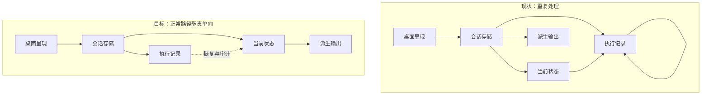

# 会话存储全链路性能改进方案

> 状态：**模型重审草稿，未实施，不作为实施蓝图**；2026-10-30。
> 本轮取代 `1e59ecfb` 版本的兼容优先、叠加优化路线；旧设计仅通过 Git 追溯，不与本版并列生效。
> 源码事实基线：`58d28d76fc39d258e17c6ced726de03a434afdf6`，SpaceAssistant 0.3.1；本轮复核相关符号，没有修改代码。
> 授权：系统分析并输出方案；用户已明确要求减少整体复杂度。本次继续完成模型重审与文档修订，不执行迁移、删除历史或改变产品行为。
> 证据：源码、本机临时库实验、既有定向测试；没有 Windows profile、真实用户库或安装包验收。没有 `--type` 支持主进程判断，不能证明具体热点占比。
> 阅读：第0层为方向取舍，第1层为评审包，第2层为模型约束；事实和历史核验在附录。本文只申请模型方向评审，详细格式与实施授权尚不具备。

### 本轮核销【人机共读】

| 上轮问题 | 本轮处理与证据 | 尚未关闭 |
| --- | --- | --- |
| 方案在复杂架构上继续加东西 | 撤销旧28单元、4新建单元、6阶段实施提案；取消新增性能Worker、通用事务结果通知、编码凭据层和独立指标模块的预设 | 减法模型仍须经恢复和旧数据反例验证 |
| 兼容格式被提前当作固定前提 | 正常运行与旧数据转换分开，兼容需有退出条件；不再承诺零格式变更 | 具体格式、转换、回退包必须另出详细方案 |
| 回执、单条preview、首屏后链路遗漏 | 保留F-17～19，并分别进入正常路径约束与AC-03／04／05 | 未实施，未证明体验改善 |

## 第0层：为什么要换方向【人必读】

**从“每次操作都重新理解历史，再增加加速机制”，转向“提交时维护可直接使用的当前状态，历史留给恢复和审计，派生输出退出正常操作的成功条件”。**

真正必要的复杂度来自：工具可能已经产生外部效果、进程可能在提交前后退出、重复指令不能重复执行、历史上下文必须能准确恢复。它们需要执行记录、提交边界和恢复规则。

额外复杂度来自：读取小量信息时重建全历史；多个表示互相校验才能继续；为绕开这些成本继续添加缓存有效性证明、线程与队列。代码已证明存在这些重复工作，尚未证明其各自在Windows故障中的占比。不能据此把所有校验或所有多份存储都判为冗余。

### D-1：是否以减少长期运行机制为目标重新设计

背景：上版保留全部格式，通过新增内部机制缩短等待，能局部改善，却继续增加维护、故障排查和一致性成本。

- A：先明确哪些记录负责什么，再合并或退出重复链路。用户操作与模型记忆保持一致；短期需要花时间验证旧数据转换与恢复，可能涉及存储格式调整。任何具体格式调整都要另行评审，不能凭本项方向决定实施。
- B：继续上版局部加速。短期改动更分散，原有重复表示与额外协调机制长期保留，不能满足降低整体复杂度的目标。
- 可逆性：文档重审可逆；数据迁移与物理删除不可凭方向批准，必须提供能承接升级后数据的回退方案。
- 依据：重复全量处理已核实；简化后的完整恢复覆盖和实际收益尚未验证。
- 推荐A。用户已认可减少复杂度并要求继续，本轮据此完成模型；不将“继续”解释为批准格式、删除、界面或外部行为变更。未另行批准时只保留草稿。
- 下钻：INV-01～05、AC-01～07。

### 完成条件与边界

本次交付是可评审的归属模型、保留／合并／退出清单、正常与异常路径及反例。它不是已完成的迁移规格，也不承诺所有正常读写固定耗时：模型需要的上下文本身很大时，仍必须支付其读取与准备成本。

不增加界面、设置、外部接口或新的乐观展示状态。消息保存仍等数据库回执；先缩短其必要路径，不能把上屏快等同于保存成功。备份脱离普通操作回执是独立的完成条件变更，详细方案须明确提出并评审；本轮只给目标，未实施。

当前Mac可验证访问范围、状态推进、回滚和恢复行为；Windows故障消失、真实历史库、安装包和IM仍需外验。只改文档不需要等待外验，也不能关闭原故障。

### 本次要审什么、哪里可能错

本次评审范围是归属模型和退出方向；不要求批准任何未定义的格式、字段、恢复包或界面。具体算法和证据由实现者补足，不把未查明事实交给负责人猜。

三处最可能推翻本模型的证据：

1. 当前状态无法完整表达压缩、失败续跑或工具结果的上下文语义，必须回看旧记录才能正常继续；则状态模型不完整，不能带着隐藏重放上线。
2. 某个计划退出的记录是恢复外部工具效果或审计的唯一材料；则必须保留该职责，或完成等价替代后再退出。
3. 主要CPU热点实际在安全解析、工具处理或渲染；则存储简化仍有维护价值，但不能宣称解决Windows卡死，需要按采样调整性能工作。

## 第1层：模型评审包【人机共读】

### 1.1 正常链路的替换



“会话存储”是已有存储边界，不是拟建大模块；“执行记录／当前状态／派生输出”是职责单元，不要求各建一套框架。SQLite仍由主进程现有事务入口写入；恢复者只能经该入口修复当前状态。派生文件沿既有单会话导出调度写入；renderer只写本地展示，不写执行事实。

正常写入并非图中两个独立成功点：属于同一次提交的执行记录和当前状态必须在同一事务提交。历史记录还保存哪些正文、当前状态如何引用正文，属于后续格式规格，不在此用箭头代替定义。

### 1.2 变更面：保留、合并、退出

| 单元 | 作用简述 | 类型 | 方向与跨边界 | 对应 |
| --- | --- | --- | --- | --- |
| 会话存储 | 提交会话事实与状态 | 改承重边界 | 收敛写入口与提交点；执行宿主、IPC、IM依赖 | D-1／INV-01、02 |
| 执行记录 | 记录执行与恢复依据 | 改对外契约 | 目标保留事实、停止热追加全前缀重放；SDK与旧历史读取受影响，格式待详设 | D-1／INV-01、03 |
| 当前状态 | 提供直接可用的状态 | 改对外契约 | 合并重复快照职责；涉及持久化及旧库转换，具体字段尚未设计 | D-1／INV-01、02、03 |
| 派生输出 | 生成展示与导出数据 | 改承重边界 | 可重建输出退出执行准入；普通回执不等待辅助导出的语义须另批 | D-1／INV-04 |
| 桌面呈现 | 展示消息与接收操作 | 改造 | 缩小live镜像、取消无关初始化屏障；不增加临时保存状态 | D-1／INV-04、05 |
| 安全与执行租约 | 约束工具授权和所有权 | 复用不改（待验证） | 保留既有policy、final-check及未知效果处理；差分验证 | D-1／INV-02 |
| 引用与回收 | 维护外置正文生命周期 | 复用不改（待验证） | 保留spill引用、完整性和GC；格式详设需证明仍适用 | D-1／INV-02、03 |

计数仅是**模型职责级**：改既有5、新建0、复用2，其中改对外契约2、改承重边界2；不能与旧版28个实现单元直接比较，也不能据此声称已减少代码。新增字段、版本、迁移数量尚未定，不报零。新增界面、开关、错误码提案均为0。本版只有一个文档模型重审交付，没有代码实施阶段。

本模型达到拆分门槛。这里保留一份总模型以评审归属；后续分开提交“事实与当前状态的提交／恢复／转换规格”和“派生读取与展示路径规格”。前者定义的数据归属是后者的输入，两者不得分别发明当前状态。未达到详细规格门禁前，不编制可实施任务。

### 1.3 契约面六面

| 面 | 模型结论及同步方 | 验证要求 |
| --- | --- | --- |
| agent-sdk | 目标可能改历史状态推进、上下文提交及公开导出；现有端口签名、事件种类是否可保持由详细规格逐项给结论，当前无实现授权 | `check:agent-sdk`、`typecheck:agent-sdk`；旧事件与MemoryHistory差分、独立宿主编译 |
| 会话存储 | 明确改提交／读取职责，保持统一事务入口；旧库转换与恢复者需详设，禁止直接启用新owner | 三项存储边界门禁及旧库、spill、续跑、track隔离用例 |
| IPC／预加载 | 本轮不改；目标普通回执脱离导出属于完成语义变化，须独立评审，不因形状未变而漏记 | 阻塞导出、保存失败、旧回执晚到测试 |
| 共享类型 | 本轮不改；后续若收敛live改变类型须列字段和调用方，不能重复定义领域类型 | `typecheck:shared`及renderer检查 |
| 其他持久化格式 | 目标允许调整；具体表、字段、格式版本与转换尚未定义，禁止实施和删除 | 可中断转换、恢复校验、升级后新增数据回退演练 |
| 领域数据格式 | 本轮无新错误码、规则、配置、诊断事件提案 | 沿用既有日志脱敏；新增格式须详设 |

附录B仅是旧版调研时的基线门禁成绩，本轮没有重新运行代码测试；不能用其证明新模型已兼容。

### 1.4 相邻方案约束

既有会话切换方案中已具备的分页定位、源版本、正文Worker和预算先复用，不能另起性能Worker／预算系统。历史边界重构和台账清理中尚未满足的owner切换、兼容包及物理删除条件继续有效；本模型不能绕过它们。进入详细设计前，实现者须按当前代码与执行记录核销依赖，不能把旧文档的“完成”直接当作生产已启用。

## 第2层：最小归属模型【机｜人工可跳过】

### 2.1 不变量与所有权

| ID | 约束 | 验收 |
| --- | --- | --- |
| INV-01 | 每项业务事实只有一个提交规则；同次必须一致的记录与当前状态走现有同一SQLite事务，回滚不发布已提交状态 | AC-01、02 |
| INV-02 | 幂等冲突、审批绑定、租约代次、终态顺序和未知工具效果不能因性能优化被跳过；派生结果不授予执行权限 | AC-02、06 |
| INV-03 | 当前状态足以支持声明的正常操作；重放用于冷恢复、迁移、审计，不能在正常路径悄悄退回全量重建 | AC-01、03、06 |
| INV-04 | 派生任务的失败不改写已提交事实；展示失败和执行状态损坏分别处置，不能一概成功或一概拒绝 | AC-03、04、05 |
| INV-05 | 所有性能结论分别报告访问范围、必要字节和线程阻塞；不得用异步签名、短返回值或乐观展示冒充少做工作 | AC-03、04、05、07 |

| 数据职责 | 唯一writer／提交点 | 正常读取 | 恢复者与失效处置 |
| --- | --- | --- | --- |
| 执行事实与当前执行状态 | 已有SQLite写入入口／事务提交 | 状态查询不读正文，历史查询读取所需记录 | 既有恢复宿主经存储入口重放；未知外部效果保持不确定，禁止自动重做 |
| 已提交模型上下文 | 已有转录提交入口／带租约及base version的事务提交 | 下一轮按已提交版本读取；不能从UI猜测 | 恢复宿主按提交回执与事实判定；版本冲突不覆盖 |
| 消息身份、队列和用户编辑 | 已有消息／队列事务入口 | 按作用域和消息身份查询 | 事务回滚或重启重读；已claim消息仍按既有规则拒绝编辑 |
| 正文定位与展示页 | 既有投影构建器／现有发布边界 | 只读所选页；读取外置正文仍做必要完整性验证 | 既有构建监督器重建；坏派生页不等于坏执行事实 |
| 辅助JSON导出 | 既有备份调度／文件发布 | 明确导出时读取，不作为普通执行凭证 | 重新导出；现有双文件不是原子对，不能声称可互相校验恢复 |
| renderer展示与live | 既有各store入口／本地更新 | 展示读已加载消息；执行材料从主进程获得 | 重读已提交状态；迟到结果按会话与代次隔离 |

这是逻辑归属，不是宣布当前各表都已满足模型。尤其“已提交模型上下文”与“用户可见消息”不等价：压缩、系统内容、失败续跑和工具配对语义须保留；不能合并成一份UI消息数组。

### 2.2 保留、合并、退出的具体判断

| 机制 | 处理 | 成立条件与删除证据 |
| --- | --- | --- |
| History事实、审批及外部效果记录 | 保留 | 列出恢复／审计消费者；不能因当前状态可读就删除历史 |
| 租约、提交回执、版本冲突和spill完整性 | 保留 | 它们处理真实竞态或损坏；不得将缓存命中当权限或完整性证明 |
| 热追加每批读取全历史并重建状态 | 替换 | 在原子提交边界维护可恢复的推进状态；初始化／恢复可重放一次；不能先加一套跨事务缓存再补通知框架 |
| invocation初始全文、终态完整转录、消息checkpoint | 合并重复职责，暂不直接删 | 逐字段列消费者及恢复材料；决定哪份是必要输入、哪份只是加速副本，再给等价引用／快照格式。全文去重不能破坏历史请求可复现性 |
| preview、summary、markers依赖全转录 | 退出正常重建链 | preview取选中消息；摘要按需要聚合或维护派生结果；markers独立读取。是否持久化额外摘要由详设权衡，不能默认新增表 |
| renderer从已加载历史重建累计live副本 | 缩减 | live仅承担执行中的增量职责；先证明API上下文等消费者可改读主进程，不能把必要上下文丢掉 |
| 旧模式、双写和全量fallback | 限期兼容 | 按数据转换完成、所有消费者切换、恢复夹具通过、回退演练完成逐项退出；不能永远按每次读动态尝试多模式 |
| 辅助备份等待 | 从普通成功条件退出的目标 | 明确外部脚本消费和退出语义后单独批准；显式导出仍报告真实完成 |
| 新性能Worker／事务通知／编码凭据框架 | 撤销预设 | 先删不必要工作；剩余必要任务若超阻塞预算，再证明现有Worker不能承接，单独比较新增协调成本 |

“提交时维护”也有写放大成本。必须比较事务内更新的行与字节、恢复材料大小，不能把全量读改成全量写就称为优化。持久推进状态需要格式和旧事件兼容设计；本模型没有偷偷批准新字段。

### 2.3 正常路径的工作边界

1. **新建会话：** 局部写入和必要列表刷新。已有长任务占住主线程时，INSERT本身再快也无用；同时量排队等待与事务时间。列表读取不执行历史清理和同步flush。
2. **提交指令：** 校验作用域与执行所有权，读小状态，再准备实际需要的已提交上下文。只查状态不水合全文；提交回执只表示已定义的持久提交完成。模型上下文的大字节成本明确保留。
3. **执行事件：** 校验新增事件与已提交推进状态，原子提交。嵌套事务回滚不能使状态领先；初始输入及续跑的直接追加入口必须走相同规则。
4. **编辑／删除／排序：** 保留数据库回执屏障；删除／排序只为候选消息取preview，不在事务内重放整场会话。候选与队列版本最终核验，漂移时重试或按既有失败返回。通用patch无生产调用不能充当输入慢的证据。
5. **加载会话：** 页数据可绘制后不再同步clone累计live；markers、summary不成为submit就绪条件。实际依赖运行上下文的消费者须有明确就绪边界，不能简单把一切延迟到idle。旧会话回执不能污染新会话。
6. **后台派生：** 有界、可取消并复用既有预算；不能为每个派生需求新增队列。完整导出成本依赖整个输出字节，派生失败的重试也不能无限占主进程。

### 2.4 绕过入口核对

详细规格须覆盖：accepted input与agentContinuation直接追加helper（新流version=0）；SqliteAgentHistory热追加；MemoryHistory与独立SDK宿主；同步恢复及canonical编辑；分页以外的单条消息、重试、搜索、导出、API baseline；状态查询和claim；普通／显式／shutdown导出；队列preview事务；ChatView辅助effect及submit初始化；IM、butler与track作用域。只改宿主append或分页IPC不能宣称全链路收敛。

### 2.5 崩溃、损坏与转换

| 窗口／反例 | 唯一处置原则 | 尚需详设的材料 |
| --- | --- | --- |
| 事务提交前退出或外层回滚 | SQLite回滚，不发布成功；恢复读取已提交版本 | 新推进状态与原事实必须同事务的测试 |
| 已提交但IPC回执丢失 | 用既有业务幂等身份查回执，不重复执行 | 重复载荷一致与冲突的差分用例 |
| 工具已执行、结果尚未可靠保存 | 保留未知效果，不从可重建视图推断可重试 | 逐工具效果／确认恢复材料清单 |
| 派生页损坏／缺失 | 隔离并重建派生页；不伪造空成功 | 源身份、取消与最终发布校验复用证明 |
| 权威正文／spill损坏 | 明确失败并保留诊断，不当作普通缓存miss | 区分派生缓存与权威正文的错误路径 |
| 旧库转换中断 | 未完成不得发布“已转换”；重启继续或撤回隔离产物 | 转换单位、事务边界、完成标记与原数据保留 |
| 升级后产生新数据又要回退 | 回退包必须承接新增数据，不能只恢复升级前副本 | 双向转换或兼容读取包的实测证明 |
| 两个owner或track并发／取消晚到 | 原租约和scope规则裁决；取消不撤销已提交事实 | 同会话及不同track并发夹具 |

迁移前先在隔离副本枚举旧模式及消费者，建立转换后的等价断言；转换完成、读写消费者切换、恢复及回退通过之后，才停写旧表示，再决定物理删除。禁止未经核查直接删除session transcript、消息checkpoint或canonical正文。转换方案必须控制过渡期的双写寿命；没有退出证据的兼容层不进入实施。

## 第2层续：模型验收与下一份方案的入口【机｜人工可跳过】

### 3.1 验收映射

以下是后续实现须兑现的行为断言，本次只完成设计映射，不声称测试通过。

| ID | 可执行断言／反例 | 对应 |
| --- | --- | --- |
| AC-01 | 固定新增批次大小扩大已有事件量，计数证明热追加不重读整个前缀；恢复一次后与全重放状态相同；嵌套回滚后再次追加仍相同 | INV-01、03；F-01～03 |
| AC-02 | 重复相同载荷成功不重做，冲突载荷拒绝；租约过期、审批身份错误、终态后追加、未知效果重试均保持既有结论；随机操作序列断言事实／状态版本一致 | INV-01、02；F-02、08 |
| AC-03 | 状态查询的正文读取计数为0；preview只读候选身份所需正文，扩大无关历史不增加正文访问量；候选漂移不能发布错误preview | INV-03～05；F-04、18 |
| AC-04 | 阻塞辅助导出时，按将来获批的完成语义验证普通回执；保存失败不成功；显式导出不提前完成；队列编辑的IPC等待单独报告 | INV-04、05；F-13、17 |
| AC-05 | 首屏dispatch→下一绘制机会、live初始化、summary、markers、submit序列查询分别计量；阻塞辅助请求不阻塞无依赖的submit，切换会话后迟到结果被隔离 | INV-04、05；F-09、19 |
| AC-06 | 旧库、旧spill、压缩历史、失败续跑、工具配对、track隔离转换前后语义相同；在各提交／转换窗口故障注入，重启不自动重做未知效果 | INV-02、03；F-05～08、10、11 |
| AC-07 | 固定页面／新增内容，分别扩大历史轮数、工具数、字节数，记录读取行数、编码字节、事件循环延迟及renderer绘制；新建耗时分解排队与本地事务，不以平均值掩盖长停顿 | INV-05；F-12、14～16 |

时间预算与参考负载须由实现者在隔离可复现夹具中测定并写入详细方案，不能现在捏造改善百分比。Windows原故障、真实库、安装包和IM四类外验分别保持未验收。

### 3.2 详细设计门禁

下一步先完成“事实与当前状态”的字段级消费者清单和恢复反例，输出明确的保留／替代／删除映射；在此之前不新增通用缓存、Worker或事务协调API。随后提交格式、旧数据转换、回退包及跨包接口的完整规格，补六面门禁与可运行验收夹具。派生读取方案消费已定归属，单独处理页面、preview、summary、live及导出。

模型本身不能绕过技术方案指南：这里尚缺新格式、迁移标记和精确回退实体，因此**不满足实施门禁**。这是本轮主动回到模型层后的交付边界，不能把本页直接交给编码执行。

### 3.3 人层与机层一致性

| 人层承诺／限制 | 规格落点 | 状态 |
| --- | --- | --- |
| 减少重复工作而非继续叠框架 | 2.2退出清单、AC-01／03／05 | 设计目标，未实施 |
| 不牺牲真实恢复与授权语义 | INV-02、2.5、AC-02／06 | 必须验证 |
| 不假装一份UI消息就是模型上下文 | 2.1上下文所有权及2.2全文合并条件 | 不允许直接删除 |
| 无新增产品交付面 | 1.2新建0、界面／开关／错误码0；格式数量未定 | 未定格式无授权 |
| 本轮只是模型重审 | 一个文档交付；零代码实施阶段；3.2门禁 | 与文首一致 |

## 附录：代码事实【机｜人工可跳过】

### 事实卡

每条 F 均以文首提交为基线，复现命令见附录 A；“源码确定”只描述工作存在，不等于已经测出线上占比。

| ID | 已核实的代码事实 | 性能含义与限定 |
| --- | --- | --- |
| F-01 | `appendSqliteAgentHistoryBatchInTransaction` 每批 SELECT 此 invocation 全部旧事件、逐行 JSON.parse，再调用 `validateHistoryTransition(previous,incoming)` | 小批次追加 E 个事件时旧事件访问量约为 E(E−1)/2；批次大小影响常数；不等于每个 token 都写 History |
| F-02 | `validateHistoryTransition` 重建 pending tool／approval 等状态并遍历前缀与新增事件 | 状态可增量归约，但终态、审批身份和 unknown-effect retry 原子批次规则都必须保留 |
| F-03 | `SqliteAgentHistory.read()` 直接调用 `readSync()`，后者全 invocation 解析、水合、校验 | Promise 接口不代表调用线程已释放；恢复与普通读需区别 |
| F-04 | `acceptPrepared` 和 `readTranscriptState` 调用 `readSessionTranscript`，只使用状态／版本；该函数仍读 `messages_json` 并可能同步读 spill | 仅查控制信息也支付完整正文成本，是指令提交前可直接消除的工作 |
| F-05 | `readHostedTranscript` 同步读取完整已提交转录；转录提交重复 JSON.stringify 与摘要计算 | 模型请求确实需要上下文，但可以复用同一次材料并在事务外准备，不能靠截短上下文提速 |
| F-06 | 每个 invocation 的初始 context 保存 messages；每次终态还保存完整 session transcript；大块可能 spill。requestSnapshot **只存消息数与摘要，不再存消息全文** | 长期保存字节可能重复；完整请求摘要本身仍 stringify＋hash。不能误诊为“每个 requestSnapshot 都存全文” |
| F-07 | spill 写入使用 UUID 文件，sync、读回验证并多次求摘要；context 中多个大块可能重复外置；同步读执行文件读取和 SHA-256 | 存储外置不消除 CPU 与 I/O；优化候选是复用同次材料；不能据此绕过读回验证 |
| F-08 | checkpoint 普通事件 2 秒合并；tool-result、确认、reconcile 和终态会立即提交；写入会重新序列化整条工具数组并读回整行 | 不能只调大 timer；高频工具结果绕过 timer，累积快照字节仍增长 |
| F-09 | `getContextHistorySummaryBaseline` 扫描会话所有 thinking／attachments 并估算；ChatView 在首屏提交后调用 | 不应误算成首屏必经串行等待，但会阻塞后续主进程工作 |
| F-10 | 当前 source identity 为 formatVersion 2，读取 source revision 与少量版本事实；页读已有 locator、Worker 与最终复核 | 早期“每页枚举全部 stream”在本基线已不成立；复用现有机制 |
| F-11 | locator 缺失可等待 backfill；兼容回退仍可能读取整会话投影；source 页面 Worker 一次一建且等待退出；已有 prepared 常驻 Worker 和前台单槽预算 | 冷、热、回填和回退必须分开；复用线程不能额外扩张并发预算 |
| F-12 | 创建会话是局部事务；列表读取全部可见会话后过滤 profile；读取时清理旧 metadata 可能触发 flushSave | 新建慢未证明是 INSERT 慢，也可能排在其他同步任务之后；列表只读需去副作用 |
| F-13 | 辅助备份为全量分页导出，默认每页 2000；3 秒防抖；部分消息／队列操作等待 flushBackup | 分页控制内存峰值，不降低总导出字节；异步文件 I/O 之外的 stringify 仍在调用线程 |
| F-14 | TurnDisplay 仍携带累计 content／thinking／工具与活动；50ms 合并部分事件，关键状态立即发；renderer 有帧合并 | 不能把渲染完全排除；应先减少重复构造；协议是否改变须另审 |
| F-15 | 主连接为同步 SQLite、WAL、synchronous=NORMAL、busy timeout 默认 5 秒；save 调度 PASSIVE checkpoint，维护另有 TRUNCATE | 锁等待可能冻结事件循环但不解释持续满核；checkpoint 不等于每次 save 重写整库；WAL 自动 checkpoint 也需计量 |
| F-16 | 本机单次临时库：4KiB payload、100／400／800 次单事件事务追加约 81／504／1626ms；定向测试46通过、25跳过 | 支持超线性现象，不是统计基准、不是 Windows 结果，未包含真实工具执行／网络／renderer |
| F-17 | `commitMessagePatch`先await messagePatchNonTurn再更新overlay／display／summary；基线仅找到定义、未找到生产调用者。队列edit／delete／reorder有ChatView调用，同样先等IPC | 独立于辅助导出的数据库回执屏障；不能等同于输入框每次键盘回显，也不能说所有submit经过该函数 |
| F-18 | `contentForSessionPreview`对canonical-backed行调用整会话`readCanonicalSessionTranscriptForShadow`再取一个message；排序／删除队列在事务内调用，最后才slice(0,120)；内容编辑若为最后一条直接使用编辑content | 单条短预览可承担整会话归约／spill校验，并延长写事务；输出短不等于访问范围小 |
| F-19 | markers在独立effect请求；首屏page dispatch后同步initLiveSessionFromStore，再请求summary；init合并当前store与既有live后clone。submit的turn-started也调用init并等待message sequence查询 | 无markers→summary→live的严格串行依赖；存在辅助IPC争用与dispatch后同步clone阻止下一绘制机会，初次已加载集合与累计live应分别计量 |

## 附录 A：复现与证据【机｜人工可跳过】

所有命令从仓库根执行。符号定位不以行号固化；源文件可用 `git show 58d28d76:<路径>` 重放基线。

```bash
git rev-parse HEAD
ls electron/sessionStorage electron/database electron/storage
# F-01/02
rg -n 'previousEvents|validateHistoryTransition|appendSqliteAgentHistoryBatchInTransaction' electron/database/agentHistoryStorage.ts packages/agent-sdk/src/history.ts
# F-03/07
rg -n 'readSync|hydrateLargeToolResultSync|spillLargeCanonicalPayload' electron/runtime/sqliteAgentHistory.ts
rg -n 'readSourceTruthSpillSync|readFileSync|writeObject|sha256|file.sync' electron/storage/spillProtocol.ts electron/storage/spillStore.ts
# F-04/05
rg -n 'acceptPrepared|readTranscriptState|readHostedTranscript|readSessionTranscript' electron/sessionStorage/execution.ts electron/database/sessionTranscript.ts electron/runtime/hostedTurnHandoff.ts
# F-06：快照全文与请求摘要要分别核实
rg -n 'invocation-context-committed|transcriptCommit|canonicalRequestSnapshot' packages/agent-sdk/src/turn.ts
rg -n 'messagesSha256|messagesCount|snapshotPreparedModelCall' packages/agent-sdk/src/model.ts
# F-08/09
rg -n 'isImmediateCheckpointEvent|CHECKPOINT_INTERVAL_MS|acceptedAssistantCheckpoint' src/shared/turnCoordinator.ts
rg -n 'updateMessageContentImpl|checkpointTurnAtomically|getContextHistorySummaryBaseline' electron/database/operations.ts
# F-10/11
rg -n 'sourceRevision|formatVersion' electron/sessionStorage/infrastructure/sqlite/projectionSourceIdentity.ts
rg -n 'readSourceChatPage|waitForSourceBackfill|readPreparedChatPage' electron/sessionStorage/queries.ts
rg -n 'new Worker|worker.once|withProjectionForegroundWorkerBudget' electron/sessionStorage/infrastructure/sqlite/projectionSourceChatBodyWorkerClient.ts
# F-12/13
rg -n 'session:list|session:create|stripAllSessionsAndPersist' electron/ipc/sessionIpc.ts electron/ipc/ipcShared.ts
rg -n 'flushBackup|backupAfterMessagePatch' electron/ipc/agentProtocolIpc.ts
rg -n 'DEFAULT_BACKUP_PAGE_SIZE|streamMessagesJsonAtomic|JSON.stringify|handle.sync' electron/sessionBackupManager.ts
# F-17/18/19：回执、预览与辅助任务的实际拓扑
rg -n 'commitMessagePatch|commitQueuedMessageEdit|commitMessageDelete|commitQueuedMessageReorder' src/renderer --glob '!*.test*'
rg -n 'contentForSessionPreview|reorderQueuedUserMessagesInScope|deleteQueuedUserMessageInScope' electron/database/operations.ts
rg -n 'chatGetSessionCompactionMarkers|initLiveSessionFromStore|chatGetContextHistorySummaryBaseline|chatGetMessageSequence' src/renderer/components/Chat/ChatView.tsx
rg -n 'cloneMessages|mergeDbAndLive|initLiveSessionFromStore' src/renderer/services/chatRunnerService.ts
# F-14/15
rg -n 'turnToDisplay|chat:turn-display' electron/main.ts
rg -n 'content: message.content|toolCalls:|summaryCache|activity' src/shared/turnDisplayProtocol.ts
rg -n 'busyTimeout|walCheckpoint|synchronous|journal_mode' electron/database/sqliteStore.ts
# 绕过入口
rg -n 'appendSqliteAgentHistoryBatchInTransaction|readSessionTranscript\(' electron --glob '*.ts' --glob '!*.test.ts'
```

### A.1 单次追加实验

环境：本机 macOS，Node v26.4.0，经 tsx 直接运行现有 SQLite helper；file-backed 临时库、默认 WAL／NORMAL、无 renderer／网络／工具／源 spill。三个 invocation 共用同一新建库，按100→400→800顺序执行；每事件 payload 的 probe 字符串4096字节（不是事件总字节），每个事件单事务。包括索引、触发器、事务和校验耗时，未分离缓存预热和 WAL 自动 checkpoint。

```text
events=100  elapsedMs=81
events=400  elapsedMs=504
events=800  elapsedMs=1626
```

可复现脚本（不会打开用户数据目录；结束清理临时库）：

```bash
node --import tsx --input-type=module <<'JS'
import fs from 'node:fs';
import os from 'node:os';
import path from 'node:path';
import { performance } from 'node:perf_hooks';
import { appendSqliteAgentHistoryBatchInTransaction } from './electron/database/agentHistoryStorage.ts';
import { openSqliteDatabase, getDbConnection } from './electron/database/sqliteStore.ts';
import { runInTransaction } from './electron/database/transaction.ts';
const dir = fs.mkdtempSync(path.join(os.tmpdir(), 'sa-history-perf-'));
const db = openSqliteDatabase(path.join(dir, 'probe.db'));
try {
  const conn = getDbConnection(db);
  for (const count of [100, 400, 800]) {
    const invocationId = 'probe-' + count;
    const start = performance.now();
    for (let i = 0; i < count; i++) {
      const sequence = i + 1;
      const event = { invocationId, turnId: invocationId, sequence,
        eventId: invocationId + '-' + sequence, idempotencyKey: invocationId + '-' + sequence,
        schemaVersion: 1, kind: 'model-request-started',
        payload: { requestId: 'r' + sequence, probe: 'x'.repeat(4096) } };
      runInTransaction(conn, () => appendSqliteAgentHistoryBatchInTransaction(conn, [event], i));
    }
    console.log(JSON.stringify({ events: count, elapsedMs: Math.round(performance.now() - start) }));
  }
} finally { db.close(); fs.rmSync(dir, { recursive: true, force: true }); }
JS
```

本实验未严格证明线上CPU由此独占，也没有对真实tool事件、不同批次、多个进程、冷文件缓存和Windows作推断。后续实施基准须增加重复样本与访问量计数。

## 附录 B：前版调研已执行核验【机｜人工可跳过】

2026-10-30，文首工作区代码基线；存在用户原有未提交安全代码改动，本方案不包含它们，不把工作区结果冒充干净提交CI。

| 命令／检查 | 本次结果 | 能证明／不能证明 |
| --- | --- | --- |
| `npm run check:agent-sdk` | 通过（含依赖与包闭包） | 当前SDK边界成立；不证明目标设计已实现 |
| `npm run typecheck:agent-sdk` | 通过 | 当前类型基线；不是异步调用方已迁移 |
| `npm run check:session-storage-boundary` | 通过，31个非法边探针被拒绝 | 当前存储依赖边界；不证明目标设计已实现 |
| `npm run check:session-storage-cleanup-boundary` | 通过 | 当前清理入口约束 |
| `npm run check:message-fact-ownership` | 通过 | 当前消息事实边界 |
| `npm exec vitest run electron/sessionStorage/sessionSwitchPerformance.test.ts electron/turnCoordinatorStorage.test.ts src/renderer/services/turnDisplayStore.test.ts` | 3文件通过，46通过、25跳过 | 既有定向行为；规模开关未启用，不证明大负载目标 |
| 附录A临时库实验 | 执行并清理临时目录 | 重复追加超线性线索；单样本不能作为验收 |


## 附录 C：尚未验证【机｜人工可跳过】

- UV-01：Windows profile与磁盘／杀软影响；有真机后由实现者采样，未关闭前不得声称原故障修复。
- UV-02：真实库的旧模式、数据量及外部JSON消费；详细转换和导出语义评审前由实现者调查，不能直接推测可删。
- UV-03：字段级恢复材料及SDK独立宿主兼容；下一份详细规格的输入门禁，由实现者完成。
- UV-04：Mac开发环境、Electron安装包和真实IM并发的性能差异；本地自动化与外验分别记录。
- UV-05：必要上下文和快照写放大是否仍构成瓶颈；按AC-07测量，再决定线程及格式，不预设新增机制。

术语：执行记录对应History事实；当前状态包括执行控制与已提交模型上下文，二者不等于UI消息；派生输出包括可重建投影、展示与辅助导出。权威spill属于事实材料，不属于可任意丢弃的派生输出。
