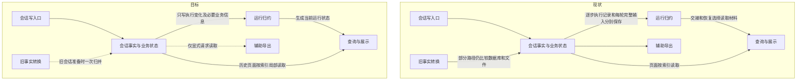

# 会话存储全链路性能改进方案

> 状态：**单一执行历史模型评审草稿，未实施**；2026-10-31。
> 代码事实基线：`58d28d76fc39d258e17c6ced726de03a434afdf6`；本轮文档基线：`001fc88e`。用户安全代码修改不纳入。
> 本轮通查开发验收、用户升级和数据处理的边界，撤销外部脚本交接前置条件，明确兼容准备由程序自动完成、回退演练属于开发验收、停读不等于删除。不实施代码、迁移或删除。
> 阅读方式：第0层说明要决定什么；第1层独立解释现状、改后行为、影响范围、收益与风险；第2层及附录供实现和证据复核，不是读懂前两层的前提。

### 本轮核销【人机共读】

| 评审问题 | 本轮改写 | 检查边界 |
| --- | --- | --- |
| 开发验收与升级动作混写 | 明确执行者／触发时机，撤销外部脚本交接条件，兼容准备自动完成，停读与物理删除分开 | §1.9、D-1／3／4、§2.6／2.7／3.1、AC-07、B.6 |
| 辅助导出仅改为异步，仍保留全会话重复工作 | 取消日常自动导出及退出补导出，保留按需生成能力；明确其不能承担完整备份 | D-3、§1.8／2.7、AC-04／07、F-26；开发核销仓内调用；升级说明告知停止自动更新 |
| 启动修复／清理未纳入新主线 | 补齐最小启动检查、按会话恢复、失败隔离和后台清理，明确哪些旧串行依赖退出 | D-5、§1.7／2.10、AC-17、F-25；旧工作集机制复用，不误称当前全量扫库 |
| “History与独立transcript一致性”无法自说明 | 改成两份具体材料：逐步执行记录，以及每轮结束后另存的完整后续模型输入；解释谁读、为何要对齐、哪条新写退出 | 第0层与§1.0／1.4给出完整例子，不要求先查代码 |
| 简图只有抽象框，读者仍不知道一次请求怎样经过系统 | 现状与目标按相同五项职责画图，说明写入者、提交时点和四种消费路径 | §1.1；图中名称复用变更面表 |
| 变更面／接口表只有内部名字 | 每行先解释现有用途、改后行为、受影响调用方，再给代码位置或检查命令 | §1.2／1.3；内部名字不承担业务解释 |
| 把工作量减少等同于用户必然更快 | 每个问题分别列减少的工作、保留的成本及如何验收，时间目标和外验限制前置 | §1.5／1.6；未实现、未实测，不宣称Windows已修复 |

## 第0层：要解决什么、需要批准什么【人必读】

**把“每轮重新读取并复制已保存的会话”改为“记录这轮变化、保留必要执行状态，再按需要读取”。**

现在，同一次对话有两类内容重叠的保存材料：一类逐步记录模型输入、回答、工具调用和结果；另一类在每轮结束后，再保存下一轮模型应看到的完整消息集合。第二类包含历史消息、工具配对和压缩摘要，不能简单等同于聊天窗口里的气泡。两类材料都被恢复流程使用，因此目前不能直接删掉其中一类。

推荐只让逐步执行记录承担新执行的恢复依据，同时在本轮结束记录“下一轮到底采用哪份内容”；每轮另存完整集合的做法退出。运行中的会话继续使用已经推进的内存状态，重启后才从保存的记录恢复。为防重启恢复过慢，间隔保存少量完整检查点，不再每轮复制全文。

排队消息能否编辑、谁可以继续执行、重试是不是同一条指令，仍需数据库单独管理。这些是业务规则，不能因为减少正文副本就取消。聊天页、搜索、工具详情和导出文件从已保存材料生成，不各自决定一次执行是否成功。

### D-1：是否取消每轮结束后另存的一份完整模型输入

背景：逐步执行记录和每轮完整消息集合有大量重叠，但分别承担恢复用途。需要决定怎样减少重复保存，同时保持重启和失败后模型看到的内容不变。

- **A：统一到逐步执行记录。** 记录本轮新增内容，以及成功、失败或暂停后应采用的消息范围。以后不再每轮另存完整集合；旧会话仍能读取。减少重复写入，代价是重启后要从检查点和后续变化还原内容，必须验证失败、压缩和人工复核等情况。
- **B：继续保存两类材料，共享其中的正文。** 各轮完整消息仍可直接读取，但要增加正文引用及回收机制；两套恢复材料的职责也继续存在。
- **推荐A，待批准；不批准则保持现状，不切换新格式。** 用户看到的消息、模型实际输入和失败处理应保持原行为，不因简化而缩短上下文。
- **可逆性：** 不能直接退回旧安装包；配套回退程序须重新生成旧格式需要的完整消息集合，保留升级后新增内容。开发者必须在隔离测试库完成回退验证，才可发布采用新写法的版本；用户升级不需要自行演练。
- **依据强度：** 两类材料及其调用方已从源码确认；新方式能否逐项还原相同内容尚待测试，没有性能实测结果。
- 下钻：§2.2／2.8，INV-01／02／06，AC-06／13／15。

### D-2：是否保存“哪些工具和审批仍未完成”

背景：要判断一条工具结果或审批是否合法，必须知道此前发生过什么。当前每次新增记录，都重新读取旧记录算一遍；工具越多，重复读取越多。

- **A：保存当前未完成事项，并和新增记录一起更新。** 校验规则不减少；重启后可接着使用，旧执行第一次恢复时计算一次。新增两个数据库字段，需证明保存结果和从头计算相同。
- **B：每次从头计算。** 不新增字段，但长执行中重复扫描的开销保留。
- **推荐A，待批准；不批准则不新增字段，也不能宣称解决密集追加瓶颈。** 对用户没有新增操作或显示状态。
- **可逆性：** 配套回退程序移除新字段，恢复从头校验；必须保留新增执行记录。
- **依据强度：** 从头扫描已确认；新旧校验是否对所有合法、非法操作得出同一结论，需对照和随机操作测试，当前未通过这些新测试。
- 下钻：§2.3，INV-01／02，AC-01／02／09。

### D-3：是否停止自动生成可读会话副本

背景：当前应用会在会话目录中反复生成会话信息和消息列表文件，方便直接查看。但正常打开会话和继续执行读取数据库；这些文件不含完整执行依据，不能当作完整备份。仅让生成过程在后台运行，仍会消耗读取、编码和写盘资源。

- **A：停止自动生成，只在明确请求时导出。** 新建、消息变化、轮次结束和退出不再生成副本；数据库保存成功即可反馈。已有文件不再自动更新，依赖它们的外部脚本需要调整。保留可读导出的底层能力，本次不新增导出按钮或调用通道；若没有既有产品入口，新增入口须另行设计和批准。
- **B：保留自动副本，改为后台生成。** 仍可供外部程序读取，但文件可能滞后；反复读取整个会话、编码写盘和维护调度的成本继续存在。
- **推荐A，待批准；未批准维持现有行为，不擅自停止更新。** 升级不因停止自动导出而扫描、迁移或删除既有可读副本；旧会话执行记录的兼容处理独立进行。取消自动副本不等于取消数据库备份，也不在这里承诺新增备份能力。
- **可逆性：** 可恢复自动生成并从数据库重导；停用期间旧文件不会自行变新，回退不能立即把它们当最新内容。已报告的数据库保存成功不因导出失败而撤销。
- **依据强度：** 自动调用及全量写出已确认，文件恢复函数未找到生产调用者；开发者负责检查并移除仓库内自动副本依赖；无法普查用户自行编写的外部脚本，也不将它们作为升级前置条件，停止自动更新应写入升级说明。
- 下钻：§1.8／2.7，INV-04，AC-04／07，F-13／26。

### D-4：旧文件中的独有记录入库后，是否停止正常执行时再读文件核对

背景：部分旧会话的压缩摘要或请求用量记录可能只在会话文件中。直接停读可能丢失模型输入所需材料；永远双读又会让兼容处理留在每次正常操作里。

- **A：程序在旧会话需要执行或后台恢复时，先处理该会话，再切换其正常读取。** 自动将文件独有材料归入数据库；不要求用户事先整理或转换全部会话。只有整份所需材料已处理完才登记完成，之后执行只依赖数据库。确实缺失的旧压缩材料沿既有批准方案重建，重建结果可能与原来不同，必须沿原规则明确处理，不能当作“从未压缩”。新增一个内部完成字段。
- **B：继续每次比较数据库和文件。** 不增加完成字段，但保留文件故障、差异核对及重复读取的长期成本。
- **推荐A，本分支接入及新增字段待批准；不批准则不停止旧读取。** 旧文件清理专项已有的缺失处理授权不在此重新修改；本案不新增用户机器上旧文件的批量删除任务。
- **可逆性：** 回退前必须从数据库重新生成升级后新增的文件记录，不能直接使用陈旧旧文件。未处理完的会话由程序在执行准备时调用兼容逻辑，用户无需寻找或手工运行转换入口。
- **依据强度：** 旧文件独有材料的消费者已确认，另一个工作树有专项实现记录；开发者仍需用隔离的旧格式夹具核验本分支覆盖；经用户授权的真实库副本可补充测试，不要求逐台用户机器核验。
- 下钻：§2.6，INV-03／04，AC-06／16。

### D-5：启动后是否允许健康会话先使用，未完成会话各自恢复

背景：当前启动要先经过执行记录恢复、运行快照还原、轮次收尾、提交核对及续跑收敛等步骤。已有未完成工作集和旧数据分类，并非每次读取所有正文；但这些步骤仍有串行和全局等待。某会话的界面数据未恢复，也可能阻止执行状态核对。

- **A：启动先建立最小执行保护，再按会话恢复。** 数据库可用、旧执行者不能继续写入后，健康会话可使用；上次未完成或状态不确定的会话仍禁止继续执行，准备完成才开放。页面缺失、文件修复和空间清理不阻挡无关会话。代价是启动完成不再表示所有旧会话已恢复，所有执行入口必须检查目标会话，不能只看一个全局完成标记。已有远程入口也遵守相同保护，仅取消无关会话恢复造成的全局等待，不改变远程消息格式或授权规则。
- **B：继续等待整条恢复链。** 开放时点简单，但无关旧数据修复仍可能拖慢启动或影响其他会话。
- **推荐A，待批准；未批准保留现有开放条件，不以性能优化名义绕过恢复。** 不新增界面、错误文案或远程调用方式；桌面、远程和自动任务共用相同的目标会话检查。
- **可逆性：** 没有新数据格式，可以恢复全局等待；已经发生的工具动作不可撤销，不能靠回退重新执行。原有归属核验后的遗留本机进程处理保留。
- **依据强度：** 当前恢复编排、未完成工作集和投影等待已从源码核实；健康／故障会话混合启动、恢复中再次退出及多入口并发仍需故障测试。
- 下钻：§1.7／2.10，INV-08，AC-17，F-25。

### 这次批准范围、交付限制及最可能出错的三处

待批范围是以上五项的组合：调整执行记录的内部保存格式；增加三个数据库字段；取消新执行每轮另存完整模型输入；停止自动生成可读会话副本并调整相关操作完成时点，以及启动后按目标会话判定是否可执行。没有新增数据库表、正文共享服务、文件回收体系或界面更新协议；没有新界面、开关、用户错误码或远程渠道行为。

算法、版本恢复、故障处理和规模测试可在Mac及隔离数据库验证。Windows原故障、安装包及真实远程渠道由开发验收人员在对应环境验证；真实用户库仅在明确授权后使用副本补充测试，不是每位用户升级前的操作；本方案当前没有这些结果。全案最后必须同时达到架构退出条件和性能目标，不能只凭局部提速完成收尾。

| 主要风险 | 出错时会怎样 | 什么证据会推翻当前设计 |
| --- | --- | --- |
| 失败后选错下一轮内容 | 把本不该保留的半轮工具交互传给模型，或丢掉原应保留的压缩摘要 | 成功、失败、暂停、压缩后失败的重建内容有一项与现有行为不同，就必须修正记录方式 |
| 重启恢复变慢 | 写入少了，但打开会话或再次提交仍长时间等待 | 检查点间恢复、必要正文传输或界面完整快照超预算，就必须在本案内调整，不能列为未来优化后关闭 |
| 旧材料的消费者遗漏 | 新写可用，旧版本、人工复核或恢复流程却找不到原内容 | 任一受支持调用方仍依赖被取消的新正文副本，就不能切换或删除 |

## 第1层：不翻代码也能评审的方案说明【人机共读】

### 1.0 先说明当前保存了什么

| 材料 | 内容与用途 | 本次怎样处理 |
| --- | --- | --- |
| **逐步执行记录**（代码称History） | 按顺序保存实际模型输入、模型回答、工具开始／结果、审批、压缩和本轮结束。工具是否已执行、恢复时能否重试，需要看这些记录 | 作为新执行唯一的正文恢复依据；记录上下文变化，不每轮再复制此前全部内容 |
| **每轮完整模型输入副本**（代码称transcript entries） | 每轮结束后另存一份下一轮模型应使用的完整消息集合，并带版本号。它不等于聊天气泡：里面还涉及工具配对、压缩摘要及失败时保留哪些内容。下一轮交接和人工复核恢复目前会读它 | 新执行停止写入；原来依赖它的调用方改从逐步执行记录恢复同一版本。旧版本副本先保留只读 |
| **业务控制信息** | 指令第一次接纳时采用的配置和输入版本、排队顺序、当前执行者及提交结果。不保存另一份正文，用于防止重复接纳、过期执行者写入和重复提交 | 保留；检查“当前能否执行”只读这些小字段，不顺便加载全文 |
| **未完成输出保存**（现有checkpoint的一部分） | 流式回答还未成为可靠执行记录时，定期保存文字和思考片段，以便中断后保留已有输出。当前还可能重复带上累计工具结果 | 保留未提交文字和必要顺序；已可靠记录的工具结果从逐步执行记录恢复，不随每次保存重复编码 |
| **查询、展示和辅助文件** | 聊天分页、搜索结果、工具摘要及按需详情、可读导出。它们面向不同消费者，不能替代执行记录判断工具是否发生过 | 单向生成或按需读取，复用现有分页、摘要和大正文文件机制，不再增加一套同步协议 |

**一个具体例子：** 会话已有100轮，用户提交第101轮，模型调用一个工具并回答。现在既记录第101轮的输入、回答和工具过程，又在结束时把下一轮所需的完整消息集合（包括仍保留的旧消息或压缩摘要）保存一份；新增记录时还可能重读已有执行记录，恢复工具／审批状态。

改后，已有100轮不因本轮开始而再复制一份：保存本轮输入相对上一版本的变化、工具和回答，以及本轮结束后采用哪段内容。若本轮失败，明确保存应继续采用原输入还是压缩后的某段内容，不用“最后一个界面数组”猜测。重启时按这些记录还原；运行中继续用已推进的状态，不每次工具调用都从头读取。

这里的“只保存变化”不意味着永远没有完整副本：首次接入旧格式、间隔64个已提交版本和既有压缩位置会保存完整检查点，作为恢复起点。其额外存储和写入峰值也要测试，不能拿它掩盖每轮全文复制。

### 1.1 现状与目标链路：谁保存，谁读取

两图使用相同粒度。节点名与§1.2变更面一致；“会话事实与业务状态”内部的两种保存材料已在上节展开。



**写入责任不新增：** 仍由Electron主进程已有会话存储入口写SQLite。一次本轮结束，执行结束记录、下一轮采用的内容选择、提交版本、执行者状态和防重复回执在同一个数据库事务中提交；其中任一步失败就不报告整体成功。现有方案已用同一事务防止两类材料只保存一边；本案不把它误诊为“原来两次独立提交”。取消的是额外准备、保存及读取一份完整正文，不是取消数据库的一致提交，也不是取消执行者检查。

**读取分四种情况：** 运行中的下一次工具／模型推进使用当前内存状态；重启或恢复指定旧版本才还原执行记录；界面分页和预览只读取需要的消息；辅助文件在数据库保存后生成。完成旧材料归并的会话，不再通过文件是否存在或与数据库一致来决定能否执行。

“运行归约”就是把按顺序保存的记录应用到当前状态：例如看到工具开始就登记待完成工具，看到结果就结清；看到压缩记录就替换相应模型输入范围。它是已有执行代码的职责收敛，不是另建一个拥有独立历史的服务。

### 1.2 改哪些地方、谁会受到影响

类型含义：**改对外契约**包括跨包接口、跨进程完成语义及落盘格式；**改承重边界**指仓库内部多个调用方共同依赖的读取或恢复接口；**改造**只调整内部实现；**复用不改（待验证）**表示必须证明已有能力够用，不能当作已经验收。

| 单元 | 作用简述 | 类型 | 改后行为与受影响调用方 | 代码定位／依据 |
| --- | --- | --- | --- | --- |
| 会话写入口 | 接纳并提交会话变更 | 改对外契约 | 数据库保存后返回，普通操作不再触发或等待可读副本；桌面及其他自动写入调用方同步退出触发 | sessionIpc／agentProtocolIpc／ipcShared；D-3 |
| 会话事实与业务状态 | 保存执行记录与业务信息 | 改对外契约 | 结束一轮只保存执行记录中的内容选择及必要业务信息，不另写完整模型输入；交接／恢复调用方共同切换 | agentHistoryStorage／sqliteAgentHistory／sessionTranscript／schema；D-1／2／4／5 |
| 运行归约 | 推进并恢复执行状态 | 改承重边界 | 从同一执行记录还原指定输入版本，运行中增量推进；真正加载正文改异步准备，返回后重核版本和执行者 | canonicalHistory／execution／hostedTurnHandoff／continuation／coordinator及recovery启动编排；D-1／5 |
| 查询与展示 | 读取消息并呈现状态 | 改承重边界 | 状态不读全文、预览只取候选、界面不复制全部已加载历史；聊天／搜索／上下文摘要／工具详情保持原可见含义 | queries／operations／ChatView／chatRunnerService／TurnDisplay；INV-03／05 |
| 辅助导出 | 生成可读会话文件 | 改对外契约 | 仅显式请求生成；退出自动调度和补导出，文件停止自动更新；现有文件格式保留，升级说明告知停止自动更新；不探测外部脚本 | sessionBackupManager／shutdown；D-3 |
| 历史校验器 | 校验工具及审批顺序 | 改对外契约 | 对新增记录使用已保存的未完成状态，保持原允许／拒绝规则；SDK及SQLite宿主共用 | packages/agent-sdk/src/history.ts；D-2 |
| 旧事实转换 | 承接旧格式独有材料 | 改承重边界 | 读取旧完整输入、归并文件独有摘要／用量，完成后正常执行只读库；恢复／用量／压缩／保留清理一起覆盖 | 旧entries兼容、台账专项、compaction／meter／retention；D-1／4 |
| 必要进度checkpoint | 保存尚未提交的输出 | 改承重边界 | 保留未完成文字和必要段顺序；工具结果改从可靠执行记录恢复，启动恢复也要同步改读 | acceptedAssistantCheckpoint／messages／启动恢复；INV-07 |
| 回归与规模夹具 | 检验故障和规模表现 | 改造 | 对照新旧输入与校验结果，模拟中断、回退及长会话，测量真实工作量和等待 | 原SDK／storage／renderer测试扩展；AC-01～17 |
| 页定位与构建预算 | 定位消息并限制后台任务 | 复用不改（待验证） | 沿已有定位索引和后台工作线程准备页面／摘要，仍验证消息来源版本；不再新建调度系统 | locator／prepared Worker；AC-03／05／10／12 |
| 安全与执行租约 | 防止未授权和过期执行 | 复用不改（待验证） | 授权检查、执行代次和“工具可能已经执行”的恢复规则保留；文件锁或数据库事务不能替代它们 | policy／final-check／claim／receipt；INV-02 |
| spill与引用回收 | 管理外置大正文文件 | 复用不改（待验证） | 大正文仍用已有文件描述和引用保护；被旧版本引用时不能回收，不增加新对象存储或回收体系 | spill／既有history和entries owner；INV-06 |

上表共12个职责单元：改既有9、新建0、复用3；其中改对外契约4、改承重边界4、内部改造1。第1.0节已说明英文名所指的数据；表中代码名只供定位，不要求读者凭它们猜用途。

**持久化改动：** 不新增表；增加3个数据库字段，2个保存工具／审批校验状态，1个标记旧文件材料已归并；数据库结构升级一次，执行记录的内部正文表示升级一版。沿用前版提议的当前状态编码，不新增展示协议、工作线程、用户错误码、开关或诊断事件。

**为什么仍用一份方案：** 取消完整输入新写、恢复指定版本、执行结束的一致提交必须一起设计，否则可能先停写再发现旧版本无法恢复。实施拆成五个可验证阶段；已有旧文件专项复用原转换规则，不另建迁移系统。最终的17项验收必须全部覆盖架构退出、恢复和性能，不能拿阶段数减少代表复杂度已消除。

### 1.3 哪些接口和格式会变，旧调用方怎么办

| 契约面 | 对未读代码的评审者说明 | 受影响者及兼容验证 |
| --- | --- | --- |
| agent-sdk：执行内核与桌面宿主之间的接口 | 执行内核发出的逻辑事件种类、历史读写方法和“结束后应保存哪些消息”的输入形状不变；新增一组纯计算函数，让内存宿主和数据库宿主共用原校验规则。数据库如何压缩保存正文由宿主处理 | SDK公开导出增加，独立宿主不能被迫懂数据库格式；运行check:agent-sdk、typecheck:agent-sdk及旧事件／新旧规则对照测试 |
| 会话存储接口：交接、恢复及数据库读写 | 取消每轮完整正文新写。下一轮和恢复改从执行记录还原指定版本；真正读取正文的readHostedTranscript由同步返回改成等待后台准备，四个交接调用点都要等待并复核版本／执行者；启动恢复改为建立最小保护，执行入口再等待目标会话恢复，不能继续依赖全局“全部已恢复”布尔值 | hosted交接、启动恢复、续跑、人工复核、页面来源与删除回收；SessionRecoveryPort新增目标会话准备，recover的完成语义和availability的全局／会话范围同步改变；三项存储边界门禁加旧版本／未知提交／回退测试。写入仍由原主进程事务入口负责 |
| 进程间接口：桌面页面调用主进程 | 通道、参数、返回结构和现有完整展示协议不改；停止普通操作触发辅助导出，数据库成功仍是操作成功条件；不新增显式导出通道或界面。工具摘要仍随展示发送，详情仍按需请求 | 桌面网关、preload和导出关闭流程；验证普通操作没有文件写任务、数据库已保存才成功，显式导出不能提前报告完成 |
| 共享数据类型：主进程与界面共用的消息结构 | 用户消息及工具展示结构不改，内部上下文引用不发给界面；不要求界面恢复数据库记录 | Message／TurnDisplay调用方；共享和renderer类型检查、原页面行为对照 |
| 落盘格式与迁移 | 增加上述3列；新执行记录可以保存“基于哪个已提交版本，增删了哪段消息”，不再每轮复制全文。旧记录和旧完整输入继续可读，旧安装包不能直接理解新表示 | 新旧格式读写、将升级后记录重新展开为旧格式的回退程序、坏大文件／磁盘满／中断重启演练；不是仅备份升级前数据库 |
| 规则、配置、产品错误码等领域格式 | 没有新增规则、设置或用户错误码，也不改变远程渠道行为；遇到坏材料继续走既有失败／恢复通路 | 现有错误行为与日志脱敏回归；实现若需要新增产品项，必须重新列入待批范围 |

附录B只有旧基线门禁成绩。它证明已有依赖边界，**不证明**上述新格式、调用时点和旧数据恢复已经正确；实现后的测试及回退演练不能省略。

### 1.4 旧方案在防什么，为什么这次可以少做

| 旧机制具体在防什么 | 原来为什么需要 | 新方案怎样承担同一责任 | 哪些保护仍不能删 |
| --- | --- | --- | --- |
| 防止工具结果没有对应开始、审批不属于这次调用、未获批准就重试 | 新记录单独看不出此前哪些工具和审批仍未完成，当前从旧记录重新算出状态 | 把同一套规则算出的当前未完成事项随记录一起保存；新增时接着计算，不再每批读完整前缀 | 工具／审批身份、结束顺序和未知效果重试规则不变；要对照新旧允许／拒绝结果 |
| 防止“这一轮结束了”和“下一轮模型看到什么”分开成功 | 逐步执行记录和另存的完整模型输入各有消费者；当前已把二者放在同一数据库事务里，防止只保存一边。仍需准备和维护两类正文，并让各调用方读对版本 | 新结束记录本身保存下一轮内容选择，与提交版本和回执一起提交；不再额外写一份完整正文，因此少一套正文写入及读取分工 | 当前执行者是否有效、采用的旧版本是否正确、重复提交是否同一内容、提交结果不确定时如何核对，全部保留 |
| 防止数据库没有旧压缩摘要，停读文件后把模型输入还原错 | 部分旧记录只在文件，或归并到数据库只完成了一部分；单看文件存在／为空都不能证明处理完 | 在旧会话准备时归并并登记完成；完成后只使用数据库，后续新事实也先入库，不每次再比较文件 | 未完成会话的兼容入口、缺失和冲突处理；损坏不能被解释成从未压缩 |
| 防止重启后丢掉工具结果或已展示的半段文字 | 当前输出保存可能同时带上累计工具数组和未提交文字，恢复会读这些材料 | 可靠工具结果从逐步执行记录还原；定期输出保存只留未提交文字和必要顺序 | 工具已经产生外部效果、但结果未保存时仍不能自动重做；未可靠保存的输出不随便删除 |
| 防止读到过期消息或坏大正文 | 复用完整读取器会顺便核验整会话，即使调用方只要几个状态字段或一条预览 | 状态只查控制信息，预览只准备实际候选消息，并在修改时再核身份和来源版本 | 实际使用正文的完整性、会话权限和版本竞争检查不变；不是“少读了就当成功” |

这里不能靠“数据库事务保证一切”推导安全：事务只保证同一批库内写入一起成功或失败，不证明选出的上下文正确，也不能撤销已经发生的外部工具动作。必须分别证明：保存的当前状态与从头计算相同；新记录还原出的下一轮消息与原保存内容相同；旧文件独有材料已完整承接。

### 1.5 哪些工作减少，为什么用户会更快

| 用户遇到的问题 | 现有额外工作 | 这次实际减少什么 | 还要测什么才能算解决 |
| --- | --- | --- | --- |
| 工具调用越多，后续操作越慢 | 每小批新增都读取、解析前面已完成的执行记录 | 固定未完成事项数量时，新增校验不再随已完成记录增长；运行中直接推进现有状态 | 100／400／800事件对照，既测历史行访问，也测主进程阻塞；未完成事项自身增长的成本单列 |
| 长会话提交或队列调整慢 | 查几个状态字段也加载全文；取120字预览却还原整个会话 | 状态读取正文为0；预览只读候选消息，写入时核候选是否变化 | 候选消息本身很大、首次定位、排队竞争仍有成本，不能只测热缓存 |
| 每轮结束写入越来越重 | 保存本轮执行后，还重复保存历史全文，初始输入也可能再次复制此前所有消息 | 初始记录存相对变化，结束时存实际内容选择；仅间隔检查点保存全文 | 分别统计初始记录、结束记录和完整检查点字节，不能只把全文从一张表搬进每个事件 |
| 页面首屏已加载却迟迟不绘制，随后输入仍卡 | 首屏更新后同步复制已加载历史；辅助摘要扫描全文与其他请求争用主进程 | 活跃消息区不复制累计历史；辅助摘要用已有后台线程准备，没依赖的提交不等待它 | 页面更新到下一绘制、后台投递和返回复制、下一次提交等待分别测；只延后任务不算消除工作 |
| 高频工具结果保存和展示造成CPU增长 | 输出保存反复编码累计工具结果；界面构造累计文本、工具摘要和活动列表 | 可靠结果不反复写入输出保存；复用未变摘要、合并展示发布、详情按需读取 | 仍保留完整展示快照，工具和文本总量增长的剩余成本必须达到整体预算，不能默认已解决 |
| 新建会话或编辑反馈慢 | 新建本身是小写入，但可能排在上述大同步任务后；编辑可能还等整会话导出 | 减少主进程前面的重复工作；停止自动全会话导出及其等待 | 单独记录请求排队与数据库执行时间；普通操作导出任务数／正文读字节为0；显式导出本身仍有全量成本 |

### 1.6 怎样判断整个方案完成

五阶段最终要同时核销：新执行没有每轮完整输入副本；新增校验不反复重读已完成历史；可靠工具结果不反复保存；已归并会话执行不依赖文件；局部查询不还原全会话；界面与辅助输出不反向决定执行结果。旧数据只读兼容和间隔检查点可以保留，因为它们有明确用途。

性能工程目标为：普通新建／提交接纳回执、热页面更新后绘制、冷首屏可读三项分别以95%的样本不超过200毫秒、100毫秒、1秒验收；主进程单次连续阻塞的最大值不超过50毫秒。覆盖100～1000轮、不同工具数量及大结果，至少30样本，网络模型时间和用户等待不计入，但请求排队、数据库、线程投递及结果复制计入。上述是待验证目标，当前没有达标成绩；详细场景见验收规格。

冷恢复仍要读取实际需要的内容，间隔检查点也仍有全文成本。若这些或完整展示仍超预算，就必须修正本案并重新评审，不能改称“后续优化”后完成收尾。Windows进程满核的直接归因仍需现场性能采样，Mac夹具通过不能替代原故障验收。

### 1.7 每次启动的修复和清理会变成什么

**目标是启动先保证不会错误执行，再让健康会话使用；不是先修好所有历史，才允许打开应用。** “可以看聊天消息”和“可以继续执行工具”分开判断。某会话有不确定工具效果时，能读取的聊天消息仍可查看，但该会话不能因此自动续跑。

| 现在启动做的事 | 新版何时做 | 保留或退出的原因 |
| --- | --- | --- |
| 检查数据库及未完成的数据库维护 | 打开数据库前后完成必要检查 | 连数据库是否可安全读写都不能确认时，不能开放执行；这类问题可能需要全局阻断 |
| 发现上次未完成轮次、失效执行者和不确定提交 | 启动建立保护；目标会话继续执行前完成核对 | 保留防重复和执行权检查，但只处理未完成项，不恢复所有已完成正文 |
| 先恢复界面运行快照，再收敛执行状态和核对提交 | 合并为目标会话的同一套执行记录归约 | 不再为了证明一次执行结束，先要求界面消息、工具数组和完整转录都恢复好 |
| 修复旧文件、归并旧摘要或重建聊天分页 | 旧会话确需材料时准备，或用原后台预算修复 | 已归并会话不依赖文件；页面可重建，不决定工具是否已经执行。仅查看消息不自动启动全会话转换 |
| 清理过期记录、大正文孤儿文件和可重建缓存 | 启动保护建立后，复用现有维护任务分批后台做 | 避免为了释放空间先等待全量扫描；引用或执行状态尚不确定的材料不能删 |
| 处理上次遗留的本机命令进程 | 保留归属核验，相关会话重新执行前完成处置 | 不能仅凭进程号结束进程，也不能把清理放到后台后允许同一会话重复启动旧任务 |

例如，同时有一个已完成会话、一个中断工具会话和一个坏分页缓存：第一个不等待后两者修好；第二个在工具结果和执行权核对前保持不可执行；坏分页只重建相应查询结果。若坏的是数据库本身，或无法建立旧执行者隔离，则仍全局停止执行。后台清理失败只影响清理任务，不把已确认健康会话改判为不能执行。

这项改变复用已有未完成工作集、数据库状态和维护调度，不新增恢复队列或完成字段。实施必须同步替换所有“全局恢复完成后才执行”的调用方；一条入口漏检，就不能启用分会话开放。恢复中应用再次退出，下一次仍从已提交记录重新判断，不能把上一次内存里的“准备好了”当作已修复证据。

### 1.8 辅助导出留下什么、取消什么

辅助导出把会话信息写成session.json，把消息列表写成messages.json，放在工作目录下的sessions子目录，供人或外部程序直接查看。它不包含完整执行历史、审批和提交凭据，不能恢复应用的全部执行状态；当前代码里的文件恢复方法只有测试调用，正常加载与续跑不使用它。

目标是停止“保存一次就顺带重写副本”。普通操作只保存数据库；需要可读文件时才明确发起导出。这样既去掉操作后的等待，也去掉后台仍会发生的整会话读取、编码、写盘和调度维护。显式导出仍需读取所选会话，成本没有消失，而是由实际需求触发。

升级后，既有session.json／messages.json可读副本保持原样，不因停用自动导出而扫描、迁移或删除，只停止更新。开发者核销仓内调用，并在升级说明告知这一变化；不检查用户的外部脚本，也不要求用户交接后才能升级。另有旧执行记录文件可能保存数据库尚缺的压缩摘要／用量，它们由兼容恢复逻辑按需处理，与可读消息副本分别对待。数据库备份与恢复是另一项完整性要求，本案没有用消息副本替代它，也没有新增备份系统。当前未确认可复用的会话导出产品入口，因此本案仅保留底层按需生成能力，不暗加按钮或设置；需要产品入口时另行设计。

### 1.9 开发验收与用户升级分别发生什么

| 环节 | 谁负责、何时发生 | 用户机器上的行为 |
| --- | --- | --- |
| 分支对齐、调用方核销、兼容／回退／性能测试 | 开发者在发布前，以隔离测试库和旧格式夹具完成；真实库测试须取得授权并使用副本 | 不在安装时运行测试，不普查用户外部脚本 |
| 安装新版后的数据库结构升级 | 新版应用打开数据库时按版本自动执行三列迁移；失败保持原失败出口 | 不要求用户执行SQL、先整理旧会话或检查工作树 |
| 旧会话执行材料兼容 | 程序在目标会话执行／恢复准备时自动处理，也可按既有后台预算推进 | 不要求升级前转换全部会话；必要材料未准备好时只限制相关执行 |
| 停止可读副本自动更新 | 新版代码取消触发；开发者写入升级说明 | 不因这项变更扫描、迁移或删除已有副本；用户自有脚本可能读到停用前内容 |
| 格式回退 | 开发者交付并验证配套程序；实际需要降级时才运行 | 正常升级不做回退演练，不能直接用旧包打开新格式 |

“批准”是项目负责人的设计裁决；“测试通过才发布”是开发交付条件；“版本／执行权校验通过才继续”是应用在运行时的安全条件。三者不能写成让用户升级前完成的一张操作清单。文件路径共处sessions目录也不代表用途相同：可读副本、旧执行记录、权威大正文文件必须按各自依赖处理。

## 第2层：单一历史规格【机｜人工可跳过】

### 2.1 所有权及退出清单

| ID | 不变量 | 验收 |
| --- | --- | --- |
| INV-01 | 事件、stream version、推进状态同事务，回滚不领先，重复不再推进 | AC-01／02／09 |
| INV-02 | 授权、租约、接纳冻结、幂等及unknown效果规则不削弱 | AC-02／06／09／14 |
| INV-03 | 控制读无正文、局部读无全会话重建，完成转换正常执行无文件裁决 | AC-03／05／10／16 |
| INV-04 | 派生失败不撤销权威事实，回执与显式导出完成分开 | AC-04／07／11／16 |
| INV-05 | 工作量、必要字节、主线程阻塞同时验收，必要全文不豁免 | AC-01／03／08／12／13 |
| INV-06 | 任意被引用已提交版本可精确恢复；新terminal不依赖独立entries正文；依赖未退出不GC | AC-06／09／13／15 |
| INV-07 | 展示只派生，恢复不依赖renderer；已提交工具结果不靠checkpoint副本保命 | AC-08／11／14／15 |
| INV-08 | 目标会话未完成恢复不得执行，局部失败不阻断已确认健康会话；全局保护未建立不开放执行，GC不删除未决依赖 | AC-17，D-5 |

| 材料 | writer／提交点 | 最终职责 |
| --- | --- | --- |
| agent_history_events | 既有append helper／事务 | 执行事实、上下文差分／锚点、终态选择及人工复核记录，唯一新正文来源 |
| streams／transcript checkpoints／receipts | 既有业务事务 | stream合法性状态、已提交上下文版本／status、turn提交身份；无第二份正文 |
| accepted_turn_contexts／queue／claim | 现有接纳／领取／终态事务 | 首次配置冻结、指定输入版本、FIFO和fencing，不强行事件化 |
| session_transcript_entries | 升级前旧writer；新运行停止写入 | 未转换旧版本只读兼容，不作为新执行的另一套权威或每轮缓存 |
| messages／turn checkpoint | 现有消息及coordinator入口 | 队列编辑、UI骨架和未提交文本，可靠工具结果从History重建 |
| locator／prepared页／summary | 既有构建器及source revision | 可重建查询表示；不决定执行是否成功 |
| 文件／renderer live | 既有导出／活跃路由 | 辅助输出及当前呈现，不能倒灌事实 |

最终退出：每批前缀重放、每轮新entries全文、每轮History初始全文、累计可靠工具checkpoint、live历史seed、状态读全文、preview全会话、正常双源裁决、自动辅助导出、普通回执等导出及退出补导出（按D-3）。保留旧entries读取和少量完整检查点有独立用途，不为了删表而发明正文库。

### 2.2 上下文版本与宿主History编码v2

业务版本仍由session_transcript_checkpoints.version和session_turn_commit_receipts映射到已提交turn；只是该turn的上下文从History恢复，不再必须有entries行。readHostedTranscript对新版本读取对应receipt的turn及terminal，依本节归约；旧版本无v2提交材料才读原entries。返回SessionTranscript逻辑形状不变。

**宿主物理编码**采用单一封套，SDK读写仍是原HistoryEvent：

```text
{ __spaceassistant_history_payload_v2: {
    payload: <原事件payload，初始context时去掉messages>,
    context: {
      base: { kind: 'empty' }
          | { kind: 'session-version', sessionId, version }
          | { kind: 'event', invocationId, eventId },
      prefixCount, suffixCount, messages: <中间新增／替换消息数组>
    }
} }
```

固定marker表达版本，不新增表或正文引用对象。prefix／suffix非负安全整数且和不超过基数组长度；结果为base前缀＋messages＋base后缀，保留消息及键序／值，不按UI气泡重组。full锚点使用empty base、两count为0。仅允许session内引用；event base必须在同一invocation且sequence更早，其含义是按既有canonical reducer归约到该event为止的上下文（不是只取该事件payload.messages）；session-version必须是该次输入的已提交baseVersion，禁止未来／环引用。未知marker拒绝，绝不回落旧payload猜测。

适用位置只有两处：`invocation-context-committed`存实际初始context相对已提交session版本的编辑；terminal的宿主封套存此次commit intent.messages的准确编辑。其他响应、工具及压缩事件沿旧格式；`transcript-compacted`已有完整messages，作为自然锚点。terminal的SDK逻辑payload原样返回，context是宿主提交材料不泄漏SDK；初始context在SDK读取前由宿主还原messages，再走原validateHistoryBatch；fromRow等结构校验也必须在封套解码后，不允许只在返回前补水合。无session归属／无commit intent的独立宿主保持旧表示，不制造跨session引用。若本轮失败没有可用commit intent，只记录原terminal及原失败结果，不擅自推进session version或把未提交context升为已提交。

编辑由既有prepared Worker对逻辑消息的序列化字节求最长公共前缀，再求不重叠最长公共后缀；只保存中间消息。允许O(M)比较，但不在主线程再次stringify全数组求差分。prepared材料绑定session generation、baseVersion和目标事件身份，最终事务重核；失败重试最多2次，不能引用过期base。一次消息很大沿原spill处理，owner仍是agent_history_events，不建新GC协议。

**终态的选择不能猜测：** completed使用SDK实际commit intent；failed／cancelled／timed_out沿sessionTranscriptMessagesForFailure的实际结果；park保留既有failure baseline；发生压缩后，SDK原逻辑决定是否采用压缩材料。准备器优先以当前invocation中最后一个已提交且可确定上下文的事件前缀为base，复用原canonical reducer；普通成功结果应只需去system等必要裁剪，而不是把本轮工具结果再存一遍。失败保留baseline时直接引用session-version；压缩后失败按原required user截断规则作必要编辑。只有归约结果与实际commit intent精确一致才使用空中段选择，否则保存真实差异。若没有可用base可精确表达，则写full锚点，不能截断或替换为运行中的另一份数组。普通完成不能每次无条件走full分支，AC-13覆盖。

终态事务仍一次提交terminal、version推进、receipt、claim／queue和必要message mirror；receipt沿现有outcome＋逻辑messagesJson摘要算法，摘要在prepared材料中计算。移除entries INSERT及其spill owner更新，而不是移除baseVersion／lease检查。commitSessionTranscriptInTransaction改为仅提交上述控制行／receipt，由同事务History terminal提供正文；无生产调用的独立commitSessionTranscript全文wrapper移除或只留旧格式恢复工具，不能成为绕过History的新writer。reconcileCommittedSessionTranscripts改核对receipt和terminal的nextVersion／上下文材料，不能继续以entries行存在作为新提交成功证据。新receipt的event_start／end继续覆盖该turn；在该范围按invocation／turn定位唯一terminal封套，缺失或冲突按损坏处理，不能当成“没执行”。仅存在旧receipt而没有v2材料时走旧entries兼容。

每次SDK恢复若需初始逻辑context，宿主解码后再交SDK；canonical查询、mirror、compaction、meter和只读Worker都接入同一codec。正常小查询不调用它全量重建。分页locator构建逐事件应用上下文编辑并复用前一版本的位置，不逐invocation先展开完整初始messages再fold；最终页只水合候选正文。实际模型输入才展开完整数组。mirror复用本次准备得出的新增／编辑消息，未变历史只核必要身份和状态，不重复全正文编码。全量逻辑恢复接口保留给真实消费者，不作为所有读入口的通用前置。幂等以还原后的原逻辑payload及commit intent比较，不能比较封套和旧inline串。旧receipt不改写；prepared hash不可由renderer提供。

### 2.3 增量追加：用事务状态替代缓存协调

**持久化提案（D-2）：** 在`agent_history_streams`增加`transition_state_version INTEGER NULL`、`transition_state_json TEXT NULL`。版本表示归约编码，不是事件schema；新建流首次追加即写v1，旧流两列均NULL表示未补齐。新表0。stream.version仍是唯一事件序列提交版本，不另增第二个水位。

JSON v1固定8个成员：`invocationId`、`turnId`、`terminalKind`（null或已有终态kind）、`pendingToolCalls`（唯一字符串数组）、`pendingApprovals`（唯一字符串数组）、`approvalIdentityByPendingId`（字符串二元组数组）、`deferredTodoIds`（唯一字符串数组）、`unconsumedRetryApprovals`（approvalEventId到toolName／inputHash的二元组数组）。排序用于确定编码，解码后须按唯一规范编码重编码并与原串相等，以拒绝重复键及非规范值；另检查非法身份和集合重复项。没有正文、权限决定或载荷副本。

unknown retry消费后移除unconsumed项；再次消费因不存在被拒绝，与现有missing-or-consumed拒绝含义一致。approvalEventId是已持久化事件身份，不能靠换payload重用；同批批准／消费／tool-start按顺序处理。`pendingUnknownRetryStart`只存在当前批次局部，批末必须为空；不落盘“消费了一半”的状态。已关闭stream保存terminalKind以拒绝再次追加。状态规模依赖未完成事项，deferred引用仍有生命周期成本，不声称O(1)。

历史校验器在现有文件导出两个纯函数：`createHistoryTransitionState(previous: readonly HistoryEvent[]): HistoryTransitionState`和`advanceHistoryTransitionState(state: HistoryTransitionState, incoming: readonly HistoryEvent[]): HistoryTransitionState`。前者从空状态校验归约完整前缀，后者不得修改输入状态、失败不返回部分状态；`HistoryTransitionState`就是上述v1的只读内存形状。旧`validateHistoryTransition`保留签名并委托同一规则，MemoryHistory依然可作全量参照。不会新增SDK→宿主依赖，不复制两套审批规则。先以旧validator做差分，确认旧合法事件及非法批次结论相同，再替换旧实现；不为提速改拒绝条件。

一次普通追加，在原事务内按顺序执行：

1. 保持批次格式、canonical JSON、process generation、session归属、幂等身份与expectedVersion检查。精确重复沿既有分支返回，不推进状态；冲突仍拒绝。
2. version=0的新流从空状态推进。已有流必须有可解析v1状态且身份匹配；缺失／不支持／损坏时不追加、不执行工具，调用既有错误通路进入显式准备／修复。不能在普通追加中悄悄回退全量读取。
3. 只读取当前状态并校验incoming；检查sequence、批末unknown retry及terminal顺序。写事件／引用／projection义务，更新stream.version与两个字段，仍在同一事务。
4. 若还有terminal transcript intent，保留现有租约、baseVersion、receipt和message mirror同事务提交。最外层COMMIT后才返回成功；SAVEPOINT释放不是持久成功。

不增加内存权威状态，因此不需要事务提交回调、WeakSet凭据或cache revision协议。外层回滚同时回滚新状态；COMMIT unknown按现有不确定路径恢复，不假定提交失败。存储读回状态的解析／编码成本为O(未完成状态)，历史校验成本不再依赖已完成正文；这比声称全流程线性更准确。

**内部旧流准备／修复（由程序自动调用）：** SDK恢复／续跑准备阶段按invocation读一次完整前缀，验证事件与归属、生成v1状态；短事务重核stream.version及session generation再写入两列。漂移则丢弃结果重试，最多2次后返回既有准备失败，不能无限争用。损坏历史不补齐。新的accepted input和continuation version=0直达helper无需旧流准备；已有流全部生产写者必须先调用同一准备入口。前台普通追加不触发整库扫描；修复完同一版本不再重放。

代码内删除session时一并删除stream状态；未来改写旧事件语义的迁移必须重建受影响流状态。禁止外部修改DB后继续信任旧状态；损坏库按恢复／审计路径处理，不以每次读全文自证覆盖任意篡改。

### 2.4 控制信息、上下文与局部读取

- 在既有sessionTranscript模块增加`readSessionTranscriptState(db, sessionId)`，返回`{sessionId, version, status, lastTurnId?}`，只SELECT checkpoint的version／status／last_turn_id，缺行保持version=0／ready语义。acceptPrepared、readTranscriptState及只查状态的恢复分支消费它。readSessionTranscript对新版本委托下述History上下文归约器，旧版本才读原entries；不能改成返回空messages。
- hosted交接获得claim后读取确定的已提交版本；遇到版本漂移仍按既有baseVersion／claim规则处理。不改变trackScopedModelInput、system消息、required user及失败settlement上下文。一次准备材料的stringify／hash复用，不能跨版本缓存未经核验正文，也不删除spill读回完整性。
- preview：事务外选择排序／删除后的候选身份并按现有prepared单条读机制取正文，事务内重新应用队列检查、选择候选并比对id／role／timestamp／message revision和session source revision。完全一致才写preview；不一致不提交本次队列变更，重做准备，最多2次后既有queue_changed返回。scope和canonical-backed校验沿用既有规则，不把空preview当读失败成功。
- 页、单条、搜索、重试目标、API baseline、导出复用现有locator／prepared body与最终源复核，不能只优化page IPC。legacy_required保持明确旧reader，不能装作canonical已经就绪。session:list按现有profile语义下推过滤；读取不再顺便strip／flush，旧元数据清理放到既有维护入口，不新建维护队列。
- summary baseline保持现有完整语义，改为在既有prepared构建Worker中计算，按source revision发布结果；冷构建与页构建共享既有预算，不允许主进程同步回退全量扫描。构建完成前独立等待，不阻塞无依赖submit；过期结果丢弃。markers仍是独立effect。Worker投递、读取与结果发布各自计入AC-12，不能只移动函数名。

正文准备接口明确改变：`SessionExecution.readHostedTranscript(sessionId): Promise<HostedTranscriptSnapshot>`，复用既有prepared Worker及预算；hostedTurnHandoff四个调用点await后核验session version／status和原lease仍有效。控制信息仍同步小查询，不借异步返回空正文。HistoryPort.read本来是Promise，宿主session v2读取在Worker解码；readSync保留给明确同步兼容／测试，不能作为新正常路径回退。启动仅核对terminal／receipt／tool事实时做定向SQL，不为判断终态水合初始完整context；真正续跑正文走异步准备。

### 2.5 恢复、必要checkpoint与运行态

运行中的上下文沿当前事件增量推进，不在每次工具循环调用readHostedTranscript重建。只有首次接管、指定旧版本、失败恢复或原有明确重新准备边界读取历史。成功commit后同一运行态推进已提交version；COMMIT unknown则停止接纳并查receipt，不能先推进内存猜成功。该状态复用现有hosted runtime生命周期，不新建全局会话缓存／失效服务。

工具身份、输入、批准、start、result和terminal以History为准。messages checkpoint只存未进入可靠事实的content／thinking、段顺序和原有必要状态（包含§2.10遗留本机进程处置所需PID／归属token，不等于工具结果副本）；普通2秒窗口不扩大，确认／reconcile／tool-result／终态的可靠提交时点不推迟。tool-result沿History成功提交后不再随后续checkpoint反复编码整个toolCalls；效果已发生而result未保存仍unknown，不从无数组推断未执行。

旧checkpoint有独占材料时，恢复按toolCallId与History合并，冲突不能授权成功；在可靠事实覆盖或按原恢复规则结案前不清空。progress和preview若无执行恢复消费者可重建；未提交文本仍保留，不能为删字段丢掉用户已见输出。terminal前checkpoint、terminal提交后回执丢失、取消后迟到checkpoint分别沿原version／streaming／lease屏障处理。

renderer live只保存routeAdd／patch／remove所需活跃差量，未命中live沿原store／overlay路径更新；不seed／clone已加载历史。无调用历史merge出口删除，abort的Redux fallback保留。page dispatch后允许绘制；markers、summary和失败原因独立且检查session代次，不虚构markers→summary→live串行链。gateway仍等DB回执再dispatch，分段计量排队／事务／reply／绘制。

### 2.6 旧文件归并（复用专项）

承接[台账拒绝服务清理专项](./会话台账拒绝服务清理-最小执行计划.md)的已批准事实分类、压缩缺失处理、outbox重建及回退；不得重建平行迁移框架。专项另一工作树“源码完成”不是本分支覆盖证明；开发者须在本分支按实际调用者移植／核验，工作树检查不是安装后运行步骤。

在既有session_ledger_projection_state增加`canonical_read_version INTEGER NULL`：NULL表示该location尚未整体归并；1表示压缩、meter及该location全部实际执行消费者依赖的文件事实均已归并或按既有批准恢复结案。只支持1，未来值拒绝；不以ready或文件为空推断完成。原session generation／workDir identity继续绑定位置，不再新增一个身份系统。

算法：

1. 新location在第一次原子初始化中写1，之后所有新压缩／meter先写canonical，文件为派生。旧location保持NULL，由程序在目标会话执行准备／后台恢复时自动调用转换；列表／页面查询不隐式触发转换。
2. 转换复用原location生命周期锁，停止该location旧文件事实writer，取得稳定文件输入及canonical版本。按专项身份合并，区分无历史、缺失、未知、冲突；不能把部分回填视为已完成。
3. 压缩沿既有canonical事件及v2 backfill snapshot存放，meter沿既有request／usage事实存放，不新建第二事实表。已有义务按专项source-missing／健康集合分流，缺源不静默ack；未覆盖类型仍保留载荷。
4. 全部消费者的结果已能从DB生成后，短事务核验session generation、source revision及location归属，提交最后的归并事实和完成列1。此前分批提交允许存在，但不提前置1；转换中断按稳定身份幂等续做。最终版本漂移最多重试2次，再走现有准备失败。
5. 完成后正常读取只查询完成列和canonical，不读文件、不调用双源比较。文件后来损坏不撤销完成；数据库缺源是权威损坏／修复问题，不能偷偷回到陈旧文件裁决。NULL仅在内部准备／恢复入口兼容，普通执行由程序先完成准备；“显式”指调用关系明确，不指用户手工触发。

完成列证明的是一次转换结束，不是每次运行的新鲜度证明；后续新事实的唯一writer与事务规则维持覆盖。旧进程不得继续写旧格式，升级需排空并保持原process generation fencing；无法排除并存旧writer时不能切换。

开发验收要求已归并会话不再依赖旧文件执行，不要求从用户磁盘删掉文件。本案不新增旧文件批量删除任务；另行执行既有专项物理删除时，仍须满足其AC-S9、载荷依赖与R包条件，不能把专项删除当成本次升级必做步骤。保留无消费者的历史文件不妨碍执行路径退出；若新正常执行仍依赖文件，则本案验收失败。retention改查DB依赖，不能因文件不再读就误删仍被上下文引用的大正文。

### 2.7 查询、展示与导出不另建协议

沿用现有TurnDisplay完整快照、50ms合并、renderer rAF和chatGetTurnDisplays重取；工具只传现有摘要，详情沿chat:get-tool-call-details按需获取。没有epoch、revision或snapshot／patch v2。未变化工具摘要复用，内容相同不能只比较长度，替换cache先扣旧字节再加新字节，只通知变化turn。脏标记在原turn更新处产生，不每次遍历并编码完整turn求diff；实际完整snapshot构造仍计入预算。

摘要生成必须先有界取值，不能完整stringify超大对象再截断。单turn工具数／文本增长后的完整展示仍有成本，AC-12／14直接测量；若此策略不能达标，须带证据重审展示边界，不能预先用一套通用patch协议掩盖问题或宣布完成。

**D-3=A的唯一行为：取消自动触发，不将原任务换个队列继续运行。** 新建／更新会话、消息新增／补丁、排队编辑／删除／重排、轮次完成、启动维护及正常退出均不得为可读副本发起正文读取或写盘。核销范围包括sessionIpc创建时backupWithRetry、scheduleBackup、flushBackup、backupAfterMessagePatch及其他backup.schedule／flush调用、main中的session-backup-flush和自动维护挂接；按调用图检查所有渠道，不只删除桌面等待。保留数据库提交后回执，不引入乐观成功，不改变远程回执格式或权限。

原DebouncedSessionBackupManager的自动防抖、pending集合、operationChains和退出重试职责退出；若删除／遗留文件清理仍共用其中方法，先拆掉自动生成依赖，保留原路径防护和清理必要边界，不以删除类名作为验收。启动不再枚举全体会话来重导出；关闭时不为了补齐文件启动新读取。权威事件排空、数据库关闭顺序及执行安全保护继续保留。

SessionBackupManager的分页写出可作为显式请求的底层能力保留；本次不新增IPC、CLI或界面入口，不把未核实入口写成既有功能。若产品需要可点击导出，先补界面归属及独立需求裁决，不能作为本案隐藏交付。显式调用者等待自身读写完成才报告成功，不得借普通保存回执冒充导出完成；分页复用现有prepared Worker，线程投递和大单条计入预算。应用退出不承诺未完成显式导出成功，不补做自动导出；在既有关闭期限内完成或按失败清理临时文件，不能关库后继续读。messages.json沿用临时文件＋sync＋rename，失败保留旧有效messages.json；session.json目前单独写，**不承诺两文件原子一致或完整旧副本保留**，更不能作数据库灾备。

开发者在发布前核销仓库内自动生成与消费调用，并在升级说明明确“可读副本停止自动更新”。不探测用户机器上的外部脚本，不要求用户确认或交接，不以外部脚本情况阻止升级。升级不因本次停用而扫描、迁移或删除既有session.json／messages.json；§2.6所处理的旧执行记录文件是另一类材料，按原内部兼容流程处理。既有会话删除语义不外扩为清理用户另存的导出。开发者若日后恢复自动模式，应由程序先从数据库重导当前副本；用户无需手工补文件。D-3=B仅为未切换分支，保留原行为及其成本，不算目标达成。

### 2.8 检查点、旧版本与人工复核

为避免每轮完整快照又避免每次从创世重放，**首次从旧格式接入的新提交、此后session version为64的整数倍时**，terminal context写full锚点；已有压缩事件是invocation内自然检查点。普通新版本只存编辑／上下文选择。解析指定版本时从其receipt定位terminal，迭代展开依赖图并复用任务内结果，最多跨63个前驱已提交版本后遇到full锚点；同invocation只归约所需事件前缀。不得用递归栈无限展开或每层重复解析同一前缀。

64是本案工程提案，不是已测最优值；AC-12记录锚点写入峰值与冷恢复。稀疏锚点仍复制必要全文，因此不宣称累计存储严格O(新增字节)；它是有明确间隔的恢复成本交换，不再让每轮都保存两份全文。若锚点成本超预算就在本案调整间隔／线程并重新核验，而非新增通用正文库。

接纳冻结的旧version不能改成latest。新version由receipt＋History恢复，升级前旧version从旧entries读取；这些只读行在accepted引用／旧恢复消费者退出前保留，不强行全库迁移。第一次接入的新terminal full锚点切断后续对旧正文的正常依赖；原旧version仍独立可读。版本0保持ready／空上下文语义，不空造事件。

人工复核不再向新entries单独写入另一份正文：在现有人工复核入口建立确定性修复invocation，使用已有invocation-context-committed完整审定messages及原terminal词汇；与新version／原审计session_transcript_reconciliations／claim处理同事务。修复身份固定为JSON.stringify([sessionId,原turnId,expectedVersion])派生的确定性ID；修复receipt使用该新ID作turn_id，checkpoint.last_turn_id指向修复ID，原审计仍记录待复核原turn。原receipt不覆盖，原claim按原待复核身份结案；重复请求先查修复receipt／审计，不重复提升version。保留原resolution／operator／rationale，不重新计算工具是否执行，不自动重跑外部效果。旧审计按其原entries读，不能把“未找到新terminal”当未复核。

**保留／删除：** 新上下文edit可以引用同session旧version或同invocation早先事件，故活跃会话内不按“旧turn已完成”删除其History。复用现有session级retention保护；消息删除／编辑不能物理抹掉仍作为版本基底的事件，只影响现有逻辑可见性与新输入准备。整session删除先按现有引用／生命周期锁检查，再一并删历史和spill owner。旧entries／spill仍沿现有owner管理，不新增GC owner或改变三张spill表CHECK。任意事件裁剪须先证明不存在上下文依赖；本案不引入细粒度历史GC来换更多复杂度。

### 2.9 故障及绕过入口

| 入口／窗口 | 唯一处理 |
| --- | --- |
| accepted input／continuation直接helper | 新流空状态；宿主codec与terminal commit都接入，不只改主History类 |
| MemoryHistory／SDK独立宿主 | 仍用逻辑事件及旧接口，无session则不采用宿主v2 |
| IM／butler／track | 底层新模型共同覆盖，不改变授权或外部回执语义 |
| 准备后baseVersion／generation漂移 | 丢弃材料，至多2次重做，禁止引用错base |
| spill完成后DB回滚 | 孤儿沿原GC，不发布成功；原owner保持 |
| 外层／嵌套回滚 | 事件、状态、receipt、version一起回滚，不留新entries |
| terminal提交后IPC回执丢失 | 查原receipt／terminal context，不能重做工具或重复推进version |
| 工具效果后result前崩溃 | unknown与原审批恢复，不用无结果推断未执行 |
| 压缩后失败／park | 按原commit intent选择baseline或压缩结果，不默认当前运行数组 |
| 人工复核提交后返回前退出 | 先查稳定修复身份／审计，恢复同一版本 |
| 已转换文件失败 | DB继续执行；仅显式导出失败由该调用者处理，不恢复自动重试；转换未完成不置完成 |
| 旧版本／损坏／未来codec | 旧版本兼容，损坏与未来版本拒绝，不回落空上下文 |
| renderer切换／迟到响应 | 原session代次和turn版本过滤；不增加patch恢复协议 |

### 2.10 启动恢复、按会话执行准备与后台清理

**旧编排的替换点：** 当前main先await recoverHistory，之后还原snapshots、coordinator收敛、transcript reconciliation和continuations；期间还await权威spill GC。恢复模块把hasUnfinishedStartupProjections作为核对前置，并在全局completed之前使所有会话不可执行。当前已有canonical_history_recovery_work及可续跑分类，不重建一套待办表；本节替换的是串行依赖和开放范围，不能用“原来每次全量重放所有历史”证明收益。

#### 最小启动检查及查询范围

1. 保留数据库打开、原schema迁移／中断维护恢复和process generation建立。若DB不可用、迁移无法完成或旧writer隔离不能建立，沿既有全局故障出口停止执行；不得以局部降级绕过。
2. 复用canonical_history_recovery_work、未完成turn、claim／queue、commit_uncertain checkpoint及running continuation的控制行定位候选。只读身份／状态／代次／receipt等必要列，不水合消息或spill；使用既有索引分页，不在主线程all()全部候选再逐个恢复。旧generation的执行权失效先由原fencing保证，持久状态随后按会话幂等收敛，不能只清内存列表就开放。
3. legacy工作集分类未完成时，复用原迁移游标在后台推进；不在启动捕获分类异常后执行全库正文恢复。未分类的旧会话请求执行时必须先定向分类／恢复，不能凭“待办表里没看到它”认定安全。新建且无旧记录／旧进程归属的会话不等待旧库分类结束。
4. 全局保护建立后可以结束最小启动屏障；不等待任何全部snapshots、文件修复、投影回填或GC。无未决状态且覆盖已确定的会话可执行；有候选、缺乏覆盖证据或恢复失败的会话，在原控制状态／就绪检查上保持禁止执行。范围无法定位的执行风险不强行归入某个会话，保留全局禁止执行。

最小屏障不承诺与未完成数量严格O(1)，但正文访问为0，已分类库中扩大已完成历史不应扩大正文恢复工作。前台分页／消息读取不调用执行准备；页面自身来源不可读才沿既有查询失败／后台重建路径处理。

#### 同一目标会话只恢复一次，再决定是否执行

现有SessionRecoveryPort新增内部方法`prepareExecution(sessionId): Promise<SessionRecoveryReadiness>`。沿用现有readable／executable／reason形状与错误通路，不新增产品错误码；它不运行模型或工具，也不自动接纳新指令。桌面submit、继续／重试、IM、butler及自动任务统一在领取执行权之前等待它，领取后仍保留原claim／generation／baseVersion最终核验，不能把一次prepare当永久许可。

同一会话并发准备合并为一个在途Promise，结束即释放；不同会话共享既有prepared Worker和预算，不新建恢复服务。Promise只合并任务，不是权威就绪缓存；source version、generation或旧进程处置变化时重新核验。取消调用者不撤销已提交恢复动作；关机停止新准备并排空／取消既有调度，未提交部分下次重做。

对候选会话按以下状态分支处理；遗留进程身份核验和处置先于会话／工具状态收尾：

| 发现的状态 | 恢复与发布条件 |
| --- | --- |
| 已接纳但尚未实际开始 | 核对原执行记录／代次后释放失效领取，保留队列与首次配置；不能只因claimed就认定外部效果已发生或未发生 |
| terminal和receipt已提交、回执／界面收尾未完成 | 核对turn、nextVersion、outcome和宿主context材料，沿原事务收敛控制行；不以新entries缺行为提交失败，不重执行工具 |
| 有工具start而缺可靠结果，或执行提交仍无法确认 | 按既有unknown／人工复核规则保持不可执行，不能用补一条“中断”展示消息授权重试 |
| 有未完成运行输出／旧toolCalls独占材料 | 同一History归约补入必要未提交进度，按§2.5处理冲突；不先把所有会话快照装入runtime，也不把全局投影收敛作为前置 |
| 有running continuation | 在本会话执行事实及归属核对后沿原续跑恢复规则收敛；不读取其他会话的全局恢复成功标志来裁决 |
| 有遗留run_shell进程身份 | 复用cleanupPersistedOrphansOnStartup的归属token核验和原清理方法；只处理归属可核验的目标，PID被复用／归属不明不裸杀。可能仍运行的旧任务未处置前不得重新执行同一会话 |

本机进程身份仍用当前toolCalls中的id、toolName、status、processPid、processGroupId、processOwnerToken等原字段保存（其余类型必需小字段沿原格式）；结果／大正文可以退出累计快照，这些独占执行身份不能退出。先读取身份并完成原归属检查，再改写会话／工具结束状态，不能先把executing改failed导致原清理器跳过。cleaned或already-exited仅说明资源已处置，不证明外部动作未发生；not-owned／unverified／failed不裸杀、不静默清除未决材料，原工具效果不确定规则继续适用。

归约所需正文在Worker读取并校验，结果发布前短事务复核generation、version、turn及原lease／receipt。无法确认则保持不可执行，恢复失败的会话不影响其他会话已证明的状态。只读展示可用不等于executable；执行可用也不要求所有搜索／分页投影均已重建。

`recover()`的Promise在最小启动检查完成后返回，报告描述已做的扫描／恢复及局部失败，不再代表全部旧会话已修复；`inspectRecoveryStatus()`仅返回最小全局保护的pending／ready／blocked状态（保留原联合类型），不再把局部恢复失败汇总成全局blocked；局部失败留在原report.failures及session就绪结果。availability.inspect的globalFence必须改接这一最小状态，execution接目标会话就绪，content保留独立来源判断；不得继续把全局report.status直接复制给所有会话。`inspectReadiness(sessionId)`只根据该会话控制信息和已建立的覆盖判断，不能内部调用readApiBaseline(limit:1)触发正文准备。main不再独立await完整recoverHistory；该旧入口若仍供专项／审计使用，仅作为显式调用，不能被默认启动间接触发。现有依赖history.succeeded、coordinator.succeeded或全局completed的消费者须全部改读目标会话结果，不能只修改接口名称。

#### 清理和修复的调度与失败边界

权威spill GC、过期会话／孤儿备份清理、可重建投影／缓存重建、旧材料回填，移交已有maintenance／retention任务和预算，启动不等待它们。并非当前全都同步：已在后台的任务继续复用，仅移出仍被await或参与执行全局就绪的部分。legacy streaming孤儿消息只处理无turn的旧记录，不伪造工具成功；可后台收敛展示，原材料保留至归属核验完成。

GC继续沿原引用索引代次与fence；恢复候选、未分类旧集合或引用回填尚无可靠覆盖时，对受影响集合跳过删除。不能因为恢复尚未载入内存就判无引用，也不能先删除基底再重建上下文。既有专项的旧文件物理删除仍受其专项／回退约束，不在本案升级中新增执行。清理遇到EPERM／ENOSPC／坏缓存独立失败并重试，不清掉执行隔离标记，不改判已提交的成功；若错误升级为数据库写入不可用，则进入原全局存储故障路径。

最小启动可用后，后台可主动处理旧候选；用户请求恢复时复用同一prepareExecution入口和在途任务，避免两套修复者竞争。停止后台任务后仍应能正常查看／新建／执行健康会话，不把维护调度当隐式执行依赖。

## 第3节：迁移、阶段与整体验收【机｜人工可跳过】

### 3.1 升级及回退R-History-v2

schema提案117→118，实施前确认占位。runInTransaction只新增两个stream状态列和ledger canonical_read_version列；无新表／新owner／新spill表约束。兼容读取器先支持旧payload与宿主v2，原schema117数据不改写。开发者在发布前用隔离夹具一起验证新terminal路径、旧版本／人工复核读取、canonical投影、幂等和回退程序；这不是每次用户升级时重复执行的测试。

不全库重写旧事件或entries，不新增迁移进度表。旧流由程序在恢复／续跑前自动调用内部准备补状态；旧location由程序按需归并；首个新提交full锚点。读取某version先定位其receipt／terminal，v2用新codec，原提交材料才用旧entries；不能以entries是否存在混淆一次COMMIT unknown。所有新terminal一律不写entries；旧entry保留只读，非双写过渡。

**R-History-v2为本案必须交付的兼容回退程序，算法如下：**

1. 停接纳和writer、排空、取得原数据库／location／spill边界，确认schema与codec受支持。拒绝未来版本，不让旧包并存写入。
2. 按session版本升序还原所有v2初始context为旧messages payload，terminal封套恢复原logical payload；对每个新提交版本重建原entries.messages_json及原spill引用，并核对原receipt的outcome／messages摘要。人工复核版本也要还原，审计、ID、event sequence、version和claim保持。
3. 逐owner事务发布旧表示，恢复旧history／entries spill owner，再移除对应新封套；不得在还原前删源。回退中断可按封套和缺失entries继续，已完成owner幂等。需要的依赖必须先水合再转换，不能先展开base事件后破坏后续版本解析；按session稳定快照准备、核验后分批发布，回退进程保留可重建材料直至整session完成。
4. 由可靠History重建旧toolCalls checkpoint及升级后的文件事实；不重执行工具。全部owner已旧格式、entries已补齐、文件可读后，最后schema事务DROP三新增列、恢复117；重开旧兼容运行逻辑并验证读／写／reopen。

准备空间不足、坏spill、任一步骤／最终DDL失败均保持停机与可恢复材料，不手改schema号、不恢复升级前备份丢掉新写。R程序必须包含支持v2的离线读取器，不能依赖即将被替换的旧安装包。开发验收只在隔离测试库演练本算法；正常升级不调用回退程序，不要求用户自行执行它。实际降级必须由支持v2的配套回退程序承接，不能让用户直接安装旧包或手改库；本次文档工作不操作用户原库。WAL／NORMAL及断电保证不变；前版空库两列DDL实验只证明局部DDL可行。

### 3.2 五阶段替换出口

| 阶段 | 输入／输出 | 出口证据与回退 |
| --- | --- | --- |
| P0 模型对拍 | 旧版本夹具→v2编辑／终态选择、旧validator差分、预算基线、全部消费者／owner及启动全局就绪调用方清单 | 失败／压缩／park／人工复核可精确还原，R原型可演练；仅夹具可撤回 |
| P1 统一历史提交 | D-1／2批准→宿主codec、控制行／receipt、增量状态；新entries写入及每轮全文初始context退出 | AC-01／02／03／09／13／15；开发隔离库带新写R回退验收通过才允许发布；不是新增共享库 |
| P2 结束文件裁决 | D-4批准＋专项本分支对齐→归并和完成列，消费者canonical读取 | AC-06／16，已转换location各正常执行入口对旧记录文件访问0；回退重建升级后文件，不依赖旧副本 |
| P3 统一恢复与读展示 | D-5批准→最小启动检查、目标会话prepareExecution、工具恢复／必要checkpoint、局部读取／live／原展示及后台维护 | AC-05／08／10／11／14／15／17；混合健康／故障会话、全局就绪旧消费者归零及GC竞态通过；原启动编排可恢复，涉及正文回退仍需R |
| P4 整体关闭 | D-3=A批准、仓内依赖核销及升级说明完成→自动导出退出、显式能力边界核验、旧消费者退出核销、全部规模与恢复验收 | AC-01～17通过，目标同时完成；Windows原故障外验另列，不把核心残余延期；R完整演练 |

阶段是可审查的替换边界，不是进度清单。旧数据只读兼容可以保留，但新写仍双正文、正常执行仍双源裁决、恢复仍依赖累计toolCalls或性能超预算，P4均失败。

### 3.3 验收定义

| ID | 可执行断言 | 对应 |
| --- | --- | --- |
| AC-01 | 固定batch／pending扩大旧前缀，热追加不读取已完成事件，状态字节单列；只在显式旧流准备全重放 | INV-01／05，D-2 |
| AC-02 | 新旧validator合法／非法批次差分，审批／terminal／defer／unknown retry；随机序列断言归约状态与事件一致 | INV-01／02，D-2 |
| AC-03 | 状态正文0；preview只候选，无关历史不放大访问；源／queue漂移不写错误预览 | INV-03，F-04／18 |
| AC-04 | 创建／消息变化／队列操作／终态及各渠道普通写入不触发辅助导出，导出读字节及任务数为0；DB提交才返回成功，DB失败不成功；IPC排队／事务／绘制分段 | INV-04／05，D-3 |
| AC-05 | page dispatch／绘制、markers、summary、live、submit sequence分开；summary不主线程扫全文，迟到结果不串会话 | INV-03／05，F-09／19 |
| AC-06 | 旧schema／spill／entries／legacy-only压缩及meter；失败续跑／人工复核／接纳旧version／track／IM等价 | INV-02／03／06，D-1／4 |
| AC-07 | 显式写出等待完成或报告失败，大单条符合阻塞预算，失败保留旧messages.json且不承诺两文件原子；启动／退出不补导出，无自动pending／防抖任务；升级不因停用导出扫描／迁移／删除既有副本，仓内依赖已核销且升级说明齐备，退出中导出不在关库后读取 | INV-04／05，D-3 |
| AC-08 | 关键持久化时点不推迟；可靠工具结果不重复checkpoint；摘要同长度变更正确，cache字节不漂移 | INV-05／07，§2.5／2.7 |
| AC-09 | 外层／嵌套回滚、COMMIT unknown、精确重复／冲突、准备版本漂移：事件／状态／version／receipt一致，无新entries副本 | INV-01／02／06，D-1／2 |
| AC-10 | 新建局部写；列表profile等价且无清理flush；页／单条／搜索／API baseline冷／热／兼容分开测 | INV-03／05，F-10～12 |
| AC-11 | live无历史seed，后台／切换／add／patch／remove／overlay／abort保持；初始页增长不扩大clone | INV-04／07，F-19／23 |
| AC-12 | §3.4全部规模／预算与退出清单通过，行／字节／p50／p95／max及主线程连续阻塞完整报告 | INV-03～07，D-1～5 |
| AC-13 | 普通新版本不写entries、不存完整历史初始context；terminal准确选择结果，稀疏锚点外只写变化；重建指定版本与旧intent逐字节／顺序一致 | INV-06，D-1 |
| AC-14 | 五工具崩溃窗口恢复不降级；原完整展示／重取／终态正确，摘要有界，不重复编码旧工具详情；累计展示成本仍满足AC-12 | INV-02／07，§2.5／2.7 |
| AC-15 | 旧库→v2新写／压缩／人工复核→读写reopen→R→117读写reopen；坏spill／磁盘满／中断不丢升级后版本及原receipt | INV-06／07，D-1／2／4 |
| AC-16 | 新／已转换location正常执行对旧记录文件访问0，坏文件／ENOSPC不改DB成功；转换中断不置完成，全部消费者与专项outbox义务覆盖 | INV-03／04，D-4 |
| AC-17 | 最小启动正文访问0；已分类库扩大已完成历史不放大启动恢复；健康／unknown／坏投影／旧未分类混合会话互不误放行；所有执行入口先目标准备并最终核lease；恢复再退出／并发／PID复用／GC交错不丢事实或重做工具；停后台维护仍可执行健康会话 | INV-02／03／05／08，D-5、F-25 |

### 3.4 规模、预算及验证落点

固定夹具：100／400／800个4KiB事件，batch固定、pending分别1／16；100／1000轮4KiB消息，每页20；10／100／1000工具各4KiB，另有100工具各1MiB结果。分别报告总字节、冷／热文件缓存、机器／SQLite、锚点有无与首次旧格式接入；每类至少30样本，不用平均值掩盖转换峰值。

沿前版工程目标：普通新建／submit接纳回执p95≤200ms，热page dispatch至下一绘制p95≤100ms，冷首屏可读p95≤1s；含IPC排队／Worker投递／DB，不含模型网络与用户等待。普通及显式准备任务主线程连续阻塞max≤50ms；必要全文总耗时允许随字节增长，但不能连续阻塞豁免。受影响旧热点p95至少降50%；原已满足绝对预算时以绝对预算和工作量约束为准。阈值是待验证目标，调整需修改方案及证据，不能测试内偷偷放宽。

大工具场景额外检查：后续checkpoint不重编码旧结果；展示只用原摘要与按需详情，摘要生成不先编码全部结果。初始context与terminal写入字节分别报告，不能只数entries INSERT归零却把同样全文移入每个事件。每64版本锚点及压缩峰值单列。活跃运行不每轮重放，冷指定版本验证依赖链边界，损坏／循环引用拒绝。

| 测试簇 | 既有落点与新增反例 |
| --- | --- |
| 追加／状态 AC-01／02／09 | packages/agent-sdk/test/history.test.ts、electron/runtime/sqliteAgentHistory.test.ts、electron/database/sqliteStore.transaction.test.ts；差分、随机状态不变量 |
| 上下文／旧数据 AC-03／06／13／15 | electron/database/sessionTranscript.test.ts、database.queuedMessage、canonicalHistory、sessionTranscriptProjection、sessionTranscriptStartup、agentContinuation既有测试；codec／失败选择／R |
| 桌面 AC-04／05／11 | messageMutationGateway.queuedEdit、chatRunnerService、ChatView既有测试；主线程／迟到回执／live |
| checkpoint／展示 AC-07／08／14 | sessionBackupManager、sessionBackupShutdown、turnCoordinatorStorage、turnDisplayPublisher、renderer turnDisplayStore；五窗口故障及原完整协议；普通写入触发矩阵、显式写出故障／关闭竞态及升级不触碰既有副本 |
| 整体 AC-10／12／16／17 | sessionSwitchPerformance、recovery.test、sessionTranscriptStartup、streamingCleanup、启动orphan清理与台账专项夹具；大结果、锚点、停文件执行、混合会话和恢复／清理竞态 |

启动增加固定未完成量的100／1000个已完成会话对照；最小屏障不读消息或spill，恢复正文只属于请求／后台选中的候选，单坏会话不得阻断新建及已知健康会话。比较DB打开／最小屏障／窗口可用／首次目标准备的独立耗时；连续主线程阻塞仍遵守50ms预算。工作集旧分类未完成、分类失败和无归属风险各自测试，不把它们都记为健康。

SDK改动跑check:agent-sdk／typecheck:agent-sdk；存储三项边界门禁；涉及renderer跑共享／renderer类型。开发定向测试合并跑，阶段收尾再全量。本轮仅文档，旧测试不充当v2已实现证明。

### 3.5 精简完成判据

主线只有一份新执行历史、一组独立业务状态、运行归约及单向派生；没有另一套新上下文正文owner、对象共享GC或展示补丁恢复协议。每份保留材料都能解释独占业务含义或恢复／查询收益。原依赖尚未承接就不删，核心成本未达预算就不完成。

计数：D5／INV8／AC17／F26、12职责单元、5阶段；新表0、新SQL列3、schema升级1、宿主codec v2一版，推进编码v1；新展示协议／GC owner／Worker／错误码／开关／诊断事件0。本案格式与恢复规格已经给出，原型若不成立须修订本文，不把目标移到后续方案。

## 附录：代码事实【机｜人工可跳过】

### 事实卡

每条 F 均以文首提交为基线，复现命令见附录 A；“源码确定”只描述工作存在，不等于已经测出线上占比。

| ID | 已核实的代码事实 | 性能含义与限定 |
| --- | --- | --- |
| F-01 | `appendSqliteAgentHistoryBatchInTransaction` 每批 SELECT 此 invocation 全部旧事件、逐行 JSON.parse，再调用 `validateHistoryTransition(previous,incoming)` | 小批次追加 E 个事件时旧事件访问量约为 E(E−1)/2；批次大小影响常数；不等于每个 token 都写 History |
| F-02 | `validateHistoryTransition` 重建 pending tool／approval 等状态并遍历前缀与新增事件 | 状态可增量归约，但终态、审批身份和 unknown-effect retry 原子批次规则都必须保留 |
| F-03 | `SqliteAgentHistory.read()` 直接调用 `readSync()`，后者全 invocation 解析、水合、校验 | Promise 接口不代表调用线程已释放；恢复与普通读需区别 |
| F-04 | `acceptPrepared` 和 `readTranscriptState` 调用 `readSessionTranscript`，只使用状态／版本；该函数仍读 `messages_json` 并可能同步读 spill | 仅查控制信息也支付完整正文成本，是指令提交前可直接消除的工作 |
| F-05 | `readHostedTranscript` 同步读取完整已提交转录；转录提交重复 JSON.stringify 与摘要计算 | 模型请求确实需要上下文，但可以复用同一次材料并在事务外准备，不能靠截短上下文提速 |
| F-06 | 每个 invocation 的初始 context 保存 messages；每次终态还保存完整 session transcript；大块可能 spill。requestSnapshot **只存消息数与摘要，不再存消息全文** | 长期保存字节可能重复；完整请求摘要本身仍 stringify＋hash。不能误诊为“每个 requestSnapshot 都存全文” |
| F-07 | spill 写入使用 UUID 文件，sync、读回验证并多次求摘要；context 中多个大块可能重复外置；同步读执行文件读取和 SHA-256 | 存储外置不消除 CPU 与 I/O；优化候选是复用同次材料；不能据此绕过读回验证 |
| F-08 | checkpoint 普通事件 2 秒合并；tool-result、确认、reconcile 和终态会立即提交；写入会重新序列化整条工具数组并读回整行 | 不能只调大 timer；高频工具结果绕过 timer，累积快照字节仍增长 |
| F-09 | `getContextHistorySummaryBaseline` 扫描会话所有 thinking／attachments 并估算；ChatView 在首屏提交后调用 | 不应误算成首屏必经串行等待，但会阻塞后续主进程工作 |
| F-10 | 当前 source identity 为 formatVersion 2，读取 source revision 与少量版本事实；页读已有 locator、Worker 与最终复核 | 早期“每页枚举全部 stream”在本基线已不成立；复用现有机制 |
| F-11 | locator 缺失可等待 backfill；兼容回退仍可能读取整会话投影；source 页面 Worker 一次一建且等待退出；已有 prepared 常驻 Worker 和前台单槽预算 | 冷、热、回填和回退必须分开；复用线程不能额外扩张并发预算 |
| F-12 | 创建会话是局部事务；列表读取全部可见会话后过滤 profile；读取时清理旧 metadata 可能触发 flushSave | 新建慢未证明是 INSERT 慢，也可能排在其他同步任务之后；列表只读需去副作用 |
| F-13 | 辅助备份为全量分页导出，默认每页 2000；3 秒防抖；部分消息／队列操作等待 flushBackup | 分页控制内存峰值，不降低总导出字节；异步文件 I/O 之外的 stringify 仍在调用线程 |
| F-14 | TurnDisplay携带累计content／thinking、工具摘要及活动，工具详情由chat:get-tool-call-details按需取；50ms合并部分事件，关键状态立即发；renderer有帧合并 | 累计展示构造仍会增长，但不是反复传全部工具结果；保留原协议也须按摘要／文本／活动的实际工作量验证 |
| F-15 | 主连接为同步 SQLite、WAL、synchronous=NORMAL、busy timeout 默认 5 秒；save 调度 PASSIVE checkpoint，维护另有 TRUNCATE | 锁等待可能冻结事件循环但不解释持续满核；checkpoint 不等于每次 save 重写整库；WAL 自动 checkpoint 也需计量 |
| F-16 | 本机单次临时库：4KiB payload、100／400／800 次单事件事务追加约 81／504／1626ms；定向测试46通过、25跳过 | 支持超线性现象，不是统计基准、不是 Windows 结果，未包含真实工具执行／网络／renderer |
| F-17 | `commitMessagePatch`先await messagePatchNonTurn再更新overlay／display／summary；基线仅找到定义、未找到生产调用者。队列edit／delete／reorder有ChatView调用，同样先等IPC | 独立于辅助导出的数据库回执屏障；不能等同于输入框每次键盘回显，也不能说所有submit经过该函数 |
| F-18 | `contentForSessionPreview`对canonical-backed行调用整会话`readCanonicalSessionTranscriptForShadow`再取一个message；排序／删除队列在事务内调用，最后才slice(0,120)；内容编辑若为最后一条直接使用编辑content | 单条短预览可承担整会话归约／spill校验，并延长写事务；输出短不等于访问范围小 |
| F-19 | markers在独立effect请求；首屏page dispatch后同步initLiveSessionFromStore，再请求summary；init合并当前store与既有live后clone。submit的turn-started也调用init并等待message sequence查询 | 无markers→summary→live的严格串行依赖；存在辅助IPC争用与dispatch后同步clone阻止下一绘制机会，初次已加载集合与累计live应分别计量 |
| F-20 | `session_transcript_entries`不仅被交接读取，还被`reconcileCommittedSessionTranscripts`及人工复核恢复按turn/version查询；spill引用、GC、删除和存储统计也消费该表 | 不是可直接删除的展示缓存；删历史版本需先替代接纳及恢复的版本引用 |
| F-21 | `readCompactionReplayForLocation`比较文件与canonical压缩记录并识别legacy-only／部分回填；`readContextMeterEventsForLocation`仍可返回文件独占request事件；retention guard保护文件压缩依赖 | 当前不能全局停止读取或删除ledger；应按事实类别转移，不能把新会话结论套到旧会话 |
| F-22 | schema v85曾创建`canonical_invocation_pending_views`，v114因runtime owner退役而删除；当前schema版本117 | 不得原样复活“缺缓存就全量回退”的协议；本版推进状态必须有唯一事务owner，替代热路径重放 |
| F-23 | renderer `resolveSessionMessagesForApi`／`getLiveMessages`基线未见外部生产调用；routeAddMessage、routePatchMessage及removeLiveMessage有调用；页面和turn-started仍触发live初始化 | 可以退出无调用的历史合并职责，但不能直接删掉运行中消息路由；需保留补丁及overlay行为 |
| F-24 | SDK turn.ts成功提交result.messages去system；park选择failure baseline；失败函数可能取最近compaction至required user的前缀。execution.readHostedTranscript当前直接读entries，canonicalHistory已有事件归约 | 不能删除entries后无条件使用当前运行数组；新终态必须持久化原commit intent的准确选择，并将既有消费者切向同一归约 |
| F-25 | main先await recoverHistory，随后await spill GC及recovery.recover；recovery依次snapshots→coordinator→reconcile→continuations，并以全局completed和未完成投影影响就绪；History已有active workset及可续跑分类，分类失败路径可退exhaustive recovery；本机orphan清理验证进程归属 | 启动问题在跨阶段依赖与故障范围，非所有路径必全量扫库；新编排应复用workset和安全处置，退出全局投影／清理等待 |
| F-26 | SessionBackupManager写session.json及messages.json；restoreSession在electron／src内仅找到定义及测试调用；sessionIpc创建直接backupWithRetry，ipcShared有schedule／flush，main退出调用flushPendingSessionBackups | 取消等待不足以消除自动副本成本；可退出自动触发，不能据仓内无恢复调用推断无外部消费者，也不能称两文件为完整灾备 |

## 附录 A：复现与证据【机｜人工可跳过】

所有命令从仓库根执行。符号定位不以行号固化；源文件可用 `git show 58d28d76:<路径>` 重放基线。

```bash
git rev-parse HEAD
ls electron/sessionStorage electron/database electron/storage
# F-01/02
rg -n 'previousEvents|validateHistoryTransition|appendSqliteAgentHistoryBatchInTransaction' electron/database/agentHistoryStorage.ts packages/agent-sdk/src/history.ts
# F-03/07
rg -n 'readSync|hydrateLargeToolResultSync|spillLargeCanonicalPayload' electron/runtime/sqliteAgentHistory.ts
rg -n 'readSourceTruthSpillSync|readFileSync|writeObject|sha256|file.sync' electron/storage/spillProtocol.ts electron/storage/spillStore.ts
# F-04/05
rg -n 'acceptPrepared|readTranscriptState|readHostedTranscript|readSessionTranscript' electron/sessionStorage/execution.ts electron/database/sessionTranscript.ts electron/runtime/hostedTurnHandoff.ts
# F-06：快照全文与请求摘要要分别核实
rg -n 'invocation-context-committed|transcriptCommit|canonicalRequestSnapshot' packages/agent-sdk/src/turn.ts
rg -n 'messagesSha256|messagesCount|snapshotPreparedModelCall' packages/agent-sdk/src/model.ts
# F-08/09
rg -n 'isImmediateCheckpointEvent|CHECKPOINT_INTERVAL_MS|acceptedAssistantCheckpoint' src/shared/turnCoordinator.ts
rg -n 'updateMessageContentImpl|checkpointTurnAtomically|getContextHistorySummaryBaseline' electron/database/operations.ts
# F-10/11
rg -n 'sourceRevision|formatVersion' electron/sessionStorage/infrastructure/sqlite/projectionSourceIdentity.ts
rg -n 'readSourceChatPage|waitForSourceBackfill|readPreparedChatPage' electron/sessionStorage/queries.ts
rg -n 'new Worker|worker.once|withProjectionForegroundWorkerBudget' electron/sessionStorage/infrastructure/sqlite/projectionSourceChatBodyWorkerClient.ts
# F-12/13
rg -n 'session:list|session:create|stripAllSessionsAndPersist' electron/ipc/sessionIpc.ts electron/ipc/ipcShared.ts
rg -n 'flushBackup|backupAfterMessagePatch' electron/ipc/agentProtocolIpc.ts
rg -n 'DEFAULT_BACKUP_PAGE_SIZE|streamMessagesJsonAtomic|JSON.stringify|handle.sync' electron/sessionBackupManager.ts
# F-17/18/19：回执、预览与辅助任务的实际拓扑
rg -n 'commitMessagePatch|commitQueuedMessageEdit|commitMessageDelete|commitQueuedMessageReorder' src/renderer --glob '!*.test*'
rg -n 'contentForSessionPreview|reorderQueuedUserMessagesInScope|deleteQueuedUserMessageInScope' electron/database/operations.ts
rg -n 'chatGetSessionCompactionMarkers|initLiveSessionFromStore|chatGetContextHistorySummaryBaseline|chatGetMessageSequence' src/renderer/components/Chat/ChatView.tsx
rg -n 'cloneMessages|mergeDbAndLive|initLiveSessionFromStore' src/renderer/services/chatRunnerService.ts
# F-14/15
rg -n "toolCalls:|toolDisplay|chat:get-tool-call-details|chat:get-turn-displays" src/shared/turnDisplayProtocol.ts electron/ipc/agentProtocolIpc.ts
rg -n 'turnToDisplay|chat:turn-display' electron/main.ts
rg -n 'content: message.content|toolCalls:|summaryCache|activity' src/shared/turnDisplayProtocol.ts
rg -n 'busyTimeout|walCheckpoint|synchronous|journal_mode' electron/database/sqliteStore.ts
# F-20～23：恢复消费者、文件独占事实及退役缓存
rg -n "session_transcript_entries|readSessionTranscript|reconcileCommittedSessionTranscripts" electron/database/sessionTranscript.ts electron/sessionStorage/execution.ts electron/storage
rg -n "readCompactionReplayForLocation|hasLegacyOnly|readContextMeterEventsForLocation" electron/sessionStorage/sqliteSessionStorage.ts
rg -n "canonical_invocation_pending_views|DB_SCHEMA_VERSION" electron/database/schema.ts
rg -n "resolveSessionMessagesForApi|getLiveMessages|initLiveSessionFromStore|routeAddMessage|routePatchMessage" src/renderer/services src/renderer/components/Chat/ChatView.tsx --glob "!*.test*"
# F-26：辅助副本与仓内自动触发（不能据此普查外部脚本）
rg -n 'restoreSession\(|backupWithRetry|scheduleBackup|flushBackup|backupAfterMessagePatch' electron src
rg -n 'session-backup-flush|flushPendingSessionBackups' electron/main.ts electron/sessionBackupShutdown.ts
# F-25：启动工作集、串行依赖与安全清理
rg -n "recoverHistory|spill-source-truth-gc|persisted-orphan|recovery.recover|cleanupStreaming" electron/main.ts
rg -n "snapshots|coordinator|reconciliation|completed|readApiBaseline" electron/sessionStorage/recovery.ts
rg -n "classifyLegacyProjectionRepairs|listStartupRecoveryWorkset|canonical_history_recovery_work" electron/runtime/sqliteAgentHistory.ts
# F-24：终态上下文不是统一取当前数组
rg -n "sessionTranscriptMessagesForFailure|sessionTranscriptFailureMessages|result.messages.filter|readHostedTranscript|rebuildClaudeMessagesFromHistory" packages/agent-sdk/src/turn.ts electron/sessionStorage/execution.ts electron/runtime/canonicalHistory.ts
# 绕过入口
rg -n 'appendSqliteAgentHistoryBatchInTransaction|readSessionTranscript\(' electron --glob '*.ts' --glob '!*.test.ts'
```

### A.1 单次追加实验

环境：本机 macOS，Node v26.4.0，经 tsx 直接运行现有 SQLite helper；file-backed 临时库、默认 WAL／NORMAL、无 renderer／网络／工具／源 spill。三个 invocation 共用同一新建库，按100→400→800顺序执行；每事件 payload 的 probe 字符串4096字节（不是事件总字节），每个事件单事务。包括索引、触发器、事务和校验耗时，未分离缓存预热和 WAL 自动 checkpoint。

```text
events=100  elapsedMs=81
events=400  elapsedMs=504
events=800  elapsedMs=1626
```

可复现脚本（不会打开用户数据目录；结束清理临时库）：

```bash
node --import tsx --input-type=module <<'JS'
import fs from 'node:fs';
import os from 'node:os';
import path from 'node:path';
import { performance } from 'node:perf_hooks';
import { appendSqliteAgentHistoryBatchInTransaction } from './electron/database/agentHistoryStorage.ts';
import { openSqliteDatabase, getDbConnection } from './electron/database/sqliteStore.ts';
import { runInTransaction } from './electron/database/transaction.ts';
const dir = fs.mkdtempSync(path.join(os.tmpdir(), 'sa-history-perf-'));
const db = openSqliteDatabase(path.join(dir, 'probe.db'));
try {
  const conn = getDbConnection(db);
  for (const count of [100, 400, 800]) {
    const invocationId = 'probe-' + count;
    const start = performance.now();
    for (let i = 0; i < count; i++) {
      const sequence = i + 1;
      const event = { invocationId, turnId: invocationId, sequence,
        eventId: invocationId + '-' + sequence, idempotencyKey: invocationId + '-' + sequence,
        schemaVersion: 1, kind: 'model-request-started',
        payload: { requestId: 'r' + sequence, probe: 'x'.repeat(4096) } };
      runInTransaction(conn, () => appendSqliteAgentHistoryBatchInTransaction(conn, [event], i));
    }
    console.log(JSON.stringify({ events: count, elapsedMs: Math.round(performance.now() - start) }));
  }
} finally { db.close(); fs.rmSync(dir, { recursive: true, force: true }); }
JS
```

本实验未严格证明线上CPU由此独占，也没有对真实tool事件、不同批次、多个进程、冷文件缓存和Windows作推断。后续实施基准须增加重复样本与访问量计数。

## 附录 B：前版调研已执行核验【机｜人工可跳过】

2026-10-30，文首工作区代码基线；存在用户原有未提交安全代码改动，本方案不包含它们，不把工作区结果冒充干净提交CI。

| 命令／检查 | 本次结果 | 能证明／不能证明 |
| --- | --- | --- |
| `npm run check:agent-sdk` | 通过（含依赖与包闭包） | 当前SDK边界成立；不证明目标设计已实现 |
| `npm run typecheck:agent-sdk` | 通过 | 当前类型基线；不是异步调用方已迁移 |
| `npm run check:session-storage-boundary` | 通过，31个非法边探针被拒绝 | 当前存储依赖边界；不证明目标设计已实现 |
| `npm run check:session-storage-cleanup-boundary` | 通过 | 当前清理入口约束 |
| `npm run check:message-fact-ownership` | 通过 | 当前消息事实边界 |
| `npm exec vitest run electron/sessionStorage/sessionSwitchPerformance.test.ts electron/turnCoordinatorStorage.test.ts src/renderer/services/turnDisplayStore.test.ts` | 3文件通过，46通过、25跳过 | 既有定向行为；规模开关未启用，不证明大负载目标 |
| 附录A临时库实验 | 执行并清理临时目录 | 重复追加超线性线索；单样本不能作为验收 |

### B.1 前版补充核验（2026-10-30，非本版实现成绩）

| 核验 | 结果 | 限定 |
| --- | --- | --- |
| `check:agent-sdk` | 通过，含依赖测试4项及包闭包 | 当前工作区边界；不证明新纯函数已实现 |
| `check:session-storage-boundary` | 通过，31非法探针拒绝、778文件分类、0待定跨目录例外 | 当前边界，不证明新状态语义 |
| `check:session-storage-cleanup-boundary`／`check:message-fact-ownership` | 均通过 | 不允许据此删除旧事实 |
| 临时库两列增删实验 | SQLite 3.53.3，242个schema对象前后定义一致，完整性ok；临时目录已删除 | 通过tsx加载现有openSqliteDatabase，在隔离库运行runInTransaction增列／删列；未改schema_meta版本，未测试安装包与数据迁移 |

该实验仅是旧提案两列DDL的历史证据，不覆盖当前§3.1。复现使用附录A临时库初始化／finally清理方式，将事件追加循环替换为两个事务：第一事务依次`ALTER TABLE agent_history_streams ADD COLUMN transition_state_version INTEGER`、`ADD COLUMN transition_state_json TEXT`；第二事务先DROP transition_state_json再DROP transition_state_version；比较前后`sqlite_schema`的type／name／sql并运行`PRAGMA integrity_check`。不打开用户库。本文新增事实与文档链接／ID／数量仍需文档自检，不以代码门禁代替。

### B.2 上版模型的文档验证

源码复核：SDK已有commit intent及失败上下文选择，canonicalHistory已有上下文归约；因此不能只删除entries而不记录terminal实际选择。现有spill owner仍限history／entries，现有TurnDisplay为工具摘要及详情按需。本文提出统一History编码，未实施／未运行其测试，前版两列DDL和门禁不计为本版语义通过。

上版文档自检覆盖D4／INV7／AC16／F24、12单元类型、5阶段、相对链接／围栏／NUL及git diff --check。未运行新codec测试，未把旧门禁记为新模型通过。

### B.3 本轮自说明改写核验

本轮仅重写第0／1层：补充五类保存材料、具体一轮示例、同粒度现状／目标图、12单元用途与调用方、六面契约的业务后果、原保护／替代机制／保留保护、六类性能因果链和整体完成条件。原同事务提交事实明确保留，未把两类恢复材料误写成两次独立提交。技术决策、字段／格式／阶段／验收数量不变。定义计数、图与表节点名称、局部链接／围栏／NUL及git diff --check已通过；未运行代码测试，也未以文字自检代替独立读者理解验证。

### B.4 启动规格补充（本轮）

核查main、SessionRecoveryPort、History workset及streaming／orphan清理，新增F-25；D-5明确开放时点取舍，§1.7自说明、§2.10具体分工、INV-08及AC-17覆盖失败隔离／重复执行／GC。无代码变更，不将新增契约记为已通过实现测试；本轮按定义区校验D5／INV8／AC17／F25、12职责单元、五阶段及新增持久化量不变，局部链接／围栏／NUL及git diff --check通过。

### B.5 辅助导出模型修订（2026-10-31）

D-3从“后台自动导出、操作早返回”改为“停止自动导出、仅显式请求生成”；同步修改链路、单元表、契约、性能因果、阶段及AC-04／07。新增F-26，复核restoreSession调用者及创建／消息／退出触发；未把外部消费者缺失或产品导出入口当已验证事实。计数为D5／INV8／AC17／F26，职责12、阶段5、新表0／新列3不变。仅文档修订，不代表实现测试通过。

### B.6 升级与开发验证边界审计（2026-10-31）

复核全文升级／启用／切换／准备／删除／回退／真实库措辞，修正六类混淆：外部脚本交接、可读副本与旧执行记录混称、内部显式准备被理解为用户操作、隔离回退演练被理解为升级步骤、分支对齐被理解为运行要求、停读与专项物理删除绑定。§1.9统一说明执行者及触发时机；D-1／3／4、§2.6／2.7／3.1、P1／P4、AC-07及UV同步修正。不取消运行时版本／租约保护，也不以文档检查代替实现验收。

## 附录 C：未验证项（不缩小交付目标）

- UV-01 开发验收人员在Windows及真实IM环境验证profile／安装包；真实库仅使用经授权的副本。原故障未复现前不称已关闭；不要求每位用户升级前完成验收。
- UV-02 旧entries／接纳引用／文件独占事实分布与专项工作树移植范围；仓内自动副本依赖及显式导出产品入口：开发者发布前核销调用、写明升级行为；不普查用户脚本，不新增未确认界面。
- UV-03 增量状态充分性及所有写者覆盖：P0／P1差分与随机不变量，不通过修正状态设计。
- UV-04 宿主v2对失败／park／压缩／人工复核的精确恢复，以及带新写R程序：开发者在P1隔离库验收中演练，发布前通过，不将空库DDL当兼容证据。
- UV-05 稀疏锚点、完整展示、必要上下文比较／读取、Worker投递及SQLite是否满足预算：P4必须通过，不能把残余列成未来优化。
- UV-06 checkpoint字段独占性、引用依赖retention与legacy完成列的全消费者覆盖：故障夹具核验，不以新写成功代替恢复正确。
- UV-07 启动工作集旧分类覆盖、全局就绪消费者迁移、各执行入口prepareExecution、遗留进程和GC竞态：开发者发布前在隔离故障夹具执行AC-17；无法定位的执行风险保持全局停止，不凭局部降级猜安全。

术语：History是执行事实；上下文版本是已提交输入选择，不等于UI消息；稀疏锚点是历史中的完整上下文检查点；校验状态不授予权限；旧entries是兼容材料；页面／展示／文件是派生；权威spill不能随意清除。
