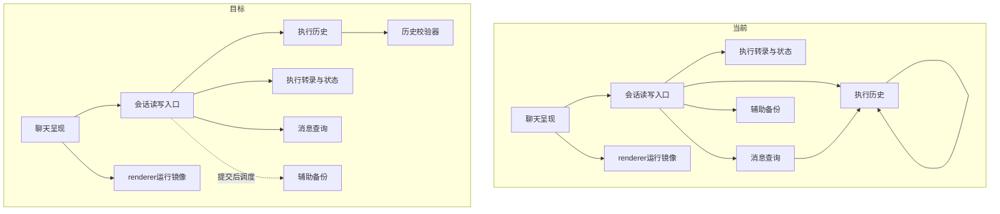

# 会话存储全链路性能改进方案

> 状态：**近期性能修复详细草稿＋架构精简目标模型，未实施**；2026-10-30。本版取代模型重审稿的悬置选型，不再并行设计JSONL迁移。
> 代码事实：`58d28d76fc39d258e17c6ced726de03a434afdf6`；本轮工作区HEAD `b20bac20`，中间仅本专题文档变化，用户安全代码修改不纳入。SpaceAssistant 0.3.1。
> 授权：完善方案及取证；不实施代码、迁移、文件删除或发布。路线依据见[路线对比](./会话权威存储路线对比.md)，本文只规定推荐路线。
> 证据边界：Mac源码核查、前版临时库实验与定向测试；无故障Windows profile、真实用户库与安装包证据，不宣称Windows已修复。
> 阅读：第0层决定范围，第1层给出变更面与契约，第2层定义正常路径和提交规则，第3节定义迁移、阶段与验收。本文不维护实施任务进度。

### 本轮核销【人机共读】

| 上轮问题 | 本轮处理 | 限制与证据 |
| --- | --- | --- |
| 是否已经最大精简不清楚 | 将近期修复与架构目标分开，定义三项终局及停止精简的判据 | §1.6；目标模型不冒充可执行格式规格，不新增实施阶段 |
| 未说明旧校验的必要性与精简依据 | 增补保护目标、成立前提与替代证明，区分保留、替换和尚不能退出 | §1.4；不以SQLite事务覆盖外部工具或文件故障 |
| 未说明性能改善的因果链 | 逐项列旧工作量、减少机制、残余成本和反证标准 | §1.5；显著改善为待验证假设，不是实施结果 |
| 模型悬置SQLite／JSONL，无法落实 | 固定SQLite权威提交、查询与导出单向派生；移除另起JSONL权威的候选流程 | 路线推荐不等于已批准具体新字段或操作完成语义 |
| 加模块却没有替代关系 | 不建性能Worker、编码凭据、通用事务回调或独立诊断系统；只提案在既有stream增加两个推进状态字段，替代追加全前缀重放 | F-22揭示旧pending-view已退役；新字段有明确提交owner与修复边界，不复活缓存fallback |
| “合并／删除”停在口号 | 列出转录、checkpoint、文件压缩和用量、renderer镜像的消费者及逐项退出门槛 | F-20～23；旧文件确有可能独占事实，不批准全局删除 |
| 性能覆盖仍可能漏入口 | 回执、preview、首屏后live／summary、直接追加与恢复均单列规格和验收 | F-01～23、AC-01～12；未实施 |

## 第0层：目标与取舍【人必读】

**让新增执行记录只推进必要状态、普通读取只取所需内容；数据库负责提交，页面和辅助文件不再互相重建来证明可以继续。**

本项目既要记录顺序执行轨迹，又要查询消息、编辑队列、领取执行权并一致提交下一轮上下文。推荐保留数据库作为权威存储，利用已有事务能力；问题集中在重复全量处理和职责重叠，换成逐行日志不会自动消除这些工作。

**本版四阶段只交付近期性能修复，不代表架构精简完成。** 架构精简还必须解决旧文件兼容的终点、正文共享、运行恢复与展示的职责分工；目标与设计缺口见第1层，未成熟的格式不混入本轮实施批准。

本轮交付不承诺“所有历史都不再有全文快照”。已提交模型上下文仍是必要执行材料，完整读取、编码及导出成本与实际字节相关。任何残余成本超过验收预算，必须报告未达标，不能把本版方案称为完整性能修复。

### D-1：推荐采用数据库单一权威提交

背景：当前有数据库事实、转录、展示快照和文件台账，部分路径反复重建和比较。需要收敛长期职责。

- A：数据库统一提交执行事实和必要状态，页面与文件从它生成；减少重复裁决及恢复协议。代价是必须调整既有消费者，旧数据独占事实需先转换。
- B：以逐行日志重新承担会话事实与执行状态；历史文件更易检查和搬运，但需重做接纳、编辑、写入所有权和恢复协议，不是只换输出格式。
- 可逆性：方案可改；数据删除须单独满足回退条件，不由路线选择授权。
- 证据：本项目查询、队列、领取执行权和终态提交已核实；没有相同耐久保证下的两介质基准，不以速度排名选型。
- 明确推荐A，本版按A设计，B不并行排期。用户要求继续完善文档，不解释为代码或迁移批准；未另行批准只保持草稿。
- 下钻：INV-01～05，AC-01～12，F-01～23。

### D-2：是否把追加校验的当前状态随事件一起保存

背景：每批新增事件都重新读取旧事件并推导待处理工具和审批，长执行中重复工作不断增长。仅存在内存里则还需处理外层事务回滚和缓存失效。

- A：随执行记录一起保存一份精简的校验当前状态，替换每批全量重放。对用户无新操作，历史含义不变；新增两个数据库字段和一版内部状态编码，升级需补齐旧记录的当前状态。
- B：暂不增加字段，保留全量重放。减少本次格式变更，但追加成本仍随旧事件增长，本方案不能宣称解决密集工具追加问题。
- 可逆性：旧记录不改写、不删除；旧包因数据库版本升级不能直接回开，需先用配套回退包移除新字段并恢复旧schema版本，升级后新增事件必须全部保留。不能简单把版本号改回去。
- 证据：全前缀读取、旧缓存退役及事务回滚规则已核实；新状态的等价性需差分测试。状态大小依赖仍待处理事项，不承诺严格恒定成本。
- 推荐A，仍待批准；未批准不实施此格式变更，其他无格式依赖的局部读取优化可独立实施，但不得据此报追加问题已完成。
- 下钻：INV-01、02，§2.3、§3.1，AC-01／02／09。

### D-3：普通操作成功是否只等待数据库提交

背景：编辑和队列操作在保存后仍可能等全会话辅助文件导出，文件失败还可能污染已提交操作的返回。

- A：成功表示数据库已提交，辅助文件随后导出。普通操作更早返回，文件可能短暂落后；显式导出仍须报告真实完成，正常退出继续遵守既有排空条件。
- B：保持等待文件，兼容当前完成时点，但大会话导出仍延长交互等待。
- 可逆性：不改文件形状，可恢复等待；已经返回的成功不能事后改成“数据库没保存”。
- 证据：等待链已核实；外部脚本是否依赖即时文件未知，必须在实施前核对消费契约。
- 推荐A，待批准；未批准采用B，不偷偷更改回执。本版不引入乐观消息展示，数据库回执仍是独立屏障。
- 下钻：INV-04、05，§2.6，AC-04／07。

### 交付边界与待批清单

推荐路线与具体格式分别评审：待批为本版数据库职责收敛、两个状态字段及其迁移／回退、普通操作完成条件。没有新增界面、开关、用户错误码或新的外部IM行为；不把普通桌面回执变化自动套到远程渠道。所有权、安全审批和未知工具效果规则保持。

Mac和自动化可验访问范围、追加规模、回滚与恢复；Windows原故障、真实库、安装包和真实IM仍是外验，不能标为通过。不需要负责人决定函数拆分或猜测代码事实，由实现者完成取证与验证。

最可能推翻本方案的三处：①精简状态无法等价表达已有审批／未知效果规则，须回退状态设计；②去掉不必要扫描后必要全文处理仍造成持续长阻塞，须另审物理布局或线程所有权，本轮不能强行过验；③旧文件或旧转录版本存在未迁移的独占消费者，停止相应退出，不以“可派生”口头承诺删除。

## 第1层：评审包【人机共读】

### 1.1 当前与目标链路



SQLite唯一writer仍为主进程既有存储入口，统一走`runInTransaction`；事件和新推进状态同事务。模型转录与终态保持现有同事务规则；消息查询不自行回写旧元数据。辅助文件由既有单会话备份链发布，renderer不决定执行事实。图中提交后调度为D-3=A目标，未批准时保留原回执时点。

### 1.2 变更面

| 单元 | 作用简述 | 类型 | 具体范围／依赖方 | 对应 |
| --- | --- | --- | --- | --- |
| 历史校验器 | 推进工具审批生命周期 | 改对外契约 | `packages/agent-sdk/src/history.ts`及公开导出，纯状态函数供MemoryHistory与SQLite共同消费 | D-2／INV-01、02 |
| 执行历史 | 提交事件和校验当前状态 | 改对外契约 | `electron/database/agentHistoryStorage.ts`、schema／migrations、`electron/runtime/sqliteAgentHistory.ts`；两个持久化字段 | D-2／INV-01、02 |
| 执行转录与状态 | 管理已提交上下文和归属 | 改承重边界 | `electron/database/sessionTranscript.ts`、`electron/sessionStorage/execution.ts`、交接宿主；状态小查询与精确正文读取 | D-1／INV-02、03 |
| 会话读写入口 | 接纳作用域内会话操作 | 改对外契约 | `electron/ipc/sessionIpc.ts`、`agentProtocolIpc.ts`、`ipcShared.ts`；仅D-3完成时点变化，无新通道 | D-1、3／INV-04 |
| 消息查询 | 提供页面与局部消息数据 | 改承重边界 | `electron/database/operations.ts`、`electron/sessionStorage/queries.ts`及公共读取包装；preview与summary | D-1／INV-03、05 |
| 文件台账消费者 | 读取旧压缩与用量事实 | 改承重边界 | `electron/sessionStorage/sqliteSessionStorage.ts`及retention adapter；按类别分离旧数据入口，禁止全局删除 | D-1／INV-03、04 |
| 消息checkpoint | 保存运行恢复快照 | 改造 | coordinator／数据库checkpoint；去掉无变更字段重编码和无必要整行读回，不取消关键检查点 | D-1／INV-02、05 |
| 辅助备份 | 输出可重建会话副本 | 改造 | 既有备份调度、文件发布与shutdown；复用排空链 | D-3／INV-04 |
| 聊天呈现 | 加载消息并提交用户操作 | 改造 | ChatView、messageMutationGateway；辅助请求独立，网关回执分段计量 | D-1／INV-03～05 |
| renderer运行镜像 | 路由运行中消息补丁 | 改造 | chatRunnerService；去无调用的历史合并出口，保留add／patch／remove与overlay | D-1／INV-03、05 |
| 实时展示发布 | 构造并通知展示快照 | 改造 | TurnDisplay协议、publisher及store；修正摘要缓存、避免无效订阅通知 | D-1／INV-04、05 |
| 回归与规模夹具 | 验证恢复语义和工作量 | 改造 | 既有History、存储、展示及切换测试簇扩展；不建独立诊断框架 | D-1～3／INV-01～05 |
| 页定位与构建预算 | 定位正文及限制派生负载 | 复用不改（待验证） | 现有source locator、版本与Worker预算，不再派发一套性能Worker | D-1／INV-03、05 |
| 安全与执行租约 | 裁决授权及执行所有权 | 复用不改（待验证） | 保留policy、final-check、claim及未知效果规则 | D-1／INV-02 |
| 引用与回收 | 管理权威大正文生命周期 | 复用不改（待验证） | 保留spill完整性、引用及GC；不删除转录owner种类 | D-1／INV-02、04 |

总计15逻辑单元：改既有12、新建0、复用3；改对外契约3、改承重边界3。新增数据库列2、内部编码版本1、schema升级1；新表0、新用户错误码0、新开关0、新诊断事件0。状态JSON的8个成员在§2.3定义，不把它们混入SQL列数。四个实施阶段的出口见§3.2；表中“改对外契约”不表示本次文档已实施。

达到拆分门槛，本文保留同一方案的理由是旧版问题跨追加、状态查询、preview和首屏后任务，必须用一份端到端验收避免局部变快却仍阻塞。以四个可独立回退阶段隔离；文件事实转换与完整上下文格式合并超出本轮可安全落定的规格，独立后续详设，不借本文批准。不会将它们作为未完成子任务藏在“已全部简化”结论中。

### 1.3 契约面六面

| 面 | 结论及依赖方 | 旧数据／调用方验证 |
| --- | --- | --- |
| agent-sdk | 改纯计算公开导出；HistoryPort与事件词汇／审批枚举不变，无反向宿主依赖 | `check:agent-sdk`、`typecheck:agent-sdk`；MemoryHistory旧事件夹具和增量／全量差分 |
| 会话存储 | 改内部状态读取、局部正文准备和追加实现；唯一writer不变，新增两列 | 三项存储边界门禁；旧库补齐、嵌套回滚、直接追加、spill、track及续跑用例 |
| IPC／preload | D-3=A只改普通桌面操作完成时点，通道／参数／返回字段不变 | 阻塞导出仍可重读DB；DB失败不返回成功；退出与显式导出不提前结束 |
| 共享类型 | 不改产品领域形状；内部TranscriptState与SDK校验状态单独命名，不复制Message | `typecheck:shared`、renderer类型检查；所有依赖live的现有调用回归 |
| 其他持久化格式 | 改：agent_history_streams新增两列、内部JSON v1；schema由117升级到118（实施时若冲突则重新分配并同步本文） | migration与回退包测试；旧spill、转录、JSONL及JSON备份形状保持 |
| 领域数据格式 | 不新增规则／配置／产品错误码或日志事件名 | 使用现有错误通路及trace；不落正文、路径或凭据；新增错误标识须另审 |

当前门禁成绩仍为附录B历史基线，不等同拟议实现。实施后必须重跑上表命令并做旧数据差分；不能以门禁通过替代语义测试。

### 1.4 旧方案为什么需要校验，新方案凭什么少做

旧方案保护的目标大多合理，问题在于部分保护通过“每次重新推导完整历史、比较不同表示、等待派生完成”实现。以下是从代码职责还原的设计理由，不等同于已找到所有历史决策的原始记录。不能把它们整体归因为过度设计，也不能以“选SQLite”作为删除理由：当前本来就在用SQLite。

| 原机制与保护目标 | 为什么原做法成立／需要它 | 新方案如何承担同一责任 | 精简的边界与验收 |
| --- | --- | --- | --- |
| 每批重放历史，阻止非法工具／审批转移 | 仅看新增事件不知道此前是否批准、工具是否结束、重试是否获准；从完整前缀归约能恢复这些前提 | 将同一归约结果随事件同事务推进。规则不减，只替换求出前置状态的方法 | 增量状态必须充分表达旧规则；差分、随机序列和回滚通过才替换。状态缺失显式准备，不能当空状态继续；AC-01／02／09 |
| version、幂等键、租约代次、receipt及不确定效果核对 | 并发、重入和崩溃会造成旧执行者写入、重复提交，外部工具效果不能随DB回滚 | 原有检查保留；事务只约束库内事实，不证明工具没有执行过 | 本轮不以“单一权威”为由删除，unknown不能自动重试；AC-02／06／09 |
| 文件与canonical比较、回填及readiness | 迁移期间两边可能不完整，旧文件还可能独占压缩／用量事实；贸然只读DB会静默丢信息 | 只有已证明被DB完整覆盖的类别才能退出双源裁决；旧数据转换必须另有完成证据 | 本轮未定义完整转换标记，不能全局退出。七个proof字段已退役，不计为本轮删除或提速；F-21／22及AC-06 |
| 从转录全文取得状态或单条预览 | 复用完整读取器可以沿用正文还原、来源与一致性验证，但把其成本带入了小查询 | 状态取checkpoint；preview只准备候选正文，在写事务核对候选和来源版本 | 不验证未使用的无关正文；实际使用的正文仍需完整性和最终版本核对。检查范围缩小，不把损坏当成功；AC-03／10 |
| 转录版本、spill摘要／引用及回收保护 | 已接纳请求和恢复流程引用特定上下文；DB事务不能保证库外大文件存在或未损坏 | 本轮保留版本与完整性边界，复用同次编码材料，局部读取不触碰无关正文 | 未完成引用格式与消费者替代前不能删完整转录／跳过spill校验；AC-06／09／12 |
| 回执等待备份、renderer重建历史镜像 | 前者让返回时文件尽量新，后者曾给调用方完整本地历史；两者是特定消费契约，不是DB提交的必要证明 | D-3批准后回执只承诺DB提交；renderer仅保留仍被消费的运行路由，读取历史交还存储查询 | 这是完成契约／职责收窄，不能称为等价删除；显式导出仍等待，运行补丁不丢；AC-04／07／11 |

**增量校验成立的核心论证**：设旧规则对历史前缀H归约得到状态S，追加批次为B。必须证明“从S校验B”与“从H全量校验B”得到相同接受／拒绝结论及下一状态。新流从空状态开始；每次事件、版本、下一状态同事务提交，回滚一起撤销，由此逐批保持等价。旧流第一次显式重放建立起点。这里依赖的是充分状态、唯一写入口和事务归纳，不是相信某个缓存永远正确。它也不提供对任意手工篡改数据库的每次全历史审计；此类检查属于显式恢复／审计边界，不能冒充热路径已覆盖。

因此本版的精简有三种不同含义：**同一规则换成增量执行；消费范围缩小后不再验证无关材料；改变完成契约后不再等待派生副本。** 真正仍跨故障边界的检查保留。旧文件双源的大规模退出目前尚未完成设计，不能用它解释本轮预期性能收益。

### 1.5 为什么会改善性能，哪些问题还没有解决

性能收益来自少读、少解析、少编码和缩短同步任务，而非数据库名称变化。下表中E为单invocation已完成事件数，P为活跃待处理状态大小，B为新增批次，M为会话正文总字节，m为候选消息字节，L为已加载历史，T为累计工具数组字节。以下是源码工作量推导；不能直接换算成Windows延迟倍数。

| 问题与事实 | 旧路径成本／用户影响 | 新路径减少什么 | 剩余约束与证伪方式 |
| --- | --- | --- | --- |
| 密集追加 F-01／02 | 固定小批次反复读解析前缀，累计事件访问近O(E²)，同步占用主进程，后续新建／submit的IPC也排队 | 热追加约O(P＋B)，不再读取已完成前缀；固定P、批次及事件大小时累计近O(E) | P可增长，冷准备仍全量，索引／事务／spill成本仍在；AC-01／12若历史访问仍随E增长即失败 |
| 状态与preview F-04／18 | 只要几个字段或120字预览也承担O(M)正文读取、水合，preview还延长写事务 | 状态正文读取0；preview正文范围降到候选m，写事务只复核必要身份和版本 | 候选本身可很大，冷locator／兼容准备仍计成本，竞态可重试；AC-03／10分别测冷／热路径 |
| 首屏与submit F-09／19／23 | dispatch后的同步历史clone阻挡绘制；summary同步扫描还占用主进程；无关IPC争用同一队列 | live初始化不随L clone；辅助请求解除交互依赖，保留真实必须等待的sequence与准备步骤 | idle调度只移出关键路径，不减少summary的O(M)工作；主进程仍可能卡。AC-05／11／12必须同时看绘制与连续阻塞 |
| checkpoint和展示 F-08／14 | 工具结果频繁触发，反复编码未变字段、整行读回、构造与广播累计快照 | 局部写、复用未变材料和变更通知，减少无效编码／IPC消费 | 改变的累计工具数组仍可能每次O(T)，完整展示协议仍在；AC-08／12超预算须继续格式或线程设计 |
| 回执与导出 F-13／17 | DB提交后仍等全会话辅助导出，网关随后才dispatch | D-3批准后移除导出等待，独立测DB往返与UI更新 | DB确认屏障仍在，导出后台CPU也未消失；只早返回不能证明总负载下降。AC-04／07／12 |
| 新建与列表 F-12／15 | INSERT本身局部，可能在上述同步任务后排队；列表读清理还触发写与flush | 少做主进程同步工作以降低排队；列表去读副作用、过滤下推 | 未证明新建瓶颈全在此，busy等待／WAL／其他模块仍可能阻塞；AC-10／12分开记录排队与执行时间 |
| 必要完整上下文及文件 F-03／05～07／11／20／21 | 恢复、模型请求、旧数据、spill或导出确实可能需要大范围处理 | 只保证正常小查询不重复承担它们，同次材料减少重复计算 | 本轮未消除必要全文与legacy双源，不能承诺这一组获得量级改善；AC-06／12及UV-05 |

**预期最强的改善是密集工具追加的增长曲线，以及小查询随会话总量增长的无关扫描。** 这两项确实减少总工作；辅助请求延后和备份不阻塞只改变等待位置，必须另测后台负载。主进程是共享执行队列，减少这些大同步任务有机会同时改善新建、加载和提交，但尚无profile证明它们就是Windows单核满载的全部来源。

“显著改善”的验收必须分两层：先以行访问／正文／编码字节证明上述工作量下降，再以同机同夹具的端到端p50／p95／max及主线程连续阻塞证明用户等待缩短。若旧路径占比不足，或剩余全文／累计快照接管瓶颈，即使局部测试通过也只能报告局部优化。当前证据支持改造方向和可检验假设，**不支持已保证整体显著改善，更不支持Windows卡死已解决**；AC-12不通过时本方案不能收尾为整体性能修复。

### 1.6 架构精简的终局与边界

#### 两项交付分别关闭

本文保留一个文件，分别定义近期修复的详细规格与架构精简的目标模型。§1.2的15单元、四阶段、12项AC只统计近期修复；下述目标尚不是另一个可执行方案，不借当前D-2／D-3批准新格式。近期验收通过可以关闭对应热点，不能将三项目标标成完成；架构工作也不应阻挡无格式依赖的近期修复。

| 交付 | 可以承诺的结果 | 不能据此宣称的结果 |
| --- | --- | --- |
| 近期性能修复 | 消除重复前缀归约、控制读全文、预览全会话重建、live历史复制等已列工作；按AC验证 | 全部双源退出、全文副本合并、累计展示协议已解决 |
| 架构精简 | 正常路径各有明确事实来源；兼容有终点；相同不可变正文可共享；展示不承担执行恢复 | 当前文档已经给出新schema、IPC版本和可执行迁移；这些须完整规格与独立评审 |

目标按职责分为三层：**执行事实和业务状态**保存不可重新猜测的信息；**上下文版本和恢复材料**保存继续执行所需的稳定引用与必要进度；**查询投影、展示和导出**为消费者提供表示。三层不是三份全文，也不是三个存储服务；优先复用当前模块。数据库统一提交不意味着所有事实必须从一条事件流重放生成，队列编辑、接纳和执行权仍是独立业务事实。

#### 旧双源：兼容处理必须能够结束

目标是新执行只消费数据库事实，JSONL只承担可重建输出；旧文件的独占事实经过兼容入口一次性导入，转换后的普通读取不再比较两边来决定可信度。不是先删文件再接受丢数据。

本主题已有[会话台账拒绝服务清理专项计划](./会话台账拒绝服务清理-最小执行计划.md)，其文首记录独立工作树的源码／隔离验收完成、保守删proof路径与保留outbox载荷的边界，不能误读为当前分支和真实库已全部切换。**该专项持有台账退役协议，本方案不新增第二套标记、修复器或有损策略。** 已批准的旧压缩缺失处理也不在本文重新裁决。当前F-21说明本分支仍有旧事实消费者，两者应通过提交、调用方和夹具逐项对齐，而不是择一相信文档状态。

| 顺序边界 | 必须形成的结果 | 失败时保持什么 |
| --- | --- | --- |
| 事实覆盖 | 按压缩、meter及其他实际消费者列明DB已覆盖／仅文件有／两边均缺／冲突；沿专项既有身份和修复规则归并 | 不静默宣告已转换，不把未知当无历史 |
| 消费者切换 | 同一旧夹具经转换后，不提供旧文件仍能得到批准范围内相同的模型输入、窗口及用量语义；桌面、IM、恢复、retention均纳入 | 未覆盖类别继续兼容，不能只迁移存储入口就宣称全部切换 |
| 停写与删除 | 沿专项AC-S9等判据处理outbox可重建性、旧义务与回退；确认消费者退出后再删对应材料 | 不把“proof已退役”扩大为“载荷与文件都能删” |

完成标准是**受支持、已转换会话的正常执行不再依赖文件存在／可写／两边一致**。未转换数据保留一个显式兼容入口；没有必要为“看起来更少”立即删除全部旧读取代码。物理删除是之后的生命周期动作，不能反过来决定执行准入。

#### 重复正文：共享内容，保留版本含义

目标不是把已提交上下文改成“当前消息表”。上下文含压缩、系统材料和工具配对，必须能还原某次已接纳输入。应保留上下文版本及引用顺序，优先共享其引用的不可变正文；UI可见顺序与模型上下文顺序各自保留语义，不再分别复制相同大块内容。

候选逻辑模型是“不可变正文＋有序上下文引用＋执行记录引用”，不在本轮指定新表或内容寻址仓库。终态仍提交新上下文版本，但未变正文复用；压缩摘要是新正文，不能覆盖原输入。初始context若等同于某个已提交版本则引用该版本；新增系统／用户材料单独保留。requestSnapshot已只存计数和摘要，不重复改造。

这项改造的反例必须先解决：首次接纳冻结后用户编辑消息、失败续跑引用旧版本、人工复核替换上下文、spill损坏、删除与GC、压缩前后窗口不同。版本相同或正文摘要相同都不能单独证明模型输入相同，还要核对有序材料及配置语义。迁移／回退必须保留升级后新增材料和旧引用，不能以恢复升级前备份代替回退。

**精简到这里应停止继续合并职责。** 将每个字段拆成通用事件、建立通用对象存储或把所有快照改成无限增量链，可能增加schema、引用、GC和恢复深度。详细设计应先验证复用现有spill与引用索引能否实现正文共享；若为了节省小文本副本反而增加多次随机读取，就保留小快照。目标是减少重复大正文和反复编码，不追求字节绝不重复。

#### 运行恢复与展示：一份执行进度，多种可重建表示

目标是事件／审批／工具结果承担执行事实，已有claim／receipt承担执行所有权和提交结论；恢复checkpoint只保留不能廉价还原或尚未进入执行事实的必要进度。checkpoint可以作为恢复加速材料，但不能成为同一工具结果的第二个独立裁决者。工具结果已经可靠记录与“只在展示快照里出现”的窗口必须区分，不能仅按字段看似相同就删掉其中一份。

TurnDisplay只承担展示，不用于批准重试或证明转录提交；renderer运行镜像只路由活跃更新，历史来自分页查询。展示丢包或重连通过权威状态生成当前展示，不能倒灌成为执行事实。

高频工具更新的目标是只持久化／发送发生变化的必要材料，而不是每次复制累计数组。**暂不默认引入delta IPC协议**：先测现有完整快照的字节和构造成本；若它超预算，才在独立格式规格中定义首次快照、增量身份／顺序、重复应用、缺口重取、会话切换及协议兼容。一次更新不再重编码其他工具正文，应成为该规格的工作量断言。若完整快照已满足预算，保留简单协议比新增一套消息恢复协议更合理。

#### 怎样判断已经精简到合理范围

每份长期保留材料必须能回答“独占什么事实／服务哪个必要消费者／谁写入／何时提交／损坏由谁恢复”。同一事实出现多份表示时，要么存在明确恢复或查询收益，要么应退出；不能只用“兼容”无限期解释。以下三项逐项关闭，才可以宣称架构目标完成：

| 目标 | 可核对的退出证据 | 尚缺的设计输入 |
| --- | --- | --- |
| 双源结束 | 已转换集合正常路径无文件裁决；文件故障不改变DB已提交结果；未转换入口和旧义务可枚举 | 专项工作树与当前分支的覆盖对齐；各类别转换与回退证据，不另造协议 |
| 正文共享 | 未变大正文不随新上下文反复写入；指定旧版本可精确重建；恢复／GC／回退通过 | 现有owner及引用的完整映射、精确引用格式、数据迁移与保留策略；须独立格式决策 |
| 状态分工 | 每个恢复字段都有必要性证据；展示可重建；高频更新不无故重编码其他结果 | checkpoint逐字段恢复窗口、累计快照字节基线；若改IPC，须独立协议决策 |

这三项是设计完成检查，不新增本轮AC编号，也不能靠声明“以后会做”关闭。架构评审前由实现者补齐完整变更面、六面契约、迁移／回退和验收，负责人审批新增格式／完成契约；未成熟时保持目标模型状态。合理精简的终点是**消除无必要的重复事实裁决和工作量，同时不为消除少量副本增加更昂贵的引用、恢复和同步协议**。

## 第2层：SQLite路线规格【机｜人工可跳过】

### 2.1 不变量与数据所有权

| ID | 不变量 | 验收 |
| --- | --- | --- |
| INV-01 | 事件、stream.version及推进状态同事务提交；回滚不能留下领先状态；幂等重复不再推进 | AC-01、02、09 |
| INV-02 | 审批绑定、终态顺序、unknown retry原子批次、租约代次和不确定提交不削弱；正文损坏不伪装缓存miss | AC-02、06、09 |
| INV-03 | 控制信息读不水合正文；页／preview不重建全会话；已支持旧数据不能因退出fallback而变空 | AC-03、05、06、10 |
| INV-04 | 派生失败不撤销权威事实；运行路由保持；旧文件独占事实迁移前不删；正常回执不与辅助成功混淆 | AC-04、06、07、11 |
| INV-05 | 所有性能结论分别核对访问范围、必要字节及主线程阻塞，不能以异步签名、短返回值或乐观展示代替少做工作 | AC-01、03～05、08、10～12 |

| 材料 | 唯一writer／提交点 | 真实消费者 | 结论 |
| --- | --- | --- | --- |
| agent_history_events／streams | 现有追加helper／SQLite事务 | SDK恢复、审批与工具对账、canonical正文及压缩查询 | 保留事件，替换每批全量transition验证；恢复仍可全量重放 |
| accepted_turn_contexts、queue／claim、receipts | 现有接纳、领取及转录提交事务 | first-acceptance配置冻结、FIFO、执行fencing、幂等及恢复 | 保留必要事实，不能只因字段重复就合并 |
| session_transcript_checkpoints | 现有转录提交与恢复入口／事务 | acceptPrepared、readTranscriptState、claim、恢复 | 保留version／status；只查状态不读entries正文 |
| session_transcript_entries | 现有终态提交与人工复核恢复／事务 | hosted交接与错误恢复、按turn/version核对、spill引用、删除和存储统计 | 本轮保留格式与版本；不把它当UI缓存删除 |
| messages／turn checkpoint | 现有消息与coordinator存储／事务 | UI骨架、排队编辑、失败呈现与运行恢复 | 保留身份／状态职责；局部写入，不每次重编码未变字段 |
| 正文source locator／投影页 | 现有构建器／发布版本 | 页、单条、API baseline、搜索及导出 | 已有按页机制复用；旧回退单列，不建立新资格系统 |
| 文件events.jsonl | 既有ledger writer／既有文件边界 | sqliteSessionStorage压缩与meter、旧数据回填、retention | 目标退出DB已覆盖类别的裁决；legacy-only仍是材料，不能一刀切 |
| renderer live／overlay | 既有路由入口／本地更新 | add／patch／remove与API overlay；历史merge出口未见外部调用 | 只留运行中差量职责，不seed累计store历史 |
| JSON辅助备份 | 既有单会话调度／文件发布 | 显式导出、退出及外部文件消费 | 派生输出；两文件不是原子对，不提高恢复保证 |

模型上下文和UI气泡并不等价。压缩窗口、系统消息、失败续跑和工具配对仍要保留，不能用messages表的可见数组替代已提交上下文。

### 2.2 保留／替换／退出映射

| 对象 | 本轮动作 | 退出证据／阻断条件 |
| --- | --- | --- |
| 追加全前缀读取与transition重放 | D-2=A后替换为同事务推进状态 | 两种验证差分及回滚／重复／旧流补齐通过；不同时保留热路径全量对拍 |
| `canonical_invocation_pending_views`旧缓存 | 不复活，不恢复旧表及fallback | 新状态不是每次可丢的缓存；缺失进入显式修复，禁止普通追加偷偷重放 |
| 状态读水合全文 | 退出 | acceptPrepared及readTranscriptState只查询checkpoint行；正文读取计数0 |
| preview事务内全转录 | 退出 | 候选身份与queue版本重核，只读候选正文；无关历史增长不增访问量 |
| live全历史seed与无调用merge出口 | 退出 | 调用方清单与页面／后台会话／overlay回归；routeAdd／Patch／remove继续 |
| 转录完整快照／invocation上下文 | 本轮保留、减少同次重复编码；不再声称可立即合并 | 后续先列每个版本的accepted引用与恢复消费者，再定义不可变引用／增量格式及回退；这部分残余成本必须实测 |
| 文件压缩与meter双源 | 本轮拆正常canonical读取与legacy转换，停在有证据的类别边界 | legacy-only、部分backfill、冲突及retention均有处理前，不停写全ledger、不删文件 |
| 已退役proof字段／旧projection fallback | 不重建新证明层；只移除已无消费者的代码 | legacy_required注册和在途清理计划仍有效；不能为了本方案统计“删除”而破坏支持范围 |
| 普通操作等辅助导出 | D-3=A时退出等待 | 外部消费契约核对；显式导出和shutdown仍等真实完成 |
| checkpoint整条更新／展示无效重算 | 改为局部字段写入与变更驱动通知 | 不取消关键确认、tool-result和终态的现有持久化时点 |

两类后续工作明确不在本轮物理删除授权内：文件独占事实转换、完整转录／上下文引用格式重构。若AC-12显示它们仍主导阻塞，本轮只能交付局部改进，整体性能目标保持未验收，须继续上述详细设计。

### 2.3 增量追加：用事务状态替代缓存协调

**持久化提案（D-2）：** 在`agent_history_streams`增加`transition_state_version INTEGER NULL`、`transition_state_json TEXT NULL`。版本表示归约编码，不是事件schema；新建流首次追加即写v1，旧流两列均NULL表示未补齐。新表0。stream.version仍是唯一事件序列提交版本，不另增第二个水位。

JSON v1固定8个成员：`invocationId`、`turnId`、`terminalKind`（null或已有终态kind）、`pendingToolCalls`（唯一字符串数组）、`pendingApprovals`（唯一字符串数组）、`approvalIdentityByPendingId`（字符串二元组数组）、`deferredTodoIds`（唯一字符串数组）、`unconsumedRetryApprovals`（approvalEventId到toolName／inputHash的二元组数组）。排序用于确定编码，解码后须按唯一规范编码重编码并与原串相等，以拒绝重复键及非规范值；另检查非法身份和集合重复项。没有正文、权限决定或载荷副本。

unknown retry消费后移除unconsumed项；再次消费因不存在被拒绝，与现有missing-or-consumed拒绝含义一致。approvalEventId是已持久化事件身份，不能靠换payload重用；同批批准／消费／tool-start按顺序处理。`pendingUnknownRetryStart`只存在当前批次局部，批末必须为空；不落盘“消费了一半”的状态。已关闭stream保存terminalKind以拒绝再次追加。状态规模依赖未完成事项，deferred引用仍有生命周期成本，不声称O(1)。

历史校验器在现有文件导出两个纯函数：`createHistoryTransitionState(previous: readonly HistoryEvent[]): HistoryTransitionState`和`advanceHistoryTransitionState(state: HistoryTransitionState, incoming: readonly HistoryEvent[]): HistoryTransitionState`。前者从空状态校验归约完整前缀，后者不得修改输入状态、失败不返回部分状态；`HistoryTransitionState`就是上述v1的只读内存形状。旧`validateHistoryTransition`保留签名并委托同一规则，MemoryHistory依然可作全量参照。不会新增SDK→宿主依赖，不复制两套审批规则。先以旧validator做差分，确认旧合法事件及非法批次结论相同，再替换旧实现；不为提速改拒绝条件。

一次普通追加，在原事务内按顺序执行：

1. 保持批次格式、canonical JSON、process generation、session归属、幂等身份与expectedVersion检查。精确重复沿既有分支返回，不推进状态；冲突仍拒绝。
2. version=0的新流从空状态推进。已有流必须有可解析v1状态且身份匹配；缺失／不支持／损坏时不追加、不执行工具，调用既有错误通路进入显式准备／修复。不能在普通追加中悄悄回退全量读取。
3. 只读取当前状态并校验incoming；检查sequence、批末unknown retry及terminal顺序。写事件／引用／projection义务，更新stream.version与两个字段，仍在同一事务。
4. 若还有terminal transcript intent，保留现有租约、baseVersion、receipt和message mirror同事务提交。最外层COMMIT后才返回成功；SAVEPOINT释放不是持久成功。

不增加内存权威状态，因此不需要事务提交回调、WeakSet凭据或cache revision协议。外层回滚同时回滚新状态；COMMIT unknown按现有不确定路径恢复，不假定提交失败。存储读回状态的解析／编码成本为O(未完成状态)，历史校验成本不再依赖已完成正文；这比声称全流程线性更准确。

**显式旧流准备／修复：** SDK恢复／续跑准备阶段按invocation读一次完整前缀，验证事件与归属、生成v1状态；短事务重核stream.version及session generation再写入两列。漂移则丢弃结果重试，最多2次后返回既有准备失败，不能无限争用。损坏历史不补齐。新的accepted input和continuation version=0直达helper无需旧流准备；已有流全部生产写者必须先调用同一准备入口。前台普通追加不触发整库扫描；修复完同一版本不再重放。

代码内删除session时一并删除stream状态；未来改写旧事件语义的迁移必须重建受影响流状态。禁止外部修改DB后继续信任旧状态；损坏库按恢复／审计路径处理，不以每次读全文自证覆盖任意篡改。

### 2.4 控制信息、上下文与局部读取

- 在既有sessionTranscript模块增加`readSessionTranscriptState(db, sessionId)`，返回`{sessionId, version, status, lastTurnId?}`，只SELECT checkpoint的version／status／last_turn_id，缺行保持version=0／ready语义。acceptPrepared、readTranscriptState及只查状态的恢复分支消费它。保留readSessionTranscript给真实正文消费者，不能改成返回空messages。
- hosted交接获得claim后读取确定的已提交版本；遇到版本漂移仍按既有baseVersion／claim规则处理。不改变trackScopedModelInput、system消息、required user及失败settlement上下文。一次准备材料的stringify／hash复用，不能跨版本缓存未经核验正文，也不删除spill读回完整性。
- preview：事务外选择排序／删除后的候选身份并按现有prepared单条读机制取正文，事务内重新应用队列检查、选择候选并比对id／role／timestamp／message revision和session source revision。完全一致才写preview；不一致不提交本次队列变更，重做准备，最多2次后既有queue_changed返回。scope和canonical-backed校验沿用既有规则，不把空preview当读失败成功。
- 页、单条、搜索、重试目标、API baseline、导出复用现有locator／prepared body与最终源复核，不能只优化page IPC。legacy_required保持明确旧reader，不能装作canonical已经就绪。session:list按现有profile语义下推过滤；读取不再顺便strip／flush，旧元数据清理放到既有维护入口，不新建维护队列。
- summary baseline仍必须返回现有完整语义。本轮先拆离交互屏障并复用一次解析结果；若其全量估算仍阻塞超过AC-12，不把延后调用算作修复，另交增量聚合或执行线程方案。markers独立effect，不虚构成markers→summary→live串行链。

### 2.5 桌面呈现与checkpoint

renderer live不再从Redux seed／clone全部已加载历史。运行路由以消息id维护本地差量，只包含routeAdd及后续patch／remove所需消息；未在live中的既有消息仍按现有Redux／overlay路径更新，不因“找不到live”丢补丁。`resolveSessionMessagesForApi`与`getLiveMessages`无外部生产调用时删除其导出及无用历史merge；不能据此改主进程模型输入。初始化页面与turn-started不再重建累计live；缓存释放沿既有会话生命周期。

ChatView page dispatch后允许下一次绘制；markers、summary与失败原因补齐独立调度和session代次校验，切换后旧结果丢弃。真正消费运行准备状态的操作保留明确await，但不等待无关summary／markers；submit的sequence查询单列，只有定位／排序确需结果的步骤等待它。

messageMutationGateway保留“DB确认后更新”的显示语义，测量edit-start→IPC→DB commit→reply→dispatch→下一绘制。队列edit／delete／reorder分别覆盖；通用commitMessagePatch基线无生产调用，不用它证明所有输入必经此路。不新增乐观overlay、保存状态UI或文案。

checkpoint保留当前确认、tool-result、reconcile和终态的立即提交时点，普通2秒窗口不扩大。仅编码变更字段，保留acceptedAssistantCheckpoint过滤；数据库写入只查身份／status／version必要列，成功返回值不要求整行时不解码读回。关键事件若仍携带累计工具数组，成本作为残余报告，不把降低checkpoint频率当成等价替代。

实时展示保持完整快照IPC及已有50ms／rAF合并，不另建delta协议；修复摘要cache替换时字节计数、相同长度不同值的错误复用，监听器只通知发生变化的turn。内容变化判定用既有数据身份／revision或精确值比较，不能用长度等同内容。摘要截断不能先把任意大对象完整stringify；若无法有界生成则单独测出，不伪装已解决。

### 2.6 文件事实与辅助导出

压缩与meter路径按类别区分canonical覆盖和legacy-only。当前`readCompactionReplayForLocation`／`readContextMeterEventsForLocation`的比较发现独占事实或部分回填时，保持受控转换／旧reader，不全局去掉readiness、sink或retention guard。canonical覆盖的正常读取目标只读数据库；判定不能新增每次全文件比较，需要由既有迁移审计结果发布一次性完成状态。**该完成状态的具体持久化规格尚未定义，故本轮只整理入口和取证，不实施切换或删除。** 这是后续文件事实转换方案的阻断项，不能借D-1绕过。

D-3=A时普通桌面操作在DB commit后scheduleBackup并返回；后台导出失败独立记录、保留旧有效副本并按现有调度重试，不把已提交成功改为失败。显式导出及shutdown仍使用既有flush／排空屏障，先排空再关库。复用3秒防抖与单会话operationChains，不新增第二套重试队列。D-3=B保留await，仅优化导出本身；schema与文件形状不因该分支变化。

### 2.7 绕过入口与故障矩阵

| 入口／故障 | 必须处理的结果 |
| --- | --- |
| prepareTurn accepted input／continuation直接追加helper | 新流空状态校验与事件同事务，不能只改SqliteAgentHistory宿主 |
| MemoryHistory／SDK独立宿主 | 旧接口可用，同一校验规则，无宿主依赖 |
| 启动恢复、续跑、canonical编辑、人工复核 | 旧流显式准备／修复；转录与unknown语义不变 |
| IM、butler及track作用域 | 底层追加与隔离测试覆盖，不自动变更远程回执 |
| 普通提交前退出／嵌套回滚 | 事实与推进状态一起回滚；不发布成功 |
| COMMIT返回unknown／IPC回执丢失 | 既有receipt与版本核对，不重做工具；重试同载荷可识别精确重复 |
| 工具已产生效果但结果未保存 | 保留unknown及现有审批恢复，不能从缺结果推断未执行 |
| 旧schema／未来state版本／状态JSON损坏 | 升级补齐／拒绝不支持版本／显式修复，不回落空状态继续 |
| 源revision、队列、claim或会话切换漂移 | 事务最终核验／旧回执代次隔离；不提交过期preview |
| 权威spill损坏／派生页缺失 | 前者失败并保留诊断，后者可重建；不混为同一种miss |
| 取消与迟到checkpoint、终态 | 保留version／streaming／租约屏障；取消不撤销已提交事实 |
| 导出失败／退出中有pending | 普通结果按获批完成条件，退出遵守排空；不提前关闭DB |

## 第3节：迁移、阶段与验收【机｜人工可跳过】

### 3.1 格式升级与回退实体

D-2升级在现有migration中以同一schema事务增加两列并推进版本；先列默认NULL，不在schema事务里扫所有历史。首次新流直接初始化，已有流在显式恢复／执行准备补齐。两个值NULL是未补齐，任一非NULL但另一缺失是损坏；不新增迁移进度表。字段自身表达每流完成：v1有效且绑定当前stream.version（与stream同次更新）；数据库事务保证无半发布。

纯迁移不会改旧事件、transcript、spill引用或备份。删除session沿原删除事务清理，无新GC owner。修复重放不发布新的History业务事件，只补充可由已提交前缀确定的状态；其版本竞争规则见§2.3。

精确回退实体为**本版兼容回退包R-SQLite-State-v1**，不是当前旧安装包。其确定算法：停止会话接纳与writer、排空既有任务、独占数据库；确认schema恰为本版118且两列编码只有NULL或v1（未来版本一律拒绝）；在`runInTransaction`内先DROP `transition_state_json`、再DROP `transition_state_version`，通过现有`schema_meta`版本键把118恢复为117；不修改或删除任何业务事件、transcript和引用。重开原117运行逻辑并使用全量validator，升级后新增的旧格式事件仍可读取。事务失败整体回滚，不继续运行旧包、不手改版本号。无需新增专用schema记录；前台功能、迁移与R包必须同一次交付。

本轮在当前完整schema的隔离新库验证：增列后按上述顺序删列，SQLite 3.53.3、242个schema对象定义前后一致、integrity_check=ok。该实验只证明当前schema下DDL可行；安装包内SQLite、含真实数据的迁移／回退、写入排空及重启恢复仍必须AC-09演练。R包未构建／未演练前不升级真实库。

schema迁移前副本用于灾难恢复，不作为升级后新增数据回退方案。本版不更改WAL／NORMAL／fsync保证；进程退出、OS崩溃和断电分别标明，不能声称提交成功等于硬件断电耐久。

### 3.2 四阶段出口（不维护进度）

| 阶段 | 输入／输出 | 出口证据 | 可回退实体 |
| --- | --- | --- | --- |
| P0 固定基线 | 当前代码→隔离规模夹具、调用与访问计数 | AC-12基线及恢复消费者清单，无真实库写入；明确时间预算和机器配置 | 仅测试／诊断代码，可整体撤回 |
| P1 局部正常路径 | 现有格式→状态小查询、preview局部准备、live差量、无副作用列表 | AC-03／05／10／11；renderer和存储定向检查，保持既有显示语义 | 原代码和原库格式；无数据转换 |
| P2 追加状态替换 | D-2批准、差分夹具及已验证R包→两字段、纯归约及直接入口接入 | AC-01／02／06／09；原全量热路径退出，旧流显式准备、R包演练及门禁通过 | R-SQLite-State-v1，必须保留升级后事件 |
| P3 发布与集成 | D-3分支确定→checkpoint局部写、展示复用、辅助导出及端到端验证 | AC-04／07／08／12；本机完整验收，残余全文和旧文件阻断明确列出，Windows保持外验 | 本阶段代码独立撤回；若同时撤P2须R包 |

四阶段是实现分界，不代表本轮批准排期。P1不等D-2；P3在D-3未批时走原回执，不伪称完成解耦。文件全切换、转录格式合并与物理清理不塞进P3“顺便完成”，另行详设。

### 3.3 验收映射与规模模型

| ID | 可执行断言／场景 | 对应 |
| --- | --- | --- |
| AC-01 | 固定batch和活跃pending数量，扩大已完成事件前缀；热追加历史行访问不随E增长，状态／编码字节按pending单列；冷准备一次后不重复全量读取 | D-2／INV-01、05，F-01～03、22 |
| AC-02 | 增量与旧全量validator对合法及非法事件批次差分；覆盖terminal、审批身份、defer、unknown retry批准／消费／start原子性；随机操作序列断言事件版本及推进状态一致 | D-2／INV-01、02，F-02、22 |
| AC-03 | acceptPrepared与readTranscriptState正文访问为0；preview只读候选正文，扩大无关历史不增加访问量；queue／source漂移不提交错误预览 | D-1／INV-03、05，F-04、18 |
| AC-04 | 人为阻塞／失败备份：D-3=A普通回执已返回且DB重读一致，B仍等待；DB失败两分支均不成功；网关等待与dispatch／绘制分段记录 | D-3／INV-04、05，F-13、17 |
| AC-05 | 首屏dispatch→下一绘制、markers、summary、live和submit sequence分别计量；辅助请求阻塞不挡无依赖submit；旧会话结果不污染新会话 | D-1／INV-03、05，F-09、19、23 |
| AC-06 | 旧schema／旧spill／旧transcript／legacy-only压缩及meter夹具可读；失败续跑、人工复核、track和IM scope与原行为一致；不自动重做unknown工具 | D-1、2／INV-02～04，F-05、20、21 |
| AC-07 | 显式导出和shutdown等待真实完成；失败不破坏旧副本；有pending时不能先关库；不把session.json＋messages.json声称原子对 | D-3／INV-04，F-13 |
| AC-08 | checkpoint关键事件保持可恢复点，更新未变字段不重复编码／整行读回；相同长度不同结果展示更新正确，缓存字节不累积错误，无变更turn监听不触发 | D-1／INV-05，F-08、14 |
| AC-09 | 外层／嵌套回滚、COMMIT unknown、重复载荷及冲突不造成状态领先；旧流准备期间版本漂移拒绝；升级后新增记录用R包全部保留并可恢复 | D-2／INV-01、02，F-20、22 |
| AC-10 | 新建只局部写，不被读取清理触发flush；list的profile过滤语义相同；冷／热／回填／legacy fallback分别计量，页及单条最终复核不弱化 | D-1／INV-03、05，F-10～12 |
| AC-11 | 删除无调用历史merge后，当前页、后台会话、切换、路由add／patch／remove及overlay行为相同；加载页数量增长不再扩大live初始化clone | D-1／INV-04、05，F-19、23 |
| AC-12 | 固定页大小、batch及pending，分别扩大轮数、工具数、正文，至少30样本，报告p50／p95／max、历史行／正文／编码字节、主线程连续阻塞及绘制；必要全文和派生任务分别统计 | D-1～3／INV-05，F-01～23 |

规模夹具至少含100／400／800事件的旧追加对照、每页20条消息读取、4KiB与1MiB工具结果、100／1000轮历史；“1000轮”不是允许测试生成1000份不可控全文副本，夹具总字节和pending数量必须明示。热态和冷文件缓存分别报告；事件循环延迟不能只看整体平均，submit计时从用户提交到下一绘制／接纳回执分开。

时间预算在P0按既有会话切换性能口径和可重复机器基线固定，必须在实施P1前写入执行验收附件；未固定预算不得宣布AC-12通过。本版给出访问量硬约束，不虚构毫秒改善。追加与小状态读的结构性目标不允许靠调高时间阈值回避。

### 3.4 验证落点

实现者按变更分组合并运行定向测试，不逐文件重复跑全量；下面是既有测试入口，必须扩展到本版反例，不能把旧测试通过当作新验收通过。

| 验收 | 既有测试簇／需补用例 |
| --- | --- |
| AC-01／02／09 | `packages/agent-sdk/test/history.test.ts`、`electron/runtime/sqliteAgentHistory.test.ts`、`electron/database/sqliteStore.transaction.test.ts`；补持久状态差分、迁移及R包测试 |
| AC-03／06／10 | `electron/database.queuedMessage.test.ts`、`electron/database/sessionTranscript.test.ts`、`electron/runtime/sessionTranscriptStartup.test.ts`、`electron/sessionStorage/sessionSwitchPerformance.test.ts`；补preview访问计数与旧文件独占事实 |
| AC-04／05／11 | `src/renderer/services/messageMutationGateway.queuedEdit.test.ts`、`chatRunnerService.test.ts`（同services目录）与ChatView既有测试簇；补辅助请求阻塞、live释放及迟到回执 |
| AC-07／08 | `electron/sessionBackupManager.test.ts`、`electron/sessionBackupShutdown.test.ts`、`electron/turnCoordinatorStorage.test.ts`、`src/renderer/services/turnDisplayStore.test.ts`；补导出分支、编码计数及缓存同长度变更 |
| AC-12 | 扩展既有sessionSwitchPerformance规模夹具，增加追加／submit／renderer绘制分段；不得新增重复trace框架 |

调用方式沿仓库规范：`npm exec vitest run <本阶段测试文件...>`；涉及SDK跑`check:agent-sdk`和`typecheck:agent-sdk`；涉及存储跑三项边界门禁；涉及renderer类型跑`typecheck:renderer`及`typecheck:shared`。阶段收尾和最终验收再跑全量，文档本轮不重复运行全部测试。

### 3.5 需完成的实现前检查与一致性

执行P2前必须完成：新SDK状态完整形状与旧事件差分夹具、显式准备全部写者清单、安装包SQLite及带数据触发器下的R包、schema版本占位复核。它们是设计／验证工作，不向负责人索要代码事实判断。未关闭时P2不可实施；P1不受格式阻断。

| 人层承诺／新增面 | 规格落点 | 结论 |
| --- | --- | --- |
| 明确SQLite，不并行JSONL迁移 | D-1、1.1、2.1 | 无第二权威writer |
| 少做重复工作，不堆框架 | 2.2、AC-01／03／05／11 | 原热路径退出；无新Worker／通知系统 |
| 新持久化成本可见 | D-2、2.3、3.1 | 两SQL列、JSON8成员、编码v1、schema升级1；不是零格式变更 |
| 成功不等待辅助导出的取舍可见 | D-3、2.6、AC-04／07 | 独立待批，无乐观UI |
| 恢复和旧数据不被删坏 | 2.1／2.7、AC-02／06／09 | 明确保留转录与legacy文件独占事实 |
| 量级闭合 | 1.2与3.2 | 15单元：改12／新0／复用3；四阶段；新表／错误码／开关／诊断事件均0 |
| 未承诺已完成整体简化或Windows修复 | 文首、2.2／2.6、3.3及附录C | 残余全量成本／转换与外验分别保留 |

## 附录：代码事实【机｜人工可跳过】

### 事实卡

每条 F 均以文首提交为基线，复现命令见附录 A；“源码确定”只描述工作存在，不等于已经测出线上占比。

| ID | 已核实的代码事实 | 性能含义与限定 |
| --- | --- | --- |
| F-01 | `appendSqliteAgentHistoryBatchInTransaction` 每批 SELECT 此 invocation 全部旧事件、逐行 JSON.parse，再调用 `validateHistoryTransition(previous,incoming)` | 小批次追加 E 个事件时旧事件访问量约为 E(E−1)/2；批次大小影响常数；不等于每个 token 都写 History |
| F-02 | `validateHistoryTransition` 重建 pending tool／approval 等状态并遍历前缀与新增事件 | 状态可增量归约，但终态、审批身份和 unknown-effect retry 原子批次规则都必须保留 |
| F-03 | `SqliteAgentHistory.read()` 直接调用 `readSync()`，后者全 invocation 解析、水合、校验 | Promise 接口不代表调用线程已释放；恢复与普通读需区别 |
| F-04 | `acceptPrepared` 和 `readTranscriptState` 调用 `readSessionTranscript`，只使用状态／版本；该函数仍读 `messages_json` 并可能同步读 spill | 仅查控制信息也支付完整正文成本，是指令提交前可直接消除的工作 |
| F-05 | `readHostedTranscript` 同步读取完整已提交转录；转录提交重复 JSON.stringify 与摘要计算 | 模型请求确实需要上下文，但可以复用同一次材料并在事务外准备，不能靠截短上下文提速 |
| F-06 | 每个 invocation 的初始 context 保存 messages；每次终态还保存完整 session transcript；大块可能 spill。requestSnapshot **只存消息数与摘要，不再存消息全文** | 长期保存字节可能重复；完整请求摘要本身仍 stringify＋hash。不能误诊为“每个 requestSnapshot 都存全文” |
| F-07 | spill 写入使用 UUID 文件，sync、读回验证并多次求摘要；context 中多个大块可能重复外置；同步读执行文件读取和 SHA-256 | 存储外置不消除 CPU 与 I/O；优化候选是复用同次材料；不能据此绕过读回验证 |
| F-08 | checkpoint 普通事件 2 秒合并；tool-result、确认、reconcile 和终态会立即提交；写入会重新序列化整条工具数组并读回整行 | 不能只调大 timer；高频工具结果绕过 timer，累积快照字节仍增长 |
| F-09 | `getContextHistorySummaryBaseline` 扫描会话所有 thinking／attachments 并估算；ChatView 在首屏提交后调用 | 不应误算成首屏必经串行等待，但会阻塞后续主进程工作 |
| F-10 | 当前 source identity 为 formatVersion 2，读取 source revision 与少量版本事实；页读已有 locator、Worker 与最终复核 | 早期“每页枚举全部 stream”在本基线已不成立；复用现有机制 |
| F-11 | locator 缺失可等待 backfill；兼容回退仍可能读取整会话投影；source 页面 Worker 一次一建且等待退出；已有 prepared 常驻 Worker 和前台单槽预算 | 冷、热、回填和回退必须分开；复用线程不能额外扩张并发预算 |
| F-12 | 创建会话是局部事务；列表读取全部可见会话后过滤 profile；读取时清理旧 metadata 可能触发 flushSave | 新建慢未证明是 INSERT 慢，也可能排在其他同步任务之后；列表只读需去副作用 |
| F-13 | 辅助备份为全量分页导出，默认每页 2000；3 秒防抖；部分消息／队列操作等待 flushBackup | 分页控制内存峰值，不降低总导出字节；异步文件 I/O 之外的 stringify 仍在调用线程 |
| F-14 | TurnDisplay 仍携带累计 content／thinking／工具与活动；50ms 合并部分事件，关键状态立即发；renderer 有帧合并 | 不能把渲染完全排除；应先减少重复构造；协议是否改变须另审 |
| F-15 | 主连接为同步 SQLite、WAL、synchronous=NORMAL、busy timeout 默认 5 秒；save 调度 PASSIVE checkpoint，维护另有 TRUNCATE | 锁等待可能冻结事件循环但不解释持续满核；checkpoint 不等于每次 save 重写整库；WAL 自动 checkpoint 也需计量 |
| F-16 | 本机单次临时库：4KiB payload、100／400／800 次单事件事务追加约 81／504／1626ms；定向测试46通过、25跳过 | 支持超线性现象，不是统计基准、不是 Windows 结果，未包含真实工具执行／网络／renderer |
| F-17 | `commitMessagePatch`先await messagePatchNonTurn再更新overlay／display／summary；基线仅找到定义、未找到生产调用者。队列edit／delete／reorder有ChatView调用，同样先等IPC | 独立于辅助导出的数据库回执屏障；不能等同于输入框每次键盘回显，也不能说所有submit经过该函数 |
| F-18 | `contentForSessionPreview`对canonical-backed行调用整会话`readCanonicalSessionTranscriptForShadow`再取一个message；排序／删除队列在事务内调用，最后才slice(0,120)；内容编辑若为最后一条直接使用编辑content | 单条短预览可承担整会话归约／spill校验，并延长写事务；输出短不等于访问范围小 |
| F-19 | markers在独立effect请求；首屏page dispatch后同步initLiveSessionFromStore，再请求summary；init合并当前store与既有live后clone。submit的turn-started也调用init并等待message sequence查询 | 无markers→summary→live的严格串行依赖；存在辅助IPC争用与dispatch后同步clone阻止下一绘制机会，初次已加载集合与累计live应分别计量 |
| F-20 | `session_transcript_entries`不仅被交接读取，还被`reconcileCommittedSessionTranscripts`及人工复核恢复按turn/version查询；spill引用、GC、删除和存储统计也消费该表 | 不是可直接删除的展示缓存；删历史版本需先替代接纳及恢复的版本引用 |
| F-21 | `readCompactionReplayForLocation`比较文件与canonical压缩记录并识别legacy-only／部分回填；`readContextMeterEventsForLocation`仍可返回文件独占request事件；retention guard保护文件压缩依赖 | 当前不能全局停止读取或删除ledger；应按事实类别转移，不能把新会话结论套到旧会话 |
| F-22 | schema v85曾创建`canonical_invocation_pending_views`，v114因runtime owner退役而删除；当前schema版本117 | 不得原样复活“缺缓存就全量回退”的协议；本版推进状态必须有唯一事务owner，替代热路径重放 |
| F-23 | renderer `resolveSessionMessagesForApi`／`getLiveMessages`基线未见外部生产调用；routeAddMessage、routePatchMessage及removeLiveMessage有调用；页面和turn-started仍触发live初始化 | 可以退出无调用的历史合并职责，但不能直接删掉运行中消息路由；需保留补丁及overlay行为 |

## 附录 A：复现与证据【机｜人工可跳过】

所有命令从仓库根执行。符号定位不以行号固化；源文件可用 `git show 58d28d76:<路径>` 重放基线。

```bash
git rev-parse HEAD
ls electron/sessionStorage electron/database electron/storage
# F-01/02
rg -n 'previousEvents|validateHistoryTransition|appendSqliteAgentHistoryBatchInTransaction' electron/database/agentHistoryStorage.ts packages/agent-sdk/src/history.ts
# F-03/07
rg -n 'readSync|hydrateLargeToolResultSync|spillLargeCanonicalPayload' electron/runtime/sqliteAgentHistory.ts
rg -n 'readSourceTruthSpillSync|readFileSync|writeObject|sha256|file.sync' electron/storage/spillProtocol.ts electron/storage/spillStore.ts
# F-04/05
rg -n 'acceptPrepared|readTranscriptState|readHostedTranscript|readSessionTranscript' electron/sessionStorage/execution.ts electron/database/sessionTranscript.ts electron/runtime/hostedTurnHandoff.ts
# F-06：快照全文与请求摘要要分别核实
rg -n 'invocation-context-committed|transcriptCommit|canonicalRequestSnapshot' packages/agent-sdk/src/turn.ts
rg -n 'messagesSha256|messagesCount|snapshotPreparedModelCall' packages/agent-sdk/src/model.ts
# F-08/09
rg -n 'isImmediateCheckpointEvent|CHECKPOINT_INTERVAL_MS|acceptedAssistantCheckpoint' src/shared/turnCoordinator.ts
rg -n 'updateMessageContentImpl|checkpointTurnAtomically|getContextHistorySummaryBaseline' electron/database/operations.ts
# F-10/11
rg -n 'sourceRevision|formatVersion' electron/sessionStorage/infrastructure/sqlite/projectionSourceIdentity.ts
rg -n 'readSourceChatPage|waitForSourceBackfill|readPreparedChatPage' electron/sessionStorage/queries.ts
rg -n 'new Worker|worker.once|withProjectionForegroundWorkerBudget' electron/sessionStorage/infrastructure/sqlite/projectionSourceChatBodyWorkerClient.ts
# F-12/13
rg -n 'session:list|session:create|stripAllSessionsAndPersist' electron/ipc/sessionIpc.ts electron/ipc/ipcShared.ts
rg -n 'flushBackup|backupAfterMessagePatch' electron/ipc/agentProtocolIpc.ts
rg -n 'DEFAULT_BACKUP_PAGE_SIZE|streamMessagesJsonAtomic|JSON.stringify|handle.sync' electron/sessionBackupManager.ts
# F-17/18/19：回执、预览与辅助任务的实际拓扑
rg -n 'commitMessagePatch|commitQueuedMessageEdit|commitMessageDelete|commitQueuedMessageReorder' src/renderer --glob '!*.test*'
rg -n 'contentForSessionPreview|reorderQueuedUserMessagesInScope|deleteQueuedUserMessageInScope' electron/database/operations.ts
rg -n 'chatGetSessionCompactionMarkers|initLiveSessionFromStore|chatGetContextHistorySummaryBaseline|chatGetMessageSequence' src/renderer/components/Chat/ChatView.tsx
rg -n 'cloneMessages|mergeDbAndLive|initLiveSessionFromStore' src/renderer/services/chatRunnerService.ts
# F-14/15
rg -n 'turnToDisplay|chat:turn-display' electron/main.ts
rg -n 'content: message.content|toolCalls:|summaryCache|activity' src/shared/turnDisplayProtocol.ts
rg -n 'busyTimeout|walCheckpoint|synchronous|journal_mode' electron/database/sqliteStore.ts
# F-20～23：恢复消费者、文件独占事实及退役缓存
rg -n "session_transcript_entries|readSessionTranscript|reconcileCommittedSessionTranscripts" electron/database/sessionTranscript.ts electron/sessionStorage/execution.ts electron/storage
rg -n "readCompactionReplayForLocation|hasLegacyOnly|readContextMeterEventsForLocation" electron/sessionStorage/sqliteSessionStorage.ts
rg -n "canonical_invocation_pending_views|DB_SCHEMA_VERSION" electron/database/schema.ts
rg -n "resolveSessionMessagesForApi|getLiveMessages|initLiveSessionFromStore|routeAddMessage|routePatchMessage" src/renderer/services src/renderer/components/Chat/ChatView.tsx --glob "!*.test*"
# 绕过入口
rg -n 'appendSqliteAgentHistoryBatchInTransaction|readSessionTranscript\(' electron --glob '*.ts' --glob '!*.test.ts'
```

### A.1 单次追加实验

环境：本机 macOS，Node v26.4.0，经 tsx 直接运行现有 SQLite helper；file-backed 临时库、默认 WAL／NORMAL、无 renderer／网络／工具／源 spill。三个 invocation 共用同一新建库，按100→400→800顺序执行；每事件 payload 的 probe 字符串4096字节（不是事件总字节），每个事件单事务。包括索引、触发器、事务和校验耗时，未分离缓存预热和 WAL 自动 checkpoint。

```text
events=100  elapsedMs=81
events=400  elapsedMs=504
events=800  elapsedMs=1626
```

可复现脚本（不会打开用户数据目录；结束清理临时库）：

```bash
node --import tsx --input-type=module <<'JS'
import fs from 'node:fs';
import os from 'node:os';
import path from 'node:path';
import { performance } from 'node:perf_hooks';
import { appendSqliteAgentHistoryBatchInTransaction } from './electron/database/agentHistoryStorage.ts';
import { openSqliteDatabase, getDbConnection } from './electron/database/sqliteStore.ts';
import { runInTransaction } from './electron/database/transaction.ts';
const dir = fs.mkdtempSync(path.join(os.tmpdir(), 'sa-history-perf-'));
const db = openSqliteDatabase(path.join(dir, 'probe.db'));
try {
  const conn = getDbConnection(db);
  for (const count of [100, 400, 800]) {
    const invocationId = 'probe-' + count;
    const start = performance.now();
    for (let i = 0; i < count; i++) {
      const sequence = i + 1;
      const event = { invocationId, turnId: invocationId, sequence,
        eventId: invocationId + '-' + sequence, idempotencyKey: invocationId + '-' + sequence,
        schemaVersion: 1, kind: 'model-request-started',
        payload: { requestId: 'r' + sequence, probe: 'x'.repeat(4096) } };
      runInTransaction(conn, () => appendSqliteAgentHistoryBatchInTransaction(conn, [event], i));
    }
    console.log(JSON.stringify({ events: count, elapsedMs: Math.round(performance.now() - start) }));
  }
} finally { db.close(); fs.rmSync(dir, { recursive: true, force: true }); }
JS
```

本实验未严格证明线上CPU由此独占，也没有对真实tool事件、不同批次、多个进程、冷文件缓存和Windows作推断。后续实施基准须增加重复样本与访问量计数。

## 附录 B：前版调研已执行核验【机｜人工可跳过】

2026-10-30，文首工作区代码基线；存在用户原有未提交安全代码改动，本方案不包含它们，不把工作区结果冒充干净提交CI。

| 命令／检查 | 本次结果 | 能证明／不能证明 |
| --- | --- | --- |
| `npm run check:agent-sdk` | 通过（含依赖与包闭包） | 当前SDK边界成立；不证明目标设计已实现 |
| `npm run typecheck:agent-sdk` | 通过 | 当前类型基线；不是异步调用方已迁移 |
| `npm run check:session-storage-boundary` | 通过，31个非法边探针被拒绝 | 当前存储依赖边界；不证明目标设计已实现 |
| `npm run check:session-storage-cleanup-boundary` | 通过 | 当前清理入口约束 |
| `npm run check:message-fact-ownership` | 通过 | 当前消息事实边界 |
| `npm exec vitest run electron/sessionStorage/sessionSwitchPerformance.test.ts electron/turnCoordinatorStorage.test.ts src/renderer/services/turnDisplayStore.test.ts` | 3文件通过，46通过、25跳过 | 既有定向行为；规模开关未启用，不证明大负载目标 |
| 附录A临时库实验 | 执行并清理临时目录 | 重复追加超线性线索；单样本不能作为验收 |


### B.1 本轮补充核验（2026-10-30）

| 核验 | 结果 | 限定 |
| --- | --- | --- |
| `check:agent-sdk` | 通过，含依赖测试4项及包闭包 | 当前工作区边界；不证明新纯函数已实现 |
| `check:session-storage-boundary` | 通过，31非法探针拒绝、778文件分类、0待定跨目录例外 | 当前边界，不证明新状态语义 |
| `check:session-storage-cleanup-boundary`／`check:message-fact-ownership` | 均通过 | 不允许据此删除旧事实 |
| 临时库两列增删实验 | SQLite 3.53.3，242个schema对象前后定义一致，完整性ok；临时目录已删除 | 通过tsx加载现有openSqliteDatabase，在隔离库运行runInTransaction增列／删列；未改schema_meta版本，未测试安装包与数据迁移 |

该实验DDL与§3.1相同，复现使用附录A临时库初始化／finally清理方式，将事件追加循环替换为两个事务：第一事务依次`ALTER TABLE agent_history_streams ADD COLUMN transition_state_version INTEGER`、`ADD COLUMN transition_state_json TEXT`；第二事务按§3.1 DROP两列；比较前后`sqlite_schema`的type／name／sql并运行`PRAGMA integrity_check`。不打开用户库。本文新增事实与文档链接／ID／数量仍需文档自检，不以代码门禁代替。

## 附录 C：未验证项与实施阻断【机｜人工可跳过】

- UV-01 Windows故障profile、磁盘／杀软、真实安装包及IM并发：实现者有环境后外验，原故障保持未关闭。
- UV-02 真实库旧模式及文件独占压缩／meter的分布、外部JSON消费契约：文件转换与D-3实施前核对；没有数据不做全局停写／删除。
- UV-03 新推进状态对全部旧合法／非法事件的等价性、SDK独立宿主、显式准备覆盖：P2前完成AC-02／06，否则不替换热路径。
- UV-04 R包实现、安装包SQLite及带数据触发器／索引兼容、升级后新增数据保留：P2前必须关闭；当前只给拟议实体，不冒充已有可用包。
- UV-05 必要完整上下文、checkpoint工具数组、summary及导出是否仍主导阻塞：AC-12判定；超预算另审格式或线程，本版不得宣称整体性能问题解决。
- UV-06 文件事实覆盖完成标记与转录版本引用合并的详细格式未定义：物理切换／清理另案，不阻断P1局部读取，但阻断对应删除承诺。

术语：执行事实对应History事件；推进状态只支持历史合法性验证，不授予权限；模型转录是已提交上下文，不等于UI气泡；派生输出包括可重建页面及辅助导出。权威spill不属于可随意清除的缓存。
