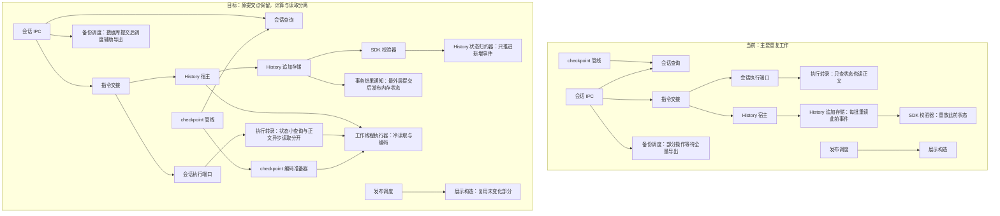

# 会话存储全链路性能改进方案

> 状态：草稿（未实施，待评审）；2026-10-30。
> 核对基线：`58d28d76fc39d258e17c6ced726de03a434afdf6`，SpaceAssistant 0.3.1；代码事实以此提交为准。
> 用户授权范围：系统分析会话存储性能并输出技术方案；本次只新增文档与入口，不实施代码、迁移或发布。
> 证据边界：源码、本机临时数据库实验和定向测试；未读取真实用户库、未运行 Windows、未取得故障时 CPU profile。用户报告高 CPU 的 Windows 进程命令行没有 `--type`，支持主进程热点判断，但不能据此断言某个函数的实际占比。
> 篇内路由：负责人读第 0 层与第 1 层即可评审；实现者继续读第 2 层；复现、门禁结果与未验证项在附录。本文只定义规格和阶段出口，不维护实施任务进度。

## 第 0 层：问题、取舍与交付边界【人必读】

**一句话：从“每次保存或读取都可能重复处理整段历史”，改为“新增记录只校验新增部分、只查状态时不读取正文、必要的大内容处理移出交互线程”，优先改善长对话和密集工具调用时的响应。**

**只有 3 分钟：** 先看下面三个决定，再看第 1 层的链路图、变更面和契约面。代码已证明存在重复工作；本方案不把“所有慢都来自存储”或“Windows 已修复”当成已知事实。

### 验收边界

- 本轮方案交付：完整的事实、模型、契约、反例、验收和回退设计。可以评审；尚未批准实施。
- Mac 和自动化可验证：重复扫描量、追加复杂度、状态与正文读取分离、事务回滚、源版本漂移、恢复、备份失败、资源上限及合成负载下的响应。
- Windows／真实安装包／真实 IM 才能验证：原故障是否消失、慢磁盘和杀软影响、真实历史体量下的体验、远程渠道并发与关机行为。
- 本轮不新建界面、按钮、提示、设置或开关；不改模型上下文内容、工具执行与审批规则。内部优化不得改变当前气泡顺序、预览回滚、失败补齐或确认状态含义。

### D-1：是否先做兼容现有数据的完整一轮优化

背景：当前代码已有分页和后台处理，但保存工具记录时仍反复读取此前记录，只查执行状态也会加载整份对话。直接更换整套存储，容易把性能修复与历史兼容、恢复风险绑在一起。

- **A：先消除重复工作，保留现有落盘格式。** 长对话和密集工具调用是优先对象；增加内部计算模块和有上限的工作线程，但没有新增数据库字段、缓存文件版本或用户设置。代价是整条消息 checkpoint、每轮完整上下文及全文备份的总字节量仍随内容增长，不能承诺任意大历史都固定耗时。
- **B：现在就重做记录格式并迁移数据库写入进程。** 有机会进一步降低全部写入量；但需要额外的数据格式、升级、旧包兼容和写入所有权设计，修复周期更长，本方案不提供该路线的实施授权。
- 可逆性：A 可按阶段撤回代码，保留现有数据；B 涉及的数据升级需要另行制定回退包。
- 依据强度：重复读取和同步正文处理已核实；各热点占比、真实库收益及原 Windows 故障的充分原因未验证。
- 推荐 A。未决定时只保留本文草稿，不实施跨包或存储边界改动。选择 A 不代表接受残余瓶颈：自动化出口未达到时，该阶段失败，必须重新评审结构性改造，不能提高阈值宣告完成。
- 下钻：INV-01～08、AC-01～10；第 2 层 §3～§8。

### D-2：普通操作是否可以不等待辅助导出完成

背景：数据库已保存消息后，部分编辑和排队操作仍等待整场会话的 JSON 辅助导出。磁盘忙或文件被占用时，用户会继续等待；导出失败还可能让已保存的操作看起来失败。

- **A：操作结果以数据库提交为准，辅助导出随后完成。** 编辑、删除排队消息和调整队列的界面可更早收到结果；短时间内磁盘上的辅助副本可能落后。显式导出和正常退出仍等待各自的既有完成条件，导出失败保留旧副本并后台重试。
- **B：继续等待辅助导出。** 保持当前返回时点，文件锁或大会话导出仍会延长操作等待；其余性能优化可以独立推进。
- 可逆性：A 不改变文件格式，可独立恢复等待顺序；已经返回的成功表示数据库已提交，不承诺辅助副本同时更新。
- 依据强度：代码中同步等待链路已确认；Windows 文件锁导致的具体时延没有实测。
- 推荐 A。未批准时按 B 保留现有返回语义，备份内部的去重、分页与资源限制仍可设计；不得把提前返回藏进内部重构。
- 下钻：INV-05、INV-07、AC-06；§7 和契约面③。

### D-3：是否接受先交付 Mac 与自动化证据，Windows 保留外验

背景：当前只有 Mac，无法重现用户报告的 Windows 主进程单核高占用。代码层可以证明某些重复工作被消除，但不能代替原机器上的运行结果。

- **A：先完成可复现的代码与 Mac 验收，Windows 保持未验收。** 可以先取得独立可回退的改进，Windows 原故障仍不得标为已关闭；需要将来的真机验证补齐发布结论。
- **B：完成方案后等待 Windows 条件，再实施或验收。** 风险归因更充分，但现有代码瓶颈继续保留。
- 可逆性：A 的代码按阶段回退，不以删除旧数据换取性能；发布与故障关闭仍是独立决定。
- 依据强度：用户已明确当前只能从代码推导；本机规模实验只是辅助证据，没有 Windows 效果数据。
- 推荐 A。未决定时只交付方案，不将 Windows 标为通过；本次写文档不需要等待真机。
- 下钻：INV-08、AC-01、AC-10、UV-01～06；§9～§10。

### 本次评审要批准什么

待批：上述兼容优先路线、普通操作与辅助导出的完成条件、先本地后 Windows 的验收形态。三项分别批准，后一项不隐含前一项。已有会话切换方案的批准范围继续有效，不在此重复索取授权。

不需要负责人决定：取证、基准夹具、状态推导、线程上限、缓存淘汰、竞态与恢复测试、内部模块拆分由实现者负责。没有新增持久化格式或跨进程消息形状的隐藏批准项；一旦实施发现必须新增，应停止对应分支并提交修订。

### 最可能被推翻的三处

1. **优先顺序。** 如果未来采样表明热点主要在安全解析、日志、工具输出处理或渲染，本方案的先后顺序必须调整；已经证明的重复工作仍是独立问题。
2. **兼容格式是否足够。** 若去掉历史重复读取后，整条消息写入和完整上下文快照仍使测试负载下的主进程持续出现长阻塞，则本轮兼容路线不能被称为完整修复，需另审数据格式或写入线程迁移。
3. **备份语义。** 若辅助文件实际被外部流程用作每次操作完成的即时依据，提前返回会影响该流程；必须保留等待或先修订该外部契约。

## 第 1 层：评审包【人机共读】

### 1.1 当前链路与目标链路

canonical History 指已提交的执行事实；checkpoint 指恢复用的状态快照；spill 指正文或工具结果外置文件。目标不改变事实来源和数据库唯一写入线程。



图中的 `checkpoint 管线 → 会话查询` 指向该单元所含的数据库 checkpoint 操作，不表示读接口写库；checkpoint 不写入 History 事件表。唯一 writer：SQLite 事实与 checkpoint 仍由主进程现有事务入口写；工作线程只做只读快照和纯编码；内存校验状态由事务结果通知发布；辅助文件由备份调度的同会话串行链发布。§4 给出精确所有权。

### 1.2 变更面表

以下计数按**逻辑单元**，不是文件数；同一文件可以承载两个单元，落实现阶段必须按单元分别验证。取证路径未列入表时只作证据，不隐含改动。每个单元作用简述不超过 20 字。

| 单元 | 作用简述 | 路径（相对仓库根） | 改动类型 | 对应 D／INV | 跨边界／依赖方 |
| --- | --- | --- | --- | --- | --- |
| U01 SDK 校验器 | 校验历史生命周期 | `packages/agent-sdk/src/history.ts`、`packages/agent-sdk/src/index.ts`、`packages/agent-sdk/src/model.ts` | 改对外契约 | D-1／INV-01 | 增量纯函数导出及同次摘要复用；MemoryHistory、宿主 |
| U02 History 状态归约器 | 推进已验证事件状态 | 新 `packages/agent-sdk/src/historyTransitionState.ts` | 新建 | D-1／INV-01 | 仅由 SDK 校验器依赖；不反向依赖宿主 |
| U03 History 追加存储 | 原子追加执行事实 | `electron/database/agentHistoryStorage.ts` | 改承重边界 | D-1／INV-01、02 | 新增内部准备凭据；宿主、续跑、接收输入 |
| U04 History 宿主 | 适配历史读写与恢复 | `electron/runtime/sqliteAgentHistory.ts` | 改承重边界 | D-1／INV-01～03 | 内部准备与缓存；HistoryPort 外形不变 |
| U05 事务结果通知 | 发布最外层提交结果 | `electron/database/transaction.ts` | 改承重边界 | D-1／INV-02 | 仅新增内部订阅能力；事务调用方 |
| U06 执行转录 | 保存已提交上下文 | `electron/database/sessionTranscript.ts` | 改承重边界 | D-1／INV-02、03 | 状态读取与正文准备；执行端口 |
| U07 会话执行端口 | 管理会话执行所有权 | `electron/sessionStorage/execution.ts`、`public/execution.ts` | 改承重边界 | D-1／INV-02、03 | 正文方法异步；交接、恢复和适配器 |
| U08 指令交接 | 准备本轮模型输入 | `electron/runtime/hostedTurnHandoff.ts`、`electron/sessionStorage/contextAdapter.ts` | 改造 | D-1／INV-03 | 消费 U07；不改消息内容与执行租约 |
| U09 checkpoint 管线 | 提交恢复状态快照 | `electron/turnRuntime.ts`、`electron/sessionStorage/coordinator.ts`、`src/shared/turnCoordinator.ts`、`src/shared/checkpointQueue.ts`、数据库 checkpoint 操作 | 改承重边界 | D-1／INV-02、05 | 注入既有异步 Checkpoint 回调；恢复与终态消费者 |
| U10 会话查询 | 提供会话和消息视图 | `electron/sessionStorage/queries.ts`、`electron/sessionStorage/public/ports.ts`、`electron/database/operations.ts` | 改承重边界 | D-1／INV-03、04 | 内部摘要异步；IPC 包装返回形状不变 |
| U11 会话 IPC | 接收桌面会话操作 | `electron/ipc/sessionIpc.ts`、`agentProtocolIpc.ts`、`ipcShared.ts` | 改对外契约 | D-2／INV-05、07 | 仅普通编辑／队列操作返回时点变；渲染端 |
| U12 正文读 Worker | 读取所选正文片段 | `electron/sessionStorage/infrastructure/sqlite/projectionSourceChatBodyWorkerClient.ts`、`projectionSourceChatBodyWorker.ts`（同目录） | 改造 | D-1／INV-04、06 | 复用预算与原算法；不扩并发槽 |
| U13 工作线程执行器 | 承担只读和纯计算 | 新 `electron/sessionStorage/infrastructure/sqlite/sessionPerformanceWorker.ts`、`sessionPerformanceWorkerClient.ts` | 新建 | D-1／INV-03、06 | 主进程单客户端；内部消息，不是 preload IPC |
| U14 性能诊断 | 汇总阶段成本计数 | 新 `electron/storage/sessionPerformanceMetrics.ts`；接入现有日志投影与基准脚本 | 新建 | D-1／INV-08 | 白名单诊断事件；不记正文与凭据 |
| U15 备份调度 | 导出会话辅助副本 | `electron/debouncedSessionBackupManager.ts`、`sessionBackupManager.ts`、`sessionBackupShutdown.ts` | 改造 | D-2／INV-05～07 | 同会话文件 writer 不变 |
| U16 溢出存储 | 保存并验证外置正文 | `electron/storage/spillStore.ts`、`spillProtocol.ts` | 改造 | D-1／INV-03、06 | 不改 descriptor、文件名或 GC 所有权 |
| U17 展示构造 | 构造实时展示快照 | `src/shared/turnDisplayProtocol.ts`、`src/renderer/services/turnDisplayStore.ts` | 改造 | D-1／INV-05、06 | 复用未变化值；协议形状不变 |
| U18 发布调度 | 合并实时展示通知 | `electron/turnDisplayPublisher.ts`、`electron/main.ts` | 改造 | D-1／INV-05、06 | 保留关键事件顺序与既有 50ms 合并窗口 |
| U19 维护与 WAL | 调度数据库维护 | `electron/database/sqliteStore.ts`、`electron/dbSaveScheduler.ts`、现有维护调度器 | 改造 | D-1／INV-06 | 主连接 writer 不迁移；仅诊断与空闲调度 |
| U20 checkpoint 编码准备器 | 准备快照落库材料 | 新 `electron/database/sessionCheckpointEncoding.ts` | 新建 | D-1／INV-02、05 | 复用 messageCodec；返回内部编码材料 |
| U21 回归与基准 | 验证行为与访问规模 | 既有 History、会话切换、checkpoint、备份和展示测试簇 | 改造 | D-1～3／INV-01～08 | 扩展夹具和差分用例，不改产品契约 |
| U22 现有页定位 | 定位所选消息正文 | 既有 source locator、paged body 与源身份模块 | 复用不改 | D-1／INV-04 | 已具 source revision 与按页定位；回归验证覆盖 |
| U23 构建监督器 | 管理派生任务生命周期 | 既有 projection supervisor 与前台预算 | 复用不改 | D-1／INV-06 | 已有 lease、分片、预算与停机屏障 |
| U24 引用与回收 | 管理 spill 和 blob 引用 | 既有 spill reference index、reconciliation、GC | 复用不改 | D-1／INV-02、07 | 新格式为零，无新引用种类 |
| U25 安全与审批 | 决定工具执行权限 | 现有 facts、policy、final-check 与执行租约 | 复用不改 | D-1／INV-01、02 | 不缓存权限决定，不削弱校验；边界对拍 |
| U26 preload 与 API 形状 | 暴露现有桌面接口 | `electron/preload.ts`、`src/shared/api.ts` | 复用不改 | D-2／INV-05 | 通道、参数、返回字段不变；U11 仅改完成时点 |
| U27 聊天呈现 | 显示消息和确认状态 | 现有 ChatView、消息气泡与确认消费者 | 复用不改 | D-1／INV-05 | 不改可见行为；沿用帧合并与终态读取 |

### 1.3 契约面六面

| 契约面 | 结论 | 具体变化／依据 | 旧数据与旧调用方验证 |
| --- | --- | --- | --- |
| ① agent-sdk | **改：纯计算导出；宿主端口与事件形状不改** | 新状态归约函数供 SQLite 与 MemoryHistory 共用；HistoryPort 签名、事件种类、审批枚举不变，无 SDK→宿主依赖 | 全量校验旧入口保留；同一历史前缀和新批次对拍；旧导入编译。`check:agent-sdk`、`typecheck:agent-sdk` 基线通过 |
| ② 会话存储 | **改：内部读／准备契约；唯一 writer 不改** | 正文异步、状态同步小查询、追加准备凭据、checkpoint 编码材料；事务仍走统一入口，文件导出形状不变 | 旧历史／旧 spill／旧 checkpoint／旧 JSON 备份夹具对拍；同步恢复入口保留；三项存储边界门禁基线通过 |
| ③ IPC／预加载 | **改：D-2=A 时完成时点；形状不改** | 普通编辑与队列成功不再等待辅助导出；没有新通道、字段或订阅；显式导出与退出不提前成功 | 阻塞导出时普通操作已返回且重读数据库一致；B 分支保持旧时点；前后端类型与通道无 diff |
| ④ 共享类型 | **不改产品类型形状** | Message、Session、TurnDisplay、领域判别式不变；使用既有异步 Checkpoint 类型，通过宿主注入而非把 TurnStorage 同步签名直接改宽 | 共享类型与 renderer 类型检查；同步内存适配器与异步 SQLite 注入并存 |
| ⑤ 其他持久化格式 | **不改** | 新表 0、新字段 0、schema 版本 0、落盘格式版本 0；不自动删除旧快照、旧备份或源 spill | 旧包在隔离库副本读本轮产物；回退仅撤代码，不降 schema |
| ⑥ 领域数据格式 | **改：新增一个诊断事件名；业务数据不改** | 新 `storage.performance.sample`，字段在 §3.3 闭合；无新用户错误码、规则、设置或稳定业务失败分类 | 白名单只放行有限计数；脱敏测试拒绝额外字段；既有错误沿原通路传播 |

承重面基线门禁结果见附录 B。它们证明当前边界基线，不证明拟议实现已兼容。实施后必须重跑并补齐上述旧数据／旧调用方用例，不能引用本文基线成绩替代。

### 1.4 量级、拆分与相邻方案

- 变更面共 **27 个逻辑单元**：改既有 **17**、新建 **4**、复用不改 **6**；其中改对外契约 **2** 行、改承重边界 **7** 处。新增产品持久化字段 **0**，用户错误码／业务失败分类 **0**，诊断事件名 **1**，用户开关 **0**，阶段 **6**。
- 新建单元为 U02／13／14／20；改对外契约为 U01／11；改承重边界为 U03／04／05／06／07／09／10。新源文件下限为 5 个（U13 含一对 Worker／Client），文件级拆分由执行计划登记，不把逻辑单元数冒充文件数。
- **达到拆分门槛，但本轮不拆多份方案。** 原因是统一需要回答“消除重复计算是否足以改善交互，而不是把负载挪到另一条队列”；追加、指令准备、checkpoint 和备份必须共享一套资源预算与基线。拆成平行方案会重复定义资源和验收范围。本篇按六个阶段隔离提交与回退；D-2=B 不阻塞其余阶段。若新增数据库格式、全局 writer 迁移或增量 IPC，则必须另立方案，不能扩入本文。
- [会话切换性能优化方案](./会话切换性能优化方案.md) 已批准的页定位、source revision、失败原因随后补齐继续由原方案负责。当前代码已有这些机制；本文只补其剩余热路径与共享资源回归，不重开旧批准、不声称其安装包外验已完成。
- [持久化与历史管理边界重构方案](./持久化与历史管理边界重构方案.md) 与 [启动历史会话恢复耗时优化方案](./启动历史会话恢复耗时优化方案.md) 的数据权威、owner、恢复、兼容回退包约束继续有效；本文不启用未获准的 owner 切换或物理清理。
- [工具调用安全审核性能调研](../../safety-approval/工具调用安全审核性能调研.md) 的政策与审核缓存不并入本轮。主进程总 CPU 中属于安全解析／审计／工具 executor 的部分单列，不用本方案指标替代其验收。

### 1.5 需求外扩声明

| 新增交付面 | 来源 | 对用户／数据的影响 |
| --- | --- | --- |
| U02／13／14／20 内部模块、内存状态与线程消息 | D-1=A 后才实施 | 不新增操作；减少重复计算；进程退出后从原记录重建 |
| SDK 纯计算导出与存储异步读／准备契约 | D-1=A | 内部调用者需同步适配；不改变历史或模型输入 |
| 普通编辑／队列操作完成条件 | D-2=A | 数据库已提交即可返回；辅助 JSON 可短暂落后 |
| 诊断事件及基准脚本 | D-1=A | 无界面与设置；日志只记阶段、计数和耗时 |
| 数据库字段、迁移、IPC 消息形状、界面、外部 IM 行为 | **无** | 本轮不得增加；出现需求必须另提决策，界面须先获批归属卡 |

## 第 2 层：规格【机｜人工可跳过】

### 2. 事实卡与成本模型

每条 F 均以文首提交为基线，复现命令见附录 A；“源码确定”只描述工作存在，不等于已经测出线上占比。

| ID | 已核实的代码事实 | 性能含义与限定 |
| --- | --- | --- |
| F-01 | `appendSqliteAgentHistoryBatchInTransaction` 每批 SELECT 此 invocation 全部旧事件、逐行 JSON.parse，再调用 `validateHistoryTransition(previous,incoming)` | 小批次追加 E 个事件时旧事件访问量约为 E(E−1)/2；批次大小影响常数；不等于每个 token 都写 History |
| F-02 | `validateHistoryTransition` 重建 pending tool／approval 等状态并遍历前缀与新增事件 | 状态可增量归约，但终态、审批身份和 unknown-effect retry 原子批次规则都必须保留 |
| F-03 | `SqliteAgentHistory.read()` 直接调用 `readSync()`，后者全 invocation 解析、水合、校验 | Promise 接口不代表调用线程已释放；恢复与普通读需区别 |
| F-04 | `acceptPrepared` 和 `readTranscriptState` 调用 `readSessionTranscript`，只使用状态／版本；该函数仍读 `messages_json` 并可能同步读 spill | 仅查控制信息也支付完整正文成本，是指令提交前可直接消除的工作 |
| F-05 | `readHostedTranscript` 同步读取完整已提交转录；转录提交重复 JSON.stringify 与摘要计算 | 模型请求确实需要上下文，但可以复用同一次材料并在事务外准备，不能靠截短上下文提速 |
| F-06 | 每个 invocation 的初始 context 保存 messages；每次终态还保存完整 session transcript；大块可能 spill。requestSnapshot **只存消息数与摘要，不再存消息全文** | 长期保存字节可能重复；完整请求摘要本身仍 stringify＋hash。不能误诊为“每个 requestSnapshot 都存全文” |
| F-07 | spill 写入使用 UUID 文件，sync、读回验证并多次求摘要；context 中多个大块可能重复外置；同步读执行文件读取和 SHA-256 | 存储外置不消除 CPU 与 I/O；本轮复用同次准备材料并去重 hash，不改持久格式或绕过读回验证 |
| F-08 | checkpoint 普通事件 2 秒合并；tool-result、确认、reconcile 和终态会立即提交；写入会重新序列化整条工具数组并读回整行 | 不能只调大 timer；高频工具结果绕过 timer，累积快照字节仍增长 |
| F-09 | `getContextHistorySummaryBaseline` 扫描会话所有 thinking／attachments 并估算；ChatView 在首屏提交后调用 | 不应误算成首屏必经串行等待，但会阻塞后续主进程工作 |
| F-10 | 当前 source identity 为 formatVersion 2，读取 source revision 与少量版本事实；页读已有 locator、Worker 与最终复核 | 早期“每页枚举全部 stream”在本基线已不成立；复用现有机制 |
| F-11 | locator 缺失可等待 backfill；兼容回退仍可能读取整会话投影；source 页面 Worker 一次一建且等待退出；已有 prepared 常驻 Worker 和前台单槽预算 | 冷、热、回填和回退必须分开；复用线程不能额外扩张并发预算 |
| F-12 | 创建会话是局部事务；列表读取全部可见会话后过滤 profile；读取时清理旧 metadata 可能触发 flushSave | 新建慢未证明是 INSERT 慢，也可能排在其他同步任务之后；列表只读需去副作用 |
| F-13 | 辅助备份为全量分页导出，默认每页 2000；3 秒防抖；部分消息／队列操作等待 flushBackup | 分页控制内存峰值，不降低总导出字节；异步文件 I/O 之外的 stringify 仍在调用线程 |
| F-14 | TurnDisplay 仍携带累计 content／thinking／工具与活动；50ms 合并部分事件，关键状态立即发；renderer 有帧合并 | 不能把渲染完全排除；本轮保留协议，仅复用未变摘要、减少无效监听与重复构造 |
| F-15 | 主连接为同步 SQLite、WAL、synchronous=NORMAL、busy timeout 默认 5 秒；save 调度 PASSIVE checkpoint，维护另有 TRUNCATE | 锁等待可能冻结事件循环但不解释持续满核；checkpoint 不等于每次 save 重写整库；WAL 自动 checkpoint 也需计量 |
| F-16 | 本机单次临时库：4KiB payload、100／400／800 次单事件事务追加约 81／504／1626ms；定向测试46通过、25跳过 | 支持超线性现象，不是统计基准、不是 Windows 结果，未包含真实工具执行／网络／renderer |

成本拆分：令 R 为历史轮数，E 为当前 invocation 事件数，B 为模型上下文字节，K 为本轮工具数，P 为本页正文及完整依赖字节。目标将热追加的重复历史访问从 O(E²) 降为首次前缀读取加新增事件载荷；控制信息读取不依赖 B；页读取沿现有机制依赖 P。状态集合操作成本另计，不宣称全流程严格线性。必要上下文读取／摘要是 O(B)，完整 checkpoint 和全量导出各自仍依赖输出总字节；本文不把它们宣称为 O(1)。

#### 2.1 绕过与关联入口清单

| 入口 | 是否绕过拟优化宿主 | 处理要求 |
| --- | --- | --- |
| accepted input：数据库 `prepareTurnAtomically`／接收 helper | 是，直接追加 helper | 当前新 invocation version=0；必须验证空状态，无须全前缀；禁止跳过校验 |
| `agentContinuation` 新 invocation 初始 context | 是，直接追加 helper | expectedVersion=0；保持原子 claim 与 context 提交；不复用源 invocation 校验状态 |
| `SqliteAgentHistory.appendBatch` | 否 | 唯一热追加接入准备凭据与提交后状态发布 |
| MemoryHistory／SDK 独立宿主 | 不经过 SQLite | 同一归约算法；未提供 session revision 的 SQLite 独立流保持完整校验，单列性能限制 |
| 同步恢复／续跑／canonical 编辑 | 部分调用 readSync 或全转录 | 保留语义；普通交互改走异步准备，启动恢复入口不悄悄改签名 |
| `queries.readChatPage`、单条消息、重试目标、搜索、导出、API baseline | 可绕过 public 准备包装 | 按调用方回归；不能只优化分页 IPC 后宣称全部读取有界 |
| `readTranscriptState`、`acceptPrepared`、执行租约 claim | 不必读正文但目前可能读 | 前两者改小查询；租约仍在主连接短事务里决定 |
| shutdown、显式导出、普通操作后台导出 | 共享备份基础设施，完成条件不同 | D-2 只影响普通操作；shutdown 不提前关库 |
| IM／track-scoped history／butler | 共享底层，部分另有作用域 | 回归会话与 track 隔离，不改其渠道返回语义，不自动套用 D-2 |

### 3. 不变量、术语与契约卡

#### 3.1 不变量

| ID | 不可违反的性质 | 机制／验收 |
| --- | --- | --- |
| INV-01 | 增量校验接受／拒绝与原完整校验一致；审批与工具执行许可不由缓存决定 | 共用纯归约、原错误映射、差分状态机；AC-02 |
| INV-02 | 未提交、回滚或提交不确定的材料不能发布成已提交状态；异步结果必须绑定原身份 | 最外层事务结果、generation／epoch／version／revision、租约复核；AC-02、03、05 |
| INV-03 | 状态读取不读正文；普通正文读取不在主进程同步解析或水合大载荷 | 元数据 reader、Worker／受预算分片、读后复核；AC-03、04 |
| INV-04 | 本页正文、骨架与游标同源；无定位不能返回部分历史或假空页 | 复用 locator 与最终复核；AC-04 |
| INV-05 | 已接受正文、预览、确认及终态语义不变；checkpoint 成功须已实际提交 | acceptedAssistantCheckpoint、版本条件更新、异步完成屏障；AC-05、07 |
| INV-06 | Worker、缓存、队列均有总量上限，前台不能无限等待后台工作；关闭与切库能收敛 | 单客户端预算、合并、退订、quiesce、超时与按字节计量；AC-08 |
| INV-07 | 主库事实与源 spill 不因性能优化被清理；辅助导出失败保留原副本且不伪报已导出 | 原引用／GC、临时文件发布、串行备份链；AC-06、09 |
| INV-08 | 收益与平台结论可追溯，观测不含消息正文／路径／凭据 | 固定诊断 schema、版本化夹具与分平台报告；AC-01、10 |

#### 3.2 术语与内部准备材料

| 术语 | 唯一含义／归属 |
| --- | --- |
| invocation version | 一个 invocation 已提交事件数；不兼作 schema 或 session revision |
| source revision | 现有会话源变更代次；覆盖源／stream 变更，用于拒绝过期计算 |
| connection epoch | AppDatabase 当前连接代次；重开库后旧连接材料失效 |
| process generation | 当前进程持久化所有权代次；不替代 session generation |
| 校验状态 | 已验证前缀的纯生命周期状态，不含完整消息／结果载荷，不包含安全放行结果 |
| PreparedHistoryAppend | 宿主内存能力：原身份、前缀状态、新批次原始／落盘摘要、下一状态；不能由 IPC 或事件 payload 自报 |
| PreparedTranscript | 原会话／版本／租约绑定的消息字节、既有格式摘要和外置 descriptor；不新增落盘字段 |
| EncodedCheckpoint | turn／message／session 身份、期望版本、已接受内容、既有列编码及原材料摘要；不是自行授权的写入许可 |

新增内部准备对象的公共头固定为 `sessionId: string`、`sessionGeneration: string`、`connectionEpoch: number`、`processGeneration: number`、`sourceRevision: number`，都由主进程持有原连接的工厂捕获。History 另含 `invocationId: string`、`expectedVersion: number`、`schemaVersion: number`、`inputDigest: string`、`storedDigest: string`、`nextState`；转录另含 `turnId: string`、`baseVersion: number`、`outcome`（沿原枚举）、`messagesJson: string`、`payloadSha256: string`、`storedMessagesJson: string`、`executionLease`（沿原类型）；checkpoint 另含 `turnId: string`、`messageId: string`、`turnVersion: number`、`acceptedInputDigest: string`、`columns`（原列名到原编码值的只读映射）。无session的兼容调用不使用该头，不伪造默认session。

准备对象由工厂登记在进程内 WeakSet／对象身份表，Worker 只返回计算结果，主进程验证任务身份后组装；它们不能反序列化成为有效能力。字段没有隐式沿用“最新”身份。旧同步调用不传准备材料时保持旧完整验证路径；该兼容路径必须计数，不能成为热路径静默回退。未知诊断类型丢弃；业务错误仍沿既有稳定错误码或异常类别，不新增用户错误码。

#### 3.3 诊断契约

新增诊断事件名只有 `storage.performance.sample`。U14 负责投影，不允许任意对象展开进入日志。允许字段固定为：`operation`、`stage`、`durationMs`、`queueWaitMs`、`sqlRows`、`readBytes`、`writeBytes`、`parsedBytes`、`eventCount`、`cachePath`、`workerStarts`、`activeJobs`、`pendingJobs`、`mainThreadMs`、`outcome`、`sampleId`、`platform`。计数为非负安全整数；毫秒为有限非负数；sampleId 为进程内无业务含义的递增匿名标识，不记录 sessionId、turnId、标题、原始路径或内容。

枚举固定为：operation=`create|select|submit|append|checkpoint|backup`；stage=`total|queue|metadata|prepare|source-check|sql|read|parse|hash|encode|transport|publish|wal`；cachePath=`none|hit|cold|invalidated|compatibility`；outcome=`ok|error|cancelled|unknown`；platform沿现有运行时平台值。未知枚举丢弃，不新增业务失败分类。字段均可缺省，未观测的计数不能填0冒充实测。

复用现有 session.switch.trace，不另造跨进程时钟差值。submit 在handler内细分接受输入、只读状态、正文准备、源复核、开始执行。主／渲染各自使用本地单调时钟；sampleId只关联同进程阶段。select跨进程关联沿既有trace元数据；create／submit不新增IPC发送时间字段，不能精确分离“发送至handler进入”的等待，只分别报告renderer端到端、handler本地时长与event-loop delay，不凭时钟相减补造排队证据。queueWaitMs仅用于确实观测到的内部任务等待。

事件按操作聚合一次，连续流式期间最多每秒一次聚合；不逐 token 写日志，不为测字节数再次 stringify 整份载荷。诊断开销在 AC-01 对比开／关；没有诊断 UI 或持久化设置。

### 4. 状态、所有权与生命周期

| 状态／产物 | 唯一 writer 与提交点 | 恢复者／失效条件 |
| --- | --- | --- |
| canonical events、transcript、turn 与消息骨架 | 现有主连接，经 runInTransaction 最外层 COMMIT | 现有 recovery；业务 owner、原租约不迁移 |
| 校验状态缓存 | U04 创建候选，U05 最外层提交成功后发布 | 冷读重建；rollback／unknown／generation／epoch／revision 不符即丢弃 |
| SQL statement 缓存 | 当前连接所属适配器 | epoch 更换整体丢弃；不跨 close 保留句柄 |
| 正文与统计读结果 | U13 基于只读快照计算；主进程读后核验身份才交付 | Worker 重启即丢内存；源变化重读一次后沿既有失败通路返回 |
| checkpoint 编码材料 | U20／13 计算；U09 在原事务内版本条件提交 | 迟到版本拒绝；未提交不提升 committedVersion |
| 备份 pending／in-flight | U15 的同会话 operation chain | 同会话最新 dirty 标志，失败有限重试；删除推进既有 generation |
| 展示摘要与 activity 缓存 | U17 在输入版本改变时更新 | turn 删除、源重置、代次变化或容量淘汰；不能用内容长度识别相同内容 |
| Worker 与任务预算 | U13 客户端；页读沿 U23 预算占位 | close／swap 先停接单，等执行退出再销毁；请求者取消不伤共享工作 |

#### 4.1 锁与事务顺序

1. 沿用既有 session lifecycle／spill fence 锁顺序；读取、预编码和文件准备在 SQLite 写事务外完成。不能等待 Worker 或文件 I/O 时持有写事务。
2. 进入原同步事务，读取真实 live identity、stream version、scope／租约，验证准备材料归属，追加事实与既有派生引用；所有写仍走统一事务 helper。
3. 只有最外层 COMMIT 已成功，才发布内存状态和可对外声明的 committedVersion。嵌套 RELEASE 不是提交。
4. 如遇 COMMIT unknown，丢弃候选缓存并走现有对账；不得把未知当成功或自动重放有副作用的工具。
5. 文件预备完成但事务失败的产物沿既有引用回收，不引入新删除线程。

U05 的事务结果通知为内部能力，按每连接、每嵌套 frame 记录提交／回滚回调。内层成功只把候选转交父 frame；内层回滚丢弃自身候选并执行失效动作；外层回滚／unknown 使所有候选失效。最外层 commit 后通知失败只清缓存和记有限诊断，不能把已提交数据库操作重新报告成业务失败。通知禁止写库、递归开启事务或执行用户回调。异步事务入口也要同样通知，但本方案不新增其业务使用者。

### 5. 写热路径与指令准备

#### 5.1 增量 History 校验

U02 提供 `createHistoryTransitionState`、`advanceHistoryTransitionState`；U01 原 `validateHistoryTransition(previous,incoming)` 保留，通过同一归约器先折叠 previous 再推进 incoming，并维持既有错误类别与优先顺序。

状态至少包含：schema／turn 身份、是否终态、pending tools、pending approvals 与 approvalId 对应、deferred todo、unknown-effect retry 授权及已消费集合。批次末必须清除“待匹配 retry start”状态，否则拒绝整个批次；不把非法半批次保存成状态。需要保留终态在 incoming 中必须最后的检查。状态对外只读，候选以 copy-on-write 产生；失败不能修改已提交缓存。

热缓存键为连接身份＋epoch＋process generation＋session generation＋invocationId＋invocation version＋source revision。比较的是事务里查到的事实，不采信事件 payload 的自报值。当前会话的其他源写入也可能推进 revision；宁可失效，不把 session revision 改成“只属于本 invocation”。独立无 session 流没有等价变更代次，保留完整校验，不声称同等性能收益。

不能遗漏checkpoint导致的revision变化：U05在受控事务内记录已知变更种类与其触发器应产生的revision增量，U03／06／09／10在各自写入点登记。对于只改消息投影、未改History／stream的事务，仅在最外层commit成功、实际revision增量与登记总量完全相等时，允许给未变invocation缓存前移revision；该通知不推进生命周期状态。History追加只给本批次所属invocation推进下一状态，其他缓存失效；History编辑／删除、scope变化、未知SQL或增量不符一律失效。没有完整登记证明就重建，不能根据“turn.version没变”跳过。AC-02还必须穿插每次tool-result的真实checkpoint，证明正常生产链路不会每次被迫重读全前缀；此项未通过不能只凭连续append夹具关闭P1。

冷失效先在 U13／只读连接按同一快照完整读取和折叠，再回主进程事务验证版本与 revision；变化最多重新准备一次，仍变则沿既有冲突通路失败，不循环霸占主线程。活跃正常写入由同一 append 提交后前移缓存，下一次直接校验新增批次。每连接内按 LRU 保留至多 32 个状态、合计估算 16MiB；单个超限状态不缓存，必须在异步准备路径处理，不能退回同步全量扫描。

prepare 不替代原幂等查重、expectedVersion、sequence、process generation、session ownership、spill 引用和租约校验。重复批次仍按落盘 payload 比较；不得使用仅包含生命周期字段的摘要判断载荷幂等。

目标 AC-02：无外部源变化、缓存就绪后，追加 E 条同规模事件不再读取前 E−1 条 payload；对历史前缀累计解析字节按首次重建＋新增载荷增长。状态集合复制本身可能随未决工具数量增长，单独计量，不能把它误报为常量。

差分oracle必须独立：P0先由本基线完整实现生成合法／非法前缀与预期错误类别语料，保留测试专用参考实现或固定结果；候选实现与它比较。不能把已改成共用归约器的两个入口互相比对就宣称等价。故意破坏审批匹配／回滚发布／终态拒绝中的任一条时，对应测试必须转红。

#### 5.2 执行状态和正文彻底分开

U06 新增内部 metadata reader，只 SELECT checkpoint 的 version／status／last_turn_id；无 row 的结果仍为 version=0、status=ready。U07 的 `acceptPrepared` 和 `readTranscriptState` 改用它，保持同步返回与原拒绝语义。测试让正文读取抛错，证明这两个控制入口不接触正文。

`readHostedTranscript` 改为 Promise 返回原 HostedTranscriptSnapshot；U08 在持有现有 execution claim 的流程中 await，随后重验 session generation、checkpoint version/status 与 execution lease。claim 不因为 Worker 成功而被重新授权；取消在执行开始前释放，unknown 沿既有处理保留对账。所有适配器／mock 同步改；同步恢复 reader 继续存在且不得被普通执行入口调用。

正文 Worker 读取只读 SQLite 快照并水合所需 spill，校验长度／摘要；主进程只接收必要模型输入。读后版本漂移一次重读，再失败沿既有通路返回。不能拿 UI 最新 20 条代替完整模型上下文，也不能跳过此前压缩、排除消息与 track scope。

U08 在单次准备内复用同一可信源消息与 surface 构造结果，跨 await 或持久化前保留原最新指纹核验。U06 transcript 提交的 stringify、payload hash 与 U04 大块准备共享一次编码材料：保持当前字节序、字段顺序、原 hash 算法和幂等比较，事务里只验证身份／版本和材料完整性，不再编码整份 messages。更换算法会改变旧回执，禁止顺手进行。

U16 单次写入只对拟写 bytes 求一次摘要、读回 bytes 求一次摘要，仍执行 write／sync／close／读回校验及原目录同步。相同准备操作中的重复消息内容可复用同一已预备 descriptor，必须在现有 spill fence 内完成引用注册；不建立跨请求的“文件仍完好”假设。跨请求缓存不能凭 mtime／长度跳过内容完整性验证。

requestSnapshot 的完整 messages 摘要仍保留；只在同一个不可变 PreparedModelCall 身份内复用已经计算的摘要，消息或 request 改变必须重新计算。需要读取 O(B) 数据是模型语义成本，本轮不改 SDK request 快照格式。

### 6. 会话创建、加载与后台资源

#### 6.1 创建与列表

创建事务保持局部 INSERT、现有 location 注册与 scope version 更新。按§3.3分别报告renderer端到端与handler内耗时，handler前排队保持缺测标记；不能用优化 INSERT 的数字替代点击到可用时间。现有 `mkdir` 和辅助空备份独立计量，不擅自改变工作目录可用性条件。

U10 内部列表 reader 接受 profile 筛选并在 SQL WHERE 实施，仍返回完整当前工作区可见会话、原排序与 ownership／visibility 过滤；公开 session:list 参数不变，不添加分页产品行为。U11 不再在 session:list／get 只读路径中同步持久化 legacy plan metadata；返回时仍剥离旧字段，持久清理由既有生命周期维护分批处理，保留原字段清理语义。以旧字段已实际删除判断该项完成，不新增持久化完成标记，不在读取时调用 flushSave。

#### 6.2 正文页与统计

U22 的 fixed source identity、locators、page source read 与最终复核继续复用；正常已定位页禁止主动调用整会话 ensure 作为首屏前置。没有完整定位的旧会话仍遵守原方案首次回填例外，单独统计，不能混入已定位冷读基准。兼容整会话回退记录扫描量与触发原因；缺失／损坏不转换为成功空页。

U10 将 context history summary 的全量读取和反序列化移到 U13，返回 shape 不变、不新增统计表。进程内至多缓存 16 个会话、8MiB，以 session generation＋message revision＋epoch 为键；思考／附件／队列变更覆盖原 revision 触发器的证明通过后才启用命中。冷读仍扫描全会话，但在 Worker 且受预算；源变化丢弃结果。不能把估算近似值写回事实或授权执行。

U12 将原一次性 source-page 任务提交给 U13 常驻执行器，复用原 source Worker 的读取／验证算法；prepared 已有常驻Worker继续复用，不另建同用途线程。两者接入现有前台预算，禁止在既有单槽外再并行启动新 source Worker。所有只读页仍按原 source revision 复核，线程常驻不等于正文永远有效。

#### 6.3 资源预算与停机

- 前台性能任务沿 U23 现有单槽执行，待队列最多沿现有 16 项、30秒等待限制，不提高现有容量；U13 按相同 slot 获取资源。U13自己的待提交队列内，页读取优先于未开始的统计与备份任务，同优先级FIFO；每完成一项前台任务后允许一个已等待5秒的后台分片推进。已进入既有共享预算的任务遵守其FIFO，不声称能抢占其队列或维护中的同步chunk；U23无需新增优先级协议。
- U13 只增加一个常驻执行线程，128MiB old generation；不得再为同类操作启动临时 Worker。与现有维护／reducer Worker 的同时活动量统一计入采样，不宣称这是全部 Electron 线程数上限。
- 新编码／统计任务待传输材料合计最多16MiB。单任务超过此值时分片：消息／工具记录逐项传输，每片最多256KiB；单值超片采用 UTF-8 分段 bytes，不先在主进程 stringify 完整对象。对象字段遍历分片在主进程每片处理后让出事件循环；这些操作必须用计时证明，不把 `await Promise.resolve()` 当作让出到下一轮事件循环。
- 每turn只保留一个executing与一个最新pending已接受快照；关键事件立即推进内存中的最高必提交版本 `requiredVersion` 并请求flush，不为每个事件保留整份快照。后续已接受的完整快照可覆盖尚未开始编码的旧快照，其实际提交版本必须≥requiredVersion才满足此前屏障；最终态不得被非终态覆盖。同步fact producer仍同步返回，不伪造可await背压；异步编码任务按客户端预算等待，待处理快照以每turn最新值合并。已有终态／shutdown消费者必须等待真实committedVersion，不能用“已经排队”满足屏障。
- 取消只移除该等待者。共享重建继续为其他等待者服务；没有等待者的未开始任务丢弃。正在执行的同步 SQLite 语句不声称可抢占；Worker超时终止后等待退出再释放槽。
- 关闭／换库先拒绝新任务，取消排队，等待 in-flight 退出；先备份与事务屏障、后关连接。epoch 变化拒绝旧材料；回调不能把旧连接写回新库。

这些上限是可逆的内部工程预算，不是用户设置。性能基准未达标时先调整任务粒度，不能提高并发掩盖主进程阻塞。U19 记录显式 PASSIVE／TRUNCATE、WAL大小与锁等待；本轮不关闭 fsync、不改变 synchronous／busy timeout、不迁移主连接。低优先级维护只在片边界暂停，长SQL单独标为超预算。

U13 内部任务种类固定为 `history-prefix|hosted-transcript|context-summary|source-chat-page|checkpoint-encode|backup-encode`。客户端生成 jobId、捕获identity、记录deadline；任务只允许预定义参数与所选ID／片段／已接受编码输入，禁止任意SQL字符串。只读连接由Worker自身按文件路径打开，不传递DatabaseSync对象；写入或连接重开均留在主进程。reply必须带原jobId与identity，重启后的旧reply丢弃。P1先实现history-prefix及生命周期预算，后续阶段只添加本表既定操作；不能先实现依赖它的调用方，再等后阶段补执行器。

### 7. checkpoint 与辅助备份

#### 7.1 checkpoint 准备与提交

U09 使用既有可异步 Checkpoint 回调类型，通过 TurnRuntime 的宿主注入接入 U20；不修改共享 TurnStorage 的同步默认适配器。U20 只接受 `acceptedAssistantCheckpoint` 后的不可变输入快照。字段级缓存以显式 revision／不可变对象身份为依据；不能用字符串长度、Object.keys 数量或工具状态替代内容身份。

编码工作由 U13 执行，复用原 messageCodec 的 toolkit 凭据净化和大结果收敛语义。只编码变化列；工具数组成员可按 tool ID 与内容代次缓存编码片段，最终仍拼成既有 JSON 列。U09 主连接提交时验证 turn／message／session、version 单调、message 仍 streaming 和 epoch；失败不写 message、不提升 turns.version。更新不再读回整行重新反序列化，仅返回提交结果；确需返回 Message 的旧 update API 保持原实现。

普通2秒节奏、tool-result／确认／reconcile／终态立即请求 checkpoint 的行为保持。异步编码只改变内部等待方式，关键事件不等于“已经落盘”；committedVersion 在实际事务后推进。晚到旧编码不得覆盖已提交新版本，终态消费者继续等既有 checkpoint status。Worker失败、退出或编码失败沿既有失败／重试通路处理，不回退到主进程同步编码巨型消息。

requiredVersion只允许被同turn更高版本的已接受完整状态满足；终态和已完成的持久化事实不降级。确认请求／确认撤销的展示通知不参与快照合并，继续按原顺序发布。过程重启以已提交canonical事实和最后实际checkpoint恢复，不把内存requiredVersion当作落盘证据。AC-05须覆盖编码慢于连续tool-result、确认后立即取消、终态与定时器并发，证明有上限的pending合并不丢恢复所需事实。

**残余成本：** 工具数组最终 JSON、SQL写入和完整内容仍有 O(本次快照字节) 成本；工具结果每次即时提交可能形成累计写放大。本轮减少重复解析、未变字段编码和主进程计算，未从格式层消除该项。AC-05 必须测真实工具数放大；不达标则本阶段不关闭，后续规范化工具投影／增量落盘需独立方案和数据格式决策。

#### 7.2 辅助导出

U15 延续同会话串行 operation chain，只保留一个 executing 与一个 dirty 标记；写入期间重复 schedule 不排多个全量任务，完成后若 dirty 只再导出最新状态一次。不同会话全量导出同时最多1项，后台读编码与前台共享预算；不改变 source-of-truth 提交顺序。

导出页以字节预算分片，默认2000条只作上限，目标单页不超过256KiB；巨型单消息采用 Worker 流式 JSON 编码，不能在主进程一次 stringify。维持逐序列游标、临时文件、完整写入、sync、close、rename 和原瞬态文件锁重试；不降低持久性。

D-2=A 时，普通消息编辑／排队编辑／排队删除／排序在数据库提交与既有 scope invalidation 后返回，调用 schedule；辅助失败不推翻已提交的业务结果。D-2=B 时仍 await flush，但使用优化后的同一备份链。显式导出和 shutdown 均保持 await；shutdown 重试失败继续沿既有错误策略，数据库不能先关闭。

捕获同一备份开始时的 generation 与消息来源身份。源在逐页导出期间变化，整个临时文件丢弃并保留旧副本，再调度最新一轮，不能发布混合版本。高频持续写入可能延迟获得完整新备份，诊断记录积压年龄；不为追赶辅助副本阻塞主库写入。session.json 与 messages.json 当前不是双文件原子事务，本文不声称新增成套原子发布；该既有恢复限制单列 UV-05，不更改文件格式。

### 8. 实时发布与非目标

U17 复用未变化工具摘要、content ranges 和 activity，但只在输入身份／版本证明未变时命中；同长度内容改写和同 key 数对象替换必须失效。修正现有摘要缓存字节统计的删除／替换顺序，缓存同时按条数与字节淘汰，不改变摘要字段或截断语义。

TurnDisplayStore.flush 只通知实际变化的 turn listener；全局 listener 仍按既有快照语义通知。U18 继续合并已有流式事件，保留关键事件 flush 顺序；不得丢确认请求、确认撤销、失败、取消或终态。计量发布前构造CPU、IPC字节与renderer长任务，不在生产热路径为计量完整 stringify 展示快照。

完整 TurnDisplay content／thinking 传输仍随本轮内容增长；本轮没有增量 IPC、隐藏窗口停发或订阅范围改变。若它成为 AC-07 不通过的主因，另提有版本重同步与兼容策略的协议方案。不得通过截掉历史工具、正文、thinking、减小模型上下文、暂停全部维护、关闭安全校验或永久禁用备份取得通过数字。

## 9. 阶段、迁移与回退【机｜人工可跳过】

本方案不建立任务复选框；获批后另建执行计划登记每阶段任务与提交。每阶段独立提交，顺序依赖如下：P0→P1→P2；P3依赖P0和P1的事务／Worker能力；P4依赖P0和P1的执行器，备份提前返回另需D-2=A；P5汇总所有已选择阶段。任何新增数据格式均超出本表。

| 阶段 | 输入 → 输出 | 独立出口证据 | 回退实体与约束 |
| --- | --- | --- | --- |
| P0 基线与观测 | 当前提交→可复现夹具、有限诊断和成本分解 | AC-01；保存各路径原始计数、环境、p50／p95／max；不需Windows才能关闭本地基线 | 独立诊断与夹具提交；不动数据 |
| P1 增量校验 | D-1=A＋P0→归约器、准备凭据、最外层事务通知、U13 history-prefix执行器与预算 | AC-02、09及AC-08的执行器子集；全校验对拍、回滚／unknown／并发和热追加访问量通过 | 撤U01～05与U13最小执行器及接入提交；旧完整校验仍可用，缓存可直接丢弃 |
| P2 读与指令准备 | P1＋现有定位→小状态查询、异步转录／统计、列表只读、source Worker复用 | AC-03、04、08、09；旧数据与track作用域；状态查询正文访问数0 | 撤内部异步端口与调用方同一阶段提交；同步旧入口保留；不回退已存在locator schema |
| P3 checkpoint与编码 | P0＋P1→事务外准备、异步回调、少列更新、spill／hash同次复用 | AC-05、08、09；预览／确认／终态及故障窗口通过；剩余整行写字节显式报告 | 撤U09／16／20接入；原checkpoint格式始终可读；不删除已有源spill |
| P4 备份与发布 | P0＋P1→备份合并、字节分页、展示缓存正确性与有限通知；D-2=A另启用提前返回 | AC-06、07、08；锁文件、取消、删除、关闭和重复schedule通过 | 备份返回时点与内部优化分开提交；显示构造可独立撤回；保留旧辅助副本 |
| P5 本地集成与外验交接 | 所选阶段→同负载比较、门禁、回退演练及未验证清单 | AC-01～09本地全部通过；AC-10明确区分Mac与Windows；Windows未做不能关原故障 | 回退阶段提交／安装包及隔离库；没有schema降级或数据清理动作 |

升级只建立可丢弃的进程内状态，无新数据库迁移。老库缺缓存时按旧格式异步重建，不写“迁移完成”标志；缓存重建失败不能改变旧库内容。新编码产物须与旧 codec 逐字节或规范化语义对拍，幂等摘要要求逐字节一致。回退不清空整个用户目录；运行期间已提交的消息仍由原格式保存。

## 10. 验收映射与场景矩阵【机｜人工可跳过】

### 10.1 验收条件

下列为**拟议工程验收标准，尚未达成**。P0冻结硬件、Electron／Node版本与夹具后不可事后抬阈值。计数和语义断言为硬门禁；耗时比较独立报告噪声、失败率和置信范围，不用一次快结果代替30样本。

| ID | 可执行断言与用例 | INV／D | 出口 |
| --- | --- | --- | --- |
| AC-01 可归因 | create／select／submit／append／checkpoint／backup报告实际可观测的主线程、内部排队、Worker、SQL行字节，未观测IPC排队明确标缺测；诊断白名单拒绝正文／凭据；启用／禁用诊断的基准开销差异≤5% | INV-08／D-1、3 | P0／P5 |
| AC-02 校验等价与规模 | 合法／非法随机历史前缀＋批次，对拍全校验与增量校验的接受、拒绝类别和状态；覆盖审批、deferred、unknown retry与终态；热写100／400／800／1600事件，不重复读取前缀payload，8倍事件的总解析字节≤10倍（固定首次重建扣除单列） | INV-01、02／D-1 | P1 |
| AC-03 状态与正文分离 | metadata／acceptPrepared／readTranscriptState正文访问数为0；扩大已提交transcript十倍不增加控制查询返回字节；异步正文读取遇编辑／取消／租约失效／换库不交付旧结果 | INV-02、03／D-1 | P2 |
| AC-04 页面与统计 | 固定所选页与依赖，十倍无关历史不增加页读取payload；完整／canonical-only／mixed／缺locator／损坏与全归约对拍；统计thinking／附件／队列变更后不复用旧值，A→B→A不串页 | INV-03、04／D-1 | P2 |
| AC-05 checkpoint真实提交 | 同步默认适配器与异步编码结果一致；晚到版本、Worker失败、事务rollback／unknown不提升committedVersion；provisional正文不落库；10／50／200工具的关键结果都可恢复，记录编码CPU和总写字节 | INV-02、05／D-1 | P3 |
| AC-06 备份完成条件 | A分支导出挂起时普通操作返回且DB重读一致，B分支仍等待；显式导出／shutdown仍等待；1000次schedule最多一个executing＋一个dirty；源变化不发布混合备份；锁文件／磁盘满保留旧文件并沿原重试 | INV-05～07／D-2 | P4 |
| AC-07 发布正确与成本 | 同长度正文变化、同key数工具result变化与autoAnswerer切换均不命中过期摘要；tool/confirm/terminal顺序与旧实现对拍；只通知变化turn；50ms窗口与字段不变；单位事件主进程构造CPU不劣于基线 | INV-05、06／D-1 | P4 |
| AC-08 资源与响应 | 随机请求／取消／源变更／关闭／swap序列，每步断言队列上限、单槽、等待者释放、epoch隔离；200工具／并发会话／备份＋维护负载下，普通任务主进程同步片p95≤20ms、max≤50ms；巨型单值、单SQL与首次回填超限单列，不免除普通负载 | INV-03、06／D-1 | P2～P5 |
| AC-09 兼容与回退 | 旧库、旧spill、旧JSON、旧checkpoint、续跑、track scope及MemoryHistory夹具；前后包读同一隔离副本结果一致；五项承重门禁与相关测试通过；不触动source权威、审批策略和executor调用顺序 | INV-01、02、07／D-1 | P1～P5 |
| AC-10 体验与平台 | 同机同库30次：无网络的create／submit控制阶段p95≤100ms；ready首屏沿旧方案≤300ms，已定位普通冷页≤1s；原始库首次回填另报；Mac结果只写Mac，Windows保留未验收并附复现负载 | INV-08／D-3 | P5／外验 |

固定负载矩阵：历史1千／1万／10万事件；当前 invocation 100／400／800／1600事件；工具10／50／200；普通事件4KiB、工具结果4KiB／64KiB／1MiB；单消息64KiB／1MiB／16MiB；会话并发1／4；背景维护和备份开／关。不是全部维度笛卡尔积：P0冻结覆盖配对与极值组合，不能只挑热缓存、无工具和空正文。普通交互阈值以单页≤1MiB、单事件≤64KiB的夹具为主；大块独立报告输入大小、主线程最长同步片与峰值内存。

主进程CPU、event-loop delay、renderer长任务、RSS、WAL和spill体积同时报告。吞吐提升但队列增长、维护永久饥饿或内存无界判失败。没有网络模型返回速度指标；测试使用确定性模型／工具替身，真实工具和IM为外验。

### 10.2 反例矩阵

| 场景 | 必须得到的唯一行为 | 验收 |
| --- | --- | --- |
| 正常／重复 | 新批次推进；相同幂等批次不重复写，不同载荷拒绝 | AC-02、05 |
| 并发／乱序 | 过期version材料拒绝；同会话无双owner；不同track不混上下文 | AC-02、03、09 |
| 嵌套事务内成功、外层回滚 | 不发布缓存或committedVersion；下次重新读已提交状态 | AC-02、05 |
| COMMIT结果不确定 | 丢候选、按原对账恢复，不自动再执行工具 | AC-02、05 |
| 超时／取消 | 取消等待者释放；共享任务不被误杀；不声称未提交即成功 | AC-03、08 |
| 进程重启 | 内存缓存丢失；按旧格式重建，不恢复为可自动执行的未决工具 | AC-05、09 |
| 部分失败 | spill已准备而DB失败留孤块待既有GC；备份失败保留旧文件 | AC-05、06、09 |
| 旧数据／缓存缺失 | 兼容路径可读；缺定位先回填，不假空成功 | AC-04、09 |
| 同版本源被修改 | session source revision变化使校验材料失效；无session流不启用热缓存 | AC-02、09 |
| 渲染重载／迟到通知 | 按原完整快照恢复；旧代次不覆盖新显示，关键确认不漏 | AC-07、09 |
| 文件原位损坏 | 内容摘要校验失败沿原错误通路，不以mtime／长度命中缓存 | AC-03、09 |
| 连续写入时导出 | 源改变丢临时副本并重排，不发布混合版本，不饿死前台 | AC-06、08 |
| 外部服务失败 | 不在纯存储基准模拟网络效果；业务失败仍沿原通路，IM实测单列 | AC-09、10 |

队列／缓存配额测试使用固定随机种子，操作含 acquire／release／cancel／delete／swap／crash；每步断言所有权、版本单调、pending守恒和容量上限，不只做场景 happy-path。

### 10.3 验证命令约定

实施过程中按阶段合并跑定向测试；不逐小改全量跑。以下为现有测试入口，新增差分／故障用例并入对应簇或新建就近测试后在执行计划登记准确文件名。

```bash
# P1：事件校验、事务与幂等
npm exec vitest run packages/agent-sdk/test/history.test.ts electron/database/sqliteStore.transaction.test.ts electron/database/agentHistoryStorage.spillReferenceIndex.test.ts
# P2/P3：读取、隔离与checkpoint
npm exec vitest run electron/sessionStorage/sessionSwitchPerformance.test.ts electron/sessionStorage/contextAdapter.test.ts electron/turnCoordinatorStorage.test.ts electron/runtime/hostedTurnHandoff.test.ts
# P4：备份与发布
npm exec vitest run electron/debouncedSessionBackupManager.test.ts electron/sessionBackupManager.test.ts electron/sessionBackupShutdown.test.ts electron/turnDisplayPublisher.test.ts src/shared/turnDisplayProtocol.test.ts src/renderer/services/turnDisplayStore.test.ts
# 改动关联用例按实际文件补充；定向通过后每阶段至多一次增量构建
npm run test:related -- <本阶段实际改动文件>
npm run build:electron:incremental
# 类型涉及对应域才跑
npm run typecheck:agent-sdk
npm run typecheck:renderer
npm run typecheck:shared
# 承重面①②必须执行
npm run check:agent-sdk
npm run check:session-storage-boundary
npm run check:session-storage-cleanup-boundary
npm run check:message-fact-ownership
```

规模页基准通过 `RUN_SESSION_SWITCH_PERF=1` 显式启用，样本数用既有 `SESSION_SWITCH_PERF_SAMPLE_COUNT` 控制；提交出口样本数不少于30。密集追加实验应固化为 U14 基准脚本再参与验收，附录单次结果不能代替。`npm test` 仅阶段收尾／提交前最终验收，`npm run build` 仅最终安装包验收。本次文档不运行全量测试或构建。

若实现触及安全调用边界，先标明 facts／policy／final-check／invariant；本方案没有新增 rule／system invariant。验收中验证现有边界未变，并运行 `npm run check:system-invariant-registry`；不能借校验优化缓存审批结果或移除执行前校验。

## 附录 A：复现与证据【机｜人工可跳过】

所有命令从仓库根执行。符号定位不以行号固化；源文件可用 `git show 58d28d76:<路径>` 重放基线。

```bash
git rev-parse HEAD
ls electron/sessionStorage electron/database electron/storage
# F-01/02
rg -n 'previousEvents|validateHistoryTransition|appendSqliteAgentHistoryBatchInTransaction' electron/database/agentHistoryStorage.ts packages/agent-sdk/src/history.ts
# F-03/07
rg -n 'readSync|hydrateLargeToolResultSync|spillLargeCanonicalPayload' electron/runtime/sqliteAgentHistory.ts
rg -n 'readSourceTruthSpillSync|readFileSync|writeObject|sha256|file.sync' electron/storage/spillProtocol.ts electron/storage/spillStore.ts
# F-04/05
rg -n 'acceptPrepared|readTranscriptState|readHostedTranscript|readSessionTranscript' electron/sessionStorage/execution.ts electron/database/sessionTranscript.ts electron/runtime/hostedTurnHandoff.ts
# F-06：快照全文与请求摘要要分别核实
rg -n 'invocation-context-committed|transcriptCommit|canonicalRequestSnapshot' packages/agent-sdk/src/turn.ts
rg -n 'messagesSha256|messagesCount|snapshotPreparedModelCall' packages/agent-sdk/src/model.ts
# F-08/09
rg -n 'isImmediateCheckpointEvent|CHECKPOINT_INTERVAL_MS|acceptedAssistantCheckpoint' src/shared/turnCoordinator.ts
rg -n 'updateMessageContentImpl|checkpointTurnAtomically|getContextHistorySummaryBaseline' electron/database/operations.ts
# F-10/11
rg -n 'sourceRevision|formatVersion' electron/sessionStorage/infrastructure/sqlite/projectionSourceIdentity.ts
rg -n 'readSourceChatPage|waitForSourceBackfill|readPreparedChatPage' electron/sessionStorage/queries.ts
rg -n 'new Worker|worker.once|withProjectionForegroundWorkerBudget' electron/sessionStorage/infrastructure/sqlite/projectionSourceChatBodyWorkerClient.ts
# F-12/13
rg -n 'session:list|session:create|stripAllSessionsAndPersist' electron/ipc/sessionIpc.ts electron/ipc/ipcShared.ts
rg -n 'flushBackup|backupAfterMessagePatch' electron/ipc/agentProtocolIpc.ts
rg -n 'DEFAULT_BACKUP_PAGE_SIZE|streamMessagesJsonAtomic|JSON.stringify|handle.sync' electron/sessionBackupManager.ts
# F-14/15
rg -n 'turnToDisplay|chat:turn-display' electron/main.ts
rg -n 'content: message.content|toolCalls:|summaryCache|activity' src/shared/turnDisplayProtocol.ts
rg -n 'busyTimeout|walCheckpoint|synchronous|journal_mode' electron/database/sqliteStore.ts
# 绕过入口
rg -n 'appendSqliteAgentHistoryBatchInTransaction|readSessionTranscript\(' electron --glob '*.ts' --glob '!*.test.ts'
```

### A.1 单次追加实验

环境：本机 macOS，Node v26.4.0，经 tsx 直接运行现有 SQLite helper；file-backed 临时库、默认 WAL／NORMAL、无 renderer／网络／工具／源 spill。三个 invocation 共用同一新建库，按100→400→800顺序执行；每事件 payload 的 probe 字符串4096字节（不是事件总字节），每个事件单事务。包括索引、触发器、事务和校验耗时，未分离缓存预热和 WAL 自动 checkpoint。

```text
events=100  elapsedMs=81
events=400  elapsedMs=504
events=800  elapsedMs=1626
```

可复现脚本（不会打开用户数据目录；结束清理临时库）：

```bash
node --import tsx --input-type=module <<'JS'
import fs from 'node:fs';
import os from 'node:os';
import path from 'node:path';
import { performance } from 'node:perf_hooks';
import { appendSqliteAgentHistoryBatchInTransaction } from './electron/database/agentHistoryStorage.ts';
import { openSqliteDatabase, getDbConnection } from './electron/database/sqliteStore.ts';
import { runInTransaction } from './electron/database/transaction.ts';
const dir = fs.mkdtempSync(path.join(os.tmpdir(), 'sa-history-perf-'));
const db = openSqliteDatabase(path.join(dir, 'probe.db'));
try {
  const conn = getDbConnection(db);
  for (const count of [100, 400, 800]) {
    const invocationId = 'probe-' + count;
    const start = performance.now();
    for (let i = 0; i < count; i++) {
      const sequence = i + 1;
      const event = { invocationId, turnId: invocationId, sequence,
        eventId: invocationId + '-' + sequence, idempotencyKey: invocationId + '-' + sequence,
        schemaVersion: 1, kind: 'model-request-started',
        payload: { requestId: 'r' + sequence, probe: 'x'.repeat(4096) } };
      runInTransaction(conn, () => appendSqliteAgentHistoryBatchInTransaction(conn, [event], i));
    }
    console.log(JSON.stringify({ events: count, elapsedMs: Math.round(performance.now() - start) }));
  }
} finally { db.close(); fs.rmSync(dir, { recursive: true, force: true }); }
JS
```

本实验未严格证明线上CPU由此独占，也没有对真实tool事件、不同批次、多个进程、冷文件缓存和Windows作推断。P0需补30样本与访问量计数。

## 附录 B：本次已执行核验【机｜人工可跳过】

2026-10-30，文首工作区代码基线；存在用户原有未提交安全代码改动，本方案不包含它们，不把工作区结果冒充干净提交CI。

| 命令／检查 | 本次结果 | 能证明／不能证明 |
| --- | --- | --- |
| `npm run check:agent-sdk` | 通过（含依赖与包闭包） | 当前SDK边界成立；不是拟议导出已实现 |
| `npm run typecheck:agent-sdk` | 通过 | 当前类型基线；不是异步调用方已迁移 |
| `npm run check:session-storage-boundary` | 通过，31个非法边探针被拒绝 | 当前存储依赖边界；不是新Worker已接入 |
| `npm run check:session-storage-cleanup-boundary` | 通过 | 当前清理入口约束 |
| `npm run check:message-fact-ownership` | 通过 | 当前消息事实边界 |
| `npm exec vitest run electron/sessionStorage/sessionSwitchPerformance.test.ts electron/turnCoordinatorStorage.test.ts src/renderer/services/turnDisplayStore.test.ts` | 3文件通过，46通过、25跳过 | 既有定向行为；规模开关未启用，不证明大负载目标 |
| 附录A临时库实验 | 执行并清理临时目录 | 重复追加超线性线索；单样本不能作为验收 |

## 附录 C：未验证项与边界【机｜人工可跳过】

| ID | 未验证项／影响 | 责任与关闭节点 |
| --- | --- | --- |
| UV-01 | Windows原故障CPU profile、磁盘／杀软影响未知，不能给出热点占比或宣告故障已修复 | 实现者准备夹具；负责人提供真机时，P5后外验关闭 |
| UV-02 | 真实用户库各路径体量、旧数据分布、历史回填剩余量未知 | 实现者在获准的隔离副本做采样；P5报告，否则保持未验收 |
| UV-03 | Mac当前开发进程与安装包／Electron运行时性能差异未知 | 实现者P0记录环境、P5安装包比较；Node实验不替代 |
| UV-04 | 兼容格式下checkpoint／完整转录／IPC残余字节是否足够小未知 | AC-05／07／08定量判定；不达标由负责人另审结构改造，不能隐式扩方案 |
| UV-05 | 辅助JSON被外部脚本即时消费的情况和双文件恢复限制未验证 | D-2批准前负责人确认消费约束；实现者AC-06／09隔离恢复，不能声称双文件原子 |
| UV-06 | 真实飞书／微信并发与track作用域性能、Windows退出行为未验证 | 自动化先验证隔离；渠道与真机实测后补外验，不改变渠道行为 |

## 附录 D：人层与规格一致性核对【机｜人工可跳过】

| 锚点 | 人层承诺 | 规格／证据 | 对账 |
| --- | --- | --- | --- |
| 消除重复工作 | D-1 A，新增只校验新增、只查状态不读正文 | INV-01／03，AC-02／03，F-01～05；尚未实施 | 一致 |
| 数据与行为保持 | D-1 A，无新格式、不改上下文与审批 | INV-01／02／05／07，AC-05／09，§5～§8 | 一致 |
| 辅助导出完成条件 | D-2独立决定A/B | INV-05／07，AC-06；U11唯一IPC完成时点变更 | 一致 |
| 平台结论 | D-3，Windows外验单列 | INV-08，AC-10，UV-01～06 | 一致 |
| 新单元 | 内部计算与线程对用户不可见 | U02／13／14／20，共4个；§3～§7 | 一致 |
| 持久化／迁移／开关 | 均无新增 | 字段0、版本0、开关0；§1.3／§9 | 一致 |
| 诊断／错误 | 有有限诊断，无业务错误扩展 | 事件1、字段17、用户错误码0；§3.3 | 一致 |
| 公共契约 | SDK导出改、会话存储内部契约改、IPC仅时点改 | 六面表①②③⑥为改；基线门禁及旧数据验收见B／AC-09 | 一致 |
| 数量 | 27单元＝17改＋4新＋6复用 | 改对外2、改承重7、6阶段、6未验证项 | 一致 |
| 三处弱点 | 归因、兼容格式残余成本、备份消费约束 | UV-01／04／05及各自推翻条件 | 一致 |

本表是作者自检，不替代负责人评审或实现验收。本文没有把待批决策写成已批准，没有把已有基线测试写成候选实现结果。
