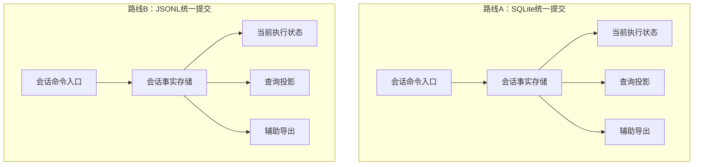

# 会话权威存储路线对比：SQLite 与 JSONL

> 状态：路线评审草稿，未实施；2026-10-30。本篇补充[性能方案的模型重审](./会话存储全链路性能改进方案.md)，不授权新格式、owner切换或删除。
> 代码基线：SpaceAssistant `a5dd7bb0`（相关运行时代码沿用 `58d28d76`）；工作区另有用户安全代码修改，本次不纳入。DSH本地HEAD `22ddee3792402c3e70ec5f86a63c3e3e895a2f60`；Codex本地HEAD `c0e88f3c04219aaa032aaf4b20a8c3284cc81449`，未核验外部检出的干净程度，不能冒充固定提交的完整审计。
> 输入：[三产品对比](../../../analyze/2026-10-30-session-storage-comparison.md)。其中跨介质权威及proof描述须按本篇事实核正，不能直接转为新增需求。
> 本次只比较两份最小目标模型；物理事件格式、迁移程序及精确模块量级尚未设计，不满足代码实施门禁。

### 本轮讨论核销【人机共读】

| 上轮不足 | 本轮修订 | 证据与边界 |
| --- | --- | --- |
| 只说两边都可行，不能决策 | 明确推荐SQLite权威存储，不将JSONL迁移作为并行实施方向 | 是技术推荐，用户要求补文档不等于批准具体迁移或删除 |
| 主要以迁移成本支撑推荐 | 新增架构、维护、性能、格式演进与故障域比较 | 区分长期适配与一次性迁移，不给未测量的性能排名 |
| 没有结合实际数据用法 | 新增执行历史、查询及执行状态三类负载及claim／终态实例 | R-F-01／02／05～07；调用结构不等于线上耗时占比 |

## 第0层：判断与取舍【人必读】

**推荐SQLite作为权威存储：执行历史按新增事件追加，必要执行状态用事务维护，页面直接查询所需数据；退出重复快照、文件裁决与全量重放链路。**

本项目的实际负载是“顺序执行记录＋有状态的桌面业务”。顺序记录确实适合追加日志，但消息分页、搜索、队列操作，以及领取执行权和提交下一轮上下文，也都是必要能力。数据库能够同时承担这些职责，避免为历史文件另行实现一套提交与恢复协议。此判断来自业务操作的语义，不只是因为现有代码已经采用数据库。

以逐行追加的日志作为会话权威，有机会简化历史、恢复和读模型之间的关系。本篇比较的是“连同会话内接纳、队列、执行归属、编辑及终态一起收敛”的完整替代路线。只搬历史正文而保持其他职责，也可以设计正确，但若同一项业务成功仍依赖文件和数据库分别提交，就保留了跨介质协调问题。

数据库路线同样必须做减法：事件与必要当前状态统一提交，文件台账退出已可从数据库重建的事实职责，正常读取停止重复重放。它不是保留现状再加缓存。

### D-2：权威存储采用哪条路线

背景：当前部分终态事实与上下文已经可以在同一个数据库事务中提交；同时仍有重复快照、文件台账与兼容分支。我们要降低长期复杂度，需要选择能真正替代旧机制的路线。

- **A：数据库统一事实提交。** 保留桌面查询与现有执行状态的事务基础，重点退出重复证明、重复快照和文件权威职责。用户通常不会感知存储介质变化；代价是必须认真重整现有职责，不能把已有表全部原样留下。历史仍可导出成文件，但导出不承担在线执行裁决。
- **B：追加日志统一会话事实。** 会话文件可独立承载恢复材料，数据库中的会话历史与执行状态成为可重建结果。历史更易独立检查和搬运；代价是重新设计接纳、编辑、执行所有权及恢复，升级后旧包不能直接理解新增记录。全局设置等独立业务数据仍留数据库；跨会话业务也不能假装单文件就能包办。
- 可逆性：本次文档比较可逆；任一路线的数据切换都必须有承接升级后新增数据的回退实体，不能只保留升级前副本。不得在此批准删除。
- 依据强度：数据库内同事务提交和现有文件派生机制已有代码证据；两种最小目标都没有实现、基准或完整转换演练，不能声称A一定更快或B一定代码更少。
- **明确推荐A，不迁移到JSONL权威历史。** 原因是本项目长期同时需要顺序记录、结构化查询和条件原子更新，数据库能一起承担；迁移成本只是次要理由。B保留为排除路线的论证，不并行安排实施。未另行批准时继续文档与取证，不做数据切换；推荐不等于已证明性能改善，也不批准具体格式或外部行为。
- 下钻：R-INV-01～04、R-AC-01～04、§2.1～§2.5。

### 本次范围与最薄弱的三处

本轮只提交路线比较、替代清单与恢复推演。新增产品界面、设置、IPC、错误码均无提案；两路线的字段、迁移、完成回执和兼容包都须详细设计后单独评审。Mac可验证恢复与访问规模，Windows原故障、真实库、安装包及IM保持外验。

最可能推翻或限制推荐的证据：①产品重心转为轨迹归档、fork、回放和按文件搬运，事务型编辑及调度大幅减少；②相同耐久保证的实测表明数据库仍是主要瓶颈，且必要工作已无法再削减；③文件台账仍独占不可替代的旧事实，使退出文件链路的前提不成立。前两项可能要求重选路线，第三项要求先完成转换，不能直接停用文件。由实现者取证，不要求负责人凭感觉判断。

## 第1层：两份最小模型【人机共读】

### 1.1 相同职责，不同提交点



两图形状相同是刻意的：介质不决定职责。A由现有主进程SQLite writer在同一事务提交事实和必要执行状态；B由每会话独占writer顺序接纳命令、追加完整提交批次，再推进状态。B的数据库投影不能独立批准执行；会话writer必须持有有效所有权并在恢复到最新已提交前缀后才接受下一命令。两路线都必须保留既有policy与final-check，不把串行化等同于授权。

### 1.2 变更面与替代关系

以下按共同职责计数，非文件级实施量级。

| 单元 | 作用简述 | A类型与变化 | B类型与变化 | 依赖方／约束 |
| --- | --- | --- | --- | --- |
| 会话命令入口 | 接纳并排序会话变更 | 改承重边界：收敛现有入口 | 改承重边界：命令交给会话writer | 桌面、IM、续跑；R-INV-01 |
| 会话事实存储 | 提交可恢复执行事实 | 改对外契约：调整重复持久化 | 改对外契约：新JSONL提交格式 | SDK宿主、恢复；R-INV-01、02 |
| 当前执行状态 | 决定接纳及执行归属 | 改承重边界：同事务推进 | 改对外契约：改为日志事件及归约状态 | 队列、租约、终态消费者；R-INV-02 |
| 查询投影 | 提供分页及实体查询 | 改承重边界：停止互相证明 | 改承重边界：按日志前缀更新 | ChatView、搜索、API context；R-INV-03 |
| 辅助导出 | 提供独立文件副本 | 改造：不再承担已覆盖事实的裁决 | 改造：明确导出与权威日志的区别 | 显式导出、退出、外部消费；R-INV-03 |
| 安全执行关卡 | 裁决并核验工具执行 | 复用不改（待验证） | 复用不改（待验证） | 身份绑定、执行代次；R-INV-02 |
| 正文引用与回收 | 管理权威大正文 | 复用不改（待验证） | 改对外契约：适配日志引用与回收 | spill完整性、GC；R-INV-04 |
| 日志提交器 | 发布有序耐久日志批次 | 无新建提案 | 新建：目标职责，复用旧ledger须证明足够 | 写lease、物理尾部、批次边界；R-INV-01 |

A：既有改造5、复用2、新建0，改对外契约1、改承重边界3。B：既有改造6、复用1、新建1，改对外契约3、改承重边界2。不将这些职责计数等同于代码行数或最终模块数。两路线新增持久化字段数／版本数／迁移数均未定；新错误码与设置无提案；本轮一个文档比较交付，零代码实施阶段。

达到拆分门槛，本篇只保留共用场景的路线对比；选定路线后再给提交／恢复／迁移详设，派生读取另案消费其定义，不在两边同时实施。

### 1.3 契约面六面

| 契约面 | A | B | 详细设计所需证明 |
| --- | --- | --- | --- |
| agent-sdk | 宿主实现必改；事件／公开导出是否需改须逐项核定 | 宿主持久化实现必改；接纳／租约新事件可能牵涉宿主事件，不默认扩SDK事件词汇 | `check:agent-sdk`、`typecheck:agent-sdk`；旧事件及MemoryHistory差分 |
| 会话存储 | 改读写职责，writer仍在SQLite | 改writer及提交点，SQLite事务不再包办日志提交 | 三项存储门禁；旧调用方、scope、恢复和旧库兼容 |
| IPC／preload | 比较不改；普通成功与导出解耦另审 | 比较不改；若确认时点变为日志耐久提交须另审 | 参数、返回字段及失败语义对拍 |
| 共享类型 | 比较不改，详设列出必要变化 | 比较不改，不将存储事件复制成第二份领域类型 | `typecheck:shared`及renderer检查 |
| 其他持久化格式 | 改重复状态／快照布局，格式待定义 | 改日志批次、所有权及旧库转换，格式待定义 | 转换中断、未来版本、升级后回退及spill引用演练 |
| 领域数据格式 | 无新增规则／配置／错误码提案 | 同A；文件内部损坏分类不自动变成产品错误码 | 沿用脱敏，新增对外项须单独列出 |

本轮只改文档，未重跑代码门禁。旧性能调研的通过成绩只说明原基线，不说明这两条路线已兼容。

### 1.4 综合优劣：比较简化后的目标

| 维度 | A：SQLite权威 | B：JSONL权威 | 本项目判断 |
| --- | --- | --- | --- |
| 架构适配 | 结构化状态和执行事实可以同事务提交 | 有序历史到投影的数据流直观，但要完整表达业务状态 | 查询与状态变更都必要，A更适配 |
| 长期维护 | 复用数据库事务、约束和索引；需控制表及快照职责膨胀 | 事件格式容易检查；归约、批次提交、投影、锁及修复协议需长期维护 | 优先减少自建协议，A占优；保留现有全部机制不算A目标 |
| 写入性能 | WAL、索引、事务有成本；批量追加可随新增内容增长 | 顺序写入路径直接；索引投影与耐久同步仍有成本 | 高频执行事件偏追加；没有相同保证基准，不能宣布B更快 |
| 读取性能 | 条件查询、排序、分页、聚合成熟 | 尾部与顺序扫描自然；实体查询通常还需索引／DB投影 | UI与控制信息读取适合A |
| 大历史 | 避免大行重复改写、全量快照及长事务 | 避免全文重复追加，处理定位、压缩与重建耗时 | 两者都必须改访问方式，换介质不治全量处理 |
| 编辑与执行调度 | 条件检查及多行状态更新由事务承担 | 编辑／撤销／重排作为新事件，writer维护状态与顺序 | A让业务约束更直接 |
| 一致性与恢复 | 同库操作可原子提交；外置正文仍有生命周期 | 日志顺序明确；多行批次、撕裂尾、owner与投影落后需协议 | A减少会话业务的部分成功窗口，不代表自动解决外部工具效果 |
| 格式演进 | schema与数据迁移集中，仍需回退实体 | 事件兼容长期存在，generation发布与压缩也有演进成本 | 均需设计，不以JSON文本可读性代替兼容 |
| 检查与搬运 | 需要SQLite工具；一致快照便利，运行中不能任意复制库文件 | 按会话查看和流式处理方便；附件与全局元数据仍需配套 | B有独立优势，当前不足以抵消事务及查询需求 |
| 故障域 | 共享数据库形成公共故障域，写入和维护可能相互影响 | 每会话日志有隔离优势，共享索引和磁盘仍是公共依赖 | A的实际约束必须测量，不隐瞒共享writer与库故障影响 |

**选择A的长期理由是业务适配和少维护自建协议；“现有事务已经可用”只是落地优势。** 两路线在相同耐久保证下才能比较性能。同步SQLite仍可能阻塞Electron主线程：选择A不等于批准永远在主线程做所有必要计算；先去掉不必要工作，再按事件循环证据决定调度或线程边界，不能预设新增Worker。

### 1.5 实际负载：哪里需要追加，哪里需要事务

| 数据用法 | 当前代码行为与入口 | 必需能力／路线含义 |
| --- | --- | --- |
| 执行历史 | SDK `turn.ts`追加初始上下文、模型响应、工具结果与终态；初始化、续跑及异常核对读取历史 | 偏顺序追加。JSONL自然，SQLite事件表也可append-only；不应每批全前缀重放 |
| 桌面与API查询 | `SessionQueries`提供消息身份查询、聊天分页、上下文、搜索、导出、message sequence及turn定位 | 必须有效定位局部数据；B仍需查询投影，不能假设只读日志尾部即可 |
| 排队消息变更 | `reorderQueuedUserMessagesInScope`核对当前队列集合、更新sequence与preview，并使scope版本失效；编辑／删除也需与claim竞争 | 必须按某个顺序裁决“还可编辑”与“已被接收执行”；SQL事务可直接表达，日志writer也需等价状态管理 |
| 执行领取 | `claimSessionExecution`检查transcript状态、现owner与队首，再更新queue和claim的owner／generation | 检查与更新必须不可被竞争写入打断；这是业务约束，不是SQL语法带来的需求 |
| 终态与下轮上下文 | `appendBatchUnderSpillFence`在同事务提交terminal、transcript及可选message mirror | “本轮完成”与“下一轮使用哪个已提交上下文”须一致；不证明当前所有镜像字段都必要 |

claim的业务语义可展开为：会话允许执行、没有冲突执行者、目标为队首三项成立，才能同时领取队列项并登记新代次。JSONL可以完成这一点，但须由writer和恢复状态实现相同排他顺序，不能靠追加一行自动获得。

执行循环的模型／工具推进主要使用运行中的上下文；持久化接收事件，历史读取出现在初始化、续跑和异常等位置。不能据此说循环“完全不读库”，也不能把全文读取当作每次循环的必需步骤。这里是调用结构判断，没有实测读写次数比例。

主方案已核实的主要浪费是：追加重读全前缀、状态查询水合全文、短preview重建会话、重复完整快照和辅助导出等待。**它们是访问范围、数据表示和完成条件的问题，不能作为数据库介质不适配的证据。**

目标组合：SQLite事件表增量追加；接纳／队列／claim／上下文由必要事务维护；分页／搜索／preview局部查询；JSONL只承担确有需求的导出、诊断或互操作。旧文件的独占事实必须转换后才能退出对应权威职责，不承诺立刻停写所有文件。

## 第2层：相同操作与故障检验【机｜人工可跳过】

### 2.1 两路线共同必须满足的性质

| ID | 不变量 | 验收 |
| --- | --- | --- |
| R-INV-01 | 同一业务命令的事实只有一个持久提交裁决；内存更新和投影成功不能代替它；批次不能恢复出半个业务命令 | R-AC-01、02 |
| R-INV-02 | 接纳幂等、配置冻结、租约fencing、审批身份、终态顺序及未知外部效果语义不变；恢复不得自动重做可能已执行的工具 | R-AC-01、02 |
| R-INV-03 | 高频读取使用明确版本的所需数据；投影落后不制造第二份权威，也不能让执行读过期状态 | R-AC-02、03 |
| R-INV-04 | 权威正文完整性与引用生命周期仍成立；换介质不默许更弱耐久保证，升级后新数据可由回退实体承接 | R-AC-02、04 |

主方案INV-01及其SQLite所有权表是A的候选实现约束，不能用它预先判B不合格；本表是两路线中立的比较口径。最终选择B时必须同步替换主方案相关规格，不能两种writer并行生效。

### 2.2 同一组操作

| 操作 | A：数据库统一提交 | B：日志统一会话事实 |
| --- | --- | --- |
| 接纳新指令／重复提交 | 同事务保存冻结配置、身份、队列事实；约束裁决重复 | writer在已提交状态检查身份，持久记录接纳及冻结配置后确认；索引可重建，不能只查落后DB |
| 编辑／删除／排序排队消息 | 事务检查尚未claim、更新队列与必要事实 | 追加编辑／撤销／重排事实；writer排序决定与claim先后，不能静默改旧日志 |
| claim与进程接管 | DB事务检查owner与代次 | 日志记录执行归属；跨进程独占锁防双writer，持久代次防旧执行回调。单写句柄本身不能替代执行fencing |
| 工具调用与结果 | 保留dispatch前后必要事实、审批和未知效果 | 同样先持久记录必要事实再dispatch；日志无结果不能证明工具没执行 |
| 终态与模型上下文 | 同事务写终态、已提交上下文和必要claim状态 | 一个可识别提交批次覆盖终态与上下文变化；完整JSON行不等于多行批次原子完成 |
| 首屏／preview／摘要 | 索引读取所需行／正文，辅助任务不挡submit | DB分页投影或定位读日志；投影落后补到目标前缀，不能默认全量扫描日志 |
| 压缩／失败续跑 | 提交新上下文版本，保留恢复与工具配对 | 新事件表达有效上下文边界，不能按可见气泡拼模型输入；上下文snapshot仍可能必要 |
| fork／会话删除／多会话动作 | 需要原子一致的DB数据可同事务提交；外部文件删除另做生命周期 | 单会话日志不足以处理父子引用与删除并发；需明确跨会话协调／不可变切点，不能宣称都可丢给投影 |

第三种分工并非天然错误：JSONL权威保存历史、SQLite权威保存独立的调度或租约事实也可以成立。关键是同一事实不由两边重复裁决，且跨边界命令有明确先后与恢复规则。本篇没有证明这种分工一定比整体接替更复杂；若消费者清单显示可清晰切开，应将它作为独立候选，而不能因为不是“全部日志化”就排除。

双方都需：新增事件增量推进、读取按所需字节、避免重复完整上下文、renderer少clone。单纯JSONL不提供这些性质，SQLite的事件表也可以是append-only。

### 2.3 崩溃窗口和唯一裁决

| 窗口 | A | B |
| --- | --- | --- |
| 提交前退出 | DB事务回滚；孤立准备正文走既有回收 | 未发布完整批次不能成为事实；修复物理尾部后才恢复写入 |
| 已提交、回执未到 | 查持久幂等回执，不重做 | 查已提交日志前缀的命令身份，不依赖投影是否已更新 |
| 事实已提交、投影更新失败 | 同事务执行状态仍一致，异步派生重建 | writer内存推进失败则停止接纳并恢复；DB投影按前缀追赶，不撤销已提交事实 |
| owner退出，旧工具回调晚到 | 现有持久代次最终校验拒绝旧owner | 新writer接管后提升代次；所有回调经当前writer核验，不能仅靠文件锁挡旧执行者 |
| 外部工具已执行、结果未可靠保存 | 保持unknown，不自动重试 | 同A；日志尾部修复不能推断外部动作被撤销 |
| 权威材料损坏 | 权威DB／spill损坏明确失败，派生损坏可重建 | 日志中段损坏不能当撕裂尾截掉；权威spill损坏同样失败 |
| 新旧包同时打开 | 既有锁与格式版本约束，详设证明旧writer拒绝新格式 | 独占writer与未来版本拒绝；新generation不是自动解决旧进程写旧文件的办法 |

B必须定义完整批次编码、耐久边界、损坏分类、排他owner和版本发布；JSONL文本本身不提供这些。A也不免于断电问题：当前WAL／NORMAL不能在未评估前声称与逐批fsync具有相同断电保证。比较需分别测试进程崩溃、OS崩溃和断电目标，不把它们混为“保存成功”。

### 2.4 到底能删什么

| 现有机制 | A的目标 | B的目标 | 本轮是否已具备删除证据 |
| --- | --- | --- | --- |
| SQLite canonical事件 | 保留为执行事实 | 转换后停写，完整消费者迁移后删除 | 否 |
| 文件ledger及对账 | 对DB可重建事实降为可选派生；无独占消费者才退出 | 旧ledger不自动等于完整新日志；转换后由单一日志提交取代双向对账 | 否 |
| accepted contexts／queue／claim | 保留必要事务职责，重复字段再收敛 | 转为日志事实与归约状态；DB对应表不再独立裁决 | 否，且是B能否简化的核心证明 |
| 完整转录／invocation上下文／checkpoint | 按字段与恢复消费者合并 | 同样要合并；不能全文原封不动搬入新日志 | 否 |
| 分页投影与locator | 原则复用，去掉多余证明 | 保留同一读职责，源定位改日志；不能承诺无需投影 | 否 |
| spill／引用／GC | 原则复用 | 保留或替代生命周期；日志被保留时不能仅按DB投影回收正文 | 否 |
| 权限校验／未知效果处置 | 保留 | 保留 | 不属于删除目标 |

不按文件数给“净减多少”的假精度。比较四项：独立提交裁决点、正常路径全量重建次数、恢复状态组合、旧机制能否彻底退出。两目标都可以收敛为一个会话事实提交点；B不天然更少，差别在实现及必要外围协议。

### 2.5 验收与改变推荐的条件

| ID | 可执行证据 | 决策关联 |
| --- | --- | --- |
| R-AC-01 | 相同命令序列在两模型产生相同接纳、队列、工具及终态结论；随机操作序列验证顺序、幂等和代次，不以UI一致替代执行一致 | D-2／R-INV-01、02 |
| R-AC-02 | 对2.3各窗口故障注入；B另逐字节截断多行批次并破坏中段；A覆盖内外层回滚；恢复不重做未知效果，投影落后不改变事实 | D-2／R-INV-01～04 |
| R-AC-03 | 相同轮数／工具数／正文夹具测追加字节、前缀读取、页读、事件循环及绘制延迟；热态、冷恢复、投影重建分开。耐久配置先声明，不能弱化保证换胜出 | D-2／R-INV-03 |
| R-AC-04 | 从隔离旧库转换、恢复、再产生新增编辑和工具记录，再用回退实体读取；列出停写和移除的真实调用方，旧ledger独占事实为零才退出 | D-2／R-INV-04 |

本轮未实现上述夹具，不宣称路线通过。下一份详设应先回答：①每个持久字段的真实消费者；②JSONL路线是否能彻底替代会话内DB执行裁决；③跨会话、删除与正文回收需要什么不可省协议。A若无法给出旧链路退出方案，不得凭“迁移少”胜出；B若只能保留数据库独立裁决再叠日志，不满足减法目标。

### 2.6 人层与规格对账

| 人层结论／边界 | 规格与证据 | 状态 |
| --- | --- | --- |
| 两介质都可减少重复裁决 | R-INV-01、2.2／2.3、R-AC-01／02 | 模型推导，未实现 |
| 明确推荐A，不并行实施B | D-2、1.4／1.5、R-F-01／02／05～07 | 架构推荐；无净减数量与实测性能证明 |
| 不削弱执行与耐久保证 | R-INV-02／04、R-AC-02／04 | 需故障注入与回退实体 |
| 不增加产品交付面 | 无界面／IPC／设置／错误码提案；字段与版本数未定 | 未定格式没有实施授权 |
| 量级及交付 | A改5／复用2，新建0；B改6／复用1，新建1；一个文档交付 | 职责级数量，不是实施文件数 |

## 附录：事实与复核入口【机｜人工可跳过】

| ID | 本轮核实事实 | 支持／不支持的结论 |
| --- | --- | --- |
| R-F-01 | `SqliteAgentHistory.appendBatchUnderSpillFence`在`runInTransaction`内追加SQLite历史；有transcriptCommit时同事务调用`commitSessionTranscriptInTransaction`并更新消息mirror | 支持A已有原子边界；不证明所有接纳步骤已经同事务 |
| R-F-02 | `acceptTurnContext`持久保存first-acceptance-wins；`sessionTranscript.ts`按owner／generation约束claim与queue | B不能只搬正文，必须替代这些裁决职责 |
| R-F-03 | `buildCanonicalToolResultProjectionTargets`生成canonical派生义务；readiness映射七个proof字段为空并注明retired | 对比文档把旧proof当活跃设计依据不准确；不证明所有legacy文件均可重建 |
| R-F-04 | DSH句柄append在入队前校验并快照批次；flush注释说明append完成已耐久；Codex分页表保存ordinal与offset投影状态 | 支持明确顺序及增量读取；不证明其整体协议可直接替代本项目 |
| R-F-05 | SDK `turn.ts`通过appendHistory保存上下文、响应、工具结果及终态；存在初始化及异常历史读取 | 执行历史偏顺序追加，不证明JSONL吞吐更高或每个token均持久化 |
| R-F-06 | `sessionStorage/public/ports.ts`的SessionQueries有readMessage、readChatPage、readTurnContext、readApiBaseline、searchMessages、readExportPage及turn定位 | 结构化查询是现存消费者需求，不是推测未来需要 |
| R-F-07 | `claimSessionExecution`在事务内检查checkpoint／claim／队首并更新queue与claim；`reorderQueuedUserMessagesInScope`事务内核验集合与更新顺序 | 支持条件检查及状态更新的原子需求，不证明现有每张表和每个字段都必要 |

```bash
# 仓库根定位，提交基线见文首
rg -n 'appendBatchUnderSpillFence|runInTransaction|commitSessionTranscriptInTransaction' electron/runtime/sqliteAgentHistory.ts
rg -n 'First acceptance|accepted_turn_contexts' electron/database/acceptedTurnStorage.ts
rg -n 'claimSessionExecution|generation|execution_queue' electron/database/sessionTranscript.ts
rg -n 'retired|proofFileIdentity|canonical-v1|buildCanonicalToolResultProjectionTargets' electron/sessionLedgerReadiness.ts electron/sessionLedgerOutbox.ts
rg -n 'appendHistory|history.read|transcriptCommit' packages/agent-sdk/src/turn.ts
rg -n 'readMessage|readChatPage|readTurnContext|readApiBaseline|searchMessages|readExportPage|readTurnBy' electron/sessionStorage/public/ports.ts
rg -n 'reorderQueuedUserMessagesInScope|queue_changed' electron/database/operations.ts
```

外部复核入口：`/Users/space/Documents/Develop/deepseek-harness/packages/session/session-persistence-jsonl/src/storage.ts`（append／flush）；`/Volumes/MacHub/Hub-Develop/codex/codex-rs/state/thread_history_migrations/0001_thread_history.sql`（ordinal／offset）。原对比文档作背景阅读，不作为新接口或新证明层的实施依据。

未验证：旧文件独占事实范围、跨会话原子需求清单、两路线完整耐久与回退协议、等保证性能数据；由实现者在详细设计前关闭。Windows原故障和真实安装／IM体验仍需外验。
