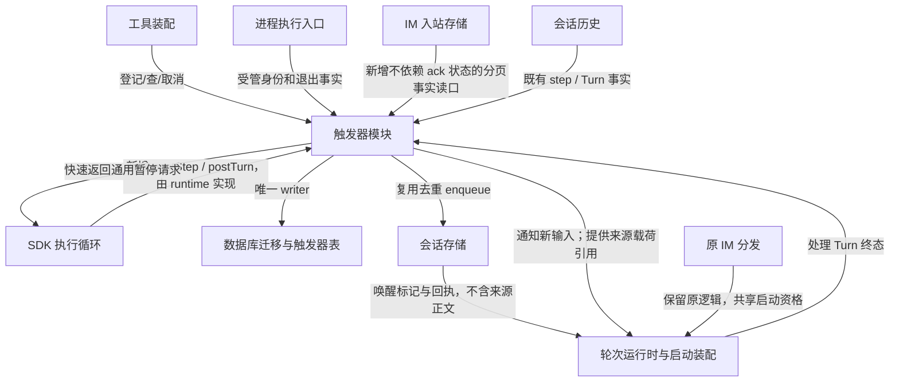

# Agent Runtime 通用触发器技术方案（首版简化）

> 状态：主要能力和范围已确认；本轮按用户明确的非追溯撤权边界删除 A-03/R-01 历史隔离扩展，并补 S-01 原子历史接纳协议；B-01/B-02、在线同步接纳、消费隔离及稳定 IM 游标合同保留。历史评审结论只适用于当时版本，本轮修订待复核。仅改方案，新增接口和测试尚未实施，未将合同修订计作 P1 通过。
> 日期：2026-11-01；代码基线：`26a79788711e5409f2f06d7f6f3fc1a126320c52`。工作区已有其他代码改动，不纳入本轮修改。
> 需求：[Agent Runtime 通用触发器需求说明书](../../../requirement/tools-mcp/in-flight/agent-runtime-trigger-requirement.md)。
> 阅读：第 0 层看决策与变化，第 1 层看改动边界，第 2 层为实现合同，附录给证据和修订核销。真实渠道行为依现有代码分析，不展开实测清单。

## 第 0 层：决策层【人必读】

**一句话：** 从反复轮询任务，变为登记一次事件等待，命中后向指定会话排队消息；需要监督时，在步结束后有期限地暂停目标会话。

**只有 3 分钟：** 看“已确认”“本轮简化”和“三处风险”。五类事件、跨会话、一次性、排队不打断、重启恢复均保留。

### 已确认与剩余参数

- **登记、查询和保存数据：A 已批准。** 保留登记、查询、列表、取消、可监听对象查询五工具；不加界面或进程间通道。关联和状态可查，消息只进入准确接收会话。下钻：D-02、INV-01/02/05、AC-01/08/12。
- **消息与进程范围：A 已批准。** 只观察授权后保存的飞书、微信消息；限定渠道、账户和聊天对象。进程只认运行时管理身份，不接受任意系统进程号。下钻：D-03、INV-04/05、AC-04/05/11/12。
- **容量与期限：A 已批准。** 每注册会话最多 128 个未结束项、应用最多 4096 个；登记最长 30 天；入队暂时失败 15 分钟内最多尝试 5 次，忙碌不耗重试次数。定时 1 秒扫描，正常在线空闲到入队的本地验收目标为 2 秒；离线到期补发，状态首期不自动清理。下钻：D-04、INV-06、AC-06/10/14。
- **执行边界和两层时限已确认。** SDK 只提供生命周期回调和通用暂停能力，触发器由 runtime 实现；回调执行、单次暂停分别限时，用户取消始终有效。暂停不消耗模型/工具执行剩余预算；首版无每轮累计暂停预算。到期继续还是失败由请求显式声明。下钻：D-01/05、INV-03/06、AC-07/10。

**撤权只限制后续来源访问，不追溯过往执行历史。** 来源正文首次写入接收执行历史的事务内仍检查当前权限；授权核验、正文 History 和接纳凭据同事务提交，一旦合法接纳，按普通会话记录保存，后续对话、重试、恢复和压缩可以沿用这些历史，不因来源撤权删除、过滤或拒绝历史。再次向来源取新消息、补读正文或重新展开引用，仍须检查当前权限。待投递 event_json 和中性队列标记不等于正文已被接收执行合法接纳，不能用预先缓存绕过首次授权。下钻：§7.1/7.2、AC-12/13。

只有正停在检查点的执行循环能接纳同步命中；原 IM 消费者不能领取触发标记；消息显示排序不充当事件游标。这些可靠性与授权入口保留；删除的是触发器专用历史隔离、投影和完整快照合成，不重做现有历史存储。

**还没有确定的是两项时长数值。** 原先 1 秒回调上限、60 秒暂停上限是作者提出的候选，没有实测依据，不作为默认值。实现接线前需确定两个有限正数；不重复裁决已确认机制。本轮不因参数未定而停止文档简化。

### 本轮简化与批准边界

本轮授权是简化实现设计，不是削减五类事件。具体调整：

1. **只新增一张登记表。** 登记记录同时保存命中载荷和投递进度；复用会话队列的去重回执，不混用现有 IM wake 消费者。删除独立投递表、暂停表、进度表和受管进程表。
2. **只新增一个触发器模块。** 登记、源适配、补扫和投递是同一服务的职责，不建立独立事件总线、屏障服务或通用投递框架。
3. **生命周期接口不再套结算回调。** 保留两个生命周期回调，暂停请求只含时限、到期动作和等待函数；删除 onSettled 及其失败恢复协议。
4. **首版每个目标会话最多一个有效同步登记。** 再登记返回可理解的冲突，完成/取消/失败后可重新登记；异步登记不受此限制。不做同一步多个同步等待的组合规则，也不维护完整等待依赖图；同会话同步自等待仍拒绝，跨会话循环由单次暂停期限收敛。

这些是本轮“简化首版”指令下的具体收缩，均在工具输入/错误与迁移中明示；会话已产生的外部效果不能通过撤销登记回滚。新表虽减少，仍涉及数据库版本升级，回退可能需要恢复升级前整库副本。未来放开同步并发需修改合同，不以实现细节偷偷放开。下钻：D-06、§3～7、AC-07/10/13。

**本轮不需要你重新决定：** 已批准 A 的三项、SDK 与 runtime 的职责、两层单点时限、无累计预算；事实核查、复用边界与故障用例由实现者负责。

### 自曝三处风险

- **不同启动入口同时执行同一会话。** 若桌面、IM 和新输入能同时获得资格，忙碌排队就不成立；发现该证据必须修正共同启动所有权。下钻：INV-02、AC-08。
- **省掉进度表后依赖历史可重建。** 如果已有历史无法识别完整结束的一步，计数就不可信；必须先补齐事实查询，不用 usage 数或模型请求数替代。下钻：INV-04、AC-03/09。
- **暂停不能靠屏蔽超时信号实现。** 若现有整轮计时不能区分执行与暂停，仍需有限的计时接线改造；不直接承诺现有代码已支持预算暂停。下钻：INV-03/06、AC-07/10。

## 第 1 层：概要与评审包【人机共读】

### 1. 当前基础与交付边界

现有会话存储已支持 requestId 去重、内容 fingerprint 校验、queued 消息及领取回执；`readTurnByRequest` 能关联准确处理 Turn。它足以承担消息入队事实，不必另建 outbox 和新的原子入队端口。现有 IM listImInboxMessages 仅返回 queued/claimed，最多 100 条且无 cursor，不能用于已 ack 消息恢复。新增持久事实查询合同见 §6.1.1，不能再把现有读口视作足够。IM 的 wake 分发按渠道领取、启动远程 loop，不能直接当作桌面/任意会话的通用输入队列；本次不扩充 wake 类型，不迁走旧消费者。

SDK 现有模型响应回调发生在工具完成前，须新增整步完成后的 postStep，以及终态提交后的 postTurn。两者不承载触发器业务。step 和 Turn 的持久事实仍来自既有 History/会话执行记录，不复制一份完整执行账本；合法接纳的来源内容使用普通历史合同，不新增留存模式、来源清单或会话投影。

本地可验证输入、计数、去重、竞争、故障注入、重开数据库、模拟 IM、测试子进程、假时钟与预算暂停。Electron/休眠/真实网络未实测，只标明代码推导边界；不增加真实渠道验收任务。本次交付是方案，AC 均为后续实现验收设计。

### 2. 链路、变更面和量级

#### 2.1 链路图（RP-2）

恢复扫描是触发器模块启动方法，不再有独立恢复器。SDK 管在线暂停计时，触发器模块唯一写登记记录，会话存储唯一写消息/队列回执，轮次运行时拥有 Turn；这些 owner 不合并。

#### 2.2 变更面（RP-3）

一行算一个交付单元；同一行的实现/端口/测试装配计入所属单元。

| 单元 | 作用简述 | 类型 | D/INV | 跨边界和依赖者 |
|---|---|---|---|---|
| SDK 执行循环：`packages/agent-sdk/src/turn.ts` 与导出 | 推进模型与工具循环 | 改对外契约 | D-01/05，INV-03 | runtime 装配两个回调及独立限时 |
| 工具箱装配：`electron/capabilities/`、`src/shared/skillPrompt.ts` | 提供能力发现与调用 | 改对外契约 | D-02，INV-05 | 桌面/远程经既有 toolkit 网关调用五项触发能力，补入口引导 |
| 轮次运行时与启动装配：`electron/turnRuntime.ts` 及调用方 | 管理会话执行资格 | 改承重边界 | D-01，INV-02 | 桌面、原 IM、新触发输入共用资格；新增触发输入启动授权屏障 |
| 会话存储：`electron/sessionStorage/` 公共端口及实现 | 保存并领取会话输入 | 改对外契约 | D-02/06，INV-02 | enqueue 增可选 queueScope、回执查询/取消、可信来源分类过滤；claim 和上下文选择均隔离平台输入与触发输入 |
| 数据库迁移与触发器表：`electron/database/schema.ts`、`electron/database/migrations.ts` | 管理落盘格式 | 改对外契约 | D-02/06，INV-01 | 新登记表及原 IM context 四列、schema_meta 两个持久键族，旧库与备份读取者受版本影响 |
| 共享合同：`src/shared/domainTypes.ts`、`src/shared/errorCodes.ts` | 统一领域与错误定义 | 改对外契约 | D-02/06，INV-05/06 | 新触发器 DTO 与失败码；SDK 类型仍归包内 |
| 进程执行入口：`electron/tools/runShellExecutor.ts`、`electron/tools/builtinExecutors.ts` 的 run_script | 启动并结算子进程 | 改承重边界 | D-03，INV-04 | 新 opaque 管理身份与退出通知；不改启动模式 |
| 原 IM 分发：`electron/remote/wakeEventDispatcher.ts` 及启动装配 | 分发渠道既有事件 | 改承重边界 | D-03，INV-02 | 共享会话资格，不消费新触发器表 |
| 触发器模块：`electron/triggers/`（拟新增） | 登记匹配并投递事件 | 新建 | D-01～06，INV-01～06 | service/store/sources 按函数组织；不建立三个独立服务 |
| IM 入站存储：`electron/database/imInbox.ts` 及两渠道接纳调用方 | 保存并查询入站事实 | 改对外契约 | D-03，INV-04/05 | 新独立接纳序号/身份读口；所有 inbox list/claim/ack 等入口按可信平台身份隔离触发项 |
| 会话历史：`electron/runtime/sqliteAgentHistory.ts` 及宿主存储装配 | 原子接纳来源正文 | 改对外契约 | D-02，INV-05 | 首次 context 与触发登记接纳凭据同事务，拒绝未接纳 raw 后续提交；SDK HistoryPort 和 transcript 格式不变 |
| 事务封装：`electron/database/transaction.ts` | 组合短同步事务 | 复用不改 | D-02，INV-01 | 已支持嵌套 SAVEPOINT，事务内不 await |
| 重试算法：`electron/remote/wakeEventRetryPolicy.ts` | 计算失败重试时刻 | 复用不改 | D-04，INV-06 | 纯算法复用，状态存触发器表，不消费 IM wake |

#### 2.3 契约六面（RP-4）

| 面 | 改/不改及同步义务 | 验证 |
|---|---|---|
| ① agent-sdk | **改**：Turn 输入增可选 lifecycleHooks/lifecycleLimits，公开两个回调与暂停请求；不新增历史 retention/manifest/投影字段，不改 HistoryPort、HistoryEvent 或 SessionTranscriptCommitIntent 合同，无 SDK→宿主依赖 | check:agent-sdk、typecheck:agent-sdk；未配置 hooks 的旧调用与历史 fixture 回放 |
| ② 会话存储 | **改承重语义及接口**：commands.enqueue 可选 queueScope 缺省 desktop，queries.readQueueReceipt 为只读公开端口；新增按 requestId 取消尚未派发输入的薄命令；原唯一 writer、事务和消息顶层格式不改；来源隔离领取语义改变；transcript writer 与历史构建保持原合同，但宿主 History 首次提交与接纳凭据新增原子交接，不能当作仅薄接口 | 三个存储边界门禁；旧队列调用、scope 隔离、删除/编辑后回执、消息导出/恢复对拍 |
| ③ IPC/预加载 | **不改**：新能力经主进程工具；既有消息投影足够，不增加管理 UI | preload/shared api 无改动 |
| ④ 共享类型 | **改**：触发器定义/状态/错误。SDK 中性生命周期类型仍留在 SDK，shared 不 import SDK | typecheck:shared、check:agent-sdk |
| ⑤ 持久化 | **改**：新登记表 16 列、原 im_inbox_message_context 新增 account_id/conversation_id/sender_id/accepted_seq 四列，共 20 个顶层 SQL 列；schema_meta 增 im_fact_next_seq/im_fact_coverage_revision:<scopeKey> 两个持久键族；JSON 合同 v1，旧消息/旧 wake 表不变 | 迁移/重入/中断/未来版本拒绝/旧库对拍 |
| ⑥ 领域数据 | **改**：五工具、10 个触发域错误码、两类 SDK 通用失败；另增两个 schema_meta 持久键族，无新策略规则表/系统 invariant/设置开关 | schema、稳定错误和权限边界用例；已有 gate 继续生效 |

前轮当前基线已通过 check:agent-sdk、typecheck:agent-sdk 和三个存储门禁，不能当作上述新增合同已验证。本轮纯文档不重复跑编译或功能测试。

#### 2.4 体量、拆分及外扩（RP-5）

**13 个单元：改既有 10、新建 1、复用 2；改对外契约 7 行、改承重边界 3 处。新登记表 16 列加既有 IM context 四列，共 20 个 SQL 列，另有两个 schema_meta 持久键族、五工具、10 触发域错误码和两类 SDK 失败，实施分 3 阶段。** 与前版五表/61 列相比，删除的是重复存储和框架，不删除可靠投递保证。

达到拆分门槛仍保留单篇：命中、唯一入队和同步等待共享 triggerId，需同一合同闭合崩溃窗口；拆篇分别批准会割裂“处理结束”的定义。实施分阶段，新增 UI、其他渠道或重复规则另立方案。

本轮评审补充的四项 IM context 列、两个持久键族及覆盖触发器、分页事实读口、登记 JSON 内授权绑定与共同启动核验，属于已有恢复/权限承诺的必要实现，不恢复多表框架；对接原 policy/授权代次，不另造规则体系。

相对需求新增面：工具具体形状、单表/JSON、错误分类来自 BR-01/08/09/10，沿 D-02 已批准的数据保存方向简化；生命周期接口、两个时限和到期动作来自同步等待开放项及 D-01/05；单同步登记限制来自本轮简化指令 D-06。上述格式由本篇给出，不增加额外界面、IPC、策略规则、累计预算或导入时自动重建任务。

## 第 2 层：规格【机｜人工可跳过】

### 3. 最小模型与存储

#### 3.1 不变量

| ID | 性质 | 机制与验收 |
|---|---|---|
| INV-01 | 同一登记最多命中一次，取消和命中只有一个胜者 | waiting CAS、revision 与唯一 clientKey；AC-01/03/10 |
| INV-02 | 同一登记最多一条接收消息，忙会话不并行启动 | 固定 requestId 复用原回执/指纹；共同 session 资格；AC-08/13 |
| INV-03 | 同步暂停在完成或按声明到期结束前不推进，取消可达 | SDK 两层时限、单结算点及独立 signal；AC-07/10 |
| INV-04 | 计数与恢复依据可重建事实，不猜退出和模型进度 | History settled 身份、IM cursor、进程代次；AC-03/04/09 |
| INV-05 | 跨会话不扩大读取、执行或出站权限 | 宿主身份、原授权域及首次历史接纳事务的代次核验；队列标记不携带正文；AC-05/11/12 |
| INV-06 | 等待、投递失败有可查询终态且迟到结果不复活 | 单表状态、持久截止、SDK 到期动作；AC-06/10/14 |

这些是本模块协议断言，不是新增不可配置安全系统约束；不登记 invariant 绕过 Policy Engine。

#### 3.2 一张表

`runtime_triggers` 的 **16 列**为：

| 列 | 含义与初值 |
|---|---|
| id | opaque triggerId，主键 |
| owner_session_id | 宿主注入，非 Agent 参数 |
| receiver_session_id | 准确接收会话 |
| client_key | 注册幂等键；与 owner 唯一 |
| definition_json | v1 条件及必要源基线，登记后不改 |
| state | 初始 waiting；见下文 |
| created_at | UTC ms |
| expires_at | 明确截止 UTC ms |
| matched_at | 初始 NULL，唯一命中提交时间 |
| event_json | 初始 NULL；命中后固定载荷、源时间、必要 pause deadline/targetTurnId |
| message_id | 初始 NULL，原 enqueue 回执给出的真实 ID |
| attempts | 0，仅计暂时入队失败，不计忙碌 |
| next_attempt_at | 初始 NULL，matched 后为首次投递时间 |
| result_json | 初始 NULL；稳定 failure/case、pause 结果和必要 receiverTurnId，不存第二份 Turn 状态 |
| revision | 初始 1，每次状态提交递增 |
| updated_at | UTC ms |

触发域只新增此表和索引（既有 IM context 四列变更见 §6.1.1）：owner/clientKey 唯一、state/nextAttemptAt、owner/createdAt/id。同步登记对 definition 中 type=session_steps、mode=sync、targetSessionId 建**有效项的唯一索引**，范围为 waiting/matched，确保一个目标只有一个未结束同步登记；字段名由 JSON schema 固定，未知/缺字段先拒绝，不靠 SQL NULL 绕过限制。

definition_json：`version,condition,sourceBaseline`；step baseline 为登记时完整 settled 总数；IM baseline 为全局接纳 accepted_seq 与 coverageRevision；进程含 opaque ID 与 runtime generation；Turn 含准确 Turn ID；时间不另存 cursor。event_json 含唯一事件信息及 sync 的 `{targetTurnId,checkpointKey,executionGeneration,pauseDeadlineAt}`；result_json 可记 pauseAcceptedBySdk，只有对应 wait 入口在准确 checkpoint 被调用时置真，matched 本身不等于 SDK 已接纳暂停。result_json 仅保存 `code,case,pauseOutcome,receiverTurnId,detail` 中可得项；缺值省略，code 使用 §4 的全集。event_json 内保存的来源载荷仍受原来源权限约束，不直接复制进 receiver 队列。result_json 另可含不可变 admission：{version:1,triggerId,requestId,receiverSessionId,turnId,invocationId,contextEventId,contextDigest,payloadDigest,authorizationGeneration,policyRevision,acceptedAt}，由 §7.1.1 同一事务生成，不由 Agent/内存推断；这只是接纳回执，不是另一份 Turn 状态。result_json 另可含 authorization：{bindingVersion,requestId,ownerSessionId,receiverSessionId,queueScope,sourceIdentity,payloadDigest,policyRevision,authorizationGeneration,runtimeGeneration,preparedTurnId?,modelRequestDigest?}；该材料由 runtime 根据可信记录生成并随原决策 trace 保存，不允许 Agent 自填。policy 重新批准后仅替换授权绑定，不修改原事件载荷。禁止将结构化消息正文写进日志。

数据库持久 state 只存 `waiting/matched/completed/cancelled/expired/failed` 六态。查询将 matched 与已有 queue receipt/Turn 事实组合，投影出“待投递/已入队/处理中”；不再单独写 queued/processing。正常完成需关联准确处理 Turn 的 completed；其他终态为处理失败。

**唯一 writer/恢复者：** 触发器模块写此表并负责启动补扫；会话存储继续写消息与回执；轮次运行时负责执行终态；SDK 负责在线检查点的接纳与暂停结算。内存对象只是缓存/等待订阅，不能作为唯一恢复证据。删除目标或接收会话保留失败记录，不转投同名对象；仅导入会话消息不恢复可执行登记，整库备份包含登记表。

### 4. 工具、事件与最少错误合同

五项操作纳入既有自省工具箱，与 `action.session.list/status/read` 同属 `electron/capabilities/` 能力集合。Agent 先用 `toolkit_find` 发现，再用 `toolkit_call` 调用；不新增五个独立顶层工具，不改变两个网关的 schema。能力 ID 为 `action.runtime_trigger.<操作>`（register/get/list/cancel/targets）；本文其余“五工具”指这五项能力，原 `runtime_trigger_<操作>` 仅为前版逻辑简称，不再作为模型工具名注册。register 输入 `clientKey,receiverSessionId,expiresAt,condition`；owner/授权上下文由宿主注入。同 owner/clientKey 同定义返回原登记，不同定义冲突。get/cancel 必须是自己的登记；list/targets 只枚举当前有权对象，分页 limit 缺省 20、最大 100。cancel 带 expectedRevision；waiting 可取消，已命中的 sync 可取消等待并走 SDK 原取消流程；其他终态返回冲突。

#### 4.1 工具箱入口与发现引导

注册落在 `electron/capabilities/handlers/` 的触发器 handler，并由 `registerBuiltinCapabilities.ts` 装配；沿用既有 CapabilityDescriptor、匹配器及调用/策略审计入口，不新建一套工具箱。CapabilityContext 经宿主注入触发器服务与可信会话身份，params 不允许覆盖 owner 或授权上下文。register/cancel 是状态变更操作，不能因同属自省集合而套用会话读取的 read 定级；沿既有策略评审与决策链定级，不新增免审旁路。

入口引导在 `src/shared/skillPrompt.ts` 既有 toolkit 提示中补充：“需要等待其他会话完成、按步监督、等待受管进程退出、接收指定 IM 消息或定时唤醒时，先用 toolkit_find 查询运行时触发器；先查目标，再登记一次等待，避免反复轮询。只有同步按步监督会暂停目标。”桌面与远程沿用同一提示生成入口，能力不可用时如实反馈。

每项描述符须包含输入约束、返回说明、失败原因及下列检索词和下一步提示，保证入口可发现而非仅支持精确 ID：

| 能力 ID | 检索用途/关键词 | 使用引导 |
|---|---|---|
| action.runtime_trigger.targets | 可监控目标、会话监督、受管进程、触发器目标 | 返回当前有权使用的准确标识；会话消息详情继续用 action.session.read，不能从标题猜 ID |
| action.runtime_trigger.register | 触发器、等待完成、按步监督、进程退出、飞书/微信消息、定时唤醒、trigger | 列出五类 condition、一次性语义及 sync/async 区别；缺目标先调用 targets；用 clientKey 幂等登记 |
| action.runtime_trigger.get | 触发器状态、等待结果、投递失败、trigger status | 按登记 ID 查状态与失败原因；无需为等待结果持续轮询 |
| action.runtime_trigger.list | 我的触发器、已登记等待、trigger list | 查已有登记以免重复创建；只列当前有权对象 |
| action.runtime_trigger.cancel | 取消等待、撤销触发器、停止监督 | 先取得当前 revision，再提交 expectedRevision；说明已命中同步等待的取消语义 |

调用示例：`toolkit_find({query:"等待另一个会话完成后通知我"})` → 返回能力及用法 → `toolkit_call({id:"action.runtime_trigger.register",params:{clientKey,receiverSessionId,expiresAt,condition}})`。该示例展示参数结构，具体目标、时间和条件须使用真实值；不把消息读取权限自动扩展成登记或来源读取权限。

#### 4.2 条件、事件与错误

| condition.type | 参数及命中合同 |
|---|---|
| turn_completed | targetSessionId、turnId；须当前活跃，已结束登记失败；该 Turn 任一真实终态可通知 |
| session_steps | targetSessionId、origin=registration、threshold 正整数、mode=async/sync；sync 另带 pauseTimeoutMs 和 onPauseTimeout=continue/fail。仅 mode=sync 时 targetSessionId=receiverSessionId 拒绝（sync-self-wait）；mode=async 允许目标与接收者相同；第二个有效 sync 登记冲突 |
| process_exit | managedProcessId；只能选已受管且仍运行对象，不接受 PID |
| im_message | channel=feishu/wechat、accountId、conversationId；选填准确 senderIds、字面 bodyContains，不支持全局/通配/脚本 |
| time | 带 Z/offset 的绝对 at、非空 taskPrompt；at≤expiresAt，已到期则可立即命中 |

队列消息正文仅为“运行时事件待处理”及 triggerId 的普通唤醒标记，不包含 IM 正文、输出、发送者或任务提示。授权后模型实际接收的事件载荷仍满足以下合同，不以标记替代事件处理。

每次唤醒公共载荷含 triggerId/type/target/occurredAt/registeredOwner；分别附 Turn ID/outcome/可用摘要、step baseline/实际值/阈值/checkpoint、进程退出码或信号/原因/可用输出、IM 正文/发送者/准确流/平台消息身份/回复关联、计划及实际时间/任务提示。未知退出码/摘要用 null 加原因，不编造结果。大量正文保留必要正文片段、受权完整引用和截断说明；不扩大原输出/正文读取权限。

触发域仅 **10 码**，统一 `TRIGGER_` 前缀：INVALID、NOT_FOUND_OR_FORBIDDEN、CONFLICT、CAPACITY、EXPIRED、TARGET_LOST、SOURCE_GAP、DELIVERY_FAILED、HANDLING_FAILED、STORAGE_UNAVAILABLE。具体原因放稳定 case：target-not-active、sync-already-registered、sync-self-wait、pause-timeout、receiver-terminal、schema-unsupported 等；case 是上述码的细分，不另造顶层异常。CONFLICT 需附自己可见的当前状态；无权与不存在不区分披露。

SDK 两类新增失败为 LIFECYCLE_CALLBACK_TIMEOUT、LIFECYCLE_PAUSE_TIMEOUT，后者仅 fail 动作改变执行结果。runtime 将其映射为 HANDLING_FAILED/case=pause-timeout 或 callback-timeout；continue 只表示目标执行继续，不伪报监督处理成功。

### 5. SDK 的最小扩展

#### 5.1 两个回调和一个暂停请求

新增独立 `AgentTurnLifecycleHooks`，调用输入可选 lifecycleHooks/lifecycleLimits；不改变 Observer，也不添加 SDK→触发器依赖。

| 接口 | 合同 |
|---|---|
| postStep | 整步模型响应及全组工具结果、必要投影提交后，下一次模型调用前。参数 invocationId/turnId/stepKey/modelTurn/historyVersion/hasNextStep/executionGeneration/signal；返回 `Promise<void 或 PauseRequest>`。无工具最终响应也调用；快速返回，不在这里等待接收会话 |
| postTurn | SDK invocation 终态成功提交后调用，含准确 identity/terminalKey/status/historyVersion/signal；返回 Promise<void>，不接受暂停，不改变已提交终态 |
| PauseRequest | `{timeoutMs,onTimeout:'continue'或'fail',wait:(signal)=>Promise<void>}`；SDK 接管 wait 和计时，不增加 onSettled、receipt 回调或暂停控制服务 |

回调/暂停需要的身份来自已提交 History。未配 hooks 的旧调用方行为不变；配置此版 hooks 时必须有 history 和有限 limits，不满足在模型启动前拒绝。SDK 不新增 HistoryEvent 种类。postTurn 只快速交接通知；SDK 终态早于宿主会话终态时 runtime 排队对账，不阻塞宿主后续提交。

两层限时：callbackTimeoutMs 限制 postStep/postTurn；maxPauseMs 限制请求 timeoutMs。数值仍待定，无隐式无限值。回调超时 abort 专属 signal；postStep 经通用失败收尾，postTurn 只记诊断。暂停超时 abort wait signal，按请求 continue/fail 处理；wait 正常完成就继续，wait reject 走已有失败协议，用户取消始终优先适用原取消语义，不能由 onTimeout 将任意错误转成继续。

SDK 的单结算点接受完成/到期/取消的唯一结果，移除 timer/listener 并消费迟到 rejection；迟到完成不重新推进。timeoutMs 为有限正数；已在 runtime 命中后耗尽等待时长的请求使用 0 表示立即到期且不调用 wait，不代表无限等待。禁止续期。

**执行计时：** 显式暂停不消耗原执行剩余预算；回调本体仍受短时限保护，恢复后不重置原预算。先核对已有 timeout：模型/工具请求在 postStep 处已结束，其请求级 timer 不应继续运行；只对确实覆盖整个执行阶段的 timer 接入暂停/恢复，不把各请求 timeout 合并成新全局时钟。不新建统一计时框架；若存在不可暂停的整轮硬 deadline，应识别其本来语义并单独报告，不屏蔽用户取消或谎称暂停预算已生效（U-01）。首版不实现累计暂停预算。

runtime 的 wait 实现订阅接收 Turn 完成，并监听 SDK 的 signal 结束等待、同步提交可得终态/取消/超时记录，再移除订阅。无需 onSettled：SDK abort reason 区分暂停到期与用户取消，runtime 依固定登记动作记账，不重新决定动作。提交失败由后续原 Turn 终态、持久 deadline 和队列事实补扫收敛；不因记账失败阻塞 SDK 无限等待，也不重跑接收消息。回调已提交 matched 但返回前超时，同样从原 Turn 终态清理，不遗留无限等待。

SDK 限制的是异步等待，不能强制抢占同线程同步死循环；回调不得长时间阻塞事件循环。不为此新增 worker/进程隔离框架。

#### 5.2 step 计数和同步等待

一步=一次接受的模型响应及其整组工具全部结算；并行多个工具仍一步，无工具最终响应一步。provider 重试/丢弃响应、chunk、压缩不是新 step；拒绝/错误工具有明确结算则计，unknown/提交不确定则不计。

从既有 History 识别每个接受响应的稳定 eventId，并确认其全部 tool-call 已有 finished/not-dispatched/deferred 结算；同一步只计一次。登记 baseline 为当时已完整 settled 的总数，之后 `实际总数-baseline≥threshold` 命中；登记时尚未完整结算的一步完成后计入。恢复/压缩不重写计数身份。不能用 usage_step_facts 或旧 stepCount 字段直接替代这一口径。

不新增进度表：启动时通过公共 History 读接口重建计数，运行时缓存只处理新事实和尚未结算的工具组；postStep 与重扫使用相同计数 reducer，但 sync 命中提交权只属于 §5.2.1 的在线 postStep；扫描不能把候选计数直接当作同步命中。缓存丢失可重建。历史被删除/损坏/缺覆盖则 SOURCE_GAP，不把计数归零后继续。若现有读口不足，在会话历史单元明确升级边界并重审，不能偷查内部 SQL。

同步由准确在线 postStep 在 §5.2.1 协议下提交 matched，再快速返回 PauseRequest。持久 pauseDeadlineAt 从命中时起算，排队也在单次期限内，返回 timeoutMs 为剩余值。单目标只有一个有效 sync 登记，因此无组合规则和同步等待图；跨会话 A→B→A 可能发生有期限等待，SDK 到期按各自声明结果解除，不承诺主动发现循环。该取舍是首版简化边界，不允许拿它宣传“不会循环等待”。

#### 5.2.1 同步检查点的唯一交接（A-01）

- **唯一 owner：** SDK 在整步 history/工具组提交后打开当前 postStep 调用，赋予 `{invocationId,turnId,stepKey,executionGeneration,signal}` 这一受信在线检查点。信号/身份由 SDK/宿主装配产生，不由 Agent 或后台扫描构造。SDK 在回调返回前不推进；返回 PauseRequest 后也必须在当前检查点调用 wait 并完成/到期后才允许下一模型请求。
- **扫描权限：** 周期扫描、启动恢复只重建 settled 候选数；async 可由其 CAS 命中，sync 只能更新内存候选/通知对应在线 postStep，不能写 matched、投递消息或创建“已暂停”记录。postStep 无论扫描先后，都重查自己的 waiting sync 和阈值，在准确 checkpoint 的短事务内 CAS 命中，写 event 的 checkpointKey/执行代次，并返回 PauseRequest。禁止扫描先 matched 导致 postStep 查不到 waiting 而返回 void。
- **投递激活：** matched 同步项在 SDK 调用该 PauseRequest.wait(signal) 时，runtime 才核对 checkpoint/代次并 CAS 记录 pauseAcceptedBySdk=true，随后激活原登记投递。未接纳前 matched 只是准备记录，投递扫描不得当作可交付监督任务。回调超时、取消或请求校验失败不推进原 Loop，原执行终态将准备记录收敛为 HANDLING_FAILED/case=checkpoint-not-accepted；不补发异步监督冒充同步。
- **丢失在线位置：** 注册时目标已结束仍拒绝。注册后阈值已满足但扫描无法关联正在开放的准确检查点，等待原 SDK postStep 接纳；若确认检查点已越过/原 Turn 已终结且没有接纳回执，或重启后旧代 waiter 无法重建，则 HANDLING_FAILED/case=checkpoint-unavailable，不在以后另一个 step、另一个 Turn 接纳该旧命中。尚未满足阈值的 waiting sync 可按需求跨 Turn 等待，不将旧检查点失败误解为所有 waiting 项重启一律失败。
- **wait 安装：** 先订阅准确 receiverTurn/队列关联终态及 abort，再读取一次持久 receipt/receiver Turn 终态/单次 deadline。完成可能早于订阅，重读可直接 resolve；订阅与重读结果经同一单结算点处理。安装监听时已有 abort 则立即收尾。SDK 若因剩余时长为 0 不调用 wait，该登记由明确到期路径记失败，不声称接纳了监督，也不激活新投递。

所有在线检查点判断在同步段读取受信当前 owner，提交前后检查 signal；如果异常导致无法交接，SDK 走既有失败/取消收尾而不是返回 void 继续。准确检查点和回执字段存在原登记 JSON，不新增屏障表。

### 6. 事件、投递和恢复

#### 6.1 五类来源

| 来源 | 事实接入与恢复 |
|---|---|
| Turn | postTurn 加速通知，准确宿主 Turn 持久终态才命中；登记事务读活跃状态，提交后重查，周期补扫闭合竞态。失败/取消等保留原 outcome |
| step | §5 reducer 重建 settled 数；async 可扫描命中，sync 仅准确在线 postStep 接纳，扫描只产候选；重复回调/重扫不重复命中 |
| process | shell/script spawn 前生成 opaque ID+runtime generation，内存受管目录供 targets 查询；close/spawn失败在返回结果前提交所有已登记匹配。重启已 matched 走投递；未命中旧代进程无退出证据则 SOURCE_GAP，不按 PID 猜测。首版不新增独立进程历史库或后台启动工具 |
| IM | 使用 §6.1.1 的持久事实读口，与 queued/claimed/sent/acked 消费状态无关；按准确流 cursor>登记基线分页补扫。平台复投不重复形成新事实；断连可查，不额外承诺平台历史补拉 |
| time | 1 秒补扫 at≤now；离线到期先补命中，再考虑登记过期。只要 at≤expiresAt，即使重启 now>expiresAt 也补发一次 |

非时间条件先补扫截止前已持久接纳事实，再过期；之后的新事实不复活 expired。IM 使用 runtime 接纳时间/cursor，不信任发送者自报时间。查询 health 可派生，不新建健康状态表或通知面板。

#### 6.1.1 IM 持久事实读口与不可复用游标（B-01/A-04）

listImInboxMessages 保留消费功能，不承担恢复。新增内部端口 captureImFactFrontier、readImFactPage；scope 为 `{channel,accountId,conversationId}`，sourceSessionId 只是当前正文读取引用，不作为游标分配域，也不因澄清路由搬迁消息而重置。

**稳定序号：** 原 im_inbox_message_context 增 `account_id/conversation_id/sender_id/accepted_seq` 四列。schema_meta 增两个持久键族：im_fact_next_seq（全应用下一可用正整数）和 im_fact_coverage_revision:<scopeKey>（准确流的非负覆盖代次；scopeKey 使用固定长度前缀编码的 channel/accountId/conversationId，不用分隔符直接拼接）。在接纳原事务中分配 accepted_seq、递增 next_seq 后保存 context；提交后全局唯一且不可改写，复投返回原 accepted_seq，ack、重排、消息搬迁不重新分配。不使用 MAX(messages.sequence)+1，也不从当前 context 最大值恢复计数；尾部删除不回退计数。安全整数溢出/计数器缺失直接拒绝接纳，不循环使用旧值。

**删除覆盖证据：** IM context 的 DELETE（包括 messages 的 FK CASCADE）在同一事务通过数据库触发器递增其准确流 coverage_revision。scopeKey 由 OLD 的不可变 channel/account_id/conversation_id 作稳定、无歧义编码，读口与触发器使用同一编码；不从可变消息路由推断。accepted_seq/三个来源身份一旦非空不能原地更新，修复或替换必须进入显式覆盖变更事务。登记事务先确保该流 coverage 键存在，再捕获 baseline/revision；删除不能因键未初始化而漏记。读口在每页和命中提交前核对 revision；变化即该流 waiting 登记 SOURCE_GAP/case=im-coverage-changed，不伪装空页或静默跳过，其他流不受影响。已 matched 有冻结载荷的项按原授权对账，不重新监听。旧 NULL 身份行在开放登记前迁移覆盖，不能据当前账户猜流。

**读口合同：**

1. `captureImFactFrontier(scope) → {after:next_seq-1,coverageRevision}`：与登记 INSERT 在同一短事务，先验证准确流授权。全局序号只作内部水位，不向 Agent 枚举其他流；登记前旧行被 baseline 覆盖。
2. `readImFactPage({scope,after,through,coverageRevision,limit})`：每轮先固定 through=当前 next_seq-1；按 accepted_seq ASC 读取 `after<accepted_seq≤through`，limit 1～100，不按 queued/claimed/sent/ack 状态过滤；返回 items/nextCursor/done。非匹配页也向 through 推进，直到 done，不能只处理首 100 条。恢复可从持久 baseline 重扫；revision 不一致先报覆盖缺口，不返回空页伪装无事件。
3. items 为准确 messageId/platformMessageId、三项来源身份、accepted_seq、首次 created_at=acceptedAt、回复/Track 引用及正文读取引用。正文经既有公共源读口装配，不直接读可能过期的 messages.content 缓存；找不到正文则 SOURCE_GAP。命中与过期裁决仍使用 runtime 首次 acceptedAt，而非发送者自报时间。

**身份生产：** 所有飞书/微信接纳调用方从受信连接稳定账户和入站结构化聊天/发送者字段传值；不从标题/正文或当前会话名推断。重投核对来源一致，澄清搬迁只能改路由关系，不能改原来源三字段或 accepted_seq。

**迁移：** 同步停止接纳/恢复扫描，给旧 context 按确定性 `(created_at,message_id)` 分配一次序号并设置计数器/覆盖代次，再开放新登记。旧来源身份允许 NULL；不追溯订阅登记前旧事实。无证据不补猜旧身份，登记后需要的事实若缺来源证据直接失败。迁移完成后四列对新接纳严格必填，accepted_seq 建唯一索引及不可改写约束；覆盖触发器与 schema 版本同事务安装。账号/流过滤与序号不因 messages.sequence 的编辑、删除复用或重排改变；不新增 IM 历史表。

#### 6.2 直接复用原会话队列

1. 登记/取消/命中用短 `runInTransaction` 和 `WHERE state='waiting' AND revision=?`；命中提交 event_json、matched_at、state=matched。此记录本身是可靠待投递任务，不另写 outbox。
2. 扫 matched 的到期投递项（sync 还须 pauseAcceptedBySdk=true），以固定 `requestId=runtime-trigger:<id>`、固定不含来源正文的唤醒标记调用 commands.enqueue。只读返回的真实 messageId，**不要求消息 ID 必须等于 triggerId**。
3. 原队列在同一 scope/session/request 下校验 fingerprint 并复用回执；enqueue 成功后即使登记回执保存失败，重试仍得到原消息，不新插入。标记内容冻结，不因重试时间变化改正文；冻结完整 payloadDigest 另存可信授权绑定，不能让队列文本自行证明来源。被用户编辑/删除导致指纹或消息缺失则 DELIVERY_FAILED，不覆盖用户修改，不重新造第二条。
4. 为远程 receiver 传准确现有 IM queueScope，桌面缺省 scope 不变；增加只读 readQueueReceipt 返回已有 queuedMessageId/turnId/state。会话领取沿用原原子事务，但启动必须经过 §7.1 屏障；runtime 从回执/readTurnByRequest 关联准确 receiver Turn。失败登记不是可执行队列项的有效凭据。
5. 未忙则通知原启动装配；正忙只排队，桌面/原 IM/触发输入共用会话资格，不能各自启动。必须先按 §7.1 取得当前授权；使用接收会话自己的模型、工作目录和授权；主进程 source 装配必须能在 renderer 未连接时运行，不要求用户点击。IM 原 inbox 消费继续保留，触发器不接管真实平台消息的 ack/claim 或出站；标记的消费隔离见 §6.2.1。
6. 接收 Turn completed 则登记完成；其他终态失败；sync 另按 SDK 等待结果记录。continue 到期后可让目标推进，但本 trigger 仍为失败记录，迟到接收结果不反转。入队前暂时故障复用已有纯重试算法，状态在登记表；忙碌不计尝试，永久失败/超过 5 次或 15 分钟可查，不重跑已入队模型处理。

#### 6.2.1 同一 scope 内的消费者隔离（A-02）

不加新 queueScope 或新队列表，增加共享的可信输入来源分类器：用 `{sessionId,queueScope,requestId,queuedMessageId}` 的真实 queue receipt，关联 runtime_triggers 的派生 requestId；真实平台输入另须具有匹配 im_inbox_message_context。仅有前缀、正文或 Agent 参数不能证明来源。

分类为 platform-im/runtime-trigger/ordinary-desktop/invalid；ordinary-desktop 只用于 desktop scope 中没有触发关联且不声明平台来源的原普通输入，保持桌面旧输入可用；同时关联两种来源、触发前缀无真实登记/回执、平台声明无 context 都是 invalid，不按普通平台输入放行。

- 原 im_inbox_list、claim、ack、release、renew 以及澄清/搬迁、批量读取/接纳到当前上下文入口，必须只接纳 platform-im；**每个变更入口都在自己的事务中重做来源资格检查**，不能仅列表隐藏。已运行 Agent 猜中标记 ID 直接 claim/ack 也必须拒绝，不改变 status/claim/receipt。更改的是原 inbox 内部消费资格，工具名与返回形状兼容。
- 触发启动者只接纳 runtime-trigger，须真实登记、准确 scope、未终结、必要 sync 接纳标记及 §7.1 授权。原 IM 分发器按平台 event/messageId 的路径不代替触发启动者消费标记。
- 共享 listQueued/claimQueuedAtomic 对来源的选择必须显式，不能只让新触发启动者自我过滤而保留旧选择器吞标记；桌面旧自动领取只取 ordinary-desktop，远程 inbox 只取 platform-im，触发启动者只取 runtime-trigger；continuation 保留原来源类别并按对应资格接纳。原普通桌面消息不能因没有 IM context 被错误拒绝。SDK 不识别来源类别，由宿主会话存储/启动装配承担。

当前 Turn 尚未结束时，无论 inbox 工具是否被调用，标记保持 queued；最终只由触发启动者按固定回执关联唯一新的 receiver Turn。隔离失败时先拒绝并可查原因，不能把标记 ack 后靠重投补回。

#### 6.3 必须覆盖的窗口

| 场景/崩溃点 | 唯一收敛动作 | AC |
|---|---|---|
| 重复、乱序、取消与命中竞争 | CAS 胜者唯一，matched 不回 waiting | 03/10 |
| 登记后监听尚未装配 | async补扫持久事实；sync仅在线准确检查点接纳，否则明确失败；定时到期补发 | 02/06/09 |
| matched 提交、入队前 | 单表恢复投递 | 09/13 |
| 入队成功、messageId 未保存 | 固定 requestId 重读原回执，不复制消息 | 08/13 |
| receiver 启动或结束、登记尚未更新 | 回执关联准确 Turn，重查持久终态 | 07/09 |
| 原回调超时、wait 不返回、迟到完成 | SDK 独立到期；订阅清理，单表对账，不复活 | 07/10 |
| 重启持有同步等待 | 先运行原执行恢复，再按准确 Turn/deadline/接收事实对账；不新建“重启即重跑”策略 | 09 |
| 未管理/旧代进程退出无法追溯 | 明确 SOURCE_GAP，不报正常退出 | 04/11 |
| 入队后未领取或取得资格后撤权 | §7.1 阻止正文装配/派发；原队列请求原子取消，已准备 Turn 终结；不是只改登记 failed | 12/13 |
| 原IM工具抢标记 | 所有消费入口按可信关联拒绝；不更改标记/回执 | 08/13 |
| 删除或重排IM消息 | accepted_seq不变不回退；删除由coverage变更明确失败 | 05/09 |
| 重启领取旧登记 | 重读持久绑定并重新 policy 授权；缺失/旧代材料不执行 | 09/12 |
| 目标删除、消息被编辑删除 | 不转投、不补造第二条，失败可查 | 11/13 |
| 跨会话循环等待 | 不建检测图；单次暂停上限及取消负责有限退出 | 07/10 |

锁顺序保持“启动资格→短事务”；事务内不等待模型、会话空闲或回调。触发器模块不越会话存储边界直接写消息。恢复就绪前不开放残留执行启动；按原恢复结果处理，不为清理登记擅自复活或终止原执行。

### 7. 权限与 IM 的既有边界

飞书 remoteCommandRouter、微信 weChatCommandRouter 都通过 appendImInboxMessageWithWakeEvent 接纳消息并保存平台上下文；原 dispatcher 带 ownerChannel。新能力观察已接纳事实，不接原始平台回调、不监听所有账户。原入站拒绝的消息不触发；消息正文本身不构成工具授权。准确账户无法从受信连接归属解析时拒绝模糊登记，不默认所有账户。

安全阶段保持：**facts** 报告身份、来源和覆盖，不作 allow/deny；**policy** 复用既有会话可见性/IM 授权域/工具 gate 判定，无可证明访问权即拒绝；**final-check** 入队前及共同启动屏障内核验既有身份、授权代次、对象与载荷绑定；代次变化必须从固定入口退回 policy，不在 final-check 重算风险。入队后拒绝须使既有请求不可执行；模型/工具 dispatch 为 0 的边界见 §7.1。后续 Agent 工具仍走原安全 gate，不复用原发送者或注册者 permit。

删除前版为接线专门新增的三条策略 rule ID；本版不另起策略规则体系。若实现发现确需新增规则/系统约束，按仓库登记与稳定 trace 要求另行审查，不能因“简化”绕过安全阶段。日志仅记录 ID、类型、时间、状态与脱敏 failure，不含正文、taskPrompt、命令或密钥。

#### 7.1 共同启动屏障与撤权窗口（B-02 修订合同）

**唯一 owner 和位置：** 在主进程共同启动装配为触发输入增加 `authorizeRuntimeTriggerStart`，桌面/远程/重启入口都调用。它位于“取得 receiver session 启动资格后、原 claimQueuedAtomic/prepare 接纳前”；其来源授权最终核验位于 §7.1.1 **首次 invocation-context-committed 与接纳凭据的同一事务提交**；提交后的来源撤权不追溯，即使模型尚未派发；已经合法接纳的历史不因重试而重新授权来源。TurnRuntime.execute/executeWithSource 本身只保证轮次/令牌身份，不当作已有来源授权检查。触发请求不能直接绕此装配调用 source；所有 requestId 带 runtime-trigger 前缀或对应登记关联的输入均须解析真实记录，无记录/无绑定即拒绝。

1. **装配材料：** 登记 ID 推导固定 requestId，读取原队列 receipt、scope 和登记可信 authorization。精确核对 owner/receiver/sourceIdentity/payloadDigest 与冻结 event_json，不能从 receiver 当前用户消息或 Agent 参数生成“预期身份”。尚未接纳来源正文的恢复从同一持久记录读取，不信任上一进程内存代次；已接纳执行的历史恢复见 §7.2。
2. **policy 入口：** `authorizeRuntimeTriggerStart` 复用既有会话可见性与 IM 来源授权判断。policyRevision/authorizationGeneration 变化、runtimeGeneration 不同或材料缺失，先重新作 policy 决策，批准后更新授权绑定与 trace；不直接将旧代次改成当前代次。拒绝进入下述原子取消。source 正文尚不进入模型输入。
3. **领取前 final-check：** 在短事务中比较最新授权代次、request/scope/receiver、payloadDigest 和已批准绑定；不重新计算业务风险。校验与队列领取之间不得有 await；代次变动退出事务回 policy，不消费队列项。授权变化的写入与领取使用同一主进程序列/数据库可读版本，不能“读旧版本→异步领取”。
4. **首次历史接纳 final-check：** 所有异步来源读取和请求准备完成后，宿主 History 写入适配器按 §7.1.1 在真实提交事务内核对当前授权代次、准确执行身份和正文摘要，无 await 地提交初始 context 与接纳凭据。代次变化先退出事务重走 policy；拒绝时不写 raw context，也不启动 provider。SDK 的 beforeModelRequest/provider-attempt-result 不作为接纳证据，不再为来源撤权在 provider 适配器内新增派发前拒绝。模型/工具本身的原安全检查继续有效。
5. **首次接纳前拒绝的可执行状态处置：** 通过会话存储新增薄命令 `cancelUndispatchedRuntimeInput({sessionId,requestId,scope,expectedTurnId?})`，在封装事务中 CAS 原 queued 请求/receipt 为 cancelled 并删除尚未领取的中性标记（内部命令同时覆盖正确 IM scope，不以现有仅 desktop 的删除路径替代）；如已领取但尚未 dispatch，经原 Turn 终态接口结束为 cancelled/failed，保留不可重领回执，不重新置 queued。触发器同事务尽可能记录 HANDLING_FAILED/case=authorization-revoked，不能只改登记 state。未能完成状态写入时保持启动门禁拒绝，恢复先清理再开放执行。

**已接纳后的语义：** §7.1.1 原子提交是唯一接纳点，不是首次物理派发。提交后、provider 调用前发生来源撤权，正文已是当时合法取得的执行历史，允许原执行继续、重试或恢复；新访问来源仍拒绝。用户取消及原模型/工具安全协议继续有效，不保证接纳后一定派发或成功，不把接纳凭据当作物理调用回执。

本节不新增安全框架、rule 表或另一张绑定表；授权材料保存在已有登记 JSON，实际批准仍来自既有 policy/授权代次。其 JSON 新字段和消息装配方式已在第 0 层披露。新增拒绝 case 是既有 10 码的细分，不增加顶层错误码。

#### 7.1.1 首次来源正文的原子历史接纳（S-01）

**唯一线性化点：** 宿主 SqliteAgentHistory 为触发执行提交第一条 invocation-context-committed 的数据库事务成功提交。该事务必须同时提交 `runtime_triggers.result_json.admission`（字段见 §3）；不以 model-request-started、provider-attempt-result.physical、queue receipt 或 event_json 判断接纳。SDK 不新增 HistoryEvent/HistoryPort/留存字段；新增的是宿主 History 适配器与触发 store 的原子协作合同。

**producer 与顺序：** 共同启动装配将可信 trigger/request/receiver/turn/invocation 及已批准授权材料绑定到当前宿主 History 实例，Agent 不能传入。来源读取仍先受当前权限保护；实际 request 在内存准备完毕后，SDK 原 ensureInitialHistoryContext 调用 appendBatch。宿主适配器在已有 `runInTransaction` 中先核验执行租约、当前授权代次、对象、payloadDigest、准确 context 内容及稳定 eventId/digest；无 await 地写真实 context 和 admission。两项必须使用同一 SQLite connection/事务，任一失败全部回滚，不用“先写 History 后写回执”的双提交。事务外 staging/spill 不代表接纳；未提交的暂存不可被公共历史读口、失败收尾或恢复读取为合法 context，失败按既有孤儿文件规则回收。若现有 staging 路径不能保证，先调整提交入口，不能把裸文件存在当接纳证据。

**幂等与恢复：** 重复提交只有 admission 与现有 context 的 trigger/request/receiver/turn/invocation/eventId、正文及请求摘要全部一致才复用；不同材料按既有冲突失败，不换新 invocation 重投。同事务保证正常新数据只有“二者都无”或“二者匹配都在”两种持久状态：前者仍需当前授权才能重新准备；后者恢复沿普通历史权限，不再验原来源。只有 context 或只有 admission、摘要不符及未知版本均为接纳协议缺口，拒绝执行/自动回放并留稳定 HANDLING_FAILED/case=admission-inconsistent，不能猜为已接纳；本轮尚未实施，不需迁移旧版触发执行，但遇无凭据的触发关联 context 也不能自动降级普通历史。

**未接纳的异常收尾：** 当首次事务因撤权/存储故障失败，SDK catch 可能携带内存 failureMessages 再提交终态。相同宿主 History 实例须在所有 raw 写入/终态 transcript 提交入口先核验 admission：无凭据不得把这批未接纳 messages/tool结果写成普通历史；整批拒绝，不生成“部分清洗”快照，也不改 SDK 的通用异常协议。宿主通过已有 Turn/队列终结接口记录脱敏失败、取消未派发输入和不可重领 receipt，保留此前完整 transcript。重启首先核对同一接纳凭据，不因看到 model-request-started 就回放 raw；正常无 admission 时没有可供下一轮/检索/导出读取的 raw 提交。若发现异常孤立 context，按协议失败并阻止触发执行装配和该异常 invocation 的正文回放，不能自动并入 session；这是损坏数据处理，不是给所有合法历史加隔离机制。

**派发事实独立：** 接纳事务失败时 SDK 尚未进入模型执行段，provider 调用计数应为 0，不能伪造 provider-attempt-result physical=true。本方案取消原“来源撤权在 provider 适配器内拒绝”路径；如果既有其他宿主拒绝发生在 provider 真正进入前，仍须在 SDK 把 providerAttemptDispatched 置真之前进入既有 not-dispatched 分支，或明确修正该拒绝映射，不能把 SDK physical 字段当接纳回执。接纳后 provider 抛错/未知结果按原执行事实记录；不为证明接纳改写真实调用结果，也不因恢复重跑已完成工具。

**故障证据：** T15/T16 覆盖准备 raw 后/事务核验前撤权、context INSERT 后凭据写入前故障回滚、原子提交后首次 provider 前撤权或崩溃、provider 调用后退出、凭据/context 不一致，以及失败 catch 试图提交 raw。前三种分别证明“无双提交、无未接纳历史泄入下一轮、已接纳历史可沿用”；物理派发与合法接纳分别断言。

#### 7.2 非追溯撤权与普通历史合同

本节依据用户明确边界：只要求“撤权后不能再访问来源”，不追溯此前合法执行历史。新读取与历史使用的判定如下：

| 操作 | 权限处理 |
|---|---|
| 扫描新来源事实、补读正文、再次读取另一会话/IM/进程输出、展开来源引用 | 使用当前来源权限；撤权即拒绝该新访问，不把登记时批准或旧缓存当永久许可 |
| 触发已命中、排队或 event_json 已保存，但正文尚未被接收执行合法接纳 | 首次历史提交仍走 §7.1 当前授权；失败时取消未派发请求。触发器内部缓存不是接收会话的既有执行历史 |
| 来源正文已按 §7.1.1 原子提交到执行历史 | 按既有真实请求、工具结果和会话历史保存，不新增触发器专用隔离模式 |
| 后续对话、同轮模型下一步/重试、历史恢复、压缩或历史检索/导出 | 沿用原会话/历史权限和一致性规则；不因原来源撤权过滤旧内容、重算来源权限或拒绝合法历史。若需要再访问来源，单独按第一行核验 |

不新增 contextRetention、sourceManifest、sessionProjectionBase 或 SessionTranscriptCommitIntent.projectionMode；不实现 H/R/D/S 合成，不改变 transcript writer 的完整快照、CAS、幂等及原异常收尾语义。也不对来源原文和最终回答做触发器专用追溯删除。既有会话可见性、访问历史本身的权限及用户取消行为保持有效。

本轮仅修改宿主 History 首次接纳/拒绝提交入口，不改普通历史留存、投影和 transcript 格式；以原子故障 fixtures、旧合同回归和来源访问反例证明边界。AC-12 覆盖新访问被拒绝，AC-13 覆盖合法历史保留，不能再以旧 A-03/R-01 的追溯要求作为开发门禁。

### 8. 验收、迁移和三阶段

拟新增触发域 protocol/sources/delivery/recovery 测试，SDK 扩展既有 turn.test；按协议组织，不为每个目录造测试框架。

| AC / 需求 | 可执行断言 | INV/D |
|---|---|---|
| 01 / 01 | 五项能力经 toolkit_find 以会话完成/按步监督/进程退出/IM/定时等用途可发现，toolkit_call 正确路由；桌面/远程提示含入口，无新增独立工具；输入、clientKey 重试、缺字段/非法时间和格式可判定，owner 不可覆盖，变更操作不旁路策略 | 01/06，D-02 |
| 02 / 02 | 准确 Turn 才触发；登记与终态双顺序；SDK 与宿主终态先后对账 | 01/04，D-01/02 |
| 03 / 03 | 并行工具一步、重试/压缩不增、重复重扫不增；恢复总数与 baseline 一致 | 01/04，D-06 |
| 04 / 04 | 测试 child 正常/异常/spawn失败/close重复；旧代无证据明确失败 | 04，D-03 |
| 05 / 05 | 两渠道准确流及正文/回复；删除尾部后再接纳、分页间重排不改accepted_seq、未扫描事实删除触发coverage失败、重开库水位不回退；先 ack 后补扫、>100条且首100条均不匹配而后页才匹配、登记/接纳双顺序、重开库账户/发送者过滤、缺证据失败 | 05，D-03 |
| 06 / 06 | 假时钟边界、离线跨过 expiresAt 仍补一次 | 04/06，D-04 |
| 07 / 07 | async 不暂停；sync 短回调返回请求、wait 完成前不推进；到期 continue/fail；扫描先于postStep及相反顺序均有准确接纳、wait订阅前receiver完成可见、检查点越过/重启无waiter明确失败；单目标第二 sync 明确拒绝 | 03，D-01/05/06 |
| 08 / 08 | 两渠道原Turn运行时标记入队，inbox list/直接claim/ack/release/renew均不能消费；最终唯一新Turn关联；桌面/IM/trigger竞争不打断、不双启；renderer 未连接仍可启动准确 receiver | 02，D-02 |
| 09 / 09 | 各窗口重开库；不丢有效等待/可靠补发；同步记录按原恢复结果对账不重跑工具；IM 已消费事实跨重启补扫，旧授权绑定启动前重新决策 | 04，D-06 |
| 10 / 10 | 取消与命中、永不返回回调/wait、超时与完成竞争、迟到不复活；同步自等待拒绝、异步同会话登记允许，跨会话环到期退出 | 01/03/06，D-05/06 |
| 11 / 11 | 不活跃/不可访问对象拒绝；删除、旧代进程、无法追溯可查 | 04/05，D-03 |
| 12 / 12 | owner 注入、防伪造、只查自己；已入队未领取撤权、取资格后撤权、异步装配中/首次历史提交前撤权、重启领取尚未接纳的旧登记；首次接纳拒绝后 model/tool dispatch=0、receipt不可重领、撤权后新读取/补读/引用展开被拒绝，而已合法接纳正文在普通下一轮/同轮重试/重启恢复/压缩回放中不被追溯拒绝，输入身份和快照一致性门禁通过；首次context与admission同事务、失败catch不提交raw；接纳提交后即使尚未派发来源撤权也不追溯取消，显式用户取消仍有效 | 05，D-02/03 |
| 13 / 实现 | 原 enqueue 指纹/回执及admission/context原子故障注入；普通问答、工具结果及合法来源正文按原历史保存，撤权后下一轮/重试/恢复/压缩仍沿用历史，实际新来源读取被拒；既有完整快照/CAS/终态/旧库回归不截断不重复；删除编辑不补第二条 | 01/02，D-02/06 |
| 14 / 实现 | 容量/期限/重试限额、执行预算暂停恢复且不重置、无累计预算；固定 seed 随机操作不变量 | 01～06，D-04/05 |

随机序列覆盖 register/event/cancel/restart/queue/complete；每步断言最多一次命中、最多一条队列消息、终态不复活、未到期未完成不推进、owner 不越界。投递率按 matched 分母、原队列真实回执分子测 99% 目标，排除永久 receiver 丢失需同步公布排除数；重复率以同 trigger 多条实际消息测 0；恢复率只认可靠恢复/补命中，SOURCE_GAP 不算成功。指标不含正文。

**迁移：** 基线 schema=117，实施时取最新可用版本，不预占 118。升级前做已有整库备份；新表、原 IM context 四列/唯一索引、两个 schema_meta 键族、序号不可改与删除覆盖触发器以及版本标记在封装事务中提交；旧行按 §6.1.1 一次分配序号，三个身份旧 NULL 不猜值；新接纳严格要求四字段，失败整体回滚；未知未来版本按原拒绝逻辑，不降版本号。旧库不从历史生成新登记；消息明文导出保持原行为且不导出可执行定义，整库备份包含新表。停所有 writer 后回退代码，如旧版不能打开升级库，须恢复升级前整库副本，会丢失副本后全部变化；不以删新表代替合法回退。

| 阶段 | 输入/范围 | 输出及出口证据 | 回退实体 |
|---|---|---|---|
| P1 最小合同与 SDK | 已确认边界；具体时限接线前定值；实现两个回调、暂停、单表迁移/状态/五工具解析、稳定IM序号及消费者分类合同，不暴露半成品功能 | U-01证据与旧 SDK/history 兼容、普通历史不追溯撤权回归、首次接纳的字段/事务合同fixture、在线sync接纳、游标/覆盖、两层时限、迁移/protocol；公共边界门禁 | P1 commit；升级库按整库备份恢复，不手改版本 |
| P2 五源与队列接线 | P1；事件源、公共 enqueue/scope/回执及取消命令、共同启动授权屏障、IM事实分页/身份接纳、单 sync、权限与补扫 | 五源、S-01接纳/异常收尾/重启故障fixtures、B-01/B-02回归及A-01～04所有交错反例、故障窗口、旧 IM 回归、队列/恢复/随机不变量；增量构建至多一次 | P2 commit；先取消/结束在线等待，再停新功能；保留登记记录 |
| P3 完整验收 | P2；AC-01～14 与旧数据对拍 | 定向缺口补齐后阶段全量 npm test、最终 npm run build、门禁和需求映射 | P3 commit；数据恢复动作另按已有批准规则执行 |

每阶段收尾提交；本文仅描述阶段，不启动代码任务。开发期间只跑合并的定向测试，阶段收尾才跑全量。SDK/存储的必跑门禁为 check:agent-sdk、typecheck:agent-sdk、check:session-storage-boundary、check:session-storage-cleanup-boundary、check:message-fact-ownership、typecheck:shared；安全改动另跑 check:system-invariant-registry 及对应边界测试，文案变化按 i18n 规则。命令取 package.json，不伪报新增测试已通过。

## 附录：证据、未验证项与核销【机｜人工可跳过】

### A. 事实卡（本轮基线与复现）

| ID | 观察及覆盖 | 复现命令 |
|---|---|---|
| F-01 | 原入队已有 requestId/scope 去重、fingerprint 与持久领取回执，可删独立 outbox；公共查询尚需薄适配 | `sed -n '935,1000p' electron/database/operations.ts; rg -n 'enqueue|readTurnByRequest' electron/sessionStorage/public/ports.ts` |
| F-02 | SDK 响应提交观察点在工具组结算之前，新生命周期点仍需实现 | `rg -n 'onModelResponseCommitted|onToolFinished|postStep|postTurn' packages/agent-sdk/src/turn.ts` |
| F-03 | IM wake 类型仅 im-inbound/safety-recovery/continuation，dispatcher 按渠道启动，不宜为省表强塞新类型 | `cat src/shared/wakeEvent.ts; sed -n '90,145p' electron/remote/wakeEventDispatcher.ts` |
| F-04 | History 有稳定 eventId/sequence 与工具终态；SessionHistoryPort 有 listInvocationIds/read，计数重建覆盖尚需 U-01 验证 | `sed -n '1,45p' packages/agent-sdk/src/history.ts; sed -n '22,35p' electron/sessionStorage/public/ports.ts` |
| F-05 | shell/script 有独立 spawn，close 返回退出信息；supervisor 不是持久进程目录 | `rg -n 'spawn\(|close|terminationReason' electron/tools/runShellExecutor.ts electron/tools/builtinExecutors.ts; cat electron/shell/processSupervisor.ts` |
| F-06 | 两渠道 router 接纳后写 inbox/context/wake，已有入站 guard；现有消费读口仅queued/claimed、≤100无cursor，append尚未持久传入account/sender/chat，须新增合同 | `rg -n 'appendImInboxMessageWithWakeEvent|ownerChannel' electron/feishu electron/wechat; cat electron/remote/imInboundGuard.ts; sed -n '89,104p' electron/database/imInbox.ts; sed -n '367,390p' electron/database/imInbox.ts` |
| F-08 | beforeModelRequest 在正常及重试 stream 前且允许异步；初始context更早落盘，本轮最终接纳核验改在宿主History同事务提交，不以该hook或physical字段证明接纳 | `rg -n 'beforeModelRequest|provider.stream|retryProvider.stream' packages/agent-sdk/src/turn.ts; sed -n '234,247p' src/shared/turnCoordinator.ts` |
| F-09 | messages.sequence由当前MAX分配且重排可修改，不能作接纳cursor；原inbox list/claim按scope/status，不天然排除触发标记；History初始上下文克隆真实request | `sed -n '1335,1349p' electron/database/operations.ts; sed -n '1660,1685p' electron/database/operations.ts; sed -n '89,104p' electron/database/imInbox.ts; sed -n '312,345p' electron/database/imInbox.ts; sed -n '720,762p' packages/agent-sdk/src/turn.ts` |
| F-10 | transcript writer写完整messages快照，baseVersion只作CAS；公共execution.readHostedTranscript可提供完整版本基线 | `cat electron/database/sessionTranscript.ts; rg -n 'readHostedTranscript' electron/sessionStorage/public/execution.ts electron/sessionStorage/execution.ts; sed -n '580,593p' packages/agent-sdk/src/turn.ts; sed -n '759,790p' electron/runtime/sqliteAgentHistory.ts` |
| F-07 | 基线 schema=117，已有未来版本拒绝与事务迁移 | `rg -n 'DB_SCHEMA_VERSION|DatabaseUpgradeRequiredError|runInTransaction' electron/database/schema.ts electron/database/migrations.ts` |

接入/绕过清单：桌面、remote、handoff/continuation 均装配同一生命周期合同，不代表单 Loop 有并行路径；旧 IM 仍须共同启动资格；run_script 不能只接 shell 通知；原始 IM/未管理 grep/browser 进程不成为观察源；历史导入不能生成登记。分别对应 AC-07/08/04/05/13。

### B. 未验证项（事实问题，不转嫁为产品裁决）

| ID | 问题与关闭节点 |
|---|---|
| U-01 | P1 出口前实现者必须验证 SDK 全组完成点、所有宿主接线、History计数覆盖、既有timer语义、普通历史合同不变、来源首次接纳字段/事务合同及公共读口（P2落实真实接线与故障窗口）。均有fixtures/调用点证据后方可进入P2；不足先修该承重单元，不能以P2再确认搁置 |
| U-02 | B-01 已确认现读口不足，不能再记为复用待验证。P2实现者落实三个来源身份字段的全部接纳调用方、新分页读口及正文公共读口；缺任一项则P2不通过，不能默认所有账户或跳过已ack事实 |
| U-03 | P3 验证历史重建与每步缓存成本、4096 等待项扫描和已批准时延；不做全历史逐步扫描。若数据表明边界不成立，提交具体证据修订 |
| U-04 | Electron/休眠/平台补投未实测，按本轮要求依代码分析；不以代码结论冒充外部保证 |

### C. 修订核销与数量对账

前轮依据[评审报告](../../../review/2026-11-01-agent-runtime-trigger-simplified-design-review.md)及[架构评审](../../../review/2026-11-01-agent-runtime-trigger-architecture-review.md)修订；[v3](../../../review/2026-11-01-agent-runtime-trigger-architecture-review-v3.md)曾核销旧版历史隔离合同。本轮用户明确撤权不追溯历史，故 A-03/R-01 的原需求前提撤销，相关实现删除；旧报告不改写，也不把旧版本通过结论当本版通过。B-01/B-02、A-01/A-02/A-04 的可靠性和首次接纳授权合同保留，尚无实施测试证据。

| 前版问题 | 本轮关闭依据 |
|---|---|
| 把 SDK 新增能力写成单 Loop 逻辑冲突 | §5：通用生命周期与显式暂停，runtime 处理业务 |
| 触发器、outbox、barrier、progress、process 五套新表 | §3/6：仅一表16列；原 requestId 回执去重，History 重建计数，受管进程内存身份+明确缺口失败 |
| SDK 请求内再套 onSettled 及回执恢复协议 | §5：只有 wait(signal)，既有取消/异常及稳定 deadline 对账 |
| 多同步组合与依赖图 | §0/5：首版单目标一个有效 sync，仅同步自等待拒绝，异步同会话登记允许，跨会话环有期限退出 |
| B-01：现有IM消费读口无法恢复已ack/>100条事实 | 架构评审已在合同层核销；本轮A-04进一步修订：§6.1.1准确scope/事务基线/不依赖ack的分页/身份三列/正文引用；§2升为改对外契约；AC-05/09覆盖读取及游标反例；尚无实施测试证据 |
| B-02：入队后撤权未阻止启动 | 架构评审已在合同层核销；本轮保留消费隔离与首次接纳边界：§7.1可信绑定/唯一启动屏障/两次final-check/拒绝取消队列；中性标记防止首次授权前正文被接收执行接纳；AC-12/13覆盖竞争与重启；尚无实施测试证据 |
| A-01：扫描命中未绑定SDK在线检查点 | v2合同层已核销：§5.2.1仅postStep能sync命中、wait接纳才激活投递、订阅后重查、缺在线位置明确失败；AC-07/09 |
| A-02：原inbox可抢触发标记 | v2合同层已核销：§6.2.1所有消费者事务内分类与双向资格，AC-08/13 |
| A-03：受保护raw历史后续重用未定义 | 本轮用户明确不追溯合法历史，旧隔离目标不再适用；§7.2 使用普通历史，撤权只阻止新来源访问；AC-12/13 调整，待复核 |
| A-04：消息显示序号不稳定 | v2合同层已核销：§6.1.1独立accepted_seq、永不回退计数器、按流删除coverage证据、迁移与反例 |
| R-01：把本轮D交给完整快照writer会截断H | 随旧隔离/增量投影设计删除，不再产生D或改造合成；直接沿用既有完整快照writer，不新增SDK/History字段；普通历史回归见AC-13 |
| 为接线新建规则/框架 | §2/7：一个模块，复用授权与队列；不新增规则表或统一计时框架 |
| 三项已选 A 却反复待批准 | §0 保留批准，D-05 只剩两个时长数值；本轮简化记 D-06，不重新发起整项审批 |

X-1～3 对账：五事件/五工具、六不变量、14 验收、13 单元（10改/1新/2复用，7对外/3承重）、新一表16列加旧表4列共20个SQL列、两个schema_meta持久键族、10触发域码/2 SDK失败、零新规则、三阶段、四未验证项。新接口/格式/单同步限制已在人层说明，测试仍为规划；没有 UI/IPC/累计预算或 SDK→宿主依赖。

决策映射：D-01→INV-03→AC-07/09；D-02→INV-01/02/05→AC-01/08/12/13；D-03→INV-04/05→AC-04/05/11/12；D-04→INV-06→AC-06/10/14；D-05→INV-03/06→AC-07/10/14；D-06→INV-01/02/04→AC-03/07/09/13。修改决策时反查对应规格和验收。

业务词：一步=settled 模型响应及工具组；处理完成=准确 receiver Turn 正常终态；暂停=SDK 有期限 wait；触发器=单次登记；待投递=已 matched 且无原队列回执；受管进程=opaque 身份+runtime generation。全文不用“完成”同时代指命中、入队和接收处理成功。

本轮 S-01 修订依据：[联合评审](../../../review/2026-11-01-agent-runtime-trigger-storage-simplification-review.md)。将接纳点从物理首次派发调整到受权 context/admission 原子提交，明确提交后、派发前撤权不追溯；新增已有 result_json.admission 及宿主 History 事务协作，SQL 列/表数量不变。13 单元重新对账为10改/1新/2复用（7对外/3承重），并同步计划 T15/T16。合同已修订待复核，尚无实施或测试证据。
