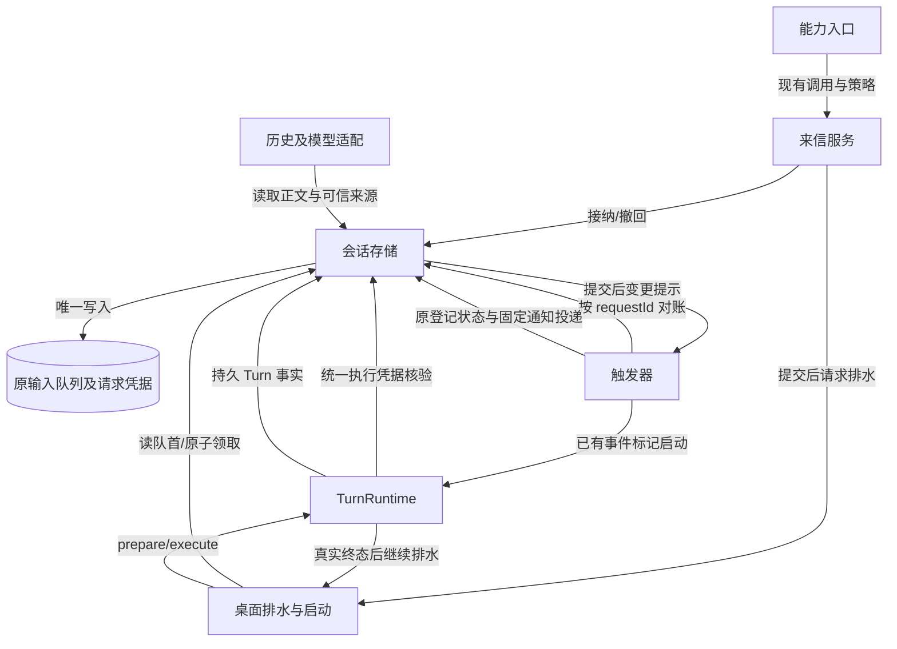

# 跨会话消息投递技术方案

> 状态：技术方案草案 v1.2；接纳回执与写策略已确认，存储格式 D-02 与授权接纳边界 D-04 待评审；仅文档修订。
> 日期：2026-11-05。需求真源：[跨会话消息投递需求（用户提供的工作区文件）](/Users/space/Documents/Develop/SpaceAssistant/docs/requirement/tools-mcp/in-flight/cross-session-message-requirement.md)。
> 核查基线：本轮在 `main` 文档提交 `425da51a` 上复核；应用代码包含 `28bec58e` 的触发器合入。最初检出分支仅为历史取证，不再作为实施基线；正式发布状态仍需单独核实。
> 阅读：负责人读第 0 层；评审者加读第 1 层；实现者读全文。本文定义合同与验收，不维护执行进度。


### 本轮问题核销【人机共读】

本轮依据 v1.1 静态评审的 B-01 修订。评审原件曾存于临时工作树，当前工作区缺少原件。下表保留本方案记录的关闭条件及其对应章节。下列“已补齐”只表示合同已可复核，B-01 是否关闭仍由复审裁决，应用代码和边界用例尚未实现。

| 上轮问题/关闭条件 | 本轮状态 | 证据与限制 |
|---|---|---|
| B-01.1 最终授权接纳点与撤权边界 | 已给出唯一提案，待 D-04 批准及复审 | §8.1：原子领取+输入历史提交为最终接纳；之前比较当前授权，之后只验持久凭据，不追溯原来源授权 |
| B-01.2 execute/executeWithSource、直接与恢复入口 | 设计已补齐，待实现 | §8.2 入口矩阵；全部经可信 receipt/source/历史锚点识别，无 UUID 前缀特例 |
| B-01.3 初始批准、重授权、失败归属 | 设计已补齐，待实现 | §7.1、§8.3：初始绑定不变，执行批准可在领取前更新，接纳凭据与领取共事务；已有 Turn 失败不回写未执行 |
| B-01.4 真实改动面 | 已修正 | §3：TurnRuntime/coordinator 改承重边界，不再声称复用不改；§4 及数量对账同步 |
| B-01.5 授权变化屏障用例 | 已定义，未运行 | V-09a～09d；D-04 提案下最终接纳先于 claim 返回，故“claim 后撤权”必须按非追溯边界验收 |
| 补充核查：目标删除后的通知授权全链路 | 设计已补齐，待实现 | §10：register、reconcile、delivery、replay、sourceContext 与执行材料统一使用自有事实权限 |
| 前轮 D-01/03 与最小持久化选择 | 保留已定行为；单来源列提案继续待批 | §0/1.1；新增批准及接纳凭据 JSON 记录属本次真实格式扩展，不伪称仅加来源字符串 |

## 第 0 层：决策层【人必读】

**一句话变更：** 从“只能读取另一个会话的产出”，变为“能向指定桌面会话发送来信，忙时等待、闲时启动，并撤回未处理来信或等待其真实处理结果”。

**只有三分钟：** 已定两项，存储格式与撤权生效边界待批准；先看下面决策状态与 §1.1 最小改动比较，再看 §2 链路图、§3 变更面和 §4 契约面。接纳成功与处理完成分开；异常结束不会被报告成审核通过。

**本次交付边界：** 只形成文档，不改代码、不迁移数据库、不新增界面。实施后的能力限于桌面用户会话；不向飞书、微信或其他渠道发送内容。通过已有工具入口、持久输入队列、桌面启动链和触发器完成闭环。

### 决策状态与本次待批准范围

| 决策 | 背景与用户可见结果 | 状态、依据和下钻 |
|---|---|---|
| D-01 接纳即返回 | 消息保存成功即返回，分别报告排队、请求唤醒或待重试；不等待目标开始或完成 | **已确认**：用户选择“接纳后立即返回”。下钻：§6/8，INV-01/03，V-02/04。 |
| D-03 跨会话写入策略 | 发送、撤回均按现有写操作策略处理，不继承只读免确认；来信正文不能代用户批准 | **已确认**：用户明确采用现有写操作策略。各档位实际规则仍由实现者核实。下钻：§9，INV-02/06，V-01/03/09。 |

**D-02｜待批准：采用收敛后的来信保存格式。** 为满足重启后识别来源、可靠撤回和晚登记等待，必须有可核验的来源与未执行事实，但不要求分别新建存储。A：原请求凭据只增加一列保存可信来源，并在同列保存执行批准和最终接纳凭据；终止原因和时间沿用原有状态、时间字段，重试复用桌面排水器。B：保留初版三列并补齐同一授权接纳协议，将来源、终态、调度进度分开保存；完整需求同样可做，但多出重复事实和跨重启重试计数承诺，本需求没有要求后者。推荐 A。两者都不新增消息库，且都要处理“删除接收会话不能连带删光请求凭据”的现有关系；**选 A 减少新增状态，不免除表重建与清理合同改动**。上线前可改稿；上线后旧程序不能直接写升级库，必要时回退需恢复升级前整库，备份后的变化会丢失。源码已核实原有字段和删除关系，隔离 SQL 实验已验证代表性表重建及回滚，但 Electron 真实库未验收。不决定则保留格式提案，不执行迁移。下钻：§1.1/1.2、§7/8/11，INV-01/02/04/05，V-02/03/05/06/07/08。

**D-04｜待批准：撤权以接收会话正式接纳输入为界。** 来信在排队和被领取前，可以因撤权而停止接纳；领取时系统会将输入及当时获批事实一起保存。A：把这一提交作为最终授权接纳，之后即使异步配置尚未结束或尚未调用模型，来源撤权也不再撤销这条已接纳输入；仍可使用接收会话已有取消能力，后续工具调用继续服从各自当前策略。B：将撤权一直延伸到第一次模型上下文提交，则需在异步准备和历史提交处再做新鲜授权校验，并重做接纳凭据及恢复边界。推荐 A：复用已有输入提交点，不新增第二个来源接纳阶段；代价是“已领取但未开始模型”的来信不能靠撤回发送授权阻止执行。两者都能设计成满足串行与来源要求，但撤权体验不同。A 上线前可调整；上线后不可把已接纳历史倒退成待撤回队列，新边界变更需新格式/兼容评审。源码证明原领取已共事务创建准确 Turn 与输入历史，新增授权凭据仍待实现与屏障测试。未决定则不实施本轮授权合同，不能据此将 B-01 标为已关闭。下钻：§8.1～8.3，INV-07，V-09a～09d。

此次只请求评审具体格式及其工具/触发条件合同，不重新要求批准完整需求本身。已确认的 D-01/03 不再列为开放项。D-02 包括两项新增 JSON 记录的形状，D-04 单独决定撤权何时停止追溯；两项均未批准。保留少量请求凭据、增加结构化历史读取来源及稳定错误类别均是 D-02 的评审范围；格式批准不代表真实迁移和发布验证已通过。

**不需要负责人决定：** 代码事实核查、事务与竞态机制、复用位置、故障用例和文档组织由实现者负责。不新增 UI、IPC、开关、附件、群发或回复线程；没有相应交付阶段。

**自曝三处弱点及推翻条件：**

1. 最终接纳选在原子领取。若负责人要求“领取后到首个模型上下文提交之间撤权仍生效”，将推翻 D-04/§8.1，必须整体改授权模型，不能只补执行前一次快照比较。
2. 来源列同时承载执行批准和接纳凭据，必须保护初始来源和已接纳材料，终态也不得被旧写口覆盖；还要保留删除后的凭据。若对旧写口和清理路径的边界测试发现状态被覆盖或凭据被删，就推翻兼容性结论；不能以列数少代替验证。
3. 本地已合入的触发器足以承担通知投递，但合入不证明正式发布。若实施基线缺少来源隔离、持久通知或共同启动能力，应先完成前置发布核验，不能复制出第二套触发器。

**验收环境边界：** 真实 SQLite、假模型/时钟可验证排序、竞态、来源、撤回、等待及恢复；真实 Electron、窗口未打开时启动、实际模型看到的来源语义和双平台重启需真机验收。真实 IM 外发不在交付范围；自动化中必须使用出站 spy 证明零调用。本文选择交付“完整设计及验收规格”，不把未执行验证写成通过。

## 第 1 层：概要层【人机共读】

### 1. 事实结论与复用选择

- **F-01 工具入口存在：** `electron/capabilities/handlers/session.ts` 已实现 list/status/read，由描述符统一发现和调用；`CapabilityContext` 已有可信 sessionId/requestId，但当前查询依赖不能执行跨会话写入。新增窄服务端口，不向 handler 传数据库。
- **F-02 队列和领取合同存在：** `queue_input_requests` 按会话、请求和 scope 保存指纹、messageId、turnId；入队和消息写入共事务，领取将 queued 改为 claimed 并创建准确 Turn。现有幂等范围包含目标会话，**不足以发现同一发送请求更换目标**；必须补 owner 范围唯一约束。
- **F-03 桌面调度存在：** `electron/ipc/agentProtocolIpc.ts` 装配 `createOutboundAcceptor/createOutboundDrainer`；入队后的 notifyEnqueued 与 Turn 终态均能触发排水。无需等待窗口连接，也无需新建通用调度器。排水当前经 submitOutbound，须增加可信来信分流，避免执行正文中的命令。
- **F-04 触发器已合入本地 main：** `28bec58e` 合并了触发器实现，包括 `electron/triggers/{service,store,sources,recovery,delivery,receiverStarter}.ts`。starter 使用既有 prepareTurnInternal/executeTurnInternal，但限定 runtime-trigger 来源与请求前缀，**不可直接当任意正文入口**。恢复器当前有定时扫描；保留其修复用途，不让发送方靠轮询启动目标。
- **F-05 等待确有缺口：** main 的 `turn_completed` 要求准确活动 Turn；注册提交时仍检查活动性。新条件独立扩展，不能放松原条件后模糊猜测相邻 Turn。
- **F-06 来源不能只靠 role：** 当前 Message 无跨会话来源字段，session.read 会剥去其他字段且有 4000 字截断。来源必须从持久凭据结构化读取，并在模型上下文保留宿主生成的来源包络；不引入新的 SDK role。
- **F-07 目标分类须收紧：** user-visible 不是 desktop 的同义词。既有 list/read 能含 remote/automation；发送、撤回和等待不能单靠列表可见性判定。
- **F-08 回执已有终态承载：** 原请求表有 TEXT state 与 created_at/updated_at；原删除队列消息先把 receipt 写为 cancelled，恢复 Turn 也会把 receipt.state 写为 outcome。state 不是只能 queued/claimed 的新枚举表。因此未执行原因可以扩展 state 的稳定取值，时间复用 updated_at，不需要 terminal_json。正常 Turn 完成仍以原 Turn 为真，不能假设所有完成路径都已同步 receipt。
- **F-09 既有重试不等于通用持久调度：** outboundDrainer 已有内存合并、受阻后补扫及 MAX_DRAIN_RETRIES=3；触发器另有 attempts/next_attempt_at，但它们属于触发器登记，不属于任意来信。复用前者可省 dispatch_json；不能盗用后者字段或把来信伪装成触发器。
- **F-10 删除关系确需处理：** v56 迁移后的请求表主键为 `(queue_scope,session_id,request_id)`，session_id 外键 ON DELETE CASCADE；messageId/turnId 外键 ON DELETE SET NULL。原 deleteSession 还拒绝删除活动 Turn。晚登记要知道目标删除前发生了什么，不能继续让该类凭据级联消失。

- **F-11 原授权门禁不是通用能力：** TurnRuntime 的 execute/executeWithSource 都调用 assertRuntimeTriggerStartAuthorized，但 UUID 不命中；claudeStreamHandlers 的来源材料与 History admission 同样以 runtime-trigger 前缀为强制条件。必须修改这些承重入口，不能仅注入已有 callback 就声称来信被保护。
- **F-12 有可复用的最终提交点：** claimQueuedTurnAtomicallyInScope 已在 runInTransaction 内创建准确 Turn、调用 appendSessionInputHistoryInTransaction 并写 claimed receipt；后者保存 session-input-committed、inputFingerprint 及 accepted_input_history_version。本轮在此增加授权接纳参与者；不是复用触发器第一次上下文提交的现有专用实现。

事实的复现入口见附录 A。上面“存在”是源码核查结论，不代表本文设计的集成已测试。

### 1.1 最小改动比较：必要事实不等于必要新字段

比较范围固定为满足全部需求，尤其是 BR-10/11 与 AC-13/20；不把“删掉撤回或恢复要求”当作低成本替代。数据库影响按新表/列、原字段语义、外键、writer 和恢复责任一起比较。

| 候选 | 来源与未执行事实放哪 | 数据库及架构代价 | 判定 |
|---|---|---|---|
| A 零 schema，只写正文包络 | 正文保存来源，自行猜测撤回/删除原因 | 正文可伪称身份；删除后无法可靠查询，内存通知无法支持晚登记 | 不满足需求，不可选 |
| B 零新增列，来源编码进请求标识或状态 | 主机保留前缀并在 requestId 编码 owner/摘要，或把来源 JSON 塞入 state | 前者需要一套可逆请求标识编码、所有接纳入口保护保留命名空间及调用方 UUID↔队列 ID 映射；后者还要重写 state='queued' 查询。两者仍须改删除关系、重建表 | 可设计，但零新增列不等于零协议成本；保留原标识和状态职责优于节省这一个来源列 |
| C 借 schema_meta、会话 metadata 或触发器 result | 保存发送来源/终态及重试 | schema_meta 变为第二份业务事实库；会话 metadata 随删除丢失；触发器只在登记后存在，不能承载登记前的发送事实 | 违反事实归属或不能满足晚登记，不采用 |
| D 原请求表新增三列（初版） | source_json、terminal_json、dispatch_json | 无新业务表，但重复保存原 state/时间，并新增跨重启调度计数；仍需表重建，且 v1.1 授权门禁不闭合 | 需另补 B-01 才是完整可实现方案；本轮不继续该三列提案 |
| E 原请求表只新增来源列（本轮） | source_json 保存来源、执行批准及接纳凭据；原 state/updated_at 保存未执行终态；原 Turn 保存处理结果 | **1 新列、1 新唯一索引、0 新业务表；1 次原表重建；1 处删除关系改变**。调度只扩既有排水器，没有持久重试字段 | 选定技术提案，D-02 待批准 |
| F 单独消息/outbox/tombstone 表 | 新表保存来源、状态及请求关联 | 又有一套请求生命周期，接纳/撤回需跨表协同；违反需求不新增第二消息存储 | 不采用 |

**结论：** 在保持标识、指纹和执行状态各自职责、不另建业务事实存储的约束下，E 是已比较候选中新增持久状态最少、复用最直接的方案。它不是所有编码技巧下的“数学最小”，也不声称迁移无风险。单纯把三个 JSON 合成一个字段但保留全部三套职责，不算本轮收敛；本轮实质删除了终态重复存储和持久调度承诺。v1.2 因 B-01 增加的执行批准与最终接纳凭据是安全合同必须的信息，列内 JSON 逻辑记录随之增加；不能以仍是一列淡化其审计与兼容成本。

### 1.2 哪些修改必需，哪些已删除

| 需要的事实/行为 | 已有能力与实际缺口 | 本轮落点 |
|---|---|---|
| 重启后识别可信发送者、校验撤回 owner | receipt 有身份键与指纹，但没有可信发送 owner | 新增唯一的 source_json；正文只是可读载体，不作为身份凭据 |
| 未创建 Turn 的终止原因与时间 | state 已能表达 cancelled/outcome，updated_at 已存在 | 新增五个 not-executed:<reason> 状态值，并冻结终态时间；不新增列 |
| 精确处理 Turn 及 outcome | turn_id 与原 Turn 已存在 | 保留原关联；不新建 Turn 状态副本 |
| 最终授权接纳与执行核验 | 原领取有输入历史，但 UUID 不命中触发器专用门禁 | 同 source_json 增 executionApproval/admission；原领取写入，所有执行入口读验；无新 SQL 列 |
| 暂时启动失败后的再次机会 | 原 drainer 已有重试、合并与终态补扫 | 扩展来源分流和耗尽回调；重启从 queued 事实重扫，不保存尝试次数；此复用不包含新增的来源授权凭据核验 |
| 删除后晚登记仍可查询 | session 外键现为 CASCADE，会抹掉整条凭据 | 重建原表移除此外键，删除命令显式清理普通凭据、保留该类终态；其余外键不变 |
| 登记先后竞态与通知 | 原 runtime_triggers 有登记、CAS 与 delivery | 扩一种 condition 与事实读取，复用原定义/事件/结果 JSON，不新增表或列 |

保留物理 session 外键又想留同一行，必须软删除会话、将外键改成可空或改用别处保存；前两者会改变会话身份/删除语义，后者增加事实存储。当前没有理由选择它们。**必要的是保留可靠事实；移除此处外键是当前架构下的最小提案，不是需求规定的唯一算法。**

### 2. 目标链路与唯一写入者



现状是“能力入口 → 只读会话查询”及“桌面排水与启动 → TurnRuntime”；新增来信服务插在能力入口与会话存储之间，扩展既有排水器识别来信，触发器新增一种来源条件。队列、请求、执行批准、最终接纳凭据与未执行终态由会话存储唯一写入；Turn 由既有 coordinator/runtime 写入；登记状态由触发器 store 写入。提交后通知只提示重读，不作为事实。

### 3. 变更面表

按逻辑单元计数；同一单元可涉及多个文件，不以文件数冒充体量。测试文件随所属单元。

| 单元 | 作用简述 | 改动类型 | 对应决策/不变量 | 跨边界与依赖方 |
|---|---|---|---|---|
| 能力入口：`electron/capabilities/handlers/session.ts` | 发现并调用会话能力 | 改对外契约 | D-01/03，INV-02/06 | 模型工具：新增 send/revoke，read 增来源字段 |
| 来信服务：拟 `electron/capabilities/sessionMessageService.ts` | 接纳和撤回来信 | 新建 | D-01/02/03，INV-01/02/04 | 装配依赖窄存储、查询和排水端口 |
| 会话存储：`electron/sessionStorage/` 与 `electron/database/operations.ts` | 管理输入与执行事实 | 改承重边界 | D-02/04，INV-01/04/05/07 | commands/queries/execution 调用者；唯一 writer 不迁移 |
| 数据库迁移：`electron/database/schema.ts`、`electron/database/migrations.ts` | 升级持久格式 | 改对外契约 | D-02，INV-01/02/05 | 旧库、整库备份、版本读取者 |
| 来源分类：`electron/database/queueInputSource.ts` | 识别可信队列来源 | 改承重边界 | D-02/03，INV-02/06 | 领取、编辑、删除、IM 消费者、模型适配 |
| 桌面排水与启动：`electron/outbound/outboundAcceptor.ts`、`electron/ipc/agentProtocolIpc.ts` | 串行启动桌面输入 | 改承重边界 | D-01/02，INV-03/06 | 来信服务和重启恢复；不新增 IPC |
| 历史及模型适配：会话读取与既有上下文构建 | 形成可读历史和模型输入 | 改对外契约 | D-02/03/04，INV-02/07 | `electron/claudeStreamHandlers.ts` 强制读取来信材料；session.read/历史宿主元数据扩展；SDK公开形状不改 |
| 触发器：`electron/triggers/` 与能力 handler | 登记和投递一次性事件 | 改对外契约 | D-02，INV-05 | 新条件与事件 JSON；原五操作保留 |
| 共享类型：`src/shared/domainTypes.ts` | 定义跨层领域合同 | 改对外契约 | D-01/02，INV-02/05 | 来源 DTO、回执、触发条件与事件 |
| 主进程装配：`electron/main.ts`、`electron/capabilities/types.ts` | 绑定宿主依赖 | 改承重边界 | D-01/02/03，INV-03/06 | 注入服务与排水请求、恢复生命周期 |
| TurnRuntime：`electron/turnRuntime.ts` 及 coordinator | 持有执行资格并守卫派发 | 改承重边界 | D-04，INV-03/07 | execute/executeWithSource 统一核验来信接纳；保留原触发器门禁，直接调用与恢复均受影响 |
| 策略及审计：既有 toolkit 调用链 | 裁决和记录能力调用 | 复用不改（待验证） | D-03，INV-06 | risk=act 已有确认通道；V-09 检查所有档位 |

**量级：** 12 个单元，改既有 10、新建 1、复用 1；改对外契约 5 行、改承重边界 5 处；原表新增 **1 个 SQL 列、1 个唯一索引**、0 张新业务表；重建原表并调整 1 处 session 外键删除关系，新增 **2 项能力、1 种触发条件、1 种来源、8 个来信错误码**；实施分 **3 阶段**。同列增加 executionApproval/admission 两项 host-only JSON 记录；JSON 内字段及复用状态逐一列于 §7；表重建过程的替代表不是新增持久业务表。

**不拆成多份方案的理由：** 来源标识、撤回终态和 requestId 等待共享同一条输入凭据；分别设计会出现“撤回已成功而等待永不结算”的合同断裂。保留一份端到端规格，按 §12 三阶段实施；每阶段都能编译、回归和回退。不是一次性大提交，也不单独重做触发器。

### 4. 六类契约面与需求外扩声明

| 契约面 | 结论、兼容与验证 |
|---|---|
| ① agent-sdk | **不改 SDK 公开接口、事件种类、HistoryPort、审批枚举或导出。** 既有通用 payload 内新增宿主输入来源摘要锚点（§7.1），属宿主持久格式扩展，须验证旧 SDK 解析/重放兼容；不把它说成“所有历史数据均不变”。 Agent 来信在宿主文本适配层生成包络，沿现有 user 文本载体和历史链路提交。SDK 不反向依赖来信服务。实施验证 `npm run check:agent-sdk`、`npm run typecheck:agent-sdk` 及旧历史重放；若必须改变 SDK 事件载荷，则推翻本结论，先修订方案。 |
| ② 会话存储 | **改。** 增来信接纳/撤回/请求事实查询、批准刷新、授权接纳和接纳核验合同，原 commands/queries/execution 唯一 writer 不变，全部写入用 runInTransaction。来源和终态需要跨删除保留，旧 enqueue 缺省行为不变。验证 `check:session-storage-boundary`、`check:session-storage-cleanup-boundary`、`check:message-fact-ownership`，旧队列、旧库、删除和备份对拍。 |
| ③ IPC/预加载 | **不新增或改变通道及现有返回形状。** 来信能力为主进程内调用；排水请求为注入端口，不能暴露为绕过策略的新 IPC。源码触及 IPC 装配不等于新增 IPC 契约。 |
| ④ 共享类型 | **改。** 在 domainTypes 定义来信回执/来源和新触发条件，供存储公开模型重导出；不重复定义领域枚举。`npm run typecheck:shared` 验证。 |
| ⑤ 持久化 | **改。** 原 queue_input_requests 加 1 个可空来源 JSON 列及 owner/requestId 唯一索引；source_json 内含原始绑定、executionApproval 和 admission；原 session-input-committed payload 增 host 来源摘要，原 state 增五个未执行状态值，updated_at 作为其时间，session 外键移除后由删除命令显式清理普通凭据；既有 runtime_triggers 定义/事件 JSON 扩展，仍 version=1，以严格 type 判别分支解析。旧条件保持原解析，新条件只由升级版本写。迁移、未来版本拒绝、降级整库恢复见 §11。 |
| ⑥ 领域数据 | **改。** 2 项能力、1 条件、1 来源、8 个稳定错误码；不新增配置项或 locked 策略规则，不登记新系统 invariant。安全阶段与 failure case 见 §9。 |

上述项目门禁**本次未运行**：当前仅写文档。隔离 SQLite 机制实验结果见附录 B，不等同于应用门禁或完整迁移通过。实施必须记录准确 SHA 的实际结果；本文不引用旧分支通过结果替代。

相对需求新增的具体交付面：1 个来源持久字段及其执行批准/接纳记录、输入历史来源摘要、原状态新增五个取值及删除保留合同承载需求 D-03/BR-04/06/11～13；新条件及事件承载 AC-13/14/20/21；2 项能力承载 §3 范围；结构化 read 来源承载 BR-10。这些格式细化统一纳入待批 D-02，不默认为需求已批准格式。没有新增 UI、IPC、开关和外部渠道行为。新服务仅依赖现有公开存储端口，不新增跨包依赖方向。

## 第 2 层：规格层【机｜人工可跳过】

### 5. 不变量与状态所有权

| ID | 不可违反的性质 | 机制与验收 |
|---|---|---|
| INV-01 | 同 owner/requestId 只有一个目标和一条接纳事实 | owner 范围唯一索引、事务内复查、原 payload 指纹；V-02/07 |
| INV-02 | Agent 来源不升级为用户身份或批准 | 宿主生成来源、可信分类、模型包络及独立策略凭据；V-03/09 |
| INV-03 | 单会话同时至多一个执行循环，desktop 队列不越序 | 原执行资格及领取事务、队首重查、合并排水；V-04/08 |
| INV-04 | 撤回成功意味着永远不可领取 | queued CAS 与领取共事务边界，持久未执行终态；V-05/08 |
| INV-05 | 对准确请求只匹配一次来源结算，不遗失快终态 | 持久请求事实+Turn、登记 revision CAS、原固定通知 requestId；V-06/07/08 |
| INV-06 | 非法入口不能产生消息、执行或外发副作用 | 能力策略、服务边界与存储 final-check、scope 隔离；V-01/09 |
| INV-07 | 来信来源授权只在唯一提交点最终接纳；无匹配接纳凭据不得派发 | 原领取事务的输入历史+admission 共提交，所有执行/恢复入口强制核验；V-09a～09d |

| 事实/状态 | 唯一 writer / 提交点 | 恢复者 |
|---|---|---|
| 正文、来源、接纳与指纹 | 会话存储接纳事务 | 原会话存储恢复 |
| queued → claimed + requestId→Turn + 来源最终授权接纳 | 原领取事务；当前批准、输入历史事件及 admission 共提交 | 原 Turn 恢复；先核验接纳，不重新入队或追溯来源批准 |
| executionApproval（领取前） | policy 产生决策与 trace，存储命令按 queued/无 admission 条件保存 | 领取前代次失效则回 policy；不覆盖原始 authorizationBinding |
| queued → not-executed | 会话存储终止事务 | 凭据查询，无需重放取消 |
| Turn state/outcome | 原 coordinator/runtime | 原执行恢复规则 |
| 调度重试进度 | 原桌面排水 owner 的内存状态；无新持久写入 | 启动时从 queued 事实重新请求原排水器 |
| 等待登记 waiting→matched/failed | 触发器 store revision CAS | 原触发器 recovery |
| 通知消息和其处理 Turn | 原触发器 delivery + 原队列 | 原触发器 recovery |

`queue_input_requests.state` 新增五个 `not-executed:<reason>` 取值，全集与解析见 §7；原 queued/claimed 和旧终态值不变。业务请求状态投影为 queued、claimed、turn-terminal、not-executed、source-gap；**不把 Turn 终态复制到新列**。Turn 由原事实查询，未执行必须没有 turnId；二者同时出现为 source-gap。

### 6. 能力与回执合同

新增 `action.session.send` 和 `action.session.revoke`，均 `family=action, risk=act, lane=desktop`；使用 strict schema，未知 sender/owner/role/approved/queueScope 等字段直接拒绝。find/call 顶层 schema 不变。

```ts
// send 参数；正文原样保留，仅以 trim 判断是否为空。
{ targetSessionId: string; content: string; requestId: string }
// revoke 参数；不接受可由模型覆盖的 owner。
{ targetSessionId: string; requestId: string }
// send 已接纳回执
{ accepted: true; targetSessionId: string; requestId: string;
  messageId: string; duplicate: boolean;
  inputState: 'queued' | 'claimed' | 'turn-terminal' | 'not-executed';
  scheduling: 'queued' | 'wake-requested' | 'retry-pending' | 'not-needed';
  turnId?: string; terminalReason?: string }
// revoke 回执
{ requestId: string; status: 'revoked' | 'already-revoked' |
  'already-claimed' | 'completed' | 'failed'; turnId?: string; reason?: string }
```

- requestId 由调用 Agent 提供稳定 UUID（同一逻辑发送全程复用），不是 CapabilityContext.requestId；后者只作调用审计关联。工具超时、确认重试、恢复重试不得换键；不同逻辑发送须换键。缺 key 拒绝，不在 handler 内临时生成随机键。
- 幂等键为 `(trustedOwnerSessionId, requestId)`，target/content 的变化均冲突。requestId 按 UUID 校验；正文复用桌面普通文本的非空校验，且无附件。队列额度复用 `MAX_CHAT_MESSAGE_QUEUE_SIZE=10` 及原覆盖配置，在接纳事务内计数。当前核查未发现该入口的独立字符长度上限，本期不虚构已有字符上限，也不另加固定上限；模型上下文压力仍经既有准备流程处理，明确拒绝时记未执行终态，不静默截断。来源包络算入实际模型输入预算。
- owner 取自可信执行上下文并查当前持久会话；明确 lane=desktop，不能利用 CapabilityContext 的缺省 desktop 将未知来源升级。目标须 `ownership=user` 且 visibility 为 primary/section；remote、automation、internal、hidden 均拒绝。旧数据仅使用既有合法迁移后的分类；损坏/未知分类不归一为允许。
- 可访问范围复用已发布触发器的 owner/target 校验（其源码有工作目录 profile 边界），发送与后续等待/读取使用相同边界交集。不得因为 session.read 当前比较宽松就扩大触发器授权，也不另设更宽的发送权限。参数中的目标 ID 不授予权限。UUID 应全局唯一；若另一 owner 的输入已经占用同一目标/requestId 原主键，统一返回 CONFLICT，不返回其消息或来源，不能复用他人的回执。
- 原需求没有禁止向自己投递：本方案允许符合范围的 self-send，仍排在本会话当前执行之后。无特殊快路径，受原配额/策略约束。
- scheduling 为回执时观测，不是执行授权。持久接纳后唤醒异常返回 accepted=true/retry-pending；不得抛出暗示未发送的错误。重放从持久凭据返回当前事实，消息被撤回/历史已清理也不能因缺正文而生成第二条消息。
- revoked 仅本次 CAS 胜出；already-revoked 仅重复发送者撤回；其他取消/准备失败返回 failed+准确 reason。completed 表示 Turn 已终结，另带实际 outcome 信息，不等于正常完成审核。已领取但尚无终态返回 already-claimed。

新增错误码全集（8 个）：`SESSION_MESSAGE_INVALID`、`SESSION_MESSAGE_TARGET_UNAVAILABLE`、`SESSION_MESSAGE_CONFLICT`、`SESSION_MESSAGE_CAPACITY`、`SESSION_MESSAGE_POLICY_DENIED`、`SESSION_MESSAGE_STORAGE_UNAVAILABLE`、`SESSION_MESSAGE_SOURCE_GAP`、`SESSION_MESSAGE_START_FAILED`。使用现有工具结果错误包装和 errors 命名空间映射；目标不存在/无权统一 TARGET_UNAVAILABLE，存储异常不包含正文。已接纳后 START_FAILED 作为 scheduling/终止 reason，不回写 accepted=false。触发器错误复用已有 TRIGGER_*，不再新增一组等待错误码。

### 7. 单列来源扩展及原字段复用合同

原 `queue_input_requests` **仅新增 source_json TEXT NULL 一列**；NULL 表示普通旧类型输入，不回填 Agent 来源。JSON 合同基部为不可变 `{version:1,kind:'agent-session',ownerSessionId,requestId,targetSessionId,messageId,payloadSha256,authorizationBinding}`，并允许 §7.1 的 executionApproval/admission 两项宿主记录。基部由宿主生成，authorizationBinding 保存发送接纳时原决策引用及获批身份/对象/摘要/代次，不另发许可、不被重授权覆盖；只允许存储授权命令更新扩展记录。

source.messageId 等于接纳事务生成的真实 ID；requestId/target 与行身份一致。在 `(json_extract(source_json,'$.ownerSessionId'),request_id)` 上建 **1 个部分唯一索引**，只覆盖 source_json 非 NULL 的 Agent 请求，跨 target/scope 保证同 owner/requestId 只有一条。列 CHECK 严格验证 JSON 对象、version/kind、必填字符串及与 request_id/session_id 一致；普通旧行 NULL 不参与。原 fingerprint 对实际持久包络计算，source.payloadSha256 对原始正文精确 UTF-8 计算，不能混用。

| 持久字段 | 本轮语义 | 为什么不用新列 |
|---|---|---|
| source_json（新增） | 原始来源基部不可变；executionApproval 只在领取前可更新，admission 写入后不可变 | 现有列没有可保持原职责的来源载体 |
| state（已有） | 原状态保留；新增 `not-executed:sender-revoked`、`not-executed:authorized-cancel`、`not-executed:target-unavailable`、`not-executed:policy-rejected`、`not-executed:start-failed` | 单个判别状态已完整表达未执行及原因；无需 terminal_json |
| updated_at（已有） | 未执行 CAS 的唯一终态发生时间，之后冻结；queued/claimed 时仍为原更新时间 | 已有持久时间；无需另存 occurredAt |
| created_at（已有） | 原接纳时间 | 不新增 acceptedAt 列 |
| turn_id（已有） | 原准确处理 Turn 关联 | 不新增关联表或 Turn 状态副本 |

`readAgentInputSettlement` 从 state 解析为 `{kind:'not-executed',reason,occurredAt:updated_at}`，对外不暴露编码细节；仅解析上表五个精确值，未知值或“未执行且有 turnId”返回 source-gap。旧普通 cancelled 不推断为发送者撤回。普通 row 不按新编码解析；新 Agent row 的其他授权取消必须通过共用终止 helper 写准确状态。

写保护：所有对新来源行的终止操作只允许 `state='queued' AND turn_id IS NULL` CAS；原通用 updateQueueInputReceiptState 对 Agent 未执行终态不得更新状态或 updated_at。原编辑、删除、清理、恢复路径同样需遵守；通过公开存储命令维护，不能靠调用约定或日志保证。后续重放不刷新时间，也不改变终止原因。

### 7.1 原始绑定、执行批准与最终接纳凭据

三者同列保存，职责分离；新增的是两项 JSON 记录，不新增表、SQL 列或调度状态。`TurnExecutionConfig` 的注释禁止放授权凭据，本方案不把这些材料塞入 execution_config_json，不通过 IPC 参数接受它们。

| 记录 | 精确内容与写入规则 |
|---|---|
| authorizationBinding（原始、不可变） | 发送接纳时的原审批引用、owner/target/目标 generation、desktop scope、payloadDigest、policyRevision、authorizationGeneration、runtimeGeneration；它是原始授权事实，不保证排队后仍新鲜 |
| executionApproval（新增、领取前可替换） | `{version:1,originDigest,decisionTraceRef,permitRef,ownerSessionId,targetSessionId,targetGeneration,requestId,messageId,queueScope,payloadDigest,policyRevision,authorizationGeneration,runtimeGeneration,approvedAt}`；由原 policy 流程产出，存储命令验证 originDigest 后 CAS 保存；没有变化也显式保存当前有效批准。permitRef 只引用既有可核验批准，不复制 token/secret |
| admission（新增、领取时写一次） | `{version:1,originDigest,approvalDigest,sessionId,sessionGeneration,requestId,messageId,turnId,invocationId,inputEventId,inputEventDigest,inputFingerprint,queueScope,acceptedAt}`；由原领取事务生成，invocationId=turnId，inputEventId 指向既有 session-input-committed；不由 Agent 或配置传入，不记录第二份正文 |

originDigest 为对 source_json **不可变基部**确定性序列化后的 SHA-256，不包含两项扩展记录；approvalDigest 对本次 executionApproval 同样计算。session-input-committed 原有 payload 增可选宿主字段 `inputSource:{kind:'agent-session',originDigest}`；不增加 HistoryEvent kind。inputEventDigest 对该事件完整身份与 payload 的固定编码计算。事件来源锚点使 source_json/receipt 缺失时不能降级成普通 UUID 请求；普通旧事件没有该字段，保留原流程。字段均在共享领域类型/宿主存储模型定义一次。

executionApproval 刷新命令以 `(owner,requestId,originDigest,旧approvalDigest,state=queued,admission缺省)` 做 CAS，失败重读，不允许并发批准覆盖已接纳材料。接纳后的 executionApproval 与 admission 均冻结，通用 source/配置更新不得覆盖。只存在来源而没有两项记录的 queued 输入合法；claimed/有 Turn 的来信必须同时存在 executionApproval、admission 和匹配历史事件，任一缺失、版本未知或摘要冲突均为授权接纳缺口。执行凭据通过窄 `readAndVerifyAgentInputAdmission({sessionId,turnId,requestId})` 读取并校验，返回 `ordinary | admitted(material) | invalid(case)`，不得用 requestId 前缀判定 ordinary。

**正文与模型来源载体：** 宿主把固定来源说明（另一 Agent、来源会话与 requestId、正文不代表用户批准）及 JSON 字符串转义的正文组成确定性包络，作为该条普通输入的 content 持久入队。包络不是新增消息协议，只有这条消息使用；不能解析正文自称作为来源。JSON 编码避免正文关闭标签伪造宿主尾部。既有 enqueue 会 trim，包络外侧固定无空白，原始正文在编码内保真。

可信身份仍以 source_json 和 receipt 关联为准，不因包络文字长得一样而成立。`classifyQueueInputSource` 增 `agent-session`，要求真实 receipt、source、scope=desktop、正文指纹与 messageId 匹配；假前缀/假正文、Agent 来源与 IM context 并存均为 invalid。分类器只产 facts，不自行放行策略。

历史及模型适配必须覆盖：队列预览/历史文本、session.read（即使内容截断也额外返回可信 `source:{kind,ownerSessionId,requestId}`）、已接纳模型输入、压缩后的持久上下文和重启恢复。原 History 种类/SDK role 不改，包络作为原文本进入现有 context commit；来源检查不能依靠模型记忆，宿主安全判定继续读可信身份。正文中的批准自述不能写入 confirmedByUser 或审批记录。

**清理合同：** 该类凭据不随发送会话删除自动撤回；删除接收会话时，在同一删除事务内先将尚无 Turn 的 queued 请求改为 not-executed/target-unavailable，保留 source_json/state/updated_at/requestId tombstone，再清理消息及会话数据。已关联 Turn 的事实按原恢复/保留规则读取；若被删除而缺失，等待结算 source-gap，绝不猜为完成。main 基线已确认 session_id 使用 ON DELETE CASCADE，必须迁移重建原表并移除 session_id 的会话外键：sessionId 成为可指向已删除目标的稳定身份。删除命令在事务内显式清理普通凭据、保留 Agent tombstone，代替原级联；message/turn 外键保留原 SET NULL。重建只使用事务内临时替代表、复制并核对行数/主键/索引后替换，最终仍只有原表，不增加持久业务表。

保留这些小凭据是幂等与晚登记的必要代价：本期不自动过期删除 Agent 请求凭据，也不新增 TTL 开关。整库备份包含来源列和已有状态/时间；纯消息导出保留可读包络，不赋予导入文本可执行 owner/撤回资格。普通明文会话备份不得当作可靠请求凭据恢复；其缺失关联在等待中明确 source-gap。

### 8. 接纳、调度与撤回算法

**接纳提交点：** service 先走能力策略，再调用窄 `acceptAgentMessage` 命令。该命令通过 runInTransaction 完成：

1. 校验可信调用者身份，再查 owner/requestId 的既有凭据。自有旧请求先比对 target/正文摘要，返回当前持久事实或冲突；此路径即使原目标已删除也不重复接纳、不泄漏其他会话内容。仅新请求进入下一步目标可用性/权限检查。
2. 新接纳复核目标未删除、原限额与策略执行材料，生成真实 messageId 和确定性包络；调用原 scoped enqueue，写唯一新增的 source_json。全部同步操作共事务，禁止 await。
3. 唯一索引冲突时读取胜者并比较，同材料重放，不同材料冲突；中途失败整笔回滚。不能先入队后补来源，不能在 handler 外直接写 SQL。
4. 提交后调用装配出的 `requestDesktopDrain(sessionId)`，只请求排水，不等待首 token。排水请求合并，提交与进程崩溃间丢失的提示由启动恢复扫描找回。

**调度：** 扩展现有 outboundDrainer 的队首分流，不新建服务队列。普通输入沿原 submitOutbound；agent-session 队首经可信校验后直接使用 `mode=reuse-user`、真实 messageId/requestId、desktop scope 调 prepareTurnInternal，再调 executeTurnInternal。复用 receiverStarter 的 prepare/dispatch 模式，不放宽其 runtime-trigger 前缀守卫，不把来信冒充触发器标记。

来信不得经过普通输入中的 slash command、继续上轮意图猜测、会话新建或 UI 配置覆盖。配置来自接收会话既有绑定；不得将发送会话的目录、模型或审批材料作为目标配置。禁止在来信启动时通过全局 active profile 切换改变其他会话执行上下文。

- 原子领取内除原“无 active Turn”判断，还需按 §8.1 核验当前执行批准，并重读该 scope 队首、receipt.state=queued、source 与 messageId 完整性；任一不符不启动。桌面手动入口、排水器、触发器竞争由共同 Turn 资格裁决；内存 running 只作提示。
- 真实 Turn 终态与执行 lease 释放后请求再次排水；已有 active owner/确认中/压缩中只留队，不能消费或计为不可恢复失败。若终态提示早于 lease 释放，释放回调补一次排水。
- 接纳提交、队列终态提交、lease 释放、应用启动恢复触发事件驱动重读。启动恢复只分批扫描 source_json 非空、state=queued 且无 turnId 的请求，将 sessionId 去重后请求原排水器；进程内重试和因 busy 释放后的补唤醒由同一排水 owner 负责，不新增 due 字段、常驻轮询器或独立恢复状态机。
- 暂时失败复用原 drainer 的 MAX_DRAIN_RETRIES=3（首轮之后最多 3 次补扫），不把触发器“5 次/15 分钟”的投递预算搬到来信。计数归属绑定当前队首 requestId，队首因撤回/失败而变化时清零，不能把前一条的失败次数转给后一条。扩展现有耗尽分支：当前 Agent 队首仍 queued、无 Turn 且最后失败为可归因的准备/启动失败时，CAS 写 not-executed:start-failed，提交后通知等待方并继续下一队首；确定的策略/目标失败直接写相应未执行原因。普通输入耗尽仍保持原行为。
- busy（含并行配额占用、会话 lease、确认、压缩）和宿主启动依赖尚未就绪不是准备失败，不计耗尽、不标未执行，分别由占用释放/全局容量释放/启动就绪回调补唤醒。存储暂不可写时不能伪造终态：保留 queued，沿既有存储恢复生命周期在可写后重扫，不做内存“成功撤回”。
- **不承诺跨重启严格累计重试次数或保留原退避位置。** 崩溃前未提交终态的请求重启后仍从 queued 获取一次调度机会，进程内计数重建；这满足接纳可恢复与单次通知要求。本需求若未来新增跨重启重试预算/SLA，应另行评审字段，不能预支 dispatch_json。
- prepare 已提交 Turn 后 dispatch 抛错，归 Turn 恢复/终态，不能标“未执行”或把同消息再准备一遍。读取 receipt.turnId 后只恢复该准确 Turn。

**撤回提交点：** `revokeAgentMessage` 在同一存储事务核验当前可信 owner 与 source.owner 一致，按 owner/requestId 精确查凭据，CAS `state=queued AND turn_id IS NULL`，写 `state=not-executed:sender-revoked,updated_at=now`，同时将消息从可执行队列移出。消息可保留既有取消历史形态；不能只删 message 留 queued receipt。重复撤回读原终态返回 already-revoked。

claim 与 revoke 都在 SQLite 写事务内对同一凭据裁决；只有胜者能改 queued。claim 胜则 revoke 返回 turnId/实际状态；revoke 胜则 claim 失败且不创建助手消息或 Turn。UI 原 deleteQueuedMessage、授权取消、session deletion、恢复失败也必须经过同一个终止 helper；不可绕过 receipt 直接删除。已接纳 Agent 正文不允许被普通 editQueuedMessage 改写；既有重排可保留显式用户重排语义，但自动来信不调用重排，保证接纳顺序。若需求希望禁止用户主动重排，应单独补行为决策，不悄悄改原 UI。

### 8.1 唯一最终授权接纳点与撤权顺序

**本方案选择原 claimQueuedTurnAtomicallyInScope 的领取事务提交为最终接纳点，待 D-04 批准；不是 send 入队、prepare 返回、execute 调用或首次模型上下文提交。** 原领取已把输入写进 session-input-committed，适合把来源授权一次性转换成已接纳输入事实。触发器目前选择其首次 context commit，本需求复用其“已接纳历史不追溯”的原则，不假定其专用代码已适用 UUID。

领取前流程：drainer、直接 prepare 或恢复重新请求领取，都先走同一宿主 `ensureAgentInputExecutionApproval`。它读持久来源与当前目标 facts、历史 owner 身份和当前适用策略；发送会话删除本身不自动撤回已发送来信，不能仅因 owner 不再在当前会话列表中就拒绝已有输入，是否撤权只依据原策略的真实代次与对象授权。原始批准或已有 executionApproval 的 policyRevision、authorizationGeneration、runtimeGeneration 任一过期，必须进入原 policy 流程产出有稳定 rule ID/decision trace 的批准。需要确认则保持 queued，无 Turn；拒绝则 policy-rejected 未执行。policy 不在数据库事务或 Runtime final-check 内运行。

原领取事务按顺序：①同连接重新读取 target generation/分类、队首、真实 source/receipt、当前安全修订与代次；②对 executionApproval 的已批准身份、对象、scope、来源摘要、permit 引用及当前三代次做 final-check，不重算风险；③通过后沿原代码创建准确 Turn、写 session-input-committed 与来源摘要锚点、写 claimed receipt，并在 source_json 写 admission；④同一 runInTransaction 提交，任何步骤失败全部回滚。若策略已变但尚无新批准，仍 queued，回到 policy 后重试，不能为了“领取成功”忽略代次。

当前策略/授权代次的变更与领取写事务必须共用已有数据库 writer 的序列化顺序：先提交撤权则本次领取不得接受旧代次；先提交领取则 admission 已成立，随后撤权不追溯。进程代次由既有启动 owner 在接受新工作前发布；不可比较一个无事务关联、可能过期的缓存快照。无法获得同连接权威版本就拒绝接纳，case=authorization-stale，不以“单进程通常顺序”代替合同。

claim 返回以后可能仍有异步 skills/config 准备，甚至准备失败；**这些都发生在已接纳输入之后**。后续来源撤权、原发送会话删除、进程代次变化均不单独使该输入失效。接收会话正常取消/执行策略/资源门禁仍可终止 Turn，等待结算为其真实 cancelled/failed；它们不是撤回入队。目标 session generation、正文或准确 Turn 关联不符属于身份/材料损坏，不是授权撤销，仍须拒绝。

### 8.2 所有执行与恢复入口强制核验

扩展 TurnRuntime 的宿主启动核验，新增必装配的 `verifyPersistedInputAdmission(turn)` 宿主端口，返回 ordinary/admitted/invalid；生产装配缺失时拒绝执行，不把可选 callback 缺省视作允许。此端口只改 Electron 内部 RuntimeOptions，不改 agent-sdk。统一在 execute/executeWithSource **调用 coordinator.execute 或传入的 ModelSource 回调之前**执行；不能只在 drainer 检查。保留现有 runtime-trigger 专用 authorizer；新增的持久来信 verifier 对每个 Turn 读取真实 receipt/source_json 与该 Turn 的 session-input 历史锚点。UUID 没有来源记录不自动等于普通输入：若历史锚点声明 agent-session、或有来源行，则必须得到匹配 admission，否则 fail closed。对 accepted_input_history_version 表明已提交输入的 Turn，预期输入历史事件缺失也直接 source-gap；不能以 receipt/事件丢失作为“无 Agent 来源”的证据。历史修订/清理保留来源锚点；新字段缺失只允许真正旧的普通数据按旧合同处理。

`readAndVerifyAgentInputAdmission` 必须核对：调用身份/target generation、desktop scope、requestId/messageId/turnId、originDigest、executionApproval→approvalDigest、inputEventId/事件摘要、inputFingerprint 与被派发输入。对已接纳材料，比较 admission 冻结的批准版本和同一持久批准记录，不比较当前 policyRevision/authorizationGeneration/runtimeGeneration；这里的“历史批准存在”指本行已冻结的 executionApproval 与 admission 的共事务一致性；decisionTraceRef 仅为审计指针，不能要求日志仍未轮转，permitRef 也不在接纳后重新判到期/可撤销性。批准/permit 的当前有效性已在领取事务消费并固化；接纳后不能因旧 permit 到期而误撤销合法历史。current startToken、执行 lease 和当前 target 普通执行门禁仍由原 runtime 校验，不由 admission 代替。

| 入口 | 唯一核验链路 | 不允许的快捷路径 |
|---|---|---|
| drainer 启动 | ensureExecutionApproval → prepare/原领取最终接纳 → executeTurnInternal → TurnRuntime.executeWithSource/execute → admission verifier → 原 source/provider | drainer 检查过就跳过 Runtime；前缀伪装 runtime-trigger |
| 直接 chat:prepare-turn | 原主进程入口按真实输入来源定位 → 同一批准准备/领取合同 → admission | IPC 传入 source/approval/permit/admission；以 config 声明来源 |
| 直接 chat:execute-turn | executeTurnInternal → ctx.executeTurn → TurnRuntime 双执行入口之一 → 同一 admission verifier | 只验 startToken；UUID 直接放行 |
| 直接 Runtime.execute | read persisted Turn/receipt/输入事件 → admission verifier → coordinator/source | 依赖调用者“已检查” |
| 直接 Runtime.executeWithSource | 同上；传入 source callback 也必须在核验后调用 | 自定义 source 参数绕过宿主授权 |
| claudeStreamHandlers/宿主模型入口 | 解析可信 Agent input material 并核验 admission，再构造模型输入；进入 hosted handoff/原 History 适配时保留同一来源绑定 | 仅用 RUNTIME_TRIGGER_* 前缀判断是否强制材料；缺材料当普通 user 输入 |
| 启动恢复仍 queued | 原队列事实 → 当前 policy 批准 → 同一领取最终接纳 → Runtime verifier | 用旧进程 executionApproval 直接领取 |
| 恢复已领取且未派发的 Turn | 精确 receipt→Turn→历史 event→admission 对账 → 原 token/lease/配置恢复 → 双执行入口 verifier | 重新入队，或因进程代次变化对已接纳来信重新申请发送授权 |
| 已接纳上下文/继续执行恢复 | 原持久历史恢复；模型适配核对已接纳来源与输入绑定；工具调用走各自当前策略 | 将合法历史误当 queued 新来信，或用历史 admission 授予新工具许可 |

现有 claudeStreamHandlers 的 `runtimeTriggerSourceContext/runtimeTriggerAdmission` 合同不被冒用。扩展其宿主依赖、`sessionStorage.execution` 的材料读取口及主进程装配，新增 Agent 来源分支；原触发器首次上下文 admission 保持原语义。模型上下文不得在发现来信材料缺失时退回普通 user role 语义。任何导出/导入或历史修订入口不得伪造 `inputSource` 锚点；来源只能来自存储 final-check 的宿主提交。

### 8.3 失败、并发与恢复裁决

- 最终领取事务前：没有合法当前 executionApproval，保持 queued 等待重授权；明确拒绝按 policy-rejected 无 Turn 终态。final-check 身份/摘要冲突则不创建 Turn、不发布开始事件、不调用 source/provider。
- 已有 Turn：缺 admission、摘要或输入事件不一致、不可可靠恢复，使用 SESSION_MESSAGE_SOURCE_GAP 或 POLICY_DENIED 加稳定 case；通过原 coordinator/failConfiguring 等真实 Turn 终态路径写 failed/cancelled，触发准确 Turn 等待。不得调用触发器的 cancelUndispatchedRuntimeInput 把来信回退 queued/not-executed，也不得仅抛异常留下永不终结的 active Turn。
- 正常原子新数据只有“queued/无 admission/无关联 Turn”或“claimed+匹配 Turn/输入事件/admission”两类；崩溃不得出现半接纳。若遇手工破坏/不支持版本等半状态，拒绝执行并结算 source-gap，不猜为普通输入。合法 orphan 恢复可沿原规则终结为 recovered/failed，也可按既有合法续跑合同恢复，但只能关联原 Turn；不能重建第二条审核请求。
- admission 的最终接纳事实不等于模型请求或工具副作用已发生。模型/provider 的既有重试和不确定副作用恢复规则不变，不承诺跨崩溃“模型恰好运行一次”。

### 9. 安全阶段、绕过入口与审计

| 阶段 | 位置及职责 | 稳定标识与验证 |
|---|---|---|
| facts | 可信调用上下文、会话查询、queueInputSource | 只报告来源/分类/覆盖；V-01/03 |
| policy | 原 toolkit 能力策略与目标读取授权 | send/revoke 按 act；复用已发布规则的稳定 ID 和 decision trace，不新增 locked 规则或 system invariant；实施记录实际命中 ID，V-09 |
| final-check | accept/revoke/claim 最终接纳事务与 execute/恢复持久凭据核验 | 核验已批准 owner、目标、scope、代次、摘要及 permit；不重算业务风险。case=`identity-mismatch,target-changed,authorization-stale,payload-mismatch,receipt-invalid,admission-missing,admission-inconsistent,source-gap`；接纳前与接纳后不混用代次判断；失败后 provider/source dispatch 零调用，V-09a～09d |
| invariant | 原单会话执行资格及状态机 | 本方案 INV-* 是设计性质，不是系统 invariant 注册条目；V-04/05/08 |

最终授权接纳之前的权限变化按 §8.1 回到原 policy owner；接纳之后来源撤权不追溯，按 §8.2 验持久事实。不能因为来信存在就授予目标后续工具权限；工具操作仍执行各自当前策略。

绕过通道清单：直接 toolkit_call/直接 handler；原 enqueue IPC；reuse-user prepare/execute IPC；desktop drainer；runtime-trigger recovery/starter；IM inbox list/claim/ack/release/renew；queued edit/delete/reorder；会话删除；启动恢复；明文导入。服务检查之外，原领取及来源分类边界必须拒绝伪造/跨 scope 来源；原 enqueue IPC 不得写 source_json；导入文本不产生 source。IM 消费者对 agent-session 一律不可领取或 ack，不调用任何出站出口。

审计复用 policy.decision 及既有工具审计，记录能力 ID、owner/target/requestId/messageId、可得 turnId、决定引用、状态与稳定 case；正文、包络、token、secret 不落日志。新增字段按 logSanitize 处理。错误码进入 errors 资源并检查双语 key；不新增 UI 展示组件。

### 10. 按 requestId 等待与一次性通知

在现有 `action.runtime_trigger.register` 的 condition union 新增：

```ts
{ type: 'session_input_settled'; targetSessionId: string; requestId: string }
// 来源事件，保存于原 event_json，不保存审核正文：
{ type: 'session_input_settled'; targetSessionId: string; requestId: string;
  occurredAt: number; result:
    | { kind: 'turn-terminal'; turnId: string;
        outcome: 'completed' | 'failed' | 'cancelled' | 'timed-out' }
    | { kind: 'not-executed'; reason: string }
    | { kind: 'source-gap'; code: 'TRIGGER_SOURCE_GAP'; case: string } }
```

本期仅接受该登记 owner 自己发送的 Agent 请求，receiverSessionId 必须是 owner 本会话；不能借新条件查询别人投递事实，也不扩大为任意队列观察器。原 clientKey 幂等、revision、expiresAt、取消、容量和授权保持。新条件不需要 active Turn，不修改旧 turn_completed 的活动校验。

**唯一事实读取口** `readAgentInputSettlement({ownerSessionId,targetSessionId,requestId})` 返回：queued、claimed(turnId)、turn-terminal、not-executed、source-gap。查询先使用保留凭据核验 owner，再查准确 Turn；目标已删除不阻止自有终态查询，但不能返回原会话其他内容。若从未接纳/无权统一不可用；对已登记且基线已记录有效来源的请求突然缺失，返回 TRIGGER_SOURCE_GAP 并通过原通知链通知 owner。

**注册/竞态算法：**

1. 原服务校验 owner/receiver/请求归属及读取权限，创建 waiting 登记；若目标已删除，只允许通过自己的保留凭据登记终态等待，不再要求目标出现在当前可见会话列表；这项权限仅能读取自有凭据，不恢复目标内容读取权。sourceBaseline 绑定准确 requestId、messageId、source 摘要与可得 turnId。
2. 安装提交后来源变更订阅，再读持久 settlement；注册返回前也触发一次 reconcile。登记完成前就终结的请求由这次读取立即命中，不依赖过去的内存事件。
3. queued 保持等待；claimed 只绑定凭据中准确 Turn；终态用原 trigger revision CAS 从 waiting 到 matched，并保存上述唯一事件。两个扫描/通知竞争只一方成功。
4. 原 delivery 使用原 `runtime-trigger:<triggerId>` 请求 ID 投递中性事件标记；真正来源信息由原 sourceContext 读取，不把正文塞进标记。发送会话忙则排队，闲则沿原 starter 启动。
5. source-gap 形成上述 source-gap 结果，仍经 waiting→matched CAS 与原 delivery 投递一次失败事实，不先转 failed 导致丢失通知。原 sourceContext/authorization 增加该结果分支，只授权 owner 读取自己的登记缺口，不重新授权已丢失的目标内容。原 result_json 保存 sourceFailure={code,case}；通知处理 Turn 完成后登记对外仍为 failed/TRIGGER_SOURCE_GAP，通知是否送达另按原 messageId/receiverTurnId 判断。来源失败与通知处理结果分别保留，不新增错误通知表，不生成第二条消息。

**目标删除后的授权全链路：** 新条件的 register、source reconcile、delivery、authorizeReplay、sourceContext、runtime executionMaterials 必须调用同一“owner 自有请求事实”授权适配，不能仅在 register 放宽。对 not-executed:target-unavailable 和 source-gap 都验证 ownerSessionId=receiverSessionId、原凭据 owner、requestId/目标/来源摘要及登记基线；允许原目标不再可见，但 owner 接收会话须仍可用且当前通知投递授权有效。原目标的 sameProfile/current visibility 不作为自有终态标记的后续前置条件；读目标正文仍沿原权限拒绝。通知自身仍是 runtime-trigger 输入，仍走原触发器当前授权与第一次上下文 admission；本节只扩其来源事实授权分支，不把来信的 admission 挪作通知许可。目标删除→先登记/后登记→匹配→投递→重放→模型来源材料的端到端用例必须零目标正文泄漏、无额外渠道外发。

“结算一次”指**每个登记** CAS 命中一次、固定通知请求接纳一次，并不承诺模型只生成一次 token；用户刻意用不同 clientKey 建两个等待是两条登记，不能误称系统重复。相同 clientKey 重试不重复登记/通知。原取消成功后不再命中；与匹配竞态按 revision 胜者返回，不擦除已发生处理。

| 持久输入事实 | 先登记/后登记的统一结果 |
|---|---|
| queued | 保持 waiting，不创建 Turn |
| claimed + 活动 Turn | 绑定准确 turnId 等真实终态 |
| Turn completed | 命中 turn-terminal/completed；读取审核正文后才解释结论 |
| Turn failed/cancelled/timed-out | 命中对应 outcome，不包装为审核成功 |
| 撤回或其他未执行终态 | 命中 not-executed 与 reason，不发送 turn_completed |
| 重启仍 queued/claimed | 原 recovery 读同凭据；不重新发送来信，不猜 Turn |
| 事实缺失/绑定冲突 | 一次 source-gap 失败通知，不无限等待 |

超过 expiresAt 沿原到期合同结束等待；保留历史事实不意味着允许无限期限等待。来源事实 occurredAt 使用持久时间，截止前事实在恢复后才被扫描仍按原触发器迟到规则判定，禁止以扫描时间替代发生时间。发送会话删除后不新建会话承接通知，沿原 receiver 丢失终态处理；这不自动撤回接收方来信。

### 11. 崩溃、迁移与回滚

| 窗口 | 唯一恢复动作 |
|---|---|
| 接纳事务未提交 | 全部回滚；同 key 可重新尝试，无排水 |
| 提交后回执/排水提示丢失 | 同 key 返回原事实；启动恢复扫描 queued 来源凭据驱动原排水 |
| 原领取最终授权接纳事务中崩溃 | Turn/消息/receipt/输入历史/来源 admission 全提交或全回滚；不能仅有 claimed |
| Turn 已创建但 dispatch 前崩溃 | 原 Turn orphan 恢复，不重新投递；恢复终态按准确 Turn 结算 |
| 撤回提交后通知丢失 | 原 trigger recovery 从 receipt.state/updated_at 对账 |
| 匹配成功、通知入队前崩溃 | 原 trigger delivery 固定 requestId 重试 |
| 通知已入队但 trigger 未更新 | 原 receipt 查回相同消息/Turn，不再创建 |
| receiver 删除与 send/claim 竞争 | 同步事务读取目标/状态，删除先胜拒绝新接纳；接纳先胜则删除事务写未执行或保留真实 Turn 关联 |

本轮 main 核对 schema 为 123；**不预占迁移版本号**。实施基于触发器正式发布提交，在当时最新 schema 后增加一次迁移：停止接纳与恢复写入→已有整库备份→runInTransaction 内按 §7 重建原请求表、添加一列与 JSON 约束/索引并替代级联清理→校验旧行与新索引→最后写原版本标记→恢复 writer。旧行 source_json 为 NULL，其他列逐值保持，不创建来信、不创建等待、不根据正文补来源。失败不打完成标记，整笔回滚。

重建细则：保留 v56 的 `(queue_scope,session_id,request_id)` 主键、message/turn 的 SET NULL 外键及原两个索引；仅移除 session_id CASCADE 外键，增加 source_json 严格校验及 owner/requestId 部分唯一索引。迁移前枚举 sqlite_master/foreign_key_list，若出现新的入向依赖先阻止迁移并修订，不盲目 DROP。事务中创建临时命名的替代表、逐列复制旧数据+NULL 来源，对行数、主键及全部旧列逐值校验后替换原表、重建索引、运行 foreign_key_check，最后提交版本。使用仓库 runInTransaction 显式开启同步事务；Python sqlite3 的 with 语法不会自动为纯 DDL 开始事务，不可把附录实验包装器误当生产实现。

新旧触发条件采用严格判别解析；未知条件/JSON 版本明确 source-gap/unsupported，不降级普通输入。schema 升级阻止旧程序继续写库；本文不宣称旧程序能安全忽略新增来信。旧有触发器五类条件和旧队列必须通过同库对拍。

回滚实体是**实施前完整 SQLite 备份及对应应用版本**。升级前可直接回退代码；升级后先停止所有 writer，若旧版本不兼容则恢复整库副本再回退应用，明确丢弃副本后的全部变化。不删列伪造降级、不改 schema 号继续打开、不从 sessions 明文备份猜请求所有权。各阶段尚未正式启用时通过不注册新能力阻止产生新格式，不添加永久功能开关。

### 12. 实施阶段与出口

| 阶段 | 输入→输出 | 出口证据 | 可回退实体 |
|---|---|---|---|
| P1 存储与来源合同 | 正式触发器基线、D-02/04 获批→单列及删除保留迁移、来源分类、批准/最终接纳凭据、撤回/终态查询；暂不注册新能力 | V-02/03/05/07/08 与 V-09a/d 存储屏障用例、旧数据对拍、三个存储边界门禁 | 本阶段提交；若已迁移则恢复升级前整库 |
| P2 桌面能力闭环 | P1、已确认的 D-01/03→能力、服务、排水来源分流、统一执行凭据门禁、模型材料与恢复审计 | V-01/04/09（含双执行入口、直接模型入口与恢复屏障），加 P1 回归；一次增量主进程构建，错误资源 i18n 校验 | 本阶段提交与启用前备份；不删除已接纳事实 |
| P3 等待与最终验收 | P2、新条件合同获批→准确请求等待、未执行/缺口通知、授权屏障与恢复验证、发布证据 | V-06、完整映射、最终 npm test/npm run build 和真机验收记录 | 本阶段提交；已写新条件须按整库回退流程 |

每阶段收尾提交，只提交该阶段改动，不夹带现有工作树其他修改。分阶段定向验证；全量测试仅阶段收尾或提交前最终验收，不能每个补丁跑全量。本文不替代后续独立执行计划。

### 13. 验收映射与验证命令

| 用例组 | 可执行断言 | 需求 AC | 方案不变量 |
|---|---|---|---|
| V-01 入口与分类矩阵 | toolkit_find/call 可发现；发送/目标 ownership 四类×visibility 三类×lane 明确判定；隐藏与不存在同错误；非法入口 enqueue/start/outbound 零调用 | 01/02/03/11/18 | INV-02/06 |
| V-02 幂等与精确输入 | 同 owner/key 并发仅一条，跨目标或正文/空白变化冲突；不同 owner 相同 key 不串；超时重试、终态后重试不依赖存活正文 | 04/08/09 | INV-01 |
| V-03 来源全链路 | 正文伪造用户/批准/前缀均无权；read 截断仍有 source；上下文捕获、压缩/恢复、纯消息导入均不提升为用户批准 | 02/04/19 | INV-02/06 |
| V-04 调度边界 | active/确认中只排队；闲时无需窗口启动；手动/触发器/IM 竞争仍单循环；两个 desktop 请求顺序稳定；正文 /命令 不执行；租约释放补唤醒 | 05/06/07/09/12 | INV-03/06 |
| V-05 撤回竞争 | 用同步屏障排列 claim/revoke 两种胜序；成功无 Turn、重启不可再领；他人撤回统一拒绝；重复撤回/其他取消/已终态不伪报成功 | 15/16/17 | INV-04 |
| V-06 等待状态矩阵 | §10 每行×登记先后×重启；快速完成不漏；四种 Turn outcome；所有五种未执行 reason；不同 key/message/Turn 不错绑；缺口有通知 | 10/13/14/20/21 | INV-05 |
| V-07 故障与旧库 | §11 每个崩溃窗口注入；单列迁移重入/失败/未来版本拒绝；旧普通取消语义、终态时间冻结、重复写口保护；级联删除替代；备份恢复；旧条件及普通 desktop/IM 队列行为对拍 | 08/09/14/19/20 | INV-01/02/05 |
| V-08 随机模型不变量 | 固定种子生成 send/claim/revoke/delete/settle/register/cancel/restart/dispatch-fail，每步对拍参考状态机；断言至多一接纳/一 active Turn/一通知、终态不复活、不跨 scope | 07/08/12/14/16/20 | INV-01/03/04/05 |
| V-09 策略与副作用 | 各档位 act 经既有规则；来源/模型/直接/恢复入口覆盖下列屏障用例；目标目录变化不借全局切换；IM inbox 不消费，零平台出站，日志无正文 | 03/05/11/18/19/20/21 | INV-02/06/07 |

V-09 授权屏障分组（实施前必须落为具名测试，不能用一次手工 happy path 替代）：

| 子组 | 可控制屏障与断言 |
|---|---|
| V-09a 接纳前撤权 | 在 executionApproval 生成后、claim final-check 前暂停；提交 policy revision、授权代次或 target generation 变化，再恢复领取。旧材料不得创建 Turn；允许重授权则保存新批准与原始绑定并存，否则未执行 policy-rejected；source/provider 均零调用 |
| V-09b 接纳后合法执行 | claim/prepare 返回后、异步配置/execute 前暂停，改变来源 policy/代次，再分别走 execute、executeWithSource（含 source spy）、直接 prepare/execute IPC 和重启恢复。按 D-04 不追溯合法已接纳输入；必须读验原 admission，再进原模型/工具策略，不重新发起跨会话批准、不退回队列 |
| V-09c 接纳后材料损坏 | 同一屏障处移除 admission/source/来源历史锚点的一部分、篡改消息/Turn/输入摘要、注入 IPC 伪凭据或未知版本；分别经双执行入口、直接模型入口及恢复进入。无论 UUID 都拒绝，传入 source callback/provider spy 零调用；已有准确 Turn 终结并通知真实失败，不记 not-executed |
| V-09d 原子与恢复边界 | 撤权与 claim 事务两种提交顺序；领取每个写入窗口故障；queued 重启旧 generation 必须重新批准；claimed 有完整 admission 的重启不因 process generation 更新而被重新授权；两次恢复不复制请求；普通和 runtime-trigger 旧数据/旧门禁保持 |

D-04 下不存在“claim 成功之后、最终接纳之前”的有效状态；评审反例必须拆成 V-09a 的接纳前失效，以及 V-09b/c 的接纳后变更/损坏。如果产品选择第一次 context commit 才接纳，则本表与 §8 全部重写，不沿用 claim 最终接纳的断言。

测试就近扩展现有 `electron/capabilities/handlers/session.test.ts`、`electron/outbound/outboundDrainer.test.ts`、`electron/database/operations.queueScope.test.ts`、`electron/database/desktopQueueCompatibility.test.ts`、`electron/triggers/{protocol,service,sources,recovery,delivery,invariants}.test.ts`，新增服务测试及数据库迁移/来源终态专项用例，扩展 `electron/turnRuntime.test.ts`、`electron/claudeStreamHandlers.callerContract.test.ts` 和 hosted 集成测试覆盖 V-09。重试用例额外覆盖首轮+3次补扫耗尽、busy 不计失败、重启计数重建后不重复接纳/不复活终态、存储不可写后恢复。真实 SQLite + fake 模型、时钟/故障端口；不要 mock 掉事务或 claim/revoke 裁决本体。

实施命令（按阶段合并运行受影响用例；下列是入口，不是本次通过记录）：

```bash
npm exec vitest run electron/capabilities/handlers/session.test.ts electron/outbound/outboundDrainer.test.ts electron/database/operations.queueScope.test.ts electron/database/desktopQueueCompatibility.test.ts
npm exec vitest run electron/triggers/protocol.test.ts electron/triggers/service.test.ts electron/triggers/sources.test.ts electron/triggers/recovery.test.ts electron/triggers/delivery.test.ts electron/triggers/invariants.test.ts
npm run check:session-storage-boundary
npm run check:session-storage-cleanup-boundary
npm run check:message-fact-ownership
npm run check:agent-sdk
npm run typecheck:agent-sdk
npm run typecheck:shared
npm run check:system-invariant-registry
npm run i18n:generate-types
npm run i18n:check
```

新增测试路径落定后补入定向命令。每阶段至多一次 `build:electron:incremental`；只有涉及渲染类型时才跑 `typecheck:renderer`。最终发布验收运行 npm test、npm run build，记录 SHA/平台/失败与排除项，不挪用 `3668a8f0` 等旧证据。

## 附录 A：事实卡、排除方案及未验证项【机｜人工可跳过】

### A.1 可复核证据

| 事实 | 基线及命令 |
|---|---|
| F-01 工具描述符和上下文 | 当前 HEAD：`cat electron/capabilities/handlers/session.ts`；`cat electron/capabilities/types.ts` |
| F-02 入队/领取/删除 | 当前 HEAD：`rg -n 'enqueueQueuedUserMessageInScope|claimQueuedTurnAtomicallyInScope|deleteQueuedUserMessageInScope|queue_input_requests' electron/database/operations.ts`；`cat electron/sessionStorage/public/execution.ts` |
| F-03 现有桌面排水 | 当前 HEAD：`rg -n 'createOutboundDrainer|notifyEnqueued|onTurnProjection|reuse-user' electron/ipc/agentProtocolIpc.ts electron/outbound/outboundAcceptor.ts` |
| F-04 合入但发布未知 | `git log main -4 --oneline`；`git show 28bec58e:electron/triggers/receiverStarter.ts`；`git show 28bec58e:electron/triggers/recovery.ts` |
| F-05 注册活动校验 | `git show 28bec58e:electron/capabilities/handlers/runtimeTrigger.ts`；`git show 28bec58e:electron/triggers/hostService.ts`（validateRegistrationAtCommit） |
| F-06 模型/历史来源缺口 | 当前 HEAD：`rg -n 'interface Message|appendSessionInputHistoryInTransaction' src/shared/domainTypes.ts electron/database/operations.ts`；main：`git show 28bec58e:electron/database/queueInputSource.ts` |
| F-07 分类与授权 | `cat src/shared/sessionOwnership.ts`；`git show 28bec58e:electron/triggers/hostService.ts`（sameProfile/visibleSessions） |
| F-08 原状态和时间 | 本轮 main `c8609e5d`：`sed -n '449,474p' electron/database/migrations.ts`；`sed -n '1258,1271p' electron/database/operations.ts`；`sed -n '1893,1901p' electron/database/operations.ts` |
| F-09 重试所有权 | 同基线：`sed -n '673,805p' electron/outbound/outboundAcceptor.ts`；`sed -n '1,80p' electron/triggers/recovery.ts`；`sed -n '1777,1800p' electron/database/schema.ts` |
| F-10 删除关系 | 同基线：`sed -n '449,474p' electron/database/migrations.ts`；`sed -n '411,425p' electron/database/operations.ts`；`sed -n '498,514p' electron/database/operations.ts` |
| F-11 触发器专用执行门禁 | 本轮 main `425da51a`：`rg -n 'executeWithSource|assertRuntimeTriggerStartAuthorized|startsWith' electron/turnRuntime.ts`；`rg -n 'runtimeTriggerSourceContext|runtimeTriggerAdmission|RUNTIME_TRIGGER' electron/claudeStreamHandlers.ts` |
| F-12 输入接纳提交 | 同基线：`sed -n '974,1010p' electron/database/operations.ts`；`rg -n 'appendSessionInputHistoryInTransaction|session-input-committed' electron/database/operations.ts`；`cat electron/triggers/authorization.ts`（对照非追溯语义） |
| 版本与工作树差异 | `git rev-parse HEAD`；`git status --short`；`git show 28bec58e:electron/database/schema.ts`；`git worktree list` |

需求原文件在用户给定的主项目工作区尚未纳入 main，本轮按该文件核查，SHA-256 为 `53e2bad41b6df8748983463f4720ac70350b767e84f7d75f0c5070c4deaa62cd`；不擅自提交或修改其内容。初版取证时原项目工作树有数据库 schema、测试、CI 和多份文档的他人改动；本轮修改位于 main 工作树，只修改本文，不修改或核销他人改动。需求中的执行分支名/HEAD 是先前核查记录，本次以本地 main 的合入证据更新设计前提，但不修改需求原文。正式发行标签/安装包证据未取得。

### A.2 排除方案

| 方案 | 排除原因 |
|---|---|
| 独立跨会话消息表/outbox/总线 | 原消息、receipt、trigger 已承载正文/接纳/通知，另建会产生重复状态与提交缺口 |
| 直接 append 历史或拼接当前模型上下文 | 无队列领取/撤回合同，会打断当前输入或绕过单会话资格 |
| 调 renderer 或要求用户打开目标 | 现有主进程 prepare/execute 足够，窗口不应是执行依赖 |
| 直接扩宽 runtime-trigger marker 正文 | 触发器来源是中性标记及特定授权，任意审核正文不能冒充此来源 |
| send 返回前等待 Turn，或靠轮询找下一 Turn | 目标忙时无法及时返回；快速完成与多消息会错绑，违反准确请求要求 |
| 新 SDK role/跨会话协议/独立启动框架 | 宿主现有文本、来源、队列和调用端口足以表达，不引入跨包成本 |

### A.3 未验证项与实施前闭合

1. **U-01 正式发布基线：** 发布负责人给出触发器正式版本/SHA和当前版本验证；合入 main 不替代发布。未闭合不能启动依赖集成。
2. **U-02 应用级迁移对拍：** 已完成附录 B 的隔离 SQLite 机制实验，尚未运行 Electron node:sqlite 的实际迁移和全量旧库。实现者必须验证 §7 单列重建、普通清理、新来源 tombstone 与终态时间保护；机制实验不能关闭应用验收。
3. **U-03 来源适配与安全策略：** 实现者捕获真实 provider 输入、压缩后上下文并核对各策略 rule ID；实现并运行 V-09 的领取前/后授权屏障及所有入口材料核验；若宿主包络不足以让所有读取/模型入口保留来源，修订适配范围后再进入 P2，不默改 SDK。
4. **U-04 真机验收：** 发布验收人在 macOS/Windows 检查窗口未连接、应用重启、真实模型识别来源与审批边界。单元测试通过不关闭此项，真实渠道发送不列为本期验收动作。

### A.4 一致性核对

| 锚点 | 人层与规格层对账 |
|---|---|
| 能力与条件 | 2 能力（send/revoke）+1 条件（session_input_settled）；原五触发器操作复用 |
| 单元 | 12=10 改+1 新+1 复用；5 对外+5 承重，见 §3 |
| 新格式 | 1 SQL 来源列、1 新唯一索引、0 新业务表；state 增5个值、session 外键删除关系改1处；同列增executionApproval/admission两记录、原输入历史增来源摘要；无新IPC/UI/开关或持久调度字段 |
| 领域失败 | 8 来信错误码、5 未执行原因；触发器失败复用 TRIGGER_*，见 §6/7/10 |
| 承重面 | SDK 不改形状；会话存储改合同，依据与未运行门禁见 §4 |
| 阶段和未验证项 | 3 阶段，4 项未验证；本次只交文档；D-01/03 已定、D-02 格式与 D-04 接纳/撤权边界待批；7 条不变量；B-01 五项关闭条件设计覆盖、待复审 |
| 双向追溯 | D-01→INV-01/03→V-02/04；D-02→INV-01/02/04/05→V-02/03/05/06/07/08；D-03→INV-02/06→V-01/03/09；D-04→INV-07→V-09a～09d |

业务词对照：来信=agent-session 输入；接纳=原队列持久提交；请求凭据=queue_input_requests；处理轮次=准确 Turn；未执行=无 Turn 的持久终态；等待结算=触发器对来源事实匹配一次；审核结果=需另行读取的接收会话输出。不得将这些含义合并成一个“已完成”。


## 附录 B：隔离 SQLite 最小机制实验【机｜人工可跳过】

**运行记录：** 2026-11-05，Python sqlite3，SQLite 3.53.3，内存库、foreign_keys=ON；未连接用户数据库，未修改仓库代码。下列七项断言在 v1.1 机制实验中通过：显式事务内重建中断可回滚；旧行全部原列不变；外键开启时表替换可完成；领取/撤回两种胜序都只有一个 CAS 更新成功；普通凭据可显式清理；Agent 撤回凭据在删除目标后仍保留原原因和时间；foreign_key_check 为空。

**实验没有证明：** Electron node:sqlite 兼容性、完整真实库依赖、来源 JSON 严格校验、真实跨连接并发、已有清理/备份端口兼容性、模型来源识别、调度重试，以及 v1.2 的授权接纳/撤权/执行门禁。上述仍归 U-02/03 与 V-03/05/07/08；不得把这个小实验称为迁移或功能验收通过。最初一次实验未显式开启 DDL 事务，回滚断言失败；改用显式事务后通过，这也要求生产继续使用 runInTransaction，不能依赖宿主隐式事务。

可复现的等价机制脚本（仅供隔离内存库；生产事务一律用项目封装）：

```python
import sqlite3
c = sqlite3.connect(':memory:')
c.execute('PRAGMA foreign_keys=ON')
c.executescript("""
CREATE TABLE sessions(id TEXT PRIMARY KEY);
CREATE TABLE messages(id TEXT PRIMARY KEY, session_id TEXT REFERENCES sessions(id) ON DELETE CASCADE);
CREATE TABLE turns(turn_id TEXT PRIMARY KEY, session_id TEXT REFERENCES sessions(id) ON DELETE CASCADE);
CREATE TABLE queue_input_requests(
 session_id TEXT NOT NULL REFERENCES sessions(id) ON DELETE CASCADE,
 queue_scope TEXT NOT NULL DEFAULT 'desktop', request_id TEXT NOT NULL,
 fingerprint TEXT NOT NULL, queued_message_id TEXT REFERENCES messages(id) ON DELETE SET NULL,
 turn_id TEXT REFERENCES turns(turn_id) ON DELETE SET NULL, state TEXT NOT NULL,
 created_at INTEGER NOT NULL, updated_at INTEGER NOT NULL,
 PRIMARY KEY(queue_scope,session_id,request_id));
INSERT INTO sessions VALUES('target');
INSERT INTO messages VALUES('m-old','target');
INSERT INTO queue_input_requests VALUES('target','desktop','old','f','m-old',NULL,'queued',1,1);
""")
old = c.execute('SELECT * FROM queue_input_requests').fetchall()
create = """CREATE TABLE queue_input_requests_next(
 session_id TEXT NOT NULL, queue_scope TEXT NOT NULL DEFAULT 'desktop', request_id TEXT NOT NULL,
 fingerprint TEXT NOT NULL, queued_message_id TEXT REFERENCES messages(id) ON DELETE SET NULL,
 turn_id TEXT REFERENCES turns(turn_id) ON DELETE SET NULL, state TEXT NOT NULL,
 created_at INTEGER NOT NULL, updated_at INTEGER NOT NULL,
 source_json TEXT CHECK(source_json IS NULL OR json_valid(source_json)),
 PRIMARY KEY(queue_scope,session_id,request_id))"""
for abort in (True, False):
 c.execute('BEGIN')
 c.execute(create)
 c.execute('INSERT INTO queue_input_requests_next SELECT *,NULL FROM queue_input_requests')
 c.execute('DROP TABLE queue_input_requests')
 if abort:
  c.rollback()
  assert c.execute('SELECT * FROM queue_input_requests').fetchall() == old
  assert not c.execute("SELECT 1 FROM sqlite_master WHERE name='queue_input_requests_next'").fetchall()
 else:
  c.execute('ALTER TABLE queue_input_requests_next RENAME TO queue_input_requests')
  c.execute("CREATE UNIQUE INDEX owner_request ON queue_input_requests(json_extract(source_json,'$.ownerSessionId'),request_id) WHERE source_json IS NOT NULL")
  c.commit()
assert c.execute('SELECT session_id,queue_scope,request_id,fingerprint,queued_message_id,turn_id,state,created_at,updated_at FROM queue_input_requests').fetchall() == old
with c:
 c.execute("INSERT INTO messages VALUES('m-agent','target')")
 c.execute('INSERT INTO queue_input_requests VALUES(?,?,?,?,?,?,?,?,?,?)',
  ('target','desktop','agent','f2','m-agent',None,'queued',2,2,'{"ownerSessionId":"sender"}'))
for a, b in [('claimed','not-executed:sender-revoked'), ('not-executed:sender-revoked','claimed')]:
 with c:
  c.execute("UPDATE queue_input_requests SET state='queued' WHERE request_id='agent'")
  sql = "UPDATE queue_input_requests SET state=? WHERE request_id='agent' AND state='queued' AND turn_id IS NULL"
  assert c.execute(sql, (a,)).rowcount == 1
  assert c.execute(sql, (b,)).rowcount == 0
with c:
 c.execute("DELETE FROM queue_input_requests WHERE session_id='target' AND source_json IS NULL")
 c.execute("DELETE FROM sessions WHERE id='target'")
assert c.execute("SELECT state,updated_at,queued_message_id FROM queue_input_requests WHERE request_id='agent'").fetchone() == ('not-executed:sender-revoked',2,None)
assert c.execute('PRAGMA foreign_key_check').fetchall() == []
print('mechanism checks passed', sqlite3.sqlite_version)
```
