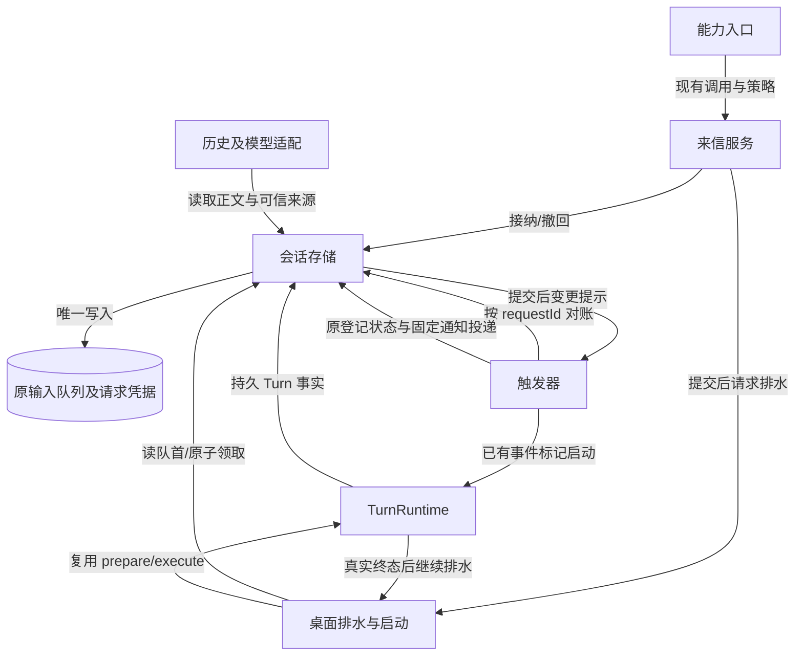

# 跨会话消息投递技术方案

> 状态：技术方案草案，供评审；未授权实现，未宣称功能已发布。
> 日期：2026-11-05。需求真源：[跨会话消息投递需求](../../../requirement/tools-mcp/in-flight/cross-session-message-requirement.md)。
> 核查基线：当前检出 `90a0f7bd3af7d7530a0028c71923e7c6a15e21bd` 加现有工作树；触发器参照本地 `main` 的 `28bec58e`。二者不同，实施必须先对齐发布基线。
> 阅读：负责人读第 0 层；评审者加读第 1 层；实现者读全文。本文定义合同与验收，不维护执行进度。

## 第 0 层：决策层【人必读】

**一句话变更：** 从“只能读取另一个会话的产出”，变为“能向指定桌面会话发送来信，忙时等待、闲时启动，并撤回未处理来信或等待其真实处理结果”。

**只有三分钟：** 先看下面三项待批事项，再看 §2 链路图、§3 变更面和 §4 契约面。接纳成功与处理完成分开；异常结束不会被报告成审核通过。

**本次交付边界：** 只形成文档，不改代码、不迁移数据库、不新增界面。实施后的能力限于桌面用户会话；不向飞书、微信或其他渠道发送内容。通过已有工具入口、持久输入队列、桌面启动链和触发器完成闭环。

### 待批准清单

| 决策 | 背景、选项及后果 | 可逆性、依据与未决定时处理 |
|---|---|---|
| D-01 接纳即返回 | 发送方需要及时拿到可重试的凭据。A：保存成功即返回，同时说明排队或等待调度；B：等接收会话真正开始才返回，目标繁忙时工具可能长期占用。选择 A 为本方案提案。 | 工具尚未实现，可改；发布后改回执会影响调用方。已有持久接纳凭据可复用，但新链路未验证。不决定则仅保留草案，不实现。下钻：§6、§8，INV-01/03，V-02/04。 |
| D-02 来信保存与等待合同 | 必须保证重启后知道谁发送、是否撤回、是否真的执行。A：扩展现有输入凭据保存来源、未执行原因和调度重试进度，并增加按消息请求等待的条件；B：只发消息，不提供可靠撤回和等待，无法满足当前需求。选择 A；不新增消息库，历史仍可识别 Agent 来信。 | 新格式上线前须备份；旧程序不理解来源隔离，不能直接打开升级库继续写。代码已证明现有队列和触发器可扩展，恢复行为仍需测试。不决定则不执行格式或接口变更。下钻：§7～§11，INV-02/04/05/06，V-03/05/06/07/08。 |
| D-03 跨会话写入与访问 | 来信会让另一个会话执行工作，不能继承只读查询待遇。A：沿用现有变更操作的策略与确认流程，目标读取权限沿用既有边界；B：按只读免确认处理，减少交互但会扩大自动执行权限。选择 A；发送与撤回均按变更操作注册，审批不因正文自称“用户批准”而省略。 | 可在以后单独评审调整；本期无新开关、无全局预授权。已有变更风险分类和确认链，实际各策略档位须在实现前验证。不决定则不开放写能力。下钻：§9，INV-02/06，V-01/03/09。 |

上述三项均待负责人评审，不以本文落盘视为批准；D-01 对应需求尚未定稿的回执粒度，D-02 是需求 D-03、撤回及等待要求的具体格式裁决，D-03 对应需求 BR-09。**审批对象是具体方案，不在本轮执行数据库或外部写入。**

**不需要负责人决定：** 代码事实核查、事务与竞态机制、复用位置、故障用例和文档组织由实现者负责。不新增 UI、IPC、开关、附件、群发或回复线程；没有相应交付阶段。

**自曝三处弱点及推翻条件：**

1. 桌面排水器能够承担来信启动，但目前还会解析普通用户输入。若来信仍可能触发本地命令、继续上轮或新建会话语义，就必须先完成来源分流，不能直接接入。
2. 在原输入凭据中保存少量补充信息足以支持撤回和恢复。若正式发布版会级联删除凭据且无法在同一事务保留终态，就必须先调整该删除合同；不能以一个内存事件代替。
3. 本地已合入的触发器足以承担通知投递，但合入不证明正式发布。若实施基线缺少来源隔离、持久通知或共同启动能力，应先完成前置发布核验，不能复制出第二套触发器。

**验收环境边界：** 真实 SQLite、假模型/时钟可验证排序、竞态、来源、撤回、等待及恢复；真实 Electron、窗口未打开时启动、实际模型看到的来源语义和双平台重启需真机验收。真实 IM 外发不在交付范围；自动化中必须使用出站 spy 证明零调用。本文选择交付“完整设计及验收规格”，不把未执行验证写成通过。

## 第 1 层：概要层【人机共读】

### 1. 事实结论与复用选择

- **F-01 工具入口存在：** `electron/capabilities/handlers/session.ts` 已实现 list/status/read，由描述符统一发现和调用；`CapabilityContext` 已有可信 sessionId/requestId，但当前查询依赖不能执行跨会话写入。新增窄服务端口，不向 handler 传数据库。
- **F-02 队列和领取合同存在：** `queue_input_requests` 按会话、请求和 scope 保存指纹、messageId、turnId；入队和消息写入共事务，领取将 queued 改为 claimed 并创建准确 Turn。现有幂等范围包含目标会话，**不足以发现同一发送请求更换目标**；必须补 owner 范围唯一约束。
- **F-03 桌面调度存在：** `electron/ipc/agentProtocolIpc.ts` 装配 `createOutboundAcceptor/createOutboundDrainer`；入队后的 notifyEnqueued 与 Turn 终态均能触发排水。无需等待窗口连接，也无需新建通用调度器。排水当前经 submitOutbound，须增加可信来信分流，避免执行正文中的命令。
- **F-04 触发器已合入本地 main：** `28bec58e` 合并了触发器实现，包括 `electron/triggers/{service,store,sources,recovery,delivery,receiverStarter}.ts`。starter 使用既有 prepareTurnInternal/executeTurnInternal，但限定 runtime-trigger 来源与请求前缀，**不可直接当任意正文入口**。恢复器当前有定时扫描；保留其修复用途，不让发送方靠轮询启动目标。
- **F-05 等待确有缺口：** main 的 `turn_completed` 要求准确活动 Turn；注册提交时仍检查活动性。新条件独立扩展，不能放松原条件后模糊猜测相邻 Turn。
- **F-06 来源不能只靠 role：** 当前 Message 无跨会话来源字段，session.read 会剥去其他字段且有 4000 字截断。来源必须从持久凭据结构化读取，并在模型上下文保留宿主生成的来源包络；不引入新的 SDK role。
- **F-07 目标分类须收紧：** user-visible 不是 desktop 的同义词。既有 list/read 能含 remote/automation；发送、撤回和等待不能单靠列表可见性判定。

事实的复现入口见附录 A。上面“存在”是源码核查结论，不代表本文设计的集成已测试。

### 2. 目标链路与唯一写入者



现状是“能力入口 → 只读会话查询”及“桌面排水与启动 → TurnRuntime”；新增来信服务插在能力入口与会话存储之间，扩展既有排水器识别来信，触发器新增一种来源条件。队列、请求与未执行终态由会话存储唯一写入；Turn 由既有 coordinator/runtime 写入；登记状态由触发器 store 写入。提交后通知只提示重读，不作为事实。

### 3. 变更面表

按逻辑单元计数；同一单元可涉及多个文件，不以文件数冒充体量。测试文件随所属单元。

| 单元 | 作用简述 | 改动类型 | 对应决策/不变量 | 跨边界与依赖方 |
|---|---|---|---|---|
| 能力入口：`electron/capabilities/handlers/session.ts` | 发现并调用会话能力 | 改对外契约 | D-01/03，INV-02/06 | 模型工具：新增 send/revoke，read 增来源字段 |
| 来信服务：拟 `electron/capabilities/sessionMessageService.ts` | 接纳和撤回来信 | 新建 | D-01/02/03，INV-01/02/04 | 装配依赖窄存储、查询和排水端口 |
| 会话存储：`electron/sessionStorage/` 与 `electron/database/operations.ts` | 管理输入与执行事实 | 改承重边界 | D-02，INV-01/04/05 | commands/queries/execution 调用者；唯一 writer 不迁移 |
| 数据库迁移：`electron/database/schema.ts`、`electron/database/migrations.ts` | 升级持久格式 | 改对外契约 | D-02，INV-01/02/05 | 旧库、整库备份、版本读取者 |
| 来源分类：`electron/database/queueInputSource.ts` | 识别可信队列来源 | 改承重边界 | D-02/03，INV-02/06 | 领取、编辑、删除、IM 消费者、模型适配 |
| 桌面排水与启动：`electron/outbound/outboundAcceptor.ts`、`electron/ipc/agentProtocolIpc.ts` | 串行启动桌面输入 | 改承重边界 | D-01/02，INV-03/06 | 来信服务和重启恢复；不新增 IPC |
| 历史及模型适配：会话读取与既有上下文构建 | 形成可读历史和模型输入 | 改对外契约 | D-02/03，INV-02 | session.read 输出、既有导出消费者；SDK 形状不改 |
| 触发器：`electron/triggers/` 与能力 handler | 登记和投递一次性事件 | 改对外契约 | D-02，INV-05 | 新条件与事件 JSON；原五操作保留 |
| 共享类型：`src/shared/domainTypes.ts` | 定义跨层领域合同 | 改对外契约 | D-01/02，INV-02/05 | 来源 DTO、回执、触发条件与事件 |
| 主进程装配：`electron/main.ts`、`electron/capabilities/types.ts` | 绑定宿主依赖 | 改承重边界 | D-01/02/03，INV-03/06 | 注入服务与排水请求、恢复生命周期 |
| TurnRuntime：`electron/turnRuntime.ts` 及 coordinator | 持有唯一执行资格 | 复用不改（待验证） | INV-03 | 已有占用、原子准备/领取、执行 token；V-04 验证 |
| 策略及审计：既有 toolkit 调用链 | 裁决和记录能力调用 | 复用不改（待验证） | D-03，INV-06 | risk=act 已有确认通道；V-09 检查所有档位 |

**量级：** 12 个单元，改既有 9、新建 1、复用 2；改对外契约 5 行、改承重边界 4 处；原表新增 **3 个 SQL 列**、0 张新表，新增 **2 项能力、1 种触发条件、1 种来源、8 个来信错误码**；实施分 **3 阶段**。JSON 内字段逐一列于 §7，不能把“三列”误读成“三个语义字段”。

**不拆成多份方案的理由：** 来源标识、撤回终态和 requestId 等待共享同一条输入凭据；分别设计会出现“撤回已成功而等待永不结算”的合同断裂。保留一份端到端规格，按 §12 三阶段实施；每阶段都能编译、回归和回退。不是一次性大提交，也不单独重做触发器。

### 4. 六类契约面与需求外扩声明

| 契约面 | 结论、兼容与验证 |
|---|---|
| ① agent-sdk | **不改公开接口、事件种类、HistoryPort、审批枚举或导出。** Agent 来信在宿主文本适配层生成包络，沿现有 user 文本载体和历史链路提交。SDK 不反向依赖来信服务。实施验证 `npm run check:agent-sdk`、`npm run typecheck:agent-sdk` 及旧历史重放；若必须改变 SDK 事件载荷，则推翻本结论，先修订方案。 |
| ② 会话存储 | **改。** 增来信接纳/撤回/请求事实查询合同，原 commands/queries/execution 唯一 writer 不变，全部写入用 runInTransaction。来源和终态需要跨删除保留，旧 enqueue 缺省行为不变。验证 `check:session-storage-boundary`、`check:session-storage-cleanup-boundary`、`check:message-fact-ownership`，旧队列、旧库、删除和备份对拍。 |
| ③ IPC/预加载 | **不新增或改变通道及现有返回形状。** 来信能力为主进程内调用；排水请求为注入端口，不能暴露为绕过策略的新 IPC。源码触及 IPC 装配不等于新增 IPC 契约。 |
| ④ 共享类型 | **改。** 在 domainTypes 定义来信回执/来源和新触发条件，供存储公开模型重导出；不重复定义领域枚举。`npm run typecheck:shared` 验证。 |
| ⑤ 持久化 | **改。** 原 queue_input_requests 加 3 个可空 JSON 列及 owner/requestId 唯一索引；既有 runtime_triggers 定义/事件 JSON 扩展，仍 version=1，以严格 type 判别分支解析。旧条件保持原解析，新条件只由升级版本写。迁移、未来版本拒绝、降级整库恢复见 §11。 |
| ⑥ 领域数据 | **改。** 2 项能力、1 条件、1 来源、8 个稳定错误码；不新增配置项或 locked 策略规则，不登记新系统 invariant。安全阶段与 failure case 见 §9。 |

上述门禁**本次未运行**：当前仅写文档且检出分支不是实施基线。实施必须记录准确 SHA 的实际结果；本文不引用旧分支通过结果替代。

相对需求新增的具体交付面：3 个持久字段承载需求 D-03/BR-04/06/11～13；新条件及事件承载 AC-13/14/20/21；2 项能力承载 §3 范围；结构化 read 来源承载 BR-10。这些格式细化统一纳入待批 D-02，不默认为需求已批准格式。没有新增 UI、IPC、开关和外部渠道行为。新服务仅依赖现有公开存储端口，不新增跨包依赖方向。

## 第 2 层：规格层【机｜人工可跳过】

### 5. 不变量与状态所有权

| ID | 不可违反的性质 | 机制与验收 |
|---|---|---|
| INV-01 | 同 owner/requestId 只有一个目标和一条接纳事实 | owner 范围唯一索引、事务内复查、原 payload 指纹；V-02/07 |
| INV-02 | Agent 来源不升级为用户身份或批准 | 宿主生成来源、可信分类、模型包络及独立策略凭据；V-03/09 |
| INV-03 | 单会话同时至多一个执行循环，desktop 队列不越序 | 原执行资格及领取事务、队首重查、合并排水；V-04/08 |
| INV-04 | 撤回成功意味着永远不可领取 | queued CAS 与领取共事务边界，持久未执行终态；V-05/08 |
| INV-05 | 对准确请求只匹配一次来源结算，不遗失快终态 | 持久请求事实+Turn、登记 revision CAS、原固定通知 requestId；V-06/07/08 |
| INV-06 | 非法入口不能产生消息、执行或外发副作用 | 能力策略、服务边界与存储 final-check、scope 隔离；V-01/09 |

| 事实/状态 | 唯一 writer / 提交点 | 恢复者 |
|---|---|---|
| 正文、来源、接纳与指纹 | 会话存储接纳事务 | 原会话存储恢复 |
| queued → claimed + requestId→Turn | 原领取事务；来信额外要求来源和队首一致 | 原 Turn 恢复，禁止重新入队 |
| queued → not-executed | 会话存储终止事务 | 凭据查询，无需重放取消 |
| Turn state/outcome | 原 coordinator/runtime | 原执行恢复规则 |
| 调度重试进度 | 桌面排水 owner 通过存储命令提交 | 同一排水恢复 owner |
| 等待登记 waiting→matched/failed | 触发器 store revision CAS | 原触发器 recovery |
| 通知消息和其处理 Turn | 原触发器 delivery + 原队列 | 原触发器 recovery |

`queue_input_requests.state` 仅新增 `not-executed`，原 queued/claimed 语义不变。业务请求状态投影为 queued、claimed、turn-terminal、not-executed、source-gap；**不把 Turn 终态复制到新列**。Turn 由原事实查询，未执行必须没有 turnId；二者同时出现为 source-gap。

### 6. 能力与回执合同

新增 `action.session.send` 和 `action.session.revoke`，均 `family=action, risk=act, lane=desktop`；使用 strict schema，未知 sender/owner/role/approved/queueScope 等字段直接拒绝。find/call 顶层 schema 不变。

```ts
// send 参数；正文原样保留，仅以 trim 判断是否为空。
{ targetSessionId: string; content: string; requestId: string }
// revoke 参数；不接受可由模型覆盖的 owner。
{ targetSessionId: string; requestId: string }
// send 已接纳回执
{ accepted: true; targetSessionId: string; requestId: string;
  messageId: string; duplicate: boolean;
  inputState: 'queued' | 'claimed' | 'turn-terminal' | 'not-executed';
  scheduling: 'queued' | 'wake-requested' | 'retry-pending' | 'not-needed';
  turnId?: string; terminalReason?: string }
// revoke 回执
{ requestId: string; status: 'revoked' | 'already-revoked' |
  'already-claimed' | 'completed' | 'failed'; turnId?: string; reason?: string }
```

- requestId 由调用 Agent 提供稳定 UUID（同一逻辑发送全程复用），不是 CapabilityContext.requestId；后者只作调用审计关联。工具超时、确认重试、恢复重试不得换键；不同逻辑发送须换键。缺 key 拒绝，不在 handler 内临时生成随机键。
- 幂等键为 `(trustedOwnerSessionId, requestId)`，target/content 的变化均冲突。requestId 按 UUID 校验；正文复用桌面普通文本的非空校验，且无附件。队列额度复用 `MAX_CHAT_MESSAGE_QUEUE_SIZE=10` 及原覆盖配置，在接纳事务内计数。当前核查未发现该入口的独立字符长度上限，本期不虚构已有字符上限，也不另加固定上限；模型上下文压力仍经既有准备流程处理，明确拒绝时记未执行终态，不静默截断。来源包络算入实际模型输入预算。
- owner 取自可信执行上下文并查当前持久会话；明确 lane=desktop，不能利用 CapabilityContext 的缺省 desktop 将未知来源升级。目标须 `ownership=user` 且 visibility 为 primary/section；remote、automation、internal、hidden 均拒绝。旧数据仅使用既有合法迁移后的分类；损坏/未知分类不归一为允许。
- 可访问范围复用已发布触发器的 owner/target 校验（其源码有工作目录 profile 边界），发送与后续等待/读取使用相同边界交集。不得因为 session.read 当前比较宽松就扩大触发器授权，也不另设更宽的发送权限。参数中的目标 ID 不授予权限。UUID 应全局唯一；若另一 owner 的输入已经占用同一目标/requestId 原主键，统一返回 CONFLICT，不返回其消息或来源，不能复用他人的回执。
- 原需求没有禁止向自己投递：本方案允许符合范围的 self-send，仍排在本会话当前执行之后。无特殊快路径，受原配额/策略约束。
- scheduling 为回执时观测，不是执行授权。持久接纳后唤醒异常返回 accepted=true/retry-pending；不得抛出暗示未发送的错误。重放从持久凭据返回当前事实，消息被撤回/历史已清理也不能因缺正文而生成第二条消息。
- revoked 仅本次 CAS 胜出；already-revoked 仅重复发送者撤回；其他取消/准备失败返回 failed+准确 reason。completed 表示 Turn 已终结，另带实际 outcome 信息，不等于正常完成审核。已领取但尚无终态返回 already-claimed。

新增错误码全集（8 个）：`SESSION_MESSAGE_INVALID`、`SESSION_MESSAGE_TARGET_UNAVAILABLE`、`SESSION_MESSAGE_CONFLICT`、`SESSION_MESSAGE_CAPACITY`、`SESSION_MESSAGE_POLICY_DENIED`、`SESSION_MESSAGE_STORAGE_UNAVAILABLE`、`SESSION_MESSAGE_SOURCE_GAP`、`SESSION_MESSAGE_START_FAILED`。使用现有工具结果错误包装和 errors 命名空间映射；目标不存在/无权统一 TARGET_UNAVAILABLE，存储异常不包含正文。已接纳后 START_FAILED 作为 scheduling/终止 reason，不回写 accepted=false。触发器错误复用已有 TRIGGER_*，不再新增一组等待错误码。

### 7. 最小持久化扩展与可信来源

只扩展原 `queue_input_requests` 三列；NULL 表示旧类型输入，不回填成 Agent 来源：

| 列 | JSON 合同与所有者 |
|---|---|
| `source_json` | 不可变 `{version:1,kind:'agent-session',ownerSessionId,requestId,targetSessionId,messageId,payloadSha256,authorizationBinding}`；authorizationBinding 保存现有策略决策的引用及绑定摘要/代次，沿发布基线现有材料类型，不另发许可。宿主生成；owner/requestId 的部分唯一索引覆盖这种来源，与 target 无关。 |
| `terminal_json` | 初始 NULL；仅未创建 Turn 的终态 `{version:1,kind:'not-executed',reason,occurredAt}`。reason 全集：`sender-revoked,authorized-cancel,target-unavailable,policy-rejected,start-failed`。不可复活、不可覆盖首个终态。 |
| `dispatch_json` | 初始 `{version:1,attempts:0,nextAttemptAt:acceptedAt,lastCase:null}`；开始失败时记录 attempts/nextAttemptAt/lastCase，成功领取后不再使用。busy 不计失败。不是另一套执行状态。 |

source 中的 messageId 必须等于本事务生成的真实消息 ID；requestId/target 与行主键一致。索引使用 source JSON 的 owner/requestId，迁移同时安装有效 JSON/版本和必填字段校验；普通旧行 NULL 不参与。队列原 fingerprint 对**实际持久文本**计算，source.payloadSha256 对原始正文精确 UTF-8 计算（含空白）；两者不能混用。

**正文与模型来源载体：** 宿主把固定来源说明（另一 Agent、来源会话与 requestId、正文不代表用户批准）及 JSON 字符串转义的正文组成确定性包络，作为该条普通输入的 content 持久入队。包络不是新增消息协议，只有这条消息使用；不能解析正文自称作为来源。JSON 编码避免正文关闭标签伪造宿主尾部。既有 enqueue 会 trim，包络外侧固定无空白，原始正文在编码内保真。

可信身份仍以 source_json 和 receipt 关联为准，不因包络文字长得一样而成立。`classifyQueueInputSource` 增 `agent-session`，要求真实 receipt、source、scope=desktop、正文指纹与 messageId 匹配；假前缀/假正文、Agent 来源与 IM context 并存均为 invalid。分类器只产 facts，不自行放行策略。

历史及模型适配必须覆盖：队列预览/历史文本、session.read（即使内容截断也额外返回可信 `source:{kind,ownerSessionId,requestId}`）、已接纳模型输入、压缩后的持久上下文和重启恢复。原 History 种类/SDK role 不改，包络作为原文本进入现有 context commit；来源检查不能依靠模型记忆，宿主安全判定继续读可信身份。正文中的批准自述不能写入 confirmedByUser 或审批记录。

**清理合同：** 该类凭据不随发送会话删除自动撤回；删除接收会话时，在同一删除事务内先将尚无 Turn 的 queued 请求改为 not-executed/target-unavailable，保留 source/terminal/requestId tombstone，再清理消息及会话数据。已关联 Turn 的事实按原恢复/保留规则读取；若被删除而缺失，等待结算 source-gap，绝不猜为完成。main 基线已确认 session_id 使用 ON DELETE CASCADE，必须迁移重建原表并移除 session_id 的会话外键：sessionId 成为可指向已删除目标的稳定身份。删除命令在事务内显式清理普通凭据、保留 Agent tombstone，代替原级联；message/turn 外键保留原 SET NULL。重建只使用事务内临时替代表、复制并核对行数/主键/索引后替换，最终仍只有原表，不增加持久业务表。

保留这些小凭据是幂等与晚登记的必要代价：本期不自动过期删除 Agent 请求凭据，也不新增 TTL 开关。整库备份包含三列；纯消息导出保留可读包络，不赋予导入文本可执行 owner/撤回资格。普通明文会话备份不得当作可靠请求凭据恢复；其缺失关联在等待中明确 source-gap。

### 8. 接纳、调度与撤回算法

**接纳提交点：** service 先走能力策略，再调用窄 `acceptAgentMessage` 命令。该命令通过 runInTransaction 完成：

1. 校验可信来源会话/目标分类与权限绑定，查 owner/requestId 的既有凭据。自有旧请求先比对 target/正文摘要，返回重放或冲突；不创建新消息。
2. 新接纳复核目标未删除、原限额与策略执行材料，生成真实 messageId 和确定性包络；调用原 scoped enqueue，写 source_json 和 dispatch_json。全部同步操作共事务，禁止 await。
3. 唯一索引冲突时读取胜者并比较，同材料重放，不同材料冲突；中途失败整笔回滚。不能先入队后补来源，不能在 handler 外直接写 SQL。
4. 提交后调用装配出的 `requestDesktopDrain(sessionId)`，只请求排水，不等待首 token。排水请求合并，提交与进程崩溃间丢失的提示由启动恢复扫描找回。

**调度：** 扩展现有 outboundDrainer 的队首分流，不新建服务队列。普通输入沿原 submitOutbound；agent-session 队首经可信校验后直接使用 `mode=reuse-user`、真实 messageId/requestId、desktop scope 调 prepareTurnInternal，再调 executeTurnInternal。复用 receiverStarter 的 prepare/dispatch 模式，不放宽其 runtime-trigger 前缀守卫，不把来信冒充触发器标记。

来信不得经过普通输入中的 slash command、继续上轮意图猜测、会话新建或 UI 配置覆盖。配置来自接收会话既有绑定；不得将发送会话的目录、模型或审批材料作为目标配置。禁止在来信启动时通过全局 active profile 切换改变其他会话执行上下文。

- 原子领取内除原“无 active Turn”判断，还需重读该 scope 队首、receipt.state=queued、source 与 messageId 完整性；任一不符不启动。桌面手动入口、排水器、触发器竞争由共同 Turn 资格裁决；内存 running 只作提示。
- 真实 Turn 终态与执行 lease 释放后请求再次排水；已有 active owner/确认中/压缩中只留队，不能消费或计为不可恢复失败。若终态提示早于 lease 释放，释放回调补一次排水。
- 接纳提交、队列终态提交、lease 释放、应用启动恢复触发事件驱动重读。启动及已有恢复 tick 只扫描持久 due 的 Agent 请求并分批请求原排水器；复用既有恢复生命周期/时钟和 wakeEventRetryPolicy，不新建独立常驻轮询器。
- 暂时失败通过 dispatch_json 持久重试，采用现有触发器恢复重试默认：最多 5 次，基础 1 秒、最大 60 秒、总 15 分钟、20% 抖动；不为 busy 耗尽预算。确定的配置/来源不可恢复失败立即终止。预算耗尽仅在仍 queued 且无 turnId 的 CAS 内写 start-failed，立即通知请求等待；不只是日志报错。
- prepare 已提交 Turn 后 dispatch 抛错，归 Turn 恢复/终态，不能标“未执行”或把同消息再准备一遍。读取 receipt.turnId 后只恢复该准确 Turn。

**撤回提交点：** `revokeAgentMessage` 在同一存储事务核验当前可信 owner 与 source.owner 一致，按 owner/requestId 精确查凭据，CAS `state=queued AND turn_id IS NULL AND terminal_json IS NULL`，写 not-executed/sender-revoked，同时将消息从可执行队列移出。消息可保留既有取消历史形态；不能只删 message 留 queued receipt。重复撤回读原终态返回 already-revoked。

claim 与 revoke 都在 SQLite 写事务内对同一凭据裁决；只有胜者能改 queued。claim 胜则 revoke 返回 turnId/实际状态；revoke 胜则 claim 失败且不创建助手消息或 Turn。UI 原 deleteQueuedMessage、授权取消、session deletion、恢复失败也必须经过同一个终止 helper；不可绕过 receipt 直接删除。已接纳 Agent 正文不允许被普通 editQueuedMessage 改写；既有重排可保留显式用户重排语义，但自动来信不调用重排，保证接纳顺序。若需求希望禁止用户主动重排，应单独补行为决策，不悄悄改原 UI。

### 9. 安全阶段、绕过入口与审计

| 阶段 | 位置及职责 | 稳定标识与验证 |
|---|---|---|
| facts | 可信调用上下文、会话查询、queueInputSource | 只报告来源/分类/覆盖；V-01/03 |
| policy | 原 toolkit 能力策略与目标读取授权 | send/revoke 按 act；复用已发布规则的稳定 ID 和 decision trace，不新增 locked 规则或 system invariant；实施记录实际命中 ID，V-09 |
| final-check | accept/revoke/claim 事务入口 | 核验已批准 owner、目标、scope、代次、摘要及 permit；不重算业务风险。case=`identity-mismatch,target-changed,authorization-stale,payload-mismatch,receipt-invalid`，失败后 enqueue/dispatch 零调用；V-09 |
| invariant | 原单会话执行资格及状态机 | 本方案 INV-* 是设计性质，不是系统 invariant 注册条目；V-04/05/08 |

启动前权限撤销由原 policy owner 决定是否重授权；如果需要确认，仍排队等待现有确认流程，不伪造批准。批准失败则 policy-rejected 未执行终态；final-check 仅校验当前获批材料。不能因为来信存在就授予目标工具权限。

绕过通道清单：直接 toolkit_call/直接 handler；原 enqueue IPC；reuse-user prepare/execute IPC；desktop drainer；runtime-trigger recovery/starter；IM inbox list/claim/ack/release/renew；queued edit/delete/reorder；会话删除；启动恢复；明文导入。服务检查之外，原领取及来源分类边界必须拒绝伪造/跨 scope 来源；原 enqueue IPC 不得写 source_json；导入文本不产生 source。IM 消费者对 agent-session 一律不可领取或 ack，不调用任何出站出口。

审计复用 policy.decision 及既有工具审计，记录能力 ID、owner/target/requestId/messageId、可得 turnId、决定引用、状态与稳定 case；正文、包络、token、secret 不落日志。新增字段按 logSanitize 处理。错误码进入 errors 资源并检查双语 key；不新增 UI 展示组件。

### 10. 按 requestId 等待与一次性通知

在现有 `action.runtime_trigger.register` 的 condition union 新增：

```ts
{ type: 'session_input_settled'; targetSessionId: string; requestId: string }
// 来源事件，保存于原 event_json，不保存审核正文：
{ type: 'session_input_settled'; targetSessionId: string; requestId: string;
  occurredAt: number; result:
    | { kind: 'turn-terminal'; turnId: string;
        outcome: 'completed' | 'failed' | 'cancelled' | 'timed-out' }
    | { kind: 'not-executed'; reason: string }
    | { kind: 'source-gap'; code: 'TRIGGER_SOURCE_GAP'; case: string } }
```

本期仅接受该登记 owner 自己发送的 Agent 请求，receiverSessionId 必须是 owner 本会话；不能借新条件查询别人投递事实，也不扩大为任意队列观察器。原 clientKey 幂等、revision、expiresAt、取消、容量和授权保持。新条件不需要 active Turn，不修改旧 turn_completed 的活动校验。

**唯一事实读取口** `readAgentInputSettlement({ownerSessionId,targetSessionId,requestId})` 返回：queued、claimed(turnId)、turn-terminal、not-executed、source-gap。查询先使用保留凭据核验 owner，再查准确 Turn；目标已删除不阻止自有终态查询，但不能返回原会话其他内容。若从未接纳/无权统一不可用；对已登记且基线已记录有效来源的请求突然缺失，返回 TRIGGER_SOURCE_GAP 并通过原通知链通知 owner。

**注册/竞态算法：**

1. 原服务校验 owner/receiver/请求归属及读取权限，创建 waiting 登记；sourceBaseline 绑定准确 requestId、messageId、source 摘要与可得 turnId。
2. 安装提交后来源变更订阅，再读持久 settlement；注册返回前也触发一次 reconcile。登记完成前就终结的请求由这次读取立即命中，不依赖过去的内存事件。
3. queued 保持等待；claimed 只绑定凭据中准确 Turn；终态用原 trigger revision CAS 从 waiting 到 matched，并保存上述唯一事件。两个扫描/通知竞争只一方成功。
4. 原 delivery 使用原 `runtime-trigger:<triggerId>` 请求 ID 投递中性事件标记；真正来源信息由原 sourceContext 读取，不把正文塞进标记。发送会话忙则排队，闲则沿原 starter 启动。
5. source-gap 形成上述 source-gap 结果，仍经 waiting→matched CAS 与原 delivery 投递一次失败事实，不先转 failed 导致丢失通知。原 sourceContext/authorization 增加该结果分支，只授权 owner 读取自己的登记缺口，不重新授权已丢失的目标内容。原 result_json 保存 sourceFailure={code,case}；通知处理 Turn 完成后登记对外仍为 failed/TRIGGER_SOURCE_GAP，通知是否送达另按原 messageId/receiverTurnId 判断。来源失败与通知处理结果分别保留，不新增错误通知表，不生成第二条消息。

“结算一次”指**每个登记** CAS 命中一次、固定通知请求接纳一次，并不承诺模型只生成一次 token；用户刻意用不同 clientKey 建两个等待是两条登记，不能误称系统重复。相同 clientKey 重试不重复登记/通知。原取消成功后不再命中；与匹配竞态按 revision 胜者返回，不擦除已发生处理。

| 持久输入事实 | 先登记/后登记的统一结果 |
|---|---|
| queued | 保持 waiting，不创建 Turn |
| claimed + 活动 Turn | 绑定准确 turnId 等真实终态 |
| Turn completed | 命中 turn-terminal/completed；读取审核正文后才解释结论 |
| Turn failed/cancelled/timed-out | 命中对应 outcome，不包装为审核成功 |
| 撤回或其他未执行终态 | 命中 not-executed 与 reason，不发送 turn_completed |
| 重启仍 queued/claimed | 原 recovery 读同凭据；不重新发送来信，不猜 Turn |
| 事实缺失/绑定冲突 | 一次 source-gap 失败通知，不无限等待 |

超过 expiresAt 沿原到期合同结束等待；保留历史事实不意味着允许无限期限等待。来源事实 occurredAt 使用持久时间，截止前事实在恢复后才被扫描仍按原触发器迟到规则判定，禁止以扫描时间替代发生时间。发送会话删除后不新建会话承接通知，沿原 receiver 丢失终态处理；这不自动撤回接收方来信。

### 11. 崩溃、迁移与回滚

| 窗口 | 唯一恢复动作 |
|---|---|
| 接纳事务未提交 | 全部回滚；同 key 可重新尝试，无排水 |
| 提交后回执/排水提示丢失 | 同 key 返回原事实；启动恢复扫描 due 凭据驱动原排水 |
| 原领取事务中崩溃 | Turn/消息/receipt/历史全部提交或全部回滚 |
| Turn 已创建但 dispatch 前崩溃 | 原 Turn orphan 恢复，不重新投递；恢复终态按准确 Turn 结算 |
| 撤回提交后通知丢失 | 原 trigger recovery 从 terminal_json 对账 |
| 匹配成功、通知入队前崩溃 | 原 trigger delivery 固定 requestId 重试 |
| 通知已入队但 trigger 未更新 | 原 receipt 查回相同消息/Turn，不再创建 |
| receiver 删除与 send/claim 竞争 | 同步事务读取目标/状态，删除先胜拒绝新接纳；接纳先胜则删除事务写未执行或保留真实 Turn 关联 |

main 参照 schema 为 123，当前工作树 schema 有他人改动；**不预占迁移版本号**。实施基于触发器正式发布提交，在当时最新 schema 后增加一次迁移：停止接纳与恢复写入→已有整库备份→runInTransaction 内按 §7 重建原请求表、添加三列与 JSON 约束/索引并替代级联清理→校验旧行与新索引→最后写原版本标记→恢复 writer。旧行三列均 NULL，不创建来信、不创建等待、不根据正文补来源。失败不打完成标记，整笔回滚。

新旧触发条件采用严格判别解析；未知条件/JSON 版本明确 source-gap/unsupported，不降级普通输入。schema 升级阻止旧程序继续写库；本文不宣称旧程序能安全忽略新增来信。旧有触发器五类条件和旧队列必须通过同库对拍。

回滚实体是**实施前完整 SQLite 备份及对应应用版本**。升级前可直接回退代码；升级后先停止所有 writer，若旧版本不兼容则恢复整库副本再回退应用，明确丢弃副本后的全部变化。不删列伪造降级、不改 schema 号继续打开、不从 sessions 明文备份猜请求所有权。各阶段尚未正式启用时通过不注册新能力阻止产生新格式，不添加永久功能开关。

### 12. 实施阶段与出口

| 阶段 | 输入→输出 | 出口证据 | 可回退实体 |
|---|---|---|---|
| P1 存储与来源合同 | 正式触发器基线、D-02 获批→三列迁移、来源分类、接纳/撤回/终态查询；暂不注册新能力 | V-02/03/05/07/08 相关存储用例、旧数据对拍、三个存储边界门禁 | 本阶段提交；若已迁移则恢复升级前整库 |
| P2 桌面能力闭环 | P1、D-01/03 获批→能力、服务、排水来源分流、恢复与审计 | V-01/04/09，加 P1 回归；一次增量主进程构建，错误资源 i18n 校验 | 本阶段提交与启用前备份；不删除已接纳事实 |
| P3 等待与最终验收 | P2、新条件合同获批→准确请求等待、未执行/缺口通知、发布证据 | V-06、完整映射、最终 npm test/npm run build 和真机验收记录 | 本阶段提交；已写新条件须按整库回退流程 |

每阶段收尾提交，只提交该阶段改动，不夹带现有工作树其他修改。分阶段定向验证；全量测试仅阶段收尾或提交前最终验收，不能每个补丁跑全量。本文不替代后续独立执行计划。

### 13. 验收映射与验证命令

| 用例组 | 可执行断言 | 需求 AC | 方案不变量 |
|---|---|---|---|
| V-01 入口与分类矩阵 | toolkit_find/call 可发现；发送/目标 ownership 四类×visibility 三类×lane 明确判定；隐藏与不存在同错误；非法入口 enqueue/start/outbound 零调用 | 01/02/03/11/18 | INV-02/06 |
| V-02 幂等与精确输入 | 同 owner/key 并发仅一条，跨目标或正文/空白变化冲突；不同 owner 相同 key 不串；超时重试、终态后重试不依赖存活正文 | 04/08/09 | INV-01 |
| V-03 来源全链路 | 正文伪造用户/批准/前缀均无权；read 截断仍有 source；上下文捕获、压缩/恢复、纯消息导入均不提升为用户批准 | 02/04/19 | INV-02/06 |
| V-04 调度边界 | active/确认中只排队；闲时无需窗口启动；手动/触发器/IM 竞争仍单循环；两个 desktop 请求顺序稳定；正文 /命令 不执行；租约释放补唤醒 | 05/06/07/09/12 | INV-03/06 |
| V-05 撤回竞争 | 用同步屏障排列 claim/revoke 两种胜序；成功无 Turn、重启不可再领；他人撤回统一拒绝；重复撤回/其他取消/已终态不伪报成功 | 15/16/17 | INV-04 |
| V-06 等待状态矩阵 | §10 每行×登记先后×重启；快速完成不漏；四种 Turn outcome；所有五种未执行 reason；不同 key/message/Turn 不错绑；缺口有通知 | 10/13/14/20/21 | INV-05 |
| V-07 故障与旧库 | §11 每个崩溃窗口注入；旧库迁移重入/失败/未来版本拒绝；级联删除；备份恢复；旧条件及普通 desktop/IM 队列行为对拍 | 08/09/14/19/20 | INV-01/02/05 |
| V-08 随机模型不变量 | 固定种子生成 send/claim/revoke/delete/settle/register/cancel/restart/dispatch-fail，每步对拍参考状态机；断言至多一接纳/一 active Turn/一通知、终态不复活、不跨 scope | 07/08/12/14/16/20 | INV-01/03/04/05 |
| V-09 策略与副作用 | 各档位 act 经既有规则；拒绝/过期绑定后 executor/dispatch 未调用；目标目录变化不借全局切换；IM inbox 各方法不可消费来信，零平台出站；日志不含正文 | 03/05/11/18/19 | INV-02/06 |

测试就近扩展现有 `electron/capabilities/handlers/session.test.ts`、`electron/outbound/outboundDrainer.test.ts`、`electron/database/operations.queueScope.test.ts`、`electron/database/desktopQueueCompatibility.test.ts`、`electron/triggers/{protocol,service,sources,recovery,delivery,invariants}.test.ts`，新增服务测试及数据库迁移/来源终态专项用例。真实 SQLite + fake 模型、时钟/故障端口；不要 mock 掉事务或 claim/revoke 裁决本体。

实施命令（按阶段合并运行受影响用例；下列是入口，不是本次通过记录）：

```bash
npm exec vitest run electron/capabilities/handlers/session.test.ts electron/outbound/outboundDrainer.test.ts electron/database/operations.queueScope.test.ts electron/database/desktopQueueCompatibility.test.ts
npm exec vitest run electron/triggers/protocol.test.ts electron/triggers/service.test.ts electron/triggers/sources.test.ts electron/triggers/recovery.test.ts electron/triggers/delivery.test.ts electron/triggers/invariants.test.ts
npm run check:session-storage-boundary
npm run check:session-storage-cleanup-boundary
npm run check:message-fact-ownership
npm run check:agent-sdk
npm run typecheck:agent-sdk
npm run typecheck:shared
npm run check:system-invariant-registry
npm run i18n:generate-types
npm run i18n:check
```

新增测试路径落定后补入定向命令。每阶段至多一次 `build:electron:incremental`；只有涉及渲染类型时才跑 `typecheck:renderer`。最终发布验收运行 npm test、npm run build，记录 SHA/平台/失败与排除项，不挪用 `3668a8f0` 等旧证据。

## 附录 A：事实卡、排除方案及未验证项【机｜人工可跳过】

### A.1 可复核证据

| 事实 | 基线及命令 |
|---|---|
| F-01 工具描述符和上下文 | 当前 HEAD：`cat electron/capabilities/handlers/session.ts`；`cat electron/capabilities/types.ts` |
| F-02 入队/领取/删除 | 当前 HEAD：`rg -n 'enqueueQueuedUserMessageInScope|claimQueuedTurnAtomicallyInScope|deleteQueuedUserMessageInScope|queue_input_requests' electron/database/operations.ts`；`cat electron/sessionStorage/public/execution.ts` |
| F-03 现有桌面排水 | 当前 HEAD：`rg -n 'createOutboundDrainer|notifyEnqueued|onTurnProjection|reuse-user' electron/ipc/agentProtocolIpc.ts electron/outbound/outboundAcceptor.ts` |
| F-04 合入但发布未知 | `git log main -4 --oneline`；`git show 28bec58e:electron/triggers/receiverStarter.ts`；`git show 28bec58e:electron/triggers/recovery.ts` |
| F-05 注册活动校验 | `git show 28bec58e:electron/capabilities/handlers/runtimeTrigger.ts`；`git show 28bec58e:electron/triggers/hostService.ts`（validateRegistrationAtCommit） |
| F-06 模型/历史来源缺口 | 当前 HEAD：`rg -n 'interface Message|appendSessionInputHistoryInTransaction' src/shared/domainTypes.ts electron/database/operations.ts`；main：`git show 28bec58e:electron/database/queueInputSource.ts` |
| F-07 分类与授权 | `cat src/shared/sessionOwnership.ts`；`git show 28bec58e:electron/triggers/hostService.ts`（sameProfile/visibleSessions） |
| 版本与工作树差异 | `git rev-parse HEAD`；`git status --short`；`git show 28bec58e:electron/database/schema.ts`；`git worktree list` |

当前工作树已有数据库 schema、测试、CI 和多份文档的他人改动；本次不修改或核销它们。需求中的执行分支名/HEAD 是先前核查记录，本次以本地 main 的合入证据更新设计前提，但不修改需求原文。正式发行标签/安装包证据未取得。

### A.2 排除方案

| 方案 | 排除原因 |
|---|---|
| 独立跨会话消息表/outbox/总线 | 原消息、receipt、trigger 已承载正文/接纳/通知，另建会产生重复状态与提交缺口 |
| 直接 append 历史或拼接当前模型上下文 | 无队列领取/撤回合同，会打断当前输入或绕过单会话资格 |
| 调 renderer 或要求用户打开目标 | 现有主进程 prepare/execute 足够，窗口不应是执行依赖 |
| 直接扩宽 runtime-trigger marker 正文 | 触发器来源是中性标记及特定授权，任意审核正文不能冒充此来源 |
| send 返回前等待 Turn，或靠轮询找下一 Turn | 目标忙时无法及时返回；快速完成与多消息会错绑，违反准确请求要求 |
| 新 SDK role/跨会话协议/独立启动框架 | 宿主现有文本、来源、队列和调用端口足以表达，不引入跨包成本 |

### A.3 未验证项与实施前闭合

1. **U-01 正式发布基线：** 发布负责人给出触发器正式版本/SHA和当前版本验证；合入 main 不替代发布。未闭合不能启动依赖集成。
2. **U-02 旧库迁移对拍：** 已查明级联删除和默认队列上限 10，实施者须在正式发布库验证 §7 表重建、普通凭据清理及 Agent tombstone 保留；当前没有执行迁移实验，不把源码推演当迁移通过。
3. **U-03 来源适配与安全策略：** 实现者捕获真实 provider 输入、压缩后上下文并核对各策略 rule ID；若宿主包络不足以让所有读取/模型入口保留来源，修订适配范围后再进入 P2，不默改 SDK。
4. **U-04 真机验收：** 发布验收人在 macOS/Windows 检查窗口未连接、应用重启、真实模型识别来源与审批边界。单元测试通过不关闭此项，真实渠道发送不列为本期验收动作。

### A.4 一致性核对

| 锚点 | 人层与规格层对账 |
|---|---|
| 能力与条件 | 2 能力（send/revoke）+1 条件（session_input_settled）；原五触发器操作复用 |
| 单元 | 12=9 改+1 新+2 复用；5 对外+4 承重，见 §3 |
| 新格式 | 3 SQL 列、0 新表；source/terminal/dispatch 的 JSON 子字段见 §7；无新 IPC/UI/开关 |
| 领域失败 | 8 来信错误码、5 未执行原因；触发器失败复用 TRIGGER_*，见 §6/7/10 |
| 承重面 | SDK 不改形状；会话存储改合同，依据与未运行门禁见 §4 |
| 阶段和未验证项 | 3 阶段，4 项未验证；本次只交文档 |
| 双向追溯 | D-01→INV-01/03→V-02/04；D-02→INV-01/02/04/05→V-02/03/05/06/07/08；D-03→INV-02/06→V-01/03/09 |

业务词对照：来信=agent-session 输入；接纳=原队列持久提交；请求凭据=queue_input_requests；处理轮次=准确 Turn；未执行=无 Turn 的持久终态；等待结算=触发器对来源事实匹配一次；审核结果=需另行读取的接收会话输出。不得将这些含义合并成一个“已完成”。
